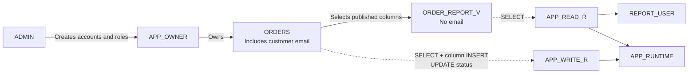

# Managing Users, Schemas, and Data Access Privileges

## Objectives and Scope

In the **Autonomous Database** chapter of the **CLOUD_PROVIDERS_ORACLE** module, data authorization remains work that must be explicitly designed even though the service automates many operational tasks. An application being able to connect to a database does not mean it only accesses the data it is supposed to.

This lesson uses **Autonomous Database Serverless** as the reference environment. The product name in documentation or the Console may appear as Autonomous AI Database. Options for Dedicated, database versions, and identity integrations may differ; verify against the actual environment before applying.

After this lesson, learners will be able to:

- Distinguish OCI IAM users, database users, schemas, and database roles.
- Separate schema-owning accounts, application runtime accounts, and reporting accounts.
- Grant object/column privileges, restrict data via views, and verify effective privileges.
- Identify the impact of quotas, Database Actions, PL/SQL, and connection pools on the privilege model.
- Execute the lifecycle of granting privileges, rotating credentials, revoking, locking, and cleaning up lab accounts.

The SQL snippets are instructions for learners to run in an authorized lab database. They have not been executed against a live tenancy in this article; all usernames, data, and expected outputs serve hands-on practice.

## 1. Identifying Identity at the Right Layer

A query request passes through multiple control layers:

```text
OCI resource management permissions
        ↓
Network path and secure connection configuration
        ↓
Database user authentication
        ↓
CREATE SESSION and account status
        ↓
Direct privileges, active roles, and data policies
        ↓
Objects/columns/rows the SQL statement is allowed to use
```

This is a verification model, not a claim that every SQL statement calls OCI IAM over the network.

| Concept | Scope | Example |
| --- | --- | --- |
| OCI IAM user/group | Manage and access OCI services via policies | Group allowed to view Autonomous Databases in a compartment |
| Database user | Identity authenticated when opening an SQL session | `APP_RUNTIME` |
| Schema | Namespace containing objects owned by a database user | `APP_OWNER.ORDERS` |
| Database role | Collection of privileges grantable to users or other roles | `APP_READ_R` |
| Connection service | Workload/connection serving policy of the database | Service chosen in the connection string |
| Application user | Business user managed by the application | Customer logging into an ordering site |

Permission to view a database in the OCI Console does not automatically grant `SELECT` on business tables. A resource principal used to call OCI APIs also does not automatically become an SQL account with read access across all schemas.

Autonomous Database supports IAM authentication integration when configured. When using this model, verify authentication setup, database mapping, and SQL privileges; creating an IAM group alone does not complete configuration. [Oracle: IAM Authentication with Autonomous AI Database](https://docs.oracle.com/en-us/iaas/autonomous-database-serverless/doc/manage-users-iam.html).

## 2. Users, Schemas, and the Role of ADMIN

### How Users and Schemas Relate

Each database user has a schema of the same name. For example, when creating `APP_OWNER`, tables created by this user in its own schema are qualified as `APP_OWNER.ORDERS`.

The users in the example reside in the same Autonomous Database; they are not three separate databases. A user can own zero tables while still reading objects in another schema if granted privileges.

A role is a collection of privileges—it is not an account you can log into with a password, and it is not a table owner.

### ADMIN Is Not SYSDBA

`ADMIN` is the provided administrative account for managing users and service-permitted functions. Oracle does not grant `SYSDBA` to `ADMIN`; granting privileges and accessing system schemas also have specific restrictions. Do not troubleshoot authorization errors by trying to log in as `SYS AS SYSDBA` like on a self-managed database. [Oracle: ADMIN User Roles and Privileges](https://docs.oracle.com/en-us/iaas/autonomous-database-serverless/doc/autonomous-admin-user-roles.html).

In the lab:

- `ADMIN` creates accounts, roles, and adjusts privilege settings.
- `APP_OWNER` creates tables/views and grants privileges on its objects.
- `APP_RUNTIME` executes permitted business operations.
- `REPORT_USER` only reads the published reporting dataset.

Do not use `ADMIN` as the application's JDBC credential. If an application runs as the schema owner, revoking DML privileges from a role will not restrict the owner's inherent privileges over its own objects.

## 3. Design the Privilege Model Before Running SQL

The lab simulates order data. Customer email is needed only by the order-processing workflow; reporting users only need order ID, amount, status, and creation timestamp.

| Identity | Required privileges | Operations withheld in lab |
| --- | --- | --- |
| `APP_OWNER` | Create tables/views in own schema; finite quota | Administer other users or system objects |
| `APP_RUNTIME` | Read orders, insert into allowed columns, update status | Change amount, delete orders, create tables |
| `REPORT_USER` | Read reporting view without email | Read base table directly, write data, create objects |
| `APP_READ_R` | `SELECT` on reporting view | Read privilege on base table |
| `APP_WRITE_R` | `SELECT` base table, column-scoped `INSERT`, `UPDATE` status column | `DELETE`, `UPDATE` total amount |

`APP_WRITE_R` allows reading email because the order-processing flow in this scenario requires it. If business logic does not need email, design another interface/view rather than keeping read access on the base table.



This diagram illustrates privilege relationships, not a data-copy pipeline. The view in the example queries the source table when accessed.

## 4. Preparing Lab Sessions and Credentials

Prerequisites:

1. An active Autonomous Database and an authorized `ADMIN` connection.
2. An SQL client configured with matching networking, TLS, or mTLS for the database.
3. The names `APP_OWNER`, `APP_RUNTIME`, `REPORT_USER`, `APP_READ_R`, and `APP_WRITE_R` do not yet exist in this lab.
4. A decision on who manages credentials and when lab accounts will be cleaned up after practice.

Example using SQL*Plus with a configured connection alias:

```text
sqlplus -L ADMIN@<ADB_TNS_ALIAS>
```

Let the tool prompt for the password; do not type passwords after the username on the command line. Replace the placeholder with the actual alias, without literal `<` and `>`.

If using mTLS, the wallet holding connection material must be protected, yet SQL privileges are still evaluated against the corresponding database identity. With walletless TLS, both database and client must meet support requirements; not every environment connects the same way. [Oracle: JDBC Thin Connections Without a Wallet](https://docs.oracle.com/en-us/iaas/autonomous-database-serverless/doc/connect-jdbc-thin-tls.html).

In each connection, run the identity verification query before modifying privileges or data:

```sql
select
  sys_context('USERENV', 'SESSION_USER') as session_user,
  sys_context('USERENV', 'CURRENT_SCHEMA') as current_schema,
  sys_context('USERENV', 'SERVICE_NAME') as service_name
from dual;
```

Use separate, clearly labeled connections for `ADMIN`, `APP_OWNER`, `APP_RUNTIME`, and `REPORT_USER`. An operation succeeding in the `ADMIN` connection does not prove runtime has permission to perform it.

## 5. Creating Users and Roles with Minimal Initial Privileges

### 5.1. Create Accounts in the ADMIN Session

The example below is for SQL*Plus; `ACCEPT`, `SET`, and `UNDEFINE` are client commands, not SQL statements to send as a block over JDBC.

```sql
set echo off
set verify off

accept owner_password char prompt 'APP_OWNER password: ' hide
create user APP_OWNER identified by "&owner_password";
undefine owner_password

accept runtime_password char prompt 'APP_RUNTIME password: ' hide
create user APP_RUNTIME identified by "&runtime_password";
undefine runtime_password

accept report_password char prompt 'REPORT_USER password: ' hide
create user REPORT_USER identified by "&report_password";
undefine report_password

grant create session to APP_OWNER, APP_RUNTIME, REPORT_USER;
grant create table, create view to APP_OWNER;
alter user APP_OWNER quota 20M on DATA;
```

Enter three distinct, random passwords meeting the current password policy. To avoid characters interfering with substitution in this example, use letters, digits, and `_`, `#`, `-`; avoid quotes and `&`. Do not save entered values in scripts or lab reports.

Oracle lets you create users from an SQL client with `CREATE USER`, then grant login permission with `CREATE SESSION`. If a user already exists, verify its owner and current configuration; do not blindly drop and recreate it just to keep running an example. [Oracle: Create and Manage Users on Autonomous AI Database](https://docs.oracle.com/en-us/iaas/autonomous-database-serverless/doc/manage-users-create.html).

### 5.2. Understand Quotas by Data Owner

`20M` is a small limit chosen by this lesson for the lab schema, not a production capacity recommendation. When `APP_RUNTIME` inserts rows into a table owned by `APP_OWNER`, space is allocated to the owner's segment; you do not need to grant tablespace quota to runtime just to fix a write error on the owner's table.

Distinguish:

| Setting | What does it allow? |
| --- | --- |
| `CREATE SESSION` | Open an SQL session |
| `CREATE TABLE` | Create tables in own schema per granted privileges |
| Quota on `DATA` | Allow storage allocation within the limit |
| `INSERT` on owner's table | Insert rows into the specified object |

Autonomous Database supports finite quotas. `UNLIMITED TABLESPACE` can override specific quota limits; inspect this privilege if a quota does not behave as expected. [Oracle: Manage User Roles and Privileges](https://docs.oracle.com/en-us/iaas/autonomous-database-serverless/doc/manage-users-privileges.html).

Storage quotas do not cap total cost: query workloads, CPU, overall database storage, and related services still must be managed separately.

### 5.3. Create Business Roles in the ADMIN Session

```sql
create role APP_READ_R;
create role APP_WRITE_R;

grant APP_READ_R, APP_WRITE_R to APP_RUNTIME;
grant APP_READ_R to REPORT_USER;

alter user APP_RUNTIME default role APP_READ_R, APP_WRITE_R;
alter user REPORT_USER default role APP_READ_R;
```

Open fresh connections for runtime and report after configuration. Do not grant `WITH ADMIN OPTION`; these accounts do not need to grant roles to others.

`DWROLE` is a convenience role for many development/analytics tasks and contains privileges to create objects, jobs, and use certain service features. It does not mean read-only data access, nor does it automatically grant read access to every business table in another schema. The lab uses dedicated roles so privileges map cleanly to requirements.

## 6. Creating Data and the Published View in APP_OWNER

Open an `APP_OWNER` session over the same secure connection setup, confirm `SESSION_USER`, and create the table:

```sql
create table ORDERS (
  order_id number generated always as identity primary key,
  customer_email varchar2(254) not null,
  total_amount number(12,2) not null,
  status varchar2(16) default 'NEW' not null,
  created_at timestamp default systimestamp not null,
  constraint orders_amount_ck check (total_amount >= 0),
  constraint orders_status_ck check (status in ('NEW', 'PAID', 'CANCELLED'))
);

insert into ORDERS (customer_email, total_amount, status)
values ('first@example.invalid', 125000, 'NEW');

commit;

create view ORDER_REPORT_V as
select order_id, total_amount, status, created_at
from ORDERS
with read only;
```

Data uses illustrative addresses and contains no real customer information. The identity column generates `order_id`; clients do not need privileges on a separate manually created sequence.

The view exposes four columns and excludes `CUSTOMER_EMAIL`. For this restriction to be meaningful, the reporting account must have no alternate path to read the base table, such as a direct grant, another role, or broad table privileges.

The view only omits the email column from this interface. It does not enforce row-level separation between customers or tenants. If row-level restrictions are needed, design an appropriate mechanism such as a constrained view or Virtual Private Database per requirements. [Oracle: Table Privileges](https://docs.oracle.com/en/database/oracle/oracle-database/19/dbseg/table-privileges.html).

## 7. Granting Object and Column Privileges

Still in the `APP_OWNER` session:

```sql
grant select on ORDER_REPORT_V to APP_READ_R;

grant select on ORDERS to APP_WRITE_R;
grant insert (customer_email, total_amount, status)
  on ORDERS to APP_WRITE_R;
grant update (status) on ORDERS to APP_WRITE_R;
```

Do not grant `DELETE`, do not grant table-wide `UPDATE`, and do not grant object privilege forwarding via `WITH GRANT OPTION`.

Oracle supports restricting `INSERT` and `UPDATE` by column. With column-scoped `INSERT`, remaining required columns must have generated values or appropriate defaults; that is why the table uses an identity column and a default creation timestamp. [Oracle: Grants of User Privileges and Roles](https://docs.oracle.com/en/database/oracle/oracle-database/19/dbseg/grants-user-privileges-and-roles.html).

### Three Types of Privileges Not to Confuse

| Type | Example in lesson | Scope |
| --- | --- | --- |
| System privilege | `CREATE TABLE` | Kind of operation a user may perform |
| Object privilege | `SELECT ON APP_OWNER.ORDER_REPORT_V` | Specific object |
| Column privilege | `UPDATE (STATUS) ON APP_OWNER.ORDERS` | Specified columns |

The `GRANT ... ON ORDERS` statements in this lesson bind to that specific object. New tables created by future migrations do not automatically inherit these object grants. Migration workflows must include grants for new objects; if your database version supports schema privileges, that is a separate design requiring its own scope evaluation.

Privileges like `... ANY TABLE` extend across many objects and are unnecessary here. Wrapping an overly broad privilege inside a role does not narrow it. [Oracle: GRANT](https://docs.oracle.com/en/database/oracle/oracle-database/19/sqlrf/GRANT.html).

## 8. Testing with the Exact Accounts and Operations

Execute the following tests in separate sessions after granting privileges. Run each negative test individually and record actual results—do not bundle them into a migration script that aborts on the first error.

### 8.1. REPORT_USER Reads Only the View

Log in as `REPORT_USER`, confirm identity, and run:

```sql
select order_id, total_amount, status, created_at
from APP_OWNER.ORDER_REPORT_V
order by order_id;
```

Expected: the query succeeds and there is no email column in the reporting interface.

The following statements **must be rejected** under the lab model:

```sql
select customer_email from APP_OWNER.ORDERS;

update APP_OWNER.ORDERS
set status = 'PAID'
where 1 = 0;
```

The `1 = 0` condition avoids changing data if the environment accidentally has broader privileges than expected. If the `UPDATE` completes reporting zero rows affected, the authorization test still failed: the statement was accepted.

### 8.2. APP_RUNTIME Writes Within Scope

Log in as `APP_RUNTIME`, confirm the user, and disable autocommit in your tool. In SQL*Plus:

```sql
set autocommit off

insert into APP_OWNER.ORDERS (customer_email, total_amount, status)
values ('runtime@example.invalid', 250000, 'NEW');

update APP_OWNER.ORDERS
set status = 'PAID'
where customer_email = 'runtime@example.invalid';

select order_id, customer_email, total_amount, status
from APP_OWNER.ORDERS
where customer_email = 'runtime@example.invalid';

rollback;
```

Expected: insert, status update, and table read succeed. `ROLLBACK` ends the test transaction without leaving test rows or session locks behind. If testing durable persistence, use a separate test transaction with `COMMIT` and a data cleanup plan.

The following statements must be rejected:

```sql
update APP_OWNER.ORDERS
set total_amount = 1
where 1 = 0;

delete from APP_OWNER.ORDERS
where 1 = 0;
```

The first tests column restriction; the second tests missing delete privilege. Even when zero rows match the predicate, the system must still validate permission to execute the statement.

### 8.3. Verify Runtime Cannot Create Tables

In a lab session with no open DML transaction:

```sql
create table UNEXPECTED_DDL_PROBE (id number);
```

Expected: rejected due to missing `CREATE TABLE`. If the statement succeeds, record that the privilege model failed and clean up the test object in the right lab schema. If it only fails with a quota error, you cannot conclude the user lacks table creation privilege; inspect system privileges.

DDL has implicit transaction side effects, so never run a DDL probe as the last step of a transaction you still intend to roll back.

### 8.4. Expected Results Matrix

| Account | Operation | Outcome |
| --- | --- | --- |
| `REPORT_USER` | Read `ORDER_REPORT_V` | Allowed |
| `REPORT_USER` | Read `ORDERS` table / email | Denied |
| `REPORT_USER` | Update `ORDERS` | Denied |
| `APP_RUNTIME` | Read `ORDERS` | Allowed |
| `APP_RUNTIME` | Insert into granted columns | Allowed |
| `APP_RUNTIME` | Update `STATUS` | Allowed |
| `APP_RUNTIME` | Update `TOTAL_AMOUNT` | Denied |
| `APP_RUNTIME` | Delete orders or create tables | Denied |

If an operation that should be denied succeeds, trace the extra grant path. Never edit the expected matrix to match an overly permissive setup.

## 9. Inspecting Granted and Effective Privileges

### Inside the User Session

```sql
select granted_role, default_role, admin_option
from user_role_privs
order by granted_role;

select role from session_roles order by role;

select privilege from session_privs order by privilege;
```

`USER_ROLE_PRIVS` shows granted roles; `SESSION_ROLES` shows roles currently enabled in the session. A role that is granted but not enabled can produce unexpected results.

`SESSION_PRIVS` lists only **system privileges**, not a complete list of table/view object privileges. Not seeing `SELECT` in this view does not prove a user cannot read an object. [Oracle: SESSION_PRIVS](https://docs.oracle.com/en/database/oracle/oracle-database/19/refrn/SESSION_PRIVS.html).

### Inside the ADMIN Session: Inspect Accounts and Roles

```sql
select username, account_status, default_tablespace, profile
from dba_users
where username in ('APP_OWNER', 'APP_RUNTIME', 'REPORT_USER')
order by username;

select grantee, granted_role, default_role, admin_option
from dba_role_privs
where grantee in (
  'APP_OWNER', 'APP_RUNTIME', 'REPORT_USER', 'APP_READ_R', 'APP_WRITE_R'
)
order by grantee, granted_role;

select grantee, privilege, admin_option
from dba_sys_privs
where grantee in (
  'APP_OWNER', 'APP_RUNTIME', 'REPORT_USER', 'APP_READ_R', 'APP_WRITE_R'
)
order by grantee, privilege;
```

`DBA_ROLE_PRIVS` records role grants to users or other roles. When nested roles exist, the query above is a starting point; traverse referenced roles rather than treating one level as all effective privileges. [Oracle: DBA_ROLE_PRIVS](https://docs.oracle.com/en/database/oracle/oracle-database/19/refrn/DBA_ROLE_PRIVS.html).

### Inspect Object and Column Privileges Separately

```sql
select grantee, owner, table_name, privilege, grantable
from dba_tab_privs
where owner = 'APP_OWNER'
order by grantee, table_name, privilege;

select grantee, owner, table_name, column_name, privilege, grantable
from dba_col_privs
where owner = 'APP_OWNER'
order by grantee, table_name, privilege, column_name;
```

`DBA_TAB_PRIVS` inspects object grants; the column `TABLE_NAME` also covers other object types. [Oracle: DBA_TAB_PRIVS](https://docs.oracle.com/en/database/oracle/oracle-database/19/refrn/DBA_TAB_PRIVS.html).

Column-scoped `UPDATE (STATUS)` and `INSERT` must also be checked in `DBA_COL_PRIVS`. Checking object grants alone will miss column-level design. [Oracle: DBA_COL_PRIVS](https://docs.oracle.com/en/database/oracle/oracle-database/19/refrn/DBA_COL_PRIVS.html).

Check owner quota:

```sql
select username, tablespace_name, bytes, max_bytes
from dba_ts_quotas
where username in ('APP_OWNER', 'APP_RUNTIME', 'REPORT_USER')
order by username, tablespace_name;
```

When investigating why an out-of-scope test still succeeded, check direct grants, nested roles, grants to `PUBLIC`, broad system privileges, and object ownership. Do not grant broad dictionary-read privileges to runtime just to run these administrative queries.

## 10. CURRENT_SCHEMA and Synonyms Do Not Grant Privileges

In a session allowed to run:

```sql
alter session set current_schema = APP_OWNER;
```

Unqualified references, such as `ORDER_REPORT_V`, resolve against the selected schema. However, the logged-in user and session privileges are not elevated to `APP_OWNER`. [Oracle: ALTER SESSION](https://docs.oracle.com/en/database/oracle/oracle-database/19/sqlrf/ALTER-SESSION.html).

Similarly, a synonym only provides a convenient alias; it does not replace an object grant.

If using `CURRENT_SCHEMA` in a connection pool, manage per-connection state and reset behavior before reuse. Switching schema is not a tenant isolation mechanism, especially when all connections share a single broadly privileged database user.

In the lab, using `APP_OWNER.<OBJECT_NAME>` helps learners clearly see who owns each object and avoids confusion with same-named objects in the current schema.

## 11. SQL Privileges vs. Privileges When Running Stored PL/SQL

A query that runs directly via a role is not guaranteed to compile or work verbatim inside a stored procedure.

| Context | What to evaluate |
| --- | --- |
| Direct runtime SQL | Direct grants and currently enabled roles |
| Compiling stored PL/SQL with static SQL | Privileges of code owner on referenced objects |
| Stored PL/SQL `AUTHID DEFINER` | Definer's context and privileges per PL/SQL rules |
| Stored PL/SQL `AUTHID CURRENT_USER` | Invoker's context, privileges, and conditions |

For stored code referencing objects in another schema, direct grants to the code owner are typically required to compile static SQL; granting a role and seeing SQL Worksheet work is not enough. Under definer's rights, standard user roles do not behave like direct SQL sessions. [Oracle: Invoker's Rights and Definer's Rights](https://docs.oracle.com/en/database/oracle/oracle-database/19/lnpls/invokers-rights-and-definers-rights-authid-property.html).

Extended design example: `APP_OWNER` exposes a package allowing only valid state transitions, and runtime gets `EXECUTE` on the package instead of updating the table directly. When doing so:

- Grant procedure/package creation privileges only to the required deployment account.
- Validate caller, parameters, and state-transition rules inside code.
- Decide explicitly whether the caller or package controls transactions.
- Re-evaluate direct DML privileges; leaving both DML and package grants can allow callers to bypass package checks.

Do not switch every procedure to invoker's rights or grant `ANY` privileges just to make compilation errors disappear. Privileges are part of the data interface and must be designed alongside business logic.

## 12. Database Actions, APEX, and Tool Access Privileges

Having valid SQL credentials does not mean all web tools are enabled for a user.

In Database Actions, an admin can open **Administration → Database Users** to create/edit accounts, quotas, roles, and Web Access options. Inspect roles automatically granted by the UI when toggling options; Web Access may add roles like `CONNECT`/`RESOURCE` per tool workflow. That impacts the privilege model designed for runtime.

If only JDBC is needed, do not enable extra web tools for the application account. If a human user genuinely needs Database Actions, create an appropriate account and verify privileges after enabling the feature.

Database Actions provides a mechanism to enable schemas via ORDS; `ADMIN` is preconfigured, while other accounts must be configured. Enabling a schema for web tools does not automatically publish all tables as REST APIs. [Oracle: Accessing Database Actions](https://docs.oracle.com/en/database/oracle/sql-developer-web/sdwad/accessing-sql-developer-web.html).

Tools like Data Studio, Graph, or OML have their own role requirements. Do not grant a broad role to a reporting account just to make another UI card appear. [Oracle: Connect with Built-In Database Actions](https://docs.oracle.com/en-us/iaas/autonomous-database-serverless/doc/connect-database-actions.html).

APEX workspaces and APEX app login users are also not automatically database users of the same name. Identify the parsing schema and the application's authentication/authorization model; underlying schema data privileges still must be governed.

## 13. Account Lifecycle, Passwords, and Revoking Privileges

### Monitor Status and Profiles

Use `DBA_USERS` to inspect account status and profile. Check password parameters of relevant profiles in an `ADMIN` session:

```sql
select profile, resource_name, limit
from dba_profiles
where resource_type = 'PASSWORD'
  and profile in (
    select profile from dba_users
    where username in ('APP_OWNER', 'APP_RUNTIME', 'REPORT_USER')
  )
order by profile, resource_name;
```

Autonomous Database allows profile management with specific limits; some service-protected profiles/accounts cannot be altered arbitrarily. If using a custom profile for applications, document its policy and test reconnection. Never weaken the whole database's password policy to accommodate one account using an old credential. [Oracle: Manage User Profiles](https://docs.oracle.com/en-us/iaas/autonomous-database-serverless/doc/manage-user-profiles.html).

### Change Passwords in a Controlled Workflow

For local-password lab accounts, `ADMIN` can rotate via a hidden prompt in SQL*Plus:

```sql
set verify off
accept new_password char prompt 'New APP_RUNTIME password: ' hide
alter user APP_RUNTIME identified by "&new_password";
undefine new_password
```

The application workflow must coordinate:

1. Identify where the secret is stored and every instance/pool using the account.
2. Change the password per policy and update the corresponding application secret.
3. Open a new connection to verify the new credential; do not rely solely on reusing a live connection.
4. Drain or close old connections according to an appropriate rollout plan.
5. Confirm no background process keeps retrying the old credential and locking the account.

Gradual password rollover depends on profile configuration and environment support; do not assume both old and new passwords remain valid simultaneously after every change.

Putting a value into Vault does not automatically change the password of a user created with `IDENTIFIED BY` in the lab. External secret/identity authentication mechanisms have their own configurations and workflows; do not assume automatic synchronization merely because the app uses Vault.

### Revoke a Specific Duty

Example removing runtime write capability, executed as `ADMIN`:

```sql
revoke APP_WRITE_R from APP_RUNTIME;
```

Open a new connection and verify runtime only retains view-read access via `APP_READ_R`, and can no longer read the base table or write via the revoked role. If writes still succeed, look for direct grants or another role path.

Oracle has different effective-timing rules for revoking roles versus revoking privileges. A role already enabled in a session can remain active in that session after being revoked from the user until it is no longer enabled. Therefore, account for connection pools and open sessions in revocation plans. [Oracle: REVOKE](https://docs.oracle.com/en/database/oracle/oracle-database/19/sqlrf/REVOKE.html).

If the exercise needs to return to the initial matrix, re-grant `APP_WRITE_R`, confirm default roles, and reconnect before continuing tests.

### Locking an Account Differs from Deleting Data

Example locking runtime login:

```sql
alter user APP_RUNTIME account lock;
```

Locking an account does not drop objects/schemas and does not replace handling existing open sessions. To unlock after addressing the root cause:

```sql
alter user APP_RUNTIME account unlock;
```

If the password has expired or another cause persists, unlocking alone does not complete recovery. Verify every change with a new connection. [Oracle: ALTER USER](https://docs.oracle.com/en/database/oracle/oracle-database/19/sqlrf/ALTER-USER.html).

For a schema owner, login can be restricted post-migration per deployment procedures while allowing runtime to continue accessing granted objects. Assess impact on jobs and tools using the owner before making changes.

## 14. Auditing and Authorization Evidence

OCI Audit tracks OCI API activity; evaluating SQL access requires auditing at the database layer. Never use a Console database-view event as proof of who read the `ORDERS` table.

Autonomous Database includes unified auditing and default policies, yet do not assume every `SELECT`/DML on business tables is logged completely out of the box. Identify policies to enable, events to collect, and appropriate retention.

In an authorized admin session, example lookup of lab-related records:

```sql
select event_timestamp, dbusername, action_name,
       object_schema, object_name, return_code
from unified_audit_trail
where dbusername in ('APP_OWNER', 'APP_RUNTIME', 'REPORT_USER')
   or object_schema = 'APP_OWNER'
order by event_timestamp desc
fetch first 30 rows only;
```

Zero rows returned does not prove zero access; the policy might not cover the operation, records may not have been flushed/collected yet, or retention may have expired. Oracle Data Safe helps manage audit policies/collection and retain data per configuration. [Oracle: Audit Autonomous AI Database](https://docs.oracle.com/en-us/iaas/autonomous-database-serverless/doc/adb-audit.html).

Lab records should include:

| Item | Evidence to retain |
| --- | --- |
| Identity | Target database, username, service, and timestamp |
| Privilege config | Users, roles, objects/columns, grantor, and grant options |
| Allow tests | SQL statement and in-scope result |
| Deny tests | SQL statement and actual error code |
| Revocation | Change performed, existing session behavior, and new connection check |
| Credentials | Secret management location; never record secret values |

Auditing can increase storage consumption and retention costs. Choose scope and retention per investigative needs; never log sensitive data into application logs just to prove privileges work.

## 15. Troubleshooting Without Arbitrarily Expanding Privileges

| Symptom | Check first | Model-aligned fix |
| --- | --- | --- |
| Cannot reach endpoint | Network, TLS/mTLS, client, and database state | Fix connectivity layer before changing SQL grants |
| `ORA-01017` | Username/password, auth method, and target database | Verify credential for exact account; avoid infinite retries |
| `ORA-28000` | Account status and source retrying old password | Stop locking source, then unlock via admin action |
| `ORA-01045` | `CREATE SESSION` on user | Grant login privilege if authorized |
| `ORA-01950` | Tablespace quota/privilege of segment owner | Grant finite quota to the right owner |
| `ORA-00942` | Object existence, schema prefix, and access grants | DBA/owner verifies both existence and grants |
| `ORA-01031` | Operation, object/column, and active roles | Add only the exact required privilege; avoid broad roles to test |
| Direct SQL works but procedure fails | Direct grants and `AUTHID`/compilation | Check stored code owner's privileges |
| Report user can read email | Direct grants, broad roles, `PUBLIC` grants, other interfaces | Narrow access paths to source table |
| Revoked role yet pool still has access | Revoked role/privilege, existing sessions, and other grants | Test current session and new connection separately |
| User logs into SQL but not web tools | Schema/web access settings and tool roles | Enable only the exact needed feature |

For example, `ORA-00942` does not always mean a table does not exist. The same object can be visible to the owner while hidden from an unprivileged user. Before granting privileges, confirm you are in the right Autonomous Database and right schema.

## 16. Lab Cleanup and Completion Criteria

When you do not want to delete data yet, prefer revoking roles or locking unused lab accounts. `DROP USER ... CASCADE` deletes all objects and data owned by the user; never use it as a temporary access lock.

Once the entire lab is finished, sample data is no longer needed, and related connections are closed, `ADMIN` can clean up objects **dedicated solely to this lesson** per plan:

```sql
drop user REPORT_USER;
drop user APP_RUNTIME;
drop user APP_OWNER cascade;
drop role APP_READ_R;
drop role APP_WRITE_R;
```

Before running, check dependencies and verify none of these names are shared with another workload. If an account still has active sessions or unexpected objects, stop and investigate rather than adding `CASCADE` to every statement.

The practice lab is complete when:

- A privilege matrix explains the roles of owner, runtime, and report accounts.
- Runtime does not use `ADMIN`, has no DDL privileges, and writes only to granted columns.
- Report reads the view but cannot read the base table/email or write data.
- You can inspect roles, object grants, column grants, and quotas using the right admin account.
- Revocation/credential rotation is verified with a fresh connection, accounting for open sessions and pools.
- Auditing, secret management, and cleanup plan are documented without storing secrets.

Autonomous Database operational automation does not replace data access design. A sound model makes clear which account owns data, which accounts use data, where privileges come from, and how to prove those boundaries remain enforced in production.
