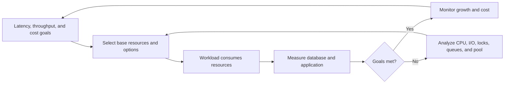

# Compute and Storage Autoscaling and Usage Management

A Java API may need minimal resources most of the time yet experience heavy load surges during sales events. There are also systems where processing load drops after each wave while data and storage costs keep climbing. These two scenarios require different management approaches.

In Autonomous Database, compute auto scaling supports higher processing demand, while storage auto scaling supports expanding storage capacity. Operators still must choose base resources, define limits, monitor service quality, and reconcile costs.

This lesson focuses on **Autonomous Database Serverless on OCI, ECPU model**, using a Transaction Processing workload example. Do not apply the numbers and procedures in this lesson verbatim to Dedicated, elastic pools, Always Free, or Developer. ECPU is an abstract service resource unit; do not convert ECPU directly 1:1 into a Compute vCPU. [Oracle: Compute Models](https://docs.oracle.com/en-us/iaas/autonomous-database-serverless/doc/autonomous-compute-models.html).

After this lesson, learners should be able to:

- Distinguish modifying base resources from enabling auto scaling.
- Accurately interpret compute, storage used, allocated, and maximum.
- Configure both auto scaling types and evaluate the impact of disabling or scaling down resources.
- Correlate database metrics, Java application metrics, and cost reports.
- Design a bounded load-increase test and a response plan when approaching resource ceilings.

Service behaviors are referenced against Oracle documentation as of **November 20, 2026**. Before making changes, verify the exact workload, deployment, version, license, and options of the target resource.

## 1. Three Distinct Resource Decisions

### 1.1. Base Resources

**Base compute** is the ECPU count configured as the database's baseline. **Base storage** is the selected baseline storage capacity.

These two values are configuration decisions. An increase in request volume does not mean the base configuration automatically rewrote itself to a larger value.

Illustrative example:

| Attribute | Hypothetical configuration |
| --- | --- |
| Deployment | Serverless |
| Workload | Transaction Processing |
| Compute model | ECPU |
| Base compute | 8 ECPU |
| Compute auto scaling | Enabled |
| Base storage | 200 GB |
| Storage auto scaling | Enabled |

Always record both value and unit. "200 storage" is insufficient to compare resources or estimate costs.

### 1.2. Manual Scaling and Auto Scaling

| Mechanism | Decision executed |
| --- | --- |
| Manual compute scaling | Change base ECPU count |
| Compute auto scaling | Allow service to use additional compute/I/O within supported scope when workload needs it |
| Manual storage scaling | Change base storage capacity |
| Storage auto scaling | Allow storage expansion beyond base within supported scope |
| Start/stop | Change database lifecycle state |

Enabling auto scaling is not an auto-stop schedule for the database. Disabling auto scaling also does not mean the database has stopped.

For management, separate **desired configuration**, **observed resources**, and **billed usage**. They are related but not identical metrics.

### 1.3. Operational Decision Loop



Do not merely ask "is auto scaling enabled?". A more complete operational question is "does this mechanism help the workload meet targets within acceptable limits?".

## 2. Compute Auto Scaling: Expansion Bounds and Limits

### 2.1. Understanding the 3x Bound Correctly

Oracle notes that compute auto scaling for Serverless can use up to **three times the CPU and I/O resources relative to the base**, within supported conditions. [Oracle: Add Resources or Enable Auto Scaling](https://docs.oracle.com/en-us/iaas/autonomous-database-serverless/doc/autonomous-add-resources.html).

For a hypothetical 8 ECPU configuration:

```text
Base compute:                   8 ECPU
3x compute bound:              24 ECPU
```

This is a bound to verify against actual limits, not a guarantee the database always gets 24 ECPUs or runs three times faster.

When evaluating a configuration, also check licensing, service limits, resource type, and active features. Do not use a single multiplier to infer total system scalability.

### 2.2. Do Not Invent Trigger Thresholds for the Service

Do not write into a runbook that "if CPU exceeds 70% for 2 minutes, OCI automatically doubles compute" without basis from documentation and the mechanism applicable to that exact service.

Numbers like 70% or 2 minutes can be **internal alert thresholds** chosen by the operations team. They do not become the service's auto scaling trigger algorithm.

Similarly, a very brief spike can be hard to assess from aggregated charts. Use matching time windows, configurations, and load levels to interpret results.

### 2.3. Adding Compute Helps Only When Targeting the Right Bottleneck

| Symptom | What to check |
| --- | --- |
| CPU rises alongside SQL execution | CPU-intensive SQL, parallelism, permitted resources |
| SQL queues while CPU is not high | Service, concurrency rules, and workload type |
| Many transactions waiting on locks | Transaction scope and contended data |
| API waiting while database is mostly idle | Connection pool, network, app logic, or external services |
| Batch reads massive amounts of data | Execution plan, I/O, filtering, and actual data needed |
| Throughput flatlines as load rises | Saturation point across the full pipeline, not just database |

For example, two transactions updating the same inventory row can block each other even with spare CPU. Adding resources does not remove that lock dependency.

The Java team should measure **connection borrow wait**, **SQL execution**, **commit**, and **non-database processing**. Measuring only total HTTP request duration makes it hard to tell which part benefited from auto scaling.

## 3. Storage: Reading Space and Limits Accurately

### 3.1. Four Metrics to Record Separately

| Metric | Meaning |
| --- | --- |
| Reserved base storage | Base capacity configured by the user |
| Used storage | Space currently occupied inside tablespaces |
| Allocated storage | Space assigned to tablespaces, including internal free space |
| Maximum storage | Configured storage boundary permitted |

When storage auto scaling is enabled, the typical bound is three times base storage, subject to service limits; current documentation lists a typical ceiling of 384 TB with a support request flow for larger needs. [Oracle: Storage Auto Scaling and Allocation](https://docs.oracle.com/en-us/iaas/autonomous-database-serverless/doc/autonomous-auto-scale.html).

Always use consistent units in calculations. Never mix GB from metrics with TB in the Console while skipping unit conversion.

### 3.2. An Example to Avoid Misreading Percentages

Suppose the practice database has:

| Value | Capacity |
| --- | ---: |
| Base | 200 GB |
| Maximum | 600 GB |
| Allocated | 420 GB |
| Used | 260 GB |

From that hypothetical dataset:

```text
Allocated / Maximum = 420 / 600 = 70%
Used / Maximum      = 260 / 600 ≈ 43.3%
Maximum - Allocated = 180 GB
Allocated - Used    = 160 GB
```

These four results answer four different questions. "About 43% of maximum used" does not negate that allocated space has already reached 70% of maximum.

Free space inside allocated storage and headroom remaining to allocate further must be distinguished. Also do not treat the entire difference as guaranteed business data capacity, because system components and space allocation rules apply.

### 3.3. Deleting Data Does Not Mean Allocated Storage Drops

DELETE, DROP, intra-segment space reclamation, shrink, and lowering base storage are distinct operations. A business operation deleting data does not prove allocated space was returned.

Autonomous manages tablespaces and object placement. Check per-tablespace usage when hitting growth errors, because total free space may not explain a full tablespace. [Oracle: Manage Tablespaces](https://docs.oracle.com/en-us/iaas/autonomous-database-serverless/doc/autonomous-database-tablespace-mgmt.html).

For example, after deleting data, used space drops from 260 GB to 120 GB while allocated remains 420 GB. That calls for inspecting space allocation and reclamation mechanisms; do not keep deleting data just because the bill has not dropped as expected.

### 3.4. Shrink Is a Conditional Operation

Oracle provides Shrink to reduce allocated storage when eligible. The operation has limits on configuration, reclaimable space, and object types; it can consume CPU and impact workloads. Read full prerequisites before selecting it. [Oracle: Shrink Storage](https://docs.oracle.com/en-us/iaas/autonomous-database-serverless/doc/autonomous-auto-scale.html).

Do not assume every small database, every index type, or every recent deletion qualifies for shrink.

A reclamation plan should record:

1. Used, allocated, base, and maximum before the change.
2. Objects or data processed per retention policy.
3. Conditions of the reclamation operation being applied.
4. Maintenance window and abort criteria.
5. Capacity, performance, and cost after metrics update.

## 4. Tracking Usage with Proper Evidence

### 4.1. Minimum Metric Set

Serverless uses the `oci_autonomous_database` namespace. Metrics to interpret accurately include:

| Metric | Primary content |
| --- | --- |
| `CpuUtilization` | CPU ratio relative to permitted database capacity |
| `QueuedStatements` | SQL statements waiting in queue |
| `SessionUtilization` | Session utilization |
| `StorageUsed`, `StorageAllocated`, `StorageMax` | Corresponding space metrics |
| `StorageUtilization` | Percentage of maximum storage allocated to tablespaces |
| `ECPUsAllocated` | Total billed ECPUs for database, including local standby and database tools if present |

Filter with the exact `RESOURCEID` dimension. Valid alarm intervals start at 5 minutes; many storage metrics emit hourly. [Oracle: Available Metrics](https://docs.oracle.com/en-us/iaas/autonomous-database-serverless/doc/autonomous-monitor-metrics-list.html).

### 4.2. Do Not Use One Metric for Every Conclusion

With `ECPUsAllocated`, identify which components are included in the figure before comparing against the primary database's base compute. For instance, a value larger than an expected bound may require checking standby or database tools.

Do not sum utilization samples as if they were independent events to derive ECPU-hours. Understand statistic, interval, unit, and measurement method; when reconciling invoices, consult cost reports as well.

With CPU%, always record permitted configured capacity. If the denominator shifts during resource adjustments, the same percentage can represent different consumption levels.

With storage, take metrics from the same timestamp. Do not combine morning used, noon allocated, and afternoon post-change maximum as a consistent snapshot.

### 4.3. Read Database Metrics Alongside Application Metrics

A dashboard for a Java application should place side by side:

- Requests/sec and completed business operations/sec.
- p50, p95, p99 latency and error rate.
- Active connections, pool wait queue, and wait duration.
- Queued SQL, sessions, and CPU utilization.
- Used, allocated, maximum, and storage growth rate.
- Configuration changes, application deployments, and batch jobs.

A scaling action counts as an improvement only when target outcomes improve. Higher resource consumption without higher throughput, lower latency, or with rising errors signals a need to re-examine.

## 5. Configuring via Console and CLI

### 5.1. Inventory Before Making Changes

Record region, compartment, database OCID, workload, compute model, license, pool if any, base resources, and the state of both auto scaling flags.

The Bash example below reads metadata only. OCI CLI must be configured with credentials and read permissions:

```bash
ADB_OCID='REPLACE_WITH_AUTONOMOUS_DATABASE_OCID'
OCI_REGION='REPLACE_WITH_REGION_IDENTIFIER'

oci db autonomous-database get \
  --autonomous-database-id "$ADB_OCID" \
  --region "$OCI_REGION" \
  --output json
```

Reference: [Oracle CLI: autonomous-database get](https://docs.oracle.com/en-us/iaas/tools/oci-cli/latest/oci_cli_docs/cmdref/db/autonomous-database/get.html).

Cross-check results with the Console. If an attribute is absent or null, verify via the corresponding UI/API; do not interpret missing values as 0 or false.

### 5.2. Console Flow

From the database details page, open **Manage resource allocation**, inspect compute, storage, and both auto scaling options. Select the desired change, apply, and monitor state until completion. Oracle describes state transitioning through Scaling in Progress and returning to Available. [Oracle: Manage Resource Allocation](https://docs.oracle.com/en-us/iaas/autonomous-database-serverless/doc/autonomous-add-resources.html).

Each change should have a measurable goal, such as shortening batch duration or increasing allocatable headroom. Avoid changing service, raising ECPU, rewriting SQL, and enabling storage auto scaling in a single comparison step.

### 5.3. The Two CLI Flags Are Independent

The following commands **modify configuration** and target a lab resource with a verified OCID and scope. They illustrate enabling each option, not commands already run on the learner's resource:

```bash
# Enable compute auto scaling.
oci db autonomous-database update \
  --autonomous-database-id "$ADB_OCID" \
  --region "$OCI_REGION" \
  --is-auto-scaling-enabled true

# After the previous operation completes, enable storage auto scaling if needed.
oci db autonomous-database update \
  --autonomous-database-id "$ADB_OCID" \
  --region "$OCI_REGION" \
  --is-auto-scaling-for-storage-enabled true
```

Syntax for both flags is documented in [Oracle CLI: autonomous-database update](https://docs.oracle.com/en-us/iaas/tools/oci-cli/latest/oci_cli_docs/cmdref/db/autonomous-database/update.html).

After each change, re-read metadata, confirm completion state, and verify the application. API acceptance does not prove the workload meets targets.

### 5.4. IAM for Viewers vs. Modifiers

Oracle separates read permissions from resource management permissions. IAM documentation lists toggling auto scaling and modifying compute/storage under `use autonomous-databases`; evaluate actual policy conditions as well. [Oracle: Autonomous Database IAM Policies](https://docs.oracle.com/en-us/iaas/autonomous-database-serverless/doc/autonomous-database-iam-policies.html).

Separate observer groups from groups authorized to adjust resources. Scope policies by compartment and duty. These permissions operate at the OCI resource layer and do not replace SQL privileges inside the database.

## 6. What Happens When Disabling Auto Scaling or Scaling Down?

### 6.1. Compute Usage Currently Above Base

When disabling compute auto scaling while CPU usage exceeds base, the service brings usage back to base compute. When disabling storage auto scaling while used exceeds base, the UI may require raising base to fit the workload. [Oracle: Disable Auto Scaling](https://docs.oracle.com/en-us/iaas/autonomous-database-serverless/doc/autonomous-remove-resources.html).

Therefore, "disable to save money" must be paired with checking current load demand. If the workload regularly needs more than base, disabling compute auto scaling can turn cost into queues, latency, or prolonged batch runs.

Disabling storage auto scaling also does not remove existing data or revert base storage to an older value.

### 6.2. Scaling Down Requires Application Verification

ECPU documentation notes that reducing compute significantly, such as by 30% or more, can drop connections, terminate sessions, or cancel and roll back incomplete work. [Oracle: ECPU Scale-Down Considerations](https://docs.oracle.com/en-us/iaas/autonomous-database-serverless/doc/autonomous-compute-models.html).

Evaluate reduction size, in-flight jobs, connection pool behavior, and handling of indeterminate transaction states. Do not assume an uneventful scale-up means every scale-down has the same impact.

In Java, return connections to the pool after each unit of work, check driver/pool configuration, and design retries around transaction boundaries. Retrying a write operation must account for idempotency and the possibility the transaction already committed.

### 6.3. Pools Are a Different Model

Elastic pools have their own sharing and billing mechanisms. Serverless documentation requires compute auto scaling to be disabled when joining an elastic pool; dedicated elastic pools also have specific rules for both compute and storage auto scaling. [Oracle: Elastic Pool Operations](https://docs.oracle.com/en-us/iaas/autonomous-database-serverless/doc/elastic-pools-create-manage.html), [Oracle: Dedicated Elastic Pools](https://docs.oracle.com/en-us/iaas/autonomous-database-serverless/doc/dedicated-elastic-pools.html).

If a resource belongs to a pool, analyze at both the database and pool levels. Do not apply the "standalone database with an independent 3x bound" model to every member while ignoring shared capacity.

## 7. Understanding Usage Calculation and Cost

### 7.1. Base Compute Remains the Minimum While Running

With ECPU, Oracle states running charges consist of base compute plus incremental usage from auto scaling. Usage is metered per second and aggregated hourly, with a one-minute minimum usage period. [Oracle: Compute Auto Scaling Billing](https://docs.oracle.com/en-us/iaas/autonomous-database-serverless/doc/autonomous-features-billing.html).

Do not assume an idle running database is billed as 0 ECPUs. Auto scaling lets you consume extra resources when needed; base selection still drives baseline recurring cost.

### 7.2. Time-Based Resource Calculation Example

Suppose a database has 8 base ECPUs, auto scaling enabled, and runs a full hour. Ignoring other components, assume compute usage billed in that hour is:

| Interval | Hypothetical compute level | Time fraction |
| --- | ---: | ---: |
| First 45 minutes | 8 ECPU | 0.75 hour |
| Next 15 minutes | 20 ECPU | 0.25 hour |

```text
Compute in hour = 8 × 0.75 + 20 × 0.25
                = 6 + 5
                = 11 ECPU-hours
```

If the applicable unit rate is P per ECPU-hour, the compute portion in this example is **11 × P**. This is an illustrative calculation from hypothetical usage, not a measured result or price quote.

Compared to a 24 ECPU base configuration running the full hour, the compute volume in this example is lower. However, a cost comparison is valid only when both options satisfy the same workload and service targets.

Conversely, if the workload continuously needs near 24 ECPUs, re-evaluate base sizing, auto scaling behavior, and SQL efficiency. No single utilization ratio automatically determines the optimal choice for every system.

### 7.3. Storage Is Billed per Service Rules

Documentation states storage within base is billed at base; when allocated exceeds base with auto scaling, storage is billed by allocated capacity and workload rounding rules. [Oracle: Storage Auto Scaling Billing](https://docs.oracle.com/en-us/iaas/autonomous-database-serverless/doc/autonomous-features-billing.html).

Under ECPU, billing documentation distinguishes billing units for Lakehouse versus Transaction Processing/JSON/APEX; backup storage is also a separate item to evaluate. [Oracle: Billing Summary](https://docs.oracle.com/en-us/iaas/autonomous-database-serverless/doc/autonomous-database-billing-overview.html).

With hypothetical figures of 200 GB base, 420 GB allocated, and 260 GB used:

- Using 260 GB used as the entire storage estimate risks omitting allocated space.
- Using 600 GB maximum as the current billed storage amount can also be wrong.
- After used space drops, re-check allocated space and billing metrics before concluding savings occurred.

Keep **permitted capacity bound**, **allocated capacity**, and **actual billable recorded quantity** clearly separated.

### 7.4. Items Outside Primary Compute

An estimate should also check:

| Component | Verification question |
| --- | --- |
| Backup storage | How do retention and retained backups change storage volume? |
| Local/cross-region peer | Which resources does the recovery architecture create? |
| Clones | What is the clone for, and how long will it exist? |
| Database tools | Is separate compute active? |
| Other features | Does any setting trigger extra SKUs or resources? |

Some database tools in the ECPU model have separate compute allocation independent of the database's primary compute and auto scaling. [Oracle: Database Tools Billing](https://docs.oracle.com/en/cloud/paas/autonomous-database/serverless/adbsb/autonomous-tools-billing.html).

Therefore, 3 × base compute is not a total cost ceiling for every component attached to a database.

### 7.5. Reconcile Using Reports

When reconciling costs, group accurately by resource, time window, SKU, unit, and license. ECPU documentation guides users to Cost and Usage Reports with resource identifiers and billed quantities. [Oracle: ECPU Cost and Usage Information](https://docs.oracle.com/en-us/iaas/autonomous-database-serverless/doc/autonomous-compute-models.html).

Do not take the total bill of a compartment holding multiple databases and conclude one database's auto scaling spiked abnormally. Nor should you compare a single 5-minute metric sample directly against a daily total cost without accounting for time, units, and related components.

## 8. Capacity Forecasting and Alerting

### 8.1. Track Remaining Allocatable Headroom

A simple planning indicator:

```text
Remaining allocatable headroom ≈ Maximum - Allocated

Time to ceiling ≈
    (Maximum - Allocated) / Allocated growth rate
```

Hypothetical example:

```text
Maximum:                  600 GB
Allocated:                420 GB
Allocated growth rate:     30 GB/day

Remaining headroom:       180 GB
Estimated time:             6 days
```

This is a linear planning forecast. It does not guarantee the system can keep writing for exactly six days: batches, indexes, temporary data, and workload shifts can alter the rate.

Use multiple observation windows to separate steady growth from step allocations. If growth rate is 0 or negative, do not divide and treat the result as an infinite guarantee.

### 8.2. Combine Utilization Level and Growth Rate

A capacity alert should consider two questions:

- How high has the allocation percentage climbed?
- At the current growth rate, how much time remains to act before hitting the ceiling?

For example, allocated at 75% right before a large data load may require earlier action than 85% that has stayed flat for months.

75% and 85% are illustrative design thresholds. Pick thresholds based on lead time needed to investigate, resize, or process data.

### 8.3. Actionable Alert Matrix

| Signal | First check | Candidate responses |
| --- | --- | --- |
| High CPU with sustained queuing | SQL, service, load, and compute limits | Optimize workload or adjust resources |
| Sessions near limit | App replicas, pool size, and long-held connections | Reduce contention, fix connection lifecycle |
| Allocated near maximum | Growth rate, batches, and tablespace distribution | Increase capacity or manage data per policy |
| Used drops but allocated stays flat | Retained space and reclamation eligibility | Plan shrink/scale-down if suitable |
| Unexplained billed ECPU increase | Primary compute, peers, tools, and time window | Reconcile report by component |
| Missing recent metrics | Emission cadence, query scope, and read permissions | Restore observability before concluding |

Every alert needs an OCID, time window, threshold, recipient, and first response step. Verify notifications actually reach the right people.

### 8.4. Budgets Are Soft Thresholds

OCI Budgets set soft spending thresholds and alert on actual or forecasted spend. Current documentation states budget alerts are evaluated periodically every 24 hours. [Oracle: Budgets](https://docs.oracle.com/en-us/iaas/Content/Billing/Concepts/budgetsoverview.htm).

Therefore, do not rely on a budget alert as an instant circuit breaker for a few-minute compute spike.

Cost control designs should combine:

- Permissions on resource modifications.
- Base configuration and service-supported limits.
- Operational alarms on resources and service quality.
- Budgets and cost reports.
- Workload owners, review cadences, and actions when forecasts are exceeded.

## 9. Checking Tablespaces When Total Storage Has Room Yet Writes Fail

Having overall storage headroom does not rule out a specific tablespace hitting its limit. On an account with appropriate observability privileges, you can run the query provided by Oracle:

```sql
SELECT tablespace_name,
       used_percent
FROM dba_tablespace_usage_metrics
WHERE tablespace_name LIKE 'DATA%';
```

Oracle describes inspecting tablespace distribution and managing objects in [Autonomous Database tablespace management guidance](https://docs.oracle.com/en-us/iaas/autonomous-database-serverless/doc/autonomous-database-tablespace-mgmt.html).

If lacking read access to the view, record the observation limitation and use an assigned admin account. Never grant broad privileges to an application account just to read an operational metric.

An investigation procedure should move from overall state to the failing scope:

1. Confirm database, timestamp, and exact error message.
2. Read base, maximum, allocated, and used.
3. Inspect relevant tablespaces.
4. Identify the table, index, or job driving space growth.
5. Choose remediation based on the identified scope.

Do not run mass MOVE, rebuild, or purge operations before identifying which object is causing pressure. Those operations can consume resources and alter the conditions under investigation.

## 10. Controlled Hands-On Practice

### 10.1. Prepare Objectives and Scope

Use a lab database supporting the options to test, a client with proper network access, and a workload free of sensitive data. Before starting, document:

| Item | Hypothetical objective example |
| --- | --- |
| Workload | Test order read/write API |
| Service quality | p95 under 300 ms at defined load level |
| Duration | Bounded test window with end time |
| Concurrency | Pre-bounded step increments |
| Data | Dataset with documented size and distribution |
| Cost | Maximum acceptable usage for the test |
| Stop criteria | Exceeding error, latency, capacity, or time thresholds |

300 ms is an illustrative target, not a default property or OCI commitment.

Allow enough observation time for metric cadence. A test lasting a few dozen seconds cannot yield complete evidence from hourly storage metrics.

### 10.2. Phase A — Baseline

1. Read metadata via CLI and capture required configuration.
2. Confirm exact JDBC service, schema, and Java replica count.
3. Record pool size, timeouts, and transaction boundaries.
4. Run the workload at a steady low rate.
5. Collect completed operations, latency, errors, and relevant metrics.

Separate job types if possible. A long batch and a short transactional API can cause aggregate charts to hide differences.

### 10.3. Phase B — Step Load Increase

Hold data and service steady, increasing concurrency through predefined steps. At each step, record enough duration to observe a relatively stable state.

Questions to answer:

- Does throughput scale with applied load?
- Does database queuing or pool wait rise first?
- How do CPU and related compute consumption change?
- Are there transaction failures or duplicate processing?
- Does incremental usage remain within expected bounds?

Do not try to force a specific autoscale figure by guessing thread counts. The goal is observing workload and service response, not forcing a chart to match expectations.

### 10.4. Phase C — Load Decrease

Reduce load back to baseline and continue observing. Separate incremental compute usage from configured base compute.

For storage, inspect separately after cleaning up lab data per plan. Do not use compute scale-back behavior to predict that allocated storage will shrink in the same way.

If shrink or scale-down must be evaluated, set up a separate test after confirming support conditions and impact. These operations are not default cleanup steps for every test.

### 10.5. Phase D — Reconciliation and Configuration Restore

Re-read metadata, confirm exact chosen values, and test the application after the final change. Post-test configuration must be recorded explicitly, including cases where base storage changed and cannot revert via one simple step.

Reconcile cost figures once reports update. Document how long the test environment remains active, running clones or tools, and who owns teardown.

### 10.6. Test Report Template

| Section | Information to record |
| --- | --- |
| Identification | OCID, region, compartment, workload, and version |
| Configuration | Base, both auto scaling flags, pool if any, service, and license |
| Load | Timestamps, dataset, client count, and concurrency |
| Results | Throughput, p95/p99, errors, pool, queues, and CPU |
| Storage | Used, allocated, maximum, and metric timestamps |
| Cost | Units, duration, SKU, and related components |
| Conclusion | Whether targets were met, evidence, and limitations |

This lesson provides procedures and examples; they are not evidence of tests already run on a specific OCI database.

## 11. Analytical Scenarios: Sales API and End-of-Day Batch

Suppose a system has 8 base ECPUs, 200 GB base storage, and both auto scaling options enabled. Transactional APIs run all day; at end of day, a batch loads data and aggregates revenue.

### Scenario A — Slow API with Low CPU

Hypothetical observations:

- Java connection pool wait time rises.
- Pool frequently runs out of idle connections.
- Database CPU is not high.
- Some requests hold connections while waiting on payment gateway calls.

The analysis direction is inspecting connection and transaction lifecycles. Adding database resources or enlarging the pool right away may simply allow more requests to hold resources simultaneously without fixing the root cause.

After changing the application, compare pool wait time, connection hold duration, and transaction success rate rather than looking only at CPU.

### Scenario B — Batch Drives Rapid Data Growth

After several load cycles, hypothetical figures are:

```text
Base:       200 GB
Maximum:    600 GB
Allocated:  420 GB
Used:       260 GB
```

Operations should inspect temporary data, required history retention, indexes, and growth trends. If allocated grows rapidly, act before hitting the ceiling; do not wait until used equals maximum to respond.

If data cleanup drops used space while allocated stays flat, the next step is evaluating space reclamation and billing behavior. Do not treat deleting more data as the default answer.

### Scenario C — Disabling Autoscaling to Lock Costs

Before changing, determine:

1. Can current load run within base capacity?
2. Does the batch have completion deadlines or business windows?
3. Has storage already exceeded base?
4. Are there warnings about a new base when disabling storage auto scaling?
5. Can the connection pool and transactions tolerate scale-down impact?
6. What costs arise from components outside primary compute?

One option may be optimizing the workload, adjusting batch schedules, and re-selecting base capacity from measurements. Final conclusions must include both cost and measured service quality.

## 12. Automating Configuration Changes While Keeping Control

The service's autoscaling mechanism and an external program calling APIs to alter base capacity are two separate control loops. If an external controller is added, avoid having both react to the same signal unpredictably.

A configuration management flow should include:

- A single clear source of desired configuration.
- Reading current state before sending a request.
- Skipping changes if configuration already matches.
- Tracking in-flight operations to avoid duplicate requests.
- Cooldown periods and re-evaluation conditions.
- Change logs, owners, and fallback actions when targets are missed.

For example, do not repeatedly raise base ECPU just because a metric from an earlier window is still high while a previous update has not completed. Nor should you slash resources solely because of one brief low sample between two batch runs.

When expressing configuration in IaC or scripts, keep base compute, base storage, and both auto scaling flags as distinct attributes. Do not collapse all semantics into a single "autoscaling on" label.

## 13. Applied Exercise

Given an Autonomous Database Serverless Transaction Processing instance using ECPU serving a Java application. Daytime load is low, with two peak hours and a nightly data-growth batch.

Perform the following:

1. Inventory configuration, license, deployment, and relevant limits.
2. Choose base compute and explain what data is needed to defend that choice.
3. Calculate the nominal bound when compute auto scaling is enabled; list additional conditions to verify.
4. Explain used, allocated, and maximum from a single same-timestamp dataset.
5. Project time to ceiling from allocated growth rate and state forecast limitations.
6. Design alerts for CPU/queues, sessions, storage, and cost.
7. Calculate ECPU-hours for a hypothetical usage curve, separating items outside primary compute.
8. Design baseline, load-increase, and load-decrease tests with stop criteria.
9. Describe the impact of disabling both auto scaling types and of a significant ECPU reduction.
10. Propose IAM governance, post-test configuration state, and cost report reconciliation.

Deliverables must clearly separate **configured limits**, **observed usage**, **billed quantities**, and **business responsiveness**. Conclude a solution is suitable only when this evidence aligns within the same scope and timeframe.
