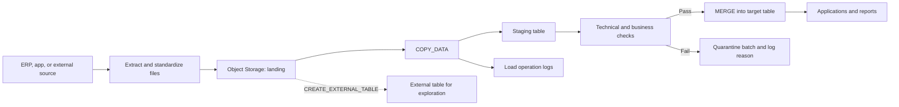

# Loading Data from Object Storage and External Sources

In the Autonomous Database chapter of the Oracle Cloud Infrastructure (OCI) module, data loading is the junction between storage, IAM, networking, and the database. A command succeeding only confirms part of the job: the system must also prove it fetched the right source, loaded complete data, handled bad records, and can re-run without corrupting results.

This lesson uses Autonomous Database Serverless as the reference environment. Examples focus on a batch pipeline from OCI Object Storage, then extend to other cloud storage, remote databases, and APIs. For other deployment types, verify capabilities, permissions, and network configuration before applying.

After this lesson, learners will be able to:

- Choose between copying data into a table, querying via an external table, and importing via Data Pump.
- Design bucket access permissions for Autonomous Database and the loading schema.
- Execute a CSV load using `DBMS_CLOUD.COPY_DATA`, reconcile counts, and merge data into business tables.
- Build retry, error tracking, and cost control strategies for external ingestion flows.

## 1. Distinguishing Data Loading from Data Linking

**Loading data** creates a copy of data inside an Autonomous Database table. Once loaded, queries against that table read the stored copy. Changes to the source object do not automatically update the target table.

**Linking data** creates an object to access data still residing at the source, such as an external table on Object Storage or a view using a database link. When choosing this approach, account for source availability and stability during queries. Oracle distinguishes these two operations in Data Studio's Load and Link flows. [Load, Link, and Feed Data](https://docs.oracle.com/en/cloud/paas/autonomous-database/data-studio-guide/load-link-and-feed-data.html).

| Need | Approach | Considerations |
| --- | --- | --- |
| Periodic file loading into reporting tables | `DBMS_CLOUD.COPY_DATA` | Requires staging, reconciliation, and deduplication |
| Explore files before deciding to store in DB | External table | Queries depend on source availability and file format |
| Test-load a file from a local machine | Data Load in Database Actions | Suits interactive work; save config if turning into a job |
| Migrate schema from Oracle Database | Oracle Data Pump Import | Must handle metadata, privileges, and object compatibility |
| Pull data from another database | Database link or integration tool | Must control source load, network, and incremental watermarks |
| Collect data from paginated APIs | Collector or integration flow, then load | Must handle tokens, rate limits, pagination, and retries |

For example, a finance dashboard requiring finalized data can read internal tables. An analytics team exploring a new dataset can start with an external table. If the goal is migrating both Oracle schema structure and data, evaluate Data Pump rather than converting every table into CSVs.

## 2. Architecture of an Operable Ingestion Pipeline

A batch architecture should separate source data, data under validation, and data approved for serving applications.



Landing receives source files for reconciliation and replay. Staging holds data prior to publication. Business tables receive only batches that pass acceptance checks.

In this design, prefer immutable objects per batch, such as:

```text
incoming/orders/business_date=2026-11-19/batch-0001/orders.csv
incoming/orders/business_date=2026-11-19/batch-0002/orders.csv
```

This object naming follows this lesson's convention, not a mandatory service rule. Do not overwrite the same filename to represent multiple distinct closeouts if the system needs reproducibility.

A manifest supplied by the exporter can include batch ID, object list, record count, total amount, schema version, and checksums. The manifest is a pipeline contract; `COPY_DATA` does not automatically interpret business rules inside a manifest.

## 3. Preparing Permissions and Connectivity

Three layers must be verified independently:

| Layer | Question to answer |
| --- | --- |
| Database privileges | Which schema can create tables, run loads, and update target tables? Does it have sufficient quota? |
| Source permissions | Which identity can read the exact object or bucket? Is the credential valid? |
| Network | Can the database's load process reach the source endpoint via active DNS, routes, and network controls? |

An operator being able to open a bucket in the OCI Console does not prove Autonomous Database can read the bucket. Similarly, a successful SQL connection from a laptop to the database does not prove the database can reach a remote source.

In a private endpoint environment, inspect client-to-database ingress separately from database-to-source outbound traffic. Do not infer outbound configuration solely from the SQL connection's public/private status. For sources inside a VCN or data center, confirm routes, DNS, service ports, and TLS with infrastructure admins.

### 3.1. Prefer Resource Principal for OCI Sources

Resource principal lets Autonomous Database use an OCI resource identity. After configuring a dynamic group and policy, an administrator enables the system credential `OCI$RESOURCE_PRINCIPAL`. This avoids embedding personal auth tokens in jobs. [Use Resource Principal](https://docs.oracle.com/en-us/iaas/autonomous-database-serverless/doc/resource-principal.html).

The example below assumes the `ETL_USER` schema exists and has required database privileges. Run the resource principal enablement using `ADMIN`:

```sql
BEGIN
  DBMS_CLOUD_ADMIN.ENABLE_RESOURCE_PRINCIPAL();

  DBMS_CLOUD_ADMIN.ENABLE_RESOURCE_PRINCIPAL(
    username => 'ETL_USER'
  );
END;
/
```

The dynamic group should include only Autonomous Databases authorized to ingest. When writing rules, use the database OCID—do not mistakenly use a compartment or bucket OCID. In tenancies with identity domains, apply domain syntax per actual IAM configuration.

A reference policy for the database's dynamic group:

```text
Allow dynamic-group <identity-domain>/adb_ingest_dg to read objects in compartment data_ingestion where target.bucket.name = 'adb-landing'
```

Replace `<identity-domain>`, dynamic group name, and compartment for your environment. The policy must be placed at a scope effective over the bucket's compartment. Bucket-scoped object read policies are also used by Oracle in [Export Data to Autonomous Database](https://docs.oracle.com/en-us/iaas/jms/doc/run-load-pipelines-exported-data.html).

Separate the data-reading identity from the bucket-admin identity. An ingestion pipeline reading files does not need full permissions to delete buckets. If a tool needs to browse bucket lists for user selection, evaluate appropriate browse permissions rather than granting broad permissions just to make UI lists work.

### 3.2. When Another Credential Is Needed

For sources requiring keys or tokens, create a credential matching the source type and reference only the credential name in load code. If using an OCI auth token, note it is not the Console login password. A credential stored inside the database also does not grant extra IAM permissions to the source identity.

The example below illustrates structure only; `<...>` values are placeholders:

```sql
BEGIN
  DBMS_CLOUD.CREATE_CREDENTIAL(
    credential_name => 'LANDING_READ_CRED',
    username        => '<OCI_USERNAME_PER_IDENTITY_DOMAIN>',
    password        => '<OCI_AUTH_TOKEN>'
  );
END;
/
```

Verify credential mechanisms and username formatting before using in a live tenancy. Oracle describes creating credentials and reusing credential names in [Create Credentials and Copy Data](https://docs.oracle.com/en-us/iaas/autonomous-database-serverless/doc/load-data-cloud-copy.html).

In automated deployments, inject secrets through an approved secret manager; avoid storing tokens in Git, terminal history, or job logs. If using a pre-authenticated request (PAR), treat the URL as sensitive, scope its permissions and expiration, and keep a revocation plan.

## 4. Data Contract for the Hands-On Example

Scenario: a sales application exports daily orders to a dedicated bucket `adb-landing`. Autonomous Database loads the file, validates it, and updates the `ORDERS` table for reporting.

Subsequent SQL examples run as `ETL_USER`, unless explicitly noted as an admin step. This is a first-run exercise in a dedicated schema. When re-running, do not re-execute `CREATE TABLE` statements that already succeeded.

Illustrative CSV file:

```csv
order_id,customer_id,order_date,amount,currency,order_status
1001,501,2026-11-19,1250000,VND,PAID
1002,502,2026-11-19,2450000,VND,NEW
1003,501,2026-11-19,450000,VND,PAID
```

Conventions:

- UTF-8 file, single header line, comma-delimited.
- Columns appear in the published order; the header row does not automatically act as name-based mapping.
- `order_date` represents the business date as `YYYY-MM-DD`.
- `amount` is numeric with no thousands separators; this example uses VND only.
- `order_id` is the business key of an order within this lesson.
- The batch has three records and total `amount` equals `4150000` VND across both `NEW` and `PAID` statuses.

If data must retain event timestamps and timezones, design a corresponding timestamp column. The `DATE` type in this example serves only this business-date contract.

Object Storage URI format:

```text
https://objectstorage.<region>.oraclecloud.com/n/<namespace>/b/adb-landing/o/incoming/orders/business_date=2026-11-19/batch-0001/orders.csv
```

`namespace` is the tenancy's Object Storage namespace, not automatically the tenancy name or OCID. Everything after `/o/` is the object name and is case-sensitive. Use the actual object URI and URL-encode special characters when needed, rather than using the Console bucket page URL.

## 5. Loading CSV with COPY_DATA

### 5.1. Create the Staging Table

Staging in this example intentionally omits a primary key so duplicate keys can be detected before publication:

```sql
CREATE TABLE orders_stage (
  order_id      NUMBER(12),
  customer_id   NUMBER(12),
  order_date    DATE,
  amount        NUMBER(18,2),
  currency      VARCHAR2(3 CHAR),
  order_status  VARCHAR2(20 CHAR)
);
```

This table handles one batch at a time. If multiple jobs run concurrently, use per-batch staging or a design containing `batch_id` with an explicit batch assignment mechanism. `COPY_DATA` does not infer a business batch just because the object name contains a batch ID.

Typed staging catches conversion errors early. If all raw values must be preserved for inspection or strict checks before numeric rounding are needed, add a string-typed staging layer. Do not treat successful type casting as proof of valid business data.

### 5.2. Execute the Load Operation

Replace region and namespace in the URI before running:

```sql
SET SERVEROUTPUT ON

DECLARE
  l_operation_id NUMBER;
BEGIN
  DBMS_CLOUD.COPY_DATA(
    table_name      => 'ORDERS_STAGE',
    credential_name => 'OCI$RESOURCE_PRINCIPAL',
    file_uri_list   =>
      'https://objectstorage.<region>.oraclecloud.com/n/<namespace>/b/adb-landing/o/incoming/orders/business_date=2026-11-19/batch-0001/orders.csv',
    format          => JSON_OBJECT(
      'type'        VALUE 'csv',
      'delimiter'   VALUE ',',
      'quote'       VALUE '"',
      'skipheaders' VALUE 1,
      'characterset' VALUE 'AL32UTF8',
      'dateformat'  VALUE 'YYYY-MM-DD',
      'blankasnull' VALUE 'true',
      'rejectlimit' VALUE 0,
      'logretention' VALUE 7
    ),
    operation_id    => l_operation_id
  );

  DBMS_OUTPUT.PUT_LINE('operation_id=' || l_operation_id);
END;
/
```

`COPY_DATA` loads into an existing table. The overload with `operation_id` returns an operation ID to link to technical logs; this is not a business batch ID. [DBMS_CLOUD Subprograms](https://docs.oracle.com/en-us/iaas/autonomous-database-serverless/doc/dbms-cloud-subprograms.html).

Meaning of key format options:

| Option | Meaning in example |
| --- | --- |
| `type` and `delimiter` | Specifies comma-delimited CSV |
| `quote` | Recognizes double quotes enclosing fields |
| `skipheaders` | Skips the first line of each file |
| `characterset` | Declares source UTF-8 using Oracle's charset name |
| `dateformat` | Parses date fields per agreed pattern |
| `blankasnull` | Converts whitespace-only fields to NULL |
| `rejectlimit` | Uses 0 to reject zero bad records during the load operation |
| `logretention` | Retains operation logs for the specified number of days |

These options must match real files. CSVs with newlines inside quoted fields require appropriate configuration, such as the CSV variant with embedded record delimiters; do not apply this sample config blindly to every CSV. See full options and scope at [DBMS_CLOUD Package Format Options](https://docs.oracle.com/en-us/iaas/autonomous-database-serverless/doc/format-options.html).

Specifically, `rejectlimit` controls load errors detected by the access driver; it does not check negative amounts, invalid currency codes, or duplicate business keys when staging has no constraints.

### 5.3. Inspect Operation Logs

```sql
SELECT id,
       table_name,
       status,
       rows_loaded,
       start_time,
       update_time,
       logfile_table,
       badfile_table
FROM user_load_operations
WHERE type = 'COPY'
  AND table_name = 'ORDERS_STAGE'
ORDER BY id DESC
FETCH FIRST 5 ROWS ONLY;
```

Prefer querying by the exact recorded `ID`, especially when multiple jobs run. `USER_LOAD_OPERATIONS` shows operations for the current schema; database-wide views require corresponding privileges. Column meanings are documented in [Track DBMS_CLOUD Load Operations](https://docs.oracle.com/en/cloud/paas/autonomous-database/serverless/adbsb/load-operations-views.html).

Take the table names from `LOGFILE_TABLE` and `BADFILE_TABLE` of the exact operation being inspected. For example, if the query returns `COPY$12_LOG` and `COPY$12_BAD`:

```sql
SELECT * FROM COPY$12_LOG;
SELECT * FROM COPY$12_BAD;
```

The number `12` is illustrative only and must never be hardcoded in a job. Logs distinguish source read errors, format errors, and rejected records. Log and badfile tables have retention limits; copy evidence needed long-term to your pipeline's tracking store. [Monitor and Troubleshoot COPY_DATA Loads](https://docs.oracle.com/en-us/iaas/autonomous-database-serverless/doc/load-data-cloud-monitor.html).

### 5.4. Reconcile Loaded Data

Check row count and total amount:

```sql
SELECT COUNT(*) AS loaded_rows,
       SUM(amount) AS total_amount
FROM orders_stage;
```

Expected result for the sample file:

| LOADED_ROWS | TOTAL_AMOUNT |
| --- | --- |
| 3 | 4150000 |

Check minimum business rules:

```sql
SELECT COUNT(*) AS invalid_business_rows
FROM orders_stage
WHERE order_id IS NULL
   OR order_id <= 0
   OR customer_id IS NULL
   OR customer_id <= 0
   OR order_date IS NULL
   OR amount IS NULL
   OR amount < 0
   OR currency IS NULL
   OR currency <> 'VND'
   OR order_status IS NULL
   OR order_status NOT IN ('NEW', 'PAID', 'CANCELLED');
```

Check for duplicate keys:

```sql
SELECT order_id, COUNT(*) AS occurrences
FROM orders_stage
GROUP BY order_id
HAVING COUNT(*) > 1;
```

The sample batch passes when there are exactly three rows, the total amount matches, `invalid_business_rows` equals 0, and the duplicate-key query returns zero rows.

In production, jobs must evaluate these checks and turn them into stop-or-proceed gates. Merely printing counts to a log and continuing to publication provides no quality gate.

## 6. Moving Data into Business Tables and Controlling Retries

Create the target table once:

```sql
CREATE TABLE orders (
  order_id      NUMBER(12) CONSTRAINT orders_pk PRIMARY KEY,
  customer_id   NUMBER(12) NOT NULL,
  order_date    DATE NOT NULL,
  amount        NUMBER(18,2) NOT NULL,
  currency      VARCHAR2(3 CHAR) NOT NULL,
  order_status  VARCHAR2(20 CHAR) NOT NULL,
  CONSTRAINT orders_amount_ck CHECK (amount >= 0),
  CONSTRAINT orders_currency_ck CHECK (currency = 'VND'),
  CONSTRAINT orders_status_ck
    CHECK (order_status IN ('NEW', 'PAID', 'CANCELLED'))
);
```

Assuming each source row represents the complete, authoritative order state and batches are processed in order, publish using `MERGE`:

```sql
MERGE INTO orders t
USING orders_stage s
ON (t.order_id = s.order_id)
WHEN MATCHED THEN
  UPDATE SET
    t.customer_id  = s.customer_id,
    t.order_date   = s.order_date,
    t.amount       = s.amount,
    t.currency     = s.currency,
    t.order_status = s.order_status
WHEN NOT MATCHED THEN
  INSERT (
    order_id, customer_id, order_date,
    amount, currency, order_status
  )
  VALUES (
    s.order_id, s.customer_id, s.order_date,
    s.amount, s.currency, s.order_status
  );

COMMIT;
```

Re-running `MERGE` with the same data preserves business state without inserting duplicate orders with the same key. However, that alone does not guarantee end-to-end exactly-once pipeline execution:

- Staging must hold only the batch currently being processed; loading twice into staging then running `MERGE` creates duplicate keys in the source set.
- Two jobs must not race to process the same batch without a claim or locking mechanism.
- An older batch running after a newer batch can overwrite newer state. If out-of-order processing is possible, include `source_updated_at` or a version number with corresponding update guards.
- Source deletions do not propagate through the `MERGE` above. Use an explicit contract for tombstones, cancellation statuses, or full-snapshot reconciliation.
- Triggers or external side effects still need evaluation on replay, even when final table values remain unchanged.

### 6.1. Batch Control Ledger

A custom control table should store at minimum:

| Field | Purpose |
| --- | --- |
| `batch_id` | Unique identifier of the data export |
| Object list and version/checksum | Confirms exact dataset processed |
| `schema_version` | Identifies applicable data contract |
| Expected row count and control sum | Basis for reconciliation |
| Load `operation_id` | Links to technical logs |
| Status and timestamps | Tracks in-progress, published, or failed state |
| Error code and reason | Supports operations and retries |

Checksums must use an algorithm and calculation method agreed upon by both sides. Never assume every object ETag equals the content MD5, especially when upload mechanisms can vary.

You can design a state flow:

```text
RECEIVED -> LOADING -> VALIDATING -> PUBLISHED
                 -> FAILED
                            -> REJECTED
```

These status names are application conventions. `PUBLISHED` is recorded only after the target table has received the full batch. When both the batch ledger and target table live in the database, update publication status and business data inside the same DML transaction.

Keep DDL like table creation outside the publication transaction because DDL has implicit commit semantics. Do not assume an application `ROLLBACK` undoes work performed by another load tool or separate job.

### 6.2. Retry Workflow

With dedicated staging like the example, before retrying confirm no other job is using it, check batch state, and reset staging per approved procedure. Never call `COPY_DATA` again onto staging that already holds a copy of the same batch.

If a job disconnects after `MERGE` before the orchestrator receives confirmation, first inspect the batch ledger and published data. If the batch is already `PUBLISHED` and the object set identity is unchanged, the orchestrator can skip reloading.

If it is unknown which step finished, base recovery on recorded evidence. Never choose "reload everything" merely because the previous call timed out.

## 7. External Tables: Exploring Before Copying

External tables fit when you need to inspect schemas, preview data, or query sources with SQL before deciding to load into internal tables.

Example creating an external table over the same CSV file:

```sql
BEGIN
  DBMS_CLOUD.CREATE_EXTERNAL_TABLE(
    table_name      => 'ORDERS_EXT',
    credential_name => 'OCI$RESOURCE_PRINCIPAL',
    file_uri_list   =>
      'https://objectstorage.<region>.oraclecloud.com/n/<namespace>/b/adb-landing/o/incoming/orders/business_date=2026-11-19/batch-0001/orders.csv',
    column_list     =>
      'ORDER_ID NUMBER(12),
       CUSTOMER_ID NUMBER(12),
       ORDER_DATE DATE,
       AMOUNT NUMBER(18,2),
       CURRENCY VARCHAR2(3 CHAR),
       ORDER_STATUS VARCHAR2(20 CHAR)',
    format          => JSON_OBJECT(
      'type'        VALUE 'csv',
      'delimiter'   VALUE ',',
      'quote'       VALUE '"',
      'skipheaders' VALUE 1,
      'characterset' VALUE 'AL32UTF8',
      'dateformat'  VALUE 'YYYY-MM-DD',
      'rejectlimit' VALUE 0
    )
  );
END;
/
```

```sql
SELECT order_status,
       COUNT(*) AS order_count,
       SUM(amount) AS total_amount
FROM orders_ext
GROUP BY order_status;
```

`CREATE_EXTERNAL_TABLE` creates metadata to query files outside the database. Successfully creating the object is not enough to prove the whole file is valid: run appropriate queries or validation routines. [Query External Data](https://docs.oracle.com/en-us/iaas/autonomous-database-serverless/doc/query-external-data.html).

When you want to persist a copy, you can use `INSERT INTO ... SELECT ... FROM orders_ext` into staging and then run reconciliation checks. Choose one load path per batch; do not run both `COPY_DATA` and `INSERT` for the same file into that staging table.

If auditability or report reproducibility is required, record the exact object set used at publication time. An external table referencing mutable sources cannot replace a finalized snapshot.

## 8. Multiple Files, Other Formats, and Schema Changes

### 8.1. Lock Down the Exact File Set of a Batch

`file_uri_list` can specify a list of URIs; some usages support object name patterns. For flows needing strict reconciliation, prefer an explicit object list finalized in a manifest.

An overly broad pattern like `incoming/orders/*` can pick up old data, test files, or hotfix files. Adding new files while a job runs also makes explaining "which files belonged to this batch" difficult.

If a single load spans multiple files, all files must follow the exact same contract: encoding, column order, header row, number format, and date format. A headerless file must not be mixed into a config skipping the first line without assessing consequences.

### 8.2. JSON, Parquet, ORC, and Avro

| Format | Common benefits | Design considerations |
| --- | --- | --- |
| CSV | Easy to exchange and inspect manually | No full type schema; sensitive to delimiters, quotes, and NLS |
| JSON | Expresses flexible structures | Decide whether to keep documents or extract fields to relational tables |
| Parquet/ORC | Includes type metadata and columnar layout | Verify type mapping, nested structures, and schema evolution |
| Avro | Carries schema alongside data | Govern schema compatibility and target type mapping |

For JSON, Oracle supports `COPY_DATA` into tables and `COPY_COLLECTION` for collections under the corresponding model; choose handling matching the target structure. [Load JSON Documents](https://docs.oracle.com/en-us/iaas/autonomous-database-serverless/doc/autonomous-json-load.html).

Do not generalize CSV error handling to every format. For Parquet, ORC, or Avro, Oracle explicitly notes cases where column conversion errors produce NULL and the bad file does not contain rejected rows as operators might expect. Therefore, still validate NULLs and business invariants after loading. [Monitor and Troubleshoot COPY_DATA Loads](https://docs.oracle.com/en-us/iaas/autonomous-database-serverless/doc/load-data-cloud-monitor.html).

If the source changes `amount` from a number to a currency-suffixed string or inserts a column in the middle of a CSV, publish a new contract version. Never silently skip missing columns or convert errors to NULL just to keep a job green.

## 9. Sources Outside OCI Object Storage

### 9.1. Other Cloud Object Storage

Autonomous Database provides methods for accessing cloud storage outside OCI, including Amazon S3, Azure, and Google Cloud Storage, depending on interface and supported mechanism. Match the URI with the provider's credential type. [Load Data into Autonomous Database](https://docs.oracle.com/en-us/iaas/autonomous-database-serverless/doc/load-data-autonomous.html).

When designing multi-cloud ingestion, define:

- Where data resides and the region of the processing database.
- Source object read permissions and credential lifetimes.
- Data egress transfer costs applied by the source provider.
- Data residency requirements and sensitive data access controls.
- How source files are retained if future reconciliation is required.

An OCI resource principal credential does not automatically substitute for another provider's credential. Replacing the hostname in an OCI URI with an S3 hostname also will not create an equivalent connection.

### 9.2. Local Workstation Files

For small files or initial testing, use Data Load in Database Actions, pick a local file source, preview, and check column mappings before running. Permissions to open UI tools may differ from SQL execution privileges; Oracle documents role requirements for the Data Load page in UI guides. [The Data Load Page](https://docs.oracle.com/en-us/iaas/autonomous-database-serverless/doc/data-load.html).

A path like `C:\exports\orders.csv` on a user's machine is not a URI the database can read on its own via `COPY_DATA`. To automate, upload the file to a database-supported source location or use an appropriate client/integration tool.

After manual testing, capture schema, mappings, and quality rules into version-controlled config or code. Avoid letting production workflows rely on someone remembering which wizard options to click.

### 9.3. Remote Databases via Database Links

Database links allow querying source tables from Autonomous Database. Once an admin configures a read link, an ingestion flow can run a query such as:

```sql
INSERT INTO orders_stage (
  order_id, customer_id, order_date,
  amount, currency, order_status
)
SELECT order_id,
       customer_id,
       order_date,
       amount,
       currency,
       order_status
FROM sales_orders@ERP_RO_LINK
WHERE source_updated_at >= :from_ts
  AND source_updated_at <  :to_ts;
```

`ERP_RO_LINK` is the configured link; `source_updated_at` is a source column in the example contract. Two bind variables define the extraction window.

To target a private endpoint source, a network path must exist from the associated VCN to the source database; VPN, FastConnect, or VCN connectivity may be part of the architecture. Hostname, credentials, wallet, and private target parameters must match the target type. [Database Links to a Private Endpoint](https://docs.oracle.com/en-us/iaas/autonomous-database-serverless/doc/database-links-oracledb-private.html).

For extraction logic, also resolve:

- Advance the watermark only after the batch is published.
- Include a tie-breaker key for rows sharing identical timestamps during paginated cursors.
- Handle late arrivals, late updates, and changes occurring mid-scan.
- Define a deletion sync strategy if business rules require it.
- Throttle frequency and read volume to avoid impacting the transactional source.

The simple time window above is not a full CDC mechanism. Sources lacking reliable update timestamps need a different design, such as reconciled snapshots or a CDC tool.

For non-Oracle databases, apply only supported link types. Oracle-managed heterogeneous connectivity has specific limitations, with documented support geared toward querying sources. [Links to Non-Oracle Databases](https://docs.oracle.com/en-us/iaas/autonomous-database-serverless/doc/database-links-other-databases-oracle-managed.html).

### 9.4. APIs and SaaS

An API returning JSON typically has pagination, access tokens, rate limits, and custom error payloads. Do not treat an arbitrary API URL as a file you can pass straight to `COPY_DATA`.

A controllable design is:

1. A collector fetches pages using an identity with least-privilege access.
2. The collector stores payloads as immutable objects and writes a manifest.
3. Mark the batch ready only after all pages are fetched.
4. Autonomous Database loads the finalized object set.
5. Validate counts and business rules before publishing.
6. Persist the cursor or sync checkpoint upon completion per source contract.

If an API throttles requests or returns transient errors, retries need backoff and bounded limits. If the API returns auth failures or contract-violating payloads, investigate root causes rather than retrying indefinitely.

## 10. Data Pump When the Source Is Oracle Database

Data Pump Import fits migrating data and schema objects from an Oracle Database. A dump file is not a CSV renamed to `.dmp`.

At the workflow level:

1. Assess object types and compatibility with Autonomous Database.
2. Create the dump set via an appropriate export method from the source Oracle DB.
3. Upload the complete dump set to Object Storage, verifying file list and read access.
4. Prepare credentials, target schema, import privileges, and remap options if needed.
5. Run Data Pump Import or the corresponding UI tool.
6. Inspect logs and verify data, failed objects, and invalid objects.

How credentials are specified depends on Data Pump client version; Oracle documentation distinguishes clients supporting `CREDENTIAL` from older clients using `DEFAULT_CREDENTIAL`. Never reuse an import command copied from another environment without checking version and privilege scope. [Import Data with Oracle Data Pump](https://docs.oracle.com/en/cloud/paas/autonomous-database/serverless/adbsb/load-data-data-pump-import.html).

An API's ability to read Data Pump format data into a table does not make it equivalent to a full schema import. When metadata and dependent objects are involved, evaluate using the corresponding migration workflow.

## 11. Automation, Observability, and Cost Control

### 11.1. Orchestrating a Batch

Orchestration can run inside the database or on an integration platform. Reference flow:

```text
receive batch-ready signal
verify manifest and claim batch with unique key
if batch already published with identical object set: exit with record
prepare dedicated staging
load and record operation_id
read logs, check row counts and business rules
if failed: quarantine batch, log error, halt publication
if passed: MERGE and update PUBLISHED within publication transaction
save reconciliation evidence and release batch claim
```

An object-created event does not necessarily mean an entire multi-file batch is ready. If event-driven, emit a completion marker or verify the manifest instead of loading immediately on the first file.

Autonomous Database also provides load pipelines for scheduled incremental loads via `DBMS_CLOUD_PIPELINE`. Evaluate file tracking, reset behavior, and data-correction handling before adopting it for production. [About Data Pipelines](https://docs.oracle.com/en-us/iaas/autonomous-database-serverless/doc/pipelines-about.html).

### 11.2. Tracking Outcomes Operators Need to Know

Separate two categories of outcomes:

| Technical outcome | Business outcome |
| --- | --- |
| Did the job start and read the source? | Did the batch receive all expected source data? |
| How many rows loaded and how long did it take? | Do row count, total amount, and keys match the manifest? |
| Were there network, credential, or format errors? | Are there negative amounts, missing required fields, or stale overwrites? |
| Are logs and operation IDs captured? | Is the batch published or quarantined? |

Alerts should tie to actions: batch missed cutoff, count mismatch, rejected records present, incomplete source, or abnormal load duration. A "job succeeded" notification does not tell whether reports now hold accurate data.

### 11.3. Performance and Cost

Benchmark with representative data before increasing compute. Track source size, file count, record size, source read time, load duration, and publication time.

Decisions with clear impact:

- Avoid excessive tiny files; measure per-file processing overhead and total batch duration.
- Split oversized files into reasonable chunks to balance throughput and recovery.
- Place sources near processing compute when aligned with data rules and cost models.
- Account for staging storage, target tables, logs, and retained source objects.
- Set retention or lifecycle policies on landing and temp files while keeping enough window for recovery and reconciliation.
- Compare repeated external table queries against storing an internal copy as query volume grows.
- Schedule loads to avoid contending with critical reports or transactions.

Do not assume all intra-region or cross-cloud transfers are free. Actual costs depend on service, transfer direction, region, and contract terms; use applicable pricing when estimating.

For availability, published data in internal tables keeps applications from hitting external sources on every query. In return, the system must expose update lag transparently. When a source or job fails, dashboards should indicate which latest batch they reflect rather than silently presenting stale data as current.

## 12. Isolating Common Failures

| Symptom | Root-cause group to check | Priority remediation |
| --- | --- | --- |
| User can browse bucket but load job is denied | User permissions differ from resource principal; wrong dynamic group or policy | Verify exact database identity and bucket scope |
| Object not found | Wrong region, namespace, bucket, object name, or URI encoding | Cross-check URI against exact finalized object |
| Credential exists yet read fails | Expired secret, wrong credential type, or missing source permissions | Check both authentication and authorization together |
| Timeout reaching private source | DNS, routes, ports, NSG/security list, or outbound config | Verify network path from database to source |
| Header row processed as data | Header not skipped or inconsistent files | Inspect files and header line count before altering config |
| Date or number conversion fails | Wrong format, NLS data violates contract | Specify explicit format or stage raw strings to inspect |
| Incorrect Vietnamese characters | Actual encoding does not match declared charset | Inspect source bytes and standardize on UTF-8 |
| Job completes with missing rows | Rejections, missing files, bad URI pattern, or incomplete source | Reconcile each file against manifest and read logs |
| MERGE fails or yields unstable results | Duplicate keys in source, concurrent jobs, or out-of-order batches | Fix staging isolation, claiming, and data versioning |
| Retry creates extra rows | Repeated append or missing business key | Halt publication, clean staging per batch, fix retry logic |
| External table query fails after creation succeeded | File was not fully read at creation; source or schema changed | Query/validate source and verify referenced object set |

On failure, preserve batch identifiers, source URIs, operation IDs, and logs before cleaning up the environment. Never raise `rejectlimit` or drop constraints as a default fix.

## 13. End-to-End Practice and Pass Criteria

Run in a test environment with a dedicated bucket and schema for this lesson:

1. Prepare the sample CSV file, save as UTF-8, and upload to the agreed object path.
2. Configure bucket read permissions for the database and enable resource principal for the practice schema.
3. Create `ORDERS_STAGE` and `ORDERS`.
4. Run `COPY_DATA` with the actual URI and record `operation_id`.
5. Inspect the load operation and reconciliation check outputs.
6. Publish via `MERGE` once all checks pass.
7. Re-run the publication step on the same staging data; verify `ORDERS` still holds three orders totaling `4150000`.
8. Create a separate bad-batch object with an invalid date; process via isolated staging or safely reset staging. Confirm the error prevents that batch from publishing.
9. Create `ORDERS_EXT` over the valid file and compare aggregation results.
10. Document root cause, recovery steps, and evidence for each batch; clean up test resources after preserving required artifacts.

Step 7 only tests replaying the publication step on identical data. To prove safe end-to-end pipeline retries, also verify orchestration does not double-load staging or run concurrently on the same batch.

The exercise passes when you can explain which identity reads the source, which schema updates the target, which objects belong to a batch, why counts were accepted, and what the system does if interrupted mid-flight.
