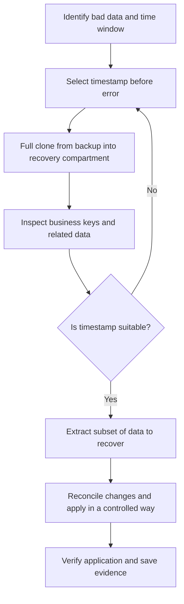

# Cloning, Backup, and Recovery of Autonomous Database

In the **Autonomous Database** chapter of the `CLOUD_PROVIDERS_ORACLE` module, this lesson guides you through creating database clones, selecting backup policies, and recovering data on Oracle Cloud Infrastructure (OCI). Operations are placed in real-world operational context: compartment-based authorization, VCN connectivity control, encryption key protection, recovery time measurement, and cost management.

## 1. Objectives and Scope

After this lesson, learners will be able to:

- Choose a full clone, metadata clone, or refreshable clone based on usage purpose.
- Distinguish in-place restore from creating a new database from backup.
- Select a recovery timestamp, interpret RPO/RTO, and verify post-recovery data.
- Execute a hands-on exercise resolving accidental data deletion using a clone from backup.
- Build a recovery procedure with controlled permissions, connectivity, costs, and operational evidence.

This lesson focuses on **Autonomous Database Serverless on OCI**, using a paid ECPU database as the practice environment. Oracle documentation currently uses the name **Autonomous AI Database**; this lesson keeps the Autonomous Database naming per the chapter. Do not apply these steps verbatim to Dedicated Exadata Infrastructure, Base Database Service, or Always Free because capabilities and policies can differ.

Console paths in this lesson start from the Autonomous Database details page. Menu labels can change; always verify resource type, OCID, region, and compartment before acting.

## 2. Distinguishing Clone, Backup, Restore, and Recovery

**Clone** creates a new database from an existing database or backup data. **Backup** stores information needed to reconstruct data state. **Restore** brings backed-up data back; **recovery** applies necessary change information to reach the target point. In Autonomous Database, the service orchestrates restore and recovery, while the operator chooses the target and verifies results.

| Need | Approach | Decision point |
| --- | --- | --- |
| Create a test environment with data | Full clone | Sensitive data and test environment config |
| Create an environment with schema structure | Metadata clone | How to load appropriate sample data |
| Maintain a read replica | Refreshable clone | Data lag and refresh schedule |
| Inspect data at a pre-incident timestamp | Clone from backup at point in time | Target timestamp and reconciliation plan |
| Roll back the entire existing database | In-place restore | Downtime and transactions after the recovery point |
| Retain data for multi-year retrieval | Long-term backup | Retention, encryption keys, and how to clone |
| Recover specific tables or schemas | Logical extraction, reconciliation, and re-import | Cross-object consistency |

Clone type and clone source are two distinct choices. A full clone can use a running database or a backup as its source. Cloning from a backup creates a new resource; it does not automatically redirect applications using the source database to the new resource. Oracle describes clone types and sources in [About Cloning on Autonomous AI Database](https://docs.oracle.com/en-us/iaas/autonomous-database-serverless/doc/autonomous-clone-about.html).

For example, a sales database accidentally deletes 100 orders at 10:15. Creating a clone at 10:14 helps recover the lost orders. Restoring the entire database back to 10:14 would also discard valid orders created after that timestamp. Therefore, decide whether you need **a subset of data** or **the entire database state** before choosing an operation.

## 3. Choosing a Clone Type

### 3.1. Full Clone

A full clone contains the source's data and metadata as of the creation point. It can be used to test migrations, validate application changes, or investigate incidents with near-production data.

Workflow to create a full clone from a running database:

1. Open the source database and select **More actions → Create clone**.
2. Choose **Full clone** and source **Clone from database instance**.
3. Choose the target compartment, database name, and compute/storage configuration.
4. Configure admin credentials, network connectivity, and encryption keys for the target.
5. Create the clone, wait for the appropriate state, then verify connectivity and data.

Refer to [Clone an Autonomous AI Database Instance](https://docs.oracle.com/en-us/iaas/autonomous-database-serverless/doc/autonomous-clone.html). A clone is a resource that must be managed separately: record its OCID, owner, purpose, and expiration date.

A full clone also copies business data. Before granting access to development teams, mask personal data, audit accounts, and disable integration paths that could send emails, trigger webhooks, or push data to live systems. Data masking must finish before opening broader access to test environments.

### 3.2. Metadata Clone

A metadata clone copies schema metadata without copying source table rows. It is useful when testing DDL structure, SQL/PLSQL code, or loading synthetic datasets.

Do not assume a metadata clone contains zero sensitive information. Object names, program code, or config settings inside metadata can expose internal details. Inventory objects and integration configs before sharing. Definitions of full clone and metadata clone appear in [About Cloning](https://docs.oracle.com/en-us/iaas/autonomous-database-serverless/doc/autonomous-clone-about.html).

### 3.3. Refreshable Clone

A refreshable clone maintains a read-only copy that can be updated from the source. It suits reporting or data inspection without needing an independent writable copy. A refreshable metadata clone option also exists for metadata syncing needs.

Oracle enforces a **7-day** refresh age limit; skipping refreshes beyond this limit can automatically disconnect the clone from its source. An explicitly disconnected clone has a **24-hour** reconnect window under supported conditions. Reconnecting discards test changes made on the clone; read prerequisites before using this workflow. See [About Refreshable Clones](https://docs.oracle.com/en-us/iaas/autonomous-database-serverless/doc/refreshable-clone-about.html).

With an ECPU source, you can enable automatic refresh and configure frequency and target lag. Monitor both the schedule and actual refresh timestamps; a configured schedule does not prove data is up to date. See [Edit Automatic Refresh Policy](https://docs.oracle.com/en-us/iaas/autonomous-database-serverless/doc/refreshable-clone-edit-auto-refresh.html).

Normal refreshes advance to a timestamp newer than the previous one. Query behavior during refresh depends on version: Oracle describes online refresh in 26ai and waiting for completion in 19c. See [Refresh a Refreshable Clone](https://docs.oracle.com/en-us/iaas/autonomous-database-serverless/doc/refreshable-clone-refresh.html). The lab exercise below uses a full clone from backup, not a refreshable clone, to preserve a historical point in time.

## 4. Understanding Backup Policies

### 4.1. Automatic Backups and Recovery Window

Per Oracle documentation, automatic backups default to **60 days** retention. With the ECPU model, retention is configurable from **1–60 days**; OCPU uses a 60-day policy. The service uses backups and change logs to support point-in-time recovery within the available data window. See [About Backup and Recovery](https://docs.oracle.com/en-us/iaas/autonomous-database-serverless/doc/backup-intro.html).

Retention is how long history is kept, not backup frequency or a guaranteed recovery duration. For instance, 30-day retention does not mean RPO is 30 days, nor does it guarantee every restore finishes in a fixed number of minutes.

With ECPU, change retention under **Backup → Automatic backup retention period → Edit**. Shortening retention can remove the ability to reach older timestamps; extending retention does not recreate expired history. **Backup Retention Lock** locks the automatic backup policy; once enabled, it cannot be disabled or modified as a normal option. Exceptions require working with Oracle through support procedures. See [Edit Automatic Backup Retention Period](https://docs.oracle.com/en-us/iaas/autonomous-database-serverless/doc/backup-edit-retention.html).

Choose retention based on error detection time. If the business only reconciles at month-end, a few-day retention window may expire before an error is noticed. Document the decision alongside business requirements and budget.

### 4.2. Long-Term Backups

Long-term backups serve long-term archival, with Oracle-supported retention from **3 months to 10 years**. They can be created once or scheduled weekly, monthly, or yearly. A database must have at least one automatic backup before creating a long-term backup. See [Create Long-Term Backups](https://docs.oracle.com/en-us/iaas/autonomous-database-serverless/doc/backup-long-term.html).

A setup flow includes:

1. Open the **Backups** tab and select **Create long-term backup**.
2. Choose retention matching archival requirements.
3. Choose one-time execution or a recurring schedule.
4. Record the business milestone the backup serves, such as post-closeout data.
5. Monitor completion and drill creating a database from that backup.

**Long-term backups are used to clone into a new database, not to restore the source database in place.** Nor do they provide a continuous PITR window across the entire multi-year archival period. See [About Backup and Recovery](https://docs.oracle.com/en-us/iaas/autonomous-database-serverless/doc/backup-intro.html).

A month-end backup schedule must align with reconciliation completion. A backup running on schedule before critical batches commit may fail to capture the intended closeout state.

### 4.3. Dependencies to Protect Alongside Backups

Having backups alone is not enough to assert recoverability:

- Backups do not contain external files in Object Storage referenced by external tables.
- For long-term backups encrypted with a customer-managed key, keep the corresponding key available.
- Terminating the source database loses access to long-term backups tied to it.
- A newly created or newly cloned database can take up to 4 hours before automatic backups appear.

These limits are documented in [Backup and Restore Notes](https://docs.oracle.com/en-us/iaas/autonomous-database-serverless/doc/backup-restore-notes.html).

Therefore, a recovery inventory must cover Object Storage data, application configuration, connection secrets, key access permissions, and software versions. For multi-year archived data, verify applications can run on a database version supported at recovery time rather than merely archiving old config files.

## 5. Selecting Recovery Points Using RPO, RTO, and Evidence

**RPO — Recovery Point Objective** is the target for acceptable data loss, typically measured in time. **RTO — Recovery Time Objective** is the target time to restore the service to an acceptable operating level.

Both objectives must be measured at the application level. Recovery duration can be modeled as:

```text
Actual downtime =
    time to detect and scope the issue
  + time to prepare permissions, resources, and recovery target
  + time to restore or create clone
  + time to verify and reconcile data
  + time to reconnect applications
```

This is a planning model, not an Oracle SLA formula. If creating a clone takes 12 minutes but reconciliation and bringing applications back up takes 35 minutes, you cannot report service recovery time as 12 minutes.

Suppose the following sequence of events occurs, all converted to UTC:

| Timestamp | Event |
| --- | --- |
| 03:00:00Z | Valid processing batch completed |
| 03:05:00Z | An accidental delete was committed |
| 03:06:00Z | Additional valid transactions occurred |
| 03:20:00Z | Operations team detected the error |

The timestamp 03:04:59Z is only a **candidate** before the error. Verify that valid transactions you want to keep actually committed prior to that timestamp. Application log timestamps may record request submission time, which differs from database commit time.

Facts to record include:

- Timestamps with timezone, transaction IDs, and commit confirmation logs if available.
- Affected tables, business keys, and data relationships.
- Latest timestamp verified as valid and earliest timestamp known to be bad.
- Valid transactions occurring after the candidate recovery point.
- Chosen target timestamp and verification results on the recovered database.

In Vietnam, 10:05 UTC+07:00 corresponds to 03:05Z on the same day. Never enter local time with the letter `Z`, because `Z` denotes UTC.

## 6. Preparing IAM, Networking, and Resources

### 6.1. Separate Cloud Permissions from SQL Privileges

OCI IAM determines who can read resource metadata, create clones, or invoke admin operations. Database privileges determine which data an SQL account can query, export, or modify. Having SQL privileges does not grant restore rights via OCI; having OCI permissions does not replace SQL privilege design.

Example policies for a group allowed to read one source and manage databases in a recovery compartment:

```text
Allow group ADBRecoveryOperators to read autonomous-databases in compartment ProdData where target.id = '<SOURCE_AUTONOMOUS_DATABASE_OCID>'
Allow group ADBRecoveryOperators to manage autonomous-databases in compartment RecoveryLab
```

Replace group name, compartments, and OCID before use. `manage` has broad scope in the target compartment; this is a lab example and should be narrowed by role in production. Same-tenancy cloning policies are guided by Oracle in [Prerequisites for Cloning](https://docs.oracle.com/en-us/iaas/autonomous-database-serverless/doc/autonomous-clone-prerequisites.html).

Permission to create clones in `RecoveryLab` is not permission to restore a database in `ProdData`. If using private endpoints, Vault, or cross-tenancy sources, prepare those permissions additionally.

### 6.2. Prepare Connectivity to the Target Database

A clone with accurate data that applications cannot connect to has not yet fulfilled recovery objectives. Before creating a clone, determine:

- Whether target region and compartment are right.
- Whether compute, storage, and quotas are sufficient.
- Whether the test host connects via a public endpoint with ACLs or a private endpoint.
- For private endpoints: whether VCN, subnet, DNS, NSGs, and routing from the test host are ready.
- How to fetch connection strings and wallet for the target database if required by connection mode.
- Who may access the clone, for how long, and for what purpose.

Do not assume the source's endpoint, wallet, and app config work automatically for the clone. In the lab, always open separate source and target SQL sessions with clear labels to avoid running commands on the wrong database.

## 7. Clone-from-Backup Workflow

Cloning from backup fits when you need to inspect a historical point, selectively recover data, or verify recoverability while keeping the existing database intact for comparison.



Console steps:

1. Open the source database and choose **Create clone**.
2. Select **Full clone**, source **Clone from a backup**.
3. Pick a PITR timestamp, select a backup from the list, or choose the latest backup timestamp per goal.
4. Enter target resource config, networking, admin credentials, and encryption key.
5. Create the clone; monitor progress before connecting.

For committed logical errors, pick a timestamp before the error; the latest backup may already contain the error. With the latest backup option, you can inspect the recovery point using this query when privileged:

```sql
SELECT last_recover_time, last_recover_scn
FROM dba_pdbs;
```

Backup source options and this query are documented in [Clone an Autonomous AI Database from a Backup](https://docs.oracle.com/en-us/iaas/autonomous-database-serverless/doc/autonomous-clone-backup.html).

Once the clone is available, check at least one known pre-point record and one known post-point change. Checking row counts alone easily misses cases where one row was deleted and another inserted.

## 8. In-Place Restore Workflow

In-place restore fits when you have decided to roll back **the entire existing database** to a chosen point. Before running it, stop or isolate write streams from applications, batches, consumers, and admin tools, while preserving records of transactions that may need reprocessing.

On the database page, select **More actions → Restore**, enter a timestamp or pick a backup, and execute the restore. The database is unavailable during this operation; upon completion, state returns to **Available**. See [Restore and Recover your Autonomous AI Database](https://docs.oracle.com/en-us/iaas/autonomous-database-serverless/doc/backup-recover.html).

A restore runbook should include:

1. Confirm OCID, region, owner, and recovery timestamp.
2. Identify write sources; prevent them from reconnecting automatically during verification.
3. Capture valid data after the recovery timestamp to plan reconciliation.
4. Execute restore and monitor progress.
5. Verify data, objects, privileges, and required connection configurations.
6. Reconcile with external systems: payments, queues, inventory, or partners.
7. Re-open write streams in defined order and monitor application errors.

Rolling a database back in time does not reverse transactions in payment gateways or messages already emitted externally. Idempotency, reconciliation, or compensating workflows are needed to prevent double processing.

Oracle also notes that restore rolls back files in `DATA_PUMP_DIR` and user-created directories to the chosen timestamp; Oracle Machine Learning workspaces, projects, and notebooks are not restored by this operation. See [Restore and Recover](https://docs.oracle.com/en-us/iaas/autonomous-database-serverless/doc/backup-recover.html). Those components require separate storage and verification plans.

## 9. Practice: Recovering a Deleted Record While Preserving New Transactions

### 9.1. Practice Prerequisites

Use a paid lab database with automatic backups available, and an empty learning schema with privileges to create tables, insert, delete, and query. Never run the following data-modifying commands on a production database.

The exercise creates three synthetic transactions. The final goal is recovering deleted transaction `1001` while retaining transaction `1003` added after the clone timestamp. Choose the same database version for source and target if supported so you focus on data recovery.

Before starting, record source OCID, recovery compartment, clone budget, and backup check results. Do not treat a newly provisioned database as proof an automatic backup recovery point already exists.

### 9.2. Create the Initial State

Run in the lab schema on the source database:

```sql
CREATE TABLE recovery_lab_orders (
    order_id     NUMBER PRIMARY KEY,
    amount       NUMBER(12, 2) NOT NULL,
    order_status VARCHAR2(20) NOT NULL
);

INSERT INTO recovery_lab_orders
VALUES (1001, 100.00, 'PAID');

INSERT INTO recovery_lab_orders
VALUES (1002, 200.00, 'PAID');

COMMIT;

SELECT order_id, amount, order_status
FROM recovery_lab_orders
ORDER BY order_id;

SELECT TO_CHAR(
           SYSTIMESTAMP AT TIME ZONE 'UTC',
           'YYYY-MM-DD"T"HH24:MI:SS.FF3"Z"'
       ) AS clean_time_utc
FROM dual;
```

Record the `clean_time_utc` value after commit. This is the candidate timestamp for the clean copy; label it `T_clean` in your lab notes. The current state has two rows `1001`, `1002`, totaling 300.

Separate the two practice phases by a clear time gap before running the next part. Do not execute subsequent changes so close to the timestamp that timestamp precision becomes hard to verify.

### 9.3. Add a New Transaction and Simulate Accidental Deletion

Run on the source database:

```sql
INSERT INTO recovery_lab_orders
VALUES (1003, 300.00, 'PAID');

COMMIT;

DELETE FROM recovery_lab_orders
WHERE order_id = 1001;

COMMIT;

SELECT order_id, amount, order_status
FROM recovery_lab_orders
ORDER BY order_id;

SELECT COUNT(*) AS row_count, SUM(amount) AS total_amount
FROM recovery_lab_orders;
```

Source now has two rows `1002`, `1003`, totaling 500. Because the delete was committed, a session `ROLLBACK` cannot restore row `1001`.

### 9.4. Create a Full Clone at T_clean

In the Console, follow the clone-from-backup workflow and pick timestamp `T_clean`. Place the clone in the recovery compartment, restrict networking, and grant query access to the practitioner.

If the service does not yet accept the recorded timestamp, check backup status, timezone, and recoverable timestamp bounds; wait until backup data becomes available and retry. Never switch to latest backup just to bypass the error, as it may include the accidental deletion.

Connect to the **clone** using target resource connection details, and run:

```sql
SELECT order_id, amount, order_status
FROM recovery_lab_orders
ORDER BY order_id;

SELECT COUNT(*) AS row_count, SUM(amount) AS total_amount
FROM recovery_lab_orders;

SELECT COUNT(*) AS orders_created_after_clean_time
FROM recovery_lab_orders
WHERE order_id = 1003;
```

Expected results:

| Check location | Present order_ids | Row count | Total amount |
| --- | --- | ---: | ---: |
| Source after error | 1002, 1003 | 2 | 500 |
| Clone at T_clean | 1001, 1002 | 2 | 300 |

The check query for `1003` on the clone must return 0. Both databases have two rows yet hold different data; this demonstrates why `COUNT(*)` alone is insufficient.

If the clone is missing the table or rows committed in phase one, re-verify the timestamp before continuing. Never edit source data to mask an inaccurate recovery point.

### 9.5. Selective Recovery Within Lab Scope

On the clone, verify the record to recover:

```sql
SELECT order_id, amount, order_status
FROM recovery_lab_orders
WHERE order_id = 1001;
```

For this lesson's small synthetic dataset, after confirming the exact values above, run the following conditional insert on the **source database**:

```sql
INSERT INTO recovery_lab_orders (order_id, amount, order_status)
SELECT 1001, 100.00, 'PAID'
FROM dual
WHERE NOT EXISTS (
    SELECT 1
    FROM recovery_lab_orders
    WHERE order_id = 1001
);

SELECT order_id, amount, order_status
FROM recovery_lab_orders
ORDER BY order_id;

SELECT COUNT(*) AS row_count, SUM(amount) AS total_amount
FROM recovery_lab_orders;

COMMIT;
```

The final state must contain `1001`, `1002`, `1003`, three rows totaling 600. The `NOT EXISTS` guard prevents inserting a key that already exists; it does not prove an existing row has valid contents. If key `1001` already exists with different values, stop and reconcile.

The insert above is appropriate only for the lesson's known synthetic dataset. With real data, export from the clone, load into staging, reconcile keys, contents, and relationships before updating the target. Do not generalize this into manually copying production data.

### 9.6. Completion Evidence

Record in the practitioner's operational log:

- Source OCID, clone OCID, requested timestamp, and clone completion time.
- Query results on source after error, clone at clean point, and source after repair.
- Recovered keys, preserved new changes, and verification method.
- Elapsed time from detection to verified data restoration.
- Observed costs and decision to keep or delete the clone.

The exercise meets its goal when lost data is recovered, new data remains intact, and reconciliation evidence exists. A clone's **Available** state alone verifies only part of the workflow.

## 10. Using OCI CLI to Inventory and Illustrate Restore

The examples below use **PowerShell**, assuming OCI CLI is configured and the principal holds appropriate permissions. Replace OCID, profile, region, and timestamp per environment. This lesson only provides commands; learners run them against identified lab resources.

List backups for the exact database:

```powershell
$databaseId = '<AUTONOMOUS_DATABASE_OCID>'
$regionName = '<OCI_REGION_ID>'

oci db autonomous-database-backup list --autonomous-database-id $databaseId --region $regionName --all --output json
```

`--all` retrieves all result pages. Inspect backup state and timestamps; having entries in the list does not prove any requested timestamp is valid. See [OCI CLI: autonomous-database-backup list](https://docs.oracle.com/en-us/iaas/tools/oci-cli/latest/oci_cli_docs/cmdref/db/autonomous-database-backup/list.html).

The following command **modifies the target database state**—use it only when in-place restore was chosen and write streams are stopped. It is not part of the selective recovery flow in Section 9:

```powershell
$databaseId = '<LAB_AUTONOMOUS_DATABASE_OCID>'
$regionName = '<OCI_REGION_ID>'
$restoreTimestamp = '<VALID_UTC_TIMESTAMP_IN_RECOVERY_WINDOW>'

oci db autonomous-database restore --autonomous-database-id $databaseId --region $regionName --timestamp $restoreTimestamp --wait-for-state AVAILABLE
```

A valid UTC timestamp has the form `2026-11-20T03:04:59Z`; replace illustrative dates with a timestamp inside the real recovery window. If waiting times out, check in-progress operations before resubmitting. A CLI timeout does not mean the service-side operation failed. Syntax and wait states are documented in [OCI CLI: autonomous-database restore](https://docs.oracle.com/en-us/iaas/tools/oci-cli/latest/oci_cli_docs/cmdref/db/autonomous-database/restore.html).

An automation workflow should log request ID, OCID, requested timestamp, and data verification results—not merely the command exit code.

## 11. Post-Recovery Verification

Design a verification suite before an incident happens so acceptance criteria are unambiguous:

| Verification layer | Example evidence |
| --- | --- |
| Right resource | OCID, region, compartment, connection string |
| Right point in time | Pre-point records exist; post-point changes reflect expected state |
| Business data | Orders, balances, inventory, or period aggregates |
| Data integrity | Orders have matching line items; no orphaned foreign keys |
| Objects and privileges | Tables, views, packages, and required accounts work |
| Integrations | Payments, messages, and batches are not double-processed |
| Application | Connects cleanly and passes scoped read/write checks |
| Operations | Logs, assigned owner, and decision to re-open service |

For real order tables, reconcile totals by status, time period, and currency. A single grand total can hide offsetting discrepancies across groups.

If data references files in Object Storage, check file versions too. Database metadata at the right point paired with an overwritten external file can still produce wrong query results.

## 12. Monitoring, Costs, and Clone Lifecycle

### 12.1. Signals to Monitor

An operational dashboard for backup and recovery should show:

- Configured retention and reachability of key milestones.
- Most recently completed automatic or long-term backup.
- Upcoming long-term backup schedule and run outcomes.
- Actual refresh timestamp, refresh age limit, and refresh errors if using refreshable clones.
- Running clone/restore operations, duration, and errors.
- Date of latest drill, measured recovery time, and data issues discovered.

The Console shows backup details and lists in the **Backups** tab; see [View Backup Information and Backups](https://docs.oracle.com/en-us/iaas/autonomous-database-serverless/doc/backup-list-backups.html). You can combine Events with Notifications to track service-emitted operations; see [Use Autonomous AI Database Events](https://docs.oracle.com/en-us/iaas/autonomous-database-serverless/doc/autonomous-database-events.html).

For automation, distinguish start events from completion outcomes. A "backup started" event is not proof of a successful backup; similarly, resource creation completion does not replace data verification.

### 12.2. Account for All Costs

When budgeting, include:

```text
Solution cost =
    compute for source and recovery resources
  + database storage
  + backup storage
  + networking, external storage, and related services
  + retention duration after completing purpose
```

This is an estimate checklist, not a pricing formula. With ECPU, backup storage is billed additionally; long-term backups and clone/DR choices have their own billing rules. Do not apply an assumption that "backups are always included in the database price" across all compute models. Check [Autonomous AI Database Serverless Features Billing](https://docs.oracle.com/en-us/iaas/autonomous-database-serverless/doc/autonomous-features-billing.html) and region-specific pricing before deploying.

Tag every clone with `Owner`, `Purpose`, `Environment`, and `ExpiresOn`. This is a suggested operational convention; an expiration tag does not delete anything unless an enforcement process acts on it.

After drills, save required evidence, revoke temporary access, and clean up resources per policy. Do not terminate a source database purely to cut costs if long-term backups depend on it. Stopping a database must also be evaluated alongside ongoing storage and backup charges.

## 13. Backups Within an Availability Strategy

Backups, clones, and disaster recovery solve different problems. A read-only refreshable clone does not automatically become an Autonomous Data Guard standby with failover capabilities. An in-region backup also does not prove recoverability when the entire region is unreachable.

With cross-region Autonomous Data Guard, Oracle allows enabling automatic backup replication to the peer; this feature is not enabled by default and has its own history window. See [About Autonomous Data Guard with Cross-Region Standby](https://docs.oracle.com/en-us/iaas/autonomous-database-serverless/doc/adg-about-cross-region--cross-tenancy.html).

Operational plans must distinguish:

| Scenario | Question to answer |
| --- | --- |
| Accidental deletion or bad data edit | Is there a pre-error point and a way to preserve subsequent valid transactions? |
| Database becomes unavailable | Is there a drilled plan for service recovery and application reconnection? |
| Region unavailable | Are data, keys, permissions, and recovery infrastructure present in the target location? |
| Retrieving data from years ago | Is the backup still accessible and can applications still read the data? |

When selecting an approach, document incident scope, target RPO/RTO, cost level, and drill results. For logical errors, replicating the latest state elsewhere may replicate the error itself; backup history and point-selection evidence remain essential.

## 14. Common Mistakes

| Symptom or misconception | Remediation |
| --- | --- |
| Database just created, no backup visible yet | Check backup capability and wait window; do not assume a recovery point exists immediately |
| Timestamp rejected | Verify UTC/offset, retention window, and recoverable bounds |
| Clone has data but misses target records | Check commits and pre/post-error points using business keys |
| Clone is Available but unreachable | Check endpoint, DNS, ACL/NSG, routing, and target connection details |
| Choosing latest backup to fix accidental deletion | Identify a point before the bad commit and verify on a clone first |
| Using long-term backup to restore source in place | Plan cloning into a new database and application cutover |
| Retention increased yet old history missing | Expired history is not regenerated by raising retention |
| Source and clone have same row count so concluded identical | Reconcile keys, values, aggregates, and cross-table relationships |
| Immediately re-opening all write paths post-restore | Complete reconciliation, reopen in order, monitor duplicate handling |
| Skipping drills because backups exist | Measure real duration and verify data, keys, networking, and permissions |

A complete recovery plan must answer four things: **which data to recover, at which point in time, into which resource, and by what evidence the application is cleared to resume operations**.
