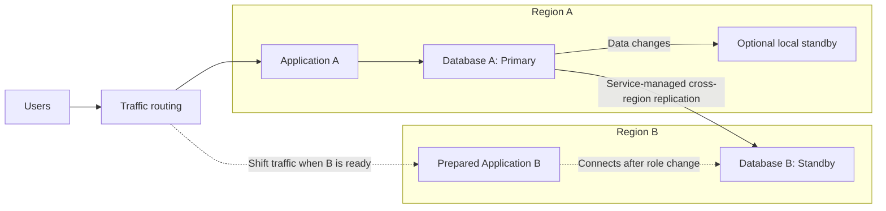

# Autonomous Data Guard and Cross-Region Recovery

## 1. Objectives and Scope

In the **CLOUD_PROVIDERS_ORACLE** module, **Autonomous Database** chapter, this lesson explains how to design and operate database recovery when an OCI region experiences an outage. The topic connects Autonomous Database with tenancy, compartment, IAM, VCN, application tier, monitoring, automation, and cost control.

After this lesson, learners will be able to:

- Distinguish in-region availability from cross-region disaster recovery.
- Choose local standby or cross-region standby based on business requirements.
- Distinguish switchover, failover, and failback to the original region.
- Prepare networking, access permissions, and application configuration before regional cutover.
- Measure recovery time and reconcile transactions after a database role transition.
- Build a runbook executable even when the primary region is unreachable.

Operations in this lesson use **Autonomous Database Serverless on OCI**, with ECPU as the reference compute model. Current Oracle documentation may display the name **Autonomous AI Database Serverless**. Do not apply these steps verbatim to Autonomous Database on Dedicated Exadata Infrastructure or self-managed Oracle Database.

The hands-on exercise is a lab-environment guide; examples do not represent an actual OCI deployment.

## 2. What Does Autonomous Data Guard Protect?

### 2.1. Primary and Standby

The **primary database** serves application operations. The **standby database** receives changes from the primary so it can take over when needed. Autonomous Data Guard is an Oracle-managed capability: users select protection configuration and invoke service operations rather than installing Data Guard Broker or managing database hosts themselves.

There are two main placement options:

| Configuration | Standby location | Purpose |
| --- | --- | --- |
| Local standby | Same OCI region as primary | Reduce disruption from in-region failures |
| Cross-region standby | Another service-supported region | Maintain recoverability when primary region is unavailable |

Both can be combined. A local standby is placed in a different Availability Domain when the region has multiple ADs; in single-AD regions, the service uses a different Fault Domain. This configuration remains within the same region. See [About Standby Databases](https://docs.oracle.com/en-us/iaas/autonomous-database-serverless/doc/autonomous-data-guard-about.html).

A design mistake is assuming two ADs in the same region eliminate all regional risk. They reduce the blast radius of certain failures, yet surviving a full-region outage requires resources and operational paths in another region.

### 2.2. A Standby Database Does Not Equal a Full Standby System

Autonomous Data Guard solves one part of the system: database role transition. Applications still need compute to run on, network paths, credentials, endpoints, and dependent services.



This diagram shows logical components. It does not mean learners must build a redo replication stream across the application's VCN.

For example, an order system successfully fails over the database to Region B, yet application servers exist only in Region A. The database recovered, yet customers still cannot place orders. Therefore, DR completion criteria must tie to successful business transactions.

### 2.3. A Standby Is Not an Arbitrary Read Replica

A standard standby is not open for read-only application queries. Do not include it in reporting designs as an active query-serving database. Autonomous Data Guard is also unavailable for Always Free Autonomous Database. See [Autonomous Data Guard Notes](https://docs.oracle.com/en-us/iaas/autonomous-database-serverless/doc/autonomous-data-guard-notes.html).

Snapshot standby capability for testing behaves differently and is covered separately later in this lesson.

## 3. Understanding RTO and RPO Correctly

### 3.1. Set Objectives from Business Needs

**RTO — Recovery Time Objective** is the target recovery duration. When stating a number, specify the start point and completion criteria of the measurement.

**RPO — Recovery Point Objective** is the target for acceptable data loss, measured in time. A 60-second RPO does not guarantee losing exactly 60 seconds of transactions; it describes the target loss bound the design must meet.

Example requirements for an order service:

| Requirement | Verifiable phrasing |
| --- | --- |
| Service restoration | Within 20 minutes from when customers first cannot place orders |
| Data preservation | Confirmed transactions missing from the recovered system do not exceed 60 seconds |
| Prevent double charging | Every payment request has an idempotency key and reconciliation workflow |
| Operable during regional outage | On-call team has Region B permissions and access independent of Region A |

These are sample organization-defined targets, not Oracle guarantees.

### 3.2. Service Objectives of Autonomous Data Guard

Per service documentation referenced as of **November 20, 2026**, key objectives include:

| Operation | Database service target RTO | Target RPO |
| --- | --- | --- |
| Switchover to local standby | 2 minutes | 0 |
| Failover to local standby | 2 minutes | Target 0; automatic failover also depends on configured data-loss limit |
| Switchover to cross-region standby | Under 10 minutes | 0 |
| Manual failover to cross-region standby | Under 10 minutes | Up to 1 minute |
| Automatic failover to cross-region standby | Not available in Autonomous Data Guard | Not applicable |

Check [Recovery Time Objective and Recovery Point Objective](https://docs.oracle.com/en-us/iaas/autonomous-database-serverless/doc/autonomous-data-guard-about.html) and [Service Level Objectives](https://docs.oracle.com/en-us/iaas/autonomous-database-serverless/doc/availability-slo.html). Values are service objectives for the corresponding configurations; do not assume every drill or every application recovers within that exact timeframe.

For local automatic failover, the default data-loss limit is **0 seconds**, configurable between **0–3600 seconds**. If the service cannot guarantee the chosen limit, automatic failover does not occur; operators must evaluate manual failover. This limit does not make cross-region failover automatic. See [Automatic Failover with a Standby Database](https://docs.oracle.com/en-us/iaas/autonomous-database-serverless/doc/autonomous-data-guard-auto-failover.html).

### 3.3. Application RTO Is Usually Longer Than Database Transition

Oracle measures cross-region transition time from when the operation is initiated. Operational design must add detection, decision, and application restoration time. See [Oracle MAA for Autonomous Database Serverless](https://docs.oracle.com/en/database/oracle/oracle-database/26/haovw/autonomous-database-serverless.html).

A time-budgeting model:

```text
Application recovery time
≈ detection time
+ assessment and decision time
+ database role-transition time
+ application startup and connection time
+ business verification and traffic shift time
```

Tasks performed in parallel reduce actual total duration. This formula prevents omitting work, rather than mandating mechanical addition of every interval.

Hypothetical example: detection takes 2 minutes, decision takes 3 minutes, database role transition takes 6 minutes, app and verification take 5 minutes. Total time is roughly 16 minutes, even though the database operation took 6 minutes.

Never use the work request completion timestamp alone as the end of system RTO.

## 4. Switchover, Failover, and Returning to the Original Region

| Concept | When used | Key point to remember |
| --- | --- | --- |
| Switchover | Planned role swap when both sides can coordinate | Zero-data-loss objective |
| Failover | Primary can no longer serve; standby must take over | Data loss possible, especially cross-region |
| Return to original region | Resume operations in the pre-incident region | Perform only after topology is restored and eligible for role transition |

In this lesson, "failback" refers to the workflow of returning service to the original region. Do not assume the Console has a single Failback button that automates the entire workflow.

Distinguish two questions when an alert fires:

1. **Why can the application not reach the database?** DNS, ACLs, NSGs, credentials, or connection pools can cause errors while the database is healthy.
2. **Is changing the primary necessary?** Decisions must rely on database evidence and incident scope, not merely a single HTTP error.

To drill regional transition while both sides are healthy, use switchover. Never break a database or simulate a regional failure just to verify application connectivity.

## 5. Preparing Before Enabling Cross-Region Protection

### 5.1. Choose Regions and Verify Deployment Capacity

Do not assume every region pair supports your desired setup. Pick a service-supported target region, verify region subscription, service limits, compartment quotas, and available resources.

Prepare a minimum tracking matrix:

| Item | Region A | Region B |
| --- | --- | --- |
| Initial role | Primary | Standby |
| Database OCID | Record actual value | Record actual value after peer creation |
| Compartment | Source compartment | Target compartment |
| VCN, subnet, NSG | Source config | Target app and endpoint config |
| Connection config | Ref to config A | Ref to config B |
| On-call permissions | Verified | Verified |
| App hosting | Source Compute or platform | Standby Compute or platform |
| Latest evidence | Test timestamp | Connectivity and drill results |

Never store passwords or wallet contents in operational tables.

### 5.2. Separate IAM from In-Database Privileges

IAM authorizes managing OCI resources. Database accounts and SQL privileges authorize applications to access data. Having permission to manage a database in the Console does not prove the application can log in and run transactions.

Example policy for an observer-only group:

```text
Allow group DR-Observers to inspect autonomous-databases in compartment OracleDatabaseProd
Allow group DR-Observers to inspect autonomous-databases in compartment OracleDatabaseDR
```

Replace group names and compartments for your actual tenancy. Operations teams need corresponding permissions for switchover/failover on the relevant resources. Oracle groups these APIs under `use autonomous-databases`; scope can be narrowed with operation conditions instead of granting tenancy-wide admin rights. Viewing databases also does not include all Monitoring, Events, or networking permissions. See [IAM Policies for Autonomous AI Database](https://docs.oracle.com/en-us/iaas/autonomous-database-serverless/doc/autonomous-database-iam-policies.html).

Test with the exact identity that will execute DR. A successful drill using a tenancy-wide admin account does not prove the on-call team has sufficient permissions.

### 5.3. Prepare Independent Access Paths

Operational access to Region B must still work when Region A loses connectivity. Anti-pattern to avoid: databases sit in two regions, yet the only bastion host holding admin tools and auth configs lives in Region A.

With private endpoints, verify separately:

- Application host B resolves the target database hostname.
- Routing to endpoint B exists.
- NSGs, security lists, and ACLs allow the right connection sources.
- TLS or mTLS configuration matches database requirements.
- The operations team can retrieve required secrets when the primary region is unavailable.

Networking and private endpoints of a remote peer have their own configuration; do not assume they synchronize fully from the source. When designing wallet-based connectivity across cross-region VCNs, handle VCN peering and DNS forwarding per Oracle requirements. See [About Autonomous Data Guard with Cross-Region Standby](https://docs.oracle.com/en-us/iaas/autonomous-database-serverless/doc/adg-about-cross-region--cross-tenancy.html).

### 5.4. Encryption Keys, Configuration, and Dependent Services

If using customer-managed encryption keys, verify key support in the target region before deploying. Never let a DR plan depend on a key accessible only in the failed region.

Inventory dependencies:

| Component | Question to answer |
| --- | --- |
| App images or deployment packages | Where does Region B pull tested releases from? |
| Secrets and wallets | Can they be retrieved independently of Region A? |
| Object Storage | Are attachments, ingestion files, and external tables accessible? |
| Queues and background jobs | Must old consumers be stopped or guarded against duplicate runs? |
| Payment gateway | How are indeterminate-outcome transactions reconciled? |
| DNS or traffic router | Which readiness criteria must pass before shifting to B? |
| Monitoring | Who receives alerts if notification systems in A are down? |

A credential still existing inside the database does not prove the external service it points to is available.

## 6. Configuring Autonomous Data Guard in the Console

### 6.1. Add Local Standby When Required by Design

On the primary's details page, open **Disaster recovery**, open the menu under **Local**, select **Upgrade to Autonomous Data Guard**, choose the protection type, and set the data-loss limit for automatic failover.

Monitor the work request and peer status until the standby is ready. The primary may return to `Available` before standby creation finishes; do not use primary status alone to conclude protection is active. See [Enable Autonomous Data Guard](https://docs.oracle.com/en-us/iaas/autonomous-database-serverless/doc/autonomous-data-guard-update-type.html).

Local standby is an optional addition in the illustrative architecture, not a mandatory step before every cross-region setup.

### 6.2. Add Cross-Region Standby

When the primary is eligible:

1. Open the **Disaster recovery** tab and select **Add peer database**.
2. Choose a supported target region and target compartment.
3. Choose DR type **Autonomous Data Guard**.
4. If the source uses a private endpoint, specify the VCN and subnet for the peer in the target region.
5. Decide explicitly whether to enable cross-region backup replication.
6. Create the peer, monitor the work request, and verify the peer has role standby, right region, and right DR type.

The primary can continue serving while the peer is created, yet a peer in `Provisioning` is not proof DR is ready. See [Add a Cross Region Standby Database](https://docs.oracle.com/en-us/iaas/autonomous-database-serverless/doc/autonomous-data-guard-enable.html).

Do not confuse **Backup-Based Disaster Recovery peer** with **Autonomous Data Guard standby** when reading the Console. They have different mechanisms and recovery objectives.

### 6.3. Record Configuration Post-Deployment

The configuration record should contain:

- OCID and region of each database.
- DR type, role, and state of each peer.
- Completion timestamp of the peer-creation work request.
- Network test results and application config in the target region.
- Backup scope and how to access backups during a regional outage.
- Schedule and owner of the first drill.

A screenshot showing "peer created" only confirms resource configuration. Proving recoverability requires executing a role transition and running transactions.

## 7. Preparing Applications to Connect After Regional Cutover

### 7.1. Connection Strings and Wallets Must Match the Exact Database

With cross-region DR, each database's default wallet and connection string contain that database's own hostname. Do not assume the source wallet automatically routes applications to the other region.

Prepare configuration for the database that will become primary after cutover; for mTLS, obtain the matching wallet from that database and verify secure update mechanisms. Tool endpoints such as APEX, ORDS, or Database Actions also need review when changing regions. See [Cross-Region Disaster Recovery Connection Strings and Wallets](https://docs.oracle.com/en-us/iaas/autonomous-database-serverless/doc/adg-about-cross-region--cross-tenancy.html).

One way to organize application configuration is maintaining two deployment configs:

```text
Application Config A:
    region = A
    database = database A
    connection config = secret reference for A

Application Config B:
    region = B
    database = database B
    connection config = secret reference for B
```

This is an illustrative configuration pattern, not mandatory OCI or Oracle JDBC variable names.

### 7.2. Connection Pool Recovery and Indeterminate Transactions

Applications holding stale connections may keep failing after the new database becomes ready. Recovery procedures must purge broken connections, open connections to the current primary, and verify transactions.

Specifically, a connection drop immediately after sending `COMMIT` does not prove the transaction rolled back. The database may have committed while the response never reached the application.

Example payment command with `request_id = PAY-20261120-0001`:

1. Application sends the command and loses connection before receiving a response.
2. Post-DR, the application queries by `request_id`.
3. If a result already exists, use that result.
4. If not found, reconcile with the payment gateway and business logs before deciding to resend.
5. If resending, reuse the same idempotency key per the target service's contract.

Unique constraints inside the database prevent duplicate inserts among recovered records. They do not automatically resolve a payment that succeeded at the payment gateway whose database record was lost within the RPO window.

Never treat retries as an exactly-once execution guarantee.

### 7.3. Move the Application Tier Together with the Database

Placing active applications close to the current primary avoids cross-region latency and reduces dependence on the impaired region. Oracle presents this pattern in [guidance for preparing mid-tier applications for cross-region DR](https://blogs.oracle.com/autonomous-ai-database/configure-your-mid-tier-applications-for-cross-region-disaster-recovery).

Before shifting traffic to B, verify all of the following:

- Connectivity to database B succeeds.
- Scoped read and write test transactions succeed.
- Mandatory business dependencies respond.
- Background tasks and consumers in A are stopped or coordinated to prevent duplicate runs.
- Applications report the active serving region accurately for diagnostics.

## 8. Practice: Planned Switchover from A to B

### 8.1. Environment and Entry Criteria

Use two supported regions in the same tenancy with primary A and standby B ready. Prepare a test application in B and a lab SQL account with table creation privileges in its schema.

Do not use a real business schema for this example. Keep a log of confirmed transactions outside the protected database so you have a reconciliation baseline when testing recovery.

Sample log format:

| UTC Timestamp | Request ID | Application-side outcome | Serving region |
| --- | --- | --- | --- |
| Commit response receipt time | Transaction ID | Succeeded or indeterminate | A or B |

The external log should live somewhere still reachable if Region A goes down.

### 8.2. Create Marker Data

Connect to primary A and run once:

```sql
CREATE TABLE dr_probe (
    request_id   VARCHAR2(80) PRIMARY KEY,
    source_label VARCHAR2(40) NOT NULL,
    created_at   TIMESTAMP WITH TIME ZONE DEFAULT SYSTIMESTAMP NOT NULL
);

INSERT INTO dr_probe (request_id, source_label)
VALUES ('DR-LAB-A-0001', 'REGION_A');

COMMIT;

SELECT request_id, source_label, created_at
FROM dr_probe
WHERE request_id = 'DR-LAB-A-0001';
```

Record the output along with when commit confirmation arrived. `created_at` reflects row insertion time, not the exact commit timestamp.

A single marker row only proves that row's presence. It is not enough to conclude RPO holds for all transactions.

### 8.3. Execute Role Transition

Pause lab write sources and background jobs, letting in-flight transactions finish. Record the start timestamp of planned downtime.

For cross-region switchover, initiate it from **standby B's details page**:

1. Switch to Region B or open the peer link from the Disaster recovery tab.
2. Verify B's exact OCID and standby role.
3. Click **Switchover** and confirm the database in the dialog.
4. Monitor role transition state and the work request.
5. Confirm B becomes primary and re-verify topology.

Switchover coordinates both sides with a zero-data-loss objective. Do not assume the operation can be cancelled arbitrarily once cross-region transition begins. See [Perform a Switchover](https://docs.oracle.com/en-us/iaas/autonomous-database-serverless/doc/autonomous-data-guard-switchover.html).

Menu labels can vary across UI updates; identify the exact resource, role, and operation type.

### 8.4. Verify on Primary B

Using B's connection configuration, open a new connection and run:

```sql
SELECT request_id, source_label, created_at
FROM dr_probe
WHERE request_id = 'DR-LAB-A-0001';

INSERT INTO dr_probe (request_id, source_label)
VALUES ('DR-LAB-B-0001', 'REGION_B');

COMMIT;

SELECT request_id, source_label
FROM dr_probe
WHERE request_id IN ('DR-LAB-A-0001', 'DR-LAB-B-0001')
ORDER BY request_id;
```

Expected: the row from A is visible and the new row writes successfully on B. Next, run business checks through application B, allow test traffic, and record when the first business transaction succeeds.

If `DR-LAB-B-0001` already exists from an earlier run, use a new request ID or inspect old results. Never delete old trace rows just to make a script look clean.

### 8.5. Evaluate Results

| Measurement | Start milestone | End milestone |
| --- | --- | --- |
| Database operation duration | Switchover initiated | New primary ready per service |
| Application disruption | Application stops serving writes | New business transaction succeeds |
| Sample data integrity | Set of confirmed pre-switchover requests | Lookup results on new primary |
| Operability | Log in with on-call identity | Complete steps using actual permissions |

Reports must preserve failure findings too. For example, "database transitioned in 5 minutes, app took 12 extra minutes due to DNS" pinpoints exactly what to improve.

## 9. Runbook When Region A Suffers a Real Outage

The procedure below is an operational framework that must be drilled before production use.

### 9.1. Gather Evidence and Choose Recovery Scope

1. Confirm failure from multiple vantage points; separate app network issues from database issues.
2. Record incident start timestamp and requests with indeterminate outcomes.
3. Check in-region recovery options, including local standby status if present.
4. Inspect from Region B: peer, permissions, networking, and standby applications.
5. Assign incident commander, operator, and business verifier.

Oracle advises prioritizing local recovery when a local standby remains available. For cross-region Console workflows, try switchover from the standby first; when that fails, the Console offers manual failover. Manual failover can incur data loss. See [Perform a Manual Failover](https://docs.oracle.com/en-us/iaas/autonomous-database-serverless/doc/autonomous-data-guard-failover.html).

Do not wait until primary A's page becomes reachable again before checking Region B resources. Region B access details must already live in the runbook.

### 9.2. Data-Risk Acceptance Decision

Before manual failover, record:

- Most recent lag timestamp and value, plus freshness of that sample.
- Confirmed transactions close to the incident timestamp.
- Indeterminate outcomes requiring reconciliation.
- Business RPO threshold and impact if exceeded.
- Decision authority per organizational governance.

This is an operational accountability step. Autonomous Data Guard cannot decide for the business whether losing a batch of payment transactions is acceptable.

Stale lag metrics do not prove current state. If unable to confirm, record "unknown" rather than turning an outdated sample into a zero-data-loss claim.

### 9.3. Transition the Database and Resume Service

From B, execute the role-transition path matching service state. Monitor completion, verify B is primary, and connect directly to B.

Next:

1. Stop or isolate any remaining write streams from application A.
2. Load connection config B and rebuild required connection pools.
3. Verify reads of confirmed data and execute a controlled test write.
4. Reconcile indeterminate transactions.
5. Shift traffic gradually and monitor errors.
6. Record business restoration time, not just database role-change time.

Never open the old database as an independent primary to "temporarily serve more traffic" before DR stabilizes. The operational goal is a single clearly designated source of business writes.

### 9.4. Restore Protection Level After the Incident

Once serving from B, inspect peers, sync status, backups, and alarms for the current primary. Do not treat the application coming back online as meaning the system has the same protection level as before.

When A returns:

- Wait for the service to complete reconnection or recreate required peers.
- Verify actual roles and states rather than relying on old display names.
- Verify networking, permissions, and configs in A as if it were a fresh target region.
- Plan return only after synchronization and transition prerequisites are satisfied.
- Use a planned switchover to move service back if design requires it.

Never fail back solely because A's Console page loads again.

## 10. Monitoring Recoverability

### 10.1. Monitor Lag on the Right Resource

The `oci_autonomous_database` namespace includes the **PeerLag** metric in seconds. For a local peer, view the metric on the primary; for a cross-region peer, view it on the peer resource. Metrics documentation mandates alarm intervals of **5 minutes** or more. See [Available Metrics: oci_autonomous_database](https://docs.oracle.com/en-us/iaas/autonomous-database-serverless/doc/autonomous-monitor-metrics-list.html).

Example MQL expression to discuss an alarm:

```text
PeerLag[5m].max() > 30
```

This is an illustrative threshold. In real configurations, filter to the exact database/peer, select the right compartment and region, and verify emitted data.

A 5-minute aggregated alarm does not create a 30- or 60-second RPO guarantee. Account for metric emission cadence, ingestion delay, trigger evaluation, and human response time.

In addition to lag values, detect missing data. Zero samples does not equal zero lag.

### 10.2. Events and Notifications

Useful events include start and end of switchover, manual failover, and automatic failover. Example switchover completion event type:

```text
com.oraclecloud.databaseservice.switchoverautonomousdatabase.end
```

For remote standbys, Oracle notes events are emitted for the database holding the primary role. Rules scoped to one region or filtering only the old primary OCID may stop covering the new primary. See [Events and Notifications for a Standby Database](https://docs.oracle.com/en-us/iaas/autonomous-database-serverless/doc/autonomous-data-guard-events.html).

Design notification channels and test them after role changes. Completion events must also be read alongside operation status—do not assume "end" always means success.

### 10.3. Verify from the User Perspective

Maintain three signal layers:

| Layer | Signal | Meaning |
| --- | --- | --- |
| Database service | Role, lifecycle, peer, work request | Are role transition and protection working? |
| App connectivity | DNS, TLS, login, pool | Can the app reach the current primary? |
| Business | Submit request, read result, dedup guard | Can users actually complete their work? |

Place probes where they do not share fate with Region A. A monitoring system that goes dark alongside the application provides no evidence during DR.

## 11. Controlled Automation

### 11.1. Separate Provisioning from Incident Response

Infrastructure as Code and deployment pipelines can prepare VCNs, subnets, NSGs, app hosts, alarms, and per-region config references.

Incident orchestration needs current roles, in-flight operation status, and traffic-opening gates. Illustrative orchestration sequence:

```text
Read resource roles and states
→ verify target database eligibility
→ confirm regional cutover decision
→ submit a single role-transition request
→ wait for result or handle timeout
→ point application config to current primary
→ verify read/write and business checks
→ open traffic
→ re-verify DR protection level
```

If a command times out, re-read state before sending another request. A client timeout does not prove the service failed to execute the operation.

Automation should log request ID, UTC timestamp, target OCID, and outcome while keeping secrets out of logs.

### 11.2. OCI Full Stack Disaster Recovery

OCI Full Stack Disaster Recovery can orchestrate regional cutover across multiple components beyond just the database. Current documentation for Autonomous Database integration requires ECPU and cross-region Autonomous Data Guard peers; do not use local standbys or Backup-Based Disaster Recovery peers for this integration.

Create DR Protection Groups in both regions, add members, configure IAM, and test DR plans. See [Use OCI Full Stack Disaster Recovery with Autonomous AI Database](https://docs.oracle.com/en-us/iaas/autonomous-database-serverless/doc/full-stack-disaster-recovery.html).

Orchestration tools execute runbooks. They do not prove applications have valid network paths, connection configs, or transaction reconciliation logic; those still require testing.

## 12. Backups and Snapshot Standby in Recovery Design

### 12.1. Keep a Recovery Path for Logical Errors

Replication keeps the standby aligned with the primary. Consequently, a committed accidental deletion also propagates to the standby. Role transition alone does not roll data back before the deletion.

Design separate handling paths:

| Scenario | Recovery path to evaluate |
| --- | --- |
| Primary unavailable, standby healthy | Appropriate role transition |
| Accidental delete or bad update propagated | Point-in-time recovery or extract from recovered copy |
| Backups unreachable in source region | Accessible backups in another region |
| Application configuration error | Fix or roll back config; do not default to changing primary |
| External data outside database unavailable | Restore dependent service or data copy |

Backups, retention, and restore drills belong in the plan alongside Data Guard. Check cross-region backup replication options explicitly; having a standby does not guarantee all desired backups exist in the target region.

### 12.2. Snapshot Standby for Testing the Standby Region

A cross-region peer can be converted to a **snapshot standby** to open read/write for testing. In this mode, changes from primary continue arriving without being applied; upon reconnection, test changes on the snapshot are discarded and queued source changes are applied. This mode has a 48-hour maximum limit.

Do not conclude a snapshot has ended all DR protection, nor treat it as having the same failover readiness as a normal standby: converting back and applying changes takes time. See [Convert Cross Region Peer to Snapshot Standby](https://docs.oracle.com/en-us/iaas/autonomous-database-serverless/doc/autonomous-data-guard-snapshot-standby.html).

This is a useful option for testing application B, yet it does not replace measuring end-to-end switchover and traffic restoration. Record the planned reconnection time and avoid treating test data on the snapshot as business data to retain.

## 13. Cost Control and Choosing Protection Levels

Under the standard ECPU model described in billing docs:

| Additional component | Additional billing basis |
| --- | --- |
| Local Autonomous Data Guard peer | Base ECPU and storage matching primary |
| Cross-region Autonomous Data Guard peer | Base ECPU and 2x storage matching primary |
| Optional cross-region backup replication | Separate cross-region backup charges |

Storage includes auto-scaled space used; primary compute auto scaling is not added the same way to a normal standby. Check specific rules if using elastic pools. See [Oracle Autonomous AI Database Serverless Features Billing](https://docs.oracle.com/en-us/iaas/autonomous-database-serverless/doc/autonomous-features-billing.html).

Beyond the database, estimates must include application B hosts, networking, load balancers, dependent storage, monitoring, and drill resources. Never estimate total cost from primary ECPU count alone.

Budget using:

```text
DR operating budget
= database protection cost
+ standby application tier cost
+ dependent data and service cost
+ monitoring, operations, and drill cost
```

Match options to needs:

- Services tolerating longer recovery times can evaluate backup-based recovery.
- Services needing rapid database takeover evaluate Autonomous Data Guard.
- Services needing protection across multiple failure scopes can combine local and cross-region standbys.
- Services needing multiple standby regions must verify support, limits, encryption keys, and costs per exact configuration.

Use tags, budgets, and usage reports to track every component. After the lab, review and tear down test resources per approved procedures; do not leave standbys and standby compute running long-term without an owner.

## 14. Common Mistakes and Troubleshooting

| Symptom or misconception | Check to perform |
| --- | --- |
| Standby created so app will definitely meet RTO | Drill full app, secrets, networking, and traffic cutover |
| Waiting for cross-region automatic failover | Check runbook or deployed orchestration tooling |
| Primary Available so peer must be ready | Check peer state and work requests |
| App B fails to connect after role change | Check hostname, wallet, DNS, routes, NSGs, ACLs, and pool |
| Using standby to run reports | Review normal standby limitations |
| PeerLag is 0 in old sample so zero data loss guaranteed | Check sample freshness and reconcile confirmed transactions |
| Missing metrics means lag equals 0 | Check wrong region, wrong resource, permissions, or missing data |
| Database recovered yet jobs run twice | Check schedulers, consumers, and idempotency keys |
| No alerts firing after DR | Check OCID filters, region, and current primary |
| Wanting to fail back immediately when A recovers | Wait for peer recovery, sync, and drill return path |
| Accidentally dropped table so failing over to get old data | Evaluate point-in-time recovery and backups |
| Skipping backups because standby exists | Check scenarios needing historical data or multi-party recovery |

## 15. Acceptance Criteria for a DR Plan

A plan ready for operations must have evidence for the following:

- **Configuration:** primary, peer, regions, and DR type match design.
- **Permissions:** on-call identity can execute steps within required scope.
- **Operational path:** team can inspect and act in B without reaching A.
- **Connectivity:** app B resolves names, authenticates, and connects to the right primary.
- **Data:** confirmed transactions are reconciled and indeterminate outcomes handled.
- **Timing:** measured from business impact to successful transaction, isolating database transition time.
- **Monitoring:** alarms and notifications cover the new primary.
- **Ongoing protection:** backups and peers reach target state post-cutover.
- **Return path:** procedure, prerequisites, and test evidence exist.
- **Cost:** standby resources have owners and budget tracking.

Each drill should record UTC timestamps, before/after roles, acted-upon OCIDs, work requests, test outcomes, and anything slower than target. Measured numbers and missing dependencies serve as inputs to refine the design.
