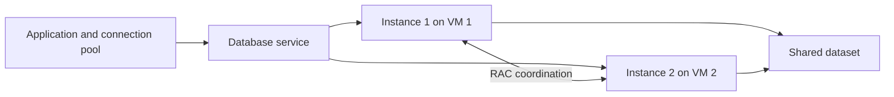
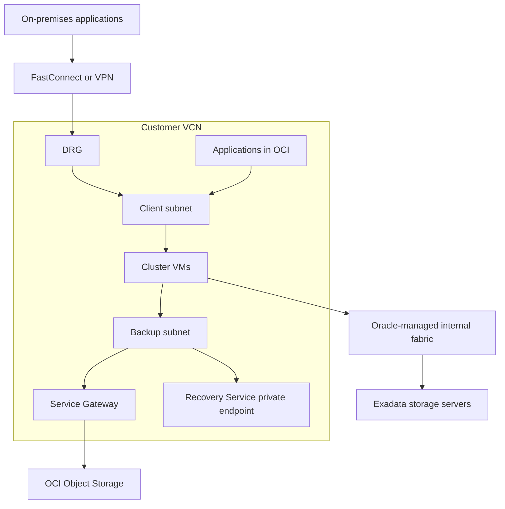

# Exadata Database Service Architecture on OCI

Oracle Exadata Database Service brings the Exadata platform into a cloud database service model. To design and operate it properly, you need to consider OCI resources, physical servers, VM clusters, Oracle Database software, and data paths together.

This lesson belongs to the **Exadata and Cloud@Customer** chapter of the **CLOUD_PROVIDERS_ORACLE** module. The focus is on **Exadata Database Service on Dedicated Infrastructure (ExaDB-D)** in OCI data centers. This serves as the foundation for combining tenancy, compartments, IAM, VCN, monitoring, and automation into an Oracle database system. [Oracle ExaDB-D Overall Architecture](https://docs.oracle.com/en/engineered-systems/exadata-cloud-service/ecsid/).

## 1. Architectural Scope and Objectives

After completing this lesson, learners will be able to:

- Distinguish between infrastructure, VM cluster, Database Home, database, and database instance.
- Trace a connection from an application to a database service.
- Explain the roles of RAC, ASM, Smart Scan, backups, and Data Guard.
- Identify boundaries for permissions, maintenance, resources, and fault domains.
- Plan a deployment with monitoring, recovery capabilities, and cost estimation.

Exadata on OCI and Exadata Cloud@Customer differ primarily in where the infrastructure is located. With Cloud@Customer, Oracle hardware is placed in the customer's data center and connected to OCI for automation and management. Therefore, do not apply the OCI network design in this lesson verbatim to an on-premises network. [Cloud@Customer Architecture](https://docs.oracle.com/en/engineered-systems/exadata-cloud-at-customer/eccid/all_diagrams.html).

This lesson uses a **VM cluster with ASM storage** as the reference configuration. ExaDB-D now also supports Exascale storage configurations on eligible infrastructure; in that case, storage pools and storage vaults must also be considered. Do not assume every VM cluster organizes disk groups the same way. [ExaDB-D Storage Configurations](https://docs.oracle.com/en/engineered-systems/exadata-cloud-service/ecscm/ecs-storage-config.html).

## 2. Two Perspectives: Service Resources and Execution Components

### 2.1. Management Resource Tree

The resource model consists of **Cloud Exadata Infrastructure** as the parent resource and **Cloud VM Cluster** attached to that infrastructure. The infrastructure level manages server configurations and infrastructure maintenance schedules; the VM cluster level attaches to networking, compute resources, and Grid Infrastructure. This is the model to use when reading the Console or designing automation. [Resource Model and Provisioning](https://docs.oracle.com/en/engineered-systems/exadata-cloud-service/ecscm/ecs-create-instance.html).

```text
Cloud Exadata Infrastructure
├── Cloud VM Cluster: transactions
│   ├── Database Home A
│   │   ├── Sales CDB
│   │   │   └── Business PDB
│   │   └── Accounting CDB
│   └── Database Home B
│       └── Patch testing CDB
└── Cloud VM Cluster: testing
    └── Database Home C
        └── Testing CDB
```

This is an illustrative resource relationship tree, not an on-disk directory tree. Nor should this tree be treated as a complete compartment diagram: you must verify the compartment and OCID of each resource when granting permissions.

A **Database Home** contains the Oracle Database software binaries. Multiple databases sharing a home share the binaries and version of that home. A **CDB** is a container database; a **PDB** holds the application data environment inside a CDB. Separating homes helps organize versions and maintenance, but it does not automatically isolate CPU, memory, or hardware fault domains. [Managing Databases on Exadata](https://docs.oracle.com/en/engineered-systems/exadata-cloud-service/ecscm/manage-databases.html).

For example, two databases in the same home can be affected by the same binary change. If you need to test a patch before moving to production, the design should specify the test home, test database, and cutover sequence; merely renaming a database does not create a maintenance boundary.

### 2.2. Execution Layers

| Layer | Key Components | Questions to Answer During Design |
| --- | --- | --- |
| Application | Driver, connection pool, database service | How does the application locate endpoints and reconnect? |
| Database | CDB, PDB, instance, Oracle processes | Which data and workloads share resources? |
| Cluster | Guest VM, Grid Infrastructure, RAC | How do nodes coordinate and detect failures? |
| Infrastructure | Database server, storage server, network fabric | Where do physical capacity and fault domains reside? |

Database servers provide the capacity to run VMs and database instances; storage servers provide Exadata storage. The two server types connect over a high-speed, low-latency fabric. Guest VMs run on a hypervisor, forming the boundary between the customer environment and the Oracle-managed infrastructure. [Physical and VM Layers in ExaDB-D Architecture](https://docs.oracle.com/en/engineered-systems/exadata-cloud-service/ecsid/all_diagrams.html).

Therefore, a "scale resources" operation must state the affected layer clearly. Increasing CPU for a VM cluster, adding database servers, and adding storage servers address different needs.

## 3. VM Clusters and Oracle RAC

### 3.1. The VM Cluster as the Runtime Organization Unit

A VM cluster groups guest VMs across selected database servers. Multi-VM allows multiple clusters on the same infrastructure; node subsetting allows a cluster to use a subset of servers. The actual number of clusters and allocation depend on configuration, version, and remaining resources. [Managing VM Clusters and Node Subsetting](https://docs.oracle.com/en/engineered-systems/exadata-cloud-service/ecscm/manage-vm-clusters.html).

Consider a design with four database servers: the transaction cluster places VMs on servers 1 and 2, and the testing cluster places VMs on servers 3 and 4. This layout helps clarify compute boundaries, but you must still ask which storage servers, network devices, and maintenance schedules the two clusters share. Two separate clusters are not sufficient by themselves to prove independence against all failures.

### 3.2. One Database Can Have Multiple Instances

In RAC, database instances across multiple nodes access a single shared dataset. An instance consists of memory and execution processes; a database consists of data and related storage structures. A private interconnect handles coordination between instances. [Oracle RAC Architecture](https://docs.oracle.com/en/database/oracle/oracle-database/26/racad/introduction-to-oracle-rac/overview-of-oracle-rac-architecture-and-processing.html).



The diagram illustrates logical relationships and does not depict all listeners and network devices.

A design consequence is that both sides must be tested: the database still has a serving instance, and the application can route connections to that instance. If the connection pool holds onto broken connections for too long, users still experience disruption even though another instance is active. You must define failure detection time, connection re-acquisition time, and how in-flight transactions with undetermined outcomes are handled.

## 4. Exadata Storage: Data, Recovery, and Near-Data Processing

### 4.1. ASM in the Reference Configuration

In an ASM configuration, **DATA** is used for datafiles; **RECO** is primarily used for the Fast Recovery Area and recovery-related files. Actual names may include an environment suffix. Choosing local backups or SPARSE for snapshots affects space allocation. Raw disk capacity is not capacity that can be allocated entirely to application data. [ASM Storage Organization](https://docs.oracle.com/en/engineered-systems/exadata-cloud-service/ecscm/ecs-storage-config.html).

When planning, separate the quantities as follows:

```text
Operational storage demand
= current data
+ projected growth
+ recovery capacity
+ clones/snapshots if applicable
+ headroom for operations and incident handling
```

This is a demand estimation framework, not Oracle's official formula for converting raw capacity to usable capacity.

Hypothetical example: current data is 8 TB and grows by 0.3 TB per month. After 12 months, data alone reaches 11.6 TB. If you size the configuration based only on the initial 8 TB, the plan has not accounted for growth, redo retention, clones, and recovery headroom.

### 4.2. Smart Scan

Smart Scan offloads part of query processing down to the storage servers, such as row filtering and column projection for eligible scans. As a result, less unnecessary data has to be transferred to the database servers. Offload capability depends on the execution path and supported operations. [Smart Scan Mechanism](https://docs.oracle.com/en/engineered-systems/exadata-database-machine/sagug/offloading-data-search-retrieval-processing.html).

Illustrative SQL example:

```sql
SELECT store_id, SUM(net_amount)
FROM sales_fact
WHERE business_date >= DATE '2026-10-01'
  AND business_date <  DATE '2026-11-01'
GROUP BY store_id;
```

If the actual workload qualifies for offload, data filtering can be processed close to storage. However, you cannot conclude from looking at this SQL statement alone that Smart Scan will definitely occur or predict its speed. You must examine the execution plan and execution statistics.

A single-order lookup by unique key and a report scanning billions of rows behave very differently. When an application is slow due to row locks or excessive SQL round-trips, adding scan capacity may not address the root cause.

### 4.3. I/O Resource Sharing

I/O Resource Management (IORM) arbitrates I/O resources among databases when contention occurs. You can set objectives and shares according to workload priority. This is a shared resource management mechanism, not a guarantee that every query will achieve a fixed latency. [Managing IORM](https://docs.oracle.com/en/engineered-systems/exadata-cloud-service/ecscm/ecs-manage-iorm.html).

For example, a design team may prioritize the transaction database over the reporting database during business hours. Both transaction response times and report completion times must be measured again; business objectives will determine the acceptable trade-off.

## 5. Networking: Separating Application Connectivity, Backups, and Management

### 5.1. Data Plane and Control Plane Flows

Applications use Oracle Net to access the database; administrators use the OCI Console, CLI, or API to manage service resources. Infrastructure management flows pass through Oracle's service environment. Therefore, API call permissions and SQL connectivity are two conditions that must be verified separately. [Access Flows in the Overall Architecture](https://docs.oracle.com/en/engineered-systems/exadata-cloud-service/ecsid/).

For example, an administrator may be able to view the VM cluster in the Console while an application host still cannot resolve the database DNS name. Conversely, the application may be processing transactions normally while a management operation fails. When logging an incident, explicitly state which flow failed.

### 5.2. Networks to Identify

| Network | Role | Points to Clarify in Design |
| --- | --- | --- |
| Client network | Application connectivity and authorized guest administration | Connection sources, DNS, listener, routes |
| Backup network | Traffic to backup destinations per service configuration | Path, bandwidth, security rules |
| Internal interconnect | RAC coordination and storage access | Not used as an application access network |
| Management network | Infrastructure management and Oracle automation | Boundary with customer networks |

ExaDB-D places customer connections inside a VCN, with separate client and backup subnets. On-premises connectivity can traverse a DRG over FastConnect or Site-to-Site VPN. Object Storage can be accessed through a Service Gateway. [VCN Design for Exadata](https://docs.oracle.com/en/engineered-systems/exadata-cloud-service/ecsid/exadbd_vcn.html).



The two backup branches illustrate destination options and do not require enabling both simultaneously. With Recovery Service, you must configure the registered subnet for the service and its corresponding private endpoint; it does not default to using the same Service Gateway path as Object Storage. [Preparing Recovery Service Connectivity](https://docs.oracle.com/en-us/iaas/recovery-service/doc/getting-started-recovery-service.html).

Arrows represent required connectivity paths. They do not replace route tables, NSGs, security lists, or service-specific network requirements.

### 5.3. SCAN, Listeners, and Database Services

Applications should connect via the SCAN name and database service rather than hardcoding a single VM's IP. SCAN helps locate an appropriate listener; the service identifies the database service requested by the application. From there, the connection is routed to a serving instance. [Application Connection Flow to Exadata](https://docs.oracle.com/en/solutions/migrate-to-oracle-vmware-solution/index.html).

The following JDBC string illustrates the Oracle Net connection structure only:

```text
jdbc:oracle:thin:@//sales-scan.db.example.internal:1521/sales_rw.example.internal
```

The domain name, port, and service are examples; you must obtain the actual configuration from the target database. For TCPS, configure the driver, trust store, and endpoint according to your environment.

A TCP test to the listener alone is not enough to prove an application can connect. You must verify in order: DNS resolution, bidirectional routing, network rules, listener, service, authentication, and then a business query. Failures at each step require separate evidence to avoid opening network permissions without justification.

### 5.4. Subnet and IP Planning

Subnets must have enough addresses for nodes, VIPs, SCAN, service addresses, and expansion plans. Check planned CIDRs against Exadata reserved ranges and corporate networks; do not copy a CIDR verbatim from another example. [Exadata Network Requirements](https://docs.oracle.com/en-us/iaas/exadatacloud/doc/ecs-network-setup.html).

The design document should include a table recording subnets, CIDRs, route tables, NSGs, allowed sources, and DNS ownership. If connections traverse from on-premises, include private name resolution and return routing. A subnet having "available IPs" does not prove the entire network path is valid.

## 6. Responsibility Boundaries and Security

### 6.1. Oracle Manages Infrastructure; Customer Manages the Database Environment

| Scope | Primary Responsibility |
| --- | --- |
| Hardware, hypervisor, storage servers, and fabric | Oracle manages, monitors, and maintains the infrastructure |
| Guest OS, Grid Infrastructure, Oracle Database software | Customer is responsible for management and maintenance, assisted by automation tools |
| Data, schemas, accounts, and access policies | Customer designs and operates |
| Access paths inside the customer VCN | Customer configures networking and access controls |

A managed service does not mean Oracle decides all patches and settings inside the guest. Schedules must be planned for both the infrastructure and the customer-managed software. [ExaDB-D Division of Responsibilities](https://docs.oracle.com/en/engineered-systems/exadata-cloud-service/ecscm/exa-service-desc.html).

### 6.2. Three Distinct Permission Layers

- **OCI IAM**: permissions to read or modify cloud resources.
- **Operating System**: permissions to log in to guest VMs and perform granted tasks.
- **Database**: permissions to log in, access data, and administer inside the database.

The customer controls access to VMs and databases; Oracle controls the Oracle-managed infrastructure. TDE protects data at rest, while database privileges and connection protection still must be designed separately. [ExaDB-D Security Guide](https://docs.oracle.com/en/engineered-systems/exadata-cloud-service/ecscm/ecs-security-guide.html).

IAM example solely for inspecting two resource types:

```text
Allow group ExadataObservers to inspect cloud-exadata-infrastructures in compartment DatabaseProd
Allow group ExadataObservers to inspect cloud-vmclusters in compartment DatabaseProd
```

The group and compartment names are examples; use identifiers matching your actual identity domain. These two lines are not a complete policy set for creating clusters, managing databases, or viewing all metrics. Operations may require permissions across multiple related resource types. [Policies for Exadata Cloud Infrastructure](https://docs.oracle.com/en/engineered-systems/exadata-cloud-service/ecscm/ecs-policy-details.html).

Within an organization, separate network designers, database operators, and cost observers. If an account can both modify SSH keys and administer the database, evaluate the combined permissions of that account rather than looking only at group names.

## 7. Availability, Recovery, and Fault Domains

### 7.1. Failure Analysis by Layer

The table below is a design analysis framework, not an SLA commitment:

| Scenario | Mechanism to Consider | Additional Testing Required |
| --- | --- | --- |
| A database instance fails | RAC and database services | Connection pool, in-flight transactions |
| A server or storage device fails | Infrastructure redundancy, cluster and storage configuration | Remaining capacity under degraded mode |
| Accidental data deletion | Backups and point-in-time recovery capability | Restore duration and data verification |
| Loss of an infrastructure or site | Standby in another fault domain | Network paths and role-transition runbook |
| Loss of an entire region | Cross-region DR plan | Applications, DNS, keys, and dependent services |

RAC shares a single dataset, so having multiple instances does not create an independent database copy capable of handling every disaster.

### 7.2. Backups and Data Guard Address Different Requirements

Automatic backups can use Autonomous Recovery Service or Object Storage. Define retention, backup destination, key usage permissions, and recovery paths. Do not mix service-managed backup tools with standalone RMAN scripts unless adhering to a supported model. [Managing Exadata Backup and Recovery](https://docs.oracle.com/en/engineered-systems/exadata-cloud-service/ecscm/ecs-managing-db-backup-and-recovery.html).

Data Guard maintains a standby database. Oracle recommends placing primary and standby databases for production workloads on separate Exadata infrastructures; if region failure isolation is required, place the standby in a different region. A standby on the same infrastructure still shares that infrastructure's risks. [Data Guard with Exadata Cloud Infrastructure](https://docs.oracle.com/en/engineered-systems/exadata-cloud-service/ecscm/ecs-using-data-guard.html).

When setting recovery objectives:

- **RPO** is the maximum acceptable data loss.
- **RTO** is the maximum acceptable time to restore service.

Hypothetically, suppose the business requires a 5-minute RPO and a 30-minute RTO. The design team must measure redo transport/apply lag and service switchover time, then rehearse the full application stack. A database role transition completing in 10 minutes does not prove the overall system meets RTO if the application takes another 40 minutes to start up and reconnect.

Backups remain necessary even with a standby, because logical errors can propagate to the standby. The design document must specify how recovery points are selected and how data is validated after a restore.

## 8. Capacity, Scaling, and Cost

### 8.1. Distinguishing Allocation Changes from Physical Expansion

| Observed Need | Evaluation Direction |
| --- | --- |
| CPU shortage while infrastructure has spare capacity | Adjust CPUs allocated to the VM cluster |
| Memory or VM resource shortage | Evaluate VM configuration, workload, and remaining limits |
| Database server capacity shortage | Evaluate adding database servers and VM placement |
| Storage space or throughput shortage | Evaluate adding storage servers, allocation, and rebalance |
| Workloads contending with each other | Evaluate cluster separation, resource plans, and IORM |

Scaling options depend on infrastructure generation and configuration. CPU units must also be interpreted correctly: older generations using OCPU and newer generations using ECPU cannot have their counts substituted one-for-one in estimates. Scaling CPUs and adding physical servers are distinct operations. [Exadata Scaling Options](https://docs.oracle.com/en/engineered-systems/exadata-cloud-service/ecscm/ecs-manage-infrastructure.html).

Hypothetical example with two equal-capacity nodes: normally each node runs at 40%. When one node fails, load shifts to the surviving node and may approach 80% if total workload stays constant. This is a simplified capacity calculation that omits failover overhead and workload characteristics; use it as a starting point for degraded-mode load testing.

### 8.2. Costs Include Infrastructure and Usage Components

ExaDB-D costs must account for provisioned infrastructure, consumed CPUs, License Included or BYOL choices, and associated services. Decreasing CPUs or deleting a VM cluster does not automatically terminate charges for existing infrastructure. Unit prices, minimum billing durations, and licensing terms must be checked against the configuration, contract, and current price list. [Usage and Billing Model](https://docs.oracle.com/en/engineered-systems/exadata-cloud-service/ecscm/exa-service-desc.html).

An internal estimation framework can be structured as follows:

```text
Projected cost for the period
= primary infrastructure
+ VM cluster CPUs
+ backup and retention
+ DR standby infrastructure/CPUs
+ network connectivity
+ billable monitoring or add-on tools
```

This is a checklist of cost categories to review, not an official billing formula. Tag each resource with environment, owner, and purpose so expenses can be explained. For learning environments, start with a design exercise and inspect existing resources rather than provisioning a new Exadata system yourself.

## 9. Architecture-Driven Monitoring and Maintenance

### 9.1. Observing Application, Cluster, and Database Together

OCI provides metrics for VM clusters in the `oci_database_cluster` namespace; database metrics have related namespaces depending on service configuration. Metric streams depend on collection agents and network paths. When metrics go missing, check the agent, IAM, and connectivity before concluding the database has no load. [Monitoring VM Cluster and Database Resources](https://docs.oracle.com/en-us/iaas/exadatacloud/doc/monitor-metrics-for-vmcluster-resources.html).

The following list is a recommended monitoring baseline for a design:

| Observation Angle | Evidence to Collect | Decision Supported |
| --- | --- | --- |
| Application | p95/p99 latency, connection errors, timeouts | Are users currently impacted? |
| VM and cluster | CPU, memory, node status | Is there a capacity shortage or node loss? |
| Database | Waits, resource-intensive SQL, locks | Tune SQL or scale resources? |
| Storage | Usable capacity, growth rate, I/O latency | When to add capacity or throttle I/O? |
| Recovery | Backup outcomes, restore drills, standby lag | Are RPO/RTO still being met? |

Business metrics and deep database statistics may require additional tools; do not assume every item in the table is available out of the box in a single namespace.

### 9.2. Maintenance Schedules Must Align with Application Behavior

Database Home patches affect the shared software in that home. Assess compatibility, run prechecks per procedure, and select a maintenance plan suited to the update type. [Exadata Patching and Updates](https://docs.oracle.com/en/engineered-systems/exadata-cloud-service/ecscm/ecs-patch-update.html).

A practical plan should clearly specify:

1. Components being updated and affected databases.
2. Capacity available as each node is temporarily taken offline.
3. How application connections are drained or restored.
4. Pre- and post-maintenance evidence.
5. Stop conditions and supported rollback procedures.

"Rolling" describes changing components one at a time; user experience still depends on services, drivers, connection pools, and in-flight transactions. Test application behavior using a representative workload.

## 10. Lab: Inspecting Architecture from an Existing Environment

### 10.1. Lab Prerequisites

Use the tenancy and resources assigned for learning, with OCI CLI authentication configured, the correct region, and corresponding read permissions. The commands below only list or read resources. They are examples for learners to execute in an assigned environment, not outputs from a live run.

Examples use PowerShell; replace placeholder values with actual OCIDs and region.

### 10.2. Finding Infrastructure and VM Clusters

```powershell
$labCompartmentId = 'ocid1.compartment.oc1..REPLACE_ME'
$labRegion = 'REPLACE_ME'

oci db cloud-exa-infra list --compartment-id $labCompartmentId --region $labRegion --all
```

Record the infrastructure OCID, lifecycle state, and availability domain from the output. The `cloud-exa-infra list` command returns resources in the specified compartment. [Infrastructure List Command Reference](https://docs.oracle.com/en-us/iaas/tools/oci-cli/latest/oci_cli_docs/cmdref/db/cloud-exa-infra/list.html).

```powershell
$labInfrastructureId = 'ocid1.cloudexadatainfrastructure.oc1.REPLACE_ME'

oci db cloud-vm-cluster list --compartment-id $labCompartmentId --cloud-exa-infra-id $labInfrastructureId --region $labRegion --all
```

If the VM cluster resides in a different compartment, use that compartment when listing. The infrastructure filter helps identify resource relationships. Empty results should be checked against the region, compartment, and caller permissions. [VM Cluster List Command Reference](https://docs.oracle.com/en-us/iaas/tools/oci-cli/latest/oci_cli_docs/cmdref/db/cloud-vm-cluster/list.html).

### 10.3. Reading Cluster and Database Home Details

```powershell
$labClusterId = 'ocid1.cloudvmcluster.oc1.REPLACE_ME'

oci db cloud-vm-cluster get --cloud-vm-cluster-id $labClusterId --region $labRegion

oci db db-home list --compartment-id $labCompartmentId --vm-cluster-id $labClusterId --region $labRegion --all
```

Cross-check the parent infrastructure ID, subnets, CPU configuration, and Grid Infrastructure details in the cluster output. Then identify the homes and software versions. Use the compartment containing the home if it differs from the sample value. [Get Cluster Reference](https://docs.oracle.com/en-us/iaas/tools/oci-cli/latest/oci_cli_docs/cmdref/db/cloud-vm-cluster/get.html), [List Database Home Reference](https://docs.oracle.com/en-us/iaas/tools/oci-cli/latest/oci_cli_docs/cmdref/db/db-home/list.html).

### 10.4. Lab Deliverable

Create a diagram or record table within the scope of your assigned exercise, including:

- Associated infrastructure and VM cluster.
- Database Home, database, and service used by the application.
- Client subnet, backup subnet, and connection path from the application.
- Backup destination and standby fault domain, if applicable.
- Teams responsible for networking, database, and maintenance.

If an Exadata environment has not been assigned, complete these items as a hypothetical design and clearly mark unverified information. Do not fill in fake success statuses in the table.

## 11. Example Architectural Decisions for a Sales System

Suppose an enterprise runs a sales application on OCI Compute requiring a private database, end-of-day reporting, and continued operation if one node fails. The following decisions are design examples, not a deployed or load-tested configuration:

| Decision | Purpose | Conditions to Verify |
| --- | --- | --- |
| Place VM cluster in separate client and backup subnets | Organize client and backup traffic flows | CIDR, DNS, routes, service rules |
| Connect via SCAN and sales service | Avoid pinning application to a single node | Driver, pool, and node failure testing |
| Size capacity for one missing node | Sustain transaction load in degraded mode | Load test with realistic error rates and latency |
| Prioritize I/O for transactions | Limit contention with reporting | Response times and report completion deadlines |
| Back up to a target outside operational storage | Provide data recovery option | Retention, key permissions, restore drills |
| Place standby on separate infrastructure when DR is required | Isolate primary infrastructure failures | Network latency, lag, and role-transition drills |

From these decisions, the implementation record should specify connection sources, relevant OCIDs, each team's permissions, recovery targets, and projected costs. Any target such as "switch over in 30 minutes" must include measurements for acceptance sign-off.

## 12. Common Misconceptions When Reading Diagrams

| Misconception | More Accurate Interpretation |
| --- | --- |
| One VM cluster equals one database | A cluster is a runtime environment; inspect homes and databases next |
| Two RAC instances are two independent databases | The instances access a single shared dataset |
| Two VM clusters provide complete DR | Check which infrastructure and fault domains they still share |
| Having SCAN means every transaction self-heals | Drivers, pools, and transaction behavior must also be tested |
| IAM permission to view a cluster allows SQL login | IAM, networking, OS, and database privileges are separate layers |
| Having backups means RTO is already met | Restore time and application recovery must be measured |
| Decreasing CPU eliminates all Exadata costs | Infrastructure and associated services are still billed |
| Every ExaDB-D configuration uses ASM identically | Identify whether ASM or Exascale is in use |

When evaluating an Exadata architecture on OCI, trace a request from the application through the service, instance, and data; then trace a failure through the recovery mechanism and responsible team. This way of reading turns a diagram into a design that can be deployed, measured, and operated.
