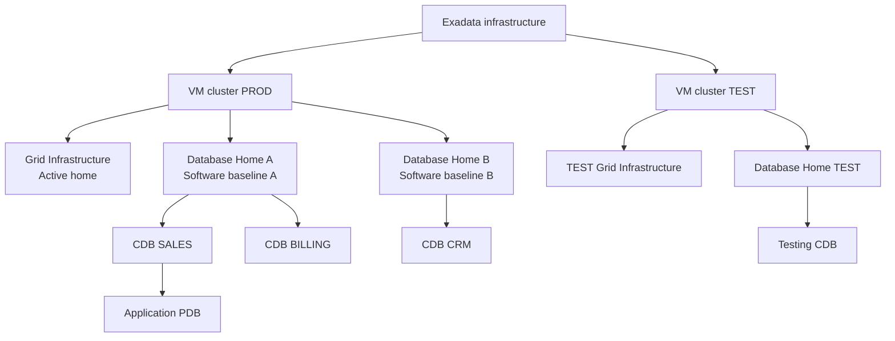
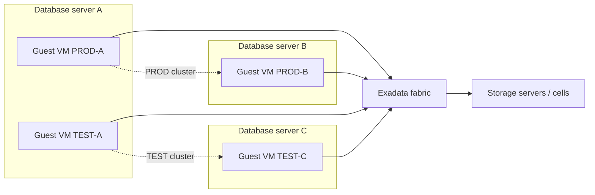

# Exadata Infrastructure, VM Clusters, and Database Homes

## Objectives and Scope

In the **Exadata and Cloud@Customer** chapter of the **CLOUD_PROVIDERS_ORACLE** module, the three concepts of infrastructure, VM cluster, and Database Home help identify which resources are provisioned, which software is running, and which changes can affect a database.

This lesson focuses on **Exadata Database Service on Dedicated Infrastructure** in OCI and contrasts it with **Exadata Database Service on Cloud@Customer**. The illustrative model uses customer-managed databases and ASM storage. Autonomous Database on Exadata and Exascale-based configurations have their own models and options; do not apply every detail of this lesson verbatim to those services.

After completing this lesson, learners will be able to:

- Diagram the relationship infrastructure → VM cluster → Database Home → database.
- Distinguish physical database servers, guest VMs, Oracle Grid Infrastructure, and Oracle Database binaries.
- Choose the appropriate layer to modify when lacking capacity, needing a different database version, or performing maintenance.
- Inventory resources using the Console/CLI and recognize the correct API families for Dedicated Infrastructure and Cloud@Customer.
- Evaluate blast radius, permissions, monitoring, availability, and cost for each layer.

Resource names, capacity figures, and examples below are hypothetical for learning purposes. The lab commands are read-only; this lesson does not require creating or deleting a live Exadata system to understand the architecture.

## 1. Three Layers Answer Three Different Questions

| Layer | Core Question | Example Decisions |
| --- | --- | --- |
| Exadata infrastructure | What Exadata infrastructure resources are available for use? | Number of database/storage servers, capacity, and infrastructure maintenance |
| VM cluster | What share of resources is allocated to this database environment? | VM placement, CPU/memory, networking, and Grid Infrastructure |
| Database Home | Which Oracle software set does the database use? | Version/image/RU, software path, and update lifecycle |

In the current Dedicated Infrastructure resource model, the infrastructure and the cloud VM cluster are separate resources. The VM cluster is a child resource of the infrastructure; having the infrastructure alone is not enough to run a user database. [Oracle: Creating an Exadata Cloud Infrastructure Instance](https://docs.oracle.com/en-us/iaas/exadatacloud/doc/ecs-create-instance.html).

A mnemonic when handling requests:

```text
Need more hardware capability or underlying capacity → inspect the infrastructure.
Need a VM/GI/network environment or resource allocation → inspect the VM cluster.
Need a different Oracle Database software set → inspect the Database Home.
Need data, CDB/PDB, or application services → inspect the database and its configuration.
```

This is a starting point for analysis, not an automatic scaling rule. A performance issue can also originate from SQL, locks, database configuration, or networking, so always measure before choosing a solution.

## 2. What Does Exadata Infrastructure Include?

### Database Servers and Storage Servers Have Different Roles

Database servers provide compute and run the guest VMs hosting database software. Exadata storage servers, commonly called storage cells, provide the storage tier and corresponding Exadata features. Both groups connect via a low-latency internal fabric; exact topology and technology depend on the system generation. [Oracle: Rack Overview](https://docs.oracle.com/en/engineered-systems/exadata-cloud-service/ecsid/exadbd_rack.html).

The infrastructure resource represents the configuration and capacity of the infrastructure provisioned for the service. When reading details, separate:

- Number and type of database servers.
- Number and type of storage servers.
- CPU/memory/local storage allocatable to VMs.
- Storage capacity across the measurements exposed by the service.
- Maintenance, lifecycle state, and child resources currently in use.

Do not equate an OCI resource with an Oracle installation directory or a CDB. The infrastructure can remain intact while a VM cluster or database has been replaced.

### Available Hardware Is Not Necessarily Consumed by Workloads

Part of the capacity may remain unallocated to VM clusters. After adding infrastructure capacity, you must also perform allocation/scaling steps at the appropriate layer for workloads to consume the new capacity.

Similarly, a low CPU graph inside one VM does not mean the entire infrastructure has enough memory, local storage, or VM slots to create another cluster. Capacity evaluation must examine multiple dimensions.

Limits such as maximum VM clusters, VMs per server, minimum CPUs, and scaling increments depend on the model, version, and supported features. Check the current configuration tables rather than memorizing a number from one Exadata generation as a universal limit.

## 3. A VM Cluster Is the Database Runtime Environment

A VM cluster groups guest VMs placed on selected database servers. It is not a Kubernetes cluster, nor is it another name for a database.

A VM cluster ties together components such as:

| Component | Role |
| --- | --- |
| Guest VM/node | Operating system environment where database software runs |
| CPU and memory | Compute capacity allocated to the environment |
| Local filesystem | Space for software and local contents per configuration |
| Client/backup network | Access and data transfer paths for workloads and operations |
| Grid Infrastructure | Cluster management and ASM layer in the ASM model |
| Database Homes | Oracle Database software installations deployed in the cluster |

Oracle isolates customer guest VMs from the Oracle-managed hypervisor and underlying infrastructure. One physical database server can host VMs belonging to different clusters when Multi-VM is supported. [Oracle: VMs and Database Servers](https://docs.oracle.com/en/engineered-systems/exadata-cloud-service/ecsid/exadbd_vmdb.html).

### Multi-VM and Node Subsetting

Multi-VM allows dividing the same infrastructure into multiple VM clusters. Node subsetting allows a cluster to use a subset of database servers instead of spanning every server in the infrastructure.

Example of a hypothetical topology:

```text
Database server A: VM-PROD-A, VM-TEST-A
Database server B: VM-PROD-B
Database server C: VM-TEST-C

VM cluster PROD: VM-PROD-A + VM-PROD-B
VM cluster TEST: VM-TEST-A + VM-TEST-C
```

Two clusters can share database server A, which does not mean they are the same guest VM or the same GI cluster. When server A undergoes maintenance, both environments may be impacted on the VMs residing on that server.

Node subsetting can support a single-VM configuration where permitted by the service; the name "cluster" alone does not prove node redundancy. Oracle recommends multiple VMs appropriate for availability requirements. [Oracle: Manage VM Clusters](https://docs.oracle.com/en-us/iaas/exadatacloud/doc/manage-vm-clusters.html).

## 4. Two Views Must Be Kept Together

### Resource and Software View



This illustrates management and dependency relationships. Database Homes A and B are not two new virtual machines. The databases under those Homes still consume the corresponding VM cluster's resources.

### Physical Placement View



The resource tree shows which Home and cluster a database belongs to. Placement shows which VMs can be touched by a failure or maintenance on a physical server. Relying on only one of the two views is insufficient to assess blast radius.

Splitting multiple clusters on the same infrastructure helps organize environments and resources, but it does not create multiple independent physical infrastructures. [Oracle: VM Clusters Architecture](https://docs.oracle.com/en/engineered-systems/exadata-cloud-service/ecsid/exadbd_vmclusters.html).

## 5. A Database Home Is a Software Set, Not Database Data

Oracle defines a Database Home as the directory location on database VMs containing the Oracle Database software binaries. A VM cluster can have multiple Database Homes. [Oracle: Create Oracle Database Homes](https://docs.oracle.com/en-us/iaas/exadatacloud/doc/creating-database-homes-exacc.html).

| Concept | What to Distinguish |
| --- | --- |
| Database Home | Oracle Database binaries, version/image, and related inventory |
| GI Home | Oracle Grid Infrastructure software |
| Database | Database data and metadata, configuration, and related instances/services |
| CDB/PDB | Multitenant structure inside a database |
| Database software image | Software source used to create a Home in a supported manner |
| Backup | Data and information required for recovery plans |

A new Home does not mean a new database exists. A new Home also does not automatically copy data from an old Home.

In the ASM configuration used in this lesson, datafiles belong to the properly managed database storage layer; business data does not all sit inside the `ORACLE_HOME` directory. Therefore, seeing free space on the filesystem holding binaries does not prove the database has sufficient data storage, and vice versa.

### One Home Can Serve Multiple Databases

In the example, SALES and BILLING use Home A. They share the Home's binaries, so both must be accounted for when that Home changes. A separate Home provides an independent software baseline and update lifecycle within the same cluster, but it does not automatically allocate separate CPU, memory, networking, or physical storage infrastructure.

Databases still maintain their own SQL patch metadata and status. Do not assume that simply checking the displayed version of a Home confirms every CDB/PDB has completed all SQL patch steps.

### GI Home Is a Separate Layer

GI manages cluster functions and ASM in this model. Database Home holds the Oracle Database software running workloads. Creating a new Database Home does not upgrade the active GI.

Some current workflows also manage GI Homes as separate resources. Identify which GI Home is active rather than counting directories/Homes and concluding the cluster has switched versions. The compatibility matrix among guest software, GI, and database images must still be verified.

## 6. When to Share a Home, and When to Separate Homes or Clusters?

Suppose SALES, BILLING, and CRM share an infrastructure. Frame the decision around the level of isolation actually needed:

| Need | Design Starting Point | Still Requires Evaluation |
| --- | --- | --- |
| Two databases share the same baseline and update schedule | Can share a Database Home | Shared impact of Home changes and support conditions |
| One database needs a different baseline | Create/select a different Home in the cluster | GI compatibility, software space, and migration procedure |
| PROD and TEST need separate resource/network/process allocation | Separate VM clusters when appropriate | Capacity, shared servers, and infrastructure maintenance scope |
| Workload needs independence from an entire infrastructure/site failure | Architect at the appropriate infrastructure/failure domain | Data Guard/DR, networking, RPO/RTO, and application runbooks |
| Only a new schema is needed in an existing database | Design at the database layer | SQL privileges, quotas, and business isolation level |

Separating Homes is primarily a software and update-lifecycle decision. Separating VM clusters is a larger decision about runtime environments and resource allocation. Separating infrastructure involves broader hardware and operational scope.

Do not create an extra cluster just because two applications have different names; conversely, do not cram every database into one Home just because they share a major release. Change, availability, and resource requirements should drive the decision.

## 7. Reading Capacity at the Right Layer

### CPU, Memory, and Local Storage

Build a capacity table per database server before summing across the entire infrastructure. Within supported model limits, you can use this check relationship:

```text
Total memory allocated to VMs on a server
    ≤ allocatable memory for VMs on that server

Resources required for each new VM
    must be satisfied on each selected server
```

Allocatable memory must be taken from service figures after relevant overhead/reservations; do not use total physical RAM as the allocatable amount.

Illustrative placement example:

| Database Server | Remaining Allocatable Memory | New VM Requirement |
| --- | --- | --- |
| A | 64 GB | 128 GB |
| B | 256 GB | 128 GB |

The system has 320 GB remaining in total—more than the combined 256 GB requirement—yet the planned placement still cannot fit on server A. Summing across the whole system hid the per-server bottleneck.

These numbers are neither an actual Exadata configuration nor recommended VM sizes. In practice, also verify valid increments, uniform resource rules across VMs per configuration, VM slots, and local storage.

### ECPU/OCPU and Number Scope

Identify the CPU unit used by the model/service, whether a displayed field represents the cluster total or per-VM, and the difference between infrastructure capacity and compute allocated/enabled for a cluster. Do not add fields with different units or apply arbitrary conversion ratios.

Adding CPU to a cluster does not automatically tune SQL or remove database-level limits. If resource limits are configured at the database layer, check them alongside the cluster configuration.

### Storage Has Multiple Measurements

| Metric | Do Not Confuse With |
| --- | --- |
| Device raw capacity | Usable capacity for workloads |
| Usable storage after data protection | Capacity already allocated to a cluster/database |
| Space provisioned for storage configuration | Free space remaining in the disk group or corresponding layer |
| Local filesystem on the VM | Database datafile space |
| Data/Recovery storage | Two demands with different growth rates and policies |

In ASM, redundancy and related reservations affect how capacity is interpreted. Do not treat raw capacity of storage servers as guaranteed application-usable space.

Adding servers and allocating capacity to a VM cluster are separate steps. Always verify after a change that the new capacity appears at the target layer, rather than only seeing the infrastructure update succeed.

## 8. Networking and Access Flows

Distinguish three flow groups:

| Flow | Purpose |
| --- | --- |
| Client network | Application/SQL clients and database connections per configuration |
| Backup network | Traffic for backups and related functions per design |
| Management/fabric infrastructure | System management and internal Exadata communication within Oracle-managed scope |

Dedicated Infrastructure uses a VCN/subnets and network components configured for the VM cluster. Planning must include DNS, addressing, routes, security rules, and connectivity to actual backup destinations. [Oracle: Network Setup for Exadata Cloud Infrastructure](https://docs.oracle.com/en-us/iaas/exadatacloud/doc/ecs-network-setup.html).

Do not use a Home OCID or an infrastructure display name as a JDBC endpoint. Applications connect using database services and configured endpoints, whereas IAM/APIs operate on resource identifiers.

Successful SSH access to a guest VM does not prove an SQL client can reach the right database/PDB. Likewise, being able to view a cluster in the Console does not prove the client network path is working.

For workloads requiring HA, connection design must align with database services, DNS, and client reconnection handling. Do not test only one active SQL session and assume all node-loss scenarios have been validated.

## 9. How Do Dedicated Infrastructure and Cloud@Customer Differ?

| Aspect | Dedicated Infrastructure in OCI | Exadata Cloud@Customer |
| --- | --- | --- |
| Infrastructure location | OCI data center per service deployment | Customer data center |
| Service hardware | Oracle-managed per service | Oracle-owned/managed per service at customer site |
| Application connectivity | VCN and networking connected to OCI | Client/backup networks prepared at site |
| Cloud automation | OCI control plane and service components | Includes CPS and automation connectivity to OCI |
| Infrastructure resource/API | Cloud Exadata Infrastructure family | Exadata Infrastructure for Cloud@Customer family |
| VM cluster resource/API | Cloud VM Cluster | VM Cluster for Cloud@Customer |

Cloud@Customer includes control plane server infrastructure and a secure automation tunnel connecting to an OCI region for management and automation. Application SQL paths and cloud management paths serve different purposes. [Oracle: Exadata Cloud@Customer Architecture Overview](https://docs.oracle.com/en/engineered-systems/exadata-cloud-at-customer/eccid/exacc_overview.html).

Do not assume placing hardware in a customer data center means the service never needs connectivity to OCI. When a management path incident occurs, distinguish automation impact from the observed data plane status; exact behavior depends on the component and actual incident.

The Database Home concept also exists in Cloud@Customer VM clusters. The Console lets you navigate from a VM cluster to its Home list and inspect related resources. [Oracle: Manage Database Homes on Cloud@Customer](https://docs.oracle.com/en-us/iaas/exadata/doc/ecc-manage-database-homes.html).

### Do Not Mix with Autonomous Exadata VM Cluster

The same Exadata platform can serve different service lines. Autonomous Exadata VM Cluster, Autonomous Container Database, and Autonomous Database follow their own provisioning and operational models. Do not use a Database Home creation guide for Exadata Database Service as instructions for managing Autonomous Database binaries.

## 10. Responsibility Boundaries and Access Permissions

With Dedicated Infrastructure where the customer manages databases, Oracle is responsible for infrastructure such as hardware, hypervisor, and the underlying tier. The customer is responsible for guest VM OS, GI, and database software maintenance per the service; cloud automation provides tools to perform many of those tasks. [Oracle: Service Description and Responsibilities](https://docs.oracle.com/en-us/iaas/exadatacloud/doc/exa-service-desc.html).

| Work Group | Owner/Process to Identify |
| --- | --- |
| Hardware and host maintenance/incidents | Oracle and service maintenance schedules |
| Guest OS, GI, Database Home | Operations team following supported procedures |
| Data, schemas, SQL users, services | DBAs/application teams per authorization |
| Customer network, DNS, firewall, Cloud@Customer site | Network/site teams coordinating within service scope |
| Backup, restore, and DR testing | Responsible teams per agreed objectives |

Having permission to manage an OCI resource does not automatically grant an OS account or SQL privileges. The three layers—IAM, OS, and database—must still be controlled independently.

### Sample Inventory Permissions on Dedicated Infrastructure

Suppose the resources to inventory reside in compartment `ExadataLab`. Sample policy allowing metadata inspection only for the exercise:

```text
Allow group 'Default'/'ExadataInventory' to inspect cloud-exadata-infrastructures in compartment ExadataLab
Allow group 'Default'/'ExadataInventory' to inspect cloud-vmclusters in compartment ExadataLab
Allow group 'Default'/'ExadataInventory' to inspect db-homes in compartment ExadataLab
Allow group 'Default'/'ExadataInventory' to inspect databases in compartment ExadataLab
Allow group 'Default'/'ExadataInventory' to inspect db-nodes in compartment ExadataLab
```

Substitute your actual domain/group/compartment and place the policy at the appropriate scope. Viewing networking, metrics, or other resources may require additional permissions matching the corresponding tab or operation.

Resource type names for Dedicated Infrastructure include `cloud-exadata-infrastructures` and `cloud-vmclusters`. When working with Cloud@Customer, check types such as `exadata-infrastructures`, `vmclusters`, and corresponding cluster network permissions; do not copy a policy verbatim and only change display names. [Oracle: Dedicated Infrastructure Policy Details](https://docs.oracle.com/en-us/iaas/exadatacloud/doc/ecs-policy-details.html), [Oracle: Cloud@Customer Policy Details](https://docs.oracle.com/en-us/iaas/exadata/doc/ecc-policy-details.html).

## 11. Environment Build Sequence and Output Checks

This is the logical sequence for an authorized deployment, not a requirement to create new infrastructure during the inventory lab:

1. **Prepare infrastructure:** region/site, permissions, capacity, and deployment prerequisites.
2. **Prepare networking:** client/backup subnets, DNS, addressing, and required management paths.
3. **Infrastructure ready:** verify actual resource state and capacity.
4. **VM cluster:** choose infrastructure/placement, allocate resources, and configure networking and GI appropriately.
5. **Database Home:** select a supported image/version in that cluster.
6. **Database/PDB:** create inside the appropriate Home with encryption, backup, and service configurations.
7. **Acceptance verification:** test application paths, permissions, monitoring, backup/restore, and availability requirements.

Some wizards combine multiple steps in the UI, but the underlying resources and responsibility scopes still need to be distinguished. Do not infer from a "Create" button name that every child resource already exists or is ready.

Oracle allows creating additional Database Homes and databases within a VM cluster. For databases provisioned via current CDB workflows, you must also understand the PDBs and services inside rather than treating the Database Home as the final business unit. [Oracle: Manage Databases on Exadata Cloud Infrastructure](https://docs.oracle.com/en-us/iaas/exadatacloud/doc/manage-databases.html).

When selecting a Home/image, verify at a minimum:

| Condition | What to Confirm |
| --- | --- |
| Hardware and guest software | Supports the planned release/image |
| GI | Compatible with the database release and update workflow |
| Version/RU/image | Permitted by the service at deployment time |
| Local storage | Sufficient for the new Home, staging, and related operations |
| Target database | Correct cluster, Home, and required configuration |
| Operational procedures | Prechecks, change window, and recovery plan in place |

Having the same major release name is not enough to conclude all combinations are compatible.

## 12. Lab: Inventorying via Console and OCI CLI

### 12.1. Starting from the Console

Select the correct region and compartment. Under **Oracle Exadata Database Service on Dedicated Infrastructure**:

- Open the infrastructure and record model, servers/capacity, and maintenance details.
- Open the VM cluster and record parent infrastructure, VM/node placement, resources, and GI.
- Open **Database Homes** and record OCID, software version, status, and path if displayed.
- Open related databases to cross-check Home and service/database identifiers.

For Cloud@Customer, select the corresponding service group and VM cluster. Use OCIDs and parent links in metadata rather than matching resources solely by similar display names.

### 12.2. Reading Dedicated Infrastructure

PowerShell example with OCI CLI pre-configured with an authorized profile/authentication. Replace all placeholders with actual OCIDs and region:

```powershell
$taskRegion = '<OCI_REGION>'
$infraId = '<CLOUD_EXADATA_INFRASTRUCTURE_OCID>'
$clusterId = '<CLOUD_VM_CLUSTER_OCID>'
$compartmentId = '<DB_HOMES_COMPARTMENT_OCID>'

oci db cloud-exa-infra get --cloud-exa-infra-id $infraId --region $taskRegion
oci db cloud-vm-cluster get --cloud-vm-cluster-id $clusterId --region $taskRegion
oci db db-home list --compartment-id $compartmentId --vm-cluster-id $clusterId --all --region $taskRegion
```

The CLI command uses the name `cloud-exa-infra`; this name is not literally identical to the IAM resource type `cloud-exadata-infrastructures`. Verify syntax in [Oracle CLI: cloud-exa-infra get](https://docs.oracle.com/en-us/iaas/tools/oci-cli/latest/oci_cli_docs/cmdref/db/cloud-exa-infra/get.html) and [Oracle CLI: cloud-vm-cluster get](https://docs.oracle.com/en-us/iaas/tools/oci-cli/latest/oci_cli_docs/cmdref/db/cloud-vm-cluster/get.html).

`db-home list` supports filtering by VM cluster; `--all` retrieves all result pages instead of relying only on the first page. After picking a Home from the output, read its details:

```powershell
$dbHomeId = '<DB_HOME_OCID>'
oci db db-home get --db-home-id $dbHomeId --region $taskRegion
```

See [Oracle CLI: db-home list](https://docs.oracle.com/en-us/iaas/tools/oci-cli/latest/oci_cli_docs/cmdref/db/db-home/list.html) and [Oracle CLI: db-home get](https://docs.oracle.com/en-us/iaas/tools/oci-cli/latest/oci_cli_docs/cmdref/db/db-home/get.html).

Verify that the output matches the parent cluster, version, lifecycle state, and related databases shown in the Console. An empty list can also result from the wrong compartment, wrong filter, or insufficient permissions—it is not enough to conclude the cluster has no Homes.

### 12.3. Reading Cloud@Customer with the Right Command Family

```powershell
$taskRegion = '<EXACC_MANAGING_OCI_REGION>'
$exaccInfraId = '<EXACC_EXADATA_INFRASTRUCTURE_OCID>'
$exaccClusterId = '<EXACC_VM_CLUSTER_OCID>'

oci db exadata-infrastructure get --exadata-infrastructure-id $exaccInfraId --region $taskRegion
oci db vm-cluster get --vm-cluster-id $exaccClusterId --region $taskRegion
```

These `exadata-infrastructure get` and `vm-cluster get` commands apply to Cloud@Customer. A syntactically valid OCID passed to the wrong API family will still not resolve as a valid resource of that API. [Oracle CLI: exadata-infrastructure get](https://docs.oracle.com/en-us/iaas/tools/oci-cli/latest/oci_cli_docs/cmdref/db/exadata-infrastructure/get.html), [Oracle CLI: vm-cluster get](https://docs.oracle.com/en-us/iaas/tools/oci-cli/latest/oci_cli_docs/cmdref/db/vm-cluster/get.html).

You do not need to run create/update/terminate commands to complete the inventory lab. If a read command fails, record the operation, region, resource type, and relevant request ID; do not print credentials or authentication config into your report.

### 12.4. Output Inventory Sheet

| Field | Details to Record |
| --- | --- |
| Service line | Dedicated Infrastructure or Cloud@Customer |
| Infrastructure | OCID, region/site, model, and capacity |
| VM cluster | OCID, parent infrastructure, VM placement, and resources |
| GI | Version and active Home if available in the environment |
| Database Home | OCID, parent cluster, software version/image, status |
| Database | Name/OCID, current Home, CDB/PDB, and related services |
| Operations | Owner, maintenance schedule, backup, and metrics source |

The inventory sheet must not contain passwords, private keys, or wallet contents.

## 13. Cross-Checking Resources Against a Running Database

If you have DBA privileges on an existing lab database, you can query details inside an SQL session to complement the runtime view:

```sql
select name, db_unique_name, database_role, open_mode
from v$database;

select inst_id, instance_name, host_name, version, status
from gv$instance
order by inst_id;
```

These queries help identify the running database and instances; they do not by themselves provide a full infrastructure inventory or hypervisor/storage server versions.

To check SQL patches in the connected container, when authorized:

```sql
select patch_id, action, status, action_time, description
from dba_registry_sqlpatch
order by action_time;
```

Cross-check SQL patch history against software inventory and work requests per supported procedures. `DBA_REGISTRY_SQLPATCH` in one container does not prove every PDB in the CDB has reached the expected state.

IAM permissions to read metadata in the Console/CLI do not automatically grant privileges to query these DBA/GV$ views. If you are only tasked with control plane inventory, clearly note that the runtime layer is unverified rather than using an out-of-scope administrative credential.

## 14. Maintenance: Identifying Change Layers and Blast Radius

| Change | Scope to Review |
| --- | --- |
| Host/storage infrastructure maintenance | Dependent VMs/clusters and databases on that infrastructure |
| Guest OS or GI in the cluster | Workloads in the VM cluster per the execution method |
| Database Home update | Databases using that Home and corresponding SQL patch steps |
| Moving a database to another Home | Target database, services, and operation dependencies |
| Application/schema update | Related users, objects, and business workloads |

A database in Home B is not automatically immune to GI or host maintenance just because Home A uses a different baseline.

### Rolling Maintenance Still Requires Appropriate Application Design

Oracle provides rolling infrastructure maintenance workflows in which database servers are processed sequentially and VMs on each host may be stopped and restarted. Applications must be designed for instance restarts and remaining capacity; rolling does not guarantee every SQL session stays uninterrupted. [Oracle: Configure Oracle-Managed Infrastructure Maintenance](https://docs.oracle.com/en-us/iaas/exadatacloud/doc/exa-conf-oracle-man-infra.html).

Before making a change, know:

- Whether the database/service can continue serving on surviving nodes.
- Whether remaining allocated capacity can sustain the workload when one node is down.
- How connection pools, timeouts, retries, and transactions handle interruptions.
- Whether the change requires downtime or has special preconditions.

RAC provides cluster-level availability per design, but it does not replace backups or DR for site-wide failures. Multiple clusters on the same infrastructure still share certain failure domains.

### New Homes and Moving Databases

One way to manage the software lifecycle is to prepare a supported target Home, run prechecks, and then move the database using the service workflow. Do not treat this operation as copying a directory or duplicating data between two databases.

Console documentation describes the **Move To Another Home** workflow and notes that the database may be stopped in the current Home and restarted in the target Home. Do not assume the operation is always online or always rolling. [Oracle: Managing Oracle Database Homes](https://docs.oracle.com/en-us/iaas/exadatacloud/doc/ecs-manage-dbhomes.html).

Distinguish RU/patch updates from major release upgrades; they have different compatibility and testing requirements. Keeping the old Home around is also not enough to guarantee valid rollback after every SQL/dictionary change.

## 15. Monitoring, Cost, and Troubleshooting Scenarios

### Monitoring by Layer

| Layer | Monitoring Questions |
| --- | --- |
| Infrastructure | Are there any maintenance events or incidents? Are base capacity and allocations still appropriate? |
| VM cluster/node | How are CPU, memory, local filesystems, GI, and VM states? |
| Database Home | Is the baseline/version accurate and have software operations completed? |
| Database/PDB | Are workload, connections, space, waits/errors, and services meeting targets? |
| Application | What are actual latency, transaction errors, reconnects, and success rates? |

Oracle provides metrics for VM clusters and databases subject to permission and collection agent requirements. An empty chart does not necessarily mean zero workload; permissions, agents, or metric export paths may be missing. [Oracle: Monitor Metrics for VM Cluster Resources](https://docs.oracle.com/en-us/iaas/exadatacloud/doc/monitor-metrics-for-vmcluster-resources.html).

Do not let a cluster-wide average CPU metric mask one overloaded node or a nearly full filesystem holding a new Home.

### Costs Tie to Retained Resources

Separate infrastructure capacity, compute billed per model, and backup/monitoring/related charges when budgeting. Do not assume an independent charge per Database Home, nor assume a new Home is free in every respect: it still consumes filesystem space, operational effort, and may drive other capacity needs.

Reducing workload or deleting a database does not automatically delete the infrastructure. Scaling down cluster compute also does not mean all underlying charges have stopped. Match against the actual usage model and retained resources rather than using database count as the entire cost metric.

### Diagnostic Scenarios

| Symptom | Initial Analysis | Evidence to Collect |
| --- | --- | --- |
| Cannot create VM cluster despite available CPU | May lack memory, VM slots, local storage, or placement | Per-server capacity and precheck/work request |
| Database Home creation fails | Incompatible image/GI/guest or filesystem/automation issue | Image/version, free space, operation error |
| Database disrupted during host maintenance | VM resides on the host under maintenance; service/client cannot tolerate interruption | Placement, maintenance schedule, service status, and app logs |
| Two databases in two Homes hit the same GI failure | Homes isolate database software but still share the cluster | GI/node state and dependent databases |
| Infrastructure recently scaled but cluster sees no new resources | New capacity not yet allocated or cluster update incomplete | Inventory at both infrastructure and cluster layers |
| Database shows wrong Home after host-tooling action | Cross-check metadata source and sync/task state | Timestamp, tool used, IDs, and actual inventory |
| Cannot delete Home | Dependent databases or related operations still exist | Database list, lifecycle state, and dependencies |

Do not resolve a non-empty Home by deleting unevaluated databases. A Database Home should only be cleaned up after dependencies and recovery needs are handled via service workflows.

## 16. Design Exercise and Completion Criteria

### Exercise: Choosing the Right Change Layer

Given an infrastructure with clusters PROD and TEST—where PROD has two Database Homes and TEST has one Home—draft a plan for these requests:

1. CRM needs a new software baseline without needing compute isolation yet.
2. TEST needs additional memory while one database server is nearly out of allocatable memory.
3. PROD must remain available during a rolling host maintenance window.
4. An old Home currently used by BILLING needs to be removed.

An acceptable plan must specify:

| Request | Details to Clarify |
| --- | --- |
| CRM baseline change | Target Home, compatibility, prechecks, disruption, and rollback plan |
| TEST memory addition | Per-server capacity/placement; options at cluster or infrastructure layer |
| PROD maintenance resilience | Surviving nodes/services, degraded-mode capacity, and application testing |
| Old Home cleanup | BILLING dependencies, move/retire workflow, and proof the Home is empty |

The exercise does not require executing actual scaling, patching, or termination. Its learning value lies in identifying which resource changes and which workloads may be affected.

### Completion Criteria

- Diagram both the resource tree and VM placement on database servers.
- Explain why a Database Home differs from a GI Home and from data storage.
- Link a database to its Home, VM cluster, and infrastructure using real identifiers or a lab model.
- Correctly distinguish Dedicated Infrastructure resource/API families from Cloud@Customer.
- Identify the limits of separating Homes, separating clusters, and separating infrastructure.
- Produce an inventory sheet containing no secrets and clearly stating what was and was not verified.
- Evaluate changes across capacity, permissions, maintenance, availability, and resources that continue incurring cost.

When these layers are understood properly, operators can state clearly whether a change affects software, the VM environment, or physical infrastructure, and what evidence is needed to confirm both databases and applications still meet requirements.
