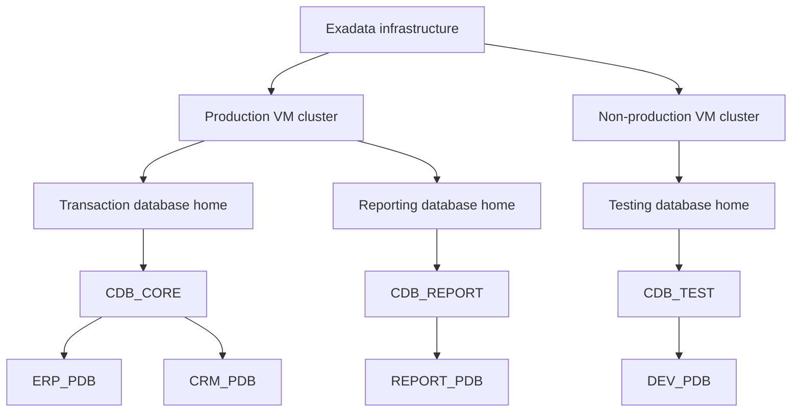

# Resource Planning and Multi-Database Consolidation

Database consolidation on Exadata is the problem of placing multiple workloads onto shared resources while maintaining committed service levels. A system with ample spare CPU during off-peak hours can still run out of memory during a node loss, hit an I/O bottleneck during reporting, or exhaust recovery space if backup transport is interrupted.

Within the **Exadata and Cloud@Customer** chapter of the Oracle Cloud Infrastructure (OCI) content, this lesson focuses on planning for **Exadata Database Service on Dedicated Infrastructure** and **Exadata Database Service on Cloud@Customer** with customer-managed databases. The goal is to decide which databases belong together, at which layer to allocate resources, how to control contention, and what evidence to require before onboarding additional workloads.

After completing this lesson, learners will be able to:

- Build workload profiles and distinguish physical, provisioned, and actually consumed resources.
- Choose consolidation boundaries across infrastructure, VM cluster, database home, CDB, and PDB.
- Estimate CPU, memory, storage, and bandwidth for both normal and degraded states.
- Design prioritization policies, monitoring, and scaling procedures tied to cost.
- Prepare a database onboarding package with measurable criteria and a rollback plan.

## 1. Define Scope Before Sizing Configurations

### 1.1. Two Deployment Locations, One Planning Methodology

With Exadata Database Service on Dedicated Infrastructure, the Exadata infrastructure resides in OCI. With Exadata Database Service on Cloud@Customer, the hardware is placed on the customer's premises and delivered under the corresponding service model. Deployment location changes the factors that must enter the plan: application connectivity networks, backup paths, standby placement, hardware expansion lead times, and on-site operational responsibilities.

Do not apply a single generic limits table across all Exadata generations. OCPU or ECPU provisioning capabilities, selectable node counts for a VM cluster, memory adjustment methods, storage types, and service limits depend on the actual configuration. When drafting a plan, record:

| Item to Lock Down | Impact on the Plan |
| --- | --- |
| Service and hardware generation | Determines supported features and limits |
| List of database servers and storage servers | Shows actual physical resources and failure scope |
| Database version, Grid Infrastructure, and patch level | Verifies compatibility, management tools, and maintenance schedules |
| Resource CPU unit | Prevents confusing OCPU, ECPU, and OS logical CPUs |
| Storage type and redundancy model | Determines usable capacity, performance, and scaling method |
| Licensing model, owner, and environment | Connects technical choices to responsibility and cost |

In ExaDB-D, the architecture consists of one or more VM clusters; node subsetting allows selecting a subset of database servers for a VM cluster where supported. Therefore, do not assume every VM cluster uses all servers in the infrastructure. See [Oracle ExaDB-D Technical Architecture](https://docs.oracle.com/en/engineered-systems/exadata-cloud-service/ecsid/all_diagrams.html).

### 1.2. Put Service Objectives Ahead of Density Targets

A plan must answer at least four questions:

1. What response times and throughput do applications require during peak hours?
2. During a node loss or maintenance window, which workloads must still maintain service levels?
3. How much data loss is acceptable, and how long can recovery take?
4. Which databases is the business willing to let share the blast radius of a single change or outage?

An **SLO** is a service level objective, such as P95 latency for payment transactions under 200 ms. **RPO** is the acceptable data loss objective; **RTO** is the service recovery time objective.

The numbers in this lesson are hypothetical figures to illustrate the methodology—not minimum configurations, limits, or Oracle performance guarantees.

## 2. Understand Consolidation Layers and Blast Radius

One possible layout has two production CDBs and one non-production CDB:



The diagram depicts management relationships; it does not fully describe I/O paths or physical placement.

| Layer | What Can It Decide? | What Still Must Be Calculated Separately? |
| --- | --- | --- |
| Infrastructure | Total physical capacity, expansion plans, and fault domains | VM clusters on the same infrastructure still share dependencies |
| VM cluster | CPU, memory, VM resource allocation, and environment organization | VM-specific resources do not add capacity to shared storage servers |
| Database home | Managing Oracle Database binaries and update cycles | A database home is not a CPU or memory quota |
| CDB | Grouping PDBs that can share a database platform and operational cycle | A CDB outage can impact multiple PDBs |
| PDB | Isolating application data, administration, and resource policies inside a CDB | A PDB does not have its own VM or SGA like a standalone database instance |

Distinguish a **database** from an **instance**. In RAC, one database can be accessed by multiple instances on different nodes. Therefore, the number of databases does not equal the number of instances; memory budgets must evaluate each running instance on each VM.

Multiple PDBs in the same CDB share CDB instance-level resources. Do not sum memory as if each PDB had an independent SGA. Conversely, multiple CDBs on the same VM create multiple SGAs, background process sets, and maintenance activities that must be budgeted.

An OCI compartment helps organize cloud resources and control permissions. It does not replace database user authorization, enforce CPU caps on PDBs, or automatically isolate I/O.

## 3. Collect Workload Profiles That Support Decisions

### 3.1. Every Workload Must Have an Owner

Before asking "how many databases can we pack in," compile an inventory with these fields:

| Category | Data to Collect |
| --- | --- |
| Business | Application, owner, criticality tier, operating hours |
| Service levels | Latency SLO, throughput, RPO, RTO, maintenance windows |
| Compatibility | Version, patch level, character set, timezone file, options used, external dependencies |
| CPU | Actual CPU usage over time, short-term spikes, concurrency, parallel execution |
| Memory | Observed SGA, PGA, PGA peaks, session count, In-Memory needs if any |
| I/O | IOPS, MB/s, I/O size, read/write ratio, latency, and redo |
| Storage | Datafiles, used space, TEMP, UNDO, recovery area, growth rate |
| Operations | Backups, stats gathering, ETL, data refreshes, clones, period-end reports |
| Network | Application paths, backups, replication, actual RTT and throughput |
| Isolation | Sensitive data, admin teams, environment separation requirements, and outage scope |

Do not infer CPU demand solely from the core count of legacy servers or the number of databases. Legacy systems may be overprovisioned, I/O-bound, or software-limited; CPU generations and Exadata behavior may also differ.

### 3.2. Measure Over Time and Preserve Overlapping Loads

The observation window must cover meaningful cycles: workdays, weekends, backups, month-end, and business peaks. If a rare event has not been observed yet, record it as an assumption requiring load testing rather than treating its load as zero.

Store averages, percentiles, and short-term spikes along with timestamps and time zones. Sampling intervals that are too coarse can hide multi-minute overloads that trigger timeouts.

There are two distinct calculations:

```text
Sum of individual peaks = peak(A) + peak(B) + peak(C)

Peak of total concurrent load = peak(A(t) + B(t) + C(t))
```

The peak of total concurrent load is useful for consolidation when workload schedules stay aligned. The sum of individual peaks serves as a stress scenario when schedules might overlap. Similarly, do not sum separate P95 values and call the result the P95 of the combined load.

AWR/ASH data or management tools can help if the environment has appropriate licensing/entitlements. Collection plans can also use OS metrics, service metrics, and authorized views. Document the measurement source and conditions so others can reproduce the findings.

## 4. Select Which Databases Should Coexist

### 4.1. Group by Shared Operational Characteristics

Two low-load workloads are not automatically good candidates for the same CDB. Verify:

- Can they share the same database version and CDB-level patching schedule?
- Are maintenance windows and recovery requirements compatible?
- Do teams accept sharing the blast radius of a CDB crash or restart?
- Can encryption, key, auditing, and admin privilege requirements be satisfied at the chosen boundary?
- Does one workload generate extreme PGA, parallel execution, redo, or TEMP spikes?
- During load shedding, is one group permitted to pause or throttle to protect critical transactions?

You can choose among these consolidation levels:

| Option | Primary Benefit | Trade-off |
| --- | --- | --- |
| Multiple PDBs in one CDB | Reduces duplicate overhead and unifies administration | Shares instance and CDB-level operational blast radius |
| Multiple CDBs in one VM cluster | Isolates database settings, PDB sets, and parts of the operational schedule | Consumes extra memory, processes, and admin overhead |
| Multiple VM clusters on one infrastructure | Isolates VM environments, resource allocations, and admin boundaries more cleanly | Still shares underlying hardware and storage dependencies |
| Separate infrastructure or location | Reduces corresponding shared dependencies | Increases cost and connectivity, operations, and data protection effort |

Do not use splitting database homes as proof of performance isolation. The main purpose of a database home is managing binaries; performance still depends on the resources where instances run.

### 4.2. Write Onboarding Rules and Exception Policies

Examples of internal rules:

- Production and heavy load-testing environments sit on separate VM clusters.
- PDBs sharing an update cycle may be considered for the same CDB after compatibility checks.
- Reporting may share infrastructure with OLTP if throttling policies exist and impact has been measured.
- Databases requiring independence from an entire infrastructure outage must have a plan in another fault domain.

These are organizational design decisions, not mandatory service rules. Every exception needs an owner, rationale, SLO impact, and review trigger.

## 5. Budget CPU for Degraded States as Well

### 5.1. Separate Three Types of CPU Figures

In the planning sheet, record separately:

1. **Physical/available capacity:** resources that the infrastructure and current configuration can deliver.
2. **Provisioned or enabled resources:** CPUs allocated to the VM cluster under the service model.
3. **Utilization:** actual CPU consumed by the OS, databases, and workloads.

OCPU/ECPU is a service billing/allocation unit; logical CPUs seen by the OS or database parameters are a different concept. Use the rules for the specific resource generation and verify on the actual VM rather than applying one conversion factor across all configurations.

A useful analytical metric is:

```text
Average database CPU in the measurement interval
    = increase in DB CPU seconds / elapsed wall-clock seconds of the interval
```

For example, an increase of 600 DB CPU seconds over 60 seconds corresponds to an average of 10 logical CPUs busy running database work during that window. This metric does not include all host work, does not directly report latency, and does not automatically translate into the number of OCPUs/ECPUs to purchase. With RAC, aggregate instances properly over the same measurement interval to avoid double-counting.

### 5.2. Calculate Capacity After Node Loss

Suppose:

- A VM cluster has `N` equivalent nodes.
- Each node provides `C` effective CPU units calibrated on the target system.
- `f` is the number of unavailable nodes in the scenario under evaluation.
- `u` is the target utilization ceiling chosen by the operations team.
- `D` is the concurrent load to be served in that scenario.

Screening condition:

```text
D <= (N - f) × C × u
```

If node configurations are asymmetric, replace `(N - f) × C` with the sum of capacities of the nodes actually serving. If services run only on a subset of nodes, use the capacity of that subset.

This calculation assumes load distributes as designed. It does not prove RAC scales linearly: you must also measure cold-cache effects, reconnects, inter-instance traffic, long transactions, and hot spots.

### 5.3. Example: Enough CPU Normally, Shortfall When One Node Fails

Assume a production VM cluster has two nodes. After accounting for defined system reservations, each node provides `64 U` of effective CPU. `U` is an internal unit for this example, not an OCI shape name or billing unit.

Operations chooses a maximum target utilization of 70% for retained load when one node is lost:

```text
CPU budget in single-node loss state
    = (2 - 1) × 64 × 0.70
    = 44.8 U
```

Cluster-wide load to evaluate:

| Workload | Location | CPU in Overlapping Load Scenario | Priority |
| --- | --- | ---: | --- |
| ERP | ERP_PDB in CDB_CORE | 24 U | Must sustain |
| CRM | CRM_PDB in CDB_CORE | 12 U | Must sustain |
| Reporting/ETL | REPORT_PDB in CDB_REPORT | 20 U | May be throttled or deferred |
| Total | | 56 U | |

When both nodes are up, 56 U out of 128 U is roughly 43.8%. Looking only at this ratio, an operator might conclude there is plenty of headroom.

When one node fails, the same load demands 87.5% of the surviving node, exceeding the 70% target. Critical transactions require 36 U; remaining budget under the target is:

```text
44.8 - 36 = 8.8 U
```

One option is throttling reporting load down to at most roughly 8 U effective in the tested scenario. The total becomes 44 U, or 68.75% of the surviving node. Enforcing this requires combining job schedules, concurrency limits, service placement, and appropriate resource limits; typing a number into a spreadsheet does not enforce a cap.

Other options include adding actual capacity, moving reporting elsewhere, or revising service levels with application owner approval. Do not rely on promises to "scale CPU up during an outage" without verifying spare capacity, operational permissions, and scaling duration.

## 6. Budget Memory per VM and per Instance

Idle CPU will not let a VM accept another SGA if memory allocation is nearly exhausted. Build a memory table per node even when nodes start identically configured.

A budget model:

```text
VM RAM must be sufficient for:
    operating system and platform components
  + total SGA of database instances on the VM
  + projected PGA at the target concurrency level
  + auxiliary tasks that may run concurrently
  + selected headroom reserve
```

PGA depends on sessions, sort/hash operations, and parallel execution. `PGA_AGGREGATE_TARGET` is a tuning target, not a guarantee that PGA stays strictly below that number at every moment. Examine limit behavior, errors raised when thresholds are exceeded, and real workload behavior.

Suppose each production VM has 512 GiB RAM. Both CDBs have an instance on that VM:

| Component on One VM | Hypothetical Budget |
| --- | ---: |
| OS, Grid Infrastructure, ASM, agents, and background services | 64 GiB |
| CDB_CORE instance SGA | 160 GiB |
| CDB_REPORT instance SGA | 48 GiB |
| CDB_CORE instance projected PGA | 64 GiB |
| CDB_REPORT instance projected PGA | 24 GiB |
| Auxiliary tasks outside itemized entries | 32 GiB |
| Surge and fluctuation headroom | 80 GiB |
| Total | 472 GiB |

Only 40 GiB remains beyond the itemized headroom. And that is only the normal budget. If during a node loss total PGA on the surviving VM rises from 88 to 120 GiB, total budgeted demand becomes 504 GiB. Test this scenario to confirm, including reconnect session counts and post-failure concurrency.

Do not automatically double total SGA on node loss: SGA belongs to existing configured instances. However, shifted workloads can increase PGA, sessions, cache pressure, and background activity on the surviving node.

Additional checks:

- HugePages and memory settings must match total SGA and the version in use.
- Do not double-count the same reserve in both the VM budget and CDB budget without explanation.
- Inside a CDB, do not sum PDB limits as if every limit represented permanently reserved RAM.
- After changing CPU or parallelism, re-measure PGA; the two resources are coupled.
- Increase consolidation density only after inspecting low-memory behavior, not just the maximum supported PDB count.

## 7. Size Storage Using a Growth and Recovery Budget

### 7.1. Distinguish Storage Categories

Separate at least four categories:

| Category | Covers or Serves |
| --- | --- |
| Shared database storage | Datafiles, indexes, TEMP, UNDO, and other components per configuration |
| Recovery area | Archived redo, flashback logs, local backups if configured, and recovery components |
| VM filesystem | Database homes, patch staging, logs, audit, dumps, and admin tasks |
| External backup location | Backup data per retention and target recovery capability |

Do not treat storage server raw capacity as space allocatable to applications. Use usable capacity according to the actual protection mechanism and storage model, and distinguish space allocated to a VM cluster from space actually available for use.

ASM environments must examine each disk group and its real usable space. With other storage models, use the corresponding pools and metrics. Total free space across the entire system does not prove the area a database uses has enough room.

### 7.2. Example Capacity Calculation with Headroom

Assume all items below are normalized to the same usable capacity basis, using decimal TB:

- Current permanent data, including allocated segments to keep: 12 TB.
- Permanent growth: 0.35 TB/month for 12 months.
- Additional TEMP and concurrent operational demand: 2 TB.
- Projected local recovery area: 3 TB.
- Temporary space for migrations or clones: 2 TB.
- Target of always keeping 20% unallocated headroom.

```text
Pre-headroom demand
    = 12 + (0.35 × 12) + 2 + 3 + 2
    = 23.2 TB

Required usable capacity
    = 23.2 / (1 - 0.20)
    = 29 TB
```

Dividing by 0.8 ensures demand occupies at most 80% of total capacity. Multiplying 23.2 by 1.2 yields only 27.84 TB and fails to maintain a full 20% free margin of the total.

The 29 TB figure is an aggregate condition. You must still allocate it across the data area, recovery area, and corresponding pools; do not assume two areas can automatically borrow space from each other. If clones live in another pool or backups sit off-box, adjust the budget accurately instead of double-counting.

### 7.3. Recovery Space Must Reflect Outage Duration

Archived redo accumulates when backups or log shipping slow down. An initial estimate:

```text
Archived redo capacity to retain
    = design redo generation rate
    × required retention duration during an outage scenario
```

For example, 150 GB/hour over eight hours requires 1.2 TB for archived redo alone, before flashback logs and other files. If two databases suffer outages together, add their corresponding rates.

Do not assume compression ratios or snapshot clone savings before measuring. Clones can grow as either the source or clone changes. Check datafile autoextend settings and cap them at the proper layer so one PDB cannot fill storage shared by multiple databases.

## 8. Evaluate I/O and Network Under Concurrent Workloads

An OLTP workload is typically latency-sensitive; reporting and ETL may demand high throughput. Two workloads with the same MB/s still have different impacts due to I/O size, randomness, write ratio, and caching behavior.

Evaluate concurrently:

- IOPS and latency of small transactions.
- Large read throughput for reporting.
- Redo, commit latency, and write volume.
- TEMP demand when sorts or hashes spill from memory.
- Backup, restore, rebalance, and administrative tasks.
- Cache contention, storage server resources, and related networks.

Do not use an isolated sequential read benchmark as proof of transaction latency when multiple databases are active.

For example, reading 1.8 TB in two hours requires an average throughput of at least roughly 250 MB/s in decimal units. Restoring 12 TB in four hours requires roughly 833 MB/s just for data transfer, before decompression, data writes, redo apply, startup, and application validation. RTO must encompass the entire recovery path.

With Cloud@Customer, test application networks, backup networks, storage targets, and Data Guard destinations directly per design. With OCI deployments, test application networks across the VCN and any external connections. Calculate end-to-end throughput from real measurements; a port's nominal link speed is not guaranteed backup throughput.

## 9. Control Contention at the Right Layer

### 9.1. One Limit Layer Does Not Replace the Others

| Control Layer | Purpose | What to Verify |
| --- | --- | --- |
| VM cluster resource allocation | Sets the VM environment budget | Total physical capacity and remaining expansion headroom |
| Instance caging | Caps a database instance's CPU via Resource Manager | Active plan and CPU value on each instance |
| CDB resource plan | Allocates resources among PDBs in a CDB | Per-PDB directives and default directive |
| Consumer groups inside PDB/database | Classifies transactions, batch, reporting | Whether session/service mappings route workloads to the right group |
| I/O Resource Management | Arbitrates I/O among databases on Exadata | Policies and interfaces supported by the active service |
| Job schedules, connection pools, parallelism | Controls concurrent work at the entry point | Whether applications generate unexpected concurrency spikes |

With Oracle Database 19c, `CPU_COUNT` relates to the number of CPU threads the database uses. Instance caging requires Resource Manager to manage CPU; setting a CPU parameter alone is not enough to confirm caging is active. If `CPU_COUNT` is pinned explicitly, review it after scaling VM CPUs because the database will no longer track CPU count changes automatically by default. See [CPU_COUNT parameter](https://docs.oracle.com/en/database/oracle/oracle-database/19/refrn/CPU_COUNT.html).

A CDB plan only divides resources within that CDB. It does not by itself resolve CDB_CORE and CDB_REPORT competing for the VM's CPU.

### 9.2. Distinguish Shares from Limits

**Shares** express relative weight during contention. For instance, if ERP_PDB has eight shares and CRM_PDB has four shares, the target ratio between those two contending PDBs is 2:1. This does not reserve a fixed block of physical CPU; other PDBs, internal background work, limits, and underlying capacity still matter.

**Utilization limit** sets a ceiling within the resource scope managed by that mechanism. A PDB with a low limit can still be throttled when other PDBs are idle. A 25% limit inside one CDB does not mean 25% of the entire Exadata infrastructure.

Oracle provides shares and utilization limits in [Oracle Resource Manager for PDBs](https://docs.oracle.com/en/database/oracle/oracle-database/19/multi/using-oracle-resource-manager-for-pdbs-with-sql-plus.html). Choose weights according to business priority; choose ceilings according to workload protection needs and measurement results.

For IORM, Oracle describes coordinating I/O across databases using directives and shares. In ExaDB-D, manage it through supported service interfaces; do not copy an ExaDB-D Console procedure verbatim to Cloud@Customer without confirming the corresponding resource support. See [Managing IORM on Exadata Cloud Infrastructure](https://docs.oracle.com/en/engineered-systems/exadata-cloud-service/ecscm/ecs-manage-iorm.html).

IORM does not create extra bandwidth and does not substitute for provisioning enough CPU, RAM, or storage capacity.

## 10. Demonstration: Checking and Configuring CDB Policies

The SQL below illustrates Oracle Database 19c. Run it on an **isolated test CDB**, connected to `CDB$ROOT` with an appropriately privileged account. The plan-creation statements apply only when `ERP_PDB` and `CRM_PDB` already exist in that CDB.

### 10.1. Record Current State

The following queries are read-only:

```sql
SELECT SYS_CONTEXT('USERENV', 'CON_NAME') AS current_container
FROM dual;

SELECT con_id, name, open_mode
FROM v$pdbs
ORDER BY con_id;

SELECT inst_id, name, value
FROM gv$parameter
WHERE name IN (
    'cpu_count',
    'resource_manager_plan',
    'sga_target',
    'pga_aggregate_target',
    'pga_aggregate_limit'
)
ORDER BY inst_id, name;

SELECT plan, pluggable_database, shares, utilization_limit
FROM dba_cdb_rsrc_plan_directives
ORDER BY plan, pluggable_database;
```

With RAC, `GV$` views let you inspect all instances instead of only the connected instance. Parameter values show configuration, not utilization graphs. The directive view lists defined plans; cross-check with the currently active plan and Scheduler windows rather than assuming every listed plan is active.

Save each instance's current `RESOURCE_MANAGER_PLAN`, existing plans, and scheduled plan-switching mechanisms before testing changes.

### 10.2. Create a Test Plan for Two Transaction PDBs

Assume `LAB_CORE_PLAN` does not yet exist, no pending area from another change is open, and the executor holds `ADMINISTER_RESOURCE_MANAGER`. Run in `CDB$ROOT` of the test CDB:

```sql
BEGIN
    DBMS_RESOURCE_MANAGER.CREATE_PENDING_AREA();

    DBMS_RESOURCE_MANAGER.CREATE_CDB_PLAN(
        plan    => 'LAB_CORE_PLAN',
        comment => 'Lab allocation for ERP and CRM'
    );

    DBMS_RESOURCE_MANAGER.CREATE_CDB_PLAN_DIRECTIVE(
        plan               => 'LAB_CORE_PLAN',
        pluggable_database => 'ERP_PDB',
        shares             => 8,
        utilization_limit  => 100
    );

    DBMS_RESOURCE_MANAGER.CREATE_CDB_PLAN_DIRECTIVE(
        plan               => 'LAB_CORE_PLAN',
        pluggable_database => 'CRM_PDB',
        shares             => 4,
        utilization_limit  => 100
    );

    DBMS_RESOURCE_MANAGER.UPDATE_CDB_DEFAULT_DIRECTIVE(
        plan                  => 'LAB_CORE_PLAN',
        new_shares            => 1,
        new_utilization_limit => 10
    );

    DBMS_RESOURCE_MANAGER.VALIDATE_PENDING_AREA();
    DBMS_RESOURCE_MANAGER.SUBMIT_PENDING_AREA();
END;
/
```

The example uses the API documented in [DBMS_RESOURCE_MANAGER](https://docs.oracle.com/en/database/oracle/oracle-database/19/arpls/DBMS_RESOURCE_MANAGER.html). The default directive applies to PDBs without a dedicated directive; review it whenever onboarding a new PDB.

Creating a plan does not activate it. If the test CDB uses an SPFILE and configuration permits setting the parameter this way, you can activate it with:

```sql
ALTER SYSTEM SET resource_manager_plan = 'LAB_CORE_PLAN'
    SCOPE = BOTH SID = '*';
```

Then re-query configuration on every instance, confirm the plan is actually in effect, and observe contention under load. In RAC setups with instance-specific overrides, do not rely solely on one `SID='*'` command. Also monitor plan changes when maintenance windows open.

This plan only illustrates prioritizing ERP and CRM inside CDB_CORE. It does not cap CDB_REPORT at the 8 U from the sizing example, create a RAM budget, or enforce cloud cost limits.

If the test fails to meet requirements, restore the recorded plan values and verify on each instance; clean up lab objects via change control afterward. If the plan-creation block errors out, inspect the pending area and root cause before retrying rather than clearing someone else's changes.

## 11. Size Resources for Maintenance, HA, and DR

### 11.1. Maintenance Is a Load-Bearing State

Beyond unexpected node failures, plan scenarios for:

- A VM or database instance temporarily taken offline for maintenance.
- Moving a database to a patched home while keeping the old home temporarily for rollback.
- Backups overlapping peak hours or running long.
- Cloning, migrations, and statistics collection after data loads.
- Restarting multiple databases and warming caches.

Do not assume every scaling action happens instantaneously with zero impact. Cloud@Customer documentation notes that memory changes involve rolling VM restarts; filesystem behavior also depends on hardware and operation type. Schedule and check preconditions for your exact system in [Manage VM Clusters](https://docs.oracle.com/en-us/iaas/exadata/doc/ecc-manage-vm-clusters.html).

Unallocated infrastructure resources may be used for expansion where configuration and service allow. However, remaining quota, remaining budget, and available physical capacity are three separate conditions.

### 11.2. RAC Does Not Replace DR

RAC supports instance/node-level availability per the deployment architecture. It does not by itself protect against all storage failures, whole-infrastructure outages, or site-wide disasters. Two VM clusters on the same infrastructure still share common dependencies.

If the design uses Data Guard, standby resource reserves include:

- Database and redo storage on the receiving side.
- CPU, memory, and I/O to keep apply caught up with redo generation.
- Redo transport network and catch-up capacity after interruptions.
- Compute capacity to run retained workloads after role transition.
- Backups and maintenance operations on both sides per policy.

A standby currently consuming little CPU does not prove it can serve the primary load after failover. Measure post-switchover workloads and the impact of other databases co-located at the standby site.

RTO must include incident detection, failover decision, technical execution, client reconnection, and application verification. For backup-based recovery, include restore, recovery, and data usability validation.

## 12. Tie Resource Allocation to Responsibility and Cost

### 12.1. Assign Permissions by Operational Action

Clearly define who can:

- Modify infrastructure and VM cluster resources.
- Create database homes, CDBs, PDBs, or clones.
- Change resource plans, batch schedules, and parallelism settings.
- Perform backups, restores, and role transitions.
- Approve budget increases or service-tier changes.

OCI IAM permissions and database privileges govern different administrative layers. A team that only needs to administer a PDB does not automatically need permission to scale VM cluster CPUs; conversely, someone allowed to scale cloud resources does not automatically need permission to read application data.

Tag every resource with owner and environment via appropriate governance metadata. When multiple PDBs share one CDB, maintain an application-to-PDB mapping catalog; looking only at VM cluster tags will not enable granular cost allocation.

### 12.2. Use a Total Cost Model

An internal estimation table can break down:

```text
Projected total cost
    = contracted underlying infrastructure cost
    + CPU/database usage cost per selected model
    + backups and additional storage
    + billable connectivity and data transfer
    + standby DR infrastructure
    + operational, testing, and maintenance costs
```

This is an analytical model, not an Oracle billing formula. Obtain billing units, minimum durations, License Included/BYOL terms, and committed spend rules from the actual configuration and contract. Do not infer licensing entitlements solely from PDB counts or a `CPU_COUNT` value.

Higher density can lower per-application overhead, but it also raises maintenance coordination costs and blast radius. Splitting VM clusters clarifies ownership, though it can leave more stranded unused capacity.

When allocating costs, you can split baseline costs by committed resources and variable costs by measured usage. Document clear rules so an application using little CPU while holding large RAM, storage, or standby capacity is not treated as cost-free.

## 13. Design Monitoring Dashboards and Scaling Triggers

Monitor across four layers: infrastructure, VM/node, database instance, and PDB/workload. Correlate infrastructure metrics with application latency and errors; a dashboard showing only cluster-wide CPU will miss many issues.

| Signal | Operational Question |
| --- | --- |
| Per-application latency and throughput | Are service levels holding as combined load grows? |
| Per-node CPU, run queues, and resource waits | Is a node skewed or unexpectedly CPU-caged? |
| SGA, PGA, concurrency, VM memory health | Is there a risk of RAM exhaustion on reconnects or higher parallelism? |
| I/O latency, throughput, TEMP, and redo | Which workload is causing contention spikes? |
| Remaining usable capacity per pool/area | How soon will limits be hit at the current growth rate? |
| Backup age, backup duration, apply lag | Is recoverability degrading? |
| Active plans and configuration drift | Do live policies match approved records? |
| Cost and provisioned resources | Does growth align with workload and budget? |

Two useful forecasting indicators:

```text
CPU headroom for critical load on node loss
    = target capacity of surviving nodes
    - CPU of critical load in the design scenario

Time remaining before capacity threshold
    = remaining capacity after required reserves
    / projected net growth rate
```

In the CPU example, headroom for ERP and CRM is 8.8 U before allocating anything to reporting. As projected growth shrinks this margin, act before normal-state CPU reaches 100%.

Remaining storage time must account for periodic surges, retention, and migration tasks—not merely extrapolate from a quiet day. Alert thresholds must give operations enough lead time to execute the chosen action.

Every alert must link to an action and an owner: which job to defer, which resource to scale, what root cause to check, and when to escalate.

## 14. Onboarding Workflow for Additional Databases or PDBs

An onboarding workflow can follow this sequence:

1. **Confirm owner and service levels.** Record peak hours, SLOs, RPO/RTO, maintenance windows, and who may authorize load shedding.
2. **Check co-location compatibility.** Verify version compatibility, admin privileges, data constraints, and blast radius.
3. **Update concurrent load model.** Add the new workload to time series for CPU, memory, I/O, redo, and task schedules.
4. **Recompute budgets across all states.** Include normal, node loss, maintenance, and major recovery operations.
5. **Select placement tier.** Choosing a new PDB, new CDB, new VM cluster, or separate location must follow documented requirements.
6. **Prepare resource and connection policies.** Define explicit directives, appropriate services, concurrency limits, and rules for unclassified workloads.
7. **Load-test in a suitable environment.** Run mixed workloads, check backup windows, and test authorized degraded-mode scenarios.
8. **Roll out in phases.** Observe effects on both new workloads and existing applications; keep an executable rollback plan ready.
9. **Post-deployment reconciliation.** Compare actual load, capacity, and cost against assumptions; update records before the next onboarding cycle.

Acceptance evidence should be quantitative—for example, "ERP maintained its SLO during a single-node outage scenario while reporting throttled per policy"—rather than "database created successfully."

In automation, before changing resources, read the current state, verify preconditions, record the change, and wait for the work request to complete. Proceed to the next step only when the resource reaches the required state. Then verify settings inside the database, because scaling VM CPUs does not guarantee pinned parameters inside the database updated automatically.

## 15. Mistakes That Make Consolidation Plans Unsafe

| Mistake | Consequence | Corrective Action |
| --- | --- | --- |
| Dividing total CPU by database count | Ignores load, criticality, and peak timing | Allocate by workload profiles and SLOs |
| Using only cluster-wide average CPU | Masks load skew and shortfall on node loss | Inspect per-node metrics and calculate degraded states |
| Counting only maximum supported PDBs | Confuses product limits with operable density | Size using CPU, RAM, I/O budgets, and load testing |
| Treating shares as hard dedicated reservations | Promises service levels beyond actual capacity | Verify scope, limits, and contending workloads |
| Packing all environments together to save RAM | Widens blast radius of testing and maintenance | Choose boundaries based on isolation needs |
| Forgetting TEMP, redo, clones, and old homes | Exhausts storage during operations or migrations | Budget these components explicitly |
| Treating successful backups as meeting RTO | Unknown restore and recovery duration | Measure end-to-end recovery with app verification |
| Planning to scale only after an outage hits | May lack physical capacity or reaction time | Pre-provision capacity and load-shedding plans |
| Skipping checks after changing CPU | Caging or parallelism drifts from design | Re-verify parameters and re-measure across instances |

## 16. Operational Documentation Package

The output of planning is a reusable artifact set as loads or infrastructure evolve:

- Inventory of databases/PDBs, owners, SLOs, and relationships to VM clusters, database homes, and CDBs.
- Baselines with timestamps, measurement sources, peak cycles, and unverified assumptions.
- CPU, memory, storage, I/O, and network tables for each design state.
- Grouping rules, resource plans, job schedules, and load-shedding order during resource contention.
- Backup, recovery, HA/DR plans, and associated test evidence.
- Cost model, scaling thresholds, lead times, and decision makers.
- Onboarding, post-deployment observation, and rollback procedures.

For the lesson's example, deciding whether to onboard one more PDB must re-evaluate the 44.8 U node-loss budget, each VM's RAM, the 29 TB usable allocation across areas, and the new workload's impact on backups and recovery. Headroom in one resource only counts when every other constraint is satisfied as well.
