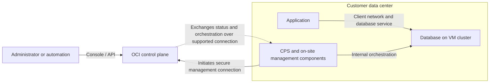

# Exadata Cloud@Customer and OCI Control Plane Connectivity

Exadata Cloud@Customer brings Exadata infrastructure into the customer's data center while retaining a cloud-service management model. Databases serve on-premises applications; service management operations are orchestrated through the OCI control plane and Oracle-provided management components at the deployment site.

Within the **Exadata and Cloud@Customer** chapter of the **CLOUD_PROVIDERS_ORACLE** module, this lesson explains the relationship between data placement, application serving paths, and service management paths. Learners will see how to align IAM, networking, monitoring, and automation to deploy an operable connection rather than merely checking that a TCP port is open.

After completing this lesson, learners will be able to:

- Distinguish the control plane, on-site automation path, and application-serving data plane.
- Explain the role of on-site control components and connectivity to OCI.
- Build a table of network flows, DNS/TLS/time requirements, and acceptance evidence.
- Evaluate the impact of management connectivity loss without assuming a database outage.
- Organize validation, alerting, and troubleshooting by layer.

The primary scope is **Exadata Database Service on Cloud@Customer**. Details belonging to Autonomous Database on Cloud@Customer must be verified under its separate service model; do not assume all features and management boundaries are identical.

## 1. On-Premises Placement Does Not Mean Disconnected from OCI

In a fully self-managed database system, the customer handles all provisioning, monitoring, and maintenance workflows themselves. With Exadata Cloud@Customer, the hardware sits at the customer's site while the service lifecycle is coupled to OCI.

The **OCI control plane** provides the interface and mechanism to manage service resources. Operators use the OCI Console, APIs, or supported tooling to inspect status and request operations. Requests may target Exadata infrastructure, VM clusters, and database resources, depending on permissions and service capabilities.

This creates two independent questions:

1. Can applications reach the database and execute transactions?
2. Can the service communicate with OCI to receive, orchestrate, and report status for management operations?

One "yes" does not substitute for the other. The system can keep serving transactions while the management path is disrupted; conversely, resources may be manageable while applications fail due to client networking, database services, or connection settings.

This forms the basis for designing monitoring and scoping incidents accurately.

## 2. Three Path Groups to Keep Separate

### 2.1. Management Path Between the Deployment Site and OCI

This path carries communication between on-site management components and OCI control services. It supports status synchronization, receiving and orchestrating management jobs, and exchanging operational telemetry within service scope.

In the Cloud@Customer architecture, **control plane servers — CPS** are the Oracle-managed on-site control components. Do not treat CPS like an ordinary database host for DBAs to log into and edit configurations.

Secure connectivity to OCI is established per the service's connectivity design, using outbound-initiated connections from the on-site deployment. However, an outbound-initiated session still carries bidirectional communication once established. "Outbound" describes connection initiation direction, not that OCI cannot dispatch tasks down to the system.

### 2.2. On-Site Automation and Management Path

The control component must communicate with managed components on the Cloud@Customer side to execute tasks. This flow is separate from the application-to-database path and separate from the outbound path to OCI.

A healthy OCI connection does not guarantee a task will complete if required internal communication fails. Conversely, on-site hosts seeing each other does not prove the management path out to OCI is ready.

Exact network names, address ranges, ports, and endpoints must come from Oracle's deployment design for the specific system. The flow groups in this lesson are a functional analysis framework, not an official list of network names applicable across every generation.

### 2.3. Data Path Between Applications and Databases

Applications connect to the database over the client network and addresses/services configured for that environment. This access path handles queries, transactions, reconnects, and result sets.

In normal database access flows, applications do not send individual SQL statements through the OCI control plane before reaching the on-site database. Therefore, latency to the OCI management endpoint and application transaction latency are two distinct metrics.

Client network design still requires sufficient capacity, redundant paths, and proper connection-error handling. Healthy management connectivity cannot fix a bad connection string or a firewall blocking database traffic.

### 2.4. Logical Diagram



The diagram shows logical roles and flows only. It does not depict full network routes, all software layers, redundancy configurations, or support access for a specific deployment. The internal orchestration arrow also does not mean CPS processes application SQL statements.

## 3. What Does OCI Manage Over This Connection?

### 3.1. Resource Identification and Organization

Cloud@Customer resources are managed within an OCI tenancy, region, and compartment context per service capabilities. OCIDs identify resources across operations and logs.

Compartments organize and scope permissions for OCI resources. They are not VLAN or subnet boundaries inside the customer data center. A valid IAM policy still cannot replace required network routes or firewall rules.

The region associated with the control service does not automatically dictate where every type of data lives. Analyze separately where databases, backups, replicated data, logs, and operational data reside.

### 3.2. Management Requests and Execution Lifecycle

A management operation typically follows a general lifecycle:

```text
Authentication and authorization check in OCI
        ↓
Valid request accepted
        ↓
Dispatched to on-site component
        ↓
Steps executed on target resource
        ↓
Progress, outcome, or error details updated
```

Actual execution depends on the operation and may involve multiple steps. When an API accepts a request, the resource has not necessarily finished changing. Operators must check task or resource status through the interface supported by that operation.

In particular, a client-side timeout does not prove the request was never received. Before resubmitting, check whether a task already exists to avoid creating duplicate requests.

### 3.3. Displayed Status vs. Actual State

Status in OCI can lag behind when connectivity drops. During investigation, record both the observation timestamp and the data source:

- What was the most recent status recorded by OCI?
- At that moment, could applications still run transactions?
- Was the on-site component executing a previously received task?
- Do messages or errors include a task ID and corresponding timestamp?

Do not conclude the system is healthy solely from a stale screen, and never restart a database just to force management status to refresh.

## 4. Where Does Data Reside and What Information Can Leave?

The core value of Cloud@Customer is bringing the database runtime environment into the customer's site. Still, separate information types when assessing data residency requirements:

| Information Type | Path or Storage Location to Identify | Question to Answer |
| --- | --- | --- |
| Business data in the database | Storage components of the on-site deployment | Where do the database and primary data reside? |
| Query results | Application and database paths | Where do applications or users receive results? |
| Management metadata and status | Management connection to OCI services | Which metadata fields are exchanged to operate the service? |
| Telemetry and diagnostics | Configured monitoring, diagnostic, and support mechanisms | What information is collected, transmitted, and retained? |
| Backups or data replicas | Selected backup target and replication architecture | Are copies sent to OCI or another site? |
| Support cases and attachments | Support process | Do files contain SQL, object names, or sensitive data? |

You cannot conclude "no information ever leaves the data center" simply because the database runs on-premises. At the same time, do not assume all business data traverses the control plane.

Customers must define data requirements, configure associated services, and control what is shared during support. When reviewing a specific flow, document source, destination, data type, purpose, and authorized recipients.

## 5. Conditions for Control Plane Connectivity to Work

### 5.1. Verified Endpoint List and Network Flows

Before configuring firewalls, the network team needs the exact connectivity requirements for the service and deployment. At minimum, identify:

- Connection sources and allowed source address ranges.
- Destination FQDNs or endpoints, purpose, and update process when changes occur.
- Protocols, ports, connection initiation direction, and return-traffic requirements.
- Routing paths, NAT devices, firewalls, or proxies along the path.
- Dependencies such as DNS and time synchronization services.
- Approving team, operating team, and verification evidence.

Do not reuse an endpoint list from another environment just because it mentions OCI. Likewise, do not open the entire Internet instead of defining exact connectivity requirements.

An internal table can be organized as follows:

| Flow Group | Logical Source | Logical Destination | Purpose | Teams to Coordinate |
| --- | --- | --- | --- | --- |
| Outbound management to OCI | On-site management component | Verified OCI service endpoints | Orchestration and status exchange | Oracle, customer network, and security |
| On-site automation | Management component | Managed components | Execute service tasks | Oracle and customer deployment lead |
| DNS/time | Components requiring lookup/sync | Designed DNS/time services | Name resolution and accurate timekeeping | Oracle and customer infrastructure team |
| Application access | Application servers | Database services on client network | Business transactions | Application team, DBAs, and network |
| Backup/replication | Participating components per configuration | Backup target or replica receiver | Data protection and recovery | DBAs, network, and related service owners |

This is a classification table, not a directly deployable firewall rulebase. Each row must be translated into verified concrete sources, destinations, and ports.

### 5.2. DNS Must Return Usable Results

If an endpoint is identified by name, the source component must reach an appropriate resolver. An admin workstation resolving a name does not prove CPS can resolve it, because the two sources may use different DNS servers or policies.

Check resolution errors, differences across DNS servers, routes to DNS, and forwarding configuration. Do not hardcode an IP address captured from a single lookup if the service mechanism requires a domain name.

### 5.3. TCP Reachability Is Not Enough; TLS Must Also Succeed

HTTPS typically uses TCP 443, but do not treat a common port number as the entire Cloud@Customer connectivity specification. Use the exact ports and endpoints required for each flow.

A successful TCP check only shows a connection can be opened to the tested address and port. Management sessions can still fail due to invalid certificates, hostname mismatches, untrusted certificate chains, or intermediate device interference.

Corporate SSL/TLS inspection can alter the certificate seen by the endpoint. If the service mechanism does not support that interception, handle it using an approved network configuration supported by Oracle. Never disable certificate verification to mask errors.

### 5.4. Time Synchronization

Clock skew can break authentication, certificate validation, and log correlation. Time synchronization services and access paths to them must follow the deployment design.

When collecting evidence, use UTC or always include time zones. An error logged at 10:00 on two systems is not comparable if one uses local time and the other uses UTC.

### 5.5. NAT, Proxies, and Session Timeouts

Intermediate devices can break connections even when port-allow rules exist. Check state tables, session idle timeouts, connection limits, source address translation, and path asymmetry.

If the design uses a proxy, verify the proxy model, authentication mechanism, and configuration are supported by the service. Do not insert a new proxy into the management path and expect the system to adapt automatically.

Redundant paths must also be tested. A second path provides no protection if it traverses the same failing device or lacks matching allow rules.

## 6. FastConnect or VPN Does Not Automatically Solve Control Plane Connectivity

In OCI, FastConnect and VPN can serve various enterprise connectivity needs. However, having a private link between the enterprise and OCI does not automatically prove Cloud@Customer control plane endpoints are reachable.

Answer three separate questions:

1. Which endpoint is needed, and what access type is it?
2. Which connectivity models does the service support for that endpoint?
3. Do current routes, DNS, firewalls, and intermediate devices implement that model properly?

If the solution uses public endpoints, a supported route to those public endpoints must exist. Do not assume an existing private subnet, DRG, or FastConnect circuit is sufficient.

Conversely, do not assume all traffic between Cloud@Customer and OCI services must use the same path. Management, backup, application, or replication flows may have different requirements.

Deployment decisions must rely on Oracle-verified connectivity diagrams and customer security requirements, rather than solely on the name of a purchased networking product.

## 7. Deployment and Connectivity Acceptance Workflow

### 7.1. Pre-Installation Preparation

Oracle and the customer must agree on roles, addressing, connectivity, and data center conditions. The customer prepares items within their scope, such as power, cooling, IP addressing, DNS, and designed network rules.

Assign contacts for each group: networking, security, facilities, OCI/IAM, and DBAs. One team reporting "firewall opened" is not enough to accept the entire management path.

### 7.2. Linking with the OCI Environment

Registration, activation, and linking infrastructure to the OCI context follow service procedures. Assigned owners verify the right tenancy, region, compartment, and resource identifiers within scope.

Onboarding details or credentials must be handled only through authorized mechanisms. Never place secret keys or login credential files in network documentation or shared support tickets.

### 7.3. Layered Acceptance Testing

| Check Layer | Required Evidence | What Cannot Be Concluded from This Layer Alone |
| --- | --- | --- |
| DNS | Test source resolves target name per design | TCP/TLS and service authentication succeeded |
| TCP | Test source establishes connection to required port | Endpoint accepted a CPS management session |
| TLS | TLS handshake and certificate verification succeed in test flow | All IAM and resource management permissions are valid |
| Actual management communication | Oracle/service confirms on-site component communicates and reports status | All lifecycle operations will succeed |
| Service operation | An authorized operation returns expected result and status | Applications meet transaction requirements |
| Application | Test business flow succeeds over client network | Control plane path will not fail later |

Acceptance operations should be small in scope, pre-agreed, and suited to the environment. Do not create a production VM cluster or database just to test networking without corresponding requirements and capacity plans.

### 7.4. Retaining Evidence

Acceptance records should include test timestamp, test source location, target endpoint, intended path, per-layer results, and sign-off owner. For steps executed on Oracle-managed components, use evidence provided by Oracle or service tooling per procedure.

Do not equate results from a personal workstation with results from on-site management components. Another host may share Internet egress while having different firewall rules, proxy settings, DNS, or NAT addresses.

## 8. Verification Examples from an Authorized Host

The commands below are for an **authorized Windows test host**, not instructions to log into CPS. Run them only against verified endpoints and ports; do not scan address ranges to guess service configuration.

```powershell
# Replace with the verified FQDN for the flow under test.
$OciEndpointHost = '<VERIFIED_OCI_ENDPOINT_FQDN>'

# 443 is only an example for a verified HTTPS endpoint.
$ApprovedTcpPort = 443

# Verify name resolution.
Resolve-DnsName -Name $OciEndpointHost

# Verify TCP connectivity from the host running the command.
Test-NetConnection -ComputerName $OciEndpointHost -Port $ApprovedTcpPort -InformationLevel Detailed
```

For an authorized HTTPS endpoint on port 443, you can observe an unauthenticated HEAD request:

```powershell
curl.exe --verbose --head --connect-timeout 10 --max-time 20 "https://${OciEndpointHost}/"
```

Before running, replace placeholders with real values. Do not use flags that disable certificate verification. Some endpoints do not support HEAD at the root path or require authentication; interpret HTTP error codes in the proper context.

Interpret results layer by layer:

- Name resolution fails: check DNS from the test source.
- Resolution succeeds but TCP fails: check routing, firewalls, NAT, and destination reachability.
- TCP succeeds but TLS fails: check certificates, system clock, endpoint hostname, and intermediate devices.
- HTTP response received: provides additional evidence of the HTTPS path from the test source; does not prove CPS service sessions work.
- Test host checks pass while the service still fails: shift focus to the real source, service registration, internal automation paths, and task status with Oracle.

An HTTP 401 or 403 response does not prove a network error; it can be an expected authentication or authorization response. Conversely, do not treat 401/403 as proof that the Cloud@Customer component authenticated successfully.

Verbose logs can reveal hostnames, addresses, and system details. Share only necessary excerpts through approved channels while retaining originals in authorized storage.

## 9. What Can Happen When Connectivity to OCI Is Lost?

Control plane connectivity loss is an incident to resolve, though impact depends on the failure scope and active work.

| Activity | What to Expect During Management Path Disruption | How to Assess |
| --- | --- | --- |
| On-site database serving transactions | Can continue if databases, client network, and dependencies remain healthy | Verify directly from applications and databases |
| Viewing status in OCI | May fail or display only the last known state | Cross-check update timestamps and on-site sources |
| Provisioning or modifying resources | May be blocked, queued, or fail to complete | Check task status, not just a single API response |
| Already-started jobs | May be running, finished without reporting status, or failed at a step | Coordinate with Oracle to verify step and actual state |
| Service-orchestrated maintenance | May be impacted by lost communication or lost internal dependencies | Monitor notices, tasks, and remediation guidance |
| Status/diagnostic collection | May pause or lag in updates | Use authorized customer-side monitoring additionally |
| Backups and data replication | Depends on mechanism, destination, and separate configuration links | Check each job rather than inferring from control plane state |

Do not guarantee databases will keep running in every connectivity loss scenario. If the root cause is a power loss, wide-area network outage, or shared dependency failure, both management and transactions may be impacted.

Likewise, do not claim every running task stops immediately when the management path drops. Uncertain states must be investigated rather than replaced by convenient assumptions.

### 9.1. Response Sequence

1. Verify whether applications are still serving and determine the affected user scope.
2. Record onset timestamp, recent changes, and affected resources.
3. Check service notices and existing task statuses.
4. Network team checks customer-managed dependencies: DNS, routes, firewalls, NAT, proxies, and redundant paths.
5. Oracle checks Oracle-managed management components.
6. After connectivity returns, reconcile resource states and tasks before issuing new commands.

Do not restart CPS, modify agents, or alter Oracle-managed component settings yourself. Those actions must follow Oracle procedures.

### 9.2. Restoring the Network Path Does Not End the Incident

After DNS, TCP, and TLS recover, verify the service actually communicates, statuses update, and in-flight jobs are reconciled.

Retry tasks only after understanding the prior request's state. If an operation supports idempotency mechanisms, automation must follow that exact operation's specification; do not assume all APIs use the same mechanism.

Do not switch management regions, re-register infrastructure, or spin up replacement resources merely to bypass a connectivity error without proper guidance. Those are service lifecycle changes, not simple network tests.

## 10. IAM and Network Security Are Complementary Control Layers

For an operation to succeed, the system needs both a working communication path and valid identity and permissions.

### 10.1. Permissions in OCI

Customers manage users, groups, policies, and compartment scope according to their organization. Separate read-only status observers from roles allowed to modify resources.

If automation is used, select an authentication mechanism supported by the environment and operation. Automation principals should hold only required permissions on target resources; keys or secrets must be protected and lifecycle-managed.

A tenancy administrator is not automatically an SQL user inside the database. Conversely, a DBA with high database privileges does not automatically hold permissions to modify Cloud@Customer resources in OCI.

### 10.2. Permissions and Network Controls

Firewalls control sources, destinations, and network connections; IAM controls who can invoke service operations. Do not broaden IAM to fix a TCP error, and do not open firewalls to fix a resource-permission error.

When errors occur, classify clearly:

| Symptom | Area to Investigate |
| --- | --- |
| Cannot resolve FQDN | DNS and source resolver configuration |
| TCP connection times out | Routing, ACLs/firewalls, NAT, target, and intermediate devices |
| TLS verification fails | Hostname, certificates, system time, and TLS inspection devices |
| API returns auth/permission error | Credentials, policies, compartment, and target resource |
| API accepts request but job stalls | Actual management path, on-site components, dependencies, and task status |

### 10.3. Support Access

Control plane connectivity does not mean every OCI user can open a session to the database. Administration, support, and data access mechanisms have distinct control scopes.

Oracle support access must follow service mechanisms and policies suited to the deployment. Customers must know their point of contact, available logs, and support-request workflow instead of building an out-of-band access path.

## 11. Monitoring and Automation in Operations

### 11.1. Monitor From at Least Two Perspectives

**Management service perspective:** resource status, notifications, task progress, and status exchange health with on-site components.

**Business serving perspective:** application connectivity, error rates, latency, and canary transaction results.

Additionally, the network team must watch customer-managed dependencies. Specific signals and metrics must come from what the service and network tools actually expose; do not assume an arbitrarily named heartbeat metric exists.

Alerts should define recipients, thresholds, evaluation windows, and expected actions. Choose windows that avoid paging on brief transient blips without leaving prolonged outages unaddressed.

### 11.2. State-Aware Automation

Resource management automation should follow this pattern:

```text
Read current state and verify permissions
        ↓
Confirm no conflicting work is running
        ↓
Submit request via supported interface
        ↓
Save request/task identifier if provided by the interface
        ↓
Track until terminal state or intervention threshold
        ↓
Reconcile resource state and validate outcome
```

On network errors, do not retry unboundedly. Apply timeouts, retry limits, and reconciliation logic tailored to the operation. When uncertain whether a prior request was accepted, halt dependent steps and escalate to an operator.

Error messages should preserve identifiers and timestamps while excluding API keys, tokens, or secrets.

### 11.3. Connectivity Costs and Capacity

Budget for circuits, redundant hardware, monitoring solutions, and operational staffing. However, do not pick bandwidth solely from the statement "we have a large database."

Control plane traffic and backup transfers have very different load profiles. Backups, restores, or data synchronization to an OCI target can dominate bandwidth and cost calculations depending on configuration.

Do not treat the management path as the default shared pipe for all data flows. Capacity planning must start with a flow table and actual traffic volumes per workload group.

## 12. Scenario: Proxy Change Breaks Management While Applications Keep Running

An enterprise operates Exadata Cloud@Customer in its primary data center. An ERP application reaches the database over the internal client network. Over the weekend, the security team updates policies on an intermediate device handling outbound traffic.

After the change, operators stop receiving expected status updates and a management task fails to complete. Meanwhile, ERP users continue logging in and posting transactions.

### 12.1. How to Analyze

Do not conclude the database needs a restart. Operations divides the investigation:

1. **Application team and DBAs** confirm live transaction health and capture evidence of unaffected business flows.
2. **OCI team** records affected resources, errors, and task IDs while checking service notices.
3. **Network/security team** correlates timing of the proxy change, DNS, egress rules, and TLS behavior.
4. **Oracle** checks communication from on-site control components and the active task step.

An admin laptop reaching the OCI Console does not prove CPS connectivity is healthy: the admin's browser may traverse a different network, proxy, or policy.

### 12.2. How to Recover

Suppose evidence shows the new policy intercepts TLS sessions in a way incompatible with the service flow. The network/security team adjusts to an approved configuration supported by Oracle, rather than disabling certificate verification on target components.

Once connectivity recovers, operations:

- Confirms management status updates resume.
- Checks whether the earlier task completed, failed, or is still running.
- Re-runs only necessary steps after ruling out duplicate requests.
- Confirms applications remain healthy with no impact outside the recorded scope.
- Adds Cloud@Customer flows to the mandatory impact-review checklist for similar network changes.

The value of separating paths lies in the response decision: protect healthy serving traffic, fix only the broken path, and retain evidence for customer-Oracle coordination.

## 13. Design and Handover Checklist

- [ ] Are the Cloud@Customer service type and managing OCI context clearly identified?
- [ ] Does the diagram separate the control plane path, internal management path, client network, and backup/replication flows?
- [ ] Have endpoints, sources, destinations, ports, and routes been confirmed by Oracle and relevant teams?
- [ ] Have DNS and time synchronization been verified from the appropriate scope?
- [ ] Do NAT, firewalls, and proxies satisfy the supported connectivity model?
- [ ] Is TLS verified properly without disabling certificate checks?
- [ ] Is there proof of actual management communication rather than only a TCP check from a test workstation?
- [ ] Is there separate validation for application database transactions?
- [ ] Is IAM scoped by role, compartment, and required actions?
- [ ] Is it documented where data, metadata, telemetry, and backups are transmitted and stored?
- [ ] Are contacts and runbooks defined for connectivity loss or ambiguous task states?
- [ ] Is management path monitoring independent from the application perspective?
- [ ] Have redundant paths and recovery conditions been tested within permitted scope?
- [ ] Does the handover record include timestamps, resource identifiers, test results, and sign-off owners?

Exadata Cloud@Customer must be operated as a service with on-premises infrastructure and an OCI-coupled management plane. A sound design ensures both database serviceability and service lifecycle manageability. Those two goals are verified through separate flows, permissions, and evidence, then coordinated within a single operational process.
