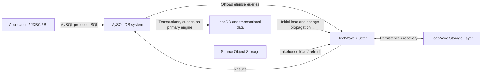

# MySQL HeatWave Architecture and Use Case Selection

An e-commerce application typically has two very different types of workloads: recording individual orders in a short time and aggregating millions of orders to analyze revenue. Both use SQL, but their data access patterns, levels of parallelism, and resource requirements are not the same. If you run large analytical reports on the same transaction-processing path without measuring the impact, the application can slow down right when fast responses are needed.

**MySQL HeatWave** combines a managed MySQL platform with an accelerated processing cluster for eligible queries. In the **MySQL HeatWave and NoSQL** chapter of the Oracle Cloud Infrastructure (OCI) learning path, this lesson explains the architectural components, how data enters the acceleration cluster, how queries are selected for execution, and criteria for choosing use cases.

After this lesson, learners will be able to:

- Distinguish between a MySQL DB system, InnoDB, a HeatWave cluster, read replicas, and high availability instances.
- Describe the flow of transaction processing, data loading, change propagation, and analytical query execution.
- Explain why a SQL query might run on InnoDB even when the DB system has a HeatWave cluster attached.
- Select candidate workloads based on query patterns, data freshness, compatibility, and operational goals.
- Prepare evaluations with evidence covering performance, correctness, cost, and recoverability.

## 1. Starting from Two Workload Types

### 1.1. OLTP: Transaction Processing

**Online Transaction Processing — OLTP** serves operations such as creating orders, updating inventory, processing payments, and looking up a single customer.

Common characteristics:

- Each operation accesses a relatively small amount of data.
- There are many concurrent requests and many write operations.
- Transactions, data constraints, and concurrency control mechanisms are required.
- Per-request latency matters more than scanning all data quickly.

Example:

```sql
SELECT order_id, customer_id, total_amount
FROM orders
WHERE order_id = 1001;
```

With an appropriate primary key, this can be a very efficient lookup on InnoDB. Routing the query through a distributed cluster does not automatically provide a benefit.

### 1.2. OLAP: Analytical Processing

**Online Analytical Processing — OLAP** serves aggregations, comparisons, and trend analysis across many records.

Example:

```sql
SELECT customer_id, SUM(total_amount) AS revenue
FROM orders
WHERE ordered_on >= '2026-10-01'
  AND ordered_on <  '2026-11-01'
GROUP BY customer_id;
```

This query may read many orders, aggregate them, and return only a few rows. When the dataset and join/aggregation operations are large enough, columnar reading and parallel processing become useful.

**HTAP — Hybrid Transactional/Analytical Processing** describes the need to serve both transactions and analytics on operational data. With HeatWave, what must be evaluated is whether both workload groups meet their targets when running concurrently, not merely whether a single reporting query runs faster.

## 2. MySQL HeatWave Architecture Map on OCI

### 2.1. Core Components

| Component | Role |
| --- | --- |
| MySQL DB system | Provides the MySQL endpoint, handles connections, transactions, and coordinates queries |
| InnoDB | Stores and processes transactional tables within the scope of this lesson |
| HeatWave plugin | Integrates cluster management, scheduling, and result return with the DB system |
| HeatWave cluster | Nodes that store loaded data and perform accelerated processing |
| HeatWave Storage Layer | Persistence layer supporting recovery of accelerated data |
| Source Object Storage | Location of external data that can be loaded via Lakehouse |
| Application or BI tool | Sends SQL over a MySQL connection to the DB system |

A standalone DB system has one MySQL instance; a high availability configuration has multiple instances under the managed service model. Clients connect to the MySQL endpoint and do not log into the DB system OS as they would with a self-managed Compute instance. See [DB system overview](https://docs.oracle.com/en-us/iaas/mysql-database/doc/overview-db-system.html).

A HeatWave cluster consists of one or more nodes. Applications still connect to the DB system; eligible queries are routed to the cluster, and results return through the DB system. The plugin's role is described in [HeatWave cluster overview](https://docs.oracle.com/en-us/iaas/mysql-database/doc/overview-heatwave.html).

### 2.2. Processing Flow Diagram



The diagram shows logical relationships. Control paths via the OCI Console, API, CLI, IAM, and monitoring systems are not drawn in full.

The two boxes for source Object Storage and Storage Layer represent **two distinct roles**: one is input data managed by applications or pipelines; the other serves internal representation and service recovery.

### 2.3. HeatWave Nodes Are Not Application Writable Shards

Data loaded into HeatWave is distributed to support parallel processing. That does not mean the application chooses a node to write an order or manually shards transactional tables across HeatWave nodes.

The application continues working with the MySQL model of the DB system. When the system is slow on writes, locks, or long transactions, you must analyze the OLTP path first. Adding analytical acceleration nodes does not automatically eliminate these bottlenecks.

## 3. Why Is HeatWave Suitable for Certain Analytical Queries?

### 3.1. Columnar Representation and Block-Based Execution

HeatWave uses an **in-memory hybrid-columnar** representation and vectorized processing. Conceptually, the data needed for filtering, aggregation, and joins is organized to process many values in a single pass rather than interpreting all work row by row independently. The architecture also distributes work across nodes and cores. See [HeatWave architecture characteristics](https://dev.mysql.com/doc/heatwave/en/mys-hw-about-heatwave.html).

A revenue query that reads only a few columns of a wide table can benefit from this organization. However, the actual benefit still depends on the number of rows read, predicate selectivity, data distribution, and join cost.

### 3.2. Parallelism Does Not Mean Linear Speedup

One way to think when evaluating a query:

```text
Result return time
    = wait time
    + required preparation and synchronization
    + data processing
    + result exchange / aggregation
    + transmitting results to the client
```

This is an analytical mental model, not a fixed internal formula of the product.

If computation dominates, increasing parallel processing capability can help significantly. If the query reads only one row, returns a massive result set, or has heavily skewed data in one group, other components may dominate.

For example, a query summing revenue across 20 regions typically returns few rows after processing a large volume of data. Conversely, exporting hundreds of millions of rows to a client may be bottlenecked by network transfer and the client's ability to consume data. Both read a large table, yet the two workloads require different evaluation approaches.

## 4. Data Lifecycle in the Acceleration Cluster

### 4.1. Initial Data Load

Having a HeatWave cluster does not mean all tables are ready for accelerated queries. For data originating from the DB system, you must identify appropriate tables/columns and load the necessary data.

Two steps must be distinguished:

1. Declare the table to use `RAPID` as its secondary engine.
2. Load data into the secondary engine.

Depending on the version and tooling, preparation steps may be automated. This lesson uses explicit declaration syntax to clearly observe the roles; see [defining the secondary engine](https://dev.mysql.com/doc/heatwave/en/mys-hw-defining-secondary-engine.html).

Data loading consumes resources on both the DB system and the cluster. You must choose timing, concurrency levels, and monitor the impact on transactions. The [data load prerequisites](https://dev.mysql.com/doc/heatwave/en/mys-hw-data-load-prerequisites.html) documentation notes that load operations share resources with DML/DDL on the DB system.

### 4.2. Change Propagation from Transactional Data

After a table is loaded, `INSERT`, `UPDATE`, and `DELETE` changes on the DB system are propagated to the corresponding representation in HeatWave. DML does not wait for each change to finish being applied on the cluster. The mechanism has triggers for propagation, including when a query needs fresh data; tables marked stale due to change propagation errors are not used for offload. See [change propagation](https://dev.mysql.com/doc/heatwave/en/mys-hw-change-propagation.html).

From an application design perspective, you should verify:

- Which data has been committed and falls within the query scope?
- Which engine did the query actually run on?
- Is there synchronization wait time before execution?
- When change propagation fails, how does the system fall back or report errors under the configured mode?

Do not treat an internal propagation interval as a guarantee that "the dashboard is always fresh within X milliseconds." End-to-end latency observed by the application also includes dashboard refresh schedules, queuing, query execution time, and network latency.

### 4.3. "No Separate ETL Needed" Must Be Understood Accurately

For MySQL data being accelerated, the system can reduce the need to build a separate ETL pipeline to a standalone analytical warehouse solely for running reports. However, the architecture still involves internal data loading, organization, and propagation tasks.

Therefore:

- There is still an additional data representation for analytical processing.
- You still need to manage which data is loaded and its status.
- Standardizing product codes, consolidating customer identifiers, or fixing dirty data remains business logic work.
- External data sources do not automatically appear in MySQL just by enabling HeatWave.

The benefit of reducing pipelines must be evaluated against the organization's existing architecture. If the current pipeline performs extensive cleansing and reconciliation, you must determine which steps remain necessary.

### 4.4. Persistence Supports Recovery, Not Backup Replacement

Loaded data and propagated changes can be stored in the HeatWave Storage Layer for cluster recovery. The exact mechanism and post-restart recovery capabilities depend on the version; see [data management and recovery in HeatWave](https://dev.mysql.com/doc/heatwave/en/mys-hw-about-analytics.html).

Do not equate this layer with enterprise retention backups. DB system backup/restore, point-in-time recovery capability, and restoring analytics capability are separate requirements that must be tested independently.

## 5. Where Is a Query Chosen to Run?

### 5.1. Conditions That Must Be Checked

A SQL statement can be valid in MySQL yet not accelerated by HeatWave. For queries against DB system tables, conditions that typically must be checked include:

- Relevant tables/columns are prepared and properly loaded.
- The query uses supported features, operators, and SQL modes.
- Transaction state and autocommit meet the requirements.
- The cluster and required data are available.
- The engine selection policy decides to offload under those conditions.

The detailed list must be checked against the deployed version in [HeatWave query prerequisites](https://dev.mysql.com/doc/heatwave/en/mys-hw-query-prerequisites.html).

Do not assume the optimizer will automatically split every query so part runs on InnoDB and part on HeatWave when unsupported tables or expressions are present. You must verify the actual execution plan and behavior.

### 5.2. Three Secondary Engine Modes

The session variable `use_secondary_engine` has the following modes:

| Mode | Meaning |
| --- | --- |
| `OFF` | Do not use the secondary engine for queries in the session |
| `ON` | Allow use when appropriate; able to fall back to the primary engine |
| `FORCED` | Require execution on the secondary engine; fail with an error if not possible |

Values and session scope are described in [HeatWave system variables](https://dev.mysql.com/doc/heatwave/en/heatwave-system-variables.html).

`FORCED` is useful for diagnosing or proving that a query is supported. It is not a switch to enable by default for all application flows: if the cluster is unavailable or a query is ineligible, error behavior differs from a mode that allows fallback.

For Java applications using a connection pool, session changes can persist across reused connections. If using a test mode, you must restore state or isolate lab connections so other requests' behavior is not altered.

### 5.3. Distinguishing "Unsupported" from "Not Selected"

A query may fail to offload because:

- It does not meet data or SQL statement requirements.
- The cluster is not ready.
- Estimated cost or offload policy determines that the InnoDB path is more advantageous.
- Data state makes offloading unsuitable at that moment.

The selection mechanism changes across versions; do not address every case by lowering a fixed cost threshold. The [debugging offload](https://dev.mysql.com/doc/heatwave/en/mys-hw-debugging-queries.html) documentation describes how to inspect reasons and use optimizer trace.

A report suddenly consuming high DB system CPU can be a sign of fallback. Therefore, the architecture should monitor execution paths alongside query runtime.

## 6. Distinguishing HeatWave from Other Mechanisms

| Mechanism | Primary Problem Solved | Should Not Be Inferred |
| --- | --- | --- |
| HeatWave cluster | Query acceleration and supported capabilities on prepared data | Adding nodes increases the number of places the application can write OLTP |
| Read replica | Serving read scaling strategies on a MySQL replica per configuration | Replicas have the same distributed columnar processing as HeatWave |
| HA secondary instances | Supporting DB system high availability | These are read replicas that applications can connect to arbitrarily |
| Backup | Retaining data for recovery per policy | Having a backup means analytics resumes immediately |
| Inbound replication | Bringing changes from a MySQL source into the DB system by design | Directly equivalent to HeatWave's internal change propagation |
| Lakehouse load/refresh | Bringing Object Storage data into the HeatWave processing path | Every modified object is immediately visible without a refresh mechanism |

Choose a replica when the problem is defined as scaling MySQL-compatible reads while accepting the corresponding replication characteristics. Choose HeatWave as a candidate when the problem is analytical processing that an acceleration architecture can solve. Both decisions should be based on measurements; the word "read" alone is not enough to choose.

## 7. Where Do Lakehouse, AutoML, GenAI, and Autopilot Fit?

### 7.1. HeatWave Lakehouse: Extending Data Sources

Lakehouse allows processing data from Object Storage using HeatWave. Source data is read and transformed into a suitable representation; an external table describes external data and does not mean those rows have been imported into InnoDB tables. See [HeatWave Lakehouse overview](https://dev.mysql.com/doc/heatwave/en/mys-hw-lakehouse-overview.html).

For example, an organization has orders in MySQL and daily advertising data in Object Storage. Lakehouse is a candidate for analyzing these sources if formats, schemas, access permissions, and queries meet the requirements.

During evaluation, add questions about the source:

- Who produces the files and confirms a data batch is complete?
- Are data types and encoding consistent across days?
- By what mechanism are new or updated files refreshed?
- Can data be duplicated, missing, or arrive late?

Source file freshness and refresh frequency are two aspects of business requirements. Do not extrapolate InnoDB change propagation behavior to all external tables.

### 7.2. HeatWave AutoML: Predictive Modeling

AutoML supports model training, prediction, and explanations on eligible data. Problem categories include classification, regression, forecasting, anomaly detection, and recommendation. See [HeatWave AutoML overview](https://dev.mysql.com/doc/heatwave/en/mys-hwaml-features.html).

Candidate examples include predicting demand by product or customer churn probability. Selection criteria go beyond having data in MySQL: there must be clear labels or targets, proper data splitting methodology, and appropriate quality metrics.

Automating training does not eliminate the responsibility to check for data leakage, unrepresentative samples, and model drift over time.

### 7.3. HeatWave GenAI: Semantic Search and Content Generation

GenAI integrates capabilities such as vector stores, embeddings, RAG-based search, and interaction with language models. Models may be built-in or external services under supported configurations. See [HeatWave GenAI overview](https://dev.mysql.com/doc/heatwave/en/mys-hw-genai-overview.html).

One candidate is a product documentation assistant with citations. Solution selection must evaluate language support, document access permissions, retrieval quality, and data paths to the model. Having a vector store does not automatically guarantee users only receive content they are authorized to view, or that answers are always accurate.

### 7.4. Autopilot: Operational and Optimization Assistance

Autopilot provides automated mechanisms or recommendations for tasks such as data loading, encoding, and placement. Auto Parallel Load assists the preparation/loading workflow; see [loading data with Auto Parallel Load](https://dev.mysql.com/doc/heatwave/en/mys-hw-auto-parallel-load.html).

Recommendations may rely on workload and query history. Therefore, testing must use a representative workload. Automation reduces manual effort but does not replace verifying results after changes. Refer to [how Autopilot supports OLTP and OLAP workloads](https://blogs.oracle.com/mysql/optimize-oltp-and-olap-workloads-with-mysql-heatwave-autopilot).

## 8. Placing the Architecture in OCI

### 8.1. Connecting Applications and BI Tools

A DB system endpoint in OCI is not publicly exposed on the Internet by default. An appropriate connectivity path is required, such as applications within the VCN, private network connectivity, or a Bastion for administration by design. See [overview of connecting to a DB system](https://docs.oracle.com/en-us/iaas/mysql-database/doc/overview-connecting-db-system.html).

A baseline architecture might place:

- Applications on Compute or an application runtime in a network with a route to the DB system.
- The DB system in a subnet with controlled access.
- BI tools over a network path with clearly defined sources.
- Object Storage with required read permissions if using Lakehouse.

You must verify routes, NSGs/security lists, connection ports, TLS, credentials, and timeouts. A connection that cannot reach the DB system is not an optimizer or HeatWave issue.

### 8.2. Separating Cloud Control Permissions from Data Permissions

OCI IAM governs cloud resource actions via policies. MySQL privileges determine which users can connect, view, or modify which data objects.

Example role separation:

| Role | Expected Scope of Responsibility |
| --- | --- |
| Infrastructure team | Manages cloud resources, networking, service configuration, and operational observability |
| DBA | Schema, users, data privileges, configuration, and SQL diagnostics |
| Analytics team | Reads authorized datasets, builds dashboards and reports |
| Transactional application | Performs required business operations |
| Testing team | Uses lab data and resources within assigned scope |

Do not grant broad cloud administrative permissions just so a BI tool can run `SELECT`. For Lakehouse or GenAI, you must also define permissions for external data sources and documents being used.

## 9. Availability of Transactions and Analytics Are Two Separate Goals

### 9.1. DB System HA Does Not Mean Analytics Is Always Instantly Available

On OCI, an HA DB system has one primary and two secondary instances using Group Replication under the service model. A HeatWave cluster attaches to the primary; when the primary changes, the cluster may need to reattach or recover before HeatWave queries resume. See [MySQL HeatWave high availability](https://docs.oracle.com/en-us/iaas/mysql-database/doc/overview-high-availability.html).

Therefore, record separately:

- Time for the transactional application to reconnect and resume processing.
- Time for accelerated data/cluster to become ready.
- Analytical query behavior during the transition window.
- DB system load if queries allowed to fall back execute on InnoDB.

The number of acceleration nodes does not replace DB system HA design.

### 9.2. Defining an Acceptable Degraded State

Suppose an e-commerce system requires checkout to continue serving after primary recovery, while dashboards are permitted an additional agreed-upon interruption window. These are two distinct business objectives and must be tested separately.

One option is to pause dashboard refreshes while analytics recovers, rather than letting many large queries fall back simultaneously and put pressure on transactions. Another option is to allow a small set of critical reports to run on InnoDB. The decision must stem from measured capacity and service-level targets, not merely setting `ON` or `FORCED`.

Backups, restores, and contingency plans for broader failures still need to be designed. A cluster's ability to reload accelerated data does not prove the business can recover source data after every scenario.

## 10. Use Cases Worth Evaluating

The examples below are design scenarios, not benchmark results or service guarantees.

### 10.1. Operational Dashboards on MySQL Data

An e-commerce system needs to aggregate revenue by store, region, and sales channel throughout the day. Transactional data already resides in MySQL; queries scan and aggregate many rows while returning small result sets.

HeatWave is a candidate when:

- Critical tables and expressions are supported.
- Freshness requirements are verified under real update streams.
- Impact on transactions can be measured while reports are running.
- The benefit of reducing a separate analytics pipeline is valuable to the operations team.

Do not stop at measuring a single query. Test concurrent dashboards and refresh schedules during peak hours.

### 10.2. Reports Joining Multiple Business Tables

A SaaS platform needs to analyze usage by customer and subscription plan. Queries involve multiple joins, time-range filters, and aggregations.

This is a candidate if data is properly modeled and joins execute on HeatWave. You need to monitor large tenants, key distribution, concurrency levels, and result sizes. A system-wide report and a single-tenant report may have different optimal execution paths.

### 10.3. Combining Operational Data with Object Storage Data

A retailer keeps recent orders in MySQL and campaign data in Object Storage. The requirement is to compare revenue by campaign, not to push every file into checkout transactions.

Lakehouse is worth evaluating if schemas, formats, and required queries are supported. Before selecting it, verify that source data is complete, refreshes on schedule, and can be reconciled. If campaign data is only updated at end of day, HeatWave does not turn it into a sub-second real-time source.

### 10.4. Analytics Combined with Predictions

A team wants to forecast next week's demand from historical data and display results on a dashboard. AutoML can be a candidate when the target, data, and evaluation methodology align.

Metrics must cover both prediction quality and operational performance. A fast model with poor predictions does not produce better decisions; a model scoring high due to data leakage is not usable evidence either.

### 10.5. Document Lookup Integrated with a MySQL Application

A product management application wants to add Q&A over technical guides. GenAI can be a candidate if the models, languages, and retrieval mechanisms meet requirements.

The architecture must clarify where document data is loaded, which users can view it, when it is updated, and how answers are verified. This evaluation is independent of whether revenue queries are accelerated.

## 11. When to Consider Other Options?

| Requirement Characteristics | Initial Evaluation Direction |
| --- | --- |
| Primarily primary-key lookups, short writes, minimal analytics | Optimize MySQL/InnoDB and DB system configuration first |
| Large analytical queries on eligible MySQL data | Evaluate HeatWave cluster and offload path |
| Many simple read queries servable by a replica | Evaluate read replica strategy and replication lag |
| Many enterprise sources needing complex transformations, historization, and governance | Compare broader data warehouse or lakehouse architectures |
| Access primarily by key, JSON, or tables with a different capacity/throughput model | Evaluate Oracle NoSQL based on access patterns |
| Need full OS control or plugins unsupported by the managed service | Evaluate managed service limits and self-managed options |

Oracle NoSQL Database Cloud Service supports JSON, Table, and Key-Value models with its own resource provisioning model; see [Oracle NoSQL overview](https://docs.oracle.com/en-us/iaas/nosql-database/index.html). Having JSON data alone does not dictate choosing NoSQL; you must consider relationships, transactions, query patterns, and scaling needs.

Signs that HeatWave is not solving the right problem:

- Time is mostly spent waiting on locks or external service calls.
- SQL fetches a very small amount of data that is already well indexed.
- Critical queries do not meet offload prerequisites.
- The primary need is increasing write transaction throughput.
- Result sets are so large that network transfer or client handling is the bottleneck.
- Analytical usage is too low to justify additional cluster capacity.

Do not use this list to rule out a product purely by guesswork. Identify the current bottleneck first, then test the option that directly addresses it.

## 12. SQL Illustration: Observing Two Execution Paths

This example uses a new lab schema on an OCI DB system with a compatible and ready HeatWave cluster. Connect with an account that has privileges to create schemas/tables, load data, and run queries. Do not run in a production schema or a session with active business transactions.

Small datasets help verify results and execution paths; they are not suitable for drawing conclusions about speedup ratios.

### 12.1. Creating Data with Clear Expected Results

Choose a schema name that does not already exist. If the schema creation statement reports a duplicate name, use a new lab schema instead of deleting existing data.

```sql
CREATE DATABASE heatwave_arch_lab;
USE heatwave_arch_lab;

CREATE TABLE customers (
    customer_id BIGINT NOT NULL,
    segment VARCHAR(20) NOT NULL,
    PRIMARY KEY (customer_id)
) ENGINE = InnoDB;

CREATE TABLE orders (
    order_id BIGINT NOT NULL,
    customer_id BIGINT NOT NULL,
    ordered_on DATE NOT NULL,
    total_amount DECIMAL(12, 2) NOT NULL,
    PRIMARY KEY (order_id)
) ENGINE = InnoDB;

INSERT INTO customers (customer_id, segment) VALUES
    (1, 'SMB'),
    (2, 'ENTERPRISE'),
    (3, 'SMB');

INSERT INTO orders
    (order_id, customer_id, ordered_on, total_amount)
VALUES
    (1001, 1, '2026-10-01', 120.00),
    (1002, 1, '2026-10-02', 180.00),
    (1003, 2, '2026-10-03', 400.00),
    (1004, 3, '2026-10-04',  80.00),
    (1005, 2, '2026-11-01', 150.00);
```

In a new lab session, enable autocommit and retrieve results on InnoDB:

```sql
SET SESSION autocommit = 1;
SET SESSION use_secondary_engine = 'OFF';

SELECT
    c.segment,
    COUNT(*) AS order_count,
    SUM(o.total_amount) AS revenue
FROM orders AS o
JOIN customers AS c
    ON c.customer_id = o.customer_id
WHERE o.ordered_on >= '2026-10-01'
  AND o.ordered_on <  '2026-11-01'
GROUP BY c.segment
ORDER BY c.segment;
```

Expected results from the declared data:

| segment | order_count | revenue |
| --- | ---: | ---: |
| ENTERPRISE | 1 | 400.00 |
| SMB | 3 | 380.00 |

The half-open filter interval excludes the November 1 order. For tables storing intra-day timestamps, boundary selection must also align with timezones and data types.

### 12.2. Declaring and Loading the Secondary Engine

```sql
ALTER TABLE customers SECONDARY_ENGINE = RAPID;
ALTER TABLE orders SECONDARY_ENGINE = RAPID;

ALTER TABLE customers SECONDARY_LOAD;
SHOW WARNINGS;

ALTER TABLE orders SECONDARY_LOAD;
SHOW WARNINGS;
```

`SECONDARY_LOAD` is the data-loading step, not merely a metadata declaration. Auto-preparation capabilities or column exclusions during loading depend on the version; inspect warnings and verify that tables/columns are actually usable. See [loading tables into HeatWave](https://dev.mysql.com/doc/heatwave/en/mys-hw-secondary-load.html).

You can inspect the definitions:

```sql
SHOW CREATE TABLE customers;
SHOW CREATE TABLE orders;
```

The secondary engine definition and the load status are two different pieces of information. When using metadata to track status, check version-specific conditions in [inspecting secondary engine definitions](https://dev.mysql.com/doc/heatwave/en/mys-hw-metadata-queries-secondary-engine.html).

### 12.3. Observing the Execution Plan on HeatWave

In the lab session, force the secondary engine for diagnostics:

```sql
SET SESSION use_secondary_engine = 'FORCED';

EXPLAIN FORMAT = TRADITIONAL
SELECT
    c.segment,
    COUNT(*) AS order_count,
    SUM(o.total_amount) AS revenue
FROM orders AS o
JOIN customers AS c
    ON c.customer_id = o.customer_id
WHERE o.ordered_on >= '2026-10-01'
  AND o.ordered_on <  '2026-11-01'
GROUP BY c.segment
ORDER BY c.segment;
```

In the output format containing an `Extra` column, the indicator of offload is `Using secondary engine RAPID`. See [EXPLAIN and verifying offload](https://dev.mysql.com/doc/heatwave/en/mys-hw-run-query.html).

Re-run the aggregation `SELECT` statement from step 12.1 in this session and compare against the expected results. If an error occurs, check the reason regarding query prerequisites, data state, and cluster state; do not turn a failure into a pass by skipping engine verification.

When finished testing:

```sql
SET SESSION use_secondary_engine = 'ON';
```

With small datasets, automatic selection may decide to run on InnoDB. This is not evidence that HeatWave is broken; a representative workload is needed to evaluate performance.

### 12.4. Observing Data Changes

In the lab schema, insert another October order:

```sql
INSERT INTO orders
    (order_id, customer_id, ordered_on, total_amount)
VALUES
    (1006, 3, '2026-10-15', 20.00);
```

After committing, re-run the aggregation query with the verified mode and plan. The SMB result must show four orders and revenue of 400.00; ENTERPRISE remains unchanged.

The goal is to verify the read path and post-update results. Do not add a fixed sleep command and treat it as proof of guaranteed latency. For a real system, measure under active write load and target concurrency.

The SQL snippets in this lesson are hands-on guides; creating this lesson file does not imply they were executed or benchmarked on a live DB system.

## 13. Designing an Evaluation to Decide Adoption

### 13.1. Selecting a Representative Query Set

Do not pick only the queries most likely to achieve the highest speedup. Select across groups:

- Critical transactional lookups and writes.
- High-volume aggregation reports.
- Representative joins across core tables.
- Small-tenant and large-tenant queries if multi-tenant SaaS.
- Queries with expressions or data types prone to limitations.
- Concurrent refresh schedules and bulk data load batches.

Record separately which queries are unsupported, which are not selected, and which execute on HeatWave. A small number of SQL queries that account for most of total runtime deserve more attention than counting every statement equally.

### 13.2. Separating Targets from Measured Outcomes

Example hypothetical targets for an evaluation:

| Item | Project Team Target |
| --- | --- |
| Checkout | Keep P95 latency under 150 ms at target concurrency |
| Revenue report | Return results within five seconds at expected dashboard count |
| Correctness | Total amounts and order counts match the source within the same data scope |
| Freshness | Meets the agreed-upon business window |
| Degraded state | Dashboard behavior is defined when the cluster is unavailable |
| Cost | Fits within the budget of the evaluated option |

These are not default benchmarks or achieved metrics of MySQL HeatWave.

### 13.3. Comparing Under Meaningful Conditions

When measuring InnoDB and HeatWave:

- Use identical logic, parameters, and data ranges.
- Document version, shape, node count, and loaded tables/columns.
- Record cache state, load time, concurrent query count, and write load.
- Run multiple iterations and examine latency distribution rather than picking the fastest run.
- Keep data stable or establish clear reference points when comparing results.
- For floating-point numbers or timestamps, define appropriate comparison rules.

```text
Speedup factor of a query
    = baseline runtime / runtime on the new option
```

This factor only describes the measured conditions. One query running much faster does not mean the entire application speeds up by the same ratio.

### 13.4. Measuring Impact and Recovery Paths

Observe transactions while running analytics, loading data, or propagating large change batches. Then test degraded scenarios in an authorized environment:

- Analytics temporarily unavailable.
- DB system primary switchover during planned testing.
- Accelerated data requiring recovery or reload.
- A group of fallback queries adding load to InnoDB.
- Object Storage source having late-arriving batches or schema errors.

Evidence should answer "what will the application see" and "how long does it take to return to normal service levels," not merely "is the cluster status active."

## 14. Sizing, Monitoring, and Cost Must Accompany Architectural Choice

### 14.1. Sizing Both Sides

The DB system must still have sufficient capacity for transactions, connections, data loading, and queries that remain on InnoDB. The HeatWave cluster needs sufficient resources for the accelerated dataset and concurrent workload.

Do not convert database disk size directly into HeatWave RAM using a fixed ratio. Loaded column sets, data types, encoding, workspace, and workload all matter. Use supported estimation tools, then verify with real data.

If adding HeatWave nodes leaves the bottleneck at write transactions, revisit the DB system, SQL, and application design. If the DB system is healthy while analytics queues or lacks resources, examine the cluster side and workload organization.

### 14.2. Monitoring the Right Signals

| Signal Group | Purpose |
| --- | --- |
| TPS, transaction latency, errors, and timeouts | Confirm the transactional application still meets targets |
| DB system CPU, memory, connections, locks, and I/O | Detect bottlenecks on the MySQL side |
| Cluster node status, memory, and queues | Assess ability to serve analytics |
| Loaded tables/columns, load/reload, and change propagation | Verify accelerated data is usable |
| Execution plans and offload paths of key queries | Detect plan changes or fallbacks |
| Refresh duration and source data age | Verify the freshness users actually receive |
| Backup, restore, and recovery time for both paths | Verify recoverability |
| Usage and provisioned resources | Reconcile capacity against budget |

Do not alert on CPU alone. A dashboard returning stale numbers or a report that has fallen back may require intervention even when average CPU is not high.

### 14.3. Comparing Total Cost of Options

An internal evaluation sheet should include all actual components: DB system, HA configuration, HeatWave cluster, storage/backups, external data sources, networking, and operational effort.

Pricing, billing units, and availability must be taken from the current configuration, region, and service terms. Include the cost of building and maintaining pipelines in any competing option.

A solution that eliminates substantial ETL work can carry operational value. Conversely, a lightly utilized cluster may not be cost-justified. Conclusions should tie back to run schedules, concurrency levels, and concrete objectives.

## 15. Architecture Decision Record

The outcome of a MySQL HeatWave evaluation should document:

1. **Problem statement:** which query groups or business flows are hitting limits.
2. **Data:** sources, tables/columns, freshness, growth rate, and access conditions.
3. **Architecture:** DB system, cluster, networking, HA, and additional capabilities genuinely required.
4. **Compatibility:** supported queries, offloaded queries, fallbacks, and exceptions.
5. **Evidence:** correct results, latency, throughput, mixed load, and recovery.
6. **Operations:** monitoring, degraded-mode handling, loading/refresh, backups, and owners.
7. **Cost:** evaluated configuration, usage assumptions, and criteria for re-evaluation.

One conclusion might be: "select HeatWave for the revenue reporting suite that proved offload while preserving transactional SLOs; keep primary-key lookups on the MySQL path; add Lakehouse once campaign sources and refresh processes meet requirements." Another conclusion might be that a cluster is not yet needed because the bottleneck lies in locks or OLTP queries.

What decides the choice is the fit between architecture, data, and measured workload. A product name or the ability to speed up a single SQL statement is not enough to replace that evidence.
