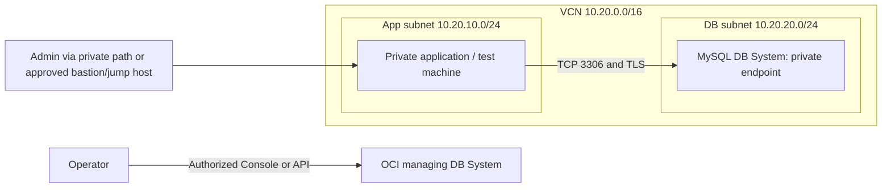

# Provisioning a MySQL DB System in a Private Subnet

In OCI, deploying a MySQL DB System in a private subnet allows applications to access the database over an internal address and clearly control connection sources. For the system to be usable, you must simultaneously prepare resource management permissions, network addressing, traffic allow rules, MySQL accounts, and TLS configuration.

This lesson belongs to the **MySQL HeatWave and NoSQL** chapter of the **CLOUD_PROVIDERS_ORACLE** module and focuses on the workflow of creating a MySQL DB System with a private endpoint, then verifying access from the appropriate application environment. The scope does not include deploying Oracle NoSQL Database or building a HeatWave cluster for analytics.

After this lesson, learners will be able to:

- Design the connection flow from an application to MySQL within the same VCN.
- Prepare a private subnet and network rules with a well-defined scope.
- Create a DB System using the service interface and record handover details.
- Verify networking, TLS, authentication, and SQL privileges step by step.
- Address backup, availability, monitoring, and cost requirements before putting the system into service.

## 1. Understanding the Resource Being Created

### 1.1. A DB System Is a Managed Service Resource

A MySQL DB System provides a MySQL environment managed by the service. Operators select a supported configuration, target network, and associated policies; you do not install MySQL with a package manager on a Compute instance and treat it as the same model.

Creating a DB System does not mean you have created a HeatWave cluster. Analytical processing components, if needed, are configured according to the service's separate capabilities and procedures. A transactional application using MySQL can start with an appropriately sized DB System without adding analytical resources yet.

### 1.2. Private Subnets and Private Endpoints Address Different Aspects

A **private subnet** is a subnet configured to prohibit VNICs from using public addresses under the OCI model. The DB System in this design is accessed through its private endpoint.

Do not simply omit a route to an Internet Gateway and call that subnet private. You must select the proper subnet type and verify the actual configuration.

A private subnet also does not imply:

- Every resource inside is allowed to access the database.
- The database needs no password, dedicated accounts, or TLS.
- All outbound flows are blocked.
- Backup, recovery, and availability are already solved.

A NAT Gateway may serve certain outbound connectivity needs for resources in a private subnet by design. Having NAT does not turn the MySQL endpoint into a public endpoint, nor does it create an inbound path from the Internet to MySQL.

### 1.3. Two Independent Permission Sets

| Permission Set | What Does It Control? | Example |
| --- | --- | --- |
| OCI IAM | Who can view, create, or modify OCI resources | Create a DB System in an assigned compartment |
| MySQL privileges | Who can log in and operate on data | Application reads/writes tables in its own schema |

Someone who can create a DB System does not automatically have permission to log in with an arbitrary MySQL account. Conversely, someone holding a MySQL password still needs a valid network path to connect.

## 2. Lab Architecture

Assume the lab uses one VCN in the same region as the DB System:

| Component | Illustrative Value | Purpose |
| --- | --- | --- |
| VCN | `10.20.0.0/16` | Network space for the lab |
| App subnet | `10.20.10.0/24`, private | Hosts authorized application or test instances |
| DB subnet | `10.20.20.0/24`, private | Dedicated to the MySQL DB System |
| Test machine | Example `10.20.10.25` | Runs the MySQL client from the application network |
| Application port | TCP `3306` | MySQL classic protocol |

The CIDRs are examples only and must be changed if they overlap with existing networks or networks connected via VPN/FastConnect. The DB System address is obtained from provisioning output; do not assume an available IP in advance.



The diagram separates the OCI resource management plane from the MySQL data connection path. A successful API call does not prove the application machine can reach the database endpoint.

With two subnets in the same VCN under standard routing, internal traffic uses VCN routing; there is no need to route application-to-database traffic through an Internet Gateway or NAT Gateway.

If an organization inserts traffic inspection appliances or uses custom routing configurations, additional routes and return paths must be evaluated. This lab uses a simple internal model with no intermediate appliances.

## 3. Pre-Provisioning Preparation

### 3.1. Checking OCI Permissions and Scope

The operator must be granted appropriate permissions to:

- Manage MySQL resources in the target compartment.
- View and use the approved VCN/subnets.
- Make network changes if that task falls within the assigned role.
- Use keys, tags, or dependent resources when the chosen configuration requires them.

Do not grant tenancy-wide administrative privileges just to work around a resource creation error. If the person provisioning and the network administrator belong to separate teams, prepare the network first and hand over the target subnet.

Policy syntax and dependent permissions must match the actual resource types and configuration. A policy to manage MySQL does not automatically replace network permissions or permissions for customer-managed encryption keys.

### 3.2. Checking Resource Prerequisites

| Prerequisite | What Must Be Confirmed |
| --- | --- |
| Region and service availability | Region supports the required configuration and the shape can be allocated |
| Quota/service limits | Sufficient limits remain for the DB System and selected configuration |
| Subnet | Private subnet in the correct region with enough addresses for current setup and headroom |
| Storage capacity | Matches data, indexes, growth, and workload characteristics |
| Availability | Select single-instance or service-supported HA configuration as required |
| Backups | Defined schedule, retention period, and recovery objectives |
| Access path | Authorized source machine or network can reach the private endpoint |
| Secrets | Approved storage location and provisioning process for the admin password |

Do not pick storage size or shape using an arbitrary fixed minimum taken from an old example. Use an option accepted by the service in the actual environment, then reconcile it against requirements and budget.

### 3.3. Preparing the Test Machine

The test machine needs a compatible MySQL client and an approved administrative access path. You can place a private Compute instance in the app subnet and access that machine using an approved method.

Do not open SSH to the DB System as you would when operating a self-managed Linux server. In this lesson, connectivity test commands are run from the client side.

Standard OCI Cloud Shell does not automatically have a route to every user private subnet. Only use a Cloud Shell environment configured with private network access after confirming the corresponding capability and permissions.

## 4. Configuring Network Rules for the MySQL Flow

### 4.1. Using a Dedicated Security List for the DB Subnet

This lab uses a **security list** to express subnet-level rules because it provides a clearly inspectable boundary. Attach a dedicated security list to the DB subnet and review all security lists currently applied.

Allow rules in OCI are additive. A strict security list does not override a broad rule that still exists in another security list or security group applied to the resource.

If the deployment uses NSGs, configure them only on resources where the service supports attaching NSGs, and evaluate them alongside security list rules. The procedure in this lesson does not depend on attaching an NSG directly to the DB System.

### 4.2. Minimal Rules for the Application

With an app subnet dedicated to authorized applications, you can start with the following flow table:

| Enforcement Point | Direction | Source or Destination | Protocol/Port | Type |
| --- | --- | --- | --- | --- |
| DB subnet | Ingress | Source `10.20.10.0/24` | TCP, destination port `3306` | Stateful |
| Application host side | Egress | Destination in DB subnet or appropriate managed DB endpoint | TCP, destination port `3306` | Stateful |
| DB subnet, only if needed | Ingress | Verified private admin source | TCP, destination port `3306` | Stateful |

In a lab with only one test machine, you can narrow the ingress source to `10.20.10.25/32`. When the application has multiple instances or autoscaling, choose a source that accurately reflects actual address allocation.

Stateful rules automatically allow return traffic for accepted connections. Do not add a broad return port range simply because clients use ephemeral source ports.

Note that security lists apply at the subnet level, not to a single database individually. This is why the DB subnet should be dedicated to resources sharing the same security requirements.

### 4.3. Rules Not Needed for This Lesson

- Do not open TCP `3306` from `0.0.0.0/0`.
- Do not open SSH to the DB System to serve MySQL connections.
- Do not open the MySQL X Protocol port just because you saw it in another example; open it only if the application actually uses it and the service configuration supports it.
- Do not open all protocols between two subnets to fix an unclassified error.

A `0.0.0.0/0` source rule is still overly broad even when the endpoint is private. It expands the allowed source scope if peering, VPN, or new routes are added later.

### 4.4. Verifying Routes and Dependencies

For a single-VCN design, verify that both subnets actually belong to the correct VCN and that no custom routing configuration alters the expected path.

If the access source is on-premises, you need an appropriate VPN/FastConnect connection, a DRG, and bidirectional routes, while verifying there are no overlapping CIDRs. Both on-premises firewalls and OCI rules must permit the flow.

Do not add a NAT Gateway or Service Gateway hoping to fix an application-to-database connection error. Those gateways serve different purposes and must be designed separately. Likewise, do not assume every internal operation of the managed backup service must traverse customer NAT.

## 5. Creating the MySQL DB System

The field groups below describe the decisions to be made. Exact labels and UI layouts may vary by service version.

### Step 1: Select the Right Context

In the OCI Console, navigate to the MySQL service management section, choose to create a DB System, and confirm the target region and compartment.

Provide an identifiable name, such as `mysql-orders-lab`. Add tags according to your organization's environment and cost-center conventions if required.

Do not confuse the compartment containing the DB System with the compartment containing the network. In organizations with separated permissions, the two resources may live in different compartments, provided access permissions and resource selection align.

### Step 2: Select Configuration for the Workload

Choose a supported shape, storage size, and MySQL configuration. For a lab, pick a budget-appropriate configuration; for production, evaluate read/write load, memory, I/O, and growth.

Decide whether HA is needed at creation time. HA improves availability through service mechanisms, but it does not replace backups or a recovery plan when data is corrupted by erroneous changes.

Do not assume configurations can be changed later without impact. Record limits, modification conditions, and required maintenance windows for the actual resource.

### Step 3: Select the Private Network

Select the example VCN `10.20.0.0/16` and DB subnet `10.20.20.0/24` after matching against the real names and OCIDs.

Confirm the subnet is private, has sufficient IP addresses, and has the right network rules applied. Do not mistakenly pick the app subnet just because it currently allows easier connectivity.

If there are fields for endpoint, port, or network name, use the agreed-upon design values. This lesson uses the MySQL classic protocol on TCP `3306`; if you change the port, you must update network rules, clients, and handover documentation in sync.

### Step 4: Configure the MySQL Administrator Account

Choose an administrator username permitted by the service, such as `dbadmin_lab`, and provide a strong password via the supported input mechanism.

Store secrets in an approved vault/location. Do not put passwords in tags, resource names, screenshots, or repositories.

This is the administrative account for initialization and service-scoped operations. The application must use its own account and must not use this account in its connection pool.

### Step 5: Configure Backups and Operational Windows

Choose the backup policy, retention period, backup window, and maintenance options provided by the service. Cross-check against the system's RPO/RTO requirements.

RPO is the target for acceptable data loss; RTO is the target for time to restore service. Enabling backups alone does not prove those two targets are met.

If customer-managed encryption keys or other add-on options are needed, thoroughly verify permissions, dependencies, and operational procedures before enabling them.

### Step 6: Review and Submit the Request

Review the chosen name, compartment, configuration, subnet, admin account, and policies. Check estimated costs or the current billing basis for the environment before creating.

Submit the request once and monitor the resource status and associated work request. If the UI disconnects or times out, check whether the DB System was already created before retrying.

### Step 7: Wait for Completion and Record the Endpoint

Once the DB System reaches the service's ready state, record:

- OCID, resource name, region, and compartment.
- VCN/subnet used and private endpoint address.
- Connection port, endpoint hostname, or resolution mechanism if applicable.
- Selected resource configuration, HA, backup, and maintenance window.
- Operator, application team, and reference location for secrets.

Do not record passwords in the same broadly shared handover sheet. Obtain the endpoint from the created resource; do not guess an IP from the CIDR.

The ready state at the OCI layer only confirms the corresponding lifecycle stage. The next step is still to verify the network path and MySQL session from the client side.

## 6. Testing Connectivity from a Private Client

The following commands run on an authorized Linux machine in the app subnet. These are examples to run in a lab environment, not commands executed on the DB System.

### 6.1. Confirming Target Parameters

```bash
# Replace placeholder with the real endpoint after the DB System is created.
MYSQL_ENDPOINT='<confirmed-private-ip-or-endpoint-name>'
MYSQL_PORT='3306'
MYSQL_ADMIN_USER='dbadmin_lab'

# Requires an appropriate nc utility on the client machine.
nc -vz -w 5 "$MYSQL_ENDPOINT" "$MYSQL_PORT"
```

If using an endpoint hostname, verify name resolution from the client machine itself. If using a private IP, verify that the IP still matches the endpoint information published by the service.

TCP success does not prove the password is correct, TLS meets requirements, or the account has schema access.

### 6.2. Opening an Encrypted MySQL Session

```bash
mysql --protocol=TCP \
  --host="$MYSQL_ENDPOINT" \
  --port="$MYSQL_PORT" \
  --user="$MYSQL_ADMIN_USER" \
  --password \
  --ssl-mode=REQUIRED
```

The `--password` option without an inline value prompts interactively for the password, avoiding placing the password directly on the command line. Do not put passwords in shell variables or arguments just to save typing.

`--ssl-mode=REQUIRED` enforces encryption but **does not verify the server's identity via certificate**. It is suitable for demonstrating the encrypted session check; it is not enough to conclude that server authentication is fully configured.

When the environment provides a CA and an endpoint hostname matching the certificate, client configuration can take the form:

```bash
mysql --protocol=TCP \
  --host='<certificate-matching-endpoint-name>' \
  --port=3306 \
  --user=dbadmin_lab \
  --password \
  --ssl-mode=VERIFY_IDENTITY \
  --ssl-ca='<path-to-verified-ca-pem>'
```

The CA path and endpoint hostname are placeholders and must be replaced with verified details for the actual service. `VERIFY_CA` checks the trust chain; `VERIFY_IDENTITY` adds hostname verification.

Do not assume a custom DNS name or an arbitrary private IP will match the certificate. Before going to production, select and verify a TLS mechanism that aligns with the service's certificate capabilities and your organization's security requirements.

### 6.3. Verifying the SQL Session

```sql
SELECT 1 AS connectivity_test;

SELECT CURRENT_USER() AS authenticated_account,
       USER() AS client_identity,
       VERSION() AS mysql_version;

SHOW SESSION STATUS LIKE 'Ssl_cipher';
```

`CURRENT_USER()` reports the MySQL account matched for authentication; `USER()` reports the client-side user/connection info. Their host portions can differ and are useful when troubleshooting access privileges.

A non-empty `Ssl_cipher` value indicates the session is using a TLS cipher suite. This result alone does not prove the client verified the certificate and hostname; you must also check the client flags used.

## 7. Creating a Least-Privilege Application Account

After logging in with the administrator account, create the schema and application account within the scope permitted by the service. The following example is for a fresh lab; do not run it verbatim on a schema that already holds data.

```sql
CREATE DATABASE orders_lab CHARACTER SET utf8mb4;

CREATE TABLE orders_lab.connection_probe (
    probe_id BIGINT UNSIGNED NOT NULL AUTO_INCREMENT,
    note VARCHAR(120) NOT NULL,
    created_at TIMESTAMP NOT NULL DEFAULT CURRENT_TIMESTAMP,
    PRIMARY KEY (probe_id)
) ENGINE=InnoDB;

-- Syntax illustration only: replace placeholder with a properly provisioned secret.
CREATE USER 'orders_app'@'10.20.10.25'
    IDENTIFIED BY '<APP_PASSWORD_TO_REPLACE>'
    REQUIRE SSL;

GRANT SELECT, INSERT, UPDATE, DELETE
ON orders_lab.*
TO 'orders_app'@'10.20.10.25';
```

The host value `10.20.10.25` is the illustrative IP of the client machine. You must verify the actual source address seen by MySQL, especially if using a proxy, tunnel, or NAT path.

Do not use the placeholder password as-is, do not store real passwords in repositories, and do not leave secrets in shell/command history outside approved policies.

The application account in this example lacks privileges to create tables, drop schemas, or manage users. If the application needs migrations, use a separate deployment role or account with a managed privilege lifecycle.

`REQUIRE SSL` enforces an encrypted session when logging in with this account; it does not replace configuring the client to verify the server.

### 7.1. Testing with the Application Account Itself

Exit the admin session, reconnect as `orders_app` from the authorized machine while keeping the appropriate TLS configuration. Then execute a test transaction in the lab schema:

```sql
USE orders_lab;

SELECT CURRENT_USER();

START TRANSACTION;

INSERT INTO connection_probe (note)
VALUES ('private-subnet-connectivity-check');

SELECT probe_id, note, created_at
FROM connection_probe
WHERE probe_id = LAST_INSERT_ID();

ROLLBACK;
```

The test transaction confirms the account can read/write within its granted scope; `ROLLBACK` removes the test row from the InnoDB table. This step does not replace full business testing of a real application.

In addition to valid access, verify that an unauthorized source cannot open a MySQL session. Test only from approved lab sources; do not scan networks or alter production rules to create test cases.

## 8. Administering a Private Database Without Exposing Public MySQL

### 8.1. Private Connectivity from the Corporate Network

With a properly designed VPN or FastConnect, administrators can reach the private endpoint from the corporate network. Requirements include bidirectional routes, non-overlapping CIDRs, network rules, and valid MySQL accounts.

Do not assume an active VPN connection automatically makes every private subnet reachable. Verify routes and source ranges specifically for the TCP `3306` flow.

### 8.2. Using an Intermediate Client Machine

Another option is to access an authorized Compute instance on the internal network via Bastion or an approved administration mechanism, then run the MySQL client on that host.

In this model, the database sees the connection coming from the intermediate client machine along the actual network path. Network rules and the host portion of the MySQL account must match that source.

Do not create an OS user on the DB System or expect direct SSH into the database server as a standard step of a managed service.

### 8.3. Notes When Using Port Forwarding

If a supported method uses port forwarding, the local connection address may be `127.0.0.1` while the server certificate is issued for a different identity.

Do not downgrade TLS verification just to bypass hostname mismatches. Design endpoint identification and client configuration to match the tunnel mechanism and certificates supported by the service.

A tunnel also does not eliminate the need for authorization, secret management, and source restrictions. It only changes how traffic reaches the destination.

## 9. Classifying Failures When Connections Fail

| Symptom | Root-Cause Group to Check | Appropriate Action |
| --- | --- | --- |
| VCN/subnet not visible during creation | Wrong region, compartment, or missing permissions | Verify context and resource usage permissions |
| DB System creation fails | Limits, capacity, subnet IPs, configuration, or dependent permissions | Inspect work request details before changing design |
| Connection hangs then times out | Wrong endpoint, missing route, blocking rule, or client-side firewall | Verify source/destination/port and return path |
| Connection refused | Wrong port, service not ready, or wrong target | Cross-check endpoint/port and service status |
| `Access denied` | Wrong credentials, host mismatch, or account conditions | Check account and client source; do not arbitrarily widen firewalls |
| TLS/certificate error | Hostname mismatch, wrong CA, incompatible client, or bad TLS config | Check trust chain and identity; do not disable verification as a default fix |
| Login succeeds but schema unusable | Missing MySQL privileges or wrong schema selected | Verify grants using a privileged account |
| Lab host connects but application fails | Connection string, secret, driver, pool, or rules from a different app source | Test from the actual application runtime environment |

Symptoms are starting points for isolation, not sole proof of root cause. For example, an intermediate appliance actively rejecting packets behaves differently from a missing route.

Do not use `ping` as the sole criterion for evaluating MySQL connectivity. ICMP and TCP `3306` can be governed by different policies.

When opening a support ticket, provide timestamps with timezone, resource OCID, test source, endpoint, port, and sanitized error messages with secrets removed. Never send passwords or access keys in tickets.

## 10. Completing Operational Readiness After Provisioning

### 10.1. Backup and Recovery

Verify that the backup policy is applied and producing successful backups. Plan an appropriately scoped restore drill to confirm data integrity, recovery time, and required permissions.

When restoring to a different DB System, re-verify endpoint, subnet, network rules, accounts, and application configuration. Never assume a new resource always has the same IP or network state as the source resource.

If protection against accidental deletion or major incidents is needed, define retention and mechanisms aligned with service capabilities. HA does not replace backups needed to recover from erroneous business operations.

### 10.2. Application Resilience

Even with HA enabled, applications still need sensible timeouts, reconnect logic, and connection pool management. A failover event can drop existing sessions.

When designing transaction retries, consider idempotency. If the client loses the response after the server has already committed, retrying the entire request without deduplication can apply business side effects twice.

Test this behavior in an appropriate environment before assuming that enabling HA fulfills service continuity requirements.

### 10.3. Monitoring

Set up available signals both in the service and on the application side for:

- DB System status and management work requests.
- Storage capacity, growth trends, and resource utilization.
- Connection counts, connection errors, latency, and query load.
- Backup outcomes, restore drill progress, and maintenance events.

Metrics, thresholds, and collection pipelines must be verified in the real environment. Alerts need owners and runbooks, not just a chart in the Console.

### 10.4. Secrets and Access Control

Separate application accounts from administrative accounts. Manage secret lifecycles, verify revocation when personnel or workloads change, and update applications during password rotation.

Network privacy does not replace data access control. Whenever adding peering, VPNs, subnets, or shared environments, re-audit allowed source ranges.

### 10.5. Cost

Record all cost-bearing components for the chosen configuration: DB System compute, storage, HA, backups, any additional analytical resources, plus test machines and access infrastructure.

Do not assume a stopped state or zero connections halts all charges. For labs, define an end date and data retention policy in advance.

Choosing a private subnet is a network access decision; it does not automatically make the DB System smaller, cheaper, or highly available.

## 11. Automating the Same Design

Once the configuration is validated, you can use supported IaC tools, OCI CLI, or SDKs to reproduce the resource. Automation must preserve decisions regarding private subnets, network rules, secrets, and backups.

Inputs should use explicit identifiers rather than ambiguous display names:

| Input | Management Approach |
| --- | --- |
| Region and compartment | Explicitly declared per environment |
| VCN/subnet | Use verified resource identifiers |
| Shape, storage, and HA | Based on supported configurations, limits, and requirements |
| Access rules | Specify exact source, destination, protocol, and port |
| Admin password | Sourced from an approved secrets mechanism, avoiding exposure in logs or state |
| Backup and maintenance | Explicitly declare options and responsible owners |

Do not commit a CLI example containing real passwords into pipelines. Depending on the tool, sensitive data can appear in state files, change plans, or logs; protect all such storage locations.

Pipelines should wait for the work request to reach the appropriate state before running connectivity verification. If a create request times out, reconcile against existing resources before retrying; do not create duplicate DB Systems just because a response was delayed.

Do not use automatic widening to `0.0.0.0/0` as a connectivity troubleshooting step.

## 12. Acceptance Criteria and Lab Teardown

A provisioning run meets this lesson's objectives when complete evidence exists for:

- [ ] DB System is in the designed compartment, region, and private subnet.
- [ ] Private endpoint and port are recorded from the actual created resource.
- [ ] All applied network rules are reviewed, with no overly broad allowances beyond requirements.
- [ ] Authorized client machine can establish a TCP connection to the endpoint.
- [ ] MySQL session uses TLS with the server verification level explicitly documented.
- [ ] Application account can log in and execute SQL operations within granted scope.
- [ ] Unauthorized source cannot open a session in an approved test.
- [ ] Administrative account is not used as the application account.
- [ ] Backups, monitoring, HA requirements, and operational ownership are assigned.
- [ ] Costs and post-lab resource disposition plan are defined.

When tearing down a lab, confirm before deletion whether any data or backups need to be retained. Delete only the DB System and lab-dedicated resources within authorized scope; do not delete shared subnets, security lists, or VCNs.

The goal of this lesson is a MySQL DB System accessible over a private network from the right sources, using appropriate accounts and TLS, along with operational details ready for handover. Successful creation in OCI is only the starting point; secure usability must be proven across networking, connection sessions, and data privileges.
