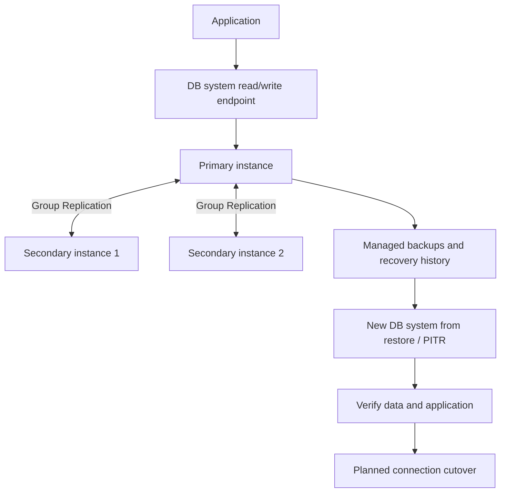

# MySQL Backup, Restore, and High Availability

A MySQL system can experience downtime due to an instance failure, accidental data modification, network disruption, or an outage across an entire deployment region. Each scenario requires a different protection mechanism. Having three instances will not recover rows that were legitimately deleted; having a good backup will not make an application automatically reconnect when the primary changes.

In the **MySQL HeatWave and NoSQL** chapter of the Oracle Cloud Infrastructure (OCI) learning path, this lesson focuses on **MySQL HeatWave Service on OCI**: planning backups, restoring from backups or to a point in time, operating high availability (HA), and verifying application recoverability. Operations are described under the managed service model; they do not assume users have SSH access to the DB system or copy the MySQL filesystem directly.

After this lesson, learners will be able to:

- Select protection mechanisms based on failure type and RPO/RTO targets.
- Distinguish backup types, creation methods, retention, and point-in-time recovery.
- Build a workflow to restore to a new DB system, reconcile data, and cut over applications.
- Explain failover, switchover, and connection-handling responsibilities on the application side.
- Design recovery drills, alerts, access separation, and budgets for environments running HeatWave.

## 1. Choosing the Mechanism Based on the Failure Scenario

### 1.1. Four Concepts That Must Stay Separate

| Concept | Primary Goal | Key Limitation to Remember |
| --- | --- | --- |
| Backup | Preserve data state so it can be restored later | Requires time to restore, validate, and bring applications back |
| Restore | Recreate data from a chosen recovery source | Does not automatically verify business correctness |
| Point-in-time recovery — PITR | Restore to a supported timestamp | Requires valid backups, log history, and a valid recovery window |
| High availability — HA | Reduce downtime when a component within HA scope fails | Erroneous data changes can still replicate to all members |

**Disaster recovery — DR** extends the problem to broader failures, such as losing an entire region or a full set of dependencies. DR must account for data, applications, networking, access permissions, and operational procedures.

### 1.2. Mapping Scenarios to Actions

| Scenario | Initial Action |
| --- | --- |
| Primary instance fails in an HA DB system | Monitor failover and verify application reconnection |
| Erroneous delete or update already committed | Determine scope; choose PITR or restore to a temporary system to extract correct data |
| Need a copy of data in a test environment | Restore a backup to a new isolated DB system |
| Transactional data is serving, but HeatWave is not ready | Recover the analytics path and manage fallback load |
| Source region becomes unavailable | Execute the DR plan prepared in another location |
| Application cannot reach the database | Check network, DNS, TLS, credentials, and connection pools before concluding the database is lost |

A valid committed `DELETE` statement does not become an infrastructure failure merely because it caused business harm. Switching the primary does not roll back that transaction.

## 2. HA Architecture and Recovery Paths Are Two Separate Flows

### 2.1. DB System HA on OCI

An HA DB system consists of one primary and two secondary instances. The service uses MySQL Group Replication; instance placement depends on the region, subnet type, and availability/fault domains. The primary serves the read/write path of the DB system. See [high availability overview](https://docs.oracle.com/en-us/iaas/mysql-database/doc/overview-high-availability.html).



The diagram shows logical relationships. Three HA instances are not three point-in-time backups; a new DB system created from a restore is not a member automatically added back to the old cluster either.

HA secondary instances should not be treated as read replicas that users arbitrarily connect to for inspection or reporting. Access restrictions are described in [HA limitations](https://docs.oracle.com/en-us/iaas/mysql-database/doc/limitations2.html).

### 2.2. Unchanged Endpoint vs. New Endpoint Have Different Implications

When the primary changes within an HA DB system, the service preserves the DB system's read/write endpoint. However, existing connections may be closed, so the application must still reopen connections.

During a restore or PITR, the target is a **new DB system**. You must identify the target endpoint and application cutover plan; do not assume it automatically replaces the source endpoint.

Operational records should store both human-readable names and OCIDs. Display names can collide, and restoring from the wrong source or pointing to the wrong endpoint is a real risk when multiple environments coexist.

## 3. Defining RPO and RTO with Measurable Data

### 3.1. RPO: The Data Window That May Not Be Recoverable

**Recovery Point Objective — RPO** is the target for acceptable data loss. Its unit is typically time, though reconciliation must tie it to transactions and business events.

An observable indicator:

```text
Data window at risk of not being recovered
    = incident timestamp
    - latest usable recovery point
```

Do not infer RPO by counting copies. Nor should you treat a daily backup schedule as proof that exactly one successful backup exists every day.

If the incident involves committed bad data, you may intentionally choose an earlier timestamp to exclude the bad transaction. In that case, legitimate transactions occurring after the chosen timestamp must be handled separately.

### 3.2. RTO: Time to Restore Service to an Acceptable Level

**Recovery Time Objective — RTO** is the target time to restore service. Database restore duration is only one component:

```text
End-to-end recovery time
    = incident detection and identification
    + decision / isolation
    + provisioning target and restoring data
    + verification
    + connection cutover
    + business functionality confirmation
```

Example allocation for a hypothetical 60-minute RTO:

| Task | Time Budget |
| --- | ---: |
| Detection and information gathering | 5 minutes |
| Selecting plan, isolating harmful change | 5 minutes |
| Provisioning target and restoring data | 25 minutes |
| Verifying database and data | 8 minutes |
| Connection cutover | 5 minutes |
| Business validation | 7 minutes |
| Projected total | 55 minutes |
| Buffer | 5 minutes |

This is an illustrative plan, not an OCI service guarantee. If a drill takes 75 minutes, you must adjust the plan or the target; you cannot claim RTO was met merely because the restore step alone took 25 minutes.

Set separate targets for transactions and analytics. Checkout resuming does not automatically mean HeatWave dashboards are operational again.

## 4. Understanding Backup Types Accurately

### 4.1. Content Type and Creation Method Are Two Different Axes

MySQL HeatWave supports **full** and **incremental** backups. Full captures all backed-up data; incremental captures changes. The service manages relationships between backups so users select supported recovery points rather than manually assembling file chains like on self-managed systems. See [backups overview](https://docs.oracle.com/en-us/iaas/mysql-database/doc/overview-backups.html).

A backup also has a creation type:

| Creation Type | Operational Purpose |
| --- | --- |
| Automatic | Periodic protection per backup plan |
| Manual | Proactive checkpoint before changes or for a specific request |
| Final | Created before deleting a DB system if requested by the deletion plan |
| Operator | Created by service support teams for their operational tasks |

Therefore, "manual" does not mean "full," and "automatic" does not mean a completely different kind of backup data. Always inspect both attributes.

### 4.2. Selecting a Backup by Recovery Point

For every critical backup, record:

- Backup OCID and source DB system OCID.
- Region, compartment, and relevant timestamps.
- Backup type, creation type, and status.
- Retention period or expiration date.
- MySQL version, encryption status, and source configuration references.
- Validation, preparation results, and the latest restore drill if any.

A backup named "before-release" is only useful if you know which release, what timestamp, and whether it completed.

Do not delete service-created support or investigation backups without understanding their purpose. Lifecycle processes must separate recovery, testing, and investigation artifacts.

## 5. Designing Automatic Backups and Retention

### 5.1. Building an Actionable Backup Plan

A plan should define:

| Plan Field | Question to Answer |
| --- | --- |
| Frequency and backup window | When does it start, and does it overlap maintenance or heavy batches? |
| Retention | How far back must we go if an error is discovered late? |
| PITR | Is it enabled and is a usable recovery window available? |
| Soft delete | Is there a grace buffer when backups reach deletion? |
| Cross-region copy | Which destination region, and has the copy completed? |
| Validation / restore drill | Who verifies and on what cadence? |
| Alerting | When is protection considered lost? |

For example, an application chooses daily automatic backups, 14-day retention, PITR, and a cross-region copy. This is an internal decision to verify against the DB system type and current limits, not a universal default for every environment.

Backup windows are configured in UTC; conflicting maintenance operations may delay or skip a scheduled backup depending on service conditions. See [managing backups](https://docs.oracle.com/en-us/iaas/mysql-database/doc/managing-backup.html).

### 5.2. Retention Must Outlast Error Detection Time

If data is corrupted and not discovered until three weeks later, a one-week retention policy may leave no clean checkpoint. Consider:

- Reconciliation or financial close cycles.
- Time to detect application bugs.
- Time needed for investigation and decision-making.
- Retention needs during major rollout windows.

Backup retention also does not replace business audit history. Having an old backup does not make extracting a handful of changes automatic; you need an appropriate audit or event model for granular reconciliation.

### 5.3. Protection Against Deletion

Three options must be distinguished:

- **Delete protection:** protects against deleting the DB system.
- **Retain automatic backups:** determines whether automatic backups are kept after the DB system is deleted.
- **Final backup:** requests creating a final backup before deletion.

These options are described in [DB system deletion plan](https://docs.oracle.com/en-us/iaas/mysql-database/doc/advanced-options.html). Do not infer that enabling one option automatically enables the others.

Soft delete is an additional protection layer at the backup level. In the `DELETE_SCHEDULED` state, you must cancel scheduled deletion to restore the backup to an eligible state before restoring from it. Do not treat soft delete as an immutable retention lock that privileged users cannot alter.

Before deleting source resources after a drill or cutover, verify the data retention plan using exact OCIDs and expiration dates. Never treat deleting a DB system as a shortcut to reuse a source IP.

## 6. Point-in-Time Recovery: Choosing the Right Timestamp

### 6.1. PITR Must Be Prepared in Advance

To use PITR, enable automatic backups and then enable PITR on the backup plan. The service restores an eligible backup and applies committed transactions up to the chosen timestamp. Oracle describes an approximate five-minute RPO for an active DB system; verify the actual recovery window rather than treating this as an exact guarantee for every incident. See [MySQL HeatWave PITR](https://docs.oracle.com/en-us/iaas/mysql-database/doc/point-time-recovery.html).

Items to verify before acting:

- Earliest and latest available recovery points.
- Whether the desired timestamp falls within that range.
- Whether required backups/logs still exist and are usable.
- Whether the feature is supported on the DB system type and version in use.

Enabling PITR today does not reconstruct history from before it was enabled. A failed backup or insufficient history gap can also alter the achievable recovery range or duration.

### 6.2. Example: Choosing a Point Before a Harmful Transaction

Assume all timestamps below are in UTC on November 20, 2026:

| Timestamp | Event |
| --- | --- |
| 02:00:00Z | Baseline backup available for recovery |
| 03:14:20Z | Valid transaction A commits |
| 03:15:10Z | Erroneous update transaction B commits |
| 03:16:30Z | Valid transaction C commits |
| 03:25:00Z | Bad data detected |

If this boundary is verified, you can evaluate `03:15:00Z`—after A and before B—provided that timestamp lies within the available PITR window.

Choosing "latest available" after 03:15:10Z will bring erroneous transaction B back. Choosing a point before B will also exclude C from a full DB system recovery state.

Thus, there are two business approaches:

1. **Roll back the whole system to an earlier point:** accept and reprocess valid transactions occurring after that point.
2. **Restore to a temporary DB system:** extract the required clean data, reconcile, and apply controlled fixes to the live system.

The second approach avoids rolling back every table, but is harder regarding data relationships, subsequent transactions, and external side effects. Never copy a few rows solely based on row counts.

### 6.3. Using UTC and Transaction Boundaries

`2026-11-20T03:15:00.000Z` corresponds to 10:15 in Vietnam time. In incident records, document the timezone of application logs, database timestamps, and timestamps entered into the recovery tool.

Identify commit time, not just when a user clicked a button or when the SQL statement started. Do not rely on millisecond input precision to separate closely spaced transactions if the API does not recover at that granularity.

For incidents with uncertain boundaries, restoring into an isolated target and inspecting several candidate points is safer than cutting the application over to the first estimated timestamp.

## 7. Workflow for Restoring to a New DB System

### 7.1. Preparing the Recovery Target

Restoring from a service backup creates a new DB system in the same tenancy; the target can retain the source's admin credentials as of the backup time. Networking and access controls must be prepared before allowing clients to connect. See [restoring from a backup](https://docs.oracle.com/en-us/iaas/mysql-database/doc/restoring-backup.html).

A target specification should include:

| Group | Details to Finalize |
| --- | --- |
| Identity | Source backup/PITR, OCID, region, compartment, purpose |
| Compute | Supported shape, sizing, and available capacity |
| Storage | Capacity, growth, and required configuration |
| Version | Restored version and application compatibility |
| Networking | VCN, subnet, routes, NSGs, endpoint, and allowed client sources |
| Permissions | IAM to create/read source, encryption key permissions if applicable, MySQL accounts |
| Ongoing protection | Target backup plan, PITR, HA, and deletion plan |
| Dependencies | Jobs, events, replication, BI, external services, and access secrets |

Do not assume remaining quota guarantees instant capacity. `OutOfHostCapacity` errors can affect target creation plans; see [work request errors and capacity](https://docs.oracle.com/en-us/iaas/mysql-database/doc/troubleshooting-work-request-errors.html).

### 7.2. Executing Through Verification Gates

1. **Confirm source:** exact backup or DB system, exact timestamp, and eligible status.
2. **Create target:** name it to reflect recovery purpose; record the new OCID.
3. **Track work request:** wait for completion or handle errors, rather than relying only on API acceptance.
4. **Verify access:** connect via the prepared administrative path.
5. **Verify data:** schemas, data, accounts, and correctness within the selected scope.
6. **Verify application:** test reads/writes in a controlled environment, manage jobs and external side effects.
7. **Cut over connections:** perform only after acceptance criteria pass.
8. **Protect target:** verify backups, PITR, HA, and alerts on the new DB system.

Each step must have inputs, expected outputs, and stop conditions. A DB system in an active state does not prove the data is right or the application can serve traffic.

### 7.3. Avoiding Unintended Side Effects from a Restored Copy

A restored copy may contain old configurations and business objects. Before opening external access or starting workloads, check:

- Event Scheduler, application jobs, and periodic tasks.
- Service accounts, privileges, and secret configurations.
- Replication channels or integrations that must be re-established.
- Jobs that send emails, sync data, process payments, or publish events.

Keep investigation or drill copies within an appropriate network boundary. Being "just a restore" does not make the data or privileges inside any less sensitive.

## 8. OCI CLI Examples for Backup and Restore

The following commands illustrate usage in **Bash**, such as OCI Cloud Shell, with the CLI configured for the right region and IAM. Replace all placeholders with values from your lab environment. These are lesson instructions, not operations executed when authoring this document.

### 8.1. Creating a Manual Backup Before a Change

```bash
DB_SYSTEM_OCID="ocid1.mysqldbsystem.oc1.<region>.<source>"

oci mysql backup create \
  --db-system-id "$DB_SYSTEM_OCID" \
  --backup-type FULL \
  --display-name "before-schema-change-lab" \
  --retention-in-days 14 \
  --soft-delete ENABLED \
  --wait-for-state SUCCEEDED
```

Manual backups can be created via Console or CLI; refer to [creating a manual backup](https://docs.oracle.com/en-us/iaas/mysql-database/doc/creating-manual-backup.html).

In this command, `--wait-for-state` waits on the **work request**, so it uses states such as `SUCCEEDED`—do not confuse this with the resource's `ACTIVE` state. Values are documented in [OCI CLI backup create](https://docs.oracle.com/en-us/iaas/tools/oci-cli/latest/oci_cli_docs/cmdref/mysql/backup/create.html).

Save the backup OCID from the output/Console and inspect it:

```bash
BACKUP_OCID="ocid1.mysqlbackup.oc1.<region>.<backup>"

oci mysql backup get --backup-id "$BACKUP_OCID"
```

If the CLI times out, check the resource and work request before retrying. A client-side timeout does not prove the service-side job was canceled.

### 8.2. Creating a DB System from a Backup

This example illustrates only the core fields; before using in production, add the full configuration finalized in your target specification:

```bash
oci mysql db-system create \
  --compartment-id "ocid1.compartment.oc1..<target-compartment>" \
  --subnet-id "ocid1.subnet.oc1.<region>.<target-subnet>" \
  --availability-domain "<availability-domain-name>" \
  --shape-name "<supported-mysql-shape>" \
  --display-name "mysql-restore-lab" \
  --source '{"sourceType":"BACKUP","backupId":"<backup-ocid>"}'
```

This creates a new resource; the display name does not identify the data source. Record the target OCID and endpoint after creation.

For PITR, the `source` object uses the source DB system and timestamp instead of a backup ID:

```json
{
  "sourceType": "PITR",
  "dbSystemId": "<source-db-system-ocid>",
  "recoveryPoint": "2026-11-20T03:15:00.000Z"
}
```

Only use the timestamp above when it is genuinely the right checkpoint in your lab. Format and PITR prerequisites must be checked against the service version's documentation. Never omit `recoveryPoint` in an operation meant to rewind before an error and assume the result will match intent.

## 9. Validating Backups and Verifying Business Recovery

### 9.1. Three Levels of Evidence

| Level | What Is Confirmed | What Is Not Yet Fully Confirmed |
| --- | --- | --- |
| Backup completed | Service created the backup | Whether that timestamp fits the incident need |
| Backup validated | Integrity and restorability per service checks | Whether the application, integrations, and business data are right |
| End-to-end restore drill | Data and application serve per defined criteria | Whether every future incident will match the exact same outcome/timing |

The service provides a validate operation and an optional prepare backup step to assist restores. These can be performed via Console or CLI; see [validate and prepare backup](https://docs.oracle.com/en-us/iaas/mysql-database/doc/managing-backup.html).

Estimated restore time shown in backup details does not include all tasks such as PITR replay, HA setup, HeatWave reload, or application verification. See [backup validation details](https://docs.oracle.com/en-us/iaas/mysql-database/doc/viewing-backup-details.html).

A passing validation result does not replace a drill involving real endpoints, access controls, and business flows.

### 9.2. Hands-On Verification with Marker Data

Use a new lab schema, an appropriate account, and connect to the exact source DB system. Never use a production schema or reuse a name holding existing data.

```sql
CREATE DATABASE recovery_lab;
USE recovery_lab;

CREATE TABLE recovery_probe (
    probe_id BIGINT NOT NULL,
    marker VARCHAR(64) NOT NULL,
    amount DECIMAL(12, 2) NOT NULL,
    created_at TIMESTAMP(6) NOT NULL DEFAULT CURRENT_TIMESTAMP(6),
    PRIMARY KEY (probe_id),
    UNIQUE KEY uk_recovery_probe_marker (marker)
) ENGINE = InnoDB;

SET SESSION time_zone = '+00:00';

START TRANSACTION;
INSERT INTO recovery_probe (probe_id, marker, amount)
VALUES (1, 'before_backup', 100.00);
COMMIT;

SELECT UTC_TIMESTAMP(6) AS observed_at_utc;
SELECT probe_id, marker, amount
FROM recovery_probe
ORDER BY probe_id;
```

Create a manual backup after the transaction above commits, and wait for the backup to complete. Only afterward, on the source, insert:

```sql
START TRANSACTION;
INSERT INTO recovery_lab.recovery_probe (probe_id, marker, amount)
VALUES (2, 'after_backup', 200.00);
COMMIT;
```

Restore the chosen backup to a new target. Assuming no other changes occurred, expected results:

| Inspection Location | `before_backup` | `after_backup` | Total `amount` |
| --- | --- | --- | ---: |
| Source after the second insert step | Present | Present | 300.00 |
| Target from the chosen backup | Present | Absent | 100.00 |

Verify on the **target endpoint**, not relying on an old terminal window:

```sql
SELECT @@hostname AS mysql_host, DATABASE() AS current_database;

SELECT probe_id, marker, amount
FROM recovery_lab.recovery_probe
ORDER BY probe_id;

SELECT
    COUNT(*) AS row_count,
    SUM(amount) AS total_amount
FROM recovery_lab.recovery_probe;
```

This marker proves part of the recovery scope. It does not replace full application verification.

### 9.3. Reconciling Against Business Invariants

For a production system, you may need to verify:

- Critical tables and objects exist at the expected schema version.
- Order counts by status and time range match reconciliation sources.
- Totals, balances, or inventory satisfy defined invariants.
- Relationships across orders, line items, payments, and events remain intact.
- Application accounts hold the right privileges and TLS connections work.
- A test transaction can commit, be read back, and be identified by request ID.
- Jobs, reports, and integrations behave according to their intended state.

When the source is still receiving writes, two queries run at different times can return different numbers without indicating a bad restore. Use fixed data checkpoints, bounded windows, or stable reconciliation sources; never compare two moving totals and jump to conclusions.

## 10. Enabling HA: Prerequisites and Pre-Change Checks

### 10.1. HA Is a Conditional Architectural Change

Before enabling HA, verify compatible configurations, primary keys, crash recovery, replication behavior, and running load. Do not run it while HeatWave is loading/reloading without checking prerequisites. Current procedures are in [enabling or disabling HA](https://docs.oracle.com/en-us/iaas/mysql-database/doc/enabling-or-disabling-high-availability.html).

Provisioning secondary instances requires resources and time. Mark it successful only once the service finishes and application-side checks pass, not the moment an operator clicks Enable.

Save source configurations and a restorable backup before major changes. If configuration changes or other conditions trigger a restart, account for that impact separately in the plan.

### 10.2. Checking Primary Keys

HA uses Group Replication and requires primary keys per service prerequisites. You can locate tables needing review with a read-only query:

```sql
SELECT t.table_schema, t.table_name
FROM information_schema.tables AS t
WHERE t.table_type = 'BASE TABLE'
  AND t.table_schema NOT IN (
      'mysql', 'sys', 'performance_schema', 'information_schema'
  )
  AND NOT EXISTS (
      SELECT 1
      FROM information_schema.statistics AS s
      WHERE s.table_schema = t.table_schema
        AND s.table_name = t.table_name
        AND s.index_name = 'PRIMARY'
  )
ORDER BY t.table_schema, t.table_name;
```

The [HA prerequisites and primary key](https://docs.oracle.com/en-us/iaas/mysql-database/doc/prerequisites1.html) documentation describes options for adding keys, including invisible primary keys depending on version/tooling.

Do not automatically add a new key to every table without evaluating data, DDL, and application behavior. Zero rows returned by this query also does not check every HA prerequisite.

### 10.3. Verifying Placement and Service Levels

Record preferred primary placement, current primary placement, and availability/fault domains of the members.

Two questions must be answered through testing:

- When the primary changes location, does the application reopen connections and handle transactions correctly?
- Does latency between the application and the new primary still meet the SLO?

HA within a single region does not automatically become cross-region DR. Losing access to an entire region's dependencies requires a broader plan.

## 11. Failover and Switchover from the Application Perspective

### 11.1. Failover Is a Response to Failure

When the primary stops functioning, the service can execute a failover. Existing connections may drop; the application must handle connection errors and in-flight request states.

Some automatic recovery actions do not generate a corresponding customer work request. You may need to inspect Audit/events and service status; see [automatic recovery and preventive operations](https://docs.oracle.com/en-us/iaas/mysql-database/doc/automatic-recovery-and-preventive-operations.html).

Do not repeatedly send restarts, stop/starts, or configuration edits simply because the DB system shows an updating status. First determine what the service is currently executing and whether that task has completed.

### 11.2. Switchover Is a Planned Primary Transfer

Switchover lets you select a different primary placement. When the primary actually changes, connections must be re-established; in-flight transactions may be affected depending on version and service conditions. See [switchover procedure](https://docs.oracle.com/en-us/iaas/mysql-database/doc/switchover.html).

A drill can follow this sequence:

1. Confirm all members and backups are in healthy states.
2. Record committed marker requests/data.
3. Apply test load with reconcilable request IDs.
4. Execute the planned switchover.
5. Measure disconnect duration, errors, and new connection establishment.
6. Verify before/after data, duplicate transactions, and latency.
7. Confirm analytics, jobs, and required integrations.
8. Record results and decide whether to switch back.

"Switching over" to the exact same current primary placement may not trigger an actual primary change. Verify current placement before and after.

### 11.3. Do Not Apply One Outage Duration to Every Workload

Long-running transactions, heavy write rates, application placement, and connection pool recovery speed all affect user-observed downtime.

Drills on an idle system with no critical transactions provide only partial evidence. Simulate representative concurrency and request patterns in an authorized environment.

## 12. Handling Retries and Uncertain Transaction Outcomes

### 12.1. Losing Connection After `COMMIT` Is a Special Case

Consider the event sequence:

1. Application sends `COMMIT`.
2. Database may have committed.
3. Connection drops before the application receives the acknowledgment.

The application must not conclude "the operation definitely failed" from a timeout alone. Retrying payment or order creation with a new request can produce duplicate side effects.

A key design principle is using a stable **idempotency key / request ID** for the same business request alongside an appropriate unique constraint in the database.

### 12.2. Conceptual Processing Flow

```text
receive request with operation_id
    |
    v
look up recorded outcome by operation_id
    |
    +-- already exists --> verify payload matches and return stored result
    |
    +-- not found --> execute transaction with unique constraint
                        |
                        +-- commit confirmed --> return result
                        |
                        +-- connection lost --> open new connection,
                                                reconcile with same operation_id
```

Pre-checking alone does not prevent race conditions. Database constraints and recording outcomes inside the transaction remain essential. The same operation ID with a different payload must be detected and rejected rather than silently treated as the same request.

For external side effects such as payments or event publishing, pair this with target-service idempotency, an outbox pattern, or reconciliation workflows. A unique key in MySQL does not automatically control side effects in external systems.

### 12.3. Connection Pools and Retry Bounds

Java applications must evict broken connections from the pool, open fresh connections, and restore any required session state. Reconnecting does not mean an interrupted transaction can be safely re-executed automatically.

Retries need deadlines, bounded attempt counts, and appropriate backoff; avoid simultaneous reconnect storms that overload the new primary. For data errors or invalid SQL, retries do not replace fixing the underlying bug.

Measure "whether the database endpoint responds" separately from "whether the application handles requests accurately after reconnecting."

## 13. Recovering HeatWave and Lakehouse Data

### 13.1. Transactional Data and Accelerated Data Have Different Lifecycles

The service's restore/PITR matrices distinguish InnoDB data from HeatWave/Lakehouse data. Do not assume restoring a DB system restores all Lakehouse data or leaves every table pre-loaded in the cluster. Check supported source/target scenarios in the [restore matrix](https://docs.oracle.com/en-us/iaas/mysql-database/doc/restoring-backup.html).

An analytics recovery profile should preserve:

- List of tables/columns requiring acceleration.
- Preparation and data-loading steps for the active version.
- External source definitions, object locations, and schemas.
- Source access permissions, source data retention, and refresh mechanisms.
- Verification queries for offload alongside expected business results.

If the Object Storage source is deleted or its schema changes, InnoDB backups alone cannot resolve that issue.

### 13.2. HA May Also Require Time to Recover Analytics

A HeatWave cluster attaches to the primary. When the primary moves, the cluster may need to reattach or be recreated/recovered for the new location. Therefore, measure separately the time until:

- The transactional path resumes serving.
- The cluster is ready.
- Critical tables are usable.
- Queries actually run on HeatWave and meet SLOs.

During the transition window, you can pause dashboard refreshes or permit only a lightweight query subset on InnoDB per a tested policy. Do not let a wave of fallback reports degrade transactions simply because the MySQL endpoint started answering.

## 14. Cross-Region Backups and DR

### 14.1. A Cross-Region Copy Is One Input to Recovery

The service supports copying backups to another region within allowed scope. Copying requires permissions such as `MYSQL_BACKUP_COPY`, which is not automatically included in the `mysql-family` aggregate resource type. Copies do not carry over the entire source DB system configuration; see [copying backups across regions](https://docs.oracle.com/en-us/iaas/mysql-database/doc/managing-backup.html).

A target-region plan must prepare:

- Region subscription, compartment, and access policies.
- VCN, subnets, application connectivity, and network rules.
- Capacity, shapes, versions, and configurations.
- Encryption keys and key usage permissions if applicable.
- Application secrets, DNS/connection settings, and dependent services.
- Backup plans and HA for the recovered resources.

Do not wait until the source region is unreachable to discover the target region lacks networking or on-call staff lack permissions to provision resources.

### 14.2. RPO for Copies Must Account for Copy Latency

Suppose a backup at the source finishes at 02:00Z, but the copy to the target region completes at 02:25Z. Before 02:25Z, that copy cannot be treated as a ready recovery point at the destination.

When measuring RPO for a region loss, count only backups genuinely usable in the destination region. Do not look only at the newest backup in the source, nor assume a backup copy carries the full PITR log history.

Supported cross-region replication options can be evaluated if backup/restore does not meet requirements. Even then, you still need backups for logical errors plus a tested role-transition, connectivity, and reconciliation procedure.

### 14.3. Capacity and Cost Are Part of the Design

Recovering into another region may require capacity that was not pre-allocated. If RTO is tight, evaluate resource readiness and appropriate contingency plans rather than relying on a single create-DB-system command.

Costs may include backups, cross-region copies, data transfer, drill resources, target DB systems, HA, and HeatWave. Estimate using current configurations and pricing; do not compare options based solely on monthly backup storage cost.

## 15. Monitoring, Access Separation, and Automation

### 15.1. Monitoring Recoverability

| Signal | Operational Meaning |
| --- | --- |
| Age of latest successful backup | Does it still meet the defined protection target? |
| Failed or missed backup windows | Is an ad-hoc checkpoint and investigation needed? |
| Actual earliest/latest PITR | Does it cover the required recovery horizon? |
| Copy status in destination region | Is the DR recovery point genuinely ready? |
| Validation/preparation status | Are there failures, overdue checks, or changed restore estimates? |
| Restore drill duration | Is end-to-end RTO still realistic at current data size? |
| HA events, connection errors, and duplicate requests | Did applications recover cleanly across primary changes? |
| HeatWave readiness and fallbacks | Is analytics placing unexpected load on transactions? |
| Retention, deletion plan, permissions, and keys | Have any changes weakened protection? |

Alerts must have owners and next-step actions. A "backup failed" email is insufficient if nobody verifies which recovery points remain usable.

### 15.2. Separating Permissions by Task

You can separate who views status, who creates backups, who runs restores, who deletes backups, and who modifies IAM/keys. Exact scope must suffice for on-call incident duties and be verified during drills.

Cloud permissions and MySQL privileges are distinct. Someone allowed to create a DB system from a backup may not have network access to connect; someone holding a MySQL account may not have permissions to read or use backups in OCI.

Enable auditing for backup plan changes, resource deletions, restores, and primary switchovers. For backups using customer-managed keys, protect both key lifecycle and key availability to satisfy recovery requirements.

### 15.3. Automation Must Track Real State

An automated workflow should:

1. Validate region, OCIDs, states, and input preconditions.
2. Submit the request and persist work request/resource identifiers.
3. Poll for completion or failure within a bounded deadline.
4. Re-read target status and metadata.
5. Run scoped data/application checks.
6. Log outcomes and halt before application cutover if criteria fail.

Never spawn duplicate restore targets when a prior call times out. Never mark success solely because the HTTP/API call accepted the request. Audit logs should record identifiers and timestamps while avoiding unnecessary passwords or sensitive data.

## 16. Incident Runbook and Acceptance Record

### 16.1. Data Recovery Runbook

A usable sequence:

1. **Identify:** is it a connectivity issue, instance outage, logical data error, or regional scope?
2. **Contain:** stop workflows from further corrupting data via an approved control.
3. **Collect:** UTC timestamps, OCIDs, transaction/request IDs, and relevant evidence.
4. **Select source:** backup or PITR point prior to the unwanted change.
5. **Select scope:** full system rollback vs. controlled data extraction/repair.
6. **Provision isolated target:** verify permissions, networking, capacity, and encryption.
7. **Restore and reconcile:** verify data, valid post-checkpoint transactions, and external side effects.
8. **Cut over serving:** halt/fence old writers, update connections, reopen pools, and verify.
9. **Monitor:** latency, errors, duplicates, analytics, and background jobs.
10. **Protect and close:** confirm target backup/HA, source retention window, and incident report.

Once writes occur on the new target, "falling back to the old source" becomes a new data reconciliation problem. Never flip endpoints back mechanically; evaluate data created on both sides and ensure only one location is treated as the authoritative writer by design.

### 16.2. Records to Retain After a Drill

- Source configuration, recovery source, timestamp, and target OCID.
- Simulated failure type and authorized test scope.
- Step-by-step timings and observed end-to-end RTO.
- Actual recovery point used, reconciled transactions, and data needing remediation.
- Database, application, retry, and analytics check results.
- Any permission, network, capacity, or configuration errors encountered.
- Drill cost and resource retention/teardown schedule.
- Remediation items, owners, and next drill date.

A recovery plan meets requirements when it can restore **the right data**, bring **the right applications** back within **an acceptable timeframe**, and keep them protected afterward. Backup, PITR, and HA deliver their full value only when integrated into this verified process.
