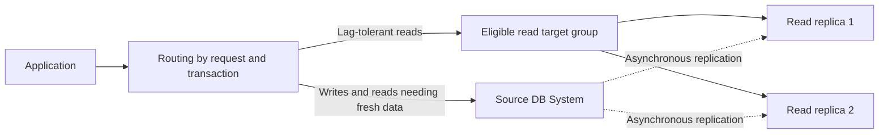

# Read Replicas, Replication, and Scaling MySQL Reads

When a MySQL application handles heavy read traffic, scaling up the source DB System is not the only option. Read replicas allow offloading part of the read workload to data copies, thereby reducing read load on the source. Effectiveness depends on query types, replication capacity, and how well the application tolerates data that is not instantaneously up to date.

This lesson belongs to the **MySQL HeatWave and NoSQL** chapter of the **CLOUD_PROVIDERS_ORACLE** module and focuses on MySQL in OCI: designing read replicas in a private network, access control, routing, monitoring, and cost control. Limits, shapes, and endpoint capabilities must be verified against the actual service; do not treat a fixed resource limit as a design principle.

After this lesson, learners will be able to:

- Distinguish replication, read replicas, HA, and analytical acceleration with HeatWave.
- Explain why a transaction committed on the source may not yet appear on a replica.
- Classify queries to select the right execution target.
- Plan replica creation, verify synchronization, and put replicas into service.
- Monitor lag, replication errors, responsiveness, and the cost of read scaling.

## 1. Distinguishing Four Concepts

| Concept | Primary Goal | What Should Not Be Inferred |
| --- | --- | --- |
| Replication | Stream and apply changes from a source system to a copy | Every copy is instantaneous or automatically used by applications |
| Read replica | Provide additional read targets from replicated data | A replica is an independent write node for the same dataset |
| High Availability — HA | Maintain service availability via managed standby and failover | Standby members are default read endpoints for applications |
| HeatWave | Accelerate supported analytical workloads | A HeatWave cluster works the same way as standard MySQL read replicas |

Replication is the underlying mechanism; a read replica is one way of using copies to scale reads. HA and read replicas can coexist in a design, but they address different goals.

### 1.1. Service-Managed Read Replicas vs. Self-Configured Replication

In OCI, distinguish read replicas managed by the MySQL service from other replication setups, such as replicating from an external MySQL into OCI or from OCI to another system.

A read replica is created and attached to a source through the supported service lifecycle. Other replication topologies may require channels, replication accounts, source configuration, and dedicated connectivity matching the data flow direction.

Do not take instructions for configuring an inbound channel and apply them directly to modify a service-managed read replica. Manually running commands to alter replication sources or stop replication threads on managed resources may be disallowed and can break service state.

### 1.2. Read Scaling Is Not Data Sharding

A standard read replica maintains a copy of the source's data within the configured replication scope. Adding replicas adds read execution capacity, not independent data shards.

In particular, replicas do not automatically distribute a single source's write load. Writes must still be processed on the source, and those changes must still be applied on every replica.

## 2. Replication Mechanics and Lag

The logical flow of asynchronous replication can be pictured as follows:

```text
Application writes transaction on source
        ↓
Source commits and logs changes per configuration
        ↓
Changes are transmitted to replica
        ↓
Replica receives and applies changes
        ↓
Read queries on replica see applied changes
```

In an asynchronous model, a successful commit acknowledgment from the source does not wait for every read replica to finish applying the transaction. Consequently, at a given moment, the source and a replica can return two different data states.

### 2.1. Read-After-Write Example

A customer places an order:

1. The application writes order `ORDER-42` to the source.
2. The source commits successfully and the application displays an order-created confirmation.
3. The order details screen sends a read query to a replica.
4. The replica has not applied the new transaction yet and cannot find the order.

The database did not necessarily lose data. The issue is that the application routed a read requiring immediate visibility of a recent write to a target that had not caught up.

### 2.2. Lag Arises Across Multiple Stages

Lag can increase due to:

- High write volume or large transactions generated on the source.
- Slow, interrupted, or under-provisioned network paths for the change volume.
- Insufficient CPU, memory, or I/O on the replica to apply changes.
- Reporting queries on the replica competing for resources with replication appliers.
- Replication stream errors, unapplied transactions, or internal background work.

Reducing read traffic on the source does not guarantee lower lag. A replica running heavy analytical queries can fall behind applying changes and serve stale data longer.

### 2.3. Defining Freshness in Business Terms

Saying "eventual consistency is acceptable" must be made concrete. For example:

| Data Group | Requirement That Can Be Set | Routing Implication |
| --- | --- | --- |
| Newly created order details | Must see the just-confirmed write | Read from source or use a mechanism ensuring transaction application |
| Recommendation catalog | Can tolerate delay within an internal threshold | Can read from replicas currently meeting the threshold |
| Aggregated reports | Can tolerate a separate data snapshot timestamp | Use replicas and display data timestamp where appropriate |
| Account balances or authorization decisions | Requires correctness against current transactions | Do not read from replicas solely to offload without a fitting consistency model |

Time thresholds are business decisions to measure and verify. They are not guarantees that every transaction will always reach every replica within the same interval.

## 3. Designing a Read/Write Topology



The read target group in the diagram is a logical concept. It can be implemented via service endpoint capabilities, supported middleware, or datasource selection logic inside the application.

### 3.1. Endpoints Do Not Understand Business Logic Automatically

The source endpoint handles write load and reads that must run on the source. Replica endpoints serve selected read sessions.

If using the service's read-replica load balancer, confirm member selection, target routing, connection handling, and behavior when no replica is available. Do not assume it parses individual SQL statements or automatically provides read-after-write consistency.

An open connection typically stays pinned to one execution target for that connection's lifetime depending on the middleware mechanism. Balancing connections does not mean balancing the cost of individual queries evenly.

Long-lived connection pools can cause one replica to receive more heavy sessions than another. Monitor actual load distribution rather than just counting replicas or connections.

### 3.2. Routing by Transaction and Session State

Do not simply check whether a SQL statement starts with `SELECT` to route it to a replica. Cases requiring separate evaluation include:

- `SELECT ... FOR UPDATE` or locking reads intended for updates.
- Read-then-write within the same business transaction.
- Sessions using temporary tables, session variables, or connection state.
- Reads that must observe changes just written to the source.
- Queries depending on the snapshot or isolation level of an already-open transaction.

A transaction must remain on the right datasource from start to finish. Do not open a transaction on the source and arbitrarily route mid-transaction reads to a replica.

Driver read-only flags or framework annotations may be mere hints; they do not create read replicas, pick endpoints automatically, or guarantee data freshness.

### 3.3. Separating Pools and Accounts

Maintain separate configurations for source and read workloads:

| Component | Purpose | Required Controls |
| --- | --- | --- |
| Source pool | Writes and consistent reads by design | Connection limits, required write privileges, timeouts |
| Replica pool | Lag-tolerant reads | Read-only account, health checks, and freshness conditions |
| Target selector | Decision based on business context | Never switch targets mid-transaction; rules when replicas are absent |

A read-only account reduces the risk of an accidental write statement, even if a read endpoint can fall back to the source under a fallback configuration. A server-side read-only flag should not be the sole defense layer.

## 4. Preparing Resources and Connectivity in OCI

### 4.1. Checking Source Prerequisites

Before creating a replica, confirm:

1. The source DB System is in an eligible state and supports read replicas under its current configuration.
2. Version, shape, quotas, and capacity satisfy the target selection.
3. Service-required replication prerequisites are met via supported mechanisms.
4. Sufficient storage and capacity exist to handle initial snapshot cloning and catching up on changes.
5. You have identified which read workload will move and what freshness level it requires.

Do not manually alter service-managed binlog or replication parameters just to bypass a prerequisite check error. Use service-permitted configurations, workflows, or support channels.

Replicas also cannot arbitrarily be placed in any region or topology. Select placement and configuration within supported service boundaries; if cross-region replication or disaster recovery is needed, evaluate that as a separate architectural requirement.

### 4.2. IAM and MySQL Accounts

Operators need permissions to manage read replicas and use dependent resources in the relevant compartment. OCI resource creation permissions are independent of MySQL data query privileges.

Applications should use read-only accounts scoped to the exact required schemas or tables. Administrative accounts and write-capable application accounts should not be placed in the read pool purely for convenience.

Account creation and modification must follow the service's user management model and replication setup. Do not create schemas or accounts directly on a replica to make the copy diverge from the source.

### 4.3. Private Networking and TLS

Identify the source endpoint, replica endpoint or read-distribution endpoint, and authorized client sources. Verify routes, network rules, and DNS from the application runtime environment itself.

Permit only ports actually used; for MySQL classic protocol this is typically TCP `3306` per endpoint configuration. Do not widen sources to `0.0.0.0/0` just because the application added a replica.

If accessing across networks, bidirectional routes and corresponding network rules are required. Internal service-managed replication flows must meet deployment requirements; do not assume opening the application port covers all connectivity.

Maintain TLS encryption and appropriate server verification across all pools. Changing endpoints may change the hostname checked against certificates; never downgrade verification just to silence errors during target switches.

## 5. Creating and Onboarding a Read Replica

### Step 1: Capture a Baseline

Before creating a replica, collect query latency, throughput, CPU, I/O, connection counts, and read/write ratios on the source. Separate heavy queries from small lookups to identify which workload causes pressure.

If the root cause is a missing index or a full table scan, adding a replica may merely duplicate the problem across more machines. Inspect execution plans and data access patterns before scaling out.

### Step 2: Provision via the Service Lifecycle

In the source DB System management area on OCI, use the service-supported read replica creation action. Choose configuration, placement, and options offered for the actual source.

Record the name, resource identifier, linked source, and target configuration. Monitor the work request to completion; if a request times out, check whether the resource already exists before retrying.

Initial cloning and catch-up can consume resources. Do not send the full read workload the instant an endpoint appears.

### Step 3: Validate the Replica

Verify simultaneously:

- Lifecycle state and replication state show no unresolved errors.
- Endpoint is reachable from the exact authorized client sources.
- Read account authenticates with required TLS.
- Sample data on the source appears on the replica under test conditions.
- Replication lag and query performance meet thresholds for serving traffic.

Successful creation in OCI does not prove a replica is always fresh or that application queries run fast.

### Step 4: Shift Traffic Gradually

Start with lag-tolerant query groups and a small fraction of traffic. Monitor both the source and the replica before increasing the share.

Maintain a mechanism to pull a replica out of the read group when errors occur or freshness thresholds are breached. Re-entry policies need a stable observation window to avoid rapid flapping in and out.

### Step 5: Handover

Hand over endpoints, pool roles, account references to secret vaults, operational thresholds, fallback policies, and alert owners. Never store passwords in topology sheets.

## 6. Choosing a Read-After-Write Strategy

Three solution groups are commonly used. Choose per business flow requirement rather than forcing one approach across the entire application.

### 6.1. Reading Back from the Source

After writing, send reads that must see the newly committed result to the source. This is the simplest way to avoid replication lag within that flow.

However, preserve proper transaction boundaries and isolation levels. A transaction already holding an older snapshot may continue seeing that snapshot; simply connecting to the source does not fix every transaction logic bug.

The source must also be the current write target per service state, especially after switchovers. Do not pin an outdated internal host address instead of the supported source endpoint.

### 6.2. Pinning the User to the Source for a Time Window

The application can mark a session or entity that just wrote and temporarily route related reads to the source.

This is easy to implement, but a fixed wait window does not prove the replica has caught up. If lag spikes abnormally, reading after the window expires can still return stale data.

If using a time window purely as a heuristic, document its limits clearly and avoid it for flows requiring strict consistency.

### 6.3. Waiting for a Replica to Apply a Specific Transaction

With MySQL GTIDs and required supported capabilities, an application can carry transaction metadata from the write step to the read step and wait for the target replica to apply it.

**GTID — Global Transaction Identifier** identifies transactions within a replication topology. The goal here is to confirm that the required transaction has executed on the exact replica that will serve the read.

Conceptual flow:

1. Write and commit on the source.
2. Retrieve the transaction identifier via a supported source/client mechanism.
3. Open or hold a connection to the selected replica.
4. Wait for that replica to apply the GTID within a bounded timeout.
5. If successful, start the read with an appropriate snapshot on that same connection.
6. If unsuccessful, apply the fallback choice: read from source, return a pending status, or report freshness unmet.

Illustrative MySQL wait step, used only when the actual service, configuration, and privileges support it:

```sql
-- Placeholder must be replaced with a valid collected GTID/GTID set.
-- 2 seconds is an internal illustrative timeout, not a service guarantee.
SELECT WAIT_FOR_EXECUTED_GTID_SET(
    '<CONFIRMED_GTID_OR_GTID_SET>',
    2
) AS wait_result;
```

A result of `0` indicates the condition was satisfied; `1` indicates timeout. Errors or other values must not be treated as success.

Never grab the entire global GTID set arbitrarily instead of the current request's transaction identifier. An overly broad or wrong set can trigger unnecessary waits.

In particular, never wait on replica A, return the connection to a pool, and then read via another connection that might land on replica B. Proof that A applied it does not guarantee B caught up.

Nor should you start an old read snapshot before waiting and keep reusing that snapshot. Consistency mechanisms must be designed jointly with transactions, pools, and drivers—not by merely dropping in a wait SQL statement.

## 7. Monitoring Replication and Read Target Health

### 7.1. Four Information Groups

| Group | What to Observe | Decisions Supported |
| --- | --- | --- |
| Service lifecycle | Resource availability, failed work requests, maintenance events | Should this target accept new connections? |
| Replication | Receiver/applier threads, lag, errors, and progress | Does the target meet freshness requirements? |
| Replica performance | CPU, memory, I/O, connections, query latency | Should we shed load, tune queries, or scale capacity? |
| Application view | Errors, timeouts, stale reads, fallback rates | Are business goals being met? |

Metric names and collection methods depend on the service and actual access permissions. Never assume a TCP check or a single lag metric proves a replica is healthy.

### 7.2. Diagnostic Query Examples

With an operational account holding service-permitted privileges, you can use the following MySQL checks:

```sql
SELECT @@server_uuid AS server_uuid,
       @@read_only AS server_read_only,
       @@super_read_only AS server_super_read_only;

-- The \G terminator syntax works in the MySQL command-line client.
SHOW REPLICA STATUS\G
```

`server_uuid` distinguishes execution targets when inspecting multiple replicas. Read-only flags are only partial evidence; never use them alone to infer full roles, permissions, or OCI lifecycle state.

Commands inspecting replication status require appropriate privileges and may be subject to service restrictions. If not permitted, use service-provided metrics/status or support workflows; never grant broad admin privileges to application accounts just for diagnostics.

Where supported by the configuration and version, inspect together:

- Whether receiver and applier threads are running.
- Reported lag, such as `Seconds_Behind_Source`.
- Latest receiver or applier errors.
- Progress of received vs. executed transactions.

A lag value of `0` does not by itself prove the replica has every latest source transaction. For example, the replica may have applied everything received so far while the receiver stream is stalled.

Missing or unknown values must never be coerced to `0`. Monitoring must distinguish missing telemetry, lost connectivity, and genuinely healthy thresholds.

### 7.3. Making Data Probes Meaningful

In a lab schema or approved test mechanism, you can write a marker on the source and check its appearance on each replica. Probes should record timestamp, execution target, and wait bounds.

This adds end-to-end visibility, but avoid writing probe rows into business tables or generating unnecessary load. When measuring lag using clocks across machines, ensure time synchronization and understand measurement skew.

A successful probe reflects only that test moment; it does not replace continuous operational monitoring.

## 8. Sizing and Counting Replicas

### 8.1. Replicas Need Capacity to Apply Changes

Do not pick tiny replicas just because they receive no direct writes from applications. Replicas still perform the work of applying changes and maintaining data structures.

If apply throughput stays below change-generation throughput for extended periods, a replica falls behind even with almost zero read clients.

When lag occurs, distinguish two situations:

| Situation | Potentially Appropriate Response |
| --- | --- |
| Replica applies well but is overloaded by read queries | Lower concurrency, optimize queries, scale resources, or split load across another replica |
| Replica cannot keep up with change stream even under light reads | Investigate replication, large transactions, and apply capacity; adding an identical replica may not help |

### 8.2. Adding Targets Does Not Yield Linear Gains

Effectiveness depends on query mix, buffer caches, replication overhead, and connection distribution. Adding two replicas does not guarantee doubling useful throughput.

Early queries on a new replica may be slow due to cold caches. Ramp traffic in stages while observing query latency and catch-up health.

Moving reads to replicas does not make source write transactions cheaper. The source can still bottleneck on locks, CPU, I/O, or transaction logic.

### 8.3. Accounting for Full Cost

Budget compute, storage, and associated resources for each replica under the service model. Replicas typically carry full data copies, so replica count directly multiplies total resource footprint.

Include connectivity, data transfer where applicable, and operational overhead. Do not assume creating a read replica automatically provides HA or data protection against every scenario.

Sound decisions rest on before/after measurements: how much load left the source, how much faster queries run, whether lag meets targets, and how much cost increased.

## 9. Handling Incidents and Lifecycle Changes

### 9.1. When a Replica Is No Longer Eligible

A replica may be reachable yet unfit for traffic because lag exceeds thresholds. Conversely, data may be fresh while the endpoint fails to serve. Treat reachability and freshness as two separate checks.

Reference handling sequence:

1. Identify the affected replica, start time, and query groups using it.
2. Stop routing new read connections to that target via supported routing controls.
3. Manage impact on active connections using timeouts and application policies.
4. Inspect replication, resources, query load, and service events.
5. Shed load or address the root cause within permitted scope.
6. Re-enable only after meeting criteria across a stable observation window.

Do not blindly dump all queries back onto the source when a replica fails. The source may lack headroom to absorb all reports and application traffic simultaneously.

Fallback policies should prioritize preserving the source for writes and critical paths; throttling concurrency or pausing reports; or serving cached results only where business logic allows.

### 9.2. When the Source Encounters an Outage

A read replica must not be treated as an automatic fallback write target unless the service and runbooks explicitly define that mechanism. Never toggle off read-only flags and send writes to a replica as a default recovery reflex.

If the design uses a supported promotion or source-replacement workflow, determine potential data loss, authorization, post-change endpoints, and fencing to prevent split-brain writes.

Source HA, recovery switchovers, and read routing must be coordinated. Connection pools should react to endpoint/state changes through supported mechanisms rather than holding dead connections indefinitely.

### 9.3. When a Replica Falls Too Far Behind

Ability to catch up also depends on whether required changes remain available from the source. If an outage exceeds retained replication history, you may need to rebuild the replica through service workflows.

Never skip failing transactions or manually adjust replication positions just to make a lag metric look clean. Such interventions can introduce silent data divergence that is hard to detect.

Record status, errors, and work request IDs; coordinate with support when tasks fall within managed service operations.

### 9.4. Replicas Do Not Replace Backups

A valid accidental `DELETE` on the source replicates to replicas. Thus, having multiple replicas does not create multiple pre-deletion recovery points.

You still need backup policies and restore drills. If the goal is disaster recovery or point-in-time retention, design that separately rather than inferring it from a read-scaling topology.

## 10. Example: Splitting Read Load for an E-Commerce Application

Suppose an application has three operation groups:

| Group | Requirement | Intended Target |
| --- | --- | --- |
| Placing orders and viewing newly created orders | Must never appear missing after a success confirmation | Source, with proper transaction boundaries |
| Browsing catalog | Tolerates delay within a chosen internal threshold | Replicas meeting freshness criteria |
| Hourly aggregated reports | Does not need to reflect every just-committed transaction | Reporting replica or appropriate analytics target |

The operations team creates a first replica and shifts only part of catalog browsing traffic. They keep order placement and the confirmation screen on the source.

Testing shows reduced read load on the source, but a long-running report on the replica drives up lag. Instead of immediately adding more replicas, the team proceeds in order:

1. Inspect the report's execution plan and rows scanned.
2. Cap concurrent report executions and runtime.
3. Re-measure replication apply capacity once report load drops.
4. If workload isolation is needed, evaluate a dedicated replica or an analytical solution like HeatWave after assessing fit.

If they add a second replica, they must also update the read target group, verify connectivity/TLS, and assess load balance across pools. Creating a new resource does not automatically cause applications to use it.

### 10.1. A Business Bug to Avoid

When the order details page fails to find an order on a replica, the application must never auto-retry creating the order simply because the read returned empty. Order creation requires proper idempotency and must distinguish "not yet replicated to the read target" from "write transaction failed."

This is why consistency classification must precede read scaling rather than treating it as a pure performance tweak.

### 10.2. Post-Deployment Evaluation Criteria

The project team compares:

- Latency and throughput per query group.
- Remaining load on the source and headroom for writes.
- Replication lag under normal load and peak traffic.
- Fallback rates, connection errors, and recovery time when losing one replica.
- Count of stale-read incidents affecting business workflows.
- Total cost relative to achieved performance targets.

Replica count is a deployment parameter; these outcomes show whether the design actually meets requirements.

## 11. Pre-Production Checklist

- [ ] Have the exact source DB System and service-supported read replica type been identified?
- [ ] Is read scaling clearly separated from HA, backups, and disaster recovery?
- [ ] Does every query group have explicit freshness requirements and execution targets?
- [ ] Are read-after-write flows and locking transactions prevented from arbitrarily routing to replicas?
- [ ] Do connection pools stay pinned to the right datasource within a transaction?
- [ ] Have endpoints, read-group membership, and fallback behavior been verified?
- [ ] Do read accounts enforce least privilege and protect credentials?
- [ ] Have routes, network rules, DNS, and TLS been verified from the actual application environment?
- [ ] Has the replica caught up on sample data and met targets under projected load?
- [ ] Does monitoring distinguish lag, replication errors, missing metrics, and connection failures?
- [ ] Is there a policy for evicting unhealthy replicas and criteria for re-admitting them?
- [ ] Does the source have protective caps when absorbing fallback traffic?
- [ ] Do source-outage procedures avoid arbitrarily turning a replica into a writable primary?
- [ ] Have backups, restore drills, and costs been assigned owners?

Read replicas are effective when an application has separable read load and tolerates an appropriate consistency model. A complete design ties three parts together: replication keeps copies current, the application chooses the right read target, and operations keeps read targets within committed service bounds.
