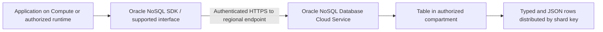

# Oracle NoSQL Database Cloud Service and Data Modeling

Oracle NoSQL Database Cloud Service is a managed NoSQL database service on OCI. Applications work with tables, rows, keys, and structured or JSON data through supported interfaces. To use it effectively, design from access patterns: know which keys are available at read time, what scope is queried, whether updates contend, and what level of data freshness is required.

This lesson belongs to the **MySQL HeatWave and NoSQL** chapter of the **CLOUD_PROVIDERS_ORACLE** module and focuses on NoSQL data modeling within the context of OCI tenancies, compartments, IAM, connectivity, monitoring, and cost control.

After this lesson, learners will be able to:

- Distinguish Oracle NoSQL Database Cloud Service from MySQL HeatWave and a self-managed relational database.
- Design typed columns, JSON fields, primary keys, and shard keys around access patterns.
- Explain the implications of consistency levels, TTL, and conditional writes.
- Recognize hot keys, broad table scans, and the cost of secondary indexes.
- Organize workflows for table creation, data validation, and operational handover.

## 1. Service Positioning and Responsibilities

### 1.1. Managed Service, Application-Driven Model

Oracle provides the infrastructure and manages service operations. Customers define tables, row structures, keys, indexes, access permissions, and how applications handle data.

Not managing database servers does not eliminate decisions around storage, read/write capacity, latency, recovery, and business correctness.

Customers also do not place a NoSQL table inside a private subnet the way they provision a MySQL DB System. Applications need a supported connectivity path to the OCI service endpoint and an appropriate authentication mechanism.

### 1.2. Comparison with MySQL HeatWave

| Aspect | MySQL HeatWave | Oracle NoSQL Database Cloud Service |
| --- | --- | --- |
| Modeling focus | Relational schemas and transactions per MySQL capabilities; HeatWave features for supported workloads | Distributed tables, key-based access, structured/JSON data, and targeted access patterns |
| Query design | Can rely on relationships, joins, and MySQL indexes | Must focus on keys, shard scope, indexes, and amount of data read |
| Application access | MySQL drivers/protocols per endpoint configuration | SDK/API and SQL queries per Oracle NoSQL capabilities |
| Application identity | MySQL accounts and privileges alongside OCI management permissions | OCI service authentication/authorization mechanisms matching the client environment |
| Critical decisions | Transactions, SQL plans, connections, and DB System capacity | Primary key, shard key, row shape, consistency, and capacity |

NoSQL does not mean schema-less or SQL-less. The service supports typed fields alongside JSON fields and provides a query language tailored to Oracle NoSQL capabilities.

Conversely, having SQL does not turn the service into another MySQL. Never lift a multi-table relational design with arbitrary joins straight into NoSQL and expect identical execution behavior.

## 2. Components of the Data Model

### 2.1. Tables and Rows

A **table** defines the data structure and primary key. A **row** is a record uniquely identified by the full primary key.

A row can combine:

- Strongly typed fields such as `STRING`, `LONG`, `BOOLEAN`, or `TIMESTAMP`.
- Structured types such as record, array, or map where appropriate.
- `JSON` fields for flexible data structures.

Typed fields help enforce stability on core attributes. JSON fits attributes that vary by device model or event version, yet still requires an application-side data contract.

### 2.2. Primary Key

The primary key uniquely identifies a row in the table and provides direct access when the application knows all key components.

Avoid using mutable values like display names as key components simply because they are readable. Define uniqueness scope upfront: global across the system, within a tenant, within a device, or within a time bucket.

Primary key fields must obey service type and value rules; never design around missing keys or `NULL`.

### 2.3. Shard Key

The shard key is the portion of the primary key used for data distribution. Rows sharing the same shard key value are placed within the corresponding partition scope.

This choice impacts:

- How evenly read/write load spreads.
- Ability to query within a known range.
- Size of data groups sharing a shard key.
- Multi-row operations constrained by data colocation.

A shard key is not a server address managed by the application. The service operates partitions; the application designs key values to avoid concentrating load into a single partition.

### 2.4. Secondary Indexes

A secondary index creates an access path on non-primary-key fields or supported data paths, including certain JSON fields.

Indexes are not free: they consume storage and must be maintained whenever data changes. Never index every JSON attribute just in case a query might need it.

Prioritize identifying required queries, execution frequency, selectivity, and expected read volume before adding indexes.

## 3. Starting from Access Patterns

Suppose a system ingests sensor events for multiple customers. Before writing DDL, list the operations:

| Access Pattern | Known Inputs | Expected Output |
| --- | --- | --- |
| Write event | Tenant, device, timestamp, and event ID | Create record; handle retries without creating duplicates |
| Read single event | Tenant, device, day, and event ID | One specific row |
| List events for a day | Tenant, device, and day | Bounded, paginated set of rows |
| View time range | Tenant, device, day, and time interval | Events falling within the target interval |
| System-wide report | Time range across many devices | Separate workload whose scan volume must be evaluated |

Do not try to optimize every query with a single key. The primary access path is by tenant, device, and day; system-wide reporting should not become a reason to make every write or point read more expensive.

## 4. Event Table Design Example

### 4.1. DDL

Example using Oracle NoSQL table syntax to create a lab model:

```sql
CREATE TABLE IF NOT EXISTS device_events (
    tenant_id STRING,
    device_id STRING,
    event_day STRING,
    event_id STRING,
    occurred_at TIMESTAMP(3),
    payload JSON,
    PRIMARY KEY (SHARD(tenant_id, device_id, event_day), event_id)
) USING TTL 30 DAYS;
```

Design choices in this example:

- The shard key combines `tenant_id`, `device_id`, and `event_day` to group events by device and day.
- `event_id` completes the primary key and distinguishes events within that group.
- `occurred_at` is a millisecond-precision timestamp in this example.
- `payload` holds flexible attributes.
- Default TTL is 30 days for lab purposes, not a mandatory service requirement.

DDL describes the schema; table throughput and storage capacity must be supplied through the service's table creation APIs/controls. DDL alone is not necessarily sufficient to provision a cloud table.

`IF NOT EXISTS` does not verify that an existing table's schema matches your desired schema identically. If a table already exists, inspect its definition and reconcile before using it.

### 4.2. Illustrative Row Representation

```json
{
  "tenant_id": "tenant-a",
  "device_id": "sensor-017",
  "event_day": "2026-11-20",
  "event_id": "evt-000042",
  "occurred_at": "2026-11-20T08:15:30.125Z",
  "payload": {
    "schema_version": 1,
    "temperature": 30.5,
    "battery_pct": 88,
    "status": "normal"
  }
}
```

This is a logical representation of the row, not a guarantee that every SDK accepts timestamps as raw JSON strings without type conversion. When writing from a client, bind/convert `occurred_at` to the exact type supported by the SDK.

Applications must compute `event_day` using a consistent convention, such as the UTC date of the event timestamp. Never use local time on one client and UTC on another.

### 4.3. Point Reads and Within-Group Queries

When the full primary key is known, use the appropriate SDK/API key-based get operation. The key in this example includes all four components; `event_id` alone is insufficient.

When listing events within a day, use a parameterized query:

```sql
DECLARE $tenant STRING; $device STRING; $day STRING;

SELECT e.event_id, e.occurred_at, e.payload
FROM device_events e
WHERE e.tenant_id = $tenant
  AND e.device_id = $device
  AND e.event_day = $day
ORDER BY e.event_id
LIMIT 100;
```

Variables must be bound through the client's prepared query mechanism. Never concatenate tenant or device strings directly into SQL text.

The predicate specifies the entire shard key, narrowing access scope. Ordering in this example is by `event_id`, not automatically by occurrence time.

`LIMIT 100` only caps this example query's result count. To iterate over full datasets, design pagination using the continuation token mechanism supported by the API/SDK while keeping the exact same query and parameters.

Do not use increasing `OFFSET` by default for large datasets; evaluate read cost and pagination stability.

### 4.4. Time-Based Index Only When Genuinely Needed

If time-range queries within a day are a critical access path, consider:

```sql
CREATE INDEX idx_device_events_time
ON device_events (tenant_id, device_id, event_day, occurred_at);
```

Queries can then supply the full prefix conditions alongside the timestamp range:

```sql
DECLARE $tenant STRING; $device STRING; $day STRING;
        $from_time TIMESTAMP(3); $to_time TIMESTAMP(3);

SELECT e.event_id, e.occurred_at, e.payload
FROM device_events e
WHERE e.tenant_id = $tenant
  AND e.device_id = $device
  AND e.event_day = $day
  AND e.occurred_at >= $from_time
  AND e.occurred_at < $to_time;
```

Verify the query plan and read cost using supported tools; never assume having an index guarantees every SQL statement uses it efficiently.

For ranges spanning multiple days, the application must iterate across day groups or use another evaluated query path. Aggregate results and costs deliberately.

## 5. Choosing a Shard Key to Avoid Hot Spots

### 5.1. Three Options and Trade-Offs

| Shard Key | Advantage | Risk |
| --- | --- | --- |
| `tenant_id` only | Easy to group data by tenant | A large tenant can concentrate load and grow partition group size |
| `tenant_id, device_id` | Distributes across devices | A very hot device or long history still creates a large group |
| `tenant_id, device_id, event_day` | Splits history into time-bounded groups | Multi-day queries must touch multiple groups |

No single shard key fits every application. Choose based on real data distributions—especially looking at the largest tenant or device rather than averages alone.

### 5.2. When Daily Buckets Are Still Too Hot

If a single device generates massive volume in one day, you may need an extra distribution bucket, such as one derived deterministically from the event ID.

In exchange, full-day queries must read multiple buckets and merge results. Bucket counts, hashing algorithms, and calculation versions must be strictly controlled.

Never pick a random bucket on each retry. The same event could land on a different key and create duplicate records.

### 5.3. Uniqueness Must Align with the Full Key

In the example table, the same `event_id` with a different `event_day` forms two distinct primary keys. The service does not infer they represent the same business event.

To prevent duplicates, the application must reuse the exact same tenant, device, day, and ID. If global uniqueness requirements differ from this model, design an additional mechanism rather than expecting a composite local primary key to enforce it.

## 6. JSON Modeling: Controlled Flexibility

### 6.1. Separating Stable Fields from Flexible Attributes

In the example, tenant, device, day, ID, and timestamp are stable fields. Temperature, battery, or sensor-specific attributes live inside `payload`.

Do not stuff everything into a single JSON column just because the service allows it. Fields used for keys, type validation, and frequent access paths should be explicitly modeled.

Applications must specify:

- Which fields are mandatory and which may be absent.
- Units of measurement, value ranges, and timestamp formats.
- Distinctions among missing fields, `null`, and defaults.
- Payload schema versions and how older versions are read.

Allowing flexible JSON schemas does not guarantee data remains semantically valid for business logic.

### 6.2. Embed or Reference?

| Modeling Pattern | Suitable When | Trade-Off |
| --- | --- | --- |
| Embed related data in one row | Data is usually read/updated together and size is bounded | Larger rows; higher write contention on the same key |
| Split into multiple rows with key references | Parts have different lifecycles or access frequencies | Requires multiple reads and cross-part consistency handling |
| Duplicate an attribute across multiple rows | Avoiding extra lookups on a critical read path | Requires update rules and tolerance for duplicated data |

For example, a small device configuration fits inside a single row. An unbounded event history must not grow forever inside an array on that configuration row.

Do not assume NoSQL performs arbitrary joins across independent tables like a relational database. If an access pattern combines multiple sources, account for request counts, read volume, and attribute synchronization mechanisms.

### 6.3. Schema Evolution

When `payload` evolves from version 1 to 2, clients must handle previously stored rows or run a migration plan. Any index on a JSON path must also be re-evaluated if field types or names change.

For typed columns and primary keys, changes must stay within the service's schema evolution capabilities. Never treat changing a shard key as a harmless edit; it typically requires a new table model, data migration, and application cutover.

## 7. Consistency and Update Correctness

### 7.1. Eventual and Absolute Consistency

Oracle NoSQL provides consistency options for eligible read operations. Two key concepts are:

| Option | Practical Meaning | Reference Usage |
| --- | --- | --- |
| Eventual consistency | May read state that does not yet reflect the latest write | Flows designed to tolerate slightly stale reads |
| Absolute consistency | Requests reading under the service's strong consistency guarantee | Flows requiring observation of committed updates per supported semantics |

Actual configuration depends on the operation and SDK; do not assume every API accepts identical flags. Cost and latency profiles can also differ.

Eventual consistency is not a promise of "always delayed by exactly X seconds." If business rules enforce freshness bounds, define how to measure them, how to handle breaches, and when to use stronger consistency.

Absolute consistency on a single read does not turn multiple independent calls into a transaction. Between a read and a subsequent write, another client can still modify the row.

### 7.2. Conditional Writes Using Version

A read operation can return a row's version. When writing back, the application supplies a version condition to avoid overwriting an update that occurred after the read.

The flow below is pseudocode, not exact function names from a specific SDK:

```text
row, version = read(key, consistency = ABSOLUTE)
new_row = apply_business_change(row)

result = put_if_version(key, new_row, expected_version = version)

if result indicates conflict:
    read latest row
    recompute or report conflict according to business rules
```

For example, two processes concurrently read configuration version A. The first updates it to B; the second must not overwrite B with a result computed from A if the version condition no longer holds.

Retries must re-read and recompute as needed rather than blindly replaying a stale update forever. Also handle cases where the row was deleted or expired.

### 7.3. Conditional Creation and Deduplication

For immutable events, an insert-if-absent operation helps handle retries safely. If the row already exists, the application determines whether it is a duplicate delivery or a genuine ID collision.

Unconditional put/upsert on the same key is not automatically idempotent at the business level: a later payload might differ and overwrite earlier data.

If a client times out after sending a write, the outcome is uncertain because the server may have executed it. Keep business keys stable and read/reconcile or use conditional operations before retrying.

### 7.4. Atomicity Scope

Single-row operations provide a foundational unit for atomic updates. For multi-row operations, adhere strictly to API constraints requiring a shared shard key, condition declarations, and failure handling.

Do not assume arbitrary multi-table, cross-shard transactions exist like in a relational database. If a business invariant spans multiple rows, pick an appropriate data model, supported batch API, or compensating workflow.

## 8. TTL and Data Lifecycle

**TTL — Time To Live** defines a row's expiration lifetime under service mechanics. It is useful for ephemeral events, sessions, or bounded-retention data.

In the example table, `USING TTL 30 DAYS` sets the table default. Depending on supported operations, applications can supply or override TTL at the row level.

Distinguish three timestamps:

1. **Business timestamp:** the event's `occurred_at` value.
2. **Expiration timestamp:** determined by TTL and how the row was written/updated.
3. **Physical reclamation time:** background cleanup after expiration.

An old event ingested late does not automatically expire relative to `occurred_at`. If retention policy counts from event creation time, the application must compute the remaining TTL using supported mechanisms.

Do not assume every update extends TTL or preserves existing TTL. Explicitly specify request options and verify expiration behavior in update scenarios.

Expired rows are no longer served as active data, but physical storage reclamation may not be instantaneous. Never treat TTL as proof that storage capacity or legal erasure finished at an exact second.

TTL does not replace backups or recovery mechanisms. A replica participating in the same expiration lifecycle does not create a pre-expiration restore point either.

## 9. Read/Write Capacity and Modeling Cost

### 9.1. Capacity Is Not Just Request Count

The service uses concepts of read capacity, write capacity, and storage. In provisioned mode, customers configure capacity in service-defined units; on-demand mode adjusts usage and billing per service mechanics.

On-demand does not mean unlimited or immune to throttling. You must still evaluate limits, key distributions, and burst patterns.

One request does not automatically equal one read unit or write unit. Consumption depends on operation type, data volume, rounding rules, consistency mode, and related work per service definitions.

You can start estimating with an internal formula:

```text
Projected read capacity
    ≈ read operations per second × average read units per operation

Projected write capacity
    ≈ write operations per second × average write units per operation
```

For example, if measurements show a workload needs an average of 2 read units per operation at 1,200 operations per second, the baseline is roughly 2,400 read units per second before headroom. These are hypothetical numbers to illustrate the math, not Oracle billing rules.

### 9.2. Costs Driven by Queries and Row Shape

Choices that typically drive up cost:

- Scanning many rows only to return a few.
- Reading entire large JSON documents when only a couple of fields are needed.
- Letting unbounded arrays or histories grow inside a single row.
- Creating numerous rarely used indexes.
- Querying across many shard groups without bounded scope.
- Aggressive retrying while being throttled.

Never estimate cost solely from returned row counts. A query returning ten rows may still read far more data to locate them.

Measure actual unit consumption via service metrics/results and test under realistic key distributions. Raising total capacity alone will not fix a hot key.

### 9.3. Storage and Retention

Total capacity must account for both row data and associated structures/indexes as metered by the service. Plan around ingestion rate, actual row size, retention duration, and cleanup lag.

Do not treat TTL-expired rows as storage guaranteed to free immediately. Nor should you use fixed numbers from learning examples to build production budgets.

## 10. Connectivity and Permissions in OCI

### 10.1. Access Flow



Applications need the right regional endpoint, right compartment context, and a supported network path to the service. If private access control is required, design around the service's OCI connectivity capabilities—do not apply MySQL TCP `3306` rules verbatim.

Never use MySQL Connector/J to connect to an Oracle NoSQL endpoint. For Java applications, use the Oracle NoSQL client suited for Cloud Service and your environment's authentication mechanism.

### 10.2. Identity and Permissions

Applications use an OCI authentication mechanism supported by the client, such as an appropriate workload identity or managed credentials. Avoid copying a developer's personal keys onto application hosts as a default deployment practice.

Separate responsibilities:

| Role | Scope to Review |
| --- | --- |
| Schema deployment team | Create/alter tables and indexes as required |
| Ingestion workload | Perform required row operations on assigned tables |
| Query workload | Read/query as needed, without implicit table alteration privileges |
| Operations team | View status, capacity, errors, and apply approved changes |

Policy syntax and permission types must be verified against actual resource types. Never grant tenancy-wide admin privileges just so a workload can ingest events.

### 10.3. Application Tenants Are Not OCI Tenancies

The `tenant_id` column in a table is an application data-model attribute. It does not automatically enforce row-level IAM isolation.

If an application service has permission to read the entire table, the application itself must authenticate callers and restrict queries to the authorized tenant. Never trust a client-supplied `tenant_id` without authorization checks.

Compartments organize permissions for OCI resources; primary keys organize data. The two mechanisms complement each other but do not replace one another.

## 11. Hands-On Modeling Workflow

### Step 1: Finalize the Data Contract

Document read/write patterns, mandatory fields, ID generation, date derivation, consistency requirements, and retention duration. Estimate row sizes and expected device distributions upfront.

### Step 2: Prepare OCI

Select region, compartment, deployment permissions, and application identity. Verify service availability, limits, connectivity paths, and budget.

### Step 3: Create the Table and Capacity

Use the OCI Console or supported API/SDK to submit DDL along with required capacity/storage settings. Track the work request and wait for the table to become active per service mechanics.

Never resubmit a create request just because a client call timed out. First check whether the table or work request was already accepted.

### Step 4: Write and Read an Event

Convert timestamps to the proper type, compute keys deterministically once, and use conditional creation where appropriate. Read back using the full primary key with the chosen consistency.

Retry the same event with the same key to verify application deduplication behavior, not merely that another row can be inserted.

### Step 5: Verify Query Paths

Bind parameters and run the single-device, single-day query. Measure read units, latency, and pagination. Add an index only when the workload justifies it, then compare before and after.

### Step 6: Test Contention and Lifecycle

Test versioned updates, write conflicts, and simulated timeouts within lab scope. Verify TTL using a supported test configuration—do not alter TTL on data you intend to keep just for quick observation.

### Step 7: Handover

Hand over table identifiers, schemas, indexes, capacity settings, key rules, consistency requirements, TTL, permissions, dashboards, and operational owners. Record only references to secret vaults, never raw secrets in documentation.

## 12. Monitoring and Handling Anomalies

| Symptom | What to Inspect | Appropriate Action |
| --- | --- | --- |
| Throttling | Capacity, bursts, hot keys, and retry counts | Adjust load or capacity; use bounded backoff per SDK guidance |
| Slow queries | Shard scope, scan volume, indexes, and result size | Narrow queries, use effective indexes, paginate properly |
| New record missing on read | Consistency, full key, region, and write status | Distinguish stale reads from wrong keys or uncertain write outcomes |
| Conditional write fails | Version changed, row already exists, or row expired | Re-read and reconcile per business rules |
| Data disappears earlier than expected | Row TTL, update operations, and expiration calculation | Check expiration timestamp, not just the event timestamp field |
| Auth/permission errors | Client identity, policies, compartment, and target resource | Fix exact permission scope; do not open networks arbitrarily |
| Storage growth | Ingestion rate, row sizes, indexes, and lifecycle | Review data model and retention policies, not just raising quotas |

Retries must classify errors. Never retry schema errors or permission denials as if they were transient rate limits. For uncertain write outcomes, always check whether the prior request succeeded.

Configure alerts against actual service-provided signals and bind them to owners and runbooks. If data recovery is required, identify supported export, backup, or restore mechanisms and rehearse them within scope; service availability alone does not guarantee recovery after accidental deletion.

## 13. Model Review Checklist

- [ ] Does every critical read/write operation have a clear access pattern?
- [ ] Does the primary key reflect the true uniqueness scope of the data?
- [ ] Does the shard key distribute load for the largest tenant or device?
- [ ] Do retries preserve the exact key and enforce deduplication or conditional writes?
- [ ] Are stable fields strongly typed, and does JSON have a versioned contract?
- [ ] Are queries bounded in scope, parameterized, and paginated cleanly?
- [ ] Does every secondary index serve a measured need with write/storage costs factored in?
- [ ] Is consistency chosen per business need rather than relying on unchecked defaults?
- [ ] Do concurrent updates use version checks or equivalent concurrency controls?
- [ ] Is TTL understood separately from business timestamps and physical reclamation timing?
- [ ] Are capacity and storage derived from measurements, with headroom and alerts?
- [ ] Are IAM permissions and application-level tenant isolation defined separately?
- [ ] Are operations, data recovery plans, and budgets established?

An effective NoSQL model starts from access paths and business invariants. Oracle NoSQL Database Cloud Service supplies distributed tables, typed/JSON data, and consistency controls; the application must weave them into sound keys, queries, updates, and data lifecycles.
