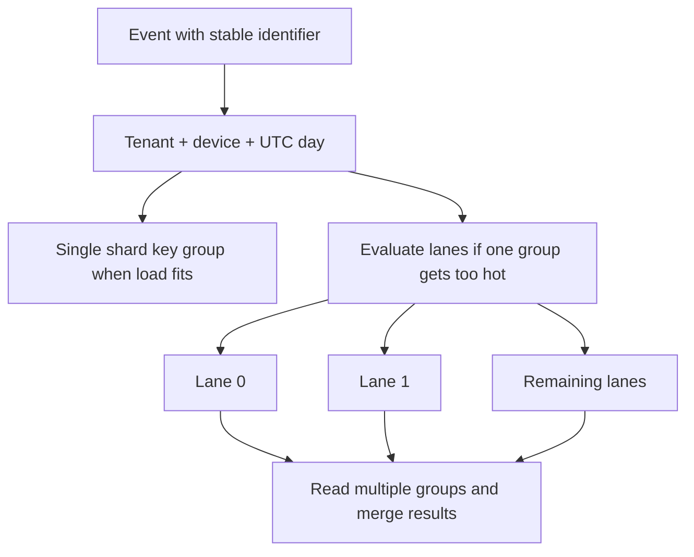

# Designing Keys, Tables, Capacity, and TTL for NoSQL

In Oracle NoSQL Database Cloud Service, a table is not merely a bucket for JSON documents. Key choices determine access paths and load distribution; schema affects record sizes and data control; capacity determines read, write, and storage budgets; TTL determines when a row expires inside the database.

These four decisions are directly coupled. If one device generates most events, raising table-wide capacity may still fail to resolve a hot key. If an index is added to cut down scans, every write may consume additional resources. If the default TTL is reduced, existing rows do not automatically inherit the new expiration.

In the **MySQL HeatWave and NoSQL** chapter of the Oracle Cloud Infrastructure (OCI) learning path, this lesson focuses on design for **Oracle NoSQL Database Cloud Service**. The running example is a multi-tenant device event ingestion application. Numbers are hypothetical for learning the calculations—not benchmarks, default configurations, or service limits.

After this lesson, learners will be able to:

- Translate business requirements into access patterns and key scopes.
- Choose primary keys, shard keys, and bucketing strategies with explicit trade-offs.
- Design tables combining typed columns with JSON, along with necessary indexes.
- Estimate RUs, WUs, and storage from workload, record size, and retention.
- Distinguish default TTL, per-row TTL, expiration timestamps, and application-checked business expiry.
- Plan tests for skewed load, updates, retries, and data lifecycles.

## 1. Starting from Access Patterns

### 1.1. Write the Questions Before Writing DDL

Suppose the application needs these capabilities:

| Access Pattern | Input Parameters | Expected Output |
| --- | --- | --- |
| Write event | Tenant, device, timestamp, event ID, and payload | A recorded event that can be identified again |
| Read single event | All key components stored in the identifier | One row or no row |
| Device history | Tenant, device, time interval | Latest events, paginated |
| Find events by type | Tenant, event type, time interval | Filtered list via an appropriate access path |
| Short-term cleanup | Retention policy | Rows expire as designed |

For each row, also record frequency, peak load, target latency, returned row count, consistency level, and authorized callers.

"The application has 100,000 devices" is not enough for sizing. You need to know how many devices are active concurrently, how many events per second a single device can emit, and whether replay bursts occur after network disconnects.

### 1.2. Separating the Serving Path from the Analytical Path

An API fetching the 100 most recent events for one device has a very different access pattern from "total error events across all tenants for one year."

If both sit behind the same unbounded query API, large aggregations can consume capacity needed for online serving requests. Separate upfront which queries require low-latency serving and which belong in a pipeline or dedicated analytics system.

SQL in NoSQL helps express queries, but it does not make every query pattern cost the same.

## 2. Primary Keys and Shard Keys Have Distinct Roles

### 2.1. The Primary Key Defines Row Identity

A primary key has one or more columns that uniquely identify a row in a table.

Example full key:

```text
tenant_id
+ device_id
+ day_bucket
+ event_ms
+ event_id
```

Two rows with the same `event_id` but different `device_id` or `event_ms` are still two distinct keys. If business logic requires `event_id` to be unique across an entire tenant, design a mechanism enforcing that scope; do not infer it merely because `event_id` appears inside a composite key.

Keys must remain stable across retries. If every retry generates a new timestamp or event ID, the database sees a brand-new event.

### 2.2. The Shard Key Determines Distribution Grouping

The shard key is the portion selected from the primary key to distribute rows. Rows sharing the same shard key value are placed in the same shard scope. If no separate shard key is declared, the primary key is used per system rules. See [cloud concepts for keys and data distribution](https://docs.oracle.com/en/cloud/paas/nosql-cloud/dtddt/cloud-concepts.html).

Example:

```sql
PRIMARY KEY (
    SHARD(tenant_id, device_id, day_bucket),
    event_ms,
    event_id
)
```

In this example:

- `tenant_id, device_id, day_bucket` is the shard key.
- All five columns form the primary key.
- Events for one device on one UTC day belong to the same shard key group.
- `event_ms, event_id` distinguish rows inside the group and support key-ordered access.

A shard key value does not equal a dedicated server. Multiple groups can reside on the same physical shard; the service manages underlying infrastructure placement.

### 2.3. Keys Are High-Cost Decisions to Change

Primary keys and shard keys are fixed at table creation and are not columns you can arbitrarily alter with a quick schema command. Changing a key model typically requires designing a new target table and migrating data. See [designing primary keys and shard keys](https://docs.oracle.com/en/database/other-databases/nosql-database/23.1/nsdev/table-modelling-and-design1.html).

Therefore, test access patterns and skewed loads before taking a table to production.

## 3. Choosing a Shard Key by Balancing Distribution and Access

### 3.1. High Cardinality Is Not Enough

**Cardinality** is the number of distinct values. A field with many distinct values can help spread data, but you must also check access frequency per value.

Examples:

| Shard Key Candidate | Advantage | Issue to Check |
| --- | --- | --- |
| `tenant_id` | Easy access scoped by tenant | A large tenant can concentrate most load into one group |
| `tenant_id, device_id` | Distributes across devices | A very hot device or deep history still grows one group |
| `tenant_id, device_id, day_bucket` | Bounds group history per day | Multi-day reads touch multiple groups |
| Full event identifier | Spreads across many keys | Reading device history requires an additional query path |

Do not pick a key simply because it has many distinct values over all history. What matters is whether values **active during the same time window** distribute well.

### 3.2. Time Bucketing Has Two Distinct Effects

Daily bucketing can:

- Bound the data volume inside a group over time.
- Let the application compute which groups to read from a date range.

However, it does not split a very hot write stream within a single day across multiple concurrent groups. If one device dominates today's load, all of today's events for that device still share the same shard key.

Similarly, using only "current day" as the shard key creates very few active write groups. Monotonically increasing timestamps alone do not settle hotspot risk; inspect the key portion actually used for distribution.

### 3.3. Adding Lanes When Evidence Shows Load Splitting Is Needed

If one device genuinely creates a hotspot, you can evaluate adding a lane:

```text
lane = stable_hash(event_id) mod 8

shard key:
tenant_id + device_id + day_bucket + lane
```

This is an application-designed technique, not a default service requirement.

The hash function must be deterministic across languages and deployments. Retries of the same event must land in the same lane; changing lane counts also requires versioning rules or data migration.

The trade-off when reading one day's history is querying up to eight groups instead of one. Multi-day reads must also merge results across days.



Do not add lanes mechanically "just in case." Fan-out, sorting, and pagination state overhead can outweigh benefits if load is already well balanced.

### 3.4. Colocation and Atomicity

If multiple rows must change in a single atomic operation, verify API rules and shard key boundaries. For instance, `WriteMultipleRequest` supports grouping put/delete operations sharing the same shard key per SDK constraints. See [WriteMultipleRequest](https://docs.oracle.com/en/database/other-databases/nosql-database/25.3/java-sdk/oracle/nosql/driver/ops/WriteMultipleRequest.html).

Adding day or lane to the shard key can split rows that previously belonged to the same group into different groups. Re-evaluate atomicity requirements, not just throughput.

## 4. Table Design: Typed Columns and JSON

### 4.1. Exposing Routing Data as Explicit Columns

Lab table example:

```sql
CREATE TABLE telemetry_events_lab (
    tenant_id STRING,
    device_id STRING,
    day_bucket STRING,
    event_ms LONG,
    event_id STRING,
    event_type STRING,
    schema_version INTEGER,
    expires_at_ms LONG,
    payload JSON,
    PRIMARY KEY (
        SHARD(tenant_id, device_id, day_bucket),
        event_ms,
        event_id
    )
) USING TTL 30 DAYS
```

This DDL illustrates a table with typed columns and a JSON column, similar to patterns described in [creating tables with SQL](https://docs.oracle.com/en/database/other-databases/nosql-database/26.1/nsdev/using-sql-commands-create-table.html).

Values to standardize on the application side:

| Column | Design Rule |
| --- | --- |
| `tenant_id` | Derived from authenticated identity and authorized scope |
| `device_id` | Stable identifier for the device within the tenant |
| `day_bucket` | UTC date derived from event timestamp per chosen rule |
| `event_ms` | Epoch milliseconds, kept identical across retries |
| `event_id` | Distinguishes concurrent events and supports reconciliation |
| `event_type` | Normalized value if used for filtering/indexing |
| `schema_version` | Payload version so readers handle compatibility |
| `expires_at_ms` | Absolute business expiry checked by the application when needed |
| `payload` | Flexible attributes with controlled size and structure |

`expires_at_ms` is an ordinary column. Setting this column value does not automatically configure native TTL.

### 4.2. Sizing the Unit of Read and Write

A row should align with the unit the application typically reads or updates.

For event data, one row per event is usually much easier to size-bound and retry than one row holding an ever-growing history array. Oversized arrays make small updates touch larger data units and risk hitting record size limits.

Flexible JSON does not mean skipping validation. Define required fields, types, max sizes, unknown-field handling, and payload versioning. These decisions affect both correctness and capacity.

If payloads are huge while APIs usually need only small metadata, consider splitting the payload out; in doing so, you must also manage access permissions, consistency, and lifecycles across both parts.

## 5. Querying Along the Designed Key Path

### 5.1. Reading One Row Requires the Full Key

To read directly via the get API, all five key values from the example must be supplied.

If an API receives only `event_id`, the application cannot deduce `day_bucket` or `event_ms` from a random UUID. Pick one of the appropriate patterns:

- Let API identifiers carry all components or securely encode routing metadata.
- Maintain a secondary lookup table.
- Maintain an index serving that query.

Lookup tables introduce extra reads/writes, latency, and synchronization rules. Factor them into capacity and data lifecycles.

### 5.2. Reading One Device in One Bucket

Parameterized query example:

```sql
DECLARE $tenant STRING;
DECLARE $device STRING;
DECLARE $bucket STRING;
DECLARE $from_ms LONG;
DECLARE $to_ms LONG;
DECLARE $now_ms LONG;

SELECT
    e.event_ms,
    e.event_id,
    e.event_type,
    e.payload
FROM telemetry_events_lab e
WHERE e.tenant_id = $tenant
  AND e.device_id = $device
  AND e.day_bucket = $bucket
  AND e.event_ms >= $from_ms
  AND e.event_ms < $to_ms
  AND e.expires_at_ms > $now_ms
ORDER BY e.event_ms DESC, e.event_id DESC
LIMIT 100
```

Applications bind these variables; never concatenate request values directly into SQL strings.

The first three predicates specify the full shard key. The half-open time interval lets windows chain cleanly without overlapping boundaries. `event_id` acts as tie-breaker when multiple events share the same millisecond.

The `expires_at_ms` predicate enforces business expiry, though it may act as an additional post-read filter. Few returned rows do not prove few rows were read; inspect execution plans and consumed units.

### 5.3. Multi-Day Reads and Pagination

A 24-hour window can span two UTC dates. The application must identify all involved buckets, read them, and merge by `event_ms, event_id`. If lanes are used, merge across lanes as well.

Never grab the first 100 rows from one bucket and assume they are the 100 newest rows across the entire range without checking the remaining buckets.

Distinguish:

- **Business API pagination:** users paging further back into history.
- **Internal SDK batches:** one query taking multiple round-trips to complete.

With the Java SDK, a batch may return empty even while the query is not finished; check the request's completion state rather than stopping on the first empty list. Requests are also not meant to be shared concurrently across threads. See [QueryRequest and partial results](https://docs.oracle.com/en/database/other-databases/nosql-database/25.3/java-sdk/oracle/nosql/driver/ops/QueryRequest.html).

While data is actively being inserted or expiring, define what stability guarantees the pagination API promises. Cursors should be bound to tenant, filter criteria, and required read state; never let clients tamper with cursors to widen access scope.

## 6. Indexes and Auxiliary Access Tables

### 6.1. Adding Indexes for High-Value Query Patterns

If filtering events by type within a tenant is frequent, evaluate:

```sql
CREATE INDEX idx_telemetry_by_type
ON telemetry_events_lab (tenant_id, event_type, event_ms)
```

The goal is an access path matching critical filter fields. Verify in the real environment that the index is supported, active, and actually chosen by the optimizer.

Indexes do not alter the table's primary/shard key. A query using an index without fixing the full shard key must still be evaluated for fan-out and cost.

### 6.2. Every Index Trades Off Reads, Writes, and Storage

For each index, document:

- Which queries need it and at what frequency.
- Rows actually read vs. rows returned.
- Maintenance overhead on inserts, updates, and deletes.
- Index storage footprint and impact as data grows.
- Whether sorting or projection still requires extra work.

JSON columns can be indexed along appropriate paths; choosing typed columns for critical access fields helps enforce value consistency. Indexing and schema capabilities are introduced in [Cloud Concepts](https://docs.oracle.com/en/cloud/paas/nosql-cloud/dtddt/cloud-concepts.html).

### 6.3. When Another Table Is Needed for a Different Access Pattern

A materialized table keyed by tenant and event type can make sense for a specific workload. However, it introduces another representation that must stay synchronized—not merely "another place to read."

Define write paths, partial-failure handling, retries, reconciliation, updates, and TTL. Two tables with identical relative TTLs written at slightly different times can expire at different moments.

Do not design one table per query before measuring. More redundant representations raise costs and correctness maintenance overhead.

## 7. Capacity: Understanding RUs, WUs, and Storage

### 7.1. Unit Definitions

In the cloud service:

- One **Read Unit — RU** represents eventual-consistency read throughput up to 1 KB per second.
- **Absolute-consistency** reads up to 1 KB require two RUs.
- One **Write Unit — WU** represents write throughput up to 1 KB per second.
- Larger records require more units; sizes are rounded up per billing unit rules.
- Index updates and certain operation options can incur extra unit costs.

See [TableLimits and throughput definitions](https://docs.oracle.com/en/database/other-databases/nosql-database/25.3/java-sdk/oracle/nosql/driver/ops/TableLimits.html) and [capacity planning](https://docs.oracle.com/en/cloud/paas/nosql-cloud/dtddt/plan-your-service.html).

Never use raw JSON string length on the client as exact storage size. Account for serialization, keys, metadata, and the actual data/indexes touched by operations.

### 7.2. Baseline Formula for Point Reads

For a simple point read:

```text
Baseline read units per operation
    ≈ ceil(record size / 1 KB) × consistency factor

Factor:
    eventual = 1
    absolute = 2

Throughput demand of an operation group
    = operations per second × units consumed per operation
```

For example, a ~1.5 KB row rounds up to two base units: an eventual point read takes ~2 RUs per operation, and an absolute point read takes ~4 RUs.

This is a starting model for the described operation. Do not apply it blindly to queries, updates, deletes, or conditional writes.

### 7.3. Queries Must Account for All Data Scanned

A query returning ten rows while scanning many rows or index entries to filter has a very different cost from ten point gets.

Likewise, conditional writes, returning previous row values, or updating indexed fields can consume both RUs and WUs. Measure each operation type separately and sum across all batches of a multi-batch query.

Counting HTTP requests or final returned rows alone is insufficient for capacity planning.

## 8. Workload Throughput Calculation Example

### 8.1. Hypothetical Workload Table

Suppose a workload has the following profile. The "units per operation" values are **assumptions for calculation practice** and must be replaced with SDK/service measurements during testing:

| Operation | Rate at Design Peak | RU/op | WU/op | Total RU/s | Total WU/s |
| --- | ---: | ---: | ---: | ---: | ---: |
| Eventual point get, ~1.5 KB row | 900/s | 2 | 0 | 1,800 | 0 |
| Absolute point get, same row size | 100/s | 4 | 0 | 400 | 0 |
| History query, summed across batches | 20/s | 15 | 0 | 300 | 0 |
| Conditional insert with index | 30/s | 2 | 3 | 60 | 90 |
| Update under evaluated workload | 5/s | 4 | 4 | 20 | 20 |
| Total | | | | 2,580 | 110 |

The factors for conditional inserts and updates are not fixed API prices. Different payloads, indexes, and options require recalculation.

### 8.2. Adding Headroom for Target Utilization

To keep the designed workload at most 80% of provisioned capacity:

```text
Minimum modeled read capacity
    = ceil(2580 / 0.8)
    = 3225 RU

Minimum modeled write capacity
    = ceil(110 / 0.8)
    = 138 WU
```

You might pick a candidate configuration of 3,300 RUs and 150 WUs for load testing. That alone is not proof of meeting latency SLOs or surviving every burst.

Distinguish "leaving 20% of total capacity free" from "adding 20% on top of demand." The two formulas yield different numbers.

### 8.3. Accounting for Replays and Retries

A device offline for an hour may flush a backlog upon reconnecting. Migrations, backfills, and admin jobs also consume capacity.

In the load model, list separately:

- Steady-state load.
- Business peaks.
- Short bursts.
- Authorized replay/backfill waves.
- Retries caused by throttling or network errors.

Unbounded retries amplify load right when resources are already strained. Enforce backoff, deadlines, concurrency limits, and stable keys.

### 8.4. Total Capacity vs. Per-Key Distribution

Keeping total RUs/WUs below table limits does not guarantee every request stays fast. If most operations target a single shard key, one partition can hit its ceiling before table-wide capacity runs out.

Track load by tenant, device, and key group alongside table-level metrics. Do not respond to every throttling incident by raising the same global limit.

## 9. Choosing Provisioned or On-Demand

This lesson reviews two common table-level throughput provisioning modes:

| Provisioning Mode | Good Candidate When | Remaining Responsibilities |
| --- | --- | --- |
| Provisioned capacity | Workload is predictable and you want proactive throughput budgeting | Monitor, tune, and plan headroom for peaks |
| On-demand capacity | Workload is new, erratic, or you want to reduce throughput forecasting overhead | Monitor usage, service limits, storage, and key skew |

On-demand manages read/write capacity automatically under service mechanics; storage capacity still needs to be specified. Limits and mode-switching rules must be verified against the current environment. See [capacity choices when creating tables](https://docs.oracle.com/en/cloud/paas/nosql-cloud/dtddt/using-console-to-create-tables-in-oracle-nosql-database.html).

Never treat on-demand as infinite, nor use it as an excuse to ignore shard key design.

Java example constructing limit descriptor objects only, without sending cloud requests yet:

```java
import oracle.nosql.driver.ops.TableLimits;

TableLimits provisioned = new TableLimits(3300, 150, 70);
TableLimits onDemand = new TableLimits(70);
```

The two objects represent two different modes. Supply only the chosen option in table create/alter requests and wait for completion before verifying settings.

When comparing costs, separate provisioned or consumed throughput by mode, configured storage, and any add-on components. Current pricing and deployment terms must come from the exact service and region. Never pick a mode based solely on average request rates from a quiet hour.

## 10. Sizing Storage Around Retention

### 10.1. Formula for Retained Data Volume

An initial estimate:

```text
Retained row count
    ≈ average new row creation rate
      × retention duration

Candidate storage size
    ≈ row count
      × (row and key size + associated index size)
      + operational overhead
```

Use the **new row creation** rate—do not count in-place updates as brand-new rows. If retries generate fresh keys, actual row count inflates, which is a modeling bug to fix.

Also account for rows without TTL, renewed rows, physical cleanup lag, and auxiliary tables.

### 10.2. Storage Calculation Example

Suppose:

- Average 10 new rows per second; brief peaks of 30/s that do not last all day.
- Measured row including keys/metadata: 1,500 bytes.
- Associated index overhead average: 250 bytes/row.
- Default TTL of 30 days.
- Budget for up to 31 days of data due to daily TTL rounding behavior.
- Add 5 GB operational buffer in the model and keep 20% of total storage free.

Using decimal units:

```text
Row count for 31 days
    = 10 × 86400 × 31
    = 26,784,000 rows

Row and index data size
    = 26,784,000 × (1500 + 250)
    = 46,872,000,000 bytes
    = 46.872 GB

Target configured storage
    = (46.872 + 5) / 0.8
    = 64.84 GB
```

You could select 70 GB as a candidate to pair with the throughput configuration from the previous example.

The 5 GB buffer is a modeling assumption, not a guarantee covering all cleanup lag or backfills. If ingestion accelerates, TTLs extend, or indexes grow, recalculate.

Do not mix decimal GB with binary GiB when comparing tools. Do not multiply logical storage spreadsheets by infrastructure replica counts unless the service billing model specifies doing so.

### 10.3. TTL Does Not Automatically Shrink Provisioned Storage

Row expiration helps bound retained data volume, but it is not an auto-shrink command for a table's provisioned storage capacity. Monitor usage and settings, then adjust through supported workflows.

Without TTL or explicit deletion, data grows continuously over time. If a subset of rows is marked non-expiring, budget for that subset separately.

## 11. Understanding TTL Precisely

### 11.1. TTL Is a Duration Used to Compute Expiration

Native TTL uses **HOURS** or **DAYS** units. A table has a default TTL, and write operations can set a row-specific TTL. A value of zero means no expiration. Expired rows are no longer returned in queries and are physically reclaimed later. See [TTL in CREATE TABLE](https://docs.oracle.com/en/database/other-databases/nosql-database/26.1/sqlreferencefornosql/create-table.html).

Distinguish three concepts:

| Concept | Example |
| --- | --- |
| TTL duration | Two hours or 30 days |
| Row expiration | An absolute timestamp computed from write time per system rules |
| Business validity deadline | An application-defined timestamp, e.g., expires after 30 minutes |

TTL is not a sliding timer from the last read. Reading a row does not extend its lifetime.

### 11.2. Rounding to UTC Hour or Day Boundaries

Expiration is rounded up to the next hour/day boundary matching the TTL unit.

Suppose write time is `2026-11-20T10:15:30Z`:

| TTL | Adding Duration Before Rounding | Expiration After Rounding Rule |
| --- | --- | --- |
| `1 HOUR` | Nov 20 at 11:15:30Z | Nov 20 at 12:00:00Z |
| `1 DAY` | Nov 21 at 10:15:30Z | Nov 22 at 00:00:00Z |
| `0` | Not applicable | Does not expire |

Consequently, a one-day TTL can retain a row longer than exactly 24 hours. For exact minute/second expiration enforcement, store an absolute deadline and check it in the application; native TTL handles subsequent storage cleanup.

Hour/day duration semantics are reflected in [Java SDK TimeToLive](https://docs.oracle.com/en/database/other-databases/nosql-database/25.3/java-sdk/oracle/nosql/driver/TimeToLive.html).

### 11.3. Expiration and Physical Reclamation Are Not Simultaneous

Do not expect storage usage to drop at the exact millisecond of expiration. The service performs physical reclamation asynchronously.

Nor should you treat native TTL as a guaranteed scheduler that triggers business actions at expiration time. If expiring a reservation must send notifications or update another system, build an explicit workflow with state tracking and retries.

Native TTL on a row also does not purge copies stored in application caches, other tables, or external archives. Every representation needs its own lifecycle policy.

## 12. Default TTL and TTL on Updates

### 12.1. Changing the Default Does Not Rewrite Existing Rows

Example:

```sql
ALTER TABLE telemetry_events_lab USING TTL 7 DAYS
```

This alters the default applied to future writes using the table default; it does not retroactively alter expiration timestamps on existing rows. See [managing default TTL in Console](https://docs.oracle.com/en/cloud/paas/nosql-cloud/mtiuc/).

If the goal is to shorten retention on older data, execute a dedicated plan: identify target rows, update/delete via supported mechanisms, throttle rates, measure RUs/WUs, and verify results.

Never run a full-table rewrite blindly just to see the TTL column look changed in the Console.

### 12.2. Behavior Matrix for Java SDK `put`

| Scenario | Behavior to Design For |
| --- | --- |
| Insert new row, no explicit TTL | Uses table default if configured |
| Insert new row, explicit TTL set | Write operation's TTL overrides default |
| Update existing row, no TTL change requested | Preserves existing expiration by default |
| Update with explicit TTL | Recomputes expiration using that write's TTL |
| Update with `setUseTableDefaultTTL(true)` | Requests updating TTL to the table default |
| Altering only table default TTL | Does not modify expiration on existing rows |

Cross-check details in [PutRequest](https://docs.oracle.com/en/database/other-databases/nosql-database/25.3/java-sdk/oracle/nosql/driver/ops/PutRequest.html). Behavior must be verified against the exact API in use; never assume one SDK's options match another API identically.

### 12.3. Sliding Expiration Must Be an Intentional Choice

For example, a cache that should live two hours from the latest update can intentionally reset TTL on each update.

Event data meant to live 30 days from occurrence is different. If every update or retry resets "30 days from now," retention stretches indefinitely.

Changing default TTL to zero also does not cancel existing expirations on older rows. To keep an existing row from expiring, use the appropriate update operation and inspect its actual expiration.

## 13. Java Example: Conditional Writes and Expiration Checks

This example uses the Oracle NoSQL Database SDK for Java with a `NoSQLHandle` already initialized for the right OCI region, compartment, and authentication. The lab table from section 4 is assumed created and active. The snippet represents application logic and contains no raw secrets or cloud provisioning code.

### 13.1. Creating a Lab Event with a Two-Hour TTL

The key and timestamp values below are generated **once per event**. On retries, preserve the generated event data; never re-run ID/timestamp generation and turn a retry into a different event.

```java
import java.time.Duration;
import java.time.Instant;
import java.time.ZoneOffset;
import java.util.UUID;

import oracle.nosql.driver.Consistency;
import oracle.nosql.driver.TimeToLive;
import oracle.nosql.driver.ops.GetRequest;
import oracle.nosql.driver.ops.GetResult;
import oracle.nosql.driver.ops.PutRequest;
import oracle.nosql.driver.ops.PutResult;
import oracle.nosql.driver.values.MapValue;

// handle is a NoSQLHandle configured by the caller.
String tenantId = "tenant-lab";
String deviceId = "device-001";

Instant eventTime = Instant.now();
long eventMs = eventTime.toEpochMilli();
String dayBucket = eventTime.atOffset(ZoneOffset.UTC)
                           .toLocalDate().toString();
String eventId = UUID.randomUUID().toString();
long expiresAtMs = eventMs + Duration.ofHours(2).toMillis();

MapValue payload = new MapValue()
    .put("temperature", 28.5);

MapValue row = new MapValue()
    .put("tenant_id", tenantId)
    .put("device_id", deviceId)
    .put("day_bucket", dayBucket)
    .put("event_ms", eventMs)
    .put("event_id", eventId)
    .put("event_type", "temperature")
    .put("schema_version", 1)
    .put("expires_at_ms", expiresAtMs)
    .put("payload", payload);

PutRequest put = new PutRequest()
    .setTableName("telemetry_events_lab")
    .setValue(row)
    .setOption(PutRequest.Option.IfAbsent)
    .setTTL(TimeToLive.ofHours(2));

PutResult written = handle.put(put);

if (written.getVersion() == null) {
    System.out.println(
        "Not inserted: inspect existing row and payload."
    );
}

System.out.printf(
    "put readUnits=%d, writeUnits=%d%n",
    written.getReadUnits(),
    written.getWriteUnits()
);
```

`IfAbsent` permits insertion only when the row does not already exist, per [PutRequest.Option](https://docs.oracle.com/en/database/other-databases/nosql-database/25.3/java-sdk/oracle/nosql/driver/ops/PutRequest.Option.html). It does not automatically verify that an existing row contains the exact same payload.

`PutResult.getVersion()` indicates a successful put; consumed units are available on the result object. See [PutResult](https://docs.oracle.com/en/database/other-databases/nosql-database/25.3/java-sdk/oracle/nosql/driver/ops/PutResult.html). Service errors or timeouts must still be handled explicitly—never treat every non-insert outcome as a benign duplicate.

### 13.2. Reading Back by Full Key

```java
MapValue key = new MapValue()
    .put("tenant_id", tenantId)
    .put("device_id", deviceId)
    .put("day_bucket", dayBucket)
    .put("event_ms", eventMs)
    .put("event_id", eventId);

GetResult fetched = handle.get(
    new GetRequest()
        .setTableName("telemetry_events_lab")
        .setKey(key)
        .setConsistency(Consistency.ABSOLUTE)
);

if (fetched.getValue() != null) {
    long businessExpiryMs = fetched.getValue()
                                  .get("expires_at_ms")
                                  .getLong();
    boolean businessValid =
        System.currentTimeMillis() < businessExpiryMs;

    System.out.printf(
        "businessValid=%s, nativeExpiryMs=%d, readUnits=%d%n",
        businessValid,
        fetched.getExpirationTime(),
        fetched.getReadUnits()
    );
}
```

`getExpirationTime()` returns epoch milliseconds; zero indicates no expiration when the row exists. Interpret expiration metadata only after confirming `getValue()` is non-null. See [GetResult](https://docs.oracle.com/en/database/other-databases/nosql-database/25.3/java-sdk/oracle/nosql/driver/ops/GetResult.html).

This example sets business expiry to exactly two hours from the event timestamp, whereas native TTL may round further out. Serving paths must reject expired data when business validity has passed, rather than merely logging `businessValid`.

Absolute read is used here for lab observation. Do not treat it as mandatory for every API; select consistency based on correctness needs and budget.

### 13.3. Avoiding Unintended Renewal on Duplicate Delivery

While the row still exists, an `IfAbsent` put with the same key will not overwrite it. However, once the row expires, the same key can appear absent again.

To prevent old events from resurrecting:

- Check absolute deadlines before accepting replays.
- Define the required deduplication retention horizon.
- Retain deduplication state longer than primary data if business rules demand it.
- Flag mismatches sharing an ID but differing in payload or timestamp.

The TTL of deduplication records must at least cover the supported replay window. A dedup record expiring early strips protection right when old data arrives again.

## 14. Late Events, Backfills, and Retention Changes

### 14.1. Choosing the Retention Start Point

Two different policies:

| Policy | Example |
| --- | --- |
| Retain 30 days from ingestion time | Data received on Nov 20 expires relative to the Nov 20 write |
| Retain 30 days from occurrence time | An event from Nov 10 has only the remaining retention left when ingested on Nov 20 |

Relative native TTL at write time has no automatic knowledge of the desired business anchor. Store timestamps and absolute deadlines, compute remaining duration or use supported APIs, and verify resulting expirations.

Never turn a negative duration from already-expired data into a TTL of zero, because zero means never expire.

### 14.2. Data Migrations Must Preserve Expiration Semantics

When migrating tables or changing keys:

1. Read identifiers, data, expiration metadata, and business deadlines to preserve.
2. Skip or separately handle already-expired rows per policy.
3. Map new keys deterministically.
4. Write with a TTL policy matching remaining retention.
5. Reconcile row counts, access paths, and deadlines after migration.
6. Cut over readers/writers only once acceptance criteria pass.

Writing every row into a target table with a fresh 30-day TTL inadvertently extends nearly-expired data. Verify this even when payloads and row counts match.

### 14.3. Changing Retention Is a Data Change

Reducing retention requires evaluating impacts on history APIs, auxiliary tables, deduplication, reconciliation jobs, and long-term archives.

Increasing retention requires recalculating storage, indexes, growth rate, and cost. Simply changing the default TTL number does not extend existing rows together.

For datasets with multiple lifecycles, separating tables can clarify ownership and capacity. If using per-row TTLs inside one table, ensure observability over expiration distributions and unexpected non-expiring rows.

## 15. Testing the Design in a Lab Environment

The checks below guide learners; the examples in this lesson were not executed or benchmarked against a live tenancy when authoring this document.

### 15.1. Testing Keys and Access Paths

- Are two events with identical timestamps but different event IDs stored separately?
- Do retries of the same event preserve the exact full key and payload?
- Given only an `event_id`, how does the API locate the row?
- Does a time range crossing a UTC midnight boundary read all required buckets?
- When using lanes, are merged results properly ordered and free of duplicates?
- Does a large tenant or hot device elevate latency or trigger throttling?

### 15.2. Testing Capacity with Real Measurements

Benchmark representative gets, puts, updates, deletes, and queries. Record RUs/WUs, sizes, batch counts, latencies, and retries; aggregate across shared time windows.

Test at least three load distributions:

1. Many devices generating relatively uniform load.
2. One tenant dominating overall traffic.
3. One device replaying a large backlog.

Compare average load against peaks over short sampling windows. Never run millions of requests across uniform random keys and claim it proves resilience for a single-hot-key workload.

### 15.3. Testing TTL Behavior Case by Case

| Test | What to Confirm |
| --- | --- |
| Insert using table TTL | New row's expiration matches table default |
| Insert with explicit TTL | Overrides default as intended |
| Update without changing TTL | Existing expiration is preserved |
| Update requesting renewal | Expiration shifts per policy |
| Altering table default TTL | Older rows are not mistakenly assumed altered |
| Zero TTL | Row does not expire under native TTL |
| Past business deadline before native expiration | API rejects stale data |
| After native expiration | Get/query handles missing row cleanly |
| Replay of old row | Does not accidentally extend or recreate expired data |

The shortest native TTL uses supported units with rounding; do not promise a test loop completes in a couple of seconds by setting a one-second TTL. Test application deadline logic separately while observing actual service expiration behavior.

## 16. Operating in OCI and Design Handover

### 16.1. Permissions, Limits, and Observability

Define IAM policies for table/schema admins, index/capacity managers, and read/write applications. For shared multi-tenant tables, having `tenant_id` in the key does not create row-level authorization. Applications must authenticate callers and enforce tenant scoping on every request.

Monitor:

| Signal | Operational Question |
| --- | --- |
| Read/write units and throttling | Is overall capacity insufficient, or is load skewed? |
| Latency and retries by access pattern | Which APIs are impacted? |
| Storage usage and growth rate | Are TTLs, indexes, or replays skewing forecasts? |
| Non-expiring or frequently renewed rows | Is there a lifecycle policy bug? |
| Cost per table and provisioning mode | Do settings and usage remain within budget? |
| Schema, TTL, index, and limit changes | Who changed what, and which data is affected? |

Tags help identify owners and environments; they do not replace cost limits or access controls.

### 16.2. Configuration Changes Require Readback

In automation, read current state, submit authorized changes, wait for completion, and verify schema, capacity mode, limits, and default TTL afterward. For TTL, also inspect expiration on representative rows to avoid confusing new defaults with existing data.

Never re-submit create/alter requests repeatedly due to client timeouts. Check prior operation results first to avoid duplicate work or ambiguous state.

### 16.3. Documentation for Operational Handover

A handover-ready design should contain:

- Access patterns, SLOs, consistency rules, and traffic rates.
- Primary key, shard key, bucketing/lane rules, and stable ID generation.
- Schema, payload bounds, indexes, and auxiliary tables.
- RU/WU worksheets per operation alongside measured telemetry.
- Storage model with units, new-row rate, and headroom.
- Retention policy, default TTL, overrides, and update behavior.
- Rules for late events, replays, deduplication, and migrations.
- IAM policies, metrics, alerts, owners, and scaling triggers.

For the event table in this lesson, a design is complete only when readers query the right buckets, writers preserve keys on retries, capacity covers mixed workloads, and expiration aligns with business lifecycles. Keys, tables, capacity, and TTL must be verified together.
