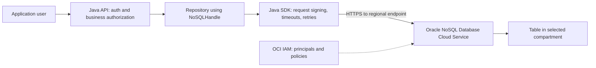
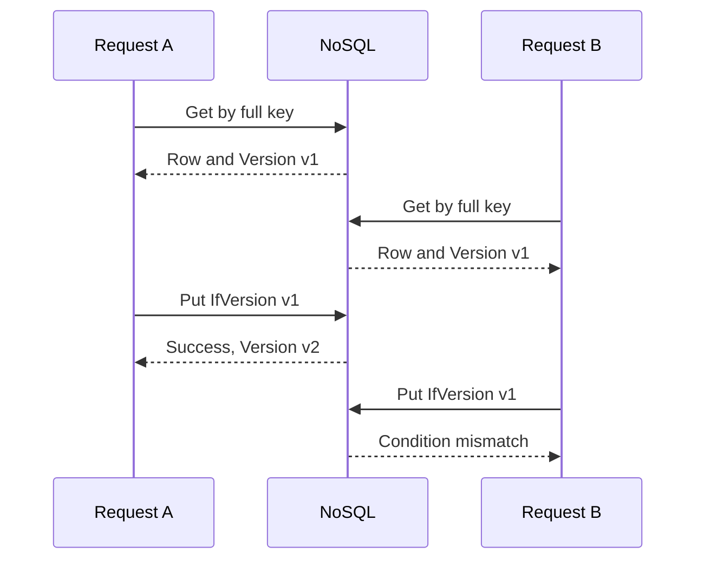

# Accessing NoSQL from a Java Application

In the **MySQL HeatWave and NoSQL** chapter of the Oracle Cloud Infrastructure module, this lesson focuses on connecting a Java application to **Oracle NoSQL Database Cloud Service on OCI**. The running example is a user settings service: each application customer has multiple users, and each user has a JSON document containing locale and notification preferences.

After this lesson, you will be able to configure identities and compartments, use the Oracle NoSQL Java SDK to read and write data, detect update conflicts, execute parameterized queries, and integrate NoSQL operations into the application lifecycle. Decisions around IAM, networking, timeouts, and throughput are tied directly to the Java example.

## 1. Choosing the Right SDK and Understanding the Request Path

Oracle NoSQL Database Cloud Service uses its own SDK under the `oracle.nosql.driver` package. When accessing it as shown in this lesson, the application does not open a JDBC connection or use MySQL Connector/J. The fact that Oracle NoSQL supports a SQL-like query language does not turn this connection into a JDBC connection.

The primary dependency is `com.oracle.nosql.sdk:nosqldriver`. The SDK works with the cloud service, the Cloud Simulator, and certain on-premises Oracle NoSQL setups, though authentication and deployment configuration differ. The code snippets below target OCI cloud. [Oracle official SDK repository](https://github.com/oracle/nosql-java-sdk).



The application must satisfy three conditions simultaneously:

1. **Right target:** endpoint/region, compartment, and table name must match.
2. **Authorized:** the requesting principal must hold permissions for the operation.
3. **Network path:** DNS, TLS, and HTTPS connectivity to the service must work.

A valid API key cannot fix a routing error; a working network connection does not grant missing IAM permissions either.

## 2. Distinguishing Identifiers Before Writing Code

The example uses the following values:

| Value | Example | Meaning |
|---|---|---|
| OCI tenancy OCID | `ocid1.tenancy.oc1..example` | Tenancy holding OCI identities |
| Compartment OCID | `ocid1.compartment.oc1..example` | Location where the NoSQL table resides |
| Region ID | `ap-singapore-1` | Region selected for the table and client |
| Table name | `UserSettings` | Table used in SDK and SQL operations |
| `tenantId` in data | `tenant-lab` | Application customer identifier |
| `userId` in data | `user-demo-001` | User belonging to that customer |

`tenantId` is an application-defined field, not an OCI tenancy OCID. Likewise, `userId` in the table is not an OCI user OCID.

In a multi-tenant system, the backend must derive `tenantId` from the authenticated context and verify data access permissions. Putting `tenantId` in the key or `WHERE` clause does not automatically create row-level authorization in the application. If an API trusts a caller-supplied `tenantId` directly, a caller can request another customer's data even though the OCI connection is valid.

## 3. Preparing OCI and IAM Permissions

### 3.1. Separating Deployment Permissions from Application Runtime Permissions

You need a compartment dedicated to the lab, such as `NoSqlLab`, and two roles:

- **Deployer:** creates tables, adjusts configuration, and cleans up resources afterward.
- **Application:** reads, writes, and optionally deletes rows in already-created tables.

Example policy for an application group needing full CRUD:

```text
Allow group NoSqlAppUsers to read nosql-tables in compartment NoSqlLab
Allow group NoSqlAppUsers to manage nosql-rows in compartment NoSqlLab
```

Here, `manage nosql-rows` grants row operations, not permission to create or drop tables. `read nosql-tables` allows reading table metadata, such as when the SDK fetches limit information for rate limiting.

If the application only reads and writes without deletes, replace the second line with:

```text
Allow group NoSqlAppUsers to use nosql-rows in compartment NoSqlLab
```

`use nosql-rows` does not include row deletion. `read nosql-rows` covers reads; deletion requires `manage nosql-rows`. Lab deployers can be granted `manage nosql-family` scoped to the lab compartment alone. With named identity domains, adjust group identifiers per your tenancy's domain configuration. [Oracle NoSQL policy reference](https://docs.oracle.com/en/cloud/paas/nosql-cloud/odsql/index.html).

These policies are compartment-level starting points. Before production use, narrow scope further to specific tables and identities as needed. Never grant tenancy-wide privileges to an application that uses a single table.

### 3.2. Choosing Authentication Matching the Runtime Environment

| Where Java Runs | Appropriate Auth Method | Condition |
|---|---|---|
| Developer workstation | User principal via OCI config and API signing key | OCI user belongs to a group with policies |
| OCI Compute | Instance principal | Instance belongs to a dynamic group with policies |
| OCI Functions | Resource principal | Function is configured with appropriate identity and policies |

The SDK provides `SignatureProvider`, `createWithInstancePrincipal()`, and `createWithResourcePrincipal()` for these cases. Instance principals and resource principals require specifying the compartment on the request or in default config. The lesson example always configures the compartment explicitly. [SignatureProvider API](https://oracle.github.io/nosql-java-sdk/oracle/nosql/driver/iam/SignatureProvider.html).

A policy for Compute may look like:

```text
Allow dynamic-group NoSqlAppInstances to read nosql-tables in compartment NoSqlLab
Allow dynamic-group NoSqlAppInstances to manage nosql-rows in compartment NoSqlLab
```

You must still create the dynamic group with a matching rule covering authorized instances. Do not simply change the policy line and assume every Compute instance gains access.

### 3.3. Configuration for Developer Workstations

Generate OCI config using your organization's key management workflow. Example profile contents:

```ini
[NOSQL_LAB]
user=ocid1.user.oc1..example
fingerprint=aa:bb:cc:dd:replace-with-real-fingerprint
tenancy=ocid1.tenancy.oc1..example
region=ap-singapore-1
key_file=C:/Users/your-name/.oci/oci_api_key.pem
```

The matching public key must be registered on the OCI user. The private key must be stored only where file permissions are restricted; never put it in source code, container images, or logs.

The Java example reads the config file path from `OCI_CONFIG_FILE` and profile name from `OCI_PROFILE`. These are environment variables explicitly read by the sample program; do not infer that every SDK constructor reads them automatically.

## 4. Network Connectivity and Testing Boundaries

The host running Java must resolve DNS and reach HTTPS on the selected region's NoSQL endpoint. In a lab using standard service endpoints, applications in a private subnet can reach outbound via a NAT Gateway when routes and security rules permit. Instance principals also require access to instance identity metadata endpoints; an API key on a personal workstation does not validate that authentication path.

Keep the SDK's TLS certificate and hostname verification active. When encountering TLS errors, inspect system clocks, truststores, and environment proxies rather than disabling verification.

The Cloud Simulator is useful for checking request structure and CRUD flows locally. A passing run against the simulator does not prove IAM policies, dynamic groups, network paths, service limits, or throttling behavior on OCI are correct. Before deploying, run an integration pass in a test compartment using the exact principal type intended for production.

## 5. Designing the Table Around Application Access Patterns

Core operations in the example:

1. Read settings by the `tenantId + userId` pair.
2. Create initial settings without overwriting existing data.
3. Change locale while detecting if another process modified the row.
4. List settings for one customer.
5. Delete a row only if it still matches the read version.

Schema:

```sql
CREATE TABLE IF NOT EXISTS UserSettings (
    tenantId STRING,
    userId STRING,
    settings JSON,
    updatedAt LONG,
    PRIMARY KEY (SHARD(tenantId), userId)
)
```

A row looks like:

```json
{
  "tenantId": "tenant-lab",
  "userId": "user-demo-001",
  "settings": {
    "locale": "vi",
    "emailOptIn": false
  },
  "updatedAt": 1795132800000
}
```

The full primary key includes both `tenantId` and `userId`. `GetRequest` requires the full key to read one row; if only `tenantId` is known, the application must use a query or multi-row API.

Using `tenantId` as the shard key groups a customer's rows within the same shard key scope and facilitates customer-filtered queries. In exchange, a very heavy customer can create a hot spot. With real traffic, evaluate distribution; adding a bucket to the shard key requires applications to read multiple buckets when listing. Do not introduce bucketing before confirming the problem to solve. [Oracle NoSQL primary key design](https://docs.oracle.com/en/database/other-databases/nosql-database/24.3/java-driver-table/primary-keys.html).

`updatedAt` in this lesson is an application-written timestamp in epoch milliseconds. It is useful for display and business auditing, but it does not replace the SDK's `Version` for optimistic concurrency control.

## 6. Maven Project Configuration

This example uses JDK 17 and pins the SDK to version `5.4.25`. This is a concrete version for reproducing the example, not advice to blindly pick the latest release without compatibility checks. When upgrading the SDK, review the changelog and re-run integration tests. [Official SDK Changelog](https://github.com/oracle/nosql-java-sdk/blob/main/CHANGELOG.md).

In a dedicated lab directory, create `pom.xml`:

```xml
<project xmlns="http://maven.apache.org/POM/4.0.0"
         xmlns:xsi="http://www.w3.org/2001/XMLSchema-instance"
         xsi:schemaLocation="http://maven.apache.org/POM/4.0.0
                             https://maven.apache.org/xsd/maven-4.0.0.xsd">
    <modelVersion>4.0.0</modelVersion>
    <groupId>learning.oci</groupId>
    <artifactId>nosql-java-lab</artifactId>
    <version>1.0.0</version>

    <properties>
        <maven.compiler.release>17</maven.compiler.release>
        <project.build.sourceEncoding>UTF-8</project.build.sourceEncoding>
    </properties>

    <dependencies>
        <dependency>
            <groupId>com.oracle.nosql.sdk</groupId>
            <artifactId>nosqldriver</artifactId>
            <version>5.4.25</version>
        </dependency>
    </dependencies>

    <build>
        <plugins>
            <plugin>
                <groupId>org.apache.maven.plugins</groupId>
                <artifactId>maven-compiler-plugin</artifactId>
                <version>3.13.0</version>
            </plugin>
            <plugin>
                <groupId>org.apache.maven.plugins</groupId>
                <artifactId>maven-dependency-plugin</artifactId>
                <version>3.8.1</version>
            </plugin>
        </plugins>
    </build>
</project>
```

The program below goes in `src/main/java/SettingsDemo.java`, without a package declaration to minimize lab setup steps. In real applications, place classes in project packages and separate client configuration from repositories.

## 7. Complete Java Program

The program supports three commands:

| Command | Task | Identity Used |
|---|---|---|
| `init` | Create the lab table and wait for completion | Deployer with DDL permissions |
| `demo` | Conditional create, read, update, and query | Application principal |
| `cleanup-row` | Delete the demo row with a version condition | Principal with row delete permissions |

`init` uses `TableRequest`; table creation operations must finish before accessing data. In production, move DDL into infrastructure deployment pipelines rather than running it on HTTP requests. [TableRequest API](https://oracle.github.io/nosql-java-sdk/oracle/nosql/driver/ops/TableRequest.html), [TableResult API](https://oracle.github.io/nosql-java-sdk/oracle/nosql/driver/ops/TableResult.html).

```java
import java.io.IOException;
import java.time.Instant;
import java.util.Locale;
import java.util.Objects;
import java.util.function.Consumer;

import oracle.nosql.driver.Consistency;
import oracle.nosql.driver.NoSQLHandle;
import oracle.nosql.driver.NoSQLHandleConfig;
import oracle.nosql.driver.NoSQLHandleFactory;
import oracle.nosql.driver.Version;
import oracle.nosql.driver.iam.SignatureProvider;
import oracle.nosql.driver.ops.DeleteRequest;
import oracle.nosql.driver.ops.DeleteResult;
import oracle.nosql.driver.ops.GetRequest;
import oracle.nosql.driver.ops.GetResult;
import oracle.nosql.driver.ops.PrepareRequest;
import oracle.nosql.driver.ops.PreparedStatement;
import oracle.nosql.driver.ops.PutRequest;
import oracle.nosql.driver.ops.PutResult;
import oracle.nosql.driver.ops.QueryRequest;
import oracle.nosql.driver.ops.QueryResult;
import oracle.nosql.driver.ops.TableLimits;
import oracle.nosql.driver.ops.TableRequest;
import oracle.nosql.driver.ops.TableResult;
import oracle.nosql.driver.values.MapValue;
import oracle.nosql.driver.values.StringValue;

public final class SettingsDemo {
    private static final String TABLE = "UserSettings";
    private static final String DEMO_TENANT = "tenant-lab";
    private static final String DEMO_USER = "user-demo-001";

    public static void main(String[] args) throws IOException {
        if (args.length != 1 ||
                !(args[0].equals("init") || args[0].equals("demo") ||
                  args[0].equals("cleanup-row"))) {
            throw new IllegalArgumentException(
                "Usage: SettingsDemo init|demo|cleanup-row");
        }

        try (NoSQLHandle handle = openHandle()) {
            if (args[0].equals("init")) {
                createLabTable(handle);
                return;
            }

            if (args[0].equals("cleanup-row")) {
                GetResult current = find(handle, DEMO_TENANT, DEMO_USER);
                if (current.getValue() == null) {
                    System.out.println("Demo row is already absent");
                    return;
                }
                DeleteResult deleted = deleteIfVersion(
                    handle, DEMO_TENANT, DEMO_USER, current.getVersion());
                System.out.println(
                    "Delete applied to expected version: " +
                    deleted.getSuccess());
                return;
            }

            PutResult created = createIfAbsent(
                handle, DEMO_TENANT, DEMO_USER);
            System.out.println(
                "Created new row: " + (created.getVersion() != null));

            GetResult current = find(handle, DEMO_TENANT, DEMO_USER);
            if (current.getValue() == null) {
                throw new IllegalStateException(
                    "Row was not found after create/read");
            }

            MapValue replacement = current.getValue();
            replacement.get("settings").asMap().put("locale", "en");
            replacement.put("updatedAt", Instant.now().toEpochMilli());

            PutResult updated = replaceIfVersion(
                handle, replacement, current.getVersion());
            System.out.println(
                "Update applied to expected version: " +
                (updated.getVersion() != null));
            System.out.printf(
                "Update consumed RU=%d, WU=%d%n",
                updated.getReadUnits(), updated.getWriteUnits());

            SettingsRepository repository = new SettingsRepository(handle);
            repository.forEachByTenant(
                DEMO_TENANT, row -> System.out.println(row.toJson()));
        }
    }

    private static NoSQLHandle openHandle() throws IOException {
        String region = requiredEnv("NOSQL_REGION");
        String compartment = requiredEnv("NOSQL_COMPARTMENT_OCID");
        String mode = envOrDefault("NOSQL_AUTH", "config")
            .toLowerCase(Locale.ROOT);

        SignatureProvider provider;
        switch (mode) {
            case "config":
                provider = new SignatureProvider(
                    requiredEnv("OCI_CONFIG_FILE"),
                    envOrDefault("OCI_PROFILE", "NOSQL_LAB"));
                break;
            case "instance":
                provider = SignatureProvider.createWithInstancePrincipal();
                break;
            case "resource":
                provider = SignatureProvider.createWithResourcePrincipal();
                break;
            default:
                throw new IllegalArgumentException(
                    "NOSQL_AUTH must be config, instance or resource");
        }

        try {
            NoSQLHandleConfig config = new NoSQLHandleConfig(region)
                .setAuthorizationProvider(provider)
                .setDefaultCompartment(compartment)
                .setRequestTimeout(5_000)
                .setTableRequestTimeout(20_000)
                .setRateLimitingEnabled(true);
            return NoSQLHandleFactory.createNoSQLHandle(config);
        } catch (RuntimeException failure) {
            provider.close();
            throw failure;
        }
    }

    private static void createLabTable(NoSQLHandle handle) {
        String ddl = """
            CREATE TABLE IF NOT EXISTS UserSettings (
                tenantId STRING,
                userId STRING,
                settings JSON,
                updatedAt LONG,
                PRIMARY KEY (SHARD(tenantId), userId)
            )
            """;
        TableRequest request = new TableRequest()
            .setStatement(ddl)
            .setTableLimits(new TableLimits(10, 10, 1));
        TableResult result = handle.tableRequest(request);
        result.waitForCompletion(handle, 120_000, 1_000);
        System.out.println("Table state: " + result.getTableState());
    }

    private static MapValue key(String tenantId, String userId) {
        return new MapValue()
            .put("tenantId", tenantId)
            .put("userId", userId);
    }

    private static PutResult createIfAbsent(
            NoSQLHandle handle, String tenantId, String userId) {
        MapValue settings = new MapValue()
            .put("locale", "vi")
            .put("emailOptIn", false);
        MapValue row = key(tenantId, userId)
            .put("settings", settings)
            .put("updatedAt", Instant.now().toEpochMilli());

        return handle.put(new PutRequest()
            .setTableName(TABLE)
            .setValue(row)
            .setOption(PutRequest.Option.IfAbsent));
    }

    private static GetResult find(
            NoSQLHandle handle, String tenantId, String userId) {
        return handle.get(new GetRequest()
            .setTableName(TABLE)
            .setKey(key(tenantId, userId))
            .setConsistency(Consistency.ABSOLUTE));
    }

    private static PutResult replaceIfVersion(
            NoSQLHandle handle, MapValue fullRow, Version expectedVersion) {
        Objects.requireNonNull(expectedVersion, "expectedVersion");
        return handle.put(new PutRequest()
            .setTableName(TABLE)
            .setValue(fullRow)
            .setOption(PutRequest.Option.IfVersion)
            .setMatchVersion(expectedVersion));
    }

    private static DeleteResult deleteIfVersion(
            NoSQLHandle handle, String tenantId, String userId,
            Version expectedVersion) {
        Objects.requireNonNull(expectedVersion, "expectedVersion");
        return handle.delete(new DeleteRequest()
            .setTableName(TABLE)
            .setKey(key(tenantId, userId))
            .setMatchVersion(expectedVersion));
    }

    private static String requiredEnv(String name) {
        String value = System.getenv(name);
        if (value == null || value.isBlank()) {
            throw new IllegalArgumentException(
                "Missing environment variable: " + name);
        }
        return value;
    }

    private static String envOrDefault(String name, String fallback) {
        String value = System.getenv(name);
        return value == null || value.isBlank() ? fallback : value;
    }

    private static final class SettingsRepository {
        private final NoSQLHandle handle;
        private final PreparedStatement byTenant;

        SettingsRepository(NoSQLHandle handle) {
            this.handle = handle;
            String sql = """
                DECLARE $tenant STRING;
                SELECT p.userId, p.settings, p.updatedAt
                FROM UserSettings p
                WHERE p.tenantId = $tenant
                """;
            this.byTenant = handle.prepare(
                new PrepareRequest().setStatement(sql))
                .getPreparedStatement();
        }

        void forEachByTenant(
                String tenantId, Consumer<MapValue> consumer) {
            PreparedStatement bound = byTenant.copyStatement()
                .setVariable("$tenant", new StringValue(tenantId));
            try (QueryRequest request = new QueryRequest()
                    .setPreparedStatement(bound)
                    .setConsistency(Consistency.ABSOLUTE)
                    .setLimit(100)
                    .setTimeout(5_000)) {
                do {
                    QueryResult page = handle.query(request);
                    for (MapValue row : page.getResults()) {
                        consumer.accept(row);
                    }
                } while (!request.isDone());
            }
        }
    }
}
```

The sample code assumes the table schema matches the declaration—specifically that `settings` is a JSON object convertible to `MapValue`. In public APIs, validate input data, bound JSON sizes, and map business errors before calling the repository. Printing JSON documents here is strictly for mock lab data.

## 8. Running the Lab with Separate Identities

The commands below target **PowerShell** inside the lab project directory. Replace all illustrative values with your lab environment's details.

```powershell
$env:NOSQL_REGION = 'ap-singapore-1'
$env:NOSQL_COMPARTMENT_OCID = 'ocid1.compartment.oc1..replace-me'
$env:NOSQL_AUTH = 'config'
$env:OCI_CONFIG_FILE = 'C:/Users/your-name/.oci/config'
$env:OCI_PROFILE = 'NOSQL_DEPLOYER'

mvn package dependency:copy-dependencies
java -cp 'target/classes;target/dependency/*' SettingsDemo init
```

The `NOSQL_DEPLOYER` profile must exist in the OCI config and have table creation permissions. `TableLimits(10, 10, 1)` requests provisioned mode with 10 read units/sec, 10 write units/sec, and a 1 GB storage limit. This is a lab configuration that may incur charges; it is neither a cost budget nor a production capacity guarantee. The single-argument `TableLimits(storageGB)` constructor is for on-demand mode. [TableLimits API](https://oracle.github.io/nosql-java-sdk/oracle/nosql/driver/ops/TableLimits.html).

After creating the table, switch to a user with application runtime permissions:

```powershell
$env:OCI_PROFILE = 'NOSQL_APP'
java -cp 'target/classes;target/dependency/*' SettingsDemo demo
```

The `NOSQL_APP` profile must also be configured. Do not reuse deployer permissions merely to avoid creating an application profile.

On the first run, output typically looks like:

```text
Created new row: true
Update applied to expected version: true
Update consumed RU=<actual-value>, WU=<actual-value>
{"userId":"user-demo-001", ...}
```

On subsequent runs, `Created new row: false` is expected: the demo row already exists and `IfAbsent` prevented overwriting it. If another process concurrently modifies or deletes the row, the versioned update may return `false`.

On Compute with an instance principal and matching dynamic group configured:

```powershell
$env:NOSQL_AUTH = 'instance'
java -cp 'target/classes;target/dependency/*' SettingsDemo demo
```

Here, the program takes the instance principal branch; authentication does not rely on a user profile. On Linux, use shell-appropriate environment variable syntax and `:` as the classpath separator, e.g., `target/classes:target/dependency/*`.

To delete the demo row:

```powershell
java -cp 'target/classes;target/dependency/*' SettingsDemo cleanup-row
```

This command leaves the table intact. When finishing the lab, use the deployer identity to drop the `UserSettings` table in the lab compartment and revoke policies/dynamic groups created specifically for the lab. Deleting rows does not release provisioned table resources.

## 9. Understanding CRUD and Return Values Accurately

### 9.1. Creating vs. Overwriting Are Two Different Intents

By default, `PutRequest` performs an unconditional write: creating a new row or replacing an existing row entirely. When you want insert-only semantics, use `PutRequest.Option.IfAbsent`. When you want to replace an existing row regardless of version, `IfPresent` exists, but that option does not detect concurrent edits by someone else. [PutRequest API](https://oracle.github.io/nosql-java-sdk/oracle/nosql/driver/ops/PutRequest.html).

For conditional puts, check `PutResult.getVersion()`:

- Non-`null`: the write succeeded and this is the new version.
- `null`: the condition was not met; do not infer a network failure.

A failed condition is a business outcome to handle. You can call `setReturnRow(true)` when you want existing row details returned under API-supported conditions; do not assume every put automatically returns the full prior row. [PutResult API](https://oracle.github.io/nosql-java-sdk/oracle/nosql/driver/ops/PutResult.html).

### 9.2. A Put Replaces the Entire Row

Suppose a row currently holds:

```json
{
  "settings": {
    "locale": "vi",
    "emailOptIn": true,
    "theme": "dark"
  }
}
```

If the application constructs a new row containing only the key and `settings.locale`, omitted fields can be replaced with defaults/nulls or fail if required by schema. `PutRequest` does not automatically merge JSON.

The complete example fetches the whole current row, modifies one attribute inside `settings`, preserves the remaining attributes, and sends the full row with a version condition. For server-side partial updates, study the `UPDATE` statement in SQL for Oracle NoSQL while still designing proper business conditions—do not merely swap put for SQL and ignore conflicts.

### 9.3. Reading When No Row Exists

`GetResult.getValue() == null` means no row exists for the requested key. The application can map this to `Optional.empty()`, an unconfigured state, or HTTP 404 depending on the API contract.

Never use `null` to mask an `UnauthorizedException` or timeout. "No data exists" and "unable to read data right now" must be distinguished to avoid overwriting real data with defaults during transient service errors. [GetResult API](https://oracle.github.io/nosql-java-sdk/oracle/nosql/driver/ops/GetResult.html).

### 9.4. Conditional Deletes

`DeleteRequest.setMatchVersion(version)` requires the row to still match the known version. `DeleteResult.getSuccess()` reflects whether the delete was applied.

A `false` result may mean either the row was already gone or the version did not match. If the API must distinguish those two cases, add a follow-up read or use return-row details where supported; a subsequent read reflects only the new point in time. [DeleteRequest API](https://oracle.github.io/nosql-java-sdk/oracle/nosql/driver/ops/DeleteRequest.html), [DeleteResult API](https://oracle.github.io/nosql-java-sdk/oracle/nosql/driver/ops/DeleteResult.html).

## 10. Controlling Concurrent Updates with Version

Consider two requests editing settings concurrently:



If both A and B use default puts, the later request silently overwrites the earlier request's change. `IfVersion` turns the write into "change only if the row has not changed since I read it."

`Version` is an opaque token returned by the service. Do not perform arithmetic on it, compare it to timestamps, or synthesize it from `updatedAt`.

When a conflict occurs:

1. Return a conflict response so the caller sees the fresh data, or
2. Re-read the row and re-apply business logic if automatic retry is valid.

For example, changing locale can be re-applied after a fresh read if product rules permit. A change depending on prior values must recompute from the fresh row; never blindly resubmit the old row with the new version just to pass the check.

In an HTTP API, business conflicts can map to 409. If the API contract uses `If-Match`, 412 may fit a failed precondition. That is an API-layer decision; the repository must return clear outcomes so upper layers can choose.

## 11. Consistency and Guarantee Boundaries

The SDK lets you choose `Consistency.EVENTUAL` or `Consistency.ABSOLUTE` for supported reads. When unconfigured, the default is eventual. The example uses absolute so read-after-write within the same region is easy to observe in the lab. Absolute consistency can increase read unit consumption and affect latency compared to eventual. [GetRequest API](https://oracle.github.io/nosql-java-sdk/oracle/nosql/driver/ops/GetRequest.html).

| Need | Choice Direction |
|---|---|
| Re-reading settings immediately after a user saves | Consider absolute for the confirmation read |
| Displaying data tolerant of slight staleness | Consider eventual |
| Preventing lost updates across two requests | Use conditional writes with `Version` |
| Reading a long list while data is mutating | Explicitly design for rows changing across pages |

An absolute read does not lock the row for a subsequent write. Thus, even though `find()` reads with absolute consistency, `replaceIfVersion()` still needs the version condition.

A sequence of independent get/put/query calls does not automatically form a transaction. When multiple atomic operations are needed, evaluate `WriteMultipleRequest` and service constraints on shared shard keys, sizes, and counts. Never design multi-customer rules assuming writes across different shard keys commit together. [NoSQLHandle.writeMultiple API](https://oracle.github.io/nosql-java-sdk/oracle/nosql/driver/NoSQLHandle.html#writeMultiple(oracle.nosql.driver.ops.WriteMultipleRequest)).

This example uses a single-region table. If extending to multi-region replicated tables, separately evaluate replication lag and supported consistency behavior; do not extrapolate cross-region instantaneous reads from a single-region lab run.

## 12. Parameterized Queries and Reading Complete Results

### 12.1. Bind Values, Keep SQL Structure Fixed

The repository prepares the statement:

```sql
DECLARE $tenant STRING;
SELECT p.userId, p.settings, p.updatedAt
FROM UserSettings p
WHERE p.tenantId = $tenant
```

The `tenantId` value is bound via `setVariable()`, never concatenated into SQL. Statement structure, table names, and selected fields are controlled by the application. If users can choose sort fields, enforce an allowlist of field names; bind parameters cannot substitute arbitrarily for table names or SQL syntax.

An unbound `PreparedStatement` template can be cached inside the repository. For each execution with bound variables, create a separate copy via `copyStatement()` so concurrent threads do not overwrite one another's parameters. [PreparedStatement API](https://oracle.github.io/nosql-java-sdk/oracle/nosql/driver/ops/PreparedStatement.html).

### 12.2. One Query Call May Return Partial Results

The key loop is:

```java
do {
    QueryResult page = handle.query(request);
    for (MapValue row : page.getResults()) {
        consumer.accept(row);
    }
} while (!request.isDone());
```

Reuse the same `QueryRequest` across one execution so the SDK tracks continuation state. A batch can return an empty list while the query has not finished—for instance, when scanned data yielded no matching rows yet. Stop conditions must check `request.isDone()`, never `getResults().isEmpty()`. `try-with-resources` frees query state upon completion or early exit. [QueryRequest API](https://oracle.github.io/nosql-java-sdk/oracle/nosql/driver/ops/QueryRequest.html).

`setLimit(100)` caps the maximum items per batch; the loop can still return more than 100 rows overall. If business logic wants strictly "the top 100 results," cap the total in SQL or the application layer. Without `ORDER BY`, do not promise result ordering to API callers.

In long-lived services, enforce a deadline across the entire query. The 5-second timeout in the sample applies per SDK call, not as an automatic 5-second cap across all batches. Before each next call, compute remaining deadline budget and set timeout no higher than what remains; if time has expired, stop and close the request.

### 12.3. SDK Batches Are Not an HTTP Pagination Contract

Never serialize a `QueryRequest` or its internal state directly to HTTP clients. If an API requires pagination, design an application cursor bound to tenant, filters, stable sort order, and expiration.

For lists ordered by `userId`, build next-page queries from the last `userId` combined with `tenantId` and `ORDER BY`. When data mutates between calls, document that new rows may appear or deleted rows may vanish; do not promise a cross-request snapshot unless the system explicitly provides one.

## 13. Client Lifecycle and Integration in Java Applications

`NoSQLHandle` manages network connections and memory and is thread-safe for sharing across threads. Initialize the handle at application startup, inject it into repositories via dependency injection, and close it on shutdown.

Requests and results carry per-operation state; never share the same mutable `PutRequest`, `QueryRequest`, or `MapValue` across concurrent requests. [NoSQLHandle API](https://oracle.github.io/nosql-java-sdk/oracle/nosql/driver/NoSQLHandle.html).

In Spring Boot or similar frameworks, a typical layering is:

```text
Environment configuration
        ↓
Single shared NoSQLHandle
        ↓
Repository: keys, requests, data mapping
        ↓
Service: business authorization, conflict rules
        ↓
Controller: HTTP contract and responses
```

The `handle.get()`, `put()`, and `query()` calls in the example are synchronous. When using an event-loop HTTP framework, offload synchronous work to a bounded executor. Wrapping in `CompletableFuture` alone does not eliminate throughput limits or backpressure needs.

API-layer DTOs should model domain objects, such as `UserSettingsResponse`, instead of leaking SDK result types into controllers. Repositories can convert `MapValue` into DTOs and return domain outcomes such as `CREATED`, `ALREADY_EXISTS`, `UPDATED`, `NOT_FOUND`, or `CONFLICT`.

## 14. Timeouts, Retries, and Uncertain Write Outcomes

### 14.1. Understanding Time Budgets

In the sample:

- `setRequestTimeout(5_000)` sets the default timeout for data calls.
- `setTableRequestTimeout(20_000)` sets the timeout for table DDL calls.
- `waitForCompletion(..., 120_000, 1_000)` waits for table operations to finish within a dedicated window, polling every 1 second.

These are illustrative values to tune around latency goals and deployment conditions. End-to-end API latency also includes executor queuing, authorization checks, serialization, and multiple SDK calls if applicable.

### 14.2. The SDK Already Includes Retry Logic

The SDK ships with a default retry handler for retryable errors. Never wrap every exception in an infinite retry loop. If retrying at the service layer, account for total attempts, deadlines, and operation idempotency.

Proactive rate limiting helps stay within table capacity; retries react only after failures. [RetryHandler API](https://oracle.github.io/nosql-java-sdk/oracle/nosql/driver/RetryHandler.html).

### 14.3. A Timeout Does Not Confirm That a Write Did Not Happen

When a write request times out, the application may miss the response even though the service applied the write. A timeout exception means the call did not finish within the configured wait, and the SDK may have already retried internally. [RequestTimeoutException API](https://oracle.github.io/nosql-java-sdk/oracle/nosql/driver/RequestTimeoutException.html).

Example:

1. Application creates a row using `IfAbsent`.
2. Service writes successfully, but the response does not arrive in time.
3. Application retries and gets a failed condition because the row already exists.

The step 3 outcome is insufficient to conclude "the first attempt also failed." For business operations requiring reconciliation, store a stable request ID alongside the outcome to recognize prior attempts.

Similarly, if `IfVersion(v1)` succeeded and the response was lost, retrying with `v1` fails because the row's version moved on. Read and reconcile per business rules instead of overwriting unconditionally.

Operations that increment counters, deduct quotas, or record events exactly once require dedicated idempotency designs. Never treat a Java retry loop as an exactly-once guarantee.

### 14.4. Classifying Errors for Appropriate Handling

| Symptom | Handling Direction |
|---|---|
| `IllegalArgumentException`, schema mismatch | Fix the request or input data; do not retry invalid payloads |
| `InvalidAuthorizationException` | Check principal config, keys/tokens, system clock, and auth context |
| `UnauthorizedException` | Check groups/dynamic groups, policies, and compartment |
| `TableNotFoundException` | Check region, compartment, table name/state, and access permissions |
| `ReadThrottlingException` or `WriteThrottlingException` | Shed load, rate-limit, evaluate capacity and hot keys |
| `RequestTimeoutException` | Inspect latency/network/load; reconcile writes before retrying at the business layer |
| Conditional put returns `null` version | Handle unmet condition; do not treat as an infrastructure error |

SDK exceptions help the application distinguish failure classes, while public responses should expose stable product error codes. Log only what is needed for diagnostics; never leak identity configs or sensitive payloads to callers. [Java SDK exception classes](https://oracle.github.io/nosql-java-sdk/oracle/nosql/driver/package-summary.html).

## 15. Performance, Cost, and Observability

### 15.1. Starting from How Data Is Read

Reading by full primary key fits screens fetching one user's settings. The sample list query always filters on the `tenantId` shard key; avoid turning it into a full-table scan across all customers just to filter in Java.

When querying non-key fields, evaluate a secondary index against real queries. Indexes carry storage and write-maintenance costs. Selecting only needed fields reduces network transfer; measure in practice to see the effect on consumed throughput.

### 15.2. Tracking Cost with Operational Telemetry

Data operation results include read/write units where applicable. The example prints `getReadUnits()` and `getWriteUnits()` for the update. For multi-batch queries, accumulate units across every batch belonging to the same business action. [SDK request/result package](https://oracle.github.io/nosql-java-sdk/oracle/nosql/driver/ops/package-summary.html).

Observe:

| Measurement Group | Question to Answer |
|---|---|
| Request counts by type | How are read/write/query loads shifting? |
| p50, p95, p99 latency | How are end users impacted? |
| Throttling, timeouts, and retries | Are we exceeding capacity or losing stability? |
| RUs/WUs per operation | Which features consume the most throughput? |
| Version conflicts | Are many requests competing to edit the same row? |
| Storage and access skew | Is there abnormal growth or an overly hot customer? |

Logs should capture operation type, duration, outcome, application correlation ID, and table name. Never use high-cardinality `userId` values as metric labels, which easily explodes time-series cardinality.

The SDK also exposes retry counts and rate-limiter delay durations on result objects. These separate client-side throttling delays from service-side execution time. [Result API](https://oracle.github.io/nosql-java-sdk/oracle/nosql/driver/ops/Result.html).

### 15.3. One Client's Rate Limiter Is Not a System-Wide Budget

`setRateLimitingEnabled(true)` assists throttling inside one SDK handle. With multiple application replicas, each replica holds its own handle and traffic stream; coordinate total load against table capacity. Scaling from one to ten replicas does not give the table ten times the throughput.

Control costs through proper capacity settings, usage alarms, budgets, and infrastructure change control. Budget alerts should not be treated as an automatic kill switch halting all spend.

### 15.4. TTL for Time-Bounded Data

User settings typically persist long-term, so the sample program sets no TTL. For temporary data like processing state or bounded deduplication records, set TTL on puts:

```java
PutRequest temporaryWrite = new PutRequest()
    .setTableName("TemporaryState")
    .setValue(temporaryRow)
    .setTTL(oracle.nosql.driver.TimeToLive.ofDays(7));
```

This snippet illustrates the API and assumes `TemporaryState` and `temporaryRow` are already prepared. `TimeToLive` operates in hours/days; understand rounding and TTL update rules before applying it. TTL serves data lifecycle cleanup, not second-accurate business job scheduling. [TimeToLive API](https://oracle.github.io/nosql-java-sdk/oracle/nosql/driver/TimeToLive.html).

## 16. Verification Workflow for Learners

Run with mock data in a test compartment:

1. **Connect to the right target:** confirm region and compartment, create the table with the deployer principal, and wait for completion.
2. **Initial creation:** run `demo`, confirm a version is returned, and read the row back.
3. **Repeat creation:** run again and verify `IfAbsent` does not overwrite existing settings.
4. **Preserve untouched fields:** add `theme` to the JSON, run the locale update flow, and confirm `theme` remains intact.
5. **Conflict detection:** take two snapshots of the same row before writing; write snapshot A using the old version, then write B using the same old version and verify B does not succeed.
6. **Multi-batch queries:** insert multiple mock rows in one tenant, set `setLimit(1)` to observe multiple pages, and check total rows processed.
7. **Authorization:** call put using a read-only principal and confirm the error is distinguished from "row not found"; runtime must also fail to create/drop tables.
8. **Runtime authentication:** run on Compute with an instance principal if that is the deployment target; do not substitute workstation runs for this step.
9. **Transient errors:** in a controlled test environment, simulate interruptions or load limits and observe timeouts/retries plus write reconciliation.
10. **Clean up resources:** delete test rows, drop the lab table with the deployer principal when finished, and verify temporary policies/resources are revoked.

Never use fixed sleeps as proof of consistency. For conflict tests, intentionally hold the same `Version` across two writes to reproduce the exact race condition.

A solid Java application accessing Oracle NoSQL clearly defines its OCI identity, access keys, and business outcomes for every operation. Once those pieces are modeled, repositories deliver reliable CRUD to the service layer while IAM, capacity, metrics, and deployment workflows sustain that behavior on OCI.
