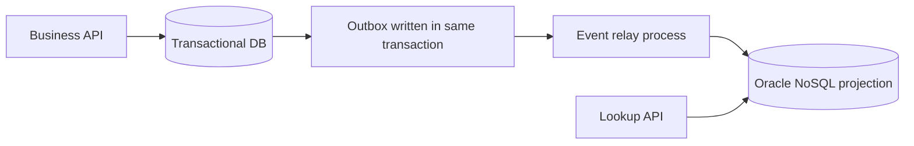

# Choosing Between Oracle Database, MySQL, and NoSQL for a Workload

In the **MySQL HeatWave and NoSQL** chapter, database selection must be framed within the full Oracle Cloud Infrastructure (OCI) architecture: which data must be accurate immediately after a write, how applications query data, what the team can operate, and how the system recovers from failures. Product names, JSON formatting, or raw record counts alone are insufficient to make the decision.

This lesson compares three paths: Oracle Database on OCI, MySQL using InnoDB in the MySQL HeatWave service, and Oracle NoSQL Database Cloud Service. The goal is to select a platform that satisfies business requirements while paired with sound plans for authorization, connectivity, monitoring, automation, and cost control.

## 1. Target Outcomes

After this lesson, learners will be able to:

- Characterize a workload by transactions, query patterns, load distribution, consistency requirements, and recovery goals.
- Distinguish selecting a database engine from selecting an OCI deployment model and service configuration.
- Explain when to prioritize Oracle Database, MySQL, or Oracle NoSQL, along with conditions that could reverse that choice.
- Design a minimal evaluation to verify performance, correctness, and cost before migrating production data.

A **workload** is the set of tasks a system must serve. **OLTP** is online transaction processing, typically reading or updating a small set of records per request. **OLAP** is analytical processing, typically scanning, joining, and aggregating large volumes of data. A single application can contain both workload types.

## 2. Starting with the Application's Data Contract

Before opening the OCI Console, state the invariants the system must uphold. For example, on an e-commerce platform:

- An order-creation request must never produce two orders merely because a client retried after a timeout.
- Reserving inventory and updating order status must have explicit handling if only one step succeeds.
- UI preference updates can tolerate synchronization lag, whereas revoking access permissions must meet strict security guarantees.
- Revenue reports can tolerate data delayed within an agreed window; payment authorization decisions must read authoritative state.

From there, build a workload profile:

| Question | Details to Record | Impact on Selection |
|---|---|---|
| Which data does one transaction touch? | Single record, multiple records for one user, or multiple independent entities | Defines the required atomicity scope |
| Key lookups or flexible search? | ID lookups, multi-field filtering, joins, aggregations | Drives data model and indexing |
| Can stale reads be tolerated? | Per operation, not just application-wide | Drives read policy and processing flows |
| How is load distributed? | Read/write ratio, peak hours, large tenants, hot keys | Affects resource sizing and shard keys |
| In which dimension is data large? | Record count, record size, index count, retention window | Estimates storage, I/O, and memory footprint |
| What are target latency and throughput? | p95, p99, requests/sec, and error rate per API | Establishes measurable test criteria |
| How must the system recover? | RPO, RTO, failure blast radius to survive | Drives HA, backup, and DR choices |
| Which technologies does the app depend on? | SQL dialect, PL/SQL, drivers, ORMs, data types | Estimates migration/conversion effort |
| Who operates and pays? | Team skills, budget, licensing, on-call support | Evaluates total cost of ownership |

**p95** is the latency threshold at which 95% of requests complete no slower than that threshold; p99 is analogous for 99%. **RPO** expresses the maximum acceptable data loss measured in time. **RTO** is the maximum allowable time to restore service. These targets must attach to specific business flows.

Do not use dataset size as the sole criterion. A small database experiencing heavy lock contention on the same records can be harder to serve than a massive dataset read primarily by key.

## 3. Where Do the Three Options Sit in OCI?

### 3.1. Oracle Database: Candidate for Relational Models and the Oracle Ecosystem

Oracle Database is worth evaluating when business logic relies on multi-table relationships, multi-step transactions, data integrity constraints, and rich SQL. One transaction can group multiple DML statements to commit or roll back together; the application must still pick proper locking, isolation levels, and error handling. The database does not infer business rules that were never declared or coded. Refer to [Oracle Database: Transactions](https://docs.oracle.com/en/database/oracle/oracle-database/26/cncpt/transactions.html).

If an application already relies on PL/SQL, packages, Oracle-specific data types, or SQL behavior, keeping Oracle Database is a reasonable initial hypothesis because it can minimize rewrite effort. This is an assessment of migration cost, not a guarantee that every version and target service is seamlessly compatible.

Oracle Database also works with JSON, including querying, indexing, and transactions. Therefore, a requirement to store JSON alone does not justify switching to NoSQL. Check whether JSON is read standalone or combined with relational data. See [JSON in Oracle Database](https://docs.oracle.com/en/database/oracle/oracle-database/26/adjsn/json-oracle-ai-database.html).

On OCI, the Oracle Database engine is offered in several deployment models such as Autonomous AI Database, Base Database Service, and Exadata services. Selecting the engine still requires choosing the right automation level, control boundaries, and deployment configuration—do not lump all offerings together as one server model with identical operational duties. The catalog is at [Databases on OCI](https://docs.oracle.com/en-us/iaas/Content/Database/home.htm).

### 3.2. MySQL: Candidate for Relational Applications in the MySQL Ecosystem

MySQL with InnoDB supports ACID transactions. Consequently, a web application managing orders, accounts, inventory, or related tables does not automatically need to move to Oracle Database just to get transactions. Data integrity also depends on schema design, isolation levels, durability settings, and how the application scopes transactions. See [InnoDB and the ACID Model](https://dev.mysql.com/doc/refman/8.4/en/mysql-acid.html).

MySQL is typically a natural candidate when the application already runs on MySQL, the team knows MySQL tooling, and relational requirements fit within its capabilities. Still, check versions, collations, SQL modes, stored procedures, drivers, and privileges permitted by the managed service. Sharing the same wire protocol is not enough to conclude an application will run untouched.

**HeatWave is an additive decision for analytical processing.** When a HeatWave cluster is enabled and required data is loaded, eligible queries can be offloaded to the cluster for acceleration. Clients continue connecting to the DB System; DML changes on loaded tables propagate automatically to HeatWave. See [About MySQL HeatWave](https://docs.oracle.com/cd/E17952_01/heatwave-en/mys-hw-about-analytics.html).

Under mixed workloads, an indexed lookup can run on InnoDB while a large aggregation runs on HeatWave. Inspect execution plans and measure real queries to see which path is chosen. Enabling HeatWave is not a cure-all for missing indexes, lock-holding transactions, or applications opening excessive connections. See [optimizing OLTP and OLAP workloads with HeatWave](https://blogs.oracle.com/mysql/optimize-oltp-and-olap-workloads-with-mysql-heatwave-autopilot).

### 3.3. Oracle NoSQL: Candidate for Key-Based Access and Clear Data Boundaries

Oracle NoSQL Database Cloud Service supports tables with typed and JSON data alongside data-access APIs. Data is distributed by shard key, which is selected from the primary key. The service offers two read consistency policies: `EVENTUAL` and `ABSOLUTE`; applications choose per operation requirement. `ABSOLUTE` reads the latest written value for the target key, but consumes more read units than `EVENTUAL` for the same data volume. See [Cloud Concepts](https://docs.oracle.com/en/cloud/paas/nosql-cloud/dtddt/cloud-concepts.html).

NoSQL also supports ACID properties; the key factor to examine is **transaction scope**. Items participating in a multi-operation transaction must share a shard key and adhere to supported APIs. If business logic continually needs atomic updates across multiple independent shard keys, that design adds coordination work to the application. See [designing an Oracle NoSQL table](https://docs.oracle.com/en/cloud/paas/nosql-cloud/dtddt/designing-a-table-in-oracle-nosql-database-cloud-service.html).

Oracle NoSQL provides a SQL-like query language and supports parent-child table joins. Do not infer from this that arbitrary joins across independent tables carry the same capabilities and cost profile as a relational database. See [Oracle NoSQL Database Cloud Service features](https://docs.oracle.com/en/cloud/paas/nosql-cloud/dtddt/features-of-oracle-nosql-database-cloud-service.html).

A common candidate is user state or device telemetry accessed by known keys, where update boundaries stay within a well-defined data group. Still, you must prove keys distribute well and critical queries do not degrade into full-table scans.

## 4. Comparison Matrix by Architectural Question

The table below provides an initial evaluation guide. Final decisions require test measurements and verification against target service configurations.

| Criterion | Oracle Database | MySQL/InnoDB and HeatWave | Oracle NoSQL Cloud Service |
|---|---|---|---|
| Modeling focus | Relational, combining models like JSON per supported features | Relational with MySQL ecosystem; HeatWave adds analytical acceleration | Key-driven data, typed or JSON; designed around access patterns |
| Multi-entity transactions | Candidate for complex relational transactions | Candidate for multi-table transactions in InnoDB | Check shared shard key boundaries and multi-op APIs |
| Joins and flexible queries | Relational SQL is a core strength | Relational SQL; evaluate offload for analytical queries | Design for known queries; verify supported SQL scope |
| What to verify for analytics | Execution plans, resources, and deployment model | Separate InnoDB performance from HeatWave performance | Cost of non-key queries, indexes, and scan scope |
| Prominent design risks | Locking, execution plans, feature and licensing dependencies | Keys, indexes, connections, compatibility; HeatWave sizing if used | Shard keys, hot keys, data duplication, and update coordination |
| When existing system uses Oracle | Prioritize evaluating compatibility and OCI operations | Must evaluate dialect and data-logic migration | Usually requires redesigning models and access flows |
| When existing system uses MySQL | Switch only if benefits outweigh platform migration cost | Prioritize testing within the same ecosystem | Choose only when access patterns and data boundaries fit |
| Required team skills | Oracle SQL and administration suited to chosen service | MySQL SQL, InnoDB; plus HeatWave skills if adopted | Key modeling, SDKs, capacity, consistency, and retry handling |

Statements of "prioritize" in this table are architectural reasoning from requirements and platform strengths—not benchmark outcomes or universal recommendations for every application.

## 5. Transaction Scope Often Decides Performance Before Raw Speed

Suppose an order confirmation request must perform three actions:

1. Transition the order from `PENDING` to `CONFIRMED`.
2. Decrement sellable inventory.
3. Record an event so a worker sends a notification later.

If these tables live in the same relational database, you can wrap the updates and an outbox row inside one transaction. You still need conditional updates so inventory cannot go negative, deduplication constraints, and contention handling. Merely calling `COMMIT` after multiple statements does not automatically prevent concurrency bugs.

With NoSQL, ask first whether those objects share a shard key. If orders are sharded by buyer while inventory is sharded by product, the two datasets have different natural boundaries. Forcing everything onto one shared shard key can turn a transaction problem into a load hotspot. An alternative is a reserve, confirm, and compensate workflow, which adds intermediate states and reconciliation work.

Also distinguish two meanings of "consistency":

- **ACID consistency** concerns preserving database invariants enforced through transactions.
- **Read consistency** concerns which value a read observes in a system with multiple replicas.

An `ABSOLUTE` read in NoSQL does not combine two updates across two shard keys into an atomic transaction. Likewise, a transaction in Oracle Database or MySQL does not automatically cover a call to an external payment gateway.

When documenting the choice, state explicitly: "Which changes must succeed together, within what scope, and what happens if the client does not know whether the commit succeeded?" That answer usually matters more than an average throughput figure.

## 6. Two Illustrative Access Patterns

### 6.1. Reporting on MySQL Order Data

Assume an `orders` table exists with `customer_id`, `total_amount`, `status`, and `created_at`. The following MySQL query computes paid order revenue for one month; illustrative timestamps must be interpreted per the application's timezone convention:

```sql
SELECT
    customer_id,
    COUNT(*) AS order_count,
    SUM(total_amount) AS gross_amount
FROM orders
WHERE status = 'PAID'
  AND created_at >= '2026-01-01 00:00:00'
  AND created_at <  '2026-02-01 00:00:00'
GROUP BY customer_id;
```

This is a relational query where both scanning many rows and aggregating matter. Before provisioning extra resources, check:

- Monetary data types and business semantics of `total_amount`, including refunds, discounts, and currencies.
- Execution plan, filter selectivity, and rows actually scanned.
- Impact when the report runs concurrently with order creation.
- If testing HeatWave, whether data is loaded, whether the query qualifies for offload, and whether propagation latency meets targets.

You can run `EXPLAIN` on the query to inspect the execution plan. Do not conclude a query is guaranteed to accelerate merely because it uses `GROUP BY`; verify the execution path and measure actual timings.

### 6.2. User State in Oracle NoSQL

The DDL below illustrates grouping state for the same user via a shard key. This is Oracle NoSQL syntax, not shared DDL for Oracle Database or MySQL:

```sql
CREATE TABLE user_state (
    tenant_id STRING,
    user_id STRING,
    state_key STRING,
    payload JSON,
    PRIMARY KEY (SHARD(tenant_id, user_id), state_key)
);
```

In this design:

- The full primary key distinguishes individual state entries for a user within a tenant.
- The shard key is `(tenant_id, user_id)`, colocating a user's data under the service's distribution mechanics.
- A lookup knowing all three key components has a direct access path.
- Updating multiple states for the same user can be evaluated with multi-operation transaction APIs; separate individual writes do not automatically merge into one transaction.
- Updating states of two different users does not fall within the same shard key boundary under this design.

A payload might look like:

```json
{
  "schemaVersion": 1,
  "preferredLanguage": "vi",
  "theme": "dark"
}
```

`schemaVersion` is an application-managed convention supporting payload evolution. Flexible JSON still requires validation, migration rules, and mandatory-field contracts.

This key pair does not guarantee balanced load either. One heavily accessed user can still become a hot key. Furthermore, putting `tenant_id` in the key does not automatically enforce per-tenant access control; the application must still authenticate callers and scope every query.

## 7. Contextual Selection Examples

### 7.1. Business System Heavily Dependent on Oracle

A contract management system already uses numerous PL/SQL packages, complex SQL reports, and integrations tested against Oracle Database. The primary goal is migrating infrastructure to OCI and improving recoverability.

**Initial hypothesis:** stay on Oracle Database in OCI. Then compare deployment options by required features, automation level, administrative control needed, and recovery requirements.

Switching to MySQL or NoSQL just to lower compute unit prices may be counterproductive if it forces rewriting logic, replacing reporting tools, and re-validating every transaction. That decision could change only if the organization already plans to replace the application, remove proprietary dependencies, and accept measured migration costs.

### 7.2. E-Commerce Application Already Using MySQL

The application already runs on MySQL/InnoDB, executes multi-table transactions, and requires frequent revenue dashboards. Reporting queries compete with order creation for resources.

**Initial hypothesis:** evaluate the managed MySQL service on OCI. Test HeatWave against a representative analytical query set while comparing against optimizing current MySQL or separating reporting flows via an appropriate architecture.

Success criteria must cover both order-creation latency and dashboard runtime. If reports run faster while costs exceed budget or data freshness misses targets, the option falls short. If the workload consists mostly of primary-key lookups with minimal analytics, there is no justification yet to add a HeatWave cluster.

### 7.3. Device State Storage Service

Most requests write or read the latest state by `device_id`; attribute shapes vary across device models. Updates for one device are typically independent of other devices.

**Initial hypothesis:** evaluate Oracle NoSQL with an appropriate key model. Measure both uniform distributions and skewed bursts from a subset of devices. Select consistency per flow; never allow stale reads for safety-critical control or authorization checks without impact analysis.

If requirements expand into storing massive history for cross-device analytics, separately evaluate historical storage and an analytical platform. Do not force every reporting need into the state table simply because that table already exists.

## 8. When Using Multiple Databases in the Same System

An architecture may use Oracle Database or MySQL for transactional records and Oracle NoSQL for key-accessed serving state. Add another platform only when benefits are clear and the team can operate the synchronization pipeline.

For example, order data can feed a projection serving lookup screens:



In this diagram, the outbox is data residing in the same database and committed in the same transaction as the business change. Arrows represent processing flow—not an implication that OCI automatically syncs two separate databases out of the box.

Establish explicit contracts for at least these concerns:

| Concern | Decision Required |
|---|---|
| Authoritative source of truth | Which database decides the final order status |
| Redelivered events | Event IDs, deduplication logic, and conditional writes |
| Out-of-order events | Version numbers or rules preventing stale data from overwriting newer state |
| Stale projection | Acceptable lag threshold and how the application responds |
| Prolonged consumer failure | Bounded retries, dead-letter storage, alerts, and reconciliation |
| Rebuilding projections | How to backfill projections and resume change consumption |

Avoid "write DB A then write DB B" flows without handling partial failure when only one write succeeds. Using two managed services does not provide a distributed transaction spanning both.

## 9. OCI Operational Factors to Include at Selection Time

### 9.1. Tenancy, Compartments, and Authorization

Compartments organize resources and scope policies. Separate learning, testing, and production environments according to tenancy governance.

For Oracle Database and MySQL, design both OCI resource management permissions and internal database accounts, roles, or privileges. Permission to create or modify a DB System does not imply permission to read every table inside it.

For Oracle NoSQL Cloud Service, govern service calls through OCI IAM and SDK-supported authentication. Use workload identities where supported rather than embedding long-lived access keys in source code. Review read, write, and resource-modification permissions separately.

Do not assume two applications in the same compartment are allowed to share credentials or read each other's data. Resource management authorization, data access control, and multi-tenant isolation must each be explicitly designed.

### 9.2. VCN, Connectivity Paths, and Secrets

Map network paths from Compute or application runtimes to each service. For endpoints inside private networks, verify subnets, routes, DNS, and network rules. For service APIs, confirm access mechanisms and private endpoint availability in the chosen region; never assume every service shares the exact same VCN model.

Applications need TLS, secret management, rotation, and sensible connection limits. Benchmarks must include connection setup, networking, serialization, and connection pooling costs. A fast database read does not guarantee a fast API if the app opens a fresh connection per request or traverses long network hops.

### 9.3. HA, Backups, and DR Are Three Separate Requirements

MySQL HeatWave supports HA DB System configurations with a primary and secondary instances, plus automatic role transitions when needed. This is a configuration to select and test, not an automatic trait inferred from the service name. See [Overview of High Availability](https://docs.oracle.com/en-us/iaas/mysql-database/doc/overview-high-availability.html).

Separate three questions:

- **HA:** when an infrastructure component fails, how long is the application disrupted and can it reconnect automatically?
- **Backup/restore:** when a user deletes data by mistake or bad logic corrupts rows, can the desired state be restored?
- **DR:** when a broader outage strikes—such as losing availability in the primary region—where does the system fail over and how much data is lost?

Standby copies serving HA also receive bad data changes, so they never replace backups. A HeatWave cluster accelerating analytics does not replace DB System HA either.

For every Oracle Database or NoSQL candidate, confirm exact guarantees and recovery mechanics of the chosen service tier. Never assign a single generic RPO/RTO claim across every deployment shape. Test recovery and measure end-to-end application recovery time, including DNS, credentials, reconnection, and data verification.

### 9.4. Monitoring and Automation

Collect telemetry from both databases and applications to link causes to effects:

| Scope | Signals to Observe |
|---|---|
| Application APIs | p95/p99, throughput, timeouts, retries, error rates per operation |
| Oracle Database | Resources, sessions, wait events, slow SQL, locks, and recovery status |
| MySQL/InnoDB | Connections, slow queries, lock waits, deadlocks, I/O, and storage |
| HeatWave | Data load status, analytical query execution, cluster resources, propagation lag |
| Oracle NoSQL | Consumed read/write units, throttling, latency, storage, and per-key load skew |
| Multi-DB pipelines | Event lag, backlog depth, failed events, and data drift |

This list represents observability goals; exact metric names and collection tools depend on the service, version, and configuration.

Capture reproducible infrastructure in appropriate IaC tools, control schema changes through migrations, and keep secrets out of source control. For lab or evaluation projects, tag resources with owner, environment, and expiration dates to track costs and reclaim resources.

## 10. Comparing Total Cost Rather Than Just Compute Price

A realistic estimation model is:

```text
TCO = compute resources + storage + replicas/HA/DR + backups
    + data transfer + licensing/support if applicable
    + operational effort + application conversion + incident handling
```

This is an evaluation framework, not an OCI billing formula. Each service uses its own billing units and metering rules.

- For Oracle Database, confirm deployment model, resource sizing, licensing options, and features genuinely required.
- For MySQL, count DB System, storage, HA, and backups; if adding HeatWave, include analytical cluster sizing.
- For NoSQL, analyze read/write capacity, storage, record sizes, consistency choices, indexes, and scan volume per query.

Oracle NoSQL offers provisioned and on-demand modes. When estimating capacity, record size, index updates, and read consistency choices all affect unit consumption. Queries lacking proper access paths can inflate costs even while application request rates stay flat. See [Plan your service](https://docs.oracle.com/en/cloud/paas/nosql-cloud/dtddt/plan-your-service.html).

For fair comparisons, hold latency, durability, HA, and retention goals constant. Comparing a single-instance setup against a redundant configuration will not answer which option meets requirements at better cost.

Use current regional unit pricing for target configurations, and include parallel-run overlap during migration. Never carry free-tier rates or tiny test shapes into production cost assumptions. Budgets and cost alerts help flag spend; they do not replace per-service resource controls.

## 11. A Verifiable Decision Process

### Step 1: Eliminate Options Failing Mandatory Constraints

Document disqualifying constraints, such as:

- A mandatory feature or data behavior is unsupported by the target service.
- Transactions must span multiple entities, yet the proposed data model lacks a compatible boundary.
- Required service or recovery configurations do not meet needs in permitted regions.
- Application migration cannot fit within allowed schedule and budget.

Never use high benchmark scores to excuse violating data-correctness invariants or mandatory deployment constraints.

### Step 2: Rank Remaining Candidates

You can start with an illustrative weighting table and adjust it to project priorities:

| Criterion | Illustrative Weight |
|---|---:|
| Transaction and data model fit | 25% |
| Compatibility and conversion cost | 20% |
| Access pattern fit | 15% |
| Performance under target load | 15% |
| Operations and recoverability | 15% |
| Total cost of ownership | 10% |

Score each criterion from 1 to 5 and compute a weighted total. This is a structured reasoning aid, not an official Oracle scorecard. Tie every score to evidence; mark unverified items as assumptions instead of awarding optimistic scores.

### Step 3: Benchmark on Representative Data and Load

A meaningful test needs:

1. **Realistic data:** row counts, payload sizes, value distributions, indexes, and large/small tenant ratios.
2. **Realistic load:** representative read/write mixes, target concurrency, bursts, and hot keys.
3. **Correctness checks:** concurrent updates, duplicate requests, post-write timeouts, and read-after-write flows.
4. **Failure drills:** dropped connections, process restarts, supported failovers, retries, and data restores.
5. **Cost measurement:** baseline resources, consumed capacity, storage, backups, and operational overhead.
6. **Clear boundaries:** test duration, configurations, versions, data scale, and untested gaps.

Measure both cold-cache and steady-state behavior where relevant. Never compare a tuned system against another running with mismatched schemas or missing indexes. Targets such as "lookup API p95 under 100 ms at defined load" are examples only; each project must establish its own numbers before testing.

### Step 4: Plan Migration and Rollback

Selecting a new database includes planning how data and applications move there:

- Inventory schemas, data types, NULL rules, timezones, collations, and in-database logic.
- Choose supported initial load and change synchronization paths; CDC does not automatically translate every semantic difference between two engines.
- Reconcile row counts, keys, monetary totals, and business invariants rather than merely checking that an import job succeeded.
- Define write freeze windows, sync completion checks, connection cutover, and post-cutover monitoring.
- Design rollback before accepting new writes on the target system. Pointing connection strings back to the old source can lose changes never replicated backward.

## 12. Architecture Decision Record Template

A concise decision record can follow this structure:

```text
Workload and data boundaries:
Critical operations and transaction scope:
Query patterns, consistency, and load levels:
Latency SLOs, RPO, and RTO:
Existing application dependencies:

Evaluated candidates:
Mandatory constraints and eliminated options:
Selected option with rationale:
OCI deployment model and configuration:
IAM, connectivity, backups, HA/DR, and monitoring:
Test evidence and open assumptions:
TCO estimate and migration/rollback plan:
Triggers to re-evaluate the decision:
```

A persuasive conclusion reads like: "Select MySQL/InnoDB because it fits the existing application and multi-table transactions; add HeatWave only if testing confirms the reporting suite meets SLOs within budget." For a different workload, the same reasoning may point to Oracle Database or Oracle NoSQL.

A sound decision explains transaction boundaries, data access paths, operational procedures, and verification evidence. When those inputs change, the decision record must clearly state when to re-evaluate.
