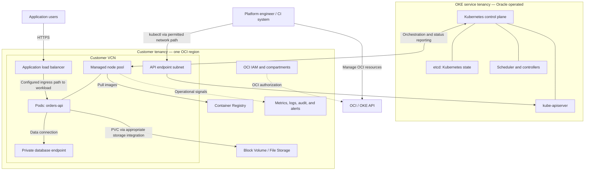

# Oracle Kubernetes Engine Architecture and Operational Responsibilities

## 1. Objectives and Context

In the **Kubernetes with OKE** chapter of the Oracle Cloud Infrastructure (OCI) learning path, Oracle Kubernetes Engine (OKE) is where knowledge of tenancy, compartment, IAM, VCN, Compute, and storage comes together to run containerized applications. OKE provides Kubernetes as a managed service, integrated with OCI infrastructure services. Choosing the worker node type determines the remaining operational workload for the using team. [Source: OKE Overview](https://docs.oracle.com/en-us/iaas/Content/ContEng/Concepts/contengoverview.htm).

After this lesson, learners can:

- Draw the architecture of an OKE cluster and point out the locations of the control plane, API endpoint, worker nodes, and dependent resources.
- Distinguish OCI infrastructure management operations from Kubernetes object management operations.
- Select a node model based on the required level of control and the team's operational capability.
- Assign specific responsibilities for authorization, networking, upgrades, monitoring, data, and cost.
- Classify incidents by architectural layer before deciding whether to troubleshoot internally or open an Oracle support request.

Prerequisite knowledge includes container images, Pods, Deployments, Services, IP addresses, subnets, and the principle of least privilege. This lesson uses a hypothetical Java service named `orders-api` to explain architectural decisions; this is a design example, not a step-by-step cluster creation procedure from scratch.

## 2. Two Planes and Two API Systems

### 2.1. The Control Plane Maintains the Desired State

The control plane receives Kubernetes requests, records state, and orchestrates work:

| Component | Role in the cluster |
| --- | --- |
| `kube-apiserver` | Receives Kubernetes API requests and handles related validation steps before accepting objects |
| `etcd` | Stores the state and configuration of Kubernetes objects |
| `kube-scheduler` | Selects an appropriate node for an unscheduled Pod |
| `kube-controller-manager` | Runs control loops to reconcile actual state toward desired state |
| `cloud-controller-manager` | Connects certain Kubernetes operations with OCI infrastructure, such as handling Services that require a load balancer |

Oracle deploys the control plane in the **OKE service tenancy**. For VCN-native clusters, the endpoint for accessing the Kubernetes API is integrated into a subnet of the customer's VCN. Having the endpoint in your VCN does not mean the control plane hosts appear in your list of Compute instances. [Source: OKE Cluster and Node Concepts](https://docs.oracle.com/en-us/iaas/Content/ContEng/Concepts/contengclustersnodes.htm).

### 2.2. The Data Plane Runs Applications

The data plane executes Pods. In the managed nodes model, OCI Compute instances reside in the customer's tenancy; on each node run components such as the kubelet, container runtime, and networking components. A node pool describes a group of managed nodes with shared configuration attributes. OKE assists with provisioning and lifecycle management of this group, while the customer decides the configuration and organizes maintenance. [Source: Managed nodes](https://docs.oracle.com/en-us/iaas/Content/ContEng/Tasks/contengworkingwithmanagednodes.htm).

The Java application runs in the data plane. When a container fails to start due to a JDBC configuration error, orchestration may still be functioning normally: Kubernetes continues retrying to start the container, but cannot fix the application's connection string or authentication credentials on its own.

### 2.3. OCI API and Kubernetes API Handle Two Different Types of Work

| Management Plane | Typical Objects | Common Tools | Example |
| --- | --- | --- | --- |
| OCI/OKE | Cluster, managed node pool, VCN, NSG, IAM policy | OCI Console, OCI CLI, OCI SDK, Terraform | View cluster configuration or modify node pool configuration |
| Kubernetes | Namespace, Deployment, Pod, Service, Role, PVC | `kubectl`, Kubernetes client, GitOps tools | Scale up the number of `orders-api` replicas |

A successful OCI request does not prove that the Kubernetes API is reachable from the user's machine. Likewise, a running Pod does not prove that the CI account has permission to modify a node pool.

For example, `oci ce cluster get` reads cluster resource information from OKE; it is not equivalent to `kubectl get pods`. The cluster identifier parameter for the OCI command is `--cluster-id`. [Source: OCI CLI — cluster get](https://docs.oracle.com/en-us/iaas/tools/oci-cli/latest/oci_cli_docs/cmdref/ce/cluster/get.html).

## 3. Reference Architecture Diagram

The following diagram illustrates a VCN-native cluster using managed nodes. The arrows represent relationships or communication flows at a conceptual level; they are not a complete set of firewall rules.



Read the diagram across three boundaries:

1. **Management boundary:** Oracle operates the control plane; the customer team manages the configurations and workloads within the scope allowed by the service.
2. **Access boundary:** The Kubernetes API endpoint is for cluster administration; the load balancer endpoint is for application traffic. You can keep the API endpoint private while still exposing the application through a public load balancer.
3. **Data boundary:** Deployment state in etcd is distinct from order records in the database and distinct from the contents of a persistent volume.

Therefore, an architectural design must depict all three paths: administration, user serving, and data access. Drawing only the Pods overlooks dependencies that can bring the system down.

## 4. Two Independent Decisions: Cluster Type and Node Type

### 4.1. Basic Cluster and Enhanced Cluster

Basic and enhanced are **cluster types**, not a way to distinguish virtual machines from bare metal.

| Architecture-Related Capability | Basic Cluster | Enhanced Cluster |
| --- | --- | --- |
| Run Kubernetes with managed node pools | Yes | Yes |
| Virtual nodes and self-managed nodes | No | Yes |
| OKE workload identity | No | Yes |
| Granular add-on management and node cycling | Fewer capabilities; lacks the corresponding enhanced features | Has enhanced capabilities |
| Service commitment | SLO | SLA with service terms |

The SLA scope of an enhanced cluster is tied to the Kubernetes API server; application availability also depends on the data plane and supporting services. A VCN-native basic cluster can be upgraded to enhanced when conditions are met; enhanced cannot be downgraded to basic. [Source: Comparing basic and enhanced](https://docs.oracle.com/en-us/iaas/Content/ContEng/Tasks/contengcomparingenhancedwithbasicclusters_topic.htm), [enhanced cluster scope](https://docs.oracle.com/en-us/iaas/Content/ContEng/Tasks/contengworkingwithenhancedclusters.htm).

When documenting an architectural decision, explicitly state which features require enhanced, who uses those features, and the associated costs. Choosing a cluster type by name alone does not demonstrate the operational benefits to be achieved.

### 4.2. Managed Nodes, Virtual Nodes, and Self-Managed Nodes

| Model | Organization | Consequence for the Platform Team |
| --- | --- | --- |
| Managed nodes | OKE provisions Compute instances in the customer tenancy, organized into managed node pools | Manage capacity, image selection, update plans, and node replacement |
| Virtual nodes | Oracle manages the virtual nodes and underlying execution infrastructure; users configure virtual node pools | Reduce server administration work, focus on Pods and workload characteristics |
| Self-managed nodes | Customer creates Compute instances and joins them to an enhanced cluster; not part of an OKE node pool | Handle more provisioning, replacement, and maintenance independently |

Virtual nodes reside in the OKE service tenancy; they are not customer VMs that you can SSH into like managed nodes. [Source: Comparing virtual and managed nodes](https://docs.oracle.com/en-us/iaas/Content/ContEng/Tasks/contengcomparingvirtualwithmanagednodes_topic.htm).

Self-managed nodes typically serve specialized configuration requirements. You can use a Compute instance pool to organize them, but that is still not an OKE managed node pool. When deleting a cluster, the Compute instances of self-managed nodes are not automatically terminated. The OKE cluster control plane remains managed by Oracle. [Source: Self-managed nodes](https://docs.oracle.com/en-us/iaas/Content/ContEng/Tasks/contengworkingwithselfmanagednodes.htm).

### 4.3. Choosing by Workload Characteristics

For `orders-api`, you can evaluate in order:

1. Does the application depend on the host, DaemonSet agents, storage drivers, or special diagnostic tools?
2. Does the team need to control the OS image, host configuration, and node replacement schedule?
3. Can the workload run within the constraints of virtual nodes?
4. Does the team have sufficient on-call operational capacity to take on the responsibilities of the chosen model?

According to current comparison documentation, virtual nodes have important differences: they only support VCN-native pod networking, do not support DaemonSets or Kubernetes NetworkPolicy, and PVCs only support persistent volumes from File Storage. Check the support matrix before migrating workloads. Do not take a managed nodes manifest as proof that a workload is compatible with virtual nodes. [Source: Virtual nodes capabilities and limitations](https://docs.oracle.com/en-us/iaas/Content/ContEng/Tasks/contengcomparingvirtualwithmanagednodes_topic.htm).

Virtual nodes reduce node infrastructure administration work, but the application team must still define resources, images, configuration, health checks, and availability targets. Oracle describes this model as serverless Kubernetes with compute resources provisioned at the Pod level. [Source: Virtual nodes](https://docs.oracle.com/en-us/iaas/Content/ContEng/Tasks/contengworkingwithvirtualnodes.htm).

## 5. Network Design Driven by Required Flows

### 5.1. Four Address Groups to Distinguish

In a managed nodes design using VCN-native pod networking, you must plan IP addresses for the API endpoint, worker nodes, Pods, and load balancers. The IPv4 example below only illustrates how to split address ranges, not a mandatory template:

| Resource Group | Illustrative Range in VCN `10.42.0.0/16` | Purpose |
| --- | --- | --- |
| API endpoint | `10.42.0.0/28` | Access the Kubernetes API |
| Managed nodes | `10.42.4.0/22` | Addresses of worker nodes |
| Pods | `10.42.16.0/20` | Pod addresses when using VCN-native CNI |
| Load balancers | `10.42.32.0/24` | Application ingress path |

Ranges must be checked against on-premises networks, VCN peering, VPN, and the Kubernetes service CIDR. The fact that all addresses are private does not guarantee they do not overlap.

With VCN-native pod networking, Pods receive IPs from the VCN and can be routed directly when networking permits. Therefore, the Pod subnet capacity must account for growth, scaling, and maintenance. Do not treat the node count as the only number of IPs to plan for. [Source: VCN-native pod networking](https://docs.oracle.com/en-us/iaas/Content/ContEng/Concepts/contengpodnetworking_topic-OCI_CNI_plugin.htm).

**VCN-native cluster** refers to integrating the cluster endpoint into the VCN. **VCN-native pod networking** refers to how IP addresses and connectivity are provided to Pods. The two terms sound similar but describe two different parts of the architecture. [Source: VCN-native clusters](https://docs.oracle.com/en-us/iaas/Content/ContEng/Tasks/contengmigratingclusters.htm).

### 5.2. Defining Management Paths and Application Paths

| Flow | What Must Be Clarified in the Design |
| --- | --- |
| Engineer/CI machine → Kubernetes API | Public or private endpoint; does the caller have the right network path, DNS, and permissions |
| Worker → endpoints supporting cluster operations | Do routes and security rules satisfy the chosen OKE model |
| Worker/Pod → registry | Which registry, how authentication works, which path traffic takes |
| User → application | Public/private load balancer, TLS, health checks, and backends |
| Pod → database | Endpoint, name resolution, port, identity, and connection limits |
| Workload → services outside OCI | Is internet egress required; which routes, NAT, and egress rules allow it |

Private subnets need appropriate outbound paths for their destinations: a NAT gateway for internet egress and a service gateway for supported services in the Oracle Services Network. Simply creating a gateway without attaching routes and security rules does not establish a network path. OKE networking documentation specifies details by API endpoint, worker, Pod, CNI type, and load balancer; the table above does not replace those requirements. [Source: OKE Network Resource Configuration](https://docs.oracle.com/en-us/iaas/Content/ContEng/Concepts/contengnetworkconfig.htm).

### 5.3. A Private API Endpoint Still Needs an Access Plan

For example, the platform team chooses a private API endpoint, private managed nodes, and a public load balancer for `orders-api`. In that case:

- The CI runner must be located where it can reach the API endpoint, such as a network connected to the VCN.
- Engineers need a pre-established administrative access path; being able to run the OCI CLI from a location does not automatically guarantee a path to the Kubernetes API.
- Customer-facing traffic goes through the load balancer; do not expose the API endpoint just so users can call the application.

Oracle recommends using private worker subnets and NSGs to reduce infrastructure exposure. Specific access policies are still designed by the using team. [Source: OKE Security Best Practices](https://docs.oracle.com/en-us/iaas/Content/ContEng/Tasks/contengbestpractices_topic-Security-best-practices.htm).

For example, if CI times out reaching the API endpoint, check the runner location, routing path, name resolution, and security rules first. Increasing IAM permissions will not fix a network path that does not exist.

## 6. Authorization by the Right Identity Type

### 6.1. Compartments and Namespaces Serve Distinct Roles

A compartment is the scope for organizing OCI resources and policies. A namespace is the scope for many Kubernetes objects. Placing a cluster in a compartment does not automatically create a corresponding namespace; creating a namespace also does not automatically create an IAM boundary for OCI resources.

One option for the order system is to use a compartment for production infrastructure and a namespace `orders` for the workload. The team must still specify who modifies the cluster, who deploys into the namespace, and which OCI services the application is allowed to call.

There are three permission groups to evaluate separately:

| Identity | Activities to Control |
| --- | --- |
| Infrastructure engineers | Manage clusters, node pools, VCNs, and dependent OCI resources |
| Users or deployment systems | Perform Kubernetes operations within the assigned scope |
| Running workload | Call OCI APIs or access data systems for business logic |

### 6.2. IAM and Kubernetes RBAC Can Both Grant Permissions

OKE integrates OCI IAM with Kubernetes RBAC. IAM can allow Kubernetes operations; RBAC provides fine-grained permissions per cluster and namespace. You should not assume that a restrictive Role revokes broad permissions already granted by IAM. When designing least privilege, evaluate both permission sources. [Source: OKE Access Control](https://docs.oracle.com/en-us/iaas/Content/ContEng/Concepts/contengaboutaccesscontrol.htm).

For example, a team only needs to view Pods in the `orders` namespace. The RBAC part can be expressed as follows; the namespace must exist and the group OCID must be replaced with the real value. The IAM configuration allowing cluster usage and the network access path must be set up separately.

```yaml
apiVersion: rbac.authorization.k8s.io/v1
kind: Role
metadata:
  name: orders-observer
  namespace: orders
rules:
  - apiGroups: [""]
    resources: ["pods", "events"]
    verbs: ["get", "list", "watch"]
  - apiGroups: [""]
    resources: ["pods/log"]
    verbs: ["get"]
---
apiVersion: rbac.authorization.k8s.io/v1
kind: RoleBinding
metadata:
  name: orders-observers
  namespace: orders
subjects:
  - kind: Group
    name: "<OCI_GROUP_OCID>"
    apiGroup: rbac.authorization.k8s.io
roleRef:
  kind: Role
  name: orders-observer
  apiGroup: rbac.authorization.k8s.io
```

The illustrative manifest intentionally permits observation without granting workload modification operations through this Role. In a real environment, check other effective permissions of the group, especially if the same members also belong to an administrator group.

### 6.3. Workload Identity Is the Application's Identity

In an enhanced cluster, OKE workload identity identifies a workload by the combination of **cluster, namespace, and service account** to grant permissions to call OCI services. The application must use the appropriate OCI SDK and identity provider; assigning a service account name alone does not complete the entire OCI access configuration. [Source: Granting Workload Access to OCI Resources](https://docs.oracle.com/en-us/iaas/Content/ContEng/Tasks/contenggrantingworkloadaccesstoresources.htm).

If `orders-api` only reads a configuration file from a bucket, the team should design a policy for that need. Do not use an engineer's administrative account as the application runtime identity. OCI call permissions also do not automatically become database accounts: JDBC connections still require appropriate authentication mechanisms and data permissions.

## 7. From a Deployment to a User Request

Tracing the lifecycle of `orders-api` clearly shows what OKE performs and what the team must prepare.

### 7.1. Deployment Path

1. The pipeline builds an image from source code, runs selected checks, and pushes the image to a registry.
2. The pipeline submits the Deployment to the Kubernetes API using an authorized identity.
3. The control plane records the desired state; controllers create the necessary objects.
4. The scheduler selects a node based on requested resources and scheduling constraints.
5. The node pulls the image and starts the container.
6. Health checks determine whether the Pod is ready to serve traffic.

For example, `ImagePullBackOff` occurring at the image pull step may relate to network path, image address, or registry authentication credentials. Changing the scheduling algorithm will not resolve the root cause in that case.

### 7.2. Serving Path

Users send HTTPS requests to the application endpoint. The load balancer configuration and corresponding ingress mechanism or Service route requests to the workload backends. The Pod processes business logic and calls the database or required services.

The Kubernetes API is not in the path of each of these HTTP transactions. When the API is temporarily unreachable, some already-running workloads may continue serving traffic; however, the cluster's ability to deploy, orchestrate, or recover may be affected. Therefore, monitor both the management API and business endpoints.

### 7.3. Persistent Data Path

A PVC is a storage request, and a PV is the object representing the volume fulfilling that request. OKE supports integrating OCI storage services via the corresponding drivers. Data in a container's filesystem has a different lifecycle from data stored in a persistent volume. [Source: Setting Up Storage for Kubernetes](https://docs.oracle.com/en-us/iaas/Content/ContEng/Tasks/contengcreatingpersistentvolumeclaim.htm).

For `orders-api`, one design choice is to keep transactional data in an Oracle database service outside the cluster while Pods handle requests in a stateless manner. This choice moves data persistence to a system with its own lifecycle, but the team must still design private connectivity, connection pools, secret or wallet management when needed, backups, and restore testing.

If running a database inside Kubernetes, the team takes on additional responsibility for storage topology, backup consistency, replication, and database recovery. Restoring a Deployment does not mean restoring lost transactions.

## 8. Operational Responsibilities Must Have Owners

### 8.1. Boundary with Oracle

| Area | What Oracle Handles | What the Customer Must Organize |
| --- | --- | --- |
| Control plane | Operates managed components | Use supported interfaces, monitor impact on the system |
| Control plane vulnerabilities | Patches Oracle-managed components | Coordinate when required or when workloads are impacted |
| Managed worker image | Provides supported images and patches | Adopt new images and replace old nodes |
| Networking and access | Provides services and configuration mechanisms | Design and maintain VCN, IAM, RBAC |
| Applications and data | Provides the platform within service scope | Maintain applications, monitoring, incident response, and data backups |

Oracle maintains etcd backups for control plane recovery; customers do not directly access those backups. Application backup plans must be designed separately. [Source: OKE Shared Responsibilities](https://docs.oracle.com/en-us/iaas/Content/ContEng/Concepts/contengsupportsharedresponsibilities.htm).

### 8.2. Dividing Responsibilities Within the Organization

The following table is a suggested assignment for the `orders-api` example and should be adapted to your organization:

| Task | Lead Team | Verifiable Output |
| --- | --- | --- |
| Cluster, networking, nodes, and platform add-ons | Platform | Configuration managed as code, maintenance schedule, and runbooks |
| IAM, RBAC, and workload permissions | Platform with Security | Permission matrix and effective permission verification results |
| Images, resource requests, probes, and rollouts | Application team | Manifests with clear owners and release versions |
| Backup, restore, and data loss targets | Data team with Application team | Evidence of successful test restores |
| Alerting and incident response | On-call operations team | Alert channels with assigned responders, escalation rules |
| Cost and leftover resources | Service owner with Platform | Usage reports, budgets, and reclamation plans |

If a task is only written down as "Oracle manages it" or "DevOps handles it" without a concrete deliverable and specific owner, gaps easily appear. A classic example is an image having a patch available while no one schedules node replacement.

## 9. Maintenance Is a Controlled Sequence of Changes

### 9.1. Cluster Upgrades and Worker Upgrades Are Separate Steps

Upgrading the control plane version does not automatically upgrade all managed worker nodes. Virtual nodes are upgraded along with the control plane upgrade according to the service mechanism; self-managed nodes use their own replacement procedure. Before upgrading, verify application compatibility, add-ons, and the version skew supported by OKE. An upgraded control plane cannot be downgraded to a prior version. [Source: Upgrading Kubernetes on OKE](https://docs.oracle.com/en-us/iaas/Content/ContEng/Concepts/contengaboutupgradingclusters.htm).

For managed nodes, the recommended operational sequence is:

1. Record the actual running versions, node pool configuration versions, and dependent components.
2. Check APIs used by applications, operators, and pipelines; test the target version in an appropriate environment.
3. Prepare spare capacity, drain capability, and a plan for handling workloads if they become unavailable.
4. Upgrade the control plane using a supported OKE interface.
5. Upgrade or replace managed nodes using the chosen approach.
6. Re-verify business behavior, errors, latency, and workload status before concluding maintenance.

This is a workflow sequence for organizing work, not a guarantee that every cluster can be upgraded in the exact same single operation. Specific upgrade prerequisites must be taken from the release documentation and cluster state.

### 9.2. Updating Node Pool Configuration Does Not Update Every Running Node

When changing the image attribute of a managed node pool, existing nodes retain the old attribute until they are updated through an appropriate replacement or cycling process. Another option is to create a new pool, migrate workloads, and then remove the old pool. [Source: Updating Worker Node Attributes](https://docs.oracle.com/en-us/iaas/Content/ContEng/Tasks/contengupgradingimageworkernode.htm).

For example, after selecting a new image, the team must check whether the **actual nodes** have transitioned to the desired image. Looking only at the node pool's configuration field can lead to ending maintenance while many machines are still running the old image.

The plan should also separate two types of rollback: rolling back the application version and rolling back infrastructure configuration. Keeping an old application image does not provide the ability to downgrade the control plane version.

## 10. Designing Availability at the Workload Layer

### 10.1. Replicas Must Be Paired with Distribution and Capacity

Three replicas on the same node still share a single point of failure. The team must choose worker placement across availability domains (AD) and fault domains (FD) appropriate for the region, while controlling Pod distribution using the topology visible to Kubernetes. Oracle recommends regional subnets and topology spread constraints to organize workload distribution. [Source: Networking and Workload Distribution Best Practices](https://docs.oracle.com/en-us/iaas/Content/ContEng/Tasks/contengbestpractices_topic-Networking-best-practices.htm).

Not every region has multiple ADs. Distribution by hostname only proves Pods are on different nodes; evaluating AD or FD resilience requires cross-referencing infrastructure placement.

A useful capacity criterion for managed nodes is:

> When a node or fault domain in the design scenario is lost, are the remaining resources sufficient to run the required sustained load and platform components?

You must calculate using allocatable resources for Pods and scheduling constraints. Simply summing nominal CPU across machines ignores system reservations, memory, quotas, and IP limits.

### 10.2. Example Manifest for Managed Nodes

The following example expresses three intents: having three replicas, distributing across hostnames, and allowing controlled maintenance. Before applying, you need the `orders` namespace, a real image, image pull capability, at least three managed nodes with sufficient resources, and corresponding health check endpoints.

The address `registry.example.com` is a placeholder. The example is for **managed nodes**, does not include a Service/ingress, and is not a complete configuration to expose the application.

```yaml
apiVersion: apps/v1
kind: Deployment
metadata:
  name: orders-api
  namespace: orders
spec:
  replicas: 3
  selector:
    matchLabels:
      app: orders-api
  strategy:
    type: RollingUpdate
    rollingUpdate:
      maxUnavailable: 0
      maxSurge: 1
  template:
    metadata:
      labels:
        app: orders-api
    spec:
      topologySpreadConstraints:
        - maxSkew: 1
          topologyKey: kubernetes.io/hostname
          whenUnsatisfiable: DoNotSchedule
          labelSelector:
            matchLabels:
              app: orders-api
      containers:
        - name: api
          image: registry.example.com/training/orders-api:1.0.0
          ports:
            - name: http
              containerPort: 8080
          resources:
            requests:
              cpu: "250m"
              memory: "512Mi"
            limits:
              cpu: "1000m"
              memory: "1Gi"
          startupProbe:
            httpGet:
              path: /health/startup
              port: http
            periodSeconds: 5
            failureThreshold: 36
          readinessProbe:
            httpGet:
              path: /health/ready
              port: http
            periodSeconds: 5
          livenessProbe:
            httpGet:
              path: /health/live
              port: http
            periodSeconds: 10
---
apiVersion: policy/v1
kind: PodDisruptionBudget
metadata:
  name: orders-api
  namespace: orders
spec:
  minAvailable: 2
  selector:
    matchLabels:
      app: orders-api
```

The startup probe gives the application time to boot; readiness indicates ability to receive traffic; liveness detects states that require a restart. Endpoints and thresholds must reflect the real application. For example, a liveness probe directly dependent on a failing database can trigger repeated restarts without fixing the database.

The parameters above have clear limitations:

- `maxSurge: 1` requires capacity for an additional Pod during rollout.
- Strict topology constraints can leave Pods waiting if no suitable placement is available.
- `minAvailable: 2` allows at most one Pod to be unavailable due to controlled eviction when all three Pods are healthy; it does not guarantee two Pods survive every outage.
- A PDB does not prevent unexpected disruptions such as node power loss, and does not replace the Deployment's rolling update strategy.

Kubernetes describes a PDB as a limit on voluntary disruptions through the eviction mechanism; involuntary disruptions can still occur. [Source: Kubernetes — Disruptions](https://kubernetes.io/docs/concepts/workloads/pods/disruptions/).

For Java, measure heap, native memory, startup time, and connection counts as replicas increase. CPU/memory in the example are illustrative numbers; the application running while idle does not prove those limits are sufficient for real load.

## 11. Scaling and Cost Are Part of the Architecture

### 11.1. Pod Scaling Differs from Node Scaling

HPA changes the number of Pods based on configured metrics sources. Cluster Autoscaler changes the number of managed nodes in managed node pools to meet scheduling demand; it does not create Pods in place of HPA. Cluster Autoscaler is not used for virtual node pools. [Source: HPA on OKE](https://docs.oracle.com/en-us/iaas/Content/ContEng/Tasks/contengusinghorizontalpodautoscaler.htm), [Cluster Autoscaler on OKE](https://docs.oracle.com/en-us/iaas/Content/ContEng/Tasks/contengusingclusterautoscaler.htm).

Hypothetical example:

- `orders-api` currently has three replicas, each requesting `250m` CPU and `512Mi` RAM.
- When scaling to six replicas, the requests for the application alone increase from `750m` to `1500m` CPU and from `1536Mi` to `3072Mi` RAM.
- The cluster must still have room for add-ons, other workloads, and maintenance capacity.
- If space is insufficient, some Pods may stay Pending; increasing replicas in a manifest does not create additional Compute capacity.

Autoscaling also depends on configured limits, quotas, IPs, and allocatable capacity in the region. Therefore, set maximum thresholds, monitor actual demand, and define how to handle situations when additional resources cannot be provisioned.

### 11.2. Track Supporting Resources as Well

You can use the following conceptual cost model to assign ownership:

```text
OKE system cost
  = cluster service portion by chosen cluster type
  + compute resources running workloads
  + boot volumes and persistent storage
  + load balancers and networking
  + logs, metrics, backups
  + registry, database, and dependent services
```

This is a classification framework, not a price list. When estimating actual costs, look up current pricing and billing scope for your region, service type, and usage agreement.

Decisions that need owners include minimum replica counts, reserve capacity for maintenance, number of load balancers, log retention periods, and volume/backup retention policies. Test environments also need resource reclamation plans. With self-managed nodes, remember that Compute instances have a lifecycle independent from the cluster.

Budgets should be tied to service objectives: reducing buffer capacity may lower the bill but also increases recovery time after failures. The team should explicitly document the accepted level of risk using a concrete scenario.

## 12. Observe the Right Layer to Act on the Right Problem

### 12.1. Four Complementary Signal Types

| Signal | Question to Answer | Example with orders-api |
| --- | --- | --- |
| Infrastructure/cluster metrics | Is there insufficient capacity or an unhealthy component? | Node not Ready, Pod unschedulable |
| Business metrics | Are users getting accurate results fast enough? | Order creation success rate, latency, JDBC errors |
| Application and platform logs | Which process logged what error? | JVM startup error, scheduler or controller error |
| Audit | Who or which identity performed a change? | Deployment change, permission change, management API call |

OKE provides metrics in the `oci_oke` namespace, including signals for the API server, unschedulable Pods, and node status. These metrics do not on their own fully measure the business quality of the application. [Source: OKE Metrics](https://docs.oracle.com/en-us/iaas/Content/ContEng/Reference/contengmetrics.htm).

OCI Audit can be used to view events from OKE and the Kubernetes API server. Control plane process logs are provided through supported service logs mechanisms; view permissions and collection configuration must be set up properly. [Source: OKE Audit logs](https://docs.oracle.com/en-us/iaas/Content/ContEng/Tasks/contengmonitoringoke.htm), [OKE service logs](https://docs.oracle.com/en-us/iaas/Content/ContEng/Tasks/contengviewingservicelogs.htm).

Every alert must have a recipient, context, and first action. A "Pod Pending" alert is far more useful when accompanied by namespace, workload, start time, and a link to events.

### 12.2. Inspecting the Architecture with Read-Only Commands

The following commands are for an environment that already has OCI CLI, `kubectl`, credentials, and a valid kubeconfig. Replace placeholder strings and verify you are selecting the right context. They are examples for learners to execute, not outputs already run for this lesson.

```powershell
# Read cluster resource through OCI/OKE API.
oci ce cluster get --cluster-id "<CLUSTER_OCID>" --region "<OCI_REGION>"

# Identify the cluster kubectl is currently pointing to.
kubectl config current-context
kubectl cluster-info

# View nodes and topology labels present on nodes.
kubectl get nodes -o wide
kubectl get nodes -L topology.kubernetes.io/zone,kubernetes.io/hostname

# View distribution, workload status, and disruption budget.
kubectl get deployment,pods,services,pdb -n orders -o wide
kubectl get events -n orders --sort-by=.metadata.creationTimestamp

# Check effective permissions of the identity currently in use.
kubectl auth can-i list pods -n orders
kubectl auth can-i patch deployments.apps -n orders

# View storage policies; requires read permission in the corresponding scope.
kubectl get storageclass
kubectl get pvc -n orders
```

When reading the outputs, cross-reference both sides of the system:

- OCI shows how cluster resources are configured.
- Kubernetes shows what state nodes and workloads are reporting.
- Topology labels indicate the basis for scheduling; cross-reference with Compute placement to evaluate true fault domains.
- Events help find causes near the time of an error, but should not be treated as a long-term operational history store.

### 12.3. Classify Incidents Before Escalating

| Symptom | First Investigation Direction | Initial Lead Team |
| --- | --- | --- |
| `kubectl` timeout | Context, DNS, routes, and rules to the API endpoint | Platform/Network |
| Kubernetes returns `Forbidden` | Identity and effective permissions from IAM/RBAC | Platform/Security |
| Pod `Pending` | Events, requests, quotas, topology, and node/IP capacity | Platform with Application |
| `ImagePullBackOff` | Image, registry, authentication, and image pull path | Pipeline team with Platform |
| `CrashLoopBackOff` | Logs, configuration, startup/liveness, memory, and dependencies | Application team |
| Application JDBC errors | DB endpoint, connectivity, credentials, pool, and DB state | Application with Data team |
| Maintenance cannot drain | PDB, ready replicas, and replacement capacity | Platform with Application |

The table provides an order of investigation, not an assertion of a single root cause. For example, `Pending` does not default to insufficient CPU; an incorrect node selector can also leave a Pod with nowhere to schedule.

If you need to open an Oracle support request, prepare the cluster OCID, region, timestamps with timezone, impact scope, most recent changes, and relevant diagnostic information. The information package should avoid containing secrets. The goal is to demonstrate which layer the problem is in and what has already been checked.

## 13. Document Architectural Decisions Before Assuming Operations

A short architectural description for `orders-api` should be sufficient for a new on-call engineer to understand the system without guessing. You can document it using this template:

| Decision | Required Content |
| --- | --- |
| Deployment scope | Tenancy, compartment, region, and cluster type |
| Nodes | Managed/virtual/self-managed, selection rationale, lifecycle owner |
| Networking | API endpoint, subnets, CI path, user path, data path |
| Identity | Who manages OCI, who modifies Kubernetes, how workloads call services |
| Data | Where real data is stored, who holds backups, test restore results |
| Availability | Fault domains to withstand, Pod distribution, reserve capacity |
| Maintenance | Upgrade schedule, decision maker, completion criteria |
| Observability | Business metrics, logs, audit, alerts, and recipients |
| Cost | Budget owner, scaling limits, resources to reclaim |

For each row, there should be concrete evidence: network diagrams, policies, manifests, configuration as code, restore reports, or runbooks. That turns operational responsibility into verifiable and executable work.

Learners should keep three connections in mind throughout the lesson: **a managed control plane comes with a data plane that carries distinct responsibilities; accessibility requires both a network path and effective permissions; application availability requires data durability, distribution, and recovery capacity**. This is the foundation for deploying OKE with proper authorization, monitoring, and cost control on OCI infrastructure.
