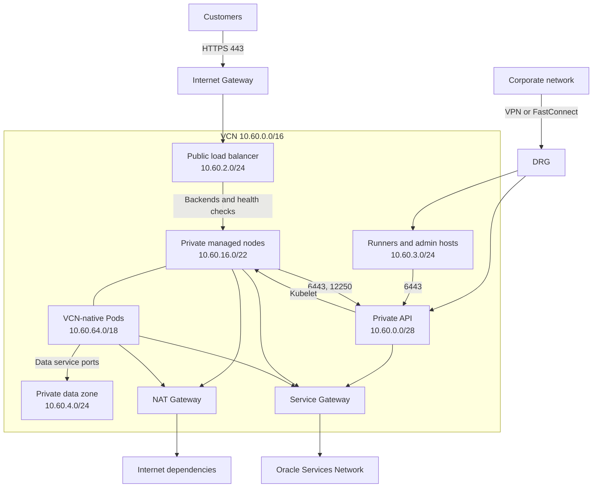

# Designing VCN, API Endpoint, and Subnets for OKE

## 1. Objectives and Scope

In the **CLOUD_PROVIDERS_ORACLE** module, this lesson belongs to the **Kubernetes with OKE** chapter and focuses on network design before creating an Oracle Kubernetes Engine (OKE) cluster. A successfully created cluster does not guarantee operators can reach the API, nodes can pull images, or applications receive traffic along the right path.

After this lesson, you can:

- Distinguish the Kubernetes management endpoint, node addresses, pod addresses, and application entry points.
- Choose a public or private API endpoint based on actual access paths.
- Partition VCN, subnets, and CIDRs with headroom for scaling and upgrades.
- Design route tables, gateways, and network rules per traffic flow.
- Test connectivity layer by layer, while identifying impacts on authorization, availability, and cost.

The illustrative architecture uses **OCI public cloud, IPv4, managed node pools, and OCI VCN-Native Pod Networking**. Configurations for virtual nodes, Private Cloud Appliance, or Compute Cloud@Customer must be evaluated separately. The commands below are hands-on examples; replace OCIDs, regions, and addresses with your environment's values before using them.

Prerequisites: CIDR, TCP/IP, route tables, NSGs, OCI IAM, Kubernetes Services, and basic `kubectl` usage. This lesson does not require deploying a database service, but reserves a network zone for applications to connect to an Oracle database over a private address.

## 2. Separate Four Address Types Before Drawing Subnets

| Component | Purpose | Design Question |
| --- | --- | --- |
| Kubernetes API endpoint | Receives administrative requests such as creating Deployments, reading state | Which path do admin machines and CI/CD take to TCP/6443? |
| Worker node | Runs kubelet, runtime, and workloads | How do nodes communicate with the API, OCI services, and image sources? |
| Pod | Runs application processes | Do IPs come from the VCN or an overlay network? How many IPs are needed when scaling? |
| Application load balancer | Receives requests from users or internal systems | Public or private listener? Where do backends and health checks go? |

The control plane is managed by Oracle. The API endpoint subnet in the customer's VCN provides an access point to the control plane; it does not mean all control plane hosts reside inside that subnet. See [OKE cluster and node concepts](https://docs.oracle.com/en-us/iaas/Content/ContEng/Concepts/contengclustersnodes.htm).

The two decisions **public/private API** and **public/private application** are independent. A public website can run in a cluster with a private API; conversely, a cluster with a public API may still serve only internal applications. Using a public load balancer does not automatically make the Kubernetes API public.

For example: customers call `https://shop.example.com` at the load balancer; the operations team uses `kubectl` over the corporate network. These two user groups do not need to go through the same endpoint or the same firewall rules.

## 3. Choose API Access Type by Users and Calling Systems

### 3.1. Public Endpoint

OKE only exposes the API over the internet when configured accordingly, including a public IP for the endpoint. Choosing a public subnet alone is not enough. The endpoint subnet must be a regional subnet. Detailed networking prerequisites are in [OKE network resource configuration](https://docs.oracle.com/en-us/iaas/Content/ContEng/Concepts/contengnetworkconfig.htm).

A design suitable for a lab with personal machines or a CI system allowed from specific source addresses:

1. Determine the actual egress IP of the admin machine or runner.
2. Allow only that source to TCP/6443.
3. Configure appropriate IAM and Kubernetes permissions.
4. Document the owner of the source allowlist, expiration, and change process.

If an office goes through NAT, the source OCI sees is usually the office egress IP. Putting a laptop's LAN IP in a rule for a public endpoint will not enable connectivity.

### 3.2. Private Endpoint

With a private API, the caller needs a network path to the endpoint's private address. Options include an admin machine or runner inside the VCN, connectivity from the corporate network, or an access path through a properly configured bastion. Oracle documents these options in [setting up OKE cluster access](https://docs.oracle.com/en-us/iaas/Content/ContEng/Tasks/contengdownloadkubeconfigfile.htm).

| Where Tools Run | Design Option | What Must Be Proven |
| --- | --- | --- |
| Runner in the VCN | Direct private connectivity | Routes, DNS, and rules from runner subnet to API |
| Machine at the office | VPN or FastConnect via DRG | Bidirectional routes, no overlapping CIDRs |
| Laptop outside the office | Admin access path via bastion/tunnel | Valid session, target port, TLS, and client configuration |
| SaaS CI service | Runner with private connectivity or supported network option | Jobs actually run from the authorized source |

The kubeconfig file contains endpoint details and how to authenticate. It does not create a VPN, routes, or tunnels. Likewise, opening the OCI Console or having permission to view the cluster does not automatically create a network path for `kubectl` running on a laptop.

The decision should be written as a verifiable statement: "Private API; deployment runners sit in the management subnet; engineers access via corporate VPN; only these two sources are permitted for administration."

## 4. Reference Architecture and Address Planning

Suppose a retail service needs:

- A website with a public entry point.
- Nodes and pods using private addresses.
- An API accessible only to the operations team and deployment runners.
- Pods accessing OCI services, certain internet dependencies, and an internal Oracle database.
- Enough IPs for autoscaling and temporary extra nodes during upgrades.



The diagram depicts primary flows and does not list every network rule or every route of the API subnet. In this architecture, traffic from the load balancer goes through node backends; a mechanism using pods as backends requires its own matrix.

### 4.1. Proposed CIDR Table

| Resource | CIDR | Type | Role |
| --- | --- | --- | --- |
| VCN | `10.60.0.0/16` | Regional | Address space of the environment |
| API subnet | `10.60.0.0/28` | Private, regional | Kubernetes endpoint |
| Public LB subnet | `10.60.2.0/24` | Public, regional | Website entry point |
| Management subnet | `10.60.3.0/24` | Private, regional | Runners and admin machines |
| Data subnet | `10.60.4.0/24` | Private, regional | Reserved zone for data services |
| Worker subnet | `10.60.16.0/22` | Private, regional | Node addresses |
| Pod subnet | `10.60.64.0/18` | Private, regional | Pod IPs with VCN-native |
| Kubernetes Service CIDR | `172.20.0.0/16` | Kubernetes logical range | ClusterIP; no OCI subnet created |

These CIDRs are choices for a learning scenario. Do not copy them before checking against corporate addresses, VPN clients, connected VCNs, and scaling plans. The subnets in the table do not overlap; the Service CIDR is also separate from the VCN.

With VCN-native, the pod subnet resides **inside the VCN**. With Flannel, the overlay pod CIDR is a separate range that does not overlap the VCN or Service CIDR. Distinguish the two models when documenting IP plans; see [CIDRs for OKE](https://docs.oracle.com/en-us/iaas/Content/ContEng/Concepts/contengcidrblocks.htm).

### 4.2. Sizing Capacity for Peak Allocation

Do not use the number of pods running on day one as the pod subnet capacity. Estimate based on maximum nodes, IPs allocated for pods per node, VNIC allocations, additional nodes during upgrades, and other resources sharing the subnet.

A planning formula:

```text
N_peak = N_autoscale_max + N_upgrade_extra

IP_pod_budget =
    N_peak × IP_allocated_per_node
    + IP_overhead
    + IP_shared_consumers
    + IP_growth_reserve
```

This is an estimation formula, not OKE's allocation algorithm. `IP_allocated_per_node` must come from actual CNI/node pool configuration. OCI VCN-native can pre-allocate IPs; capacity also depends on compute shape, VNICs, and network configuration. Refer to [VCN-native pod networking mechanics](https://docs.oracle.com/en-us/iaas/Content/ContEng/Concepts/contengpodnetworking_topic-OCI_CNI_plugin.htm).

Hypothetical example: autoscaler max 30 nodes, upgrades can add 6 nodes; the allocation budget chosen by the design team is 64 IPs/node. Estimated node consumption is `36 × 64 = 2,304` IPs. With a 25% growth buffer on this portion, 2,880 IPs are needed before adding overhead and shared consumers. **64 is a calculation assumption**, not a default value or OKE limit.

An IPv4 `/20` subnet has 4,096 total addresses. OCI reserves three addresses in every IPv4 subnet; the remainder must also serve other allocations. See [VCN and subnet overview](https://docs.oracle.com/en-us/iaas/Content/Network/Tasks/Overview_of_VCNs_and_Subnets.htm). Compare estimates against usable IPs rather than comparing against 4,096 and concluding it is enough.

The sample table chooses a `/18` pod subnet for headroom; a small lab can use a smaller range after calculating. The worker range must be sized separately by node/VNIC and upgrade strategy. Having available IPs does not mean compute quota or shape capacity remains in the region.

### 4.3. Regional Subnets and Deployment Boundaries

Using regional subnets decouples IP addressing from placing nodes into Availability Domains (ADs). You can place nodes in appropriate ADs without splitting one subnet per AD. Splitting subnets by role makes observability, change authorization, and impact analysis easier.

Regional subnets do not automatically distribute application replicas. Availability also depends on node placement, fault domains, topology spread, regional capabilities, and data services. Network and capacity choices are discussed further in [OKE networking best practices](https://docs.oracle.com/en-us/iaas/Content/ContEng/Tasks/contengbestpractices_topic-Networking-best-practices.htm).

One compartment can hold resources across multiple subnets; multiple compartments can also be authorized to share a network. A compartment is an organizational and IAM boundary. Separating compartments does not create a packet-filtering boundary; subnets also do not replace IAM policies.

## 5. Designing Route Tables by Destination

### 5.1. Role of Gateways

| Component | Used for Which Path? | Key Points |
| --- | --- | --- |
| Internet Gateway (IGW) | Direct internet access in public designs | Requires appropriate public addresses, routes, and rules |
| NAT Gateway | Private nodes/pods initiating connections to the internet | Does not provide an inbound admin port from the internet |
| Service Gateway (SGW) | To supported services in Oracle Services Network | Select the service label matching the region and scope |
| DRG | Connecting corporate networks or related networks | Requires designing routes/attachments and return paths |

Reference docs: [Internet Gateway](https://docs.oracle.com/en-us/iaas/Content/Network/Tasks/managingIGs.htm), [NAT Gateway](https://docs.oracle.com/en-us/iaas/Content/Network/Tasks/NATgateway.htm), [Service Gateway](https://docs.oracle.com/en-us/iaas/Content/Network/Tasks/servicegateway.htm), and [OCI network security](https://docs.oracle.com/en-us/iaas/Content/Security/Reference/networking_security.htm).

### 5.2. Route Tables of the Sample Architecture

| Route Table | Attached to Subnet | Destination | Target |
| --- | --- | --- | --- |
| `rt-public-lb` | Public LB | `0.0.0.0/0` | IGW |
| `rt-private-api` | Private API | All `<region>` Services in Oracle Services Network | SGW |
| `rt-private-api` | Private API | `0.0.0.0/0` | NAT Gateway |
| `rt-private-api` | Private API | `192.168.100.0/24`, assumed corporate network | DRG |
| `rt-private-workload` | Worker, pod | All `<region>` Services in Oracle Services Network | SGW |
| `rt-private-workload` | Worker, pod | `0.0.0.0/0` | NAT Gateway |
| `rt-management` | Management | All `<region>` Services in Oracle Services Network | SGW |
| `rt-management` | Management | `0.0.0.0/0` | NAT Gateway |
| `rt-management` | Management | `192.168.100.0/24` | DRG |

The routes for private API/workers here follow standard OKE network configuration; a private endpoint does not mean removing all egress paths. Oracle also provides [illustrative OKE network configurations](https://docs.oracle.com/en-us/iaas/Content/ContEng/Concepts/contengnetworkconfigexample.htm).

DRG routes must be accompanied by routes in the DRG and the corporate network. If the office calls pods or nodes directly, the relevant subnets also need return routes to the office. Do not assume that adding a route only on the API subnet handles every hybrid flow.

In this simple design, subnets in the same VCN communicate via default internal routing; do not add a route via NAT to reach the data subnet. Architectures with intermediate firewalls or custom routing must review actual paths. Refer to [VCN route tables](https://docs.oracle.com/en-us/iaas/Content/Network/Tasks/managingroutetables.htm).

### 5.3. Common Route and DNS Mistakes

- **Creating only the gateway:** the resource exists, but the subnet lacks a corresponding route.
- **Choosing SGW only for Object Storage:** does not cover other OCI destinations the cluster requires.
- **Sending all OCI traffic through NAT:** bypasses the intended SGW path.
- **Having an outbound route without a return path:** VPN is up, yet connections still time out.
- **Using a private subnet with an IGW route:** a route does not automatically assign public IPs or make resources public.
- **Custom DNS unable to resolve required names:** changing firewall rules will not fix name resolution failures.

A service label is a service destination type, not a free-form CIDR string. Match the label on the SGW with the route, and check supported services/regions. The [Service Gateway guide](https://docs.oracle.com/en-us/iaas/Content/Network/Tasks/servicegateway.htm) explains these conditions.

With OKE, use supported DNS configurations, starting from the VCN resolver and appropriate DHCP options. If integrating corporate DNS, clearly document which names are forwarded, which resolver answers, and test from both client locations and workloads. Do not arbitrarily change cluster-wide DHCP DNS just to fix one application name.

## 6. Designing Network Rules by Flow

### 6.1. Assigning NSGs and Security Lists

We recommend creating groups `nsg-oke-api`, `nsg-oke-workers`, `nsg-oke-pods`, `nsg-app-lb`, and `nsg-ops`. Attach them respectively to the endpoint, node pools, pod networking, and load balancer.

NSGs attach to resource/VNIC groups; Security Lists attach to subnets. When both are used, permissive rules are unioned. An overly permissive Security List can still open traffic even if the NSG is tightly configured. Stateful rules track connections and allow corresponding return traffic; stateless rules must be evaluated in both directions. See [OCI Security Rules mechanics](https://docs.oracle.com/en-us/iaas/Content/Network/Concepts/securityrules.htm).

For each rule, document source, destination, protocol, destination port, stateful/stateless mode, and reason. TCP/12250 and TCP/10250 are two different ports; do not swap them when entering configuration.

### 6.2. Control Plane and Data Plane Connectivity Matrix

The rows below show **initiation direction**. For connections between two network-filtered resources, check both egress at the source and ingress at the destination. Return traffic for a stateful connection is tracked; that does not authorize a new connection initiated in the reverse direction.

| Source → Destination | Protocol/Port | Role |
| --- | --- | --- |
| Admin, runner → API | TCP/6443 | Administration |
| Worker → API | TCP/6443, TCP/12250 | Node–API communication |
| Pod → API | TCP/6443, TCP/12250 | VCN-native |
| API → worker | TCP/10250 and ICMP | Kubelet, network checks |
| API → pod | Protocols per OKE rule set | Control plane–pod |
| Worker ↔ worker | Protocols per OKE rule set | Intra-node |
| Worker ↔ pod | Protocols per OKE rule set | Node–pod |
| Pod ↔ pod | Protocols per OKE rule set | Intra-pod |
| API → OSN | TCP/443 | OKE service |
| Worker, pod → OSN | TCP per OKE rule set | OCI services |

In the baseline rule set for VCN-native, some internal flows require `ALL/ALL` and TCP egress to OSN involves more than just 443. Do not replace the entire rule set with just a few 6443/10250 lines. ICMP type 3/code 4 for Path MTU Discovery must also be preserved in the directions Oracle specifies. Use the [complete OKE network rule table](https://docs.oracle.com/en-us/iaas/Content/ContEng/Concepts/contengnetworkconfig.htm) as the source of truth when deploying; this matrix is a design reading aid.

You can use CIDRs or NSG references where supported. If choosing NSG references, verify resources are actually members of the group. Do not use the worker NSG in place of the pod NSG just because pods run on those nodes.

### 6.3. Application and Load Balancer Flows

Add the sample scenario's specific flows separately:

| Flow | Recommended Scope | Data Needed from Actual Configuration |
| --- | --- | --- |
| Internet → LB | HTTPS/443 listener | Certificate, listener, allowed sources |
| LB → node backend | Service NodePort and health check | Backend IP, port, health-check port |
| Pod → data service | Listener port provided by service | Private endpoint, DNS, TLS, data-side rules |
| Pod → public dependencies | Inventoried destinations/ports | DNS, NAT route, egress |
| Runner → API | TCP/6443 | Runner source and deployment permissions |

Do not open all NodePorts to the internet to fix a backend issue. First check whether backends are nodes or pods, the port allocated to the Service, `externalTrafficPolicy` configuration, and health checks. If using an NLB that preserves source IP, the source address seen at backends may differ from a proxied LB model; do not blindly copy rules that only allow the LB source to every case.

A configuration reference is [OKE network examples](https://docs.oracle.com/en-us/iaas/Content/ContEng/Concepts/contengnetworkconfigexample.htm). In practice, clearly choose who manages load balancer rules: the controller in a supported mode or the networking team via IaC. Having two sides edit the same rule set causes drift and makes auditing difficult.

If a separate internal service is needed, an OCI Load Balancer manifest can express the intent as follows:

```yaml
apiVersion: v1
kind: Service
metadata:
  name: orders-internal
  namespace: demo
  annotations:
    oci.oraclecloud.com/load-balancer-type: "lb"
    service.beta.kubernetes.io/oci-load-balancer-internal: "true"
    service.beta.kubernetes.io/oci-load-balancer-subnet1: "<PRIVATE_LB_SUBNET_OCID>"
spec:
  type: LoadBalancer
  selector:
    app: orders
  ports:
    - name: http
      port: 80
      targetPort: 8080
```

This example assumes a matching namespace, workload, and private subnet already exist; it illustrates only the Service. A private subnet for an internal LB must be planned separately if used. This service is distinct from the website's public LB in the diagram.

OCI LB and OCI NLB use some different annotations. Check [configuring LB/NLB for OKE](https://docs.oracle.com/en-us/iaas/Content/ContEng/Tasks/contengconfiguringloadbalancersnetworkloadbalancers-subtopic.htm) before deploying. Creating a `LoadBalancer` Service can provision OCI resources that incur cost.

### 6.4. Distinguish Network Protection from Application Permissions

The design has three layers to verify independently:

1. **Connectivity:** routes, gateways, DNS, and NSGs/Security Lists allow reaching the destination.
2. **Authentication and authorization:** OCI IAM and Kubernetes permission mechanisms permit the action.
3. **Workload isolation:** applications and NetworkPolicy control communication between pod groups when an enforcement engine is present.

Having TCP/6443 does not mean a user can create a Deployment. Having permission to create a Deployment does not mean a laptop can reach a private API. Similarly, network access to a database listener does not grant an account, certificate, or permission to query data.

A successfully created `NetworkPolicy` object does not prove policy is enforced. With managed nodes and VCN-native, Oracle provides instructions to integrate Calico for policy enforcement; select a compatible version. See [NetworkPolicy on OKE](https://docs.oracle.com/en-us/iaas/Content/ContEng/Tasks/contengsettingupcalico.htm).

## 7. Sequence for Implementing the Design

You can deploy via Console, Terraform, or OCI Resource Manager, while keeping the same inputs and dependencies.

1. **Finalize access requirements:** who calls the API, who calls the app, which services workloads call.
2. **Review the IP plan:** check against corporate networks, connected networks, and growth; include the Service CIDR.
3. **Define resource permissions:** the compartment holding the VCN/cluster and who can create, use, and modify networks. For shared networks, clarify cross-compartment permissions.
4. **Create VCN and gateways:** choose DNS and properly scoped SGW; set up DRG if hybrid connectivity is needed.
5. **Create route tables and subnets:** explicitly declare regional/public/private; attach the right route tables, DHCP options, and Security Lists.
6. **Create NSGs and rule sets:** matching the chosen CNI, node type, and application flows.
7. **Create cluster with custom configuration:** point to the right VCN, API subnet, endpoint type, CNI, Service CIDR, and LB subnet.
8. **Create managed node pool:** select worker subnet, pod subnet, corresponding NSGs, node placement, and pod/node budget.
9. **Configure client:** kubeconfig and designed private/public access path.
10. **Verify before accepting workloads:** node Ready, DNS, API, image pull, backends, and data flows.

Use meaningful names and tags such as environment, application, owner, and purpose. With IaC, expose subnet/API NSG/worker NSG/pod NSG OCIDs as clear variables; output only identifiers needed in subsequent steps. Do not hard-code the same OCID across all environments.

Avoid modifying the API endpoint without an alternative access path in place. If changing public/private status or the endpoint address, re-check routes, source rules, kubeconfig, and running deployment runners. A management network change can disrupt every pipeline while the application continues serving normally.

## 8. Hands-On: Verifying a Private API

### 8.1. Preparing the Client and Dedicated Kubeconfig

Run on a machine that already has OCI CLI, kubectl, OCI authentication, and a private path to the VCN. The PowerShell example below saves the cluster configuration to a separate file, making it easy to distinguish from other environments:

```powershell
$clusterId = '<CLUSTER_OCID>'
$region = '<REGION_IDENTIFIER>'
$okeConfig = Join-Path (Get-Location) 'oke-private-lab.kubeconfig'

oci ce cluster create-kubeconfig --cluster-id $clusterId --region $region --file $okeConfig --token-version 2.0.0 --kube-endpoint PRIVATE_ENDPOINT

$env:KUBECONFIG = $okeConfig
kubectl config current-context
kubectl config view --minify -o jsonpath='{.clusters[0].cluster.server}'
```

`PRIVATE_ENDPOINT` selects the private address in the kubeconfig. This parameter does not convert a public cluster to private and does not set up networking. Syntax is described in [OCI CLI create-kubeconfig](https://docs.oracle.com/en-us/iaas/tools/oci-cli/latest/oci_cli_docs/cmdref/ce/cluster/create-kubeconfig.html).

Run each command and inspect the output. Avoid committing kubeconfig files or credentials into learning repositories.

### 8.2. Testing TCP and Kubernetes Operations in Order

```powershell
$apiUrl = kubectl config view --minify -o jsonpath='{.clusters[0].cluster.server}'
$apiHost = ([System.Uri]$apiUrl).Host

Test-NetConnection -ComputerName $apiHost -Port 6443

kubectl --request-timeout=10s get nodes -o wide
kubectl --request-timeout=10s get pods -n kube-system -o wide
kubectl auth can-i get pods --namespace demo
```

Expected results for an appropriately authorized account:

- The endpoint in kubeconfig matches the cluster and has the selected private address.
- TCP/6443 connects from the permitted source.
- Expected nodes are in `Ready` state.
- System components have no persistent networking errors.
- `auth can-i` output matches the assigned role.

`TcpTestSucceeded: True` only confirms TCP connectivity at test time. It does not prove TLS, credentials, or RBAC are valid.

With a tunnel, the TCP target address on the client machine may be a local port. In that case, follow bastion access instructions, preserving proper certificate verification and TLS server name checks. Do not work around certificate errors by disabling TLS verification.

### 8.3. Checking Application Paths from Inside Out

When the `demo` namespace and `orders-internal` Service exist, inspect the configuration with:

```powershell
kubectl get service orders-internal -n demo -o yaml
kubectl get endpointslices -n demo -l kubernetes.io/service-name=orders-internal
kubectl get pods -n demo -o wide
kubectl get events -n demo --sort-by=.metadata.creationTimestamp
```

Cross-reference the Service with the LB in OCI: subnet, address type, NSG, listener, backends, and health checks. EndpointSlices show whether the Service has backend pods. If no backends are ready, opening more VCN ports will not make the application healthy.

Use an operations-approved diagnostic pod to test in order:

1. Resolve an internal Service.
2. Call the internal Service and application endpoint.
3. Connect to the private data endpoint, with proper TLS/authentication configuration.
4. Call a supported OCI service over the planned SGW path.
5. Call an allowed internet dependency via NAT.

Record test source, destination, timestamp, outcome, and evidence. "Laptop can reach it" and "pod can reach it" are two different tests. Image pulls usually originate from the node/runtime; a successful HTTP check inside a pod does not prove the node can pull images from a registry.

## 9. Symptom-Based Troubleshooting

| Symptom | Hypothesis to Check | Evidence to Collect |
| --- | --- | --- |
| Kubeconfig created, but kubectl times out | Missing path to private API, wrong endpoint, or blocked | Server in kubeconfig, TCP/6443, routes, source/destination rules |
| TCP connects, certificate error | Wrong TLS address/name, CA config, or tunnel | Actual endpoint, TLS error string, kubeconfig |
| `Unauthorized` or `Forbidden` | Authentication/permissions; wrong context may be selected | Context, OCI identity, Kubernetes permissions |
| Node fails to register or `NotReady` | Node–API, OCI service, DNS, or CNI failure | Node status, events, relevant component logs |
| `ImagePullBackOff` | Wrong image/registry permissions, DNS, or node egress path | Pod events, registry hostname, NAT/SGW, and login credentials |
| Pod gets no IP | IP exhaustion, VNIC limits, or CNI configuration | Available IPs, node pool config, CNI status |
| LB Service stays `Pending` | OCI permissions, quota, subnet, or invalid annotations | Service events, OCI-side work request/errors |
| LB has IP, but backends unhealthy | Wrong port/health check, rules, or workload not ready | Backend set, NodePort, EndpointSlice, readiness |
| Only some connections/large packets fail | Asymmetric routing or MTU/ICMP issue | Actual routes, ICMP rules, flow logs, and relevant probes |
| Reachable from unexpected sources | Permissive rule in another Security List/NSG | All rules applied to VNIC, actual source seen by OCI |

Read layer by layer: **configured target → DNS → route → network rules → TCP/TLS → authentication → authorization → application**. Change one group of causes at a time and save before/after results. Opening all ingress/egress destroys evidence of which flows are genuinely required.

## 10. Operations, Availability, and Cost

### 10.1. Turn Design into Operational Evidence

Documentation should include the VCN diagram, CIDR table, network flows, route tables, permitted admin sources, and change owners. Save verifiable values such as subnet OCIDs and NSG OCIDs; do not just save a screenshot of a cluster creation screen.

Use OCI Audit to trace network changes and enable VCN Flow Logs where needed to analyze connections. Set retention periods, capture levels, and log readers based on operational needs. Monitor backend health, node Ready state, CNI errors, remaining IPs, and critical egress errors. The [OCI network security guide](https://docs.oracle.com/en-us/iaas/Content/Security/Reference/networking_security.htm) recommends reviewing NSG, Security List, route, and gateway changes via Audit.

### 10.2. Avoid Bottlenecks During Scaling and Upgrades

- Size IPs for peak node count, including overlapping old and new nodes during replacement phases.
- Spread nodes and replicas per region capabilities; verify paths to data as well.
- Maintain a backup administrative path so a VPN or runner outage does not completely cut off cluster operations.
- For address spaces shared across multiple node pools/clusters, sum budgets across all consumers.
- Before expanding a pod subnet or changing CNI, check supportability and known issues for the current version.

Increasing CIDR space does not automatically increase pod-per-node limits or compute quotas. Conversely, scaling out a node pool can fail due to IP exhaustion even when CPU quota remains. These are two separate budgets to track.

### 10.3. Control Costs Through Architecture and Resource Lifecycle

Do not equate "private" with "free." Budget for nodes, load balancers, traffic, hybrid links, and logs using actual pricing, resource types, and region. This lesson does not fix unit prices.

For labs, set lifetimes for node pools and LBs. Multiple `LoadBalancer` Services can create multiple LBs; if appropriate for requirements, consider a shared ingress for multiple services. That choice requires re-evaluating TLS, isolation, capacity, and operational ownership.

When finishing a lab, delete only the resources created for the lab in dependency order, and verify LBs and related resources are reclaimed. Do not delete shared VCNs, SGWs, NAT Gateways, or routes belonging to other environments.

## 11. Design Handover Criteria

A design is clear enough for someone else to implement when it has the following evidence:

- Decision on public/private API and where administrative tools run.
- Non-overlapping IP plan, including Service CIDR and peak pod/node capacity estimates.
- Role-based subnets, DNS/DHCP options, and properly attached route tables.
- Separated routes for internet, OCI services, and corporate networks; return path for hybrid.
- Baseline OKE rule set matching the CNI/node type plus application, listener, backend, and health-check rules.
- IAM scope and Kubernetes permissions suited to each user/runner.
- Test results from permitted sources, alongside denied test results from unpermitted sources.
- Owners, change/recovery plans, monitoring, and resource budgets.

The hands-on deliverable of this lesson is **a network design with verification evidence**, sufficient to explain which subnet, route, gateway, and rules each flow traverses. In the sample architecture, the public website, private API, and private nodes/pods must all operate along the paths documented in the design.
