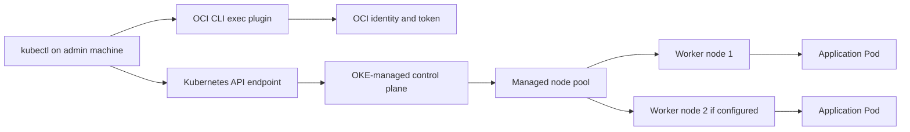

# Creating Clusters, Node Pools, and Configuring kubectl

In the **Kubernetes with OKE** chapter, cluster creation must sit within the overall Oracle Cloud Infrastructure (OCI) architecture: tenancy and compartment hold resources, IAM defines permissions, VCN provides network paths, and Compute supplies capacity to run applications. A cluster operates properly when these layers are configured consistently and clients connect with the right identity.

This lesson walks through creating an Oracle Kubernetes Engine (OKE) cluster, adding a managed node pool, generating a kubeconfig, and verifying with `kubectl`. Commands on a local workstation use **PowerShell**. Resource names are examples; replace all `<...>` values with real values before running.

## 1. Learning Outcomes

After this lesson, learners can:

- Distinguish cluster, control plane, node pool, worker node, and Pod.
- Prepare IAM, networking, quotas, and tools before provisioning resources.
- Create clusters and managed node pools in the right compartment and region.
- Generate a kubeconfig bound to the right OCI CLI profile and authentication context.
- Verify connectivity, access permissions, node status, and a small workload.
- Diagnose errors by layer and reclaim resources after hands-on practice.

## 2. Understanding Components and Operational Responsibilities

| Component | Role | Configuration to Watch |
|---|---|---|
| Cluster | Management scope for Kubernetes objects | Version, cluster type, endpoint, networking |
| Control plane | Provides API, scheduling, maintains desired state | Service configuration and access permissions |
| Node pool | Group of worker nodes sharing provisioning config | Node count, shape, image, subnet, placement, labels |
| Managed worker node | Compute instance running kubelet and containers | Readiness to serve, lifecycle, and node updates |
| Pod | Unit running containers scheduled onto a node | Image, resource requests, application config |
| Kubeconfig | Client cluster access configuration | Endpoint, CA, identity, and context |

OKE manages the service's control plane. Managed nodes run in the user's tenancy under the shared responsibility model; operators still need to manage capacity and worker lifecycle. See [Working with Managed Nodes](https://docs.oracle.com/en-us/iaas/Content/ContEng/Tasks/contengworkingwithmanagednodes.htm).

A cluster can be created before having a node pool. In that case, the API may be reachable, yet there are no workers to run applications. The `Active` status in OCI and node `Ready` status in Kubernetes are two separate pieces of evidence to verify.



The diagram shows main roles and interactions. Network paths, authentication, and action permissions must be verified separately.

## 3. Preparing Lab, Tenancy, and Tools

### 3.1. Illustrative Configuration

| Attribute | Value or Selection Method |
|---|---|
| Compartment | `OkeLab`, dedicated to hands-on practice |
| Cluster | `oke-lab` |
| Kubernetes | Stable version currently supported by OKE in the region |
| API endpoint | Public, restricting admin sources by allowed IP/CIDR |
| Workers | Managed nodes in a private subnet |
| Initial pool | One pool with one node to verify functionality |
| Shape and image | Available capacity, OKE image matching Kubernetes and CPU architecture |
| Pod networking | Record the CNI type chosen in the workflow |
| Kubeconfig | Dedicated file `oke-lab.yaml` |
| OCI tags | For example `environment=lab`, `owner=<owner>` |

One node is suitable to start a lab, but does not provide redundancy if the node fails. When availability is needed, design node counts, placement, and replica distribution according to application requirements.

### 3.2. Checking Region, Quotas, and Capacity

Before creating:

1. Confirm the tenancy is subscribed to a region with OKE.
2. Select the right compartment for cluster, node pools, and networking.
3. Check limits for clusters, Compute, OCPUs, memory, boot volumes, and IP addresses required.
4. Check shape capacity in the planned placement.
5. Define budget and retention time for lab resources.

Quotas and capacity are two different conditions. A tenancy with remaining quota can still face insufficient shape capacity in a specific availability domain. See [Preparing for Kubernetes Engine](https://docs.oracle.com/en-us/iaas/Content/ContEng/Concepts/contengprerequisites.htm).

### 3.3. Installing and Verifying Tools

The workstation needs OCI CLI, `kubectl`, and a configured OCI CLI profile. If using an API signing key, the public key is registered to the OCI user, while the private key is protected on the machine running the CLI. The API signing key serves OCI APIs; a node's SSH key serves OS login.

Refer to [installing OCI CLI](https://docs.oracle.com/en-us/iaas/Content/API/SDKDocs/cliinstall.htm) and [installing kubectl on Windows](https://kubernetes.io/docs/tasks/tools/install-kubectl-windows/).

```powershell
Get-Command oci
Get-Command kubectl
oci --version
kubectl version --client
```

Use `kubectl` within the version range compatible with the API server. Kubernetes supports a client differing by at most one minor version from `kube-apiserver`; also adhere to OKE limits. See [Version Skew Policy](https://kubernetes.io/releases/version-skew-policy/).

Choose a Kubernetes version from the list currently offered by OKE rather than hardcoding a version from an old example. For a new lab cluster, choose the same supported version for the control plane and workers to reduce variables.

## 4. Preparing IAM and Permission Boundaries

Distinguish permissions to manage OCI resources from permissions to manipulate Kubernetes objects. Creating a VCN, node pool, or Compute is an OCI operation; creating a Deployment, reading Pods, or managing a namespace goes through the Kubernetes API.

For example, the `OkeLabOperators` group administering a lab compartment might need these policies:

```text
Allow group OkeLabOperators to manage cluster-family in compartment OkeLab
Allow group OkeLabOperators to manage instance-family in compartment OkeLab
Allow group OkeLabOperators to manage volume-family in compartment OkeLab
Allow group OkeLabOperators to manage virtual-network-family in compartment OkeLab
Allow group OkeLabOperators to inspect compartments in tenancy
```

This is an example of lab administration permissions, not a least-privilege set for every role. Adjust the group for your identity domain; add appropriate scopes if using networks in another compartment or custom encryption keys. Cross-reference [Policy Configuration for Cluster Creation and Deployment](https://docs.oracle.com/en-us/iaas/Content/ContEng/Concepts/contengpolicyconfig.htm).

OCI IAM and Kubernetes RBAC work together to grant permissions in OKE. Broad permissions already granted by IAM are not automatically narrowed by a RoleBinding in a namespace. Review both sides before granting permissions to application teams. See [About Access Control and Kubernetes Engine](https://docs.oracle.com/en-us/iaas/Content/ContEng/Concepts/contengaboutaccesscontrol.htm).

Successfully creating a kubeconfig does not prove the user has permission to list nodes or deploy applications. Test each operation using the actual identity, against the exact resource and namespace.

## 5. Designing Networking for API, Workers, and Pods

### 5.1. Public API Endpoint and Private Workers

The lab uses a public API endpoint so a personal workstation can administer directly, while worker nodes reside in a private subnet. Restrict admin sources by allowed public IP or CIDR; for a laptop behind NAT, this is usually the egress IP of the current network.

Required flows:

| Flow | Purpose |
|---|---|
| Admin machine → API endpoint | Call Kubernetes API, typically via TCP/6443 |
| Workers → API and related OCI services | Node registration and performing work |
| Control plane → workers/Pods | Workload management, including paths for logs/exec |
| Nodes/Pods → registry | Pull container images |
| Cluster components → DNS and each other | Name resolution, communication per CNI |

Cross-reference all routes and security rules for the chosen CNI model. Opening a single port from a laptop only solves one access path. See [Network Resource Configuration](https://docs.oracle.com/en-us/iaas/Content/ContEng/Concepts/contengnetworkconfig.htm).

When both NSGs and security lists exist, review all applied rules. Adding a narrow rule does not disable an existing broad rule. Preserve internal flows required by OKE when modifying administrative access sources.

### 5.2. Outbound Path for Private Workers

Workers need a path to registries and required services. A NAT Gateway can serve internet outbound; a Service Gateway serves supported services in the Oracle Services Network. A Service Gateway does not provide a route to all public registries.

For a sample workload using a public image, verify DNS, routes, and egress to the registry. A node can be `Ready` while a Pod stays `ImagePullBackOff` if the image cannot be pulled.

### 5.3. CNI and Address Capacity

With OCI VCN-Native Pod Networking, Pods use addresses from the pod subnet per OCI's CNI mechanism. When sizing, consider IPs for Pods and the network capacity of the shape. See [OCI VCN-Native Pod Networking](https://docs.oracle.com/en-us/iaas/Content/ContEng/Concepts/contengpodnetworking_topic-OCI_CNI_plugin.htm).

When using Custom Create, check CIDR requirements for the VCN, Pods, and Services to avoid conflicts with existing networks or networks connected via peering/VPN. Document the CNI type and actual network resources for operations.

## 6. Creating a Cluster in the OCI Console

### 6.1. Choosing Workflow and Cluster Type

OKE has two main workflows:

- **Quick Create:** uses many default values and creates required network resources; convenient for a dedicated practice compartment.
- **Custom Create:** provides more explicit configuration choices and uses pre-built networking; suited when VCN, subnets, and security must follow an initial design.

Refer to [Creating Kubernetes Clusters Using Console Workflows](https://docs.oracle.com/en-us/iaas/Content/ContEng/Tasks/contengcreatingclusterusingoke.htm).

Clusters have **basic** and **enhanced** types. Managed node pools work with both; some features such as virtual nodes require an enhanced cluster. Review cluster type, features, and pricing policy on the Review page before creating. Refer to [OKE and Kubernetes Concepts](https://docs.oracle.com/en-us/iaas/Content/ContEng/Concepts/contengclustersnodes.htm).

### 6.2. Performing Quick Create

Find **Kubernetes Clusters (OKE)** in the OCI Console, select the right region and compartment:

1. Select **Create cluster → Quick create**.
2. Enter name `oke-lab`, choose a currently supported stable Kubernetes version.
3. Choose a public API endpoint for access from your personal machine.
4. Choose **Managed**, private workers, compatible shape, and OKE image.
5. Set node count per budget, e.g., one node to verify functionality.
6. Review network configuration, pool, cluster type, and cost, then confirm creation.

The workflow may auto-name the first pool and network resources. Record names and OCIDs for tracking. Details at [Quick Create workflow](https://docs.oracle.com/en-us/iaas/Content/ContEng/Tasks/contengcreatingclusterusingoke_topic-Using_the_Console_to_create_a_Quick_Cluster_with_Default_Settings.htm).

After the network is created, review allowed sources for the API endpoint and restrict them to admin IPs/CIDRs. If you need control over rules right at provisioning time, use Custom Create with pre-configured networking.

Monitor **Work requests** until completion. If an error occurs, read the message and note related resources before retrying; failed cluster creation can leave behind resources that need cleanup.

### 6.3. Performing Custom Create with Existing Networking

Prepare the VCN, endpoint subnet, worker subnet, pod subnet if required by CNI, routes, and security rules. In the workflow, select the exact OCIDs of those resources, then configure node pools as needed.

You can create a cluster without a pool and add workers later to separate control plane provisioning from Compute provisioning. See [Custom Create workflow](https://docs.oracle.com/en-us/iaas/Content/ContEng/Tasks/contengcreatingclusterusingoke_topic-Using_the_Console_to_create_a_Custom_Cluster_with_Explicitly_Defined_Settings.htm).

## 7. Creating and Managing Managed Node Pools

### 7.1. Adding an Additional Pool

Open the cluster, select **Node pools → Add node pool**. For example, add `pool-batch` with one node if budget permits.

| Field | What to Check |
|---|---|
| Compartment | Matches authorized scope |
| Node type | Managed for this lab |
| Kubernetes version | Matches planned config and compatibility limits with control plane |
| Image | OKE image matching Kubernetes version and CPU architecture |
| Shape | Sufficient CPU, RAM, and network capability; available capacity |
| Node count | Desired number of nodes in the pool |
| Placement | Availability domain, fault domain, and worker subnet |
| Kubernetes labels | For example `workload=batch` |
| OCI tags | Owner, environment, and cost tracking |
| Boot volume | Size and encryption choice |

Monitor the work request and created nodes. Refer to [Adding Node Pools](https://docs.oracle.com/en-us/iaas/Content/ContEng/Tasks/contengaddingnodepools_topic.htm).

Application images must also match worker architecture. When switching between x86 and Arm, check container image manifests; running on a laptop does not represent every shape.

### 7.2. Kubernetes Labels and OCI Tags

OCI tags serve cloud resource governance. Kubernetes labels serve identification, filtering, and selection of objects inside the cluster.

If `pool-batch` nodes carry the label `workload=batch`, a Pod template can select them:

```yaml
spec:
  template:
    spec:
      nodeSelector:
        workload: batch
```

This is a Deployment snippet. If no node carries the matching label, Pods may stay `Pending`. Dedicating a pool to a workload may require adding taints/tolerations; a label alone does not create a security boundary. See [Assigning Pods to Nodes](https://kubernetes.io/docs/concepts/scheduling-eviction/assign-pod-node/).

Declare labels in the pool configuration so newly created nodes receive the intended configuration. Labels applied manually to a single node must be accounted for when that node is replaced.

### 7.3. Scaling and Updating

Increasing node count adds infrastructure capacity; increasing replicas adds desired Pod count. Both actions must coordinate so workloads have room to schedule. Refer to [Scaling Kubernetes Clusters and Node Pools](https://docs.oracle.com/en-us/iaas/Content/ContEng/Tasks/contengscalingkubernetesclustersnodepools.htm).

Changing the image or version in pool configuration does not mean existing nodes are updated. Replace nodes via an appropriate workflow while checking for application disruption. See [Creating Worker Nodes with Updated Properties](https://docs.oracle.com/en-us/iaas/Content/ContEng/Tasks/contengupgradingimageworkernode.htm).

Before reducing node count, check resource requests, local data, running workloads, and PodDisruptionBudgets. When HA is required, spread nodes and replicas across appropriate fault domains.

## 8. Inspecting Cluster and Pools with OCI CLI

After the cluster is created, copy the Cluster OCID from the details page. Prepare variables in PowerShell:

```powershell
$ociRegion = '<region-id>'
$ociProfile = 'OKE_LAB'
$ociAuth = 'api_key'
$okeClusterId = '<cluster-ocid>'
$okeCompartmentId = '<compartment-ocid>'
$okeKubeconfig = Join-Path $HOME '.kube\oke-lab.yaml'
```

`OKE_LAB` must match your actual profile. The example uses an API key; if your organization uses a security token, choose the matching profile and auth, ensuring the session is active.

Check the cluster:

```powershell
oci ce cluster get --cluster-id $okeClusterId --region $ociRegion --profile $ociProfile --auth $ociAuth
```

Inspect region, compartment, status, and endpoints. If the CLI reports unauthorized or resource not found, check OCID, region, profile, and policies together.

List node pools:

```powershell
oci ce node-pool list --compartment-id $okeCompartmentId --cluster-id $okeClusterId --all --region $ociRegion --profile $ociProfile --auth $ociAuth
```

The command only lists within the specified compartment. Pools in another compartment must be queried where they reside. See [OCI CLI: node-pool list](https://docs.oracle.com/en-us/iaas/tools/oci-cli/latest/oci_cli_docs/cmdref/ce/node-pool/list.html).

## 9. Generating Kubeconfig and Pinning Authentication Context

### 9.1. Generating a Dedicated Kubeconfig for the Lab

A dedicated file makes the cluster easy to identify. If the file already exists, check existing clusters and contexts before reusing it.

```powershell
New-Item -ItemType Directory -Path (Split-Path -Parent $okeKubeconfig) -Force | Out-Null

$okeKubeconfigArgs = @(
    'ce', 'cluster', 'create-kubeconfig',
    '--cluster-id', $okeClusterId,
    '--file', $okeKubeconfig,
    '--region', $ociRegion,
    '--profile', $ociProfile,
    '--auth', $ociAuth,
    '--token-version', '2.0.0',
    '--kube-endpoint', 'PUBLIC_ENDPOINT',
    '--with-auth-context'
)
oci @okeKubeconfigArgs
if ($LASTEXITCODE -ne 0) {
    throw 'Could not create kubeconfig; check OCI CLI errors before continuing.'
}
```

`--kube-endpoint` selects the endpoint the client uses. `--with-auth-context` writes the current profile/auth selection into the kubeconfig exec command. `--overwrite` overwrites the file and is not needed in this example. Refer to [OCI CLI: create-kubeconfig](https://docs.oracle.com/en-us/iaas/tools/oci-cli/latest/oci_cli_docs/cmdref/ce/cluster/create-kubeconfig.html).

### 9.2. Authentication Mechanism

OKE kubeconfig uses the OCI CLI as an exec plugin to generate short-lived tokens scoped to the cluster and identity. Therefore, the environment running `kubectl` must find `oci` and use the corresponding credentials. Copying kubeconfig to another machine does not grant permissions to the identity on that machine. See [Setting Up Cluster Access](https://docs.oracle.com/en-us/iaas/Content/ContEng/Tasks/contengdownloadkubeconfigfile.htm).

OKE's token version `2.0.0` is distinct from the Kubernetes version number and from the `apiVersion` field in Kubernetes configuration.

Select the file for the current PowerShell session:

```powershell
$okePreviousKubeconfig = $env:KUBECONFIG
$env:KUBECONFIG = $okeKubeconfig
kubectl config get-contexts
kubectl config current-context
kubectl config view --minify
```

Check the endpoint and exec section, especially the profile/auth used. `kubectl config` commands mainly inspect client-side configuration; succeeding does not prove connectivity to the API server.

### 9.3. Managing Contexts

A context binds cluster, user, and default namespace. Verify the context before create/delete operations and explicitly specify namespaces when needed. See [Organizing Cluster Access Using kubeconfig Files](https://kubernetes.io/docs/concepts/configuration/organize-cluster-access-kubeconfig/).

You can rename the context in the lab file:

```powershell
$okeOriginalContext = kubectl config current-context
kubectl config rename-context $okeOriginalContext 'oke-lab'
kubectl config use-context 'oke-lab'
```

When working with multiple clusters, you can pass `--kubeconfig` and `--context` per command. Keep kubeconfigs out of shared repositories and verify the source before using an externally provided kubeconfig.

## 10. Accessing a Private API Endpoint and Cloud Shell

With a private API endpoint, generate kubeconfig pointing to `PRIVATE_ENDPOINT`. Changing this parameter only changes the target address; it does not create a network path from a laptop into the VCN.

Prepare an authorized administrative path: a machine inside the VCN, a network connected via VPN/FastConnect, or an OCI Bastion solution configured for the cluster. Check routes, DNS, firewalls, and NSGs/security lists along the entire path.

If using a tunnel, follow OCI's cluster access instructions, including endpoint configuration and proper TLS verification. Properly resolve differences between tunnel addresses and certificate names instead of skipping API server verification.

Cloud Shell provides an OCI tooling environment, yet reaching the endpoint still depends on networking. A rule allowing only your laptop's egress IP may not allow Cloud Shell. Logging into the Console also does not create a path to a private endpoint.

On the cluster page, select **Access cluster** to get local access or Cloud Shell access instructions. Generate kubeconfig in the same environment where `kubectl` runs; the lesson's PowerShell examples must be converted to Bash syntax if run in Cloud Shell.

## 11. Verifying Connectivity, Permissions, and Node Status

### 11.1. API and Network Path

```powershell
kubectl cluster-info
kubectl version
```

Output should show the client communicating with the target server. If multiple contexts exist, verify you are using the intended cluster.

Test TCP from Windows:

```powershell
$okeApiEndpoint = kubectl config view --minify -o jsonpath='{.clusters[0].cluster.server}'
$okeApiUri = [Uri]$okeApiEndpoint
Test-NetConnection -ComputerName $okeApiUri.Host -Port $okeApiUri.Port
```

TCP success only confirms a path to the port. TLS, authentication, and action permissions still must be checked through the Kubernetes API.

### 11.2. Permissions and Workers

```powershell
kubectl auth can-i list nodes
kubectl get nodes -o wide
kubectl get nodes -L workload,kubernetes.io/arch,topology.kubernetes.io/zone
kubectl get pods -n kube-system -o wide
```

Expect the number of worker nodes to match provisioned pools and nodes to be in `Ready` state. Names, IPs, and versions depend on the environment. The OKE-managed control plane normally does not appear as user-operable worker nodes.

Users with namespace-only permissions may encounter `Forbidden` when reading nodes. Administrators check cluster-level resources with an appropriate identity; deployers verify required permissions inside their assigned namespaces.

When a node has issues:

```powershell
kubectl describe node <node-name>
kubectl get events -A --sort-by=.metadata.creationTimestamp
```

Cross-reference Kubernetes events with work requests and Compute status. A running Compute instance does not yet prove kubelet registered successfully and the node is ready.

## 12. Running a Small Workload to Verify

This section checks scheduling, image pull, and HTTP response. You need permission to create a namespace or ask an administrator to pre-create `oke-lab`.

```powershell
kubectl create namespace oke-lab
kubectl auth can-i create deployments.apps -n oke-lab
kubectl auth can-i get pods -n oke-lab
kubectl auth can-i create pods/portforward -n oke-lab
```

If the namespace already exists, confirm it is the right environment before continuing. If permissions are missing, handle per assigned role.

Save the following manifest as `oke-smoke.yaml` in the working directory on the machine running `kubectl`:

```yaml
apiVersion: apps/v1
kind: Deployment
metadata:
  name: oke-smoke
  namespace: oke-lab
spec:
  replicas: 1
  selector:
    matchLabels:
      app: oke-smoke
  template:
    metadata:
      labels:
        app: oke-smoke
    spec:
      containers:
        - name: web
          image: nginx:stable-alpine
          ports:
            - name: http
              containerPort: 80
          resources:
            requests:
              cpu: 100m
              memory: 64Mi
            limits:
              cpu: 500m
              memory: 128Mi
          readinessProbe:
            httpGet:
              path: /
              port: http
            initialDelaySeconds: 2
            periodSeconds: 5
```

The `stable-alpine` tag is a convenient example whose contents can change over time. For reproducibility, choose a verified image and pin its digest. Confirm architecture, path to the registry, and namespace security policies. If restrictive Pod Security applies, use an image and security context meeting that policy.

```powershell
kubectl apply -f .\oke-smoke.yaml
kubectl -n oke-lab rollout status deployment/oke-smoke --timeout=180s
kubectl -n oke-lab get pods -o wide
```

Deployment maintains the desired replica count via a controller loop; refer to [Kubernetes Deployments](https://kubernetes.io/docs/concepts/workloads/controllers/deployment/).

When the Pod is ready, run in the first terminal:

```powershell
kubectl -n oke-lab port-forward deployment/oke-smoke 8080:80
```

Keep that terminal running. In another PowerShell terminal on the same machine:

```powershell
(Invoke-WebRequest -Uri 'http://127.0.0.1:8080').StatusCode
```

Expect HTTP `200`. Port-forward verifies one path to the Pod through the API; this result does not confirm public ingress, a `LoadBalancer` Service, or DNS between Pods. See [Use Port Forwarding](https://kubernetes.io/docs/tasks/access-application-cluster/port-forward-access-application-cluster/).

If `pool-batch` exists and a node carrying `workload=batch` is `Ready`, add `nodeSelector` to `spec.template.spec` in the manifest, re-apply, and observe the `NODE` column. The selector snippet in the node pools section shows the exact location for that configuration.

## 13. Layer-by-Layer Troubleshooting

| Symptom | Check First |
|---|---|
| `oci` or `kubectl` not found | Installation, PATH, and current terminal |
| OCI CLI reports unauthorized/resource not found | Profile, auth, region, OCID, compartment, IAM |
| Have kubeconfig, but timeout | Endpoint, routes, source IP, NSGs/security lists, and path to VCN |
| `exec: executable oci not found` | PATH of the process actually running `kubectl` |
| `Unauthorized` | Identity, API key/security token session, and authentication context |
| `Forbidden` | IAM/RBAC for exact verb, resource, and namespace |
| Certificate or hostname error | CA, endpoint, context, proxy/tunnel, and machine clock |
| No workers yet | Pool not provisioned, quota/capacity, or node not registered |
| Node `NotReady` | Conditions, kubelet, CNI, resources, and networking |
| Pod `Pending` | Requests, selector, taints, available IPs, and scheduling events |
| `ImagePullBackOff` | Image/tag, registry credentials, DNS, egress, and architecture |
| Pod running, but HTTP not ready | Readiness probe, application, logs, and listening port |

Gather evidence in the lab namespace:

```powershell
kubectl -n oke-lab describe deployment oke-smoke
kubectl -n oke-lab describe pod <pod-name>
kubectl -n oke-lab logs deployment/oke-smoke
kubectl -n oke-lab get events --sort-by=.metadata.creationTimestamp
```

If reading nodes succeeds while `logs`, `exec`, or port-forward fails, check both subresource permissions and the control plane–worker communication path. Connecting from a laptop to the API only verifies one part of the system.

For provisioning errors, record the work request OCID, timestamp, message, and related configuration before retrying. Changing one layer at a time makes isolating root causes easier.

## 14. Cost, Automation, and Lab Cleanup

### 14.1. Track Remaining Resources

Costs can include cluster type, Compute workers, boot volumes, networking, traffic, and additional resources such as load balancers or persistent volumes. Even when no application Pods exist, Compute and storage may still be provisioned.

Track via tags and compartments, use current regional unit prices, and set lab retention limits. Reducing node counts does not reclaim all related resources. Budgets/alerts help monitor spend; resource cleanup procedures still must be run explicitly.

### 14.2. Record Configuration for Reproducibility

Save in operational docs or project IaC configuration:

- Region, compartment, cluster type, and Kubernetes version.
- VCN, subnets, CNI, endpoint, and permitted admin sources.
- Shape, image, architecture, node count, placement, labels, and tags of each pool.
- Authentication method, permission model, registries, and encryption dependencies.
- Monitoring, owners, and update procedures.

You can use Terraform/OCI Resource Manager to reproduce the configuration. The cluster creation workflow has an option to save as a stack at appropriate steps; review variables and state before reusing. Identities for automation must have permissions scoped to the running environment.

### 14.3. Cleaning Up After Practice

Stop port-forward with `Ctrl+C`. Check the context, then delete the lab-only namespace:

```powershell
kubectl config current-context
kubectl delete namespace oke-lab
```

Wait for objects to be reclaimed. If you created additional `LoadBalancer` Services, PVCs, or resources outside the sample manifest, verify reclamation outcomes per controllers and reclaim policies before deleting the cluster.

In the OCI Console:

1. Confirm the cluster and pools belong to the right lab.
2. Delete the cluster and monitor the work request until completion.
3. Check for remaining volumes, load balancers, VCNs, subnets, gateways, and related resources.
4. Delete network resources only after confirming no other system uses them.

OKE does not automatically delete all related resources when deleting a cluster. See [Deleting Kubernetes Clusters](https://docs.oracle.com/en-us/iaas/Content/ContEng/Tasks/contengdeletingcluster.htm).

Restore `KUBECONFIG` if you saved its previous value in the same PowerShell session:

```powershell
$env:KUBECONFIG = $okePreviousKubeconfig
```

## 15. Verifying Lab Outcomes

| Outcome | Evidence |
|---|---|
| Cluster in right scope | Region, compartment, OCID, and succeeded work request |
| Pools provisioned properly | Node count, shape, image, subnet, and placement |
| Client uses right identity | Matching endpoint, profile, auth, and context |
| API and permissions work | Required operations succeed |
| Workers run workloads | Nodes `Ready`, rollout succeeded, Pod assigned to node |
| Test HTTP path works | HTTP `200` via port-forward |
| Resources managed after lab | Configuration recorded, unused resources reclaimed |

This evidence establishes the initial foundation for working with OKE. When bringing applications to production, continue designing and verifying availability, data protection, workload security, monitoring, and upgrade workflows against actual requirements.
