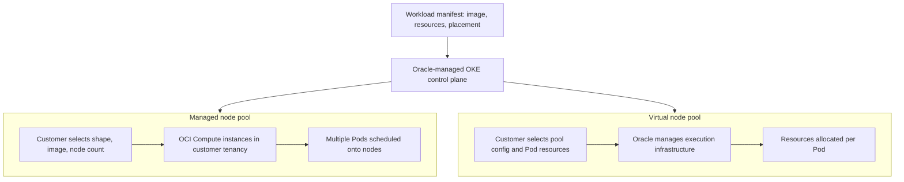
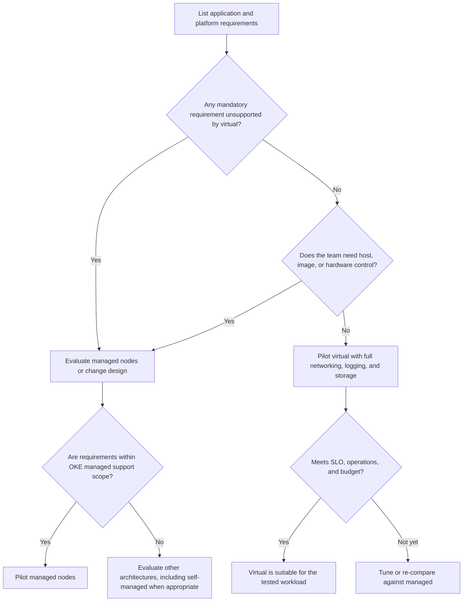

# Managed Nodes, Virtual Nodes, and Choosing a Deployment Model

## 1. Purpose of the Deployment Decision

In the **Kubernetes with OKE** chapter of the Oracle Cloud Infrastructure (OCI) learning path, choosing a node type is a decision about resources, control, and the operational workload the team must take on. This decision directly touches Compute, VCN, IAM, storage, monitoring, and cost.

This lesson focuses on two OKE models:

- **Managed nodes:** run workloads on OCI Compute instances provisioned by OKE in the customer's tenancy.
- **Virtual nodes:** run workloads with Oracle-managed node infrastructure, allocating resources at the Pod level.

The team must be able to answer: where workloads run, who manages the servers, how resources are provisioned, and what requirements could disqualify a model.

After this lesson, learners can distinguish both models, verify workload compatibility, organize a cluster using multiple node types, and build a deployment plan backed by evidence for availability, observability, and cost.

The running example is a Java application named `orders-api`, connecting to an Oracle database service over a private network. Resource numbers in this lesson are illustrative assumptions, not recommended settings for every Java application.

## 2. Understanding Managed and Virtual Accurately

### 2.1. Managed Nodes: OKE Provisions Nodes, Customer Organizes Operations

A managed node is an OCI Compute instance, which can be a virtual machine or bare metal depending on supported options. OKE organizes nodes into a managed node pool. You select attributes such as shape, image, placement, networking, and node count. You also organize capacity and worker node upgrades. [Source: Comparing managed with virtual nodes](https://docs.oracle.com/en-us/iaas/Content/ContEng/Tasks/contengcomparingmanagednodeswithvirtualnodes_topic.htm).

For example, a team creates one pool for Java services and a separate pool for infrastructure components. When an application needs more capacity, the team increases pool size or uses a properly configured autoscaler. When OS updates are needed, the team schedules adopting a new image.

The word "managed" does not exempt the customer from worker responsibilities. OKE provides provisioning and Kubernetes software update mechanisms, while operations remain a shared responsibility. [Source: Working with managed nodes](https://docs.oracle.com/en-us/iaas/Content/ContEng/Tasks/contengworkingwithmanagednodes.htm).

### 2.2. Virtual Nodes: Focus on Pods Instead of Servers

Virtual nodes provide a serverless Kubernetes experience. Oracle manages the virtual nodes and underlying execution infrastructure; users create a virtual node pool and declare workload CPU and memory needs. This model reduces work on server capacity management, patching, and node infrastructure upgrades. [Source: Working with virtual nodes](https://docs.oracle.com/en-us/iaas/Content/ContEng/Tasks/contengworkingwithvirtualnodes.htm).

A virtual node is not a VM that engineers can SSH into to install packages or edit host configuration. Diagnostics and auxiliary tooling deployment must fit the feature surface provided by the service.

### 2.3. Both Worker Types Share a Managed Control Plane



The diagram highlights the resource control unit. Both models still require networking, permissions, images, health checks, observability, and a data plan.

**Cluster type** is a separate choice: managed nodes can be used in basic or enhanced clusters; virtual nodes require an enhanced cluster. Needing workload identity or add-on management capabilities can also influence the cluster type decision. [Source: Comparing basic and enhanced clusters](https://docs.oracle.com/en-us/iaas/Content/ContEng/Tasks/contengcomparingenhancedwithbasicclusters_topic.htm).

Self-managed nodes are a different model in which the customer creates Compute instances themselves to join OKE. They do not belong to an OKE node pool and are only used with enhanced clusters. Do not call a managed node that the team has SSH access to a "self-managed node." [Source: Self-managed nodes](https://docs.oracle.com/en-us/iaas/Content/ContEng/Tasks/contengworkingwithselfmanagednodes.htm).

## 3. Managed Nodes: Designing from Server Capacity

### 3.1. Attributes to Decide for a Pool

| Decision Group | Content to Document | Impacts to Consider |
| --- | --- | --- |
| Compute | Shape, CPU, memory, processor architecture | Ability to run images and Pod density |
| Image | Supported image, OS version | Patches, platform tools, node reproducibility |
| Kubernetes | Worker version compatible with control plane | Upgrade conditions and add-on operation |
| Placement | Region, AD/FD, node count per location | Fault tolerance and capacity expansion |
| Networking | Subnet, CNI, NSG, outbound path | Registry, OCI services, and data connectivity |
| Scheduling | Labels, taints, pool constraints | Which workloads are allowed to run on the pool |
| Lifecycle | Scaling, maintenance, and node replacement methods | Disruption and on-call team workload |

A shape existing in OCI Compute does not mean all shapes work with every OKE worker type. Check OKE's supported image/shape list and regional availability. [Source: Supported images and shapes](https://docs.oracle.com/en-us/iaas/Content/ContEng/Reference/contengimagesshapes.htm).

### 3.2. Machine CPU Is Not All Resources Available to Applications

A node needs resources for the OS, kubelet, container runtime, and other components. What Kubernetes publishes as `allocatable` must still be shared between platform Pods and applications. When diagnosing resource shortages, compare `capacity`, `allocatable`, and requested resources. [Source: Node and Pod issues on OKE](https://docs.oracle.com/en-us/iaas/Content/ContEng/Tasks/contengtroubleshooting_topic-node_issues.htm).

In a hypothetical example, after accounting for system overhead and platform workloads, each node has a remaining application budget of **3 CPU and 10 GiB RAM**. There are eight Pods, each requesting **0.5 CPU and 1 GiB RAM**:

```text
Total application requests:
  CPU = 8 × 0.5 = 4 CPU
  RAM = 8 × 1 = 8 GiB

Lower bound by total resources:
  By CPU: ceil(4 / 3) = 2 nodes
  By RAM: ceil(8 / 10) = 1 node
  Pick the larger lower bound: 2 nodes
```

Two nodes is the lower bound under these assumptions. This number does not yet account for fault tolerance, Pod distribution, IP limits, Pod count limits, or extra capacity during rollouts.

If three nodes are provisioned and one is lost, the two remaining nodes still have a combined budget of 6 CPU and 20 GiB RAM under the assumptions. However, whether Pods can actually reschedule still depends on remaining constraints. Summing resources does not replace placement checks.

An example of fragmentation: three nodes each have only 1 GiB RAM left, while a new Pod needs 2 GiB. Total free RAM is 3 GiB, yet no single node has room for that Pod.

### 3.3. Requests and Limits Are Still Needed on Managed Nodes

Choosing a large node does not replace declaring container resources:

```yaml
# Resources section of a container on managed nodes.
resources:
  requests:
    cpu: "500m"
    memory: "1Gi"
  limits:
    cpu: "2000m"
    memory: "2Gi"
```

The example expresses a reservation lower than the usage limit. Values must be based on real measurements; how much extra CPU can be used also depends on headroom and contention on the node. For Java, memory limits must cover heap, native memory, thread stacks, and off-heap components.

Declaring resources aids capacity planning and reduces the risk of one workload consuming too much shared capacity. Oracle also recommends setting requests and limits on workloads. [Source: Cluster management best practices](https://docs.oracle.com/en-us/iaas/Content/ContEng/Tasks/contengbestpractices_topic-Cluster-Management-best-practices.htm).

## 4. Virtual Nodes: Designing from Pod Resources

### 4.1. Do Not Reuse Managed Node Allocation Assumptions As-Is

With virtual nodes, OKE calculates resources from the containers configured in the Pod, including overhead for runtime/kube-proxy and rounding rules. Current documentation notes rounding up to whole OCPUs and whole GBs of memory. Do not treat small requests in a manifest directly as the final billed resource amount. [Source: Resource allocation for Pods on virtual nodes](https://docs.oracle.com/en-us/iaas/Content/ContEng/Tasks/contengvirtualnodepodresourceallocation.htm).

Example of resources setting requests equal to limits:

```yaml
# Resources section of a container on virtual nodes.
resources:
  requests:
    cpu: "2"
    memory: "2Gi"
  limits:
    cpu: "2"
    memory: "2Gi"
```

The current virtual nodes support matrix does not support requests differing from limits. Therefore, do not simply copy the `500m/2000m` configuration from the managed example onto virtual and expect the same behavior. [Source: Virtual nodes support matrix](https://docs.oracle.com/en-us/iaas/Content/ContEng/Tasks/contengcomparingvirtualwithmanagednodes_topic.htm).

### 4.2. Distinguish Kubernetes CPU, vCPU, and OCPU

Do not assume `cpu: "1"` in a manifest equals one billed OCPU. Conversion depends on shape and architecture; for instance, x86 typically has two vCPUs per OCPU, while Arm lines also have different conversions. When comparing, use the conversion for the exact shape. [Source: OCI Compute shapes — OCPU and vCPU](https://docs.oracle.com/en-us/iaas/Content/Compute/References/computeshapes.htm).

Memory units must also align: `Gi` in manifests is GiB, whereas configuration tables or service documentation may express GB. An accurate spreadsheet needs unit columns and the actual allocated resources.

### 4.3. Multiple Containers in a Pod Mean Multiple Needs to Sum

Suppose a Pod has an application container, a telemetry exporter container, and an internal integration sidecar. Resources for all three must be included in the evaluation.

This leads to two practical steps:

1. When adding a sidecar, re-measure total resources and Pod startup time.
2. When comparing managed vs. virtual, keep observability and security features identical; if one side lacks those features, the comparison is not apples-to-apples.

A small sidecar can change the post-rounding allocated resources. Therefore, optimizing requests must be paired with measurement and checking final allocation, rather than just trimming a few millicores in the manifest.

### 4.4. Serverless Still Has Limits

Virtual nodes do not eliminate constraints such as service limits, quotas, subnet IPs, supported shapes, or provisioning capacity. OCI enforces Compute core and memory limits for Pods running on virtual nodes. [Source: OKE Prerequisites](https://docs.oracle.com/en-us/iaas/Content/ContEng/Concepts/contengprerequisites.htm).

Distinguish:

- **Service limit:** service limit applied to the tenancy.
- **Compartment quota:** organizational limit imposed at the compartment scope.
- **Actual provisioning capacity:** resources that can be allocated in the requested location at that moment.

Limits and quotas come from different sources; having sufficient quota is not a guarantee that an allocation request will immediately succeed. [Source: OCI Service Limits](https://docs.oracle.com/en-us/iaas/Content/General/service-limits/overview.htm).

## 5. Check Compatibility Before Comparing Benefits

### 5.1. Requirements That Can Rule Out Virtual Nodes

The following table summarizes several virtual node constraints in current Oracle documentation:

| Requirement | Capability on Virtual Nodes |
| --- | --- |
| SSH into node, custom cloud-init | Not supported |
| DaemonSet-based agents | Not supported |
| Kubernetes NetworkPolicy | Not supported |
| Init containers | Not supported |
| PVC using Block Volume | Not supported; PVCs supported with File Storage |
| `kubectl exec`, `kubectl port-forward` | Not supported per current matrix |

[Source: Virtual nodes capabilities and limitations](https://docs.oracle.com/en-us/iaas/Content/ContEng/Tasks/contengcomparingvirtualwithmanagednodes_topic.htm).

Limits can change with service updates; when deploying, re-check documentation for your region and configuration.

For existing workloads, list dependencies from manifests, Helm charts, operators, agents, and runbooks. A stateless API might still depend on an init container to load configuration, a host security agent, or `exec` during incident response. Looking only at application source code misses these conditions.

If a mandatory requirement is unsupported, there are three evaluation paths: keep the workload on managed nodes, change how the requirement is met, or revisit the application architecture. Changing a security or storage solution must be confirmed by the responsible team with test results.

### 5.2. Networking and Load Balancers Must Match the Node Type

Virtual nodes use VCN-native pod networking. Oracle's official network configuration example uses a private subnet for virtual nodes/Pods with matching routes and security rules; the path from load balancer to backends must be configured for the virtual model. Do not copy a managed nodes rule set just because both use a VCN. [Source: Network example for virtual nodes](https://docs.oracle.com/en-us/iaas/Content/ContEng/Concepts/contengnetworkconfig-virtualnodes.htm).

For `orders-api`, explicitly document the paths:

- CI → Kubernetes API for deployment.
- Workload → registry for pulling images.
- Load balancer → backends and health checks.
- Pod → Oracle database.
- Pod → telemetry services or external services when needed.

Then cross-reference subnets, NSGs, security lists, and routes for each path. A Running Pod with a load balancer reporting unhealthy backends may be a health-check path issue rather than CPU shortage.

NSGs and Kubernetes NetworkPolicy have different scopes and enforcement mechanisms. When switching models, re-verify actual network isolation requirements and prove the new design meets them.

### 5.3. Storage Class Is Part of the Placement Decision

If a workload has PVCs, inspect the storage class and the actual backing service behind the volume. You cannot rely solely on a workload using standard Kubernetes objects to conclude it can move to every node type.

For example, if a component depends on Block Volume, moving only the Deployment to virtual nodes is not a data migration plan. The team must decide whether to keep that component on managed nodes or redesign data persistence, then verify consistency and recoverability.

Java applications connecting to an external database are generally easier to decouple from Pod lifecycles. Even so, increasing replica counts can still raise total database connections:

```text
Max connections by application pool config
  ≈ replica count × connection limit per replica

Example: 6 replicas × 20 connections = 120 connections
```

This calculation assumes each replica has one corresponding pool. Add other pools or components if the application uses multiple data sources.

### 5.4. Observability Needs a Working Design

On managed nodes, log collection can be set up via tooling on Compute instances when agent, permission, and log configuration requirements are met. [Source: Application logs on managed nodes](https://docs.oracle.com/en-us/iaas/Content/ContEng/Tasks/contengviewingworkernodelogs.htm).

On virtual nodes, Oracle documents viewing stdout/stderr with `kubectl logs` or sending logs to persistent storage; one option is a logging sidecar. Do not assume a host-level agent from an older design automatically follows the workload into the new model. [Source: Application logs on virtual nodes](https://docs.oracle.com/en-us/iaas/Content/ContEng/Tasks/contengviewingapplicationlogs-virtualnodes.htm).

Before moving `orders-api`, be able to answer: do logs reach the central system, can they be searched by request ID, who can access them, and do logs persist after a Pod terminates? A model with less server management still needs enough data to troubleshoot application incidents.

## 6. How Scaling and Upgrades Differ

### 6.1. Separate Replica Count from Node Count

| Mechanism | What It Changes | Scope to Watch |
| --- | --- | --- |
| Horizontal Pod Autoscaler (HPA) | Workload replica count | Requires an appropriate metrics source |
| Cluster Autoscaler | Size of managed node pools | Not used for virtual node pools |
| Vertical Pod Autoscaler (VPA) | Container resource needs | OKE documentation currently limits VPA to managed node pools |
| Virtual execution infrastructure | Resources serving Pods | Oracle managed; still requires workload configuration and service limits |

HPA can be used with managed and virtual node pools, but the metrics source deployment must fit the model. Do not infer from generic "autoscaling" descriptions that all autoscalers work identically across both node types. [Source: Autoscaling node pools and Pods on OKE](https://docs.oracle.com/en-us/iaas/Content/ContEng/Tasks/contengautoscalingclusters.htm).

For example, HPA scales `orders-api` from three to six replicas. With managed nodes, there must be nodes with room or a mechanism to add nodes. With virtual nodes, the team focuses on resource provisioning for the new Pods and related limits. In both cases, measure the time from demand spike until new Pods actually become Ready.

Scaling speed is also affected by image pull, JVM startup, warm-up, and database connections. Changing node types does not automatically make those steps disappear.

### 6.2. Managed Nodes Need a Clear Worker Replacement Plan

With a managed node pool, modifying the image attribute only applies to new nodes; existing nodes keep the previous attribute until updated via a corresponding replacement or cycling mechanism. You can update in-place within a pool or create a new pool and migrate workloads. [Source: Updating worker node attributes](https://docs.oracle.com/en-us/iaas/Content/ContEng/Tasks/contengupgradingimageworkernode.htm).

An operational procedure should include:

1. Identify supported target versions and images.
2. Test the application and add-ons in an appropriate environment.
3. Prepare capacity for shifting workloads and surge Pods.
4. Execute by selected scope.
5. Verify actual nodes, workload status, and business behavior.
6. Conclude once criteria are met, rather than merely when the update request is accepted.

For example, a pool pointing to a new image while some nodes still run the old image is a state that must be caught before closing maintenance.

### 6.3. Virtual Nodes Reduce Infrastructure Actions, Yet Pods Still Move

When upgrading the cluster's Kubernetes version, OKE upgrades virtual nodes alongside the control plane in a coordinated process. During this process, Pods are evicted and rescheduled to use the matching components. Oracle recommends multiple replicas distributed across ADs/FDs and configuring PDBs to support availability. [Source: Upgrading virtual nodes](https://docs.oracle.com/en-us/iaas/Content/ContEng/Tasks/contengupgradingvirtualnodes.htm).

Application teams must therefore still prepare for Pod replacement: ephemeral data can be lost, connections must be re-established, and in-flight work needs proper completion or retry mechanisms.

For example, an order-processing consumer should be able to reprocess messages without creating duplicate transactions. This is an application property that must be designed regardless of how nodes are managed.

## 7. Choosing a Model Using Mandatory Requirements and Evidence

### 7.1. Decision Sequence



The diagram is a design reasoning flow. It does not replace the support matrix and does not declare a single best node type for every system.

### 7.2. Common Scenarios

| Workload or Organizational Trait | Reasonable Evaluation Path | Required Evidence |
| --- | --- | --- |
| Stateless API, no host dependencies | Pilot virtual, measuring cost and scaling time | Logs, metrics, data connectivity, and rollouts all work |
| Steady service, many small Pods | Compare packing on managed vs. actual virtual allocation | Utilization, headroom, and rounding impact |
| Mandatory agent running on every host | Prioritize testing managed nodes | Agent supported and survives node lifecycle |
| Workload with special storage or hardware | Check drivers, shapes, and node types first | Support matrix verification and functional tests |
| Short jobs with bursty load | Test fast provisioning, resources, and cleanup | Completion time, full Job lifecycle cost |
| Team with low OS maintenance capacity | Consider virtual if workload is compatible | Runbooks do not rely on host access |
| Multiple workloads with differing needs | Evaluate separate pools or separate clusters | Placement, permissions, and blast radius controlled |

"Prioritize testing" or "consider" are evaluation directions, not automatic conclusions. For example, variable load might benefit from a model that avoids keeping idle servers, yet allocation rules and sidecar resources can also shift cost outcomes.

### 7.3. Three Distinct Outcomes During Piloting

Separate three questions:

1. **Runs:** containers start and perform their function.
2. **Operable:** observability data, diagnostics, releases, and error handling are in place.
3. **Meets targets:** satisfies latency, recovery, security, and budget requirements.

A demo proving only the first question is not enough to accept production operations. The decision table should record outcomes for all three rather than just marking "Pod Running."

## 8. Combining Managed and Virtual in the Same Cluster

### 8.1. Mixed Clusters Are a Supported Capability

Oracle added support for a single cluster having both managed node pools and virtual node pools; the same cluster can also include self-managed nodes. Thus, the choice does not have to be migrating an entire cluster to one worker type. [Source: Mixed-node cluster support announcement](https://docs.oracle.com/en-us/iaas/releasenotes/conteng/conteng-Mixed-node-clusters-support-Release-Note.htm).

For example, a design can keep host-dependent components on a managed pool while moving compatibility-proven workloads to a virtual pool. However, multiple pool types also add work for managing placement, add-ons, permissions, and runbooks.

A mixed cluster shares one control plane. If requirements demand separating cluster admin permissions or reducing blast radius between independent systems, evaluate separate clusters as well. Separate pools alone do not create that full security boundary.

### 8.2. Use Labels for Placement, Taints to Block Unsuitable Workloads

Suppose the team configures self-managed labels:

| Pool | Illustrative Label |
| --- | --- |
| Managed pool | `learning.example.com/execution=managed` |
| Virtual pool | `learning.example.com/execution=virtual` |

The virtual pool adds an illustrative taint `learning.example.com/execution=virtual:NoSchedule`. This is an example convention, not an Oracle default label/taint name. OKE allows configuring Kubernetes labels and taints on virtual node pools. [Source: Updating virtual node pool attributes](https://docs.oracle.com/en-us/iaas/Content/ContEng/Tasks/contengmodifyingvirtualnodepool.htm).

Pods targeting the virtual pool need a matching selector and a toleration for that taint:

```yaml
# Place in spec.template.spec of a Deployment.
nodeSelector:
  learning.example.com/execution: virtual
tolerations:
  - key: learning.example.com/execution
    operator: Equal
    value: virtual
    effect: NoSchedule
```

A toleration lets a Pod pass the matching taint; it does not force the Pod onto a specific pool. A selector or node affinity expresses the node selection requirement. Other conditions such as resources and remaining taints are still evaluated. [Source: Kubernetes — Taints and Tolerations](https://kubernetes.io/docs/concepts/scheduling-eviction/taint-and-toleration/).

In operations, maintain labels/taints via pool configuration so new nodes also receive the right settings. Before applying selectors, inspect actual labels and taints; missing one label can leave all new Pods unscheduled.

## 9. Example Deployment Targeting a Virtual Pool

### 9.1. Example Prerequisites

The example below assumes:

- The cluster is an enhanced cluster and already has a virtual node pool.
- The pool carries the team-configured label and taint as in the previous section; any other actual taints have also been reviewed.
- Namespace `orders` exists, and networking and deployment permissions are ready.
- The real image matches the pod shape's CPU architecture and is pullable from the registry.
- The application exposes corresponding health check endpoints.
- Quotas and limits allow running the Pod count, resources, and rollout surge.

`registry.example.com` is a placeholder address. This manifest illustrates placement and resources; it does not yet include Service, ingress, database config, OCI calling identity, or full production requirements.

### 9.2. Illustrative Manifest

```yaml
apiVersion: apps/v1
kind: Deployment
metadata:
  name: orders-api-virtual
  namespace: orders
spec:
  replicas: 3
  selector:
    matchLabels:
      app: orders-api
      track: virtual
  strategy:
    type: RollingUpdate
    rollingUpdate:
      maxUnavailable: 0
      maxSurge: 1
  template:
    metadata:
      labels:
        app: orders-api
        track: virtual
    spec:
      nodeSelector:
        learning.example.com/execution: virtual
      tolerations:
        - key: learning.example.com/execution
          operator: Equal
          value: virtual
          effect: NoSchedule
      containers:
        - name: api
          image: registry.example.com/training/orders-api:1.0.0
          ports:
            - name: http
              containerPort: 8080
          resources:
            requests:
              cpu: "2"
              memory: "2Gi"
            limits:
              cpu: "2"
              memory: "2Gi"
          startupProbe:
            httpGet:
              path: /health/startup
              port: http
            periodSeconds: 5
            failureThreshold: 36
          readinessProbe:
            httpGet:
              path: /health/ready
              port: http
            periodSeconds: 5
          livenessProbe:
            httpGet:
              path: /health/live
              port: http
            periodSeconds: 10
```

The manifest expresses four intents:

1. Run on the node group labeled `virtual`.
2. Allow Pods to tolerate that group's illustrative taint.
3. Set requests equal to limits per the virtual model.
4. Use health checks and rolling updates to manage the application lifecycle.

Three replicas do not automatically guarantee distribution across different fault domains. Configure and verify placement across AD/FD matching the region, along with workload topology. If a PDB is needed, select a level aligned with replica count and drain capability; a PDB does not replace spare capacity.

`maxSurge: 1` can create one extra Pod. If quota only covers exactly three Pods, rollouts may stall unexpectedly. Include maintenance states in capacity sizing rather than sizing solely for steady state.

### 9.3. When Moving to a Managed Pool

In a configuration for managed nodes, the team can use selector `learning.example.com/execution: managed`, remove the illustrative virtual toleration, and re-select requests/limits after measurement. Verify images, CNI, storage, logs, and corresponding dependencies.

Do not change only the selector and declare the migration complete. If Pods have very large requests chosen for virtual, keeping them unchanged may exhaust space in the managed pool; using requests that are too small may fail to satisfy the application.

A node selector also does not create a "if virtual runs out of room, automatically run on managed" mechanism. A constraint selecting `virtual` means Pods wait when no matching node is available. If a fallback option is needed, explicitly design placement, resources, and traffic routing.

## 10. Comparing Costs Using the Same Service Objective

### 10.1. Two Cost Allocation Models

With managed nodes, Compute costs tie to the instances serving workloads. When nodes have spare room, that cost still belongs to the node operating budget. With virtual nodes, the focus shifts to resources allocated to Pods and related service charges. [Source: Managed nodes model](https://docs.oracle.com/en-us/iaas/Content/ContEng/Tasks/contengcomparingmanagednodeswithvirtualnodes_topic.htm), [virtual nodes model](https://docs.oracle.com/en-us/iaas/Content/ContEng/Tasks/contengworkingwithvirtualnodes.htm).

A conceptual comparison framework:

```text
Managed:
  Cluster cost
  + total cost of nodes over usage duration
  + boot volumes, storage, and dependent resources
  + maintenance, observability, and headroom effort

Virtual:
  Cluster/virtual nodes cost per applicable rate card
  + total Pod resources allocated during billed duration
  + storage and dependent resources
  + integration, observability, and application operations effort
```

This framework is not a price list or complete billing formula. When estimating, use current rates for the exact region, shape, contract, and billing units; separate staffing effort from service fees for transparent evaluation.

### 10.2. Data Points to Keep Equivalent

| Data Point | Why It Is Needed |
| --- | --- |
| Same requirements and business load | Avoid comparing an idle setup on one side against a loaded setup on the other |
| Same latency and error-rate targets | Cheaper resources that miss targets are not a viable option |
| Actual allocated resources vs. usage | Reveals headroom, rounding, and unused allocations |
| Same logs, metrics, and security requirements | Avoids omitting sidecar or agent costs |
| Traffic to databases and other services | Reveals impacts on external-to-cluster resources |
| Behavior during scaling, rollouts, and failures | Reveals transient demand outside steady state |

For example, a workload with many small Pods can utilize spare room on managed nodes. With virtual, evaluate allocated amounts after service rounding rules. Conversely, keeping many nodes just waiting for brief load spikes can also create significant reserve costs. Results must come from the specific workload's model and measurements.

Low CPU utilization does not automatically mean low Compute cost. The team needs to know which provisioned resources they pay for, how long they are held, and why they must be kept.

### 10.3. Completed Jobs Do Not Always End Billing Lifecycle

Oracle notes that Jobs running on virtual nodes continue to be billed for consumed resources as long as the Job still exists, even after Complete or Failed. Job plans need a cleanup step after completion. [Source: Virtual nodes resource billing](https://docs.oracle.com/en-us/iaas/Content/ContEng/Tasks/contengvirtualnodepodresourceallocation.htm).

One Kubernetes mechanism you can use is TTL for finished Jobs:

```yaml
# Config snippet inside a Job's spec, not a complete manifest.
spec:
  ttlSecondsAfterFinished: 600
```

After the Job finishes and the TTL expires, the Job becomes eligible for cleanup by the controller along with dependent objects per Kubernetes mechanics. This is asynchronous cleanup, not a guarantee of deletion at exact second 600. Logs and outputs must be exported to appropriate storage before cleanup. [Source: Kubernetes — TTL after finished](https://kubernetes.io/docs/concepts/workloads/controllers/ttlafterfinished/).

For report-exporting jobs, separate three tasks: finishing processing, saving reports/logs, and reclaiming resources. A single successful run only solves the first task.

## 11. Workload Evaluation and Migration Process

### 11.1. Preparing a Workload Profile

Before piloting, document:

| Item | Examples of Required Information |
| --- | --- |
| Function | Java API, consumer, or batch Job |
| Resources | Requests/limits, container count, startup, usage under load |
| Host dependencies | DaemonSets, init containers, devices, filesystems, or special tools |
| Data | External databases, PVCs, ephemeral data, backup procedures |
| Connectivity | Registry, database, external APIs, logging system |
| Identity | Deployer, service account, OCI access identity if any |
| Availability | Replicas, placement, restarts, retries, recovery targets |
| Cost | Baseline load, peak load, runtime duration, cleanup policy |

Especially for Java, measure both startup phase and steady phase. Measuring only after warm-up can cause the team to underestimate initial CPU demand or the time needed to scale out.

### 11.2. Test Layer by Layer

A pilot run can proceed in order:

1. **Compatibility:** images run, auxiliary components are supported.
2. **Connectivity:** pulls images, calls database, sends logs, and receives traffic.
3. **Resources:** measures CPU, memory, restarts, and time to Ready.
4. **Scaling:** observes new replicas and impact on the database.
5. **Maintenance:** tests rollouts and Pod replacement using the chosen workflow.
6. **Observability:** on-call engineers can diagnose errors without unsupported operations.
7. **Reclamation:** verifies workloads, Jobs, and independently lifecycled resources are handled properly.

Define pass criteria before testing. For example: under the defined test load, success rate and latency meet system targets; logs contain full correlation IDs; no Pod lands in the wrong pool; expected resource thresholds are not exceeded.

These criteria must have concrete values per organization. This lesson does not prescribe a universal SLO or budget.

### 11.3. Scoped Migration and Rollback Plan

One approach is to create a new Deployment for the target pool, test full functionality, and shift a fraction of traffic using the system's ingress/load balancer mechanism. Expand scope only after metrics meet criteria.

Define:

- Which application configuration and version serve as the rollback checkpoint.
- How to shift traffic back to the old workload.
- Whether both versions are compatible with the data schema.
- When the old pool or workload will be reclaimed.
- Who has authority to decide to stop or proceed.

Shifting application traffic does not automatically undo a database schema change. If a release includes data changes, create separate compatibility and recovery plans.

## 12. Observing Node Selection with Read-Only Commands

The commands below are examples for learners in an environment that already has valid OCI CLI, kubeconfig, permissions, and network paths. None of the commands in this lesson have been executed on your behalf. Replace placeholders with real values.

### 12.1. Viewing Pool Configuration in OCI

```powershell
# Managed node pool.
oci ce node-pool get --node-pool-id "<MANAGED_NODE_POOL_OCID>" --region "<OCI_REGION>"

# Virtual node pool.
oci ce virtual-node-pool get --virtual-node-pool-id "<VIRTUAL_NODE_POOL_OCID>" --region "<OCI_REGION>"
```

The two commands use their respective identifier and resource types. When reading results, verify the associated cluster, pool config, placement, networking, labels/taints, and lifecycle state. [Source: OCI CLI — node-pool get](https://docs.oracle.com/en-us/iaas/tools/oci-cli/latest/oci_cli_docs/cmdref/ce/node-pool/get.html), [virtual-node-pool get](https://docs.oracle.com/en-us/iaas/tools/oci-cli/latest/oci_cli_docs/cmdref/ce/virtual-node-pool/get.html).

### 12.2. Viewing Actual Placement and State in Kubernetes

```powershell
# Ensure kubectl points to the intended cluster.
kubectl config current-context

# View nodes and labels per the illustrative convention.
kubectl get nodes -o wide
kubectl get nodes -L learning.example.com/execution,kubernetes.io/arch

# Cross-reference labels, taints, capacity, and allocatable.
kubectl describe node "<NODE_NAME>"

# Inspect Deployment and Pods targeting the virtual pool.
kubectl get deployment orders-api-virtual -n orders
kubectl get pods -n orders -l 'app=orders-api,track=virtual' -o wide
kubectl describe pod "<POD_NAME>" -n orders

# View container events and logs without interactive exec into containers.
kubectl get events -n orders --sort-by=.metadata.creationTimestamp
kubectl logs "<POD_NAME>" -n orders -c api

# Check resources with independent lifecycles.
kubectl get pvc -n orders
kubectl get jobs -n orders
```

Questions to answer from the output:

- Did Pods land in the intended node group?
- Do labels, taints, and architecture match the pool configuration?
- If a Pod is Pending, do events indicate resource shortage or another constraint?
- Is the application Ready or is the container merely Running?
- Are logs sufficient to understand errors?
- Are finished Jobs lingering uncollected longer than expected?

Do not treat a virtual node capacity figure as the budget of a physical VM in the customer's tenancy. With virtual, cross-reference Pod configuration, allocation rules, and service limits.

### 12.3. When OCI Operations Are Still Processing

Creating or updating a pool is an asynchronous operation. Work requests provide status, logs, and errors for the operation; inspect them before concluding a pool is ready. [Source: OKE Work Requests](https://docs.oracle.com/en-us/iaas/Content/ContEng/Tasks/contengviewingworkrequests.htm).

An accepted request and a serving workload are two different milestones. The team should collect evidence for both OCI resource state and Kubernetes state.

## 13. Diagnosing by Model Differences

| Symptom | What to Check | Reasoning |
| --- | --- | --- |
| Pod does not enter target pool | Labels, selector, taints, and tolerations | A toleration does not replace a selector |
| Pod Pending after adding sidecar | Total requests, quota, limits, and placement | Auxiliary containers also consume resources |
| Managed pool image changed, nodes did not | Actual node image, cycling/replacement progress | Desired config differs from running node state |
| Workload runs on managed but fails on virtual | Dependencies and support matrix | Standard Kubernetes manifests can still use features outside virtual scope |
| Logs stop reaching central store after switch | Log shipping path, sidecar/collector, permissions | Do not assume host mechanisms follow the workload |
| Pod healthy, yet endpoint fails | Backends, health check, routes, and security rules | Compute resources alone do not prove traffic paths are right |
| Java restarts under load | Memory limits, application errors, probes, and logs | Separate application needs from node selection |
| Job finished, yet cost continues accruing | Job lifecycle, cleanup, and dependent resources | Finishing execution does not equal reclaiming resources |

The table gives an initial investigation order. Do not conclude virtual is "unstable" or managed is "short on machines" from a single error state alone.

## 14. Documenting Deployment Decisions for Operability

A brief record for `orders-api` should include:

| Field | Content to Record |
| --- | --- |
| Deployment model | Managed, virtual, or mixed; corresponding cluster type |
| Rationale | Mandatory requirements and pilot results leading to the choice |
| Resources | Shape/pod shape, requests/limits, replica count, reserve headroom |
| Placement | Pool, labels/taints, AD/FD, and scheduling conditions |
| Networking & permissions | Application path, data path, identities, and access scope |
| Observability | Logs, metrics, alert recipients, and diagnostic approach |
| Maintenance | How Pods or nodes are upgraded/replaced, accountable owner |
| Cost | Billing units, allocated resources, reference load, cleanup |
| Rollback | How to shift workloads/traffic back, trigger conditions |
| Owners | Application team, Platform, Security, and relevant data teams |

The completion criterion for the decision is that the team can explain why the workload fits the chosen model and demonstrate how to operate it. Managed nodes require capacity and server lifecycle management; virtual nodes shift focus to compatibility, Pod resources, and operational integration. For each workload, evidence of functionality, availability, and cost must guide the choice.
