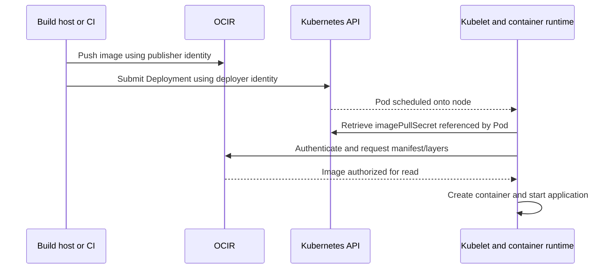

# Integrating OCIR and Authorizing Container Image Pulls

A Deployment on Oracle Kubernetes Engine (OKE) only runs when the execution environment can pull the container image. For private images in Oracle Cloud Infrastructure Registry (OCIR), networking, OCI identity, and Kubernetes configuration must all be right. A deployer successfully running `kubectl apply` does not prove that worker nodes can pull the image.

This lesson belongs to the **Kubernetes with OKE** chapter in the Oracle Cloud Infrastructure module and focuses on the deployment chain from OCIR to Pod: creating a private repository, separating push/pull permissions, providing credentials via `imagePullSecrets`, verifying image pulls, and rotating credentials. Examples use OKE with managed worker nodes; hands-on commands run in Bash on Linux or WSL with Docker and kubectl working.

## 1. Components Involved When a Pod Needs an Image



Three identities commonly appear in this workflow:

| Identity | Function | Permissions to Review |
|---|---|---|
| Pipeline publisher | Pushes images to repository | OCI IAM for push |
| Deployer person or pipeline | Creates Secrets, ServiceAccounts, Deployments | OKE access and Kubernetes RBAC |
| OCI user used to pull images | Authenticates to OCIR with auth token | OCI IAM for pull |

A Kubernetes ServiceAccount attached to a Pod can reference an image pull Secret. In this lesson's approach, the ServiceAccount does not automatically turn into an OCI user; registry credentials live inside the Secret. OCI IAM determines which repositories that user may read, while Kubernetes determines which Pods are configured to use the Secret.

Oracle documents integrating OKE with OCIR using a Docker registry Secret and the `imagePullSecrets` field in the Pod template. [Guide to pulling OCIR images when deploying on OKE](https://docs.oracle.com/en-us/iaas/Content/ContEng/Tasks/contengpullingimagesfromocir.htm).

## 2. Preparing the Environment and Consistent Identifiers

### 2.1. Lab Prerequisites

You need:

- An OKE cluster with ready managed worker nodes and kubeconfig pointing to the right cluster.
- Docker with Linux containers mode and Buildx working on the build machine.
- kubectl, Bash, `base64`, `tr`, `mktemp`, and `curl` on the practice machine.
- A compartment for storing artifacts, e.g., `AppArtifacts`.
- An administrator able to create the required repository, users/groups, and IAM policies.
- A deployment identity allowed to create namespaces, Secrets, ServiceAccounts, and Deployments for the lab.

Verify context and node types before deploying:

```bash
kubectl config current-context
kubectl get nodes -L kubernetes.io/os,kubernetes.io/arch
kubectl auth can-i create namespaces
```

If namespaces are managed by the platform team, ask them to prepare the namespace and use your assigned permissions inside that namespace. Namespace creation permission is only needed for preparation; the application does not need it.

### 2.2. Example Value Set

| Component | Illustrative Value |
|---|---|
| Region | Singapore, `ap-singapore-1` |
| Registry host | `sin.ocir.io` |
| OCIR tenancy namespace | `acmeexample` |
| Compartment holding repository | `AppArtifacts` |
| Repository | `oke-pull-demo` |
| Image tag | `1.0.0` |
| Kubernetes namespace | `ocir-lab` |
| Kubernetes ServiceAccount | `ocir-reader` |
| Initial Secret | `ocir-pull-v1` |

`acmeexample` is only a placeholder. Replace it with the Object Storage namespace of the tenancy owning the repository, retrieved from tenancy details in the OCI Console or a configuration source confirmed by the platform team.

Three concepts to keep distinct:

- **OCI compartment:** scope for placing resources and applying IAM policies.
- **Tenancy namespace in OCIR URI:** the tenancy identifier segment after the registry host.
- **Kubernetes namespace:** scope for placing Pods, ServiceAccounts, and Secrets.

The image URI in this lesson has the form:

```text
sin.ocir.io/acmeexample/oke-pull-demo:1.0.0
└── host ──┘ └ namespace ┘ └ repository ┘ └ tag ┘
```

The URI does not contain the compartment name or Kubernetes namespace. Regional registries have corresponding endpoints; `sin.ocir.io` is an endpoint listed in documentation for Singapore in realm OC1. Pick the endpoint matching your realm/region and use it consistently in both image URIs and Docker config. [OCIR endpoints by region](https://docs.oracle.com/en-us/iaas/Content/Registry/Concepts/registryprerequisites.htm).

## 3. Preparing a Private Repository in the Right Compartment

In the OCI Console, switch to the right region, open Container Registry, and create a **standard repository**:

1. Select compartment `AppArtifacts`.
2. Name it `oke-pull-demo`.
3. Choose **Private** access.
4. Note the region, compartment, and repository path for subsequent steps.

A standard repository accepts client-pushed images. Pull-through cache repositories serve a different purpose and do not support client pushes as in this example. A single-segment repository name is used to avoid depending on how the tenancy configures top-level repository capabilities. [Creating an OCIR repository](https://docs.oracle.com/en-us/iaas/Content/Registry/Tasks/registrycreatingarepository.htm).

Proactively creating the repository before pushing gives control over resource placement. Do not rely on the first push to select a compartment: when auto-creating a repository via push where supported, the new repository may be created in the root compartment and require corresponding permissions.

A public repository allows anyone with the matching path to pull images without private credentials. Because this lesson verifies pull authorization, keep the repository private throughout the entire lab. [OCIR repository concepts](https://docs.oracle.com/en-us/iaas/Content/Registry/Concepts/registryconcepts.htm).

## 4. Designing IAM Policies for Pull and Push

### 4.1. Image-Pulling OCI User Belongs Only to a Least-Privilege Group

Create an OCI user dedicated to pulling images, e.g., `oke-image-puller`, and place it in group `OcirPullers`. This is a managed operational user; do not use cluster administrator credentials.

Baseline policy:

```text
Allow group OcirPullers to read repos in compartment AppArtifacts
```

If allowed to read only this lesson's specific repository:

```text
Allow group OcirPullers to read repos in compartment AppArtifacts where target.repo.name = 'oke-pull-demo'
```

The example uses a short group name for readability. For groups in an identity domain requiring domain qualification, use the group name in your tenancy's IAM syntax, such as `DomainName/OcirPullers`.

The `target.repo.name` scope applies to the actual OCIR repository name. Do not include the registry host or tenancy namespace in this condition.

### 4.2. Understanding the Verbs of Resource Type repos

| Verb | Meaning Relevant to This Lesson |
|---|---|
| `inspect repos` | View listing information as appropriate; insufficient to pull manifests/layers |
| `read repos` | Includes repository/image read permissions required for pulling |
| `use repos` | According to the OCIR permission table, adds no permissions beyond read |
| `manage repos` | Includes create, update, manage, or delete permissions depending on policy conditions |

Do not infer that `use repos` grants push permissions. Permissions per resource type are defined by the service; read the OCIR permission table. [IAM details for Container Registry](https://docs.oracle.com/en-us/iaas/Content/Identity/policyreference/registrypolicyreference.htm).

### 4.3. Pipeline Publisher Has Separate Credentials

For an already-created repository, an illustrative policy for the publisher group in the compartment is:

```text
Allow group OcirPublishers to manage repos in compartment AppArtifacts where any {request.permission = 'REPOSITORY_READ', request.permission = 'REPOSITORY_UPDATE'}
```

Oracle requires `REPOSITORY_READ` and `REPOSITORY_UPDATE` to push. The policy above does not grant `REPOSITORY_CREATE`; the pipeline only pushes to pre-created repositories. You can further restrict by repository if needed.

`REPOSITORY_UPDATE` has a broader scope than a single upload operation, covering certain APIs that modify or delete images. Therefore, do not describe this policy as a guarantee of "upload-only and unable to affect old images." Inspect both the permission table and any other policies the user receives. [Sample policies for controlling repository access](https://docs.oracle.com/en-us/iaas/Content/Registry/Concepts/registrypolicyrepoaccess.htm).

An OCI user's permissions are the union of permissions granted across relevant groups/policies. A restricted read policy does not narrow a broad manage policy granted elsewhere. A user's auth token also does not acquire its own scope just because you name the Secret `pull-only`.

## 5. Creating an Auth Token and Determining the Docker Username

For Docker login in this lesson:

- The username contains the tenancy namespace and the user identifier.
- The password is that user's **OCI auth token**.
- OCI Console login passwords and private keys used to sign OCI APIs are not the password values for this flow.

Example user under standard configuration:

```text
acmeexample/oke-image-puller
```

For users in an identity domain or federated setup requiring a domain component, the username takes the form:

```text
acmeexample/DomainName/oke-image-puller
```

The domain name must come from the user's actual identity; do not mechanically insert `oracleidentitycloudservice` if your tenancy uses a different domain. [How to log in and pull images with Docker CLI](https://docs.oracle.com/en-us/iaas/Content/Registry/Tasks/registrypullingimagesusingthedockercli.htm).

Create an auth token for the image-pulling user in the user's credentials section in the OCI Console. Copy the value immediately upon creation and store it in your organization's secret manager; the Console will not show the full value again afterward. The publisher uses the separate publisher user's token.

Establish a proactive rotation schedule. Do not assume this auth token expires quickly like a short-lived access token. IAM documentation states auth tokens do not automatically expire and each user can have at most two auth tokens concurrently, enabling a transition window between old and new tokens. [Managing OCI auth tokens](https://docs.oracle.com/en-us/iaas/Content/Identity/access/working-with-auth-tokens.htm).

## 6. Building the Lab Image and Pushing with the Publisher Identity

### 6.1. Declaring Non-Secret Variables

The remaining commands use the same Bash shell:

```bash
REGISTRY_HOST='sin.ocir.io'
TENANCY_NAMESPACE='replace-with-your-tenancy-namespace'
REPOSITORY='oke-pull-demo'
TAG='1.0.0'
K8S_NS='ocir-lab'
IMAGE_REPO="$REGISTRY_HOST/$TENANCY_NAMESPACE/$REPOSITORY"
IMAGE_TAGGED="$IMAGE_REPO:$TAG"
PUSH_USER="$TENANCY_NAMESPACE/replace-with-publisher-user"
PULL_USER="$TENANCY_NAMESPACE/replace-with-puller-user"
```

Replace the placeholders before running. If users require a domain component, include the domain in `PUSH_USER` or `PULL_USER` as shown in the previous section.

### 6.2. Small HTTP Image to Observe Pulling

In a separate build directory, create `Dockerfile`:

```dockerfile
FROM busybox:1.37.0
WORKDIR /www
RUN printf 'OKE pulled this image from private OCIR\n' > index.html
USER 10001:10001
EXPOSE 8080
CMD ["httpd", "-f", "-p", "8080", "-h", "/www"]
```

This is an illustrative image serving static content via BusyBox, not a hardened production image. For a real Java application, substitute the image built and tested by the application's pipeline; the IAM, Secret, and OKE flow remains similar. A specific BusyBox version is pinned for hands-on practice; in operations, select base images per your organization's update and vetting workflow. [BusyBox Docker Official Image](https://hub.docker.com/_/busybox/).

Example build for AMD64 nodes:

```bash
docker buildx build \
  --platform linux/amd64 \
  --load \
  --tag "oke-pull-demo:$TAG" \
  .
```

The Kubernetes manifest below also selects AMD64 nodes. If your cluster only has Arm64, change both the build platform to `linux/arm64` and the node selector to `arm64`. Changing only the node selector without an architecture-compatible image will not solve the problem.

### 6.3. Logging In and Pushing

```bash
docker login "$REGISTRY_HOST" --username "$PUSH_USER"
docker tag "oke-pull-demo:$TAG" "$IMAGE_TAGGED"
docker push "$IMAGE_TAGGED"
```

When Docker prompts for a password, enter the publisher's auth token. Do not put the real token value into commands saved in documentation or shell history.

In CI, fetch the token from a secret store and pass it via `--password-stdin`, while disabling command logging that prints secret data. Docker can save credentials via a credential helper or Docker config; logging in on the build machine does not automatically create credentials for Kubernetes. [Docker login and credential storage](https://docs.docker.com/reference/cli/docker/login/).

After pushing, record the **manifest digest** reported by the registry, formatted as `sha256:` followed by 64 hex characters. Use the digest from the pushed repository, not the local Docker image ID.

```bash
IMAGE_DIGEST='sha256:replace-with-the-full-digest-from-push'
IMAGE_REF="$IMAGE_REPO@$IMAGE_DIGEST"
```

This variable remains a placeholder until you fill in the real digest. You can use the image details page in OCIR to cross-check the tag and digest.

Digests pin deployed content when tags change. A digest alone does not prove who published the image; build provenance checks, signatures, and approval workflows are additional controls.

## 7. Creating an imagePullSecret Without Passing the Token as a CLI Argument

### 7.1. The Secret Must Reside in the Pod's Namespace

```bash
kubectl create namespace "$K8S_NS"
```

If the namespace was already prepared, skip the create command. `imagePullSecrets` references Secrets in the same namespace as the Pod. A Secret of the same name in `default` cannot be used directly by Pods in `ocir-lab`.

Kubernetes uses Secret type `kubernetes.io/dockerconfigjson`, with data under key `.dockerconfigjson`, to supply registry credentials. Base64 in Secrets is data encoding, not a security mechanism replacing access control. [Kubernetes: pulling images from a private registry](https://kubernetes.io/docs/tasks/configure-pod-container/pull-image-private-registry/).

### 7.2. Building a Minimal Docker Config with Puller Credentials

The Bash function below takes a Secret name, prompts silently for the token without echoing to the screen, creates a temporary file containing credentials for a single registry, and submits the file to Kubernetes:

```bash
create_ocir_pull_secret() (
  set -euo pipefail
  set +x
  umask 077

  secret_name="$1"
  : "$REGISTRY_HOST" "$PULL_USER" "$K8S_NS"
  creds_dir=$(mktemp -d)
  trap 'rm -f -- "$creds_dir/config.json"; rmdir -- "$creds_dir"' EXIT

  IFS= read -r -s -p 'Puller OCI auth token: ' pull_token
  printf '\n'
  if [ -z "$pull_token" ]; then
    printf 'Token must not be empty\n' >&2
    exit 1
  fi

  encoded_auth=$(
    printf '%s:%s' "$PULL_USER" "$pull_token" |
      base64 | tr -d '\n'
  )
  unset pull_token

  printf '{"auths":{"%s":{"auth":"%s"}}}\n' \
    "$REGISTRY_HOST" "$encoded_auth" > "$creds_dir/config.json"
  unset encoded_auth

  kubectl --namespace "$K8S_NS" create secret generic "$secret_name" \
    --from-file=.dockerconfigjson="$creds_dir/config.json" \
    --type=kubernetes.io/dockerconfigjson
)

create_ocir_pull_secret ocir-pull-v1
```

Enter `PULL_USER`'s auth token, not the publisher token. Because the function uses a subshell, temporary variables do not persist in the parent shell after it finishes. An existing Secret with the same name will cause `create` to fail; pick a new versioned name when rotating rather than accidentally overwriting.

Do not enable shell tracing or print temporary file contents. The execution host and Secret-creation permissions must still be protected; passing via a file does not remove the need to secure the operator machine.

### 7.3. Checking Metadata Without Printing Credentials

```bash
kubectl --namespace "$K8S_NS" get secret ocir-pull-v1 \
  -o custom-columns=NAME:.metadata.name,TYPE:.type

kubectl --namespace "$K8S_NS" describe secret ocir-pull-v1
```

Expect type `kubernetes.io/dockerconfigjson` and key `.dockerconfigjson`. Avoid exporting full Secret YAML or decoding credentials into pipeline logs just to confirm the Secret exists.

If taking a Docker config from a personal machine, check how Docker stores credentials. A file containing only `credsStore` or `credHelpers` referencing a helper program on your laptop does not provide usable credentials to kubelet. The minimal config above explicitly creates an `auths` entry containing the required data.

## 8. Attaching the Secret to a Dedicated Application ServiceAccount

Create `serviceaccount.yaml`:

```yaml
apiVersion: v1
kind: ServiceAccount
metadata:
  name: ocir-reader
  namespace: ocir-lab
automountServiceAccountToken: false
imagePullSecrets:
  - name: ocir-pull-v1
```

```bash
kubectl apply -f serviceaccount.yaml
```

When creating a Pod using this ServiceAccount without declaring a separate pull secret list, Kubernetes populates the reference list into the Pod. Updating the ServiceAccount affects Pods created afterward; existing Pods do not automatically update `spec.imagePullSecrets`. [Configuring imagePullSecrets on a ServiceAccount](https://kubernetes.io/docs/tasks/configure-pod-container/configure-service-account/).

`automountServiceAccountToken: false` prevents automatically mounting a Kubernetes API token into containers that do not need it. This setting does not disable pulling images with registry Secrets.

You can specify it directly in the Pod template if needed:

```yaml
spec:
  template:
    spec:
      serviceAccountName: ocir-reader
      imagePullSecrets:
        - name: ocir-pull-v1
```

This is a configuration snippet inside a Deployment, not a full manifest. In the main lab workflow, set the list only on the ServiceAccount for centralized management. If a Pod template already declares its own list, do not expect the ServiceAccount to merge other Secrets into that list.

Avoid attaching application credentials to the namespace-wide `default` ServiceAccount unnecessarily. A dedicated ServiceAccount makes it clear which workloads are configured to use which credentials.

## 9. Deploying Image by Digest and Verifying Actual Pods

### 9.1. Full Deployment Manifest

Create `deployment.yaml`, replacing the image placeholder with the real `IMAGE_REF` value:

```yaml
apiVersion: apps/v1
kind: Deployment
metadata:
  name: ocir-web
  namespace: ocir-lab
spec:
  replicas: 2
  revisionHistoryLimit: 3
  strategy:
    type: RollingUpdate
    rollingUpdate:
      maxUnavailable: 0
      maxSurge: 1
  selector:
    matchLabels:
      app: ocir-web
  template:
    metadata:
      labels:
        app: ocir-web
    spec:
      serviceAccountName: ocir-reader
      automountServiceAccountToken: false
      nodeSelector:
        kubernetes.io/os: linux
        kubernetes.io/arch: amd64
      securityContext:
        runAsNonRoot: true
        runAsUser: 10001
        runAsGroup: 10001
        seccompProfile:
          type: RuntimeDefault
      containers:
        - name: web
          image: sin.ocir.io/REPLACE_NAMESPACE/oke-pull-demo@sha256:REPLACE_DIGEST
          imagePullPolicy: Always
          ports:
            - name: http
              containerPort: 8080
          resources:
            requests:
              cpu: 50m
              memory: 32Mi
            limits:
              cpu: 200m
              memory: 64Mi
          securityContext:
            allowPrivilegeEscalation: false
            readOnlyRootFilesystem: true
            capabilities:
              drop:
                - ALL
          readinessProbe:
            httpGet:
              path: /
              port: http
            initialDelaySeconds: 1
            periodSeconds: 3
```

The illustrative manifest does not automatically substitute environment variables in YAML. Fill in the real hostname, tenancy namespace, and digest before applying. If using a pipeline rendering tool, inspect the rendered manifest to ensure no placeholders remain.

### 9.2. Applying and Observing

```bash
kubectl apply -f deployment.yaml
kubectl --namespace "$K8S_NS" rollout status deployment/ocir-web --timeout=180s
kubectl --namespace "$K8S_NS" get pods -l app=ocir-web -o wide
```

Fetch one Pod's name:

```bash
POD_NAME=$(
  kubectl --namespace "$K8S_NS" get pods -l app=ocir-web \
    -o jsonpath='{.items[0].metadata.name}'
)

kubectl --namespace "$K8S_NS" get pod "$POD_NAME" \
  -o jsonpath='{.spec.serviceAccountName}{"\n"}{.spec.imagePullSecrets[*].name}{"\n"}'

kubectl --namespace "$K8S_NS" describe pod "$POD_NAME"
```

Confirm the Pod actually uses `ocir-reader` and has `ocir-pull-v1` in its list. Do not just inspect the local ServiceAccount file and assume the Pod received the configuration.

Inspect the image reference and image ID reported by the runtime:

```bash
kubectl --namespace "$K8S_NS" get pods -l app=ocir-web \
  -o custom-columns=NAME:.metadata.name,IMAGE:.spec.containers[0].image,IMAGE_ID:.status.containerStatuses[0].imageID
```

For multi-platform images, the image index digest and the architecture-specific manifest digest can differ. When comparing image IDs, understand the published artifact structure rather than expecting every digest string to be identical.

### 9.3. Testing HTTP Without Creating a Load Balancer

```bash
kubectl --namespace "$K8S_NS" port-forward deployment/ocir-web 18080:8080
```

In another terminal:

```bash
curl http://127.0.0.1:18080/
```

Expected output:

```text
OKE pulled this image from private OCIR
```

`port-forward` must stay running during the HTTP request. This check suffices for the lab; there is no need to create an extra public Load Balancer just to verify image pulling.

## 10. Network Connectivity from Worker Nodes to OCIR

Image pulling is performed by kubelet/container runtime inside the node environment. A laptop may reach the registry while a node in a private subnet lacks an appropriate outbound path.

OCIR supports private access via Service Gateway from resources in a VCN in the same region. For OKE private workers, verify:

1. The Service Gateway has the appropriate regional network service enabled.
2. The route table attached to the worker subnet routes to the appropriate service CIDR label via the Service Gateway.
3. NSGs/security lists and intermediate appliances permit required HTTPS traffic, including return paths per stateful/stateless configuration.
4. DNS resolves the registry endpoint in use.

A Service Gateway is a network path, not pull authorization. Valid credentials and IAM policies are still required for private repositories. [OCIR and access via Service Gateway](https://docs.oracle.com/en-us/iaas/Content/Registry/Concepts/registryoverview.htm).

If the design uses a NAT Gateway for private workers to reach public endpoints, verify corresponding routes and egress. When images reside in a registry outside OCI or in another region, do not assume a same-region Service Gateway covers the entire path.

A Pod's Kubernetes NetworkPolicy does not replace checking routes/NSGs on the worker subnet. For pull timeout errors, investigate from the environment performing the pull, not just by running `curl` inside a Pod already running on a different node.

With cluster autoscaling, test new nodes as well. An older node with cached layers or differing network setup can hide a gap in the node pool/subnet that only surfaces on the next scale-out.

## 11. Kubernetes RBAC and Secret Usage Scope

### 11.1. Registry Read Permission and Secret Read Permission Are Two Separate Scopes

`read repos` allows an OCI user to read images in OCIR. Kubernetes RBAC controls how users and ServiceAccounts act on Kubernetes resources, including Secrets.

Containers do not need a Role to read Secrets via the Kubernetes API just so kubelet can use `imagePullSecrets`. Kubelet and the control plane handle the image pull mechanism. Grant Secret-provisioning permissions to tools based on their actual task; do not add `get/list/watch secrets` to the application ServiceAccount to "fix a pull error" without identifying the root cause.

### 11.2. Users Who Can Create Pods Can Access Secrets Indirectly

Someone permitted to create or modify Pods in a namespace can configure a workload to use or mount Secrets in that namespace, subject to other admission and RBAC controls. Thus, denying them `get Secret` is not an absolute guarantee they cannot use the credentials.

Separate namespaces and deployment permissions by trust level; restrict workload creation permissions in namespaces holding sensitive credentials. Separating namespaces helps scope management, yet still requires appropriate cluster policies and configuration. [Kubernetes RBAC Good Practices](https://kubernetes.io/docs/concepts/security/rbac-good-practices/).

### 11.3. Managing Secret Lifecycle

Secrets should only hold least-privilege puller credentials. Protect Kubernetes API access, backups, and cluster data encryption per your OKE configuration.

Do not commit Secrets containing real tokens into Git as base64 YAML. If using GitOps, manage Secret synchronization via an organization-approved secret management mechanism, with explicit permissions to read the secret source and write to the right namespace.

Putting a token into OCI Vault does not automatically update the Secret inside Kubernetes. You need a provisioning/sync process with clear identity, policies, namespace scope, and rotation schedule. [Kubernetes Secrets and Usage](https://kubernetes.io/docs/concepts/configuration/secret/).

## 12. Rotating Auth Tokens with a Verification Step

### 12.1. Why Running Pods Do Not Prove the New Token Works

Already-running containers do not continuously re-pull images. A revoked old token may not affect existing Pods yet, but will cause failures when creating new Pods, rescheduling, or scaling out a node pool.

A check showing existing Pods remain `Running` does not prove the new credentials work.

### 12.2. Creating a New Token and New Secret

Normal procedure:

1. Create a new auth token for the puller user, keeping the old token active during the transition window.
2. Update the managed secret store.
3. Use the declared function to create the new versioned Secret:

```bash
create_ocir_pull_secret ocir-pull-v2
```

Enter the new token when prompted. Do not recreate `ocir-pull-v1` with different data and lose the ability to tell which workloads have migrated.

### 12.3. Canary Referencing Only the New Secret

Create `pull-canary.yaml`, replacing the image with the exact real digest under verification:

```yaml
apiVersion: v1
kind: Pod
metadata:
  name: ocir-pull-canary
  namespace: ocir-lab
spec:
  restartPolicy: Never
  serviceAccountName: ocir-reader
  automountServiceAccountToken: false
  imagePullSecrets:
    - name: ocir-pull-v2
  nodeSelector:
    kubernetes.io/os: linux
    kubernetes.io/arch: amd64
  securityContext:
    runAsNonRoot: true
    runAsUser: 10001
    runAsGroup: 10001
    seccompProfile:
      type: RuntimeDefault
  containers:
    - name: web
      image: sin.ocir.io/REPLACE_NAMESPACE/oke-pull-demo@sha256:REPLACE_DIGEST
      imagePullPolicy: Always
      securityContext:
        allowPrivilegeEscalation: false
        readOnlyRootFilesystem: true
        capabilities:
          drop:
            - ALL
      resources:
        requests:
          cpu: 25m
          memory: 16Mi
        limits:
          cpu: 100m
          memory: 32Mi
      readinessProbe:
        httpGet:
          path: /
          port: 8080
        periodSeconds: 3
```

```bash
kubectl apply -f pull-canary.yaml
kubectl --namespace "$K8S_NS" wait \
  --for=condition=Ready pod/ocir-pull-canary --timeout=180s
kubectl --namespace "$K8S_NS" describe pod ocir-pull-canary
```

The canary declares only `ocir-pull-v2`; declaring both v1 and v2 could let old credentials make the check pass even if v2 is broken. Inspect the actual Pod configuration and ensure no node-level credential mechanism is inadvertently providing broader permissions.

`imagePullPolicy: Always` requires the runtime to perform the pull/resolve flow when starting the container; cached layers may still be reused. To also test the layer download path, prefer a test node without the image and do not directly tamper with caches on nodes serving production workloads. [Image pull policy and caching in Kubernetes](https://kubernetes.io/docs/concepts/containers/images/).

### 12.4. Migrating Workloads and Revoking the Old Token

Update `serviceaccount.yaml` to:

```yaml
apiVersion: v1
kind: ServiceAccount
metadata:
  name: ocir-reader
  namespace: ocir-lab
automountServiceAccountToken: false
imagePullSecrets:
  - name: ocir-pull-v2
```

Then:

```bash
kubectl apply -f serviceaccount.yaml
kubectl --namespace "$K8S_NS" rollout restart deployment/ocir-web
kubectl --namespace "$K8S_NS" rollout status deployment/ocir-web --timeout=180s
kubectl --namespace "$K8S_NS" get pods -l app=ocir-web -o wide
```

Verify new Pods actually reference `ocir-pull-v2`. Once target workloads, Jobs/CronJobs, and related namespaces have been reviewed, revoke the old auth token in OCI IAM and then delete the old Secret:

```bash
kubectl --namespace "$K8S_NS" delete secret ocir-pull-v1
kubectl --namespace "$K8S_NS" delete pod ocir-pull-canary
```

Deleting a Kubernetes Secret does not revoke the OCI token; revoking the token also does not delete copies of the Secret. Manage both sides. If the system uses GitOps, update the authoritative declaration source so the controller does not restore the old config.

When evidence indicates a token was compromised, incident response may require immediate revocation, accepting a brief disruption for new pulls. The overlap window above is for scheduled rotation under normal conditions.

## 13. Diagnosing ErrImagePull and ImagePullBackOff

`ImagePullBackOff` indicates Kubernetes could not pull the image and is backing off retry intervals. Read the causal events before restarting the Deployment or changing IAM policies.

```bash
kubectl --namespace "$K8S_NS" get pods -l app=ocir-web -o wide
kubectl --namespace "$K8S_NS" describe pod "$POD_NAME"
kubectl --namespace "$K8S_NS" get events \
  --field-selector "involvedObject.name=$POD_NAME" \
  --sort-by=.metadata.creationTimestamp
```

If the old Pod has been replaced, re-fetch `POD_NAME` from the current list. Events have a finite retention window; collect them early rather than viewing only summary statuses. [Pod debugging guide](https://kubernetes.io/docs/tasks/debug/debug-application/debug-pods/).

| Symptom or Message | What to Check First |
|---|---|
| `FailedToRetrieveImagePullSecret` | Does the Secret exist in the same namespace, is the name exact, did the Pod receive the right list |
| `unauthorized`, authentication required | Does username have right namespace/domain, does token belong to right user and remain valid, does host in config match |
| `denied`, insufficient permissions | User's group, `read repos` policy, actual compartment of repository, and repo name conditions |
| `manifest unknown`, `not found` | Tag/digest, image name, region, and tenancy namespace; some responses can also relate to access permissions |
| Timeout, DNS, or TLS error | Network path from node, DNS, Service Gateway/NAT, egress, and clock/certificates |
| `no matching manifest` | Does the image support the selected node's architecture/OS |
| Pod `Pending` due to node selector or insufficient resources | Scheduling capability; image pull may not even have been requested yet |
| Container runs then `CrashLoopBackOff` | Entry point, arguments, filesystem, and application errors after image was pulled |

Do not conclude every pull failure is caused by missing IAM permissions. For instance, having hostname `sin.ocir.io` in the Secret while the image uses a different endpoint alias can prevent the runtime from matching credentials, even though both endpoints belong to the same service.

A successful Docker pull on a local machine is a useful data point, yet it only proves the identity/network combination on that machine. If the Docker user is a broadly privileged publisher, that result does not test the puller token inside the cluster.

In this lesson's approach, adding policies to a node's identity will not fix wrong credentials inside `imagePullSecrets`. If your organization uses a kubelet credential provider or another integrated identity mechanism, configure and verify that mechanism per OKE's specific support; do not assume adding an OCI policy alone gives kubelet login credentials.

## 14. Tags, Digests, Architecture, and Reproducibility

### 14.1. Do Not Let a Silently Updated Tag Cause Version Drift

Tags are human-friendly references. If a tag is updated to point to a different image, subsequent Pod creations may pull new content while older Pods still run old content.

In production, record the digest alongside release, deployment configuration, and build metadata. On rollback, use the digest of a known release and ensure that artifact still exists in OCIR.

The sample in this lesson sets `Always` explicitly to make verifying registry credentials straightforward. A design using digests and `IfNotPresent` can favor caching, yet needs evaluation of credential verification requirements, admission policies, and node pool behavior. Do not use a Pod running from cache as the sole proof of current pull permissions.

### 14.2. Images Must Match the Node Pool

OKE can use node pools of different architectures. When needing to support both AMD64 and Arm64, the pipeline can publish a multi-platform image:

```bash
docker buildx build \
  --platform linux/amd64,linux/arm64 \
  --tag "$IMAGE_TAGGED" \
  --push \
  .
```

This replaces a single-architecture build step and requires a builder and base image supporting the chosen platforms. At deployment, the digest may be the image index digest; the registry/runtime selects the manifest matching the node. [Docker: multi-platform image builds](https://docs.docker.com/build/building/multi-platform/).

### 14.3. Retention and Artifact Provenance

Retain images of running releases, planned rollback releases, and releases still under support. Deleting an image from the registry may not stop currently running containers, but will break fresh pulls on nodes lacking cache.

Scan images for vulnerabilities and link scan results to deployed digests. Pull permissions only answer "may this identity read this artifact"; they do not replace vulnerability scanning or release provenance verification. OCI Vulnerability Scanning can scan images in Container Registry when appropriate scanning resources are configured. [OCI Vulnerability Scanning Overview](https://docs.oracle.com/en-us/iaas/Content/scanning/using/overview.htm).

## 15. Automation and Observability in the Deployment Workflow

Pipelines can be organized into independent stages:

```text
Build and test image
        ↓
Push to OCIR using publisher credentials
        ↓
Record digest and scan artifact
        ↓
Provision or reconcile pull secret for target namespace
        ↓
Render Deployment with digest
        ↓
Apply, wait for rollout, and inspect Pod events
```

The publisher identity does not need permission to edit Secrets in the cluster just to upload images. The deployer identity does not need push permissions if it only deploys approved digests. The in-cluster puller identity only needs read permission on the right repository.

Information to retain in deployment records:

| Information | Purpose |
|---|---|
| Image URI and digest | Identify the exact deployed artifact |
| Commit/build ID | Link artifact to source code and pipeline |
| Cluster, namespace, Deployment | Identify the target environment |
| Pull Secret name/version | Track credential rotations |
| Rollout duration, Ready Pods, pull errors | Detect deployment incidents |
| Node pool and architecture | Isolate platform or network path errors |

Do not record token values, Docker `auth` strings, or Secret contents in these records.

Monitor bursts of `ErrImagePull`, `ImagePullBackOff`, stalled rollouts, and errors on newly created nodes. Kubernetes events should be collected by your observability pipeline if long-term retention is required. A failed replica scale-out after rotating a token is often far more informative than old Pods staying `Running`.

Control costs via reasonable image sizes, cleaning up end-of-life artifacts, and choosing appropriate regions. In the lab, worker nodes, registry storage, and related network resources can still incur charges depending on environment configuration. Do not delete images still needed for rollback just to reclaim space immediately.

## 16. Verification Practice and Resource Cleanup

Before considering the integration complete, learners should perform these steps using dedicated lab resources:

1. Confirm the private repository is in the right compartment/region.
2. Push successfully as publisher; record the tag and manifest digest.
3. Using the puller with read policy, create a Secret in the same namespace as the workload.
4. Verify the actual Pod receives the right ServiceAccount and pull Secret.
5. Wait for rollout completion and call HTTP over port-forward.
6. Create a test workload referencing a non-existent Secret name to observe `FailedToRetrieveImagePullSecret`, then fix it; do not alter production workload configs.
7. Test with the read identity to confirm it cannot push to the chosen repository.
8. Test pulling on a new node or low-cache environment to confirm node pool network configuration.
9. Rotate to Secret v2, verify the new credentials independently, then migrate related workloads.
10. Revoke the old token and delete the old Secret after migration completes.

Do not flip the repository to public to make a permission test pass. A successful run while public does not verify private authentication paths.

When finishing the lab, stop port-forward and delete the dedicated workloads:

```bash
kubectl --namespace "$K8S_NS" delete deployment ocir-web
kubectl --namespace "$K8S_NS" delete serviceaccount ocir-reader
kubectl --namespace "$K8S_NS" delete secret ocir-pull-v2
```

Adjust the Secret name to whichever version remains. If the canary or Secret v1 was not yet deleted, clean them up after confirming they are no longer used. Delete the namespace only if it is dedicated to this lesson and contains no resources to keep.

Revoke tokens created solely for the lab, clean up lab images/repositories using an artifact-admin identity, and remove temporary permissions no longer needed. Do not delete a shared OKE cluster or compartment just because the lab exercise has ended.

The target outcome is a verifiable chain: artifact identified by digest, OCI user restricted to reading the exact repository, Secret managed in the right namespace, Pod receiving the right configuration, and workers having a network path to the registry. This chain is also the foundation for redeploying, scaling node pools, and rotating credentials while keeping image access controlled.
