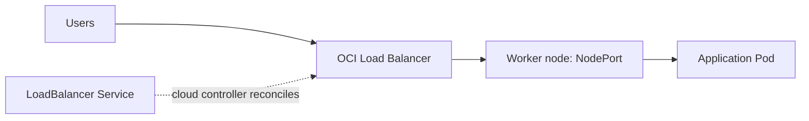
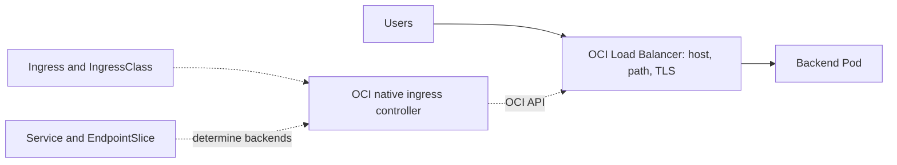

# Ingress, LoadBalancer Services, and Exposing Applications

## 1. Objectives and Context on Oracle Cloud Infrastructure

A Deployment running successfully on Oracle Kubernetes Engine (OKE) only proves the application has started inside the cluster. For users to access it by domain name and HTTPS, multiple components must connect properly: Services, traffic ingestion mechanisms, OCI Load Balancer, VCN networking, DNS, and certificates.

In the **Kubernetes with OKE** chapter of the Oracle Cloud Infrastructure module, this lesson focuses on exposing applications outside the cluster in a controlled manner. Compartments define where resources reside; IAM determines which resources controllers can act on; VCN and network rules determine whether packets reach the application. These choices also affect observability, automation, cost, and availability.

After this lesson, learners can:

- Choose between a `LoadBalancer` Service and an Ingress based on protocol, application count, and operational requirements.
- Explain who provisions the OCI Load Balancer and who enforces routing rules.
- Deploy an HTTP example, verify the traffic path, and then add DNS and TLS.
- Distinguish infrastructure provisioning errors, network errors, routing errors, and backend errors.
- Reclaim resources in the right order, avoiding leftover unused load balancers or certificates.

The manifests below are hands-on practice materials; replace placeholders with your learning environment's OCI resources. They do not imply a cluster or load balancer has already been provisioned.

## 2. Distinguishing Service, Ingress, and Controller

### 2.1. Ways to Route Traffic to Applications

| Component | Role | Appropriate Usage |
| --- | --- | --- |
| `ClusterIP` Service | Provides an in-cluster service address and port | Internal backends or backends for a compatible ingress controller |
| `NodePort` Service | Opens a service port on nodes via Kubernetes networking | Backends for certain load balancer models; source access must be controlled |
| `LoadBalancer` Service | Requests cloud integration to provision or configure an external load balancer | Expose a single service over specific ports |
| Ingress | Declares HTTP/HTTPS rules by host and path | Consolidate multiple web applications behind one entry point |
| Ingress controller | Watches Ingresses and configures the system enforcing rules | Mandatory component for Ingresses to take effect |

A Service uses selectors to pick Pods; corresponding endpoints are represented via EndpointSlices. The `port`, `targetPort`, and `nodePort` fields serve different roles: Service port, application port, and node port. Declaring `containerPort` alone does not expose an application. See [Kubernetes Service concepts](https://kubernetes.io/docs/concepts/services-networking/service/).

An Ingress does not automatically create DNS, issue certificates, or install a controller. The `ingressClassName` field specifies the IngressClass the resource wants to use; the IngressClass binds that configuration to a specific implementation.

The Ingress API is feature-frozen, though still maintained by Kubernetes. For new designs, you can evaluate the Gateway API along with your chosen controller's support. This lesson uses Ingress to directly address exposing OKE applications. See [Ingress](https://kubernetes.io/docs/concepts/services-networking/ingress/) and [Ingress Controllers](https://kubernetes.io/docs/concepts/services-networking/ingress-controllers/).

### 2.2. LoadBalancer Service on OKE

When creating a `type: LoadBalancer` Service, OCI's cloud controller manager reconciles Kubernetes configuration with cloud resources. Annotation `oci.oraclecloud.com/load-balancer-type: "lb"` requests an OCI Load Balancer; value `"nlb"` selects an OCI Network Load Balancer.

OCI Load Balancer can proxy TCP and handle HTTP/HTTPS. OCI Network Load Balancer suits network-layer balancing such as TCP/UDP, per supported features. The Kubernetes name `LoadBalancer` does not mean every load balancer supports host/path rules. Annotation lists for the two resource types also differ; see [OKE annotation summary](https://docs.oracle.com/en-us/iaas/Content/ContEng/Tasks/contengcreatingloadbalancer_topic-Summaryofannotations.htm).

Common node-backend model on managed nodes:



Verify actual backends in OCI. Paths may differ when using Pod-as-backend features or another network configuration.

### 2.3. Two Ingress Controller Architectures

The **OCI native ingress controller** configures an OCI Load Balancer to perform routing. The controller manages configuration; user requests do not have to pass through a controller Pod.



With VCN-native pod networking, the native controller can register Pods as backends. With Flannel, it uses worker nodes and requires `NodePort` backend Services. This lab chooses **managed nodes and VCN-native pod networking** so it can use `ClusterIP` backend Services. The native controller creates load balancers per IngressClass; load balancer count does not necessarily equal Ingress count. See [how the OCI native ingress controller works](https://docs.oracle.com/en-us/iaas/Content/ContEng/Tasks/contengsettingupnativeingresscontroller.htm).

**Controllers with in-Pod proxies** typically receive traffic in a chain: OCI load balancer → proxy Pod → application Service/Pod. With this architecture, account for resources, replica counts, and upgrade lifecycles of the proxy layer. Do not apply one controller's annotations to another just because both read Ingress resources. See [ingress controller options on OKE](https://docs.oracle.com/en-us/iaas/Content/ContEng/Tasks/contengmanagingresscontrollers.htm).

## 3. Application Exposure Decisions

| Need | Reasonable Starting Point | Considerations |
| --- | --- | --- |
| Single endpoint with dedicated ports | `LoadBalancer` Service | Simple, but provisions additional cloud resources per exposed service |
| Multiple websites or APIs by host/path | Ingress with chosen controller | Shares entry point; requires managing shared rules and configuration |
| Non-web TCP/UDP service | `LoadBalancer` Service with suitable LB type | Standard HTTP Ingress does not model every protocol |
| Internal-only application | Private load balancer or private ingress | Requires internal connectivity and internal DNS |
| Backend accessing Oracle Database | Keep backend and database connections on private network | Expose only the application endpoint users need |

For example, a retail system has a `/` frontend and an `/api` backend. If each component has its own LoadBalancer Service, operators must manage multiple addresses, listeners, and cloud resources. One Ingress can consolidate those rules under a single entry point.

Sharing also introduces dependencies: changing a shared listener, certificate, or rule can impact multiple applications. Separate IngressClasses or load balancers along administrative boundaries, trust levels, and availability requirements when needed.

## 4. Preparing Cluster, Permissions, and Networking

### 4.1. Lab Prerequisites

Prepare beforehand:

1. An OKE cluster with managed nodes and VCN-native pod networking, with enough resources for four small Pods.
2. `kubectl` connected to the right cluster; account has permission to create resources in the practice namespace.
3. Suitable public subnet for the load balancer, free IP addresses, and sufficient OCI quota.
4. An NSG for the load balancer; rules to workers or Pods prepared according to actual backends.
5. OCI native ingress controller installed at a supported version if doing the Ingress section.
6. A domain you manage and a valid certificate if doing the public HTTPS section.

Check context before applying manifests:

```powershell
kubectl config current-context
kubectl get nodes -o wide
kubectl auth can-i create deployments -n oke-public-lab
kubectl auth can-i create services -n oke-public-lab
kubectl auth can-i create ingresses.networking.k8s.io -n oke-public-lab
kubectl auth can-i create ingressclasses.networking.k8s.io
```

IngressClass is a cluster-scoped resource; permission to create Ingresses in a namespace does not automatically include permission to create IngressClasses.

### 4.2. Two Independent Permission Layers

Kubernetes RBAC allows users to create Services or Ingresses. OCI IAM allows the cloud controller or native ingress controller to create/update load balancers, use networks, and handle certificates per enabled features.

Therefore, a successful `kubectl apply` can still be accompanied by cloud provisioning failures. Assign permissions to the right principal and resource compartments. If networking and load balancers reside in different compartments, cover both scopes.

The native controller supports different authentication options. Workload identity works with enhanced clusters; instance principals bind to Compute instances and do not suit virtual nodes. Pick one approach, grant required resource permissions, and scope them per deployment documentation. See [permission and authentication prerequisites for the native ingress add-on](https://docs.oracle.com/en-us/iaas/Content/ContEng/Tasks/contengsettingupnativeingresscontroller-addon-prereqs.htm).

### 4.3. Public and Private Paths

A public load balancer needs a public subnet with an appropriate route to an Internet Gateway. Workers and Pods can reside in private subnets. A NAT Gateway serves outbound connections initiated from private networks; it does not replace a public load balancer for accepting new inbound connections from the Internet.

Additional lab rules can be organized as follows:

| Hop | Allowed Source | Destination and Port |
| --- | --- | --- |
| Lab machine → HTTP frontend | Lab machine's public IP as `/32` CIDR | Load balancer NSG, TCP 80 |
| Users → HTTPS frontend | User range or Internet if public website | Load balancer NSG, TCP 443 |
| LB → direct Service node backend | LB NSG or subnet per design | Worker nodes, allocated NodePort |
| LB → native ingress Pod backend | LB NSG or subnet per design | Pods, TCP 8080 in example |
| Health check → backend | Appropriate LB source | Actual health-check port and protocol |

This table supplements an already-working OKE network; it does not replace all control plane, node, and CNI rules. Account for LB egress, backend ingress, and related health-check ports.

NSGs and security lists both contribute to the effective allow rule set. An overly permissive security list can still allow traffic even if an NSG was narrowed. See [OKE network configuration](https://docs.oracle.com/en-us/iaas/Content/ContEng/Concepts/contengnetworkconfig.htm).

## 5. Creating Two Applications to Observe Routing

The example uses two small web servers:

- `portal` returns `portal oke`.
- `catalog` returns `catalog oke`.
- Both listen on port 8080 and have `/healthz` returning HTTP 200.

The returned body helps identify which backend a request reached. These are illustrative apps; a real application's health check should reflect true serving readiness.

Save the following as `apps.yaml` in your working directory:

```yaml
apiVersion: v1
kind: Namespace
metadata:
  name: oke-public-lab
---
apiVersion: v1
kind: ConfigMap
metadata:
  name: demo-nginx-config
  namespace: oke-public-lab
data:
  portal.conf: |
    server {
      listen 8080;
      location = /healthz {
        default_type text/plain;
        return 200 "ok\n";
      }
      location / {
        default_type text/plain;
        return 200 "portal oke\n";
      }
    }
  catalog.conf: |
    server {
      listen 8080;
      location = /healthz {
        default_type text/plain;
        return 200 "ok\n";
      }
      location / {
        default_type text/plain;
        return 200 "catalog oke\n";
      }
    }
---
apiVersion: apps/v1
kind: Deployment
metadata:
  name: portal
  namespace: oke-public-lab
spec:
  replicas: 2
  selector:
    matchLabels:
      app: portal
  template:
    metadata:
      labels:
        app: portal
    spec:
      containers:
        - name: web
          image: nginx:stable-alpine
          ports:
            - name: http
              containerPort: 8080
          readinessProbe:
            httpGet:
              path: /healthz
              port: http
            initialDelaySeconds: 2
            periodSeconds: 5
          resources:
            requests:
              cpu: 50m
              memory: 32Mi
            limits:
              cpu: 250m
              memory: 96Mi
          volumeMounts:
            - name: configuration
              mountPath: /etc/nginx/conf.d/default.conf
              subPath: portal.conf
      volumes:
        - name: configuration
          configMap:
            name: demo-nginx-config
---
apiVersion: apps/v1
kind: Deployment
metadata:
  name: catalog
  namespace: oke-public-lab
spec:
  replicas: 2
  selector:
    matchLabels:
      app: catalog
  template:
    metadata:
      labels:
        app: catalog
    spec:
      containers:
        - name: web
          image: nginx:stable-alpine
          ports:
            - name: http
              containerPort: 8080
          readinessProbe:
            httpGet:
              path: /healthz
              port: http
            initialDelaySeconds: 2
            periodSeconds: 5
          resources:
            requests:
              cpu: 50m
              memory: 32Mi
            limits:
              cpu: 250m
              memory: 96Mi
          volumeMounts:
            - name: configuration
              mountPath: /etc/nginx/conf.d/default.conf
              subPath: catalog.conf
      volumes:
        - name: configuration
          configMap:
            name: demo-nginx-config
---
apiVersion: v1
kind: Service
metadata:
  name: portal
  namespace: oke-public-lab
spec:
  type: ClusterIP
  selector:
    app: portal
  ports:
    - name: http
      port: 80
      targetPort: http
---
apiVersion: v1
kind: Service
metadata:
  name: catalog
  namespace: oke-public-lab
spec:
  type: ClusterIP
  selector:
    app: catalog
  ports:
    - name: http
      port: 80
      targetPort: http
```

The image tag in the example is convenient for a lab. For repeatable deployments, choose a vetted version, matching CPU architecture, and pin the image by digest in your build pipeline.

Apply and confirm Pods are ready:

```powershell
kubectl apply -f apps.yaml
kubectl rollout status deployment/portal -n oke-public-lab --timeout=180s
kubectl rollout status deployment/catalog -n oke-public-lab --timeout=180s
kubectl get pods -n oke-public-lab -o wide
kubectl get endpointslices -n oke-public-lab -l kubernetes.io/service-name=portal
kubectl get endpointslices -n oke-public-lab -l kubernetes.io/service-name=catalog
```

To verify application responses before creating an LB, run port-forward:

```powershell
kubectl port-forward -n oke-public-lab service/portal 18080:80
```

From another terminal:

```powershell
curl.exe --fail-with-body http://127.0.0.1:18080/
```

Expected output is `portal oke`. Port-forward verifies application response and port, but does not prove traffic paths via ClusterIP, OCI LB, or the Internet are working.

## 6. Direct Exposure with a LoadBalancer Service

### 6.1. Manifest with Explicit Bandwidth and Network Management Control

This example uses a public LB, node backends on managed nodes, and operator-managed NSGs. Before applying:

- Replace `<LB_NSG_OCID>` with the load balancer NSG in the appropriate VCN.
- Confirm the cluster's default LB subnet suits a public LB.
- Allow frontend TCP 80 from your lab machine.
- Allow LB to nodes on TCP 30080 and required health-check ports.
- Verify NodePort 30080 is not already used by another Service in the cluster.

Save as `portal-lb.yaml`:

```yaml
apiVersion: v1
kind: Service
metadata:
  name: portal-public
  namespace: oke-public-lab
  annotations:
    oci.oraclecloud.com/load-balancer-type: "lb"
    service.beta.kubernetes.io/oci-load-balancer-internal: "false"
    service.beta.kubernetes.io/oci-load-balancer-shape: "flexible"
    service.beta.kubernetes.io/oci-load-balancer-shape-flex-min: "10"
    service.beta.kubernetes.io/oci-load-balancer-shape-flex-max: "20"
    oci.oraclecloud.com/security-rule-management-mode: "None"
    oci.oraclecloud.com/oci-network-security-groups: "<LB_NSG_OCID>"
spec:
  type: LoadBalancer
  externalTrafficPolicy: Cluster
  selector:
    app: portal
  ports:
    - name: http
      port: 80
      targetPort: http
      nodePort: 30080
```

The shape annotations set min/max bandwidth in Mbps using numeric strings without unit suffixes. Explicit configuration avoids relying on cluster-version defaults. This is an LB bandwidth limit, not a request-rate limit or total bill cap. See [provisioning OCI Load Balancers for Services](https://docs.oracle.com/en-us/iaas/Content/ContEng/Tasks/contengcreatingloadbalancers-subtopic.htm).

`security-rule-management-mode: "None"` tells the controller not to auto-manage network security rules. Attaching an NSG does not automatically create missing rules. This choice makes operator responsibility explicit in the lab.

If you want the cloud controller to manage rules with NSGs, use a supported mode such as `"NSG"`, along with required IAM and backend NSGs. Additional user-specified NSGs carry their own management responsibility. Do not mix legacy and new annotations with conflicting values. See [OKE network security rule management modes](https://docs.oracle.com/en-us/iaas/Content/ContEng/Tasks/contengconfiguringloadbalancersnetworkloadbalancers-subtopic.htm).

### 6.2. Observing from Kubernetes to OCI

```powershell
kubectl apply -f portal-lb.yaml
kubectl get service portal-public -n oke-public-lab -w
```

Once an address appears, stop watching and inspect:

```powershell
kubectl describe service portal-public -n oke-public-lab
kubectl get events -n oke-public-lab --sort-by=.metadata.creationTimestamp
```

In the OCI Console, cross-check the newly created load balancer: compartment, subnet, frontend IP, listener, backend set, and backend health. Having an IP only proves part of provisioning; backends may still be unhealthy.

If status returns an IPv4 address, fetch and test it with PowerShell:

```powershell
$directIp = kubectl get service portal-public -n oke-public-lab -o jsonpath='{.status.loadBalancer.ingress[0].ip}'
curl.exe --fail-with-body --connect-timeout 10 "http://$directIp/"
```

Expected output is `portal oke`. If status uses a hostname, read the `hostname` field to test accordingly. The address shown in the `EXTERNAL-IP` column can also be a private address in an internal LB setup; the column name does not guarantee a public endpoint.

### 6.3. Choosing Cluster or Local

With node backends, `externalTrafficPolicy: Cluster` lets nodes forward requests to ready endpoints on other nodes. `Local` restricts forwarding to local endpoints, requiring suitable Pod placement and health checks.

`Local` avoids some Kubernetes forwarding hops and SNAT, but can cause uneven load distribution. It does not restore user addresses already replaced by an upstream proxy. With proxied LBs, evaluate mechanisms like `X-Forwarded-For` and application trust boundaries. See [Kubernetes source IP behavior](https://kubernetes.io/docs/tutorials/services/source-ip/) and [external load balancer notes](https://kubernetes.io/docs/tasks/access-application-cluster/create-external-load-balancer/).

## 7. Exposing Multiple Paths with OCI Native Ingress

### 7.1. Confirm the Controller Is Active

If the cluster does not have the native controller yet, complete prerequisites, choose standalone or add-on installation, configure principals, and deploy the controller first. Do not install both methods simultaneously for the same controller.

With the add-on, use the OCI Console or OCI CLI to install `NativeIngressController`, configuring compartment, LB subnet, and authentication method. This section assumes the controller is already running; it does not replace controller authorization and installation procedures. See [installing the native ingress add-on](https://docs.oracle.com/en-us/iaas/Content/ContEng/Tasks/contengsettingupnativeingresscontroller-addon-installing-creating-resources.htm).

Inspect provided resources:

```powershell
kubectl get crd ingressclassparameters.ingress.oraclecloud.com
kubectl get pods -A -l app.kubernetes.io/name=oci-native-ingress-controller
kubectl get ingressclass
```

If no Pod is found by label, check the namespace and labels of your actual installation. A CRD existing alone does not prove the controller is healthy.

### 7.2. Creating a Dedicated Class Configuration for the Lab

Save as `native-class.yaml` and replace the three OCI placeholders:

```yaml
apiVersion: ingress.oraclecloud.com/v1beta1
kind: IngressClassParameters
metadata:
  name: oke-lab-public-params
  namespace: oke-public-lab
spec:
  compartmentId: "<LB_COMPARTMENT_OCID>"
  subnetId: "<PUBLIC_LB_SUBNET_OCID>"
  loadBalancerName: "oke-lab-ingress"
  isPrivate: false
  minBandwidthMbps: 10
  maxBandwidthMbps: 20
---
apiVersion: networking.k8s.io/v1
kind: IngressClass
metadata:
  name: oke-lab-public
  annotations:
    oci-native-ingress.oraclecloud.com/network-security-group-ids: "<LB_NSG_OCID>"
spec:
  controller: oci.oraclecloud.com/native-ingress-controller
  parameters:
    scope: Namespace
    namespace: oke-public-lab
    apiGroup: ingress.oraclecloud.com
    kind: ingressclassparameters
    name: oke-lab-public-params
```

The IngressClass references parameters in the lab namespace, while the IngressClass itself remains cluster-scoped. The Ingresses below explicitly name this class, so there is no need to change the cluster's default class. See [native ingress configuration resources](https://docs.oracle.com/en-us/iaas/Content/ContEng/Tasks/contengsettingupnativeingresscontroller-createrources.htm).

Use the NSG annotation specific to the native controller; the LoadBalancer Service annotation from the previous section does not apply to IngressClass. See [OCI native ingress controller project guide](https://github.com/oracle/oci-native-ingress-controller/blob/main/GettingStarted.md).

### 7.3. Creating HTTP Rules

`shop.example.com` in the example is a placeholder; no DNS change is needed yet to test. Save as `shop-ingress.yaml`:

```yaml
apiVersion: networking.k8s.io/v1
kind: Ingress
metadata:
  name: shop
  namespace: oke-public-lab
  annotations:
    oci-native-ingress.oraclecloud.com/http-listener-port: "80"
spec:
  ingressClassName: oke-lab-public
  rules:
    - host: shop.example.com
      http:
        paths:
          - path: /api
            pathType: Prefix
            backend:
              service:
                name: catalog
                port:
                  number: 80
          - path: /
            pathType: Prefix
            backend:
              service:
                name: portal
                port:
                  number: 80
```

```powershell
kubectl apply -f native-class.yaml
kubectl apply -f shop-ingress.yaml
kubectl get ingress shop -n oke-public-lab -w
```

Backend Services are in the same namespace as the Ingress. Port 80 in the backend is the Service port; containers still listen on 8080.

`Prefix` rules match by path segment. In the example, `/api` and `/api/items` go to catalog; `/apix` does not match the `/api` prefix and falls through to `/`. Longer prefixes take precedence; do not rely on YAML line order for priority.

Ingress does not automatically strip `/api` from requests. The illustrative catalog returns content for any path so it works as-is. With real applications, either have the backend understand that path or configure a rewrite mechanism supported by your controller.

### 7.4. Testing Host Routing Before Changing DNS

Fetch the address from Ingress status or check the LB frontend in OCI:

```powershell
$ingressIp = kubectl get ingress shop -n oke-public-lab -o jsonpath='{.status.loadBalancer.ingress[0].ip}'
curl.exe --fail-with-body -H "Host: shop.example.com" "http://$ingressIp/"
curl.exe --fail-with-body -H "Host: shop.example.com" "http://$ingressIp/api/items"
```

The two expected responses are `portal oke` and `catalog oke`, respectively. If no address is published in status yet, inspect events and the controller before guessing an IP.

Testing by IP without sending the right Host header may fail to match rules. This differs from a dead backend: requests may reach the listener yet fail to route to the intended Service.

## 8. Adding DNS and HTTPS

### 8.1. DNS Must Point to the Right Entry Point

Once HTTP tests pass, create an A record for your real domain pointing to the **ingress LB** frontend IPv4 address. Do not mistakenly use `portal-public`'s IP: the two examples create two different entry points.

If the endpoint is provided as a hostname, you can use a CNAME where DNS structure permits. Add AAAA records only when IPv6 paths are configured and tested. Pointing DNS to the right IP does not open firewall ports or create listeners.

During cutover, set an appropriate TTL, test from user networks, and allow for cache propagation. If you need a static address across infrastructure rebuilds, evaluate a reserved public IP and address attachment mechanisms supported by the controller.

### 8.2. Separate Frontend TLS from Backend TLS

TLS has two hops to decide independently:

1. Client → load balancer: domain name, certificate, CA chain, and TLS policy.
2. Load balancer → backend: internal HTTP or HTTPS with backend certificate verification.

The sample application listens only on HTTP 8080. When using native ingress to terminate HTTPS and forward HTTP to Pods, explicitly disable backend TLS. Do not enable frontend HTTPS and assume the controller always uses HTTP behind it.

The OCI native controller supports reading certificates from a Kubernetes Secret or referencing OCI Certificates. When using a Secret, the controller needs the related OCI permissions to manage certificates; RBAC permission to read the Secret alone is not enough. See [native controller TLS, listener, and health check configuration](https://docs.oracle.com/en-us/iaas/Content/ContEng/Tasks/contengsettingupnativeingresscontroller-configuring.htm).

### 8.3. HTTPS Example for an HTTP Backend

Obtain a certificate issued by an appropriate CA for your real domain; `fullchain.pem` contains the server certificate and intermediate chain, and `privkey.pem` is the matching private key. Create the Secret in the same namespace:

```powershell
kubectl create secret tls shop-tls -n oke-public-lab --cert=fullchain.pem --key=privkey.pem
```

Replace `shop.example.com` with your real domain in both `tls.hosts` and `rules.host`. Replace the entire contents of `shop-ingress.yaml` with the following HTTPS configuration:

```yaml
apiVersion: networking.k8s.io/v1
kind: Ingress
metadata:
  name: shop
  namespace: oke-public-lab
  annotations:
    oci-native-ingress.oraclecloud.com/https-listener-port: "443"
    oci-native-ingress.oraclecloud.com/backend-tls-enabled: "false"
spec:
  ingressClassName: oke-lab-public
  tls:
    - hosts:
        - shop.example.com
      secretName: shop-tls
  rules:
    - host: shop.example.com
      http:
        paths:
          - path: /api
            pathType: Prefix
            backend:
              service:
                name: catalog
                port:
                  number: 80
          - path: /
            pathType: Prefix
            backend:
              service:
                name: portal
                port:
                  number: 80
```

```powershell
kubectl apply -f shop-ingress.yaml
```

Open frontend TCP 443 per access policy and keep the LB → Pod TCP 8080 path. After the controller finishes reconciling, verify the listener and backend set in OCI. Port 443 on the listener does not require containers to switch to 443 when the LB forwards HTTP to backends.

You can test TLS before DNS updates using `--resolve`. The example below uses the illustrative domain; replace it with the domain in your certificate:

```powershell
curl.exe --fail-with-body --resolve "shop.example.com:443:$ingressIp" https://shop.example.com/
curl.exe --fail-with-body --resolve "shop.example.com:443:$ingressIp" https://shop.example.com/api/items
```

This command preserves both Host and TLS SNI. Calling `https://<IP>` and overriding only the HTTP Host header may still mismatch SNI or the certificate name. Final verification must validate the certificate cleanly; skipping certificate verification hides errors real users would hit.

Declaring TLS does not automatically guarantee an HTTP → HTTPS redirect. If a redirect is needed, configure a mechanism supported by the controller and check response codes. If serving HTTPS only, verify no unintended HTTP listener or entry path remains.

### 8.4. Certificate Lifecycle

Operators must define who issues, renews, and monitors certificates. Track expiration dates, read access to private keys, reconciliation status, and the actual certificate served by the listener after rotation.

cert-manager can participate in issuing application certificates if matching issuers and challenges are configured. Installing cert-manager solely for a controller's webhook does not automatically provision a public certificate for `shop`. With Secrets, base64 encoding does not replace access control and secret protection.

If using HTTPS to backends, the application must actually serve TLS on its target port. Also configure trust and health checks accordingly; enabling backend TLS does not turn an HTTP server into an HTTPS server.

## 9. Monitoring, Availability, and Cost

### 9.1. Observe All Three Layers

| Layer | Signals to Monitor | Question to Answer |
| --- | --- | --- |
| Kubernetes | Pod readiness, restarts, EndpointSlice, Service/Ingress events | Are endpoints ready and is the controller reconciling? |
| OCI Load Balancer | Backend health, connections, traffic, errors, and latency via supported metrics | Is the LB routing requests to healthy backends? |
| Application | HTTP statuses, response times, dependency errors, request IDs | Can users complete actual operations? |

Enable LB access/error logs as needed, set retention periods, and control log read access. Application logs should let you trace a single request across components. Distinguish infrastructure change events in OCI Audit from HTTP serving logs.

For example, a readiness probe returns 200 while the order endpoint returns 500 due to an Oracle Database connection failure. Traffic ingestion infrastructure can still appear healthy. Transaction monitoring must test real functionality rather than only watching Running Pod counts.

### 9.2. Maintaining Service During Changes

Two replicas in a manifest do not guarantee placement on two different workers. For high-availability applications, add Pod distribution across nodes and fault domains/availability domains appropriate for the region.

During rollouts, coordinate readiness probes, backend registration time, connection draining, and graceful shutdown. PodDisruptionBudgets help limit voluntary disruptions; they do not create additional capacity when workers are already short on resources.

With native ingress, the OCI LB executes routing while the controller updates configuration. A failing controller can delay endpoint or rule updates even though existing LB configuration continues serving. Monitor both the controller and backend health, and test rollouts and node replacements under load.

### 9.3. Architecture-Driven Costs

Items to include in estimates cover LB count, bandwidth, data transfer, proxy workers if any, and log storage. Use actual pricing, quotas, and tenancy policies at deployment time; min/max values in this lesson are not quotes.

You can build a simple decision model:

```text
Multiple LoadBalancer Services approach:
  cost of separate LBs + traffic + operating each entry point

Shared ingress approach:
  cost of shared LB + traffic + related controller/proxy
  + effort managing shared configuration
```

Consolidating ingress can reduce LB count while increasing blast radius on misconfiguration. Scaling a Deployment to 0 does not delete the load balancer or stop it from accruing charges. Budgets and alerts help spot spend; stopping resources requires its own procedure.

When automating, let Terraform manage VCN, NSGs, IAM, and foundational resources, while manifests/controllers manage the LB lifecycle tied to Kubernetes. Avoid having two controllers edit the same listener or backend set. Record owner, environment, and compartment to trace resources during cleanup.

## 10. Hop-by-Hop Troubleshooting

### 10.1. LoadBalancer Service Stuck Pending

Start with:

```powershell
kubectl describe service portal-public -n oke-public-lab
kubectl get events -n oke-public-lab --sort-by=.metadata.creationTimestamp
```

Look for IAM errors, quotas, subnet IP exhaustion, wrong OCIDs, or invalid annotations. Check both region and compartment. When no LB exists because provisioning failed, changing application code will not resolve the root cause.

### 10.2. Has an IP, Yet Connections Time Out

Check in order:

1. Do the LB's IP and public/private mode match the intended entry point?
2. Does the listener exist on the right port and protocol?
3. Do the route to the Internet Gateway and frontend rules permit your test machine?
4. Do LB egress and backend ingress permit data ports and health checks?
5. Does the backend set have healthy backends?

Test from outside the VCN to verify public access. Success from a machine inside the VCN does not prove Internet users can reach it.

### 10.3. Unhealthy Backends or Error Responses

```powershell
kubectl get pods -n oke-public-lab -o wide
kubectl get service portal catalog -n oke-public-lab -o yaml
kubectl get endpointslices -n oke-public-lab
kubectl logs deployment/portal -n oke-public-lab --tail=100
kubectl logs deployment/catalog -n oke-public-lab --tail=100
```

Cross-reference selectors, endpoint readiness, Service ports, and application ports. Port-forward each backend to confirm the application responds. Then inspect the health check in OCI: protocol, port, path, and expected response codes.

An HTTP 200 from a readiness probe does not prove OCI's health check uses the right settings. A health check sending HTTPS to an HTTP port or hitting a login-protected path can mark backends unhealthy.

### 10.4. Ingress Wrong Host or Path

```powershell
kubectl describe ingress shop -n oke-public-lab
kubectl get ingressclass oke-lab-public -o yaml
kubectl get ingressclassparameters oke-lab-public-params -n oke-public-lab -o yaml
```

Verify class, parameters namespace, Host, path, Service, and backend port. For native controller errors, check logs in the actual installation namespace/deployment and search for `shop` or the related LB name.

A 404 may stem from a rule mismatch or the application lacking that path. 502/503 errors can originate at the proxy layer when backends are unavailable. Error codes depend on implementation; use access logs and direct backend responses to isolate the originating layer.

### 10.5. HTTPS Fails Even Though HTTP Works

Check target DNS/IP, listener 443, SNI, domain name in SAN, CA chain, and certificate expiration. Verify the Secret or certificate OCID referenced by the Ingress.

If frontend TLS handshakes succeed yet requests fail downstream, check backend TLS and health checks. In particular, the lab applications listen on HTTP 8080, so matching backend settings must be preserved.

## 11. Reclaiming Resources After Practice

The lab created one LB from `portal-public` and one LB from IngressClass `oke-lab-public`. Deleting the `shop` Ingress alone may still leave the LB belonging to the IngressClass.

Run the following commands only for the dedicated lab resources you created:

```powershell
kubectl delete ingress shop -n oke-public-lab
kubectl delete service portal-public -n oke-public-lab
kubectl delete ingressclass oke-lab-public
```

Wait for controllers to finish deleting cloud resources and verify the LBs disappear in OCI. Keep controllers active during this phase so they handle resource lifecycles. If resources get stuck in Terminating, check permissions, events, and logs instead of immediately removing finalizers.

Once LB resources are reclaimed, proceed:

```powershell
kubectl delete ingressclassparameters oke-lab-public-params -n oke-public-lab
kubectl delete namespace oke-public-lab
```

Confirm no OCI certificates created from Secrets, reserved IPs, logs, or lab-only auxiliary resources still need separate cleanup. Check deletion-protection annotations if an LB was intentionally retained. Do not delete NSGs, subnets, IAM policies, or controllers used by other systems.

## 12. Lab Completion Indicators

A deployment achieves its goals when the following evidence is present:

- Both applications have ready endpoints; direct requests to the LB Service return `portal oke`.
- Requests with the right Host to `/` and `/api/items` via ingress return the two distinct backends.
- DNS points to the right entry point; HTTPS validates the domain name and certificate chain cleanly.
- Public frontend and backends allow only necessary network paths; workers do not expose NodePorts to the entire Internet.
- Operators can locate events, logs, and backend health to explain a specific failure.
- Lab LBs and auxiliary resources have been reconciled after deletion.

This evidence ties Kubernetes configuration to OCI resources and real access behavior, making application exposure repeatable, observable, and cost-controlled.
