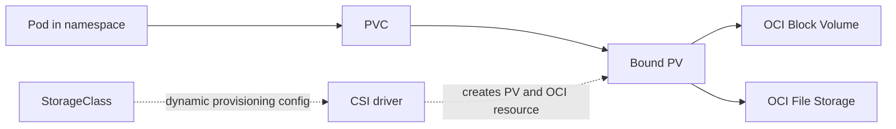

# Persistent Volumes with Block Volume and File Storage

In the **Kubernetes with OKE** chapter of the Oracle Cloud Infrastructure module (`CLOUD_PROVIDERS_ORACLE`), persistent storage connects Kubernetes resources to OCI data services. A Pod can be recreated on a different worker node; business data needs its own lifecycle and recovery mechanism. This decision directly involves compartments, IAM, VCN, Compute, monitoring, and operational cost.

This lesson builds two storage paths: Block Volume for data attached to a stateful component and File Storage for a shared directory. Examples use OKE with **Linux-based managed worker nodes**; commands are written for **Bash in OCI Cloud Shell or a Linux admin host with kubeconfig configured**. This is a guide for learners to practice in their own environments; manifests do not deploy automatically to OCI when reading the lesson.

## 1. Identifying Which Data Must Outlive a Pod

Suppose a case-intake application has three components:

- A request-handling API that can run multiple replicas.
- A processor that saves checkpoints to resume work after restarts.
- Processes that read documents together and write outputs into a shared directory.

If checkpoints are written to the container's filesystem, replacing the container can lose state. If documents are written to one node's local disk, API replicas on other nodes cannot automatically see them.

A reasonable initial design for this example is a dedicated volume for checkpoints and a shared filesystem for documents. Next, answer: who is allowed to create resources, which availability domain holds the data, what happens to data when a PVC is deleted, and how long recovery takes.

After this lesson, learners should be able to:

1. Distinguish StorageClass, PersistentVolume, and PersistentVolumeClaim.
2. Choose between Block Volume and File Storage based on how applications read and write data.
3. Provision storage using CSI, verifying data persists across Pod recreation.
4. Recognize provisioning, scheduling, attach, and mount errors.
5. Plan data protection, capacity monitoring, and controlled resource cleanup.

## 2. How PV, PVC, StorageClass, and CSI Work Together

| Component | Scope | Responsibility |
| --- | --- | --- |
| StorageClass | Cluster-wide | Describes how storage is provisioned, the driver, and related policies |
| PersistentVolume, abbreviated PV | Cluster-wide | Represents a piece of storage managed by Kubernetes |
| PersistentVolumeClaim, abbreviated PVC | Namespaced | An application's request for storage |
| Pod | Namespaced | References a PVC and mounts the volume into containers |
| CSI driver | Integrates Kubernetes with storage systems | Performs storage operations supported by the driver |

A Pod uses PVCs in the same namespace. One PV binds to one PVC at a time; multiple Pods can use the same PVC if the backend and access mode permit. Container filesystems, `emptyDir`, and `hostPath` do not provide the same lifecycle contract as a PV provisioned from an OCI service. See [Kubernetes Persistent Volumes](https://kubernetes.io/docs/concepts/storage/persistent-volumes/).

There are two ways to bring resources into this chain:

- **Dynamic provisioning:** create a PVC referencing a StorageClass; the provisioner creates corresponding storage.
- **Static provisioning:** an administrator prepares the storage and PV first; the PVC binds to a matching PV.

Dynamic provisioning lets application teams request storage using a configuration standardized by the platform team. Static provisioning fits when data already exists or when another team manages the resource lifecycle. The mechanism is described in [Dynamic Volume Provisioning](https://kubernetes.io/docs/concepts/storage/dynamic-provisioning/).



The diagram depicts two backend choices. A specific PV represents only the backend declared for that PV itself.

### Access Mode and Volume Mode Are Two Different Decisions

`ReadWriteOnce` (RWO) allows read/write mounting from one node; multiple Pods on that node can still share access. `ReadWriteMany` (RWX) allows multiple nodes to mount read/write concurrently. `ReadWriteOncePod` (RWOP) restricts access to a single Pod and requires support from both the driver and Kubernetes version; do not blindly switch RWO to RWOP in OCI manifests.

`volumeMode: Filesystem` provides a filesystem mounted into a directory. `volumeMode: Block` provides a raw block device for applications that know how to use it. Block Volume can still be used with `volumeMode: Filesystem`, as in this lesson. Access modes do not replace file permissions inside the operating system. Refer to [access modes and volume modes](https://kubernetes.io/docs/concepts/storage/persistent-volumes/).

## 3. Choosing Block Volume or File Storage

| Design Question | Block Volume | File Storage |
| --- | --- | --- |
| Access model | Block device attached to a Compute instance | Network-accessed filesystem |
| Usage pattern in lesson | RWO, dedicated volume for one component | RWX, shared directory for multiple Pods |
| Suitable examples | Per-instance checkpoints, data needing a block-backed filesystem | Shared documents, batch inputs, shared content |
| Aspects to evaluate | Topology, attach/detach, IOPS, and throughput | NFS connectivity, metadata, file permissions, and concurrent writes |
| Verification method | Recreate Pod and read data on the same PVC | Pods on multiple nodes see the same data |

Oracle advises choosing services by workload and using StorageClasses to express storage requirements. See [Storage Best Practices for OKE](https://docs.oracle.com/en-us/iaas/Content/ContEng/Tasks/contengbestpractices_topic-Storage-best-practices.htm).

A sequential file writer and a database writing transaction logs can demand very different characteristics. Thus, the table above is a starting point for designing tests. For Oracle databases, verify product-supported storage configurations, backup mechanisms, replication, and operational models; the checkpoint example in this lesson is not an Oracle Database deployment configuration.

File Storage supports NFSv3 along with NLM locking. Having RWX allows sharing a filesystem, yet applications still need rules when updating the same data object concurrently. For example, two workers can write separate files and publish results; if modifying the same file, design appropriate locking or coordination. Refer to [OCI File Storage](https://docs.oracle.com/en-us/iaas/Content/File/home.htm).

## 4. Preparing OKE, Permissions, and Networking

### 4.1. Checking the Lab Environment

Prepare an active OKE cluster, Linux managed worker nodes, Kubernetes access, and corresponding OCI storage admin permissions. The File Storage section uses two worker nodes capable of scheduling Pods to demonstrate multi-node access.

Run on the admin host:

```bash
kubectl config current-context
kubectl get nodes -o wide
kubectl get storageclass
kubectl get csidrivers
kubectl get nodes -L topology.kubernetes.io/zone
```

Driver names to check are `blockvolume.csi.oraclecloud.com` and `fss.csi.oraclecloud.com`. If the cluster lacks the needed drivers or drivers are unhealthy, finish platform setup before running the lab.

StorageClass names come from your actual cluster configuration. This lesson uses dedicated classes rather than relying on whichever class is default. For Block Volume, Oracle recommends using CSI and the `oci-bv` class; older upgraded clusters may still retain FlexVolume's `oci` default. See [Provisioning PVCs on Block Volume](https://docs.oracle.com/en-us/iaas/Content/ContEng/Tasks/contengcreatingpersistentvolumeclaim_topic-Provisioning_PVCs_on_BV.htm).

### 4.2. Separate Kubernetes API Permissions from OCI Resource Creation Permissions

An account permitted to create PVCs in a namespace might not have permission to create StorageClasses or PVs. At the same time, the CSI provisioner needs OCI authorization to act on the compartment holding the resources.

Map out responsibilities before practicing:

| Principal | Actions Permitted |
| --- | --- |
| Platform administrator | Prepare StorageClasses, static PVs, drivers, and cluster config |
| Application deployer | Create workloads and PVCs in assigned namespaces |
| Principal used by OKE integration | Perform storage and network operations per integration mechanism |
| Data administrator | Prepare directory permissions, backups, and restores |

IAM governs OCI resource actions; data access on File Storage also passes through networking, exports, and filesystem permissions. These are separate layers, explained in [About File Storage Security](https://docs.oracle.com/en-us/iaas/Content/File/Concepts/securitylayers.htm).

For dynamically provisioned File Storage, verify policies for `file-family`, related network permissions, and the target compartment per the [OKE File Storage guide](https://docs.oracle.com/en-us/iaas/Content/ContEng/Tasks/contengcreatingpersistentvolumeclaim_Provisioning_PVCs_on_FSS.htm). If using customer-managed keys in Vault, add key usage permissions. Do not infer the CSI principal from the application's service account.

### 4.3. Preparing the Network Path to File Storage

A Pod with a `Bound` PVC can still fail to mount the filesystem. Worker nodes must reach the mount target's private IP, and the export must permit the matching client source.

In this lesson's managed nodes model:

1. Prepare a mount target in a private subnet reachable from worker nodes.
2. Check routes and security rules on both node and mount target sides.
3. Permit the right client sources and required protocols.
4. Verify export options for the actual client source.

For typical NFS access, Oracle documentation lists TCP 111, 2048, 2049, 2050 and UDP 111, 2048 for the corresponding flows. Specific rules depend on whether nodes and the mount target share a subnet or sit in different subnets; follow [Configuring VCN Security Rules for File Storage](https://docs.oracle.com/en-us/iaas/Content/File/Tasks/securitylistsfilestorage.htm).

## 5. Block Volume Practice: Dedicated Data for a StatefulSet

### 5.1. Configuration Meaning

We use a single-replica StatefulSet that appends startup timestamps to `/data/history.log`. Each time the Pod is recreated, it continues using the PVC bound to that replica's identity.

The StorageClass sets `volumeBindingMode: WaitForFirstConsumer`, allowing the scheduler and provisioner to coordinate placement before provisioning. With this binding mode, a PVC without a consuming Pod can stay `Pending` normally; avoid hardcoding `nodeName` to bypass the scheduler. See [Volume binding mode](https://kubernetes.io/docs/concepts/storage/storage-classes/).

OCI Block Volumes are tied to an availability domain: an instance can directly attach volumes only in the same AD. Therefore, an existing volume constrains where a Pod can run. Refer to [Overview of Block Volume](https://docs.oracle.com/en-us/iaas/Content/Block/Concepts/overview.htm).

### 5.2. Complete Manifest

Save the example as `lab-bv.yaml` on your practice machine:

```yaml
apiVersion: v1
kind: Namespace
metadata:
  name: oke-storage-lab
---
apiVersion: storage.k8s.io/v1
kind: StorageClass
metadata:
  name: oke-lab-bv-retain
provisioner: blockvolume.csi.oraclecloud.com
parameters:
  attachment-type: "paravirtualized"
reclaimPolicy: Retain
allowVolumeExpansion: true
volumeBindingMode: WaitForFirstConsumer
---
apiVersion: v1
kind: Service
metadata:
  name: checkpoint
  namespace: oke-storage-lab
spec:
  clusterIP: None
  selector:
    app: checkpoint
  ports:
    - name: placeholder
      port: 8080
---
apiVersion: apps/v1
kind: StatefulSet
metadata:
  name: checkpoint
  namespace: oke-storage-lab
spec:
  serviceName: checkpoint
  replicas: 1
  selector:
    matchLabels:
      app: checkpoint
  template:
    metadata:
      labels:
        app: checkpoint
    spec:
      terminationGracePeriodSeconds: 15
      securityContext:
        runAsUser: 1000
        runAsGroup: 1000
        fsGroup: 1000
      containers:
        - name: writer
          image: busybox:1.37.0
          command: ["/bin/sh", "-c"]
          args:
            - |
              set -eu
              printf 'pod=%s time=%s\n' "$HOSTNAME" "$(date -u)" >> /data/history.log
              sync
              while true; do sleep 3600; done
          resources:
            requests:
              cpu: 20m
              memory: 16Mi
            limits:
              cpu: 100m
              memory: 64Mi
          volumeMounts:
            - name: data
              mountPath: /data
  volumeClaimTemplates:
    - metadata:
        name: data
      spec:
        storageClassName: oke-lab-bv-retain
        accessModes:
          - ReadWriteOnce
        volumeMode: Filesystem
        resources:
          requests:
            storage: 50Gi
```

This class uses CSI Block Volume and the attachment type illustrated by Oracle. OKE rounds requests smaller than the 50 GB minimum up to the minimum; the example selects `50Gi` from the start. Refer to [Provisioning PVCs on the Block Volume Service](https://docs.oracle.com/en-us/iaas/Content/ContEng/Tasks/contengcreatingpersistentvolumeclaim_topic-Provisioning_PVCs_on_BV.htm).

The headless Service supplies the network identity configuration for the StatefulSet; the sample process does not open port 8080. The container simply writes a startup marker and sleeps. For a real application, replace the image and command with your business program, and pin the image by digest in your release workflow.

Apply and observe:

```bash
kubectl apply -f lab-bv.yaml
kubectl -n oke-storage-lab get pvc
kubectl -n oke-storage-lab rollout status statefulset/checkpoint --timeout=300s
kubectl -n oke-storage-lab get pod checkpoint-0 -o wide
kubectl -n oke-storage-lab get pvc data-checkpoint-0
kubectl -n oke-storage-lab exec checkpoint-0 -- cat /data/history.log
```

Expect PVC `data-checkpoint-0` to transition to `Bound` and the Pod to run. Provisioning, attach, and image-pull times depend on the environment; hitting a timeout is a cue to inspect events, not enough to conclude data has failed.

### 5.3. Verifying Data After Recreating the Pod

Record the PV name and backend volume handle:

```bash
BV_PV=$(kubectl -n oke-storage-lab get pvc data-checkpoint-0 -o jsonpath='{.spec.volumeName}')
kubectl get pv "$BV_PV"
kubectl get pv "$BV_PV" -o jsonpath='{.spec.csi.volumeHandle}'
printf '\n'

kubectl -n oke-storage-lab delete pod checkpoint-0
kubectl -n oke-storage-lab wait --for=condition=Ready pod/checkpoint-0 --timeout=300s
kubectl -n oke-storage-lab exec checkpoint-0 -- cat /data/history.log
```

Once the new Pod is ready, the file should still contain the old line plus a new startup marker. Verify the PVC remains bound to the same PV. This test proves data survives Pod recreation; it does not yet verify recovery from an AD outage or accidental deletion.

A StatefulSet creates a dedicated PVC for each element of `volumeClaimTemplates`. Scaling to three replicas creates three separate PVCs for three identities; the application must handle its own replication if replicas need identical data. See [StatefulSets and stable storage](https://kubernetes.io/docs/concepts/workloads/controllers/statefulset/).

### 5.4. Observing Node Affinity

```bash
kubectl get pv "$BV_PV" -o yaml
kubectl get nodes -L topology.kubernetes.io/zone
kubectl -n oke-storage-lab describe pod checkpoint-0
```

Inspect the PV's `nodeAffinity` and compare it with node topology. When Compute capacity in the matching AD runs out, the Pod may wait in scheduling even if the cluster still has nodes in other ADs.

This yields a concrete operational requirement: when scaling down a node pool or replacing nodes, ensure eligible nodes remain to serve already-provisioned data. Raising total node count without considering placement may still fail to solve the issue.

## 6. Expanding Block Volumes at the Right Layer

This lesson's class enables `allowVolumeExpansion`. To expand the PVC from `50Gi` to `100Gi`:

```bash
kubectl -n oke-storage-lab patch pvc data-checkpoint-0 --type=merge \
  -p '{"spec":{"resources":{"requests":{"storage":"100Gi"}}}}'

kubectl -n oke-storage-lab get pvc data-checkpoint-0
kubectl -n oke-storage-lab describe pvc data-checkpoint-0
kubectl -n oke-storage-lab exec checkpoint-0 -- df -h /data
```

Resize requests go through the PVC; do not edit PV capacity directly to fake a resize. Monitor both PVC capacity and the filesystem inside the container. Oracle's CSI guide documents online expansion and notes that shrinking is unsupported. See [Expand a Block Volume using CSI](https://github.com/oracle/oci-cloud-controller-manager/blob/master/docs/expand-block-volume-using-csi.md).

For real workloads, store the desired sizes of existing PVCs in operational procedures or an appropriate configuration source. `volumeClaimTemplates` is not a mechanism to auto-resize existing PVCs; do not treat editing the template as a bulk resize operation.

Capacity increases should be paired with growth forecasts. For example, if checkpoints actually use 8 GiB but grow by 3 GiB per day, address history retention as well. Expansion buys operational time; data retention rules govern long-term demand.

## 7. File Storage Practice: Multiple Nodes Sharing a Filesystem

### 7.1. Preparing Resources and Directory Permissions

The static provisioning path below assumes an administrator has already prepared:

- An OCI File Storage filesystem for the lab.
- A mount target with a private IP, e.g., `10.0.20.10`.
- An illustrative export path `/oke-shared`.
- Security rules and export options permitting valid clients.
- The actual filesystem OCID, mount target IP, and export path.

Use a Linux admin host authorized to mount that export. After mounting successfully at `/mnt/oke-fss`, create a dedicated directory for the lab:

```bash
sudo mkdir -p /mnt/oke-fss/lab-data
sudo chown 1000:1000 /mnt/oke-fss/lab-data
sudo chmod 2770 /mnt/oke-fss/lab-data
ls -ldn /mnt/oke-fss/lab-data
```

This path must be on the mounted filesystem; avoid accidentally creating the directory on local disk. If `chown` is not permitted, the administrator must handle permissions and export policies per environment design.

Export options can restrict client sources, read/write access, and UID/GID mapping, including root squash. Root privileges inside a container do not bypass these constraints. See [Working with NFS Exports and Export Options](https://docs.oracle.com/en-us/iaas/Content/File/Tasks/exportoptions.htm).

Preparing a directory with an explicit owner lets the example use UID/GID 1000 without assuming the driver automatically changes ownership for every RWX volume. When using `securityContext`, check driver capabilities; see [Configure a Security Context](https://kubernetes.io/docs/tasks/configure-pod-container/security-context/).

### 7.2. Declaring the Static PV and PVC

Save as `lab-fss-static.yaml`, replacing all placeholders with real values:

```yaml
apiVersion: v1
kind: PersistentVolume
metadata:
  name: oke-lab-fss-static
spec:
  capacity:
    storage: 50Gi
  volumeMode: Filesystem
  accessModes:
    - ReadWriteMany
  persistentVolumeReclaimPolicy: Retain
  storageClassName: ""
  csi:
    driver: fss.csi.oraclecloud.com
    volumeHandle: "<FILESYSTEM_OCID>:<MOUNT_TARGET_PRIVATE_IP>:/oke-shared"
---
apiVersion: v1
kind: PersistentVolumeClaim
metadata:
  name: shared-files
  namespace: oke-storage-lab
spec:
  storageClassName: ""
  volumeName: oke-lab-fss-static
  accessModes:
    - ReadWriteMany
  volumeMode: Filesystem
  resources:
    requests:
      storage: 50Gi
```

`volumeHandle` identifies the filesystem, mount target address, and export path. `volumeName` selects the specific PV; `storageClassName: ""` indicates the PVC does not request a default class. See the official CSI example at [Statically Provisioned FSS using CSI](https://github.com/oracle/oci-cloud-controller-manager/blob/master/docs/statically-provisioned-fss-using-csi.md).

Apply after the namespace from the Block Volume section already exists:

```bash
kubectl apply -f lab-fss-static.yaml
kubectl -n oke-storage-lab get pvc shared-files
kubectl get pv oke-lab-fss-static
```

In the FSS example, `50Gi` is a declared value for the PV/PVC mechanism. Do not assume the filesystem was created with a matching hard quota; capacity monitoring is covered in the cost section.

### 7.3. Two Pods Writing to the Shared Directory Together

Save as `lab-fss-writer.yaml`:

```yaml
apiVersion: apps/v1
kind: Deployment
metadata:
  name: shared-writer
  namespace: oke-storage-lab
spec:
  replicas: 2
  strategy:
    type: RollingUpdate
    rollingUpdate:
      maxSurge: 0
      maxUnavailable: 1
  selector:
    matchLabels:
      app: shared-writer
  template:
    metadata:
      labels:
        app: shared-writer
    spec:
      securityContext:
        runAsUser: 1000
        runAsGroup: 1000
      affinity:
        podAntiAffinity:
          requiredDuringSchedulingIgnoredDuringExecution:
            - labelSelector:
                matchLabels:
                  app: shared-writer
              topologyKey: kubernetes.io/hostname
      containers:
        - name: writer
          image: busybox:1.37.0
          command: ["/bin/sh", "-c"]
          args:
            - |
              set -eu
              printf 'pod=%s time=%s\n' "$HOSTNAME" "$(date -u)" > "/shared/$HOSTNAME.txt"
              sync
              while true; do sleep 3600; done
          resources:
            requests:
              cpu: 20m
              memory: 16Mi
            limits:
              cpu: 100m
              memory: 64Mi
          volumeMounts:
            - name: shared
              mountPath: /shared
              subPath: lab-data
      volumes:
        - name: shared
          persistentVolumeClaim:
            claimName: shared-files
```

`subPath` selects the `lab-data` directory prepared in the export. Anti-affinity forces the two Pods onto two different nodes. If only one eligible node exists, one Pod stays `Pending`; to demonstrate two-node access, provide an appropriate second node.

```bash
kubectl apply -f lab-fss-writer.yaml
kubectl -n oke-storage-lab rollout status deployment/shared-writer --timeout=300s
kubectl -n oke-storage-lab get pods -l app=shared-writer -o wide

for pod in $(kubectl -n oke-storage-lab get pods -l app=shared-writer -o jsonpath='{.items[*].metadata.name}'); do
  printf '\nPod: %s\n' "$pod"
  kubectl -n oke-storage-lab exec "$pod" -- sh -c 'ls -l /shared; cat /shared/*.txt'
done
```

Results should provide two pieces of evidence: two Pods on two nodes, and each Pod reading files created by both. Each process writes a separate file named after its Pod to prevent one process from overwriting the other's output.

You can recreate Pods using `kubectl -n oke-storage-lab rollout restart deployment/shared-writer`. Setting `maxSurge: 0` and `maxUnavailable: 1` allows terminating one old Pod to make room for a new Pod when two nodes are serving two replicas. Data from old Pods remains in the shared directory after the rollout completes.

## 8. Dynamically Provisioned File Storage: An Alternative Option

Static provisioning decouples filesystem creation from application deployment. When the platform team wants to allow creating filesystems per PVC, they can prepare a StorageClass using FSS CSI.

Example using an existing mount target:

```yaml
apiVersion: storage.k8s.io/v1
kind: StorageClass
metadata:
  name: oke-lab-fss-dynamic-retain
provisioner: fss.csi.oraclecloud.com
reclaimPolicy: Retain
volumeBindingMode: Immediate
parameters:
  availabilityDomain: "<TENANCY_AD_NAME>"
  compartmentOcid: "<STORAGE_COMPARTMENT_OCID>"
  mountTargetOcid: "<EXISTING_MOUNT_TARGET_OCID>"
---
apiVersion: v1
kind: PersistentVolumeClaim
metadata:
  name: shared-files-dynamic
  namespace: oke-storage-lab
spec:
  storageClassName: oke-lab-fss-dynamic-retain
  accessModes:
    - ReadWriteMany
  resources:
    requests:
      storage: 50Gi
```

The AD must match the selected mount target's location. If you want the driver to create a mount target, use `mountTargetSubnetOcid` instead of `mountTargetOcid`. CSI creates a new filesystem for the PVC; the `storage` request in the PVC does not size the OCI filesystem. Required parameters and policies are documented at [Provisioning PVCs on File Storage](https://docs.oracle.com/en-us/iaas/Content/ContEng/Tasks/contengcreatingpersistentvolumeclaim_Provisioning_PVCs_on_FSS.htm).

If practicing this option, save it as a separate manifest on the lab machine and apply after replacing placeholders. Once the PVC is `Bound`, read the PV handle to identify the new filesystem and export:

```bash
FSS_DYNAMIC_PV=$(kubectl -n oke-storage-lab get pvc shared-files-dynamic -o jsonpath='{.spec.volumeName}')
kubectl get pv "$FSS_DYNAMIC_PV" -o jsonpath='{.spec.csi.volumeHandle}'
printf '\n'
```

Before reusing the Deployment from section 7, prepare `lab-data` with matching permissions on the **new filesystem**, then update `claimName` to `shared-files-dynamic`. A directory on the static filesystem does not automatically appear on the dynamic filesystem.

Do not hardcode the same export path across multiple PVCs creating distinct filesystems on one mount target. When managing via CSI, keep provisioning configuration and lifecycle in the corresponding Kubernetes workflow; editing StorageClass parameters does not reconfigure already-provisioned resources.

## 9. Data Lifecycle: Pod Recreation, PVC Deletion, and Reclaim Policy

Distinguish three events:

| Event | What to Check |
| --- | --- |
| Pod recreated | Does the PVC still exist and point to the old PV? |
| PVC deleted | What reclaim policy does the PV have? |
| OCI resource deleted | Is there a usable replica or restore point? |

`Delete` lets the system reclaim the PV and backend storage per the driver. `Retain` keeps the data for administrators to handle; after the PVC is deleted, the PV typically moves to `Released` and does not automatically become an available volume for another application. Refer to [Change the Reclaim Policy of a PersistentVolume](https://kubernetes.io/docs/tasks/administer-cluster/change-pv-reclaim-policy/).

The examples choose `Retain` so deleting a claim does not simultaneously delete lab data. In return, operators are responsible for inventorying remaining resources and their costs.

Before removing a stateful workload, check:

```bash
kubectl -n oke-storage-lab get pvc
kubectl get pv
kubectl get pv "$BV_PV" -o jsonpath='{.spec.persistentVolumeReclaimPolicy}'
printf '\n'
```

When needing to change the policy of an existing PV, patch that PV itself. The following example switches the lab Block Volume PV to `Retain` before deleting the claim:

```bash
kubectl patch pv "$BV_PV" --type=merge \
  -p '{"spec":{"persistentVolumeReclaimPolicy":"Retain"}}'
```

Changing the policy in a StorageClass applies to future volumes provisioned from that class; do not treat that change as proof that older PVs have the new policy.

If retained data must be reused, verify the backend, attachment state, permissions, and prior claim. An administrator can arrange an appropriate rebind or restore into a new resource. Arbitrarily clearing `claimRef` can expose old data to the wrong workload.

## 10. Encryption and Data Access Permissions

Three items must be documented in the design:

1. Which key protects data at rest?
2. Does the data path require in-transit encryption?
3. Which processes are allowed to read and modify data after mounting?

With Block Volume using CSI, `kms-key-id` can specify a customer-managed key. Encrypting worker node boot volumes and setting a key for dynamically provisioned data volumes are two configurations to review separately. Refer to [Customer-managed encryption in OKE](https://blogs.oracle.com/cloud-infrastructure/oke-customer-managed-encryption).

With File Storage, in-transit encryption has specific software, OS, and network port requirements. Oracle's TLS guide uses port 2051 for encrypted access; do not reuse unencrypted NFS security rules verbatim and consider the configuration complete. See [Using In-transit TLS Encryption](https://docs.cloud.oracle.com/en-us/Content/File/Tasks/intransitencryption.htm).

The lab manifests above do not enable in-transit encryption. When a deployment requires it, add configuration matching your driver and node image, and verify the actual data path.

At the filesystem layer, use UIDs/GIDs matching the application and set directory permissions intentionally. With FSS, do not assume adding `fsGroup` fixes every RWX error; check how the driver handles ownership and whether the export applies squashing. Avoid changing permissions across an entire filesystem just to fix one subdirectory.

## 11. Backup, Restore, and Availability

### 11.1. Defining Recovery Objectives

A volume surviving Pod recreation is persistence across Pod lifecycles. To design business recovery, also define:

- **RPO:** how much recent data loss is acceptable.
- **RTO:** how much service downtime is acceptable.
- Incident scope: application bug, accidental deletion, data corruption, AD loss, or region loss.
- Procedure for verifying which restore point is trustworthy.

For example, if checkpoints can be regenerated from upstream inputs, a larger RPO may be acceptable. If a directory holds unique original case files, backup rules and restore verification must reflect that value.

### 11.2. Block Volume and CSI Snapshots

Kubernetes uses dedicated snapshot objects outside the core API. Before taking snapshots, verify compatible CRDs and the snapshot controller are ready; see [Volume Snapshots](https://kubernetes.io/docs/concepts/storage/volume-snapshots/).

```bash
kubectl api-resources --api-group=snapshot.storage.k8s.io
```

OCI CSI can create snapshots backed by Block Volume backups. Restoring via CSI creates a new volume from a snapshot rather than overwriting an existing volume's data. Refer to [Block Volume Snapshot and Restore using CSI](https://github.com/oracle/oci-cloud-controller-manager/blob/master/docs/volume-snapshot-and-restore-using-csi.md).

A drill procedure for a real workload might include:

1. Put the application in an appropriate state for a consistent copy.
2. Create a restore point and wait for completion.
3. Create a new PVC from the snapshot/backup.
4. Run a verification instance of the application in a separate recovery namespace.
5. Validate data integrity and measure completion time.
6. Cut over traffic only after business checks pass.

Backups can support restoring a volume to a different AD within the same region; directly moving an existing volume is not equivalent to that operation. See [Block Volumes FAQ](https://www.oracle.com/cloud/storage/block-volumes/faq/).

### 11.3. File Storage: Snapshots and Replication

File Storage supports filesystem-wide snapshots and policy-based snapshot schedules. When scheduling, define frequency, retention, and how snapshot creation is monitored. See [Managing Snapshots](https://docs.oracle.com/en-us/iaas/Content/File/Tasks/managingsnapshots.htm) and [Policy-Based Snapshots and Scheduling](https://docs.oracle.com/en-us/iaas/Content/File/Tasks/snapshot-policies-and-schedules.htm).

To protect against site failures, File Storage offers replication within the same region or across regions. Recovery target design must also prepare exports, networking, and connecting workloads to data at the target. See [File System Replication](https://docs.oracle.com/en-us/iaas/Content/File/Tasks/FSreplication.htm).

### 11.4. Multiple Replicas Do Not Automatically Create Data HA

A three-replica StatefulSet with three PVCs does not guarantee three consistent copies of data. A three-replica Deployment mounting FSS together also does not solve every network path or storage location failure.

To evaluate availability, simulate the exact failures required by the design: a Pod recreated, a node unavailable, no nodes left in the AD holding a Block Volume, or the application reading from restored data. Each test answers a different question and should document the outcome for that exact question.

## 12. Monitoring Performance, Capacity, and Cost

### 12.1. Reading Signals Together

During operations, correlate application signals with storage state:

| Signal | Question to Answer |
| --- | --- |
| PVC `Pending` for an extended time | Waiting for consumer or failing to provision? |
| Pod not Ready after scheduling | Failing at attach, mount, permissions, or image? |
| Write latency spiking | Higher app load, storage limits, or network bottleneck? |
| Used capacity growing rapidly | Business data, temp files, or unpruned history? |
| Many `Released` PVs | Do retained resources still have an accountable owner? |
| Stale restore points | Are schedules failing or backup intervals missing RPO? |

Initial inspection commands:

```bash
kubectl -n oke-storage-lab get pods,pvc
kubectl get pv
kubectl -n oke-storage-lab get events --sort-by=.metadata.creationTimestamp
kubectl -n oke-storage-lab exec checkpoint-0 -- df -h /data
kubectl -n oke-storage-lab exec checkpoint-0 -- df -i /data
```

Monitor space and inodes on filesystems that enforce those limits. For File Storage, combine the application view with service metrics; `df` inside a container is not your bill.

### 12.2. Separate Provisioned Capacity from Active Data

With Block Volume, inventory provisioned capacity, chosen performance tier, and associated backups. A small PVC storing very little data can still provision a larger backend due to minimum size rules.

With FSS, monitor the service's `meteredBytes`. Oracle describes this as usage measured for billing, updated asynchronously; snapshot delta data is also counted toward filesystem usage. See [File System Usage and Metering](https://docs.cloud.oracle.com/en-us/Content/File/Concepts/FSutilization.htm).

Example cost governance practices for a lab environment:

- Tag resources with owner, environment, and purpose.
- Record the mapping namespace → PVC → PV → OCID.
- Periodically review retained volumes after labs finish.
- Set backup and snapshot retention aligned with requirements.
- Compare growth trends against the compartment budget.

A Kubernetes ResourceQuota can cap PVC counts or total declared requests per cluster design. For FSS, control actual data volume at the service and application layers, because `requests.storage` in a PVC does not replace monitoring real consumption.

## 13. Diagnosing Failures by Stage

Start with the object closest to the symptom:

```bash
kubectl -n oke-storage-lab describe pvc data-checkpoint-0
kubectl -n oke-storage-lab describe pod checkpoint-0
kubectl get volumeattachments
kubectl -n oke-storage-lab get events --sort-by=.metadata.creationTimestamp
```

Swap in the corresponding PVC and Pod names when inspecting the FSS section.

| Symptom | Hypothesis to Check | Evidence to Collect |
| --- | --- | --- |
| Block Volume PVC `Pending`, no consumer | `WaitForFirstConsumer` working as designed | StorageClass and PVC events |
| PVC shows `ProvisioningFailed` | IAM, quota, driver, or OCI parameters invalid | Full event, compartment, and target resource |
| Pod reports volume node affinity conflict | Candidate nodes do not match PV topology | PV `nodeAffinity` and node labels |
| Pod reports attach or multi-attach error | Volume still attached to prior node or improper RWO usage | VolumeAttachment, node status, and attachment in OCI |
| FSS PVC `Bound`, but mount times out | Cannot reach mount target or missing network flow | Target IP, routes, and security rules |
| FSS reports access denied on mount | Export does not permit client source | Export path and export options |
| Mount succeeds, yet file write gets permission denied | UID/GID, mode, or squash mismatch | `id`, `ls -ldn`, directory permissions, and export policy |
| One FSS Pod `Pending` | Missing node satisfying anti-affinity in lab | Scheduling events and eligible nodes |
| Resize does not yet show new capacity | Expansion steps not yet complete | PVC conditions, events, and filesystem size |

The table shows diagnostic directions, not a one-to-one mapping from message to single root cause. Read the verbatim error, any OCI request ID, and recent change context before making edits.

When a node loses connectivity, forcing a volume detach must be accompanied by verifying the old process stopped accessing data. Deleting a `VolumeAttachment` or finalizer to make an error disappear can mask unhandled resource state.

When looking for driver logs, use `kubectl -n kube-system get pods -o wide` to identify actual Pod and container names, then read logs from the exact component. Do not hardcode CSI Pod names copied from another cluster.

## 14. Cleaning Up the Lab Environment

First record which PV names, backend OCIDs, exports, and mount targets belong solely to the lab. Decide which data to keep and which to delete. The examples use `Retain`, so removing workloads alone does not end OCI charges.

Stop workloads:

```bash
kubectl -n oke-storage-lab delete deployment shared-writer
kubectl -n oke-storage-lab delete statefulset checkpoint
kubectl -n oke-storage-lab delete service checkpoint
kubectl -n oke-storage-lab get pods
kubectl -n oke-storage-lab get pvc
```

Wait for Pods to terminate. Check remaining PVCs and each PV's reclaim policy before deleting lab claims:

```bash
kubectl -n oke-storage-lab delete pvc data-checkpoint-0 shared-files
```

If you also practiced dynamic provisioning, inspect `shared-files-dynamic` separately and delete that claim once data is no longer needed.

Afterward:

1. Check retained PVs and corresponding OCI resources.
2. Complete data retention or deletion according to documented decisions.
3. For lab-only Block Volumes, confirm detachment before deleting backends.
4. For lab-only filesystems, handle exports, filesystems, and restore points per their lifecycles.
5. Keep shared mount targets; delete lab-only mount targets only when no dependencies remain.
6. Remove retained PVs after backend data and resources are handled.
7. Remove lab-only StorageClasses and the namespace when no longer used.

For dynamically provisioned File Storage, verify which resources CSI created and which mount targets already existed; the reclaim policy and driver govern automatic cleanup. Reusing a mount target does not make it owned solely by one PVC.

Lab completion should include evidence that Block Volume data persisted across Pod recreation, evidence that two nodes accessed File Storage concurrently, a resource mapping for the data assets, and cleanup or retention outcomes for each resource.
