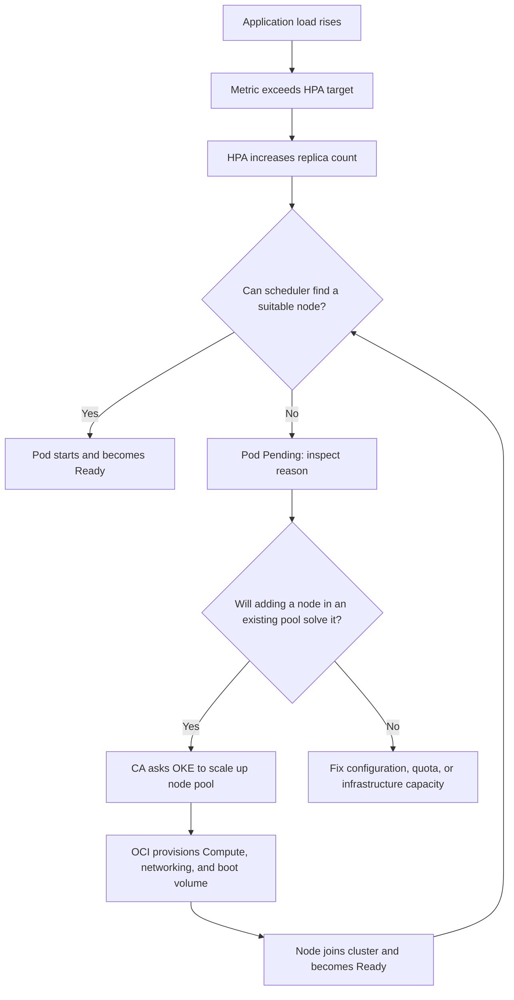

# Autoscaling Applications, Node Pools, and Resource Management

## 1. Objectives and Scope

In the **Kubernetes with OKE** chapter of the **CLOUD_PROVIDERS_ORACLE** module, autoscaling connects application demand to Oracle Cloud Infrastructure (OCI) capacity. An API needing more replicas might not have room to run; a newly provisioned node also will not help if Pods target the wrong node pool or run out of IP addresses.

This lesson helps you design the scaling chain from application to infrastructure, set resource budgets, and observe causes when that chain stalls. Knowledge connects directly to tenancy, compartment, IAM, VCN, Compute, and OCI monitoring. For applications using Oracle Database, connection limits and database capacity must also be part of scaling decisions.

After studying, you can:

- Distinguish scaling Pod counts, worker node counts, and per-container resources.
- Use requests/limits as inputs for scheduling and autoscaling.
- Configure HPA and scaling bounds for managed node pools on OKE.
- Set appropriate LimitRanges, ResourceQuotas, and OCI budgets.
- Trace a scale-up and scale-down event and identify bottlenecks with evidence.

The hands-on examples use **managed node pools**. Oracle's support matrix clearly distinguishes: HPA works with managed and virtual node pools; Cluster Autoscaler and VPA in this guide apply to managed node pools. For virtual nodes, use the resource allocation mechanisms specific to that node type. [Oracle: autoscaling node pools and Pods](https://docs.oracle.com/en-us/iaas/Content/ContEng/Tasks/contengautoscalingclusters.htm).

## 2. Three Distinct Scaling Decisions

| Mechanism | Target Modified | Primary Input | Example |
| --- | --- | --- | --- |
| Horizontal Pod Autoscaler — HPA | Workload replica count | CPU, memory, or metrics exposed via compatible APIs | API scales from 2 to 6 Pods |
| Cluster Autoscaler — CA | Number of managed nodes in managed node pools | Unschedulable Pods; requests and Pod placement constraints | Application pool scales from 1 to 2 nodes |
| Vertical Pod Autoscaler — VPA | Recommends or adjusts container requests; limits per configuration | Historical resource usage | Container recommended to raise memory request |

HPA and CA often form a chain:



A key distinction is that **high node CPU alone does not instruct CA to add nodes**. CA solves Pod schedulability and removes underutilized removable nodes. It does not create Deployments, new node pools, or new clusters. [Oracle: Kubernetes Cluster Autoscaler](https://docs.oracle.com/en-us/iaas/Content/ContEng/Tasks/contengusingclusterautoscaler.htm).

Reasoning example: a pool shows 85% actual CPU utilization, yet all Pods are scheduled and there is no demand for new replicas. That situation does not trigger CA to add nodes. Conversely, CPU usage is only 20%, yet a new Pod requests 4 CPUs while each node has only 2 CPUs free—scaling demand can still arise.

## 3. Requests and Limits Are the Foundation

### 3.1. Understanding Each Value Accurately

```yaml
resources:
  requests:
    cpu: "500m"
    memory: "1Gi"
  limits:
    cpu: "1"
    memory: "2Gi"
```

In the example above:

- `500m` is 0.5 Kubernetes CPU units; `1Gi` is 1 gibibyte.
- The scheduler uses requests to decide whether a node has room for a Pod.
- A CPU limit can cause throttling when a container needs more CPU than permitted.
- Exceeding the memory limit can lead to an OOM kill; adding nodes does not change a container's memory limit.

This is Kubernetes' container resource management mechanism. Request does not mean the amount of CPU an application constantly consumes, and memory request is not RAM pre-allocated exclusively for the application. [Kubernetes: managing resources for Pods and containers](https://kubernetes.io/docs/concepts/configuration/manage-resources-containers/).

For managed nodes, use `status.allocatable` published by Kubernetes when calculating capacity. When estimating OCI Compute, check the OCPU/vCPU conversion of your chosen shape; do not substitute an OCPU figure in the Console directly for a node's allocatable CPU.

### 3.2. Requests Affect Both Performance and Cost

Suppose an API actually needs around `400m` CPU under normal load:

| Declared CPU Request | Consequence to Evaluate |
| --- | --- |
| `100m` | CPU-to-request ratio is very high; HPA may scale replicas early |
| `500m` | Better starting point for load testing and choosing HPA targets |
| `2000m` | Each Pod reserves a large slot in scheduling; may increase required node count |

Values in the table are illustrative scenarios, not default thresholds for every API. Choose requests after measuring representative load, startup time, usage percentiles, and target latency.

For Java applications, memory limits must cover heap, metaspace, direct memory, thread stacks, and native allocations. Setting heap equal to the container's entire memory limit makes Pods prone to running out of memory even before heap graphs hit the cap.

### 3.3. Calculating Per-Node Capacity

Planning example for a workload, independent of the lab setup later:

| Quantity | Assumed Value |
| --- | --- |
| Allocatable per node | `3500m` CPU, `14Gi` RAM |
| DaemonSet and agent requests per node | `500m` CPU, `1Gi` RAM |
| Remaining for applications | `3000m` CPU, `13Gi` RAM |
| Request per application Pod | `500m` CPU, `1Gi` RAM |

Estimated capacity:

```text
CPU-bound limit    = floor(3000m / 500m) = 6 Pods/node
RAM-bound limit    = floor(13Gi / 1Gi)   = 13 Pods/node
Calculated capacity = min(6, 13)         = 6 Pods/node
```

For 12 Pods, at least 2 nodes are needed under this model. To still fit 12 Pods after losing 1 node, at least 3 equivalent nodes are needed, while ensuring Pods actually spread and can reschedule.

This is a preliminary calculation constructed for the lesson. In practice, add requests for sidecars, other workloads, surge Pods during rollouts, per-node Pod limits, and placement constraints. Total free CPU across the entire cluster cannot help a Pod if no single node has enough room for that Pod.

## 4. Choosing HPA Metrics and Policies

### 4.1. Percentage Targets Compare Against Requests

For CPU resource metrics, HPA calculates utilization relative to CPU request, not CPU limit. The simplified formula is:

```text
desired_replicas = ceil(current_replicas × current_metric / target_metric)
```

Suppose 4 Pods average 90% utilization with a 60% target:

```text
ceil(4 × 90 / 60) = 6 replicas
```

With a `500m` request, 90% utilization corresponds to roughly `450m` CPU. This is an explanatory model; real decisions are also affected by missing data, unready Pods, tolerance, and stabilization policies. [Kubernetes: HPA algorithm](https://kubernetes.io/docs/concepts/workloads/autoscaling/horizontal-pod-autoscale/).

### 4.2. Metrics Must Reflect the Bottleneck

| Workload | Reasonable Starting Metric | What to Verify Under Load Testing |
| --- | --- | --- |
| Compute-heavy API | CPU | Does adding replicas actually lower latency |
| Queue consumer | Queue depth, message age | How many partitions or parallel tasks exist |
| API waiting on Oracle Database queries | In-flight requests, latency, DB saturation | Does adding Pods overload the DB further |
| App caching in RAM | Memory combined with business metrics | Does RAM drop when demand subsides |

Metrics Server supplies CPU/RAM resource metrics; custom or external metrics require a corresponding metrics provider pipeline. Merely enabling OCI Monitoring does not mean HPA can automatically read every OCI metric. [Oracle: HPA on OKE](https://docs.oracle.com/en-us/iaas/Content/ContEng/Tasks/contengusinghorizontalpodautoscaler.htm).

Design example: if each Pod opens up to 20 DB connections, 10 replicas can create up to 200 connections, before counting rollouts and other workloads. Use your real connection budget to cap `maxReplicas`, and check connection pools, timeouts, and backpressure.

### 4.3. Scale-Up and Scale-Down Need Different Pacing

A starting configuration might allow scaling up by at most 2 Pods per minute, while scaling down only half of replicas per minute after a 5-minute stabilization window. The goal is to react to load increases while avoiding premature shrink during fluctuating traffic.

This is an illustrative choice for the lab that should be tuned via load testing. If an application starts slowly, adding replicas rapidly still does not deliver immediate serving capacity. Measure total time from demand onset until new Pods actually receive requests.

## 5. Preparing Node Pools, IAM, and OCI Networking

### 5.1. Separate System Capacity from Application Capacity

An easy-to-operate layout:

| Pool | Role | Policy in Example |
| --- | --- | --- |
| System pool | CA, DNS, and essential infrastructure components | Not sized by CA; maintains stable capacity |
| Application pool | Lab Pods | Managed by CA within 1–3 nodes |

Oracle recommends keeping one pool outside CA's management scope and running multiple replicas for CA. Pools across different Availability Domains can be used when designing scalability and availability. [Oracle: autoscaler best practices](https://docs.oracle.com/en-us/iaas/Content/ContEng/Tasks/contengbestpractices_topic-Autoscaler-best-practices.htm).

In the lab, configure labels on the **node pool** so new nodes receive them too:

- System pool: `node-purpose=system`.
- Application pool: `workload=autoscaling-lab`.

Applying labels manually to an existing node and forgetting pool-level label configuration causes scaling outcomes to miss expectations. If the system pool has taints, add-ons placed there need matching tolerations.

Two CA replicas sitting on the same node still share failure risk if that node dies. For environments needing availability, provide sufficient system nodes and corresponding spread rules.

### 5.2. Distinguish OCI IAM from Kubernetes Permissions

Deployers need permissions to act on the cluster and Kubernetes resources. CA itself also needs an identity authorized to call OCI APIs to manage node pools, Compute, and related network resources.

Oracle's add-on guide supports instance principals and workload identity; workload identity requires an enhanced cluster and compatible version. With instance principals, set up a dynamic group for instances running CA and apply the full policy set in the guide. If networking resides in another compartment, grant permissions in that scope too. [Oracle: CA add-on identity and deployment](https://docs.oracle.com/en-us/iaas/Content/ContEng/Tasks/contengusingclusterautoscaler_topic-Working_with_Cluster_Autoscaler_as_Cluster_Add-on.htm).

The configuration example below uses `authType=instance`. Kubernetes RoleBindings do not replace this OCI policy set. When logs show auth errors or `NotAuthorizedOrNotFound`, verify actual principal, dynamic group, OCIDs, and compartments before tweaking Pod requests.

### 5.3. Having Quota Does Not Guarantee Node Provisioning

When setting pool maximums, build a capacity checklist for:

- Service limits and compartment quotas related to Compute/OKE.
- Shape and instance provisioning capacity in the planned Availability Domain.
- Boot volumes, worker subnet, and related network resources.
- Pod IP addresses if using OCI VCN-Native Pod Networking.
- Reachability to registry, OCI APIs, and Kubernetes API from required components.

With VCN-native networking, plan worker and Pod IPs to match maximum scale. Read the CIDR guide for your active networking mode rather than inferring IP counts from node count alone. [Oracle: CIDRs and OKE](https://docs.oracle.com/en-us/iaas/Content/ContEng/Concepts/contengcidrblocks.htm).

A `Ready` node with Pods stuck at network setup is a different diagnostic branch from Pods `Pending` due to `Insufficient cpu`. Separating the two avoids adding nodes when the real cause lies in CNI or IPs.

## 6. Configuring Cluster Autoscaler Bounds on OKE

### 6.1. Choosing Deployment Method

OKE supports CA as an add-on and as a standalone deployment. The lab uses the add-on on a cluster supporting that feature. Choose a CA version compatible with your cluster's Kubernetes version and re-verify during upgrades; do not install two CA instances simultaneously controlling the same pool.

Add-on parameters use OKE-published key names, differing from CLI flags in some standalone deployments. Specifically, `nodes` declares pool bounds in the form `min:max:node-pool-ocid`. [Oracle: CA add-on arguments](https://docs.oracle.com/en-us/iaas/Content/ContEng/Tasks/configuration-arguments-cluster-autoscaler.htm).

Example contents of lab file `cluster-autoscaler-lab.json`:

```json
{
  "configurations": [
    {
      "key": "nodes",
      "value": "1:3:<APP_NODE_POOL_OCID>"
    },
    {
      "key": "authType",
      "value": "instance"
    },
    {
      "key": "numOfReplicas",
      "value": "2"
    },
    {
      "key": "nodeSelectors",
      "value": "{\"node-purpose\":\"system\"}"
    },
    {
      "key": "maxNodeProvisionTime",
      "value": "25m"
    },
    {
      "key": "scaleDownDelayAfterAdd",
      "value": "10m"
    },
    {
      "key": "scaleDownUnneededTime",
      "value": "10m"
    }
  ]
}
```

Replace `<APP_NODE_POOL_OCID>` with the real OCID. The system pool does not appear in `nodes`. The two 10-minute values in the example set wait delays before scale-down; they do not guarantee a node is deleted at exact minute 10.

### 6.2. Installing and Confirming

Commands below run in PowerShell configured with OCI CLI and kubeconfig for the lab cluster:

```powershell
$clusterId = "<CLUSTER_OCID>"
oci ce cluster list-addons --cluster-id $clusterId
```

If CA is already deployed, check how it is managed and update configuration through that workflow. If not present, and IAM plus compatible versions are ready, install the add-on:

```powershell
oci ce cluster install-addon --addon-name ClusterAutoscaler --cluster-id $clusterId --from-json file://./cluster-autoscaler-lab.json
kubectl -n kube-system get deployment cluster-autoscaler
kubectl -n kube-system get pods -o wide
```

Installing the add-on creates a work request; confirm the work request succeeds and CA actually watches the right pool. Full steps are in [Oracle's CA add-on guide](https://docs.oracle.com/en-us/iaas/Content/ContEng/Tasks/contengusingclusterautoscaler_topic-Working_with_Cluster_Autoscaler_as_Cluster_Add-on.htm).

If CA replicas cannot run on the system pool, check labels, taints/tolerations, and remaining capacity on that pool. Do not start load tests while the component responsible for node provisioning is still Pending.

## 7. Setting Resource Budgets for the Lab Namespace

### 7.1. Lab Prerequisites

Prepare a lab-only environment with these conditions:

- Application managed node pool running Linux and `amd64` architecture, labeled `workload=autoscaling-lab`.
- Application pool configured with min 1, max 3 nodes in CA; sufficient OCI quota and capacity for max.
- System pool labeled `node-purpose=system`, with enough room for CA and add-ons.
- Metrics Server deployed using an OKE-supported method.
- Nodes can pull images from registry and Pods can communicate internally.
- Practitioner has permission to create the namespace and resources used in this lesson.

Illustrative images serve load testing. When moving to an organizational environment, use approved images and pin digests after verifying architecture and compatibility.

Check baseline inputs:

```powershell
kubectl config current-context
kubectl get nodes -L node-purpose,workload
kubectl get apiservice v1beta1.metrics.k8s.io
kubectl top nodes
```

If `kubectl top` does not yet return metrics, resolve Metrics Server before evaluating HPA. You can deploy Metrics Server following [Oracle: Metrics Server on OKE](https://docs.oracle.com/en-us/iaas/Content/ContEng/Tasks/contengdeployingmetricsserver.htm).

### 7.2. LimitRange and ResourceQuota Solve Two Different Problems

**LimitRange** sets default and per-container/Pod resource bounds inside a namespace. Defaults prevent omitted requests; they do not replace application sizing. [Kubernetes: LimitRange](https://kubernetes.io/docs/concepts/policy/limit-range/).

**ResourceQuota** sets aggregate resource ceilings for a namespace. If exceeded, API admission may reject Pod creation. No new Pod exists for the scheduler to place on a node then, so adding nodes will not solve that cause. [Kubernetes: ResourceQuota](https://kubernetes.io/docs/concepts/policy/resource-quotas/).

Save the following manifest as `namespace-budget-lab.yaml` in your working directory:

```yaml
apiVersion: v1
kind: Namespace
metadata:
  name: autoscaling-lab
---
apiVersion: v1
kind: LimitRange
metadata:
  name: container-budget
  namespace: autoscaling-lab
spec:
  limits:
    - type: Container
      min:
        cpu: "50m"
        memory: "32Mi"
      max:
        cpu: "2"
        memory: "2Gi"
      defaultRequest:
        cpu: "250m"
        memory: "128Mi"
      default:
        cpu: "500m"
        memory: "512Mi"
---
apiVersion: v1
kind: ResourceQuota
metadata:
  name: namespace-budget
  namespace: autoscaling-lab
spec:
  hard:
    requests.cpu: "8"
    requests.memory: "8Gi"
    limits.cpu: "16"
    limits.memory: "16Gi"
    pods: "20"
```

Apply and inspect:

```powershell
kubectl apply -f .\namespace-budget-lab.yaml
kubectl -n autoscaling-lab describe limitrange container-budget
kubectl -n autoscaling-lab describe resourcequota namespace-budget
```

This quota is a choice for the exercises below. It does not reserve 8 physical CPUs, does not guarantee OCI Compute availability, and is not a billing cap.

When budgeting for real applications, use peak replica counts plus rollout surge and auxiliary Pods. At `500m` CPU request per Pod, 10 replicas request 5 CPU total; 1 rollout surge Pod raises that to 5.5 CPU, before counting other workloads.

## 8. Hands-On HPA with a CPU-Load Application

### 8.1. Deployment, Service, HPA, and PDB

The manifest below is a lab configuration built for this lesson, using the illustrative application image from the [Kubernetes HPA walkthrough](https://kubernetes.io/docs/tasks/run-application/horizontal-pod-autoscale-walkthrough/). Save as `hpa-demo-lab.yaml`:

```yaml
apiVersion: apps/v1
kind: Deployment
metadata:
  name: hpa-demo
  namespace: autoscaling-lab
spec:
  replicas: 2
  revisionHistoryLimit: 2
  selector:
    matchLabels:
      app: hpa-demo
  strategy:
    type: RollingUpdate
    rollingUpdate:
      maxSurge: 1
      maxUnavailable: 0
  template:
    metadata:
      labels:
        app: hpa-demo
    spec:
      terminationGracePeriodSeconds: 30
      nodeSelector:
        workload: autoscaling-lab
      topologySpreadConstraints:
        - maxSkew: 1
          topologyKey: kubernetes.io/hostname
          whenUnsatisfiable: ScheduleAnyway
          labelSelector:
            matchLabels:
              app: hpa-demo
      containers:
        - name: web
          image: registry.k8s.io/hpa-example
          ports:
            - name: http
              containerPort: 80
          resources:
            requests:
              cpu: "500m"
              memory: "256Mi"
            limits:
              cpu: "1"
              memory: "512Mi"
          startupProbe:
            tcpSocket:
              port: http
            periodSeconds: 5
            failureThreshold: 30
          readinessProbe:
            tcpSocket:
              port: http
            periodSeconds: 5
---
apiVersion: v1
kind: Service
metadata:
  name: hpa-demo
  namespace: autoscaling-lab
spec:
  type: ClusterIP
  selector:
    app: hpa-demo
  ports:
    - name: http
      port: 80
      targetPort: http
---
apiVersion: autoscaling/v2
kind: HorizontalPodAutoscaler
metadata:
  name: hpa-demo
  namespace: autoscaling-lab
spec:
  scaleTargetRef:
    apiVersion: apps/v1
    kind: Deployment
    name: hpa-demo
  minReplicas: 2
  maxReplicas: 10
  metrics:
    - type: Resource
      resource:
        name: cpu
        target:
          type: Utilization
          averageUtilization: 60
  behavior:
    scaleUp:
      stabilizationWindowSeconds: 0
      policies:
        - type: Pods
          value: 2
          periodSeconds: 60
    scaleDown:
      stabilizationWindowSeconds: 300
      policies:
        - type: Percent
          value: 50
          periodSeconds: 60
---
apiVersion: policy/v1
kind: PodDisruptionBudget
metadata:
  name: hpa-demo
  namespace: autoscaling-lab
spec:
  minAvailable: 1
  selector:
    matchLabels:
      app: hpa-demo
```

Choices in the manifest:

- CPU request `500m` and a 60% target correspond to around `300m` CPU/Pod at target in the simplified model.
- A 10-replica ceiling caps application demand for the test.
- ClusterIP Service enables generating load from inside the cluster.
- TCP probes check that the port is open; real applications should have readiness checks reflecting serving capability.
- `ScheduleAnyway` prefers spreading, not a guarantee every node or Availability Domain holds a replica.

Topology spread can be soft or hard; hard constraints must match the domains and nodes the cluster actually provides. [Kubernetes: topology spread constraints](https://kubernetes.io/docs/concepts/scheduling-eviction/topology-spread-constraints/).

`replicas: 2` here serves initial creation. Once HPA manages the workload, GitOps workflows or apply steps should not continuously re-apply a fixed replica count. Separate control of this field so replicas are not snapped back between HPA adjustments.

### 8.2. Deploying and Capturing Baseline State

```powershell
kubectl apply -f .\hpa-demo-lab.yaml
kubectl -n autoscaling-lab rollout status deployment/hpa-demo --timeout=180s
kubectl -n autoscaling-lab get hpa
kubectl -n autoscaling-lab top pods
kubectl -n autoscaling-lab get pods -o wide
```

Allow time for a metrics collection cycle. `<unknown>` right after creation is not enough to conclude an error; if it persists, inspect HPA conditions and events.

Before generating load, record the number of application nodes, Ready Pods, CPU requests, and CPU usage. These numbers serve as the baseline to separate Pod scaling from node scaling.

### 8.3. Generating Time-Bounded Load

Save the following manifest as `load-generator-lab.yaml`. The Job runs for at most 10 minutes and can be stopped early:

```yaml
apiVersion: batch/v1
kind: Job
metadata:
  name: load-generator
  namespace: autoscaling-lab
spec:
  activeDeadlineSeconds: 600
  backoffLimit: 0
  template:
    metadata:
      labels:
        app: load-generator
    spec:
      restartPolicy: Never
      nodeSelector:
        workload: autoscaling-lab
      containers:
        - name: client
          image: busybox:1.36.1
          command:
            - /bin/sh
            - -c
            - |
              for worker in 1 2 3 4; do
                (
                  while true; do
                    wget -q -O /dev/null -T 2 http://hpa-demo.autoscaling-lab.svc.cluster.local/
                    sleep 0.05
                  done
                ) &
              done
              wait
          resources:
            requests:
              cpu: "100m"
              memory: "64Mi"
            limits:
              cpu: "250m"
              memory: "128Mi"
```

Create the Job:

```powershell
kubectl apply -f .\load-generator-lab.yaml
kubectl -n autoscaling-lab get hpa hpa-demo --watch
```

Open another terminal to observe; press Ctrl+C to stop watching:

```powershell
kubectl -n autoscaling-lab get pods -o wide --watch
kubectl get nodes -l workload=autoscaling-lab --watch
```

Expect to observe a sequence of changes rather than a single static replica count:

1. Application CPU usage increases.
2. HPA raises desired replicas if the metric exceeds the target.
3. New Pods are created and become Ready if capacity exists.
4. If suitable capacity is insufficient, new Pods stay Pending and CA may request additional nodes.
5. Once new nodes are Ready, the scheduler places waiting Pods.

If the initial pool already has room for 10 Pods, HPA scaling replicas alone is a reasonable outcome. Verifying CA requires demand exceeding free capacity within the defined pool maximum.

Four request loops are a starting point for the lab. If CPU does not rise enough, check DNS, Service, request errors, and client load generation before concluding HPA is broken.

### 8.4. Stopping Load and Observing Scale-Down

```powershell
kubectl -n autoscaling-lab delete job load-generator --ignore-not-found
kubectl -n autoscaling-lab get hpa hpa-demo --watch
```

After load drops, HPA waits through the stabilization window before reducing replicas toward an appropriate count, down to 2 in this example. CA has its own evaluation loop and scale-down criteria. Pods scaling down first does not mean nodes immediately disappear right after.

Record two separate durations: from load stop to replica reduction, and from reduced request demand to node scale-in. If nodes remain, inspect why they cannot be removed instead of looking only at low CPU usage.

## 9. Testing Node Pool Scale-Out Independently

HPA might not create enough Pods to exhaust existing capacity. You can separate the CA test from the metrics test using a workload declaring fixed resource requests.

Run this after deleting the load-generator Job, once HPA stabilizes at 2 replicas and the application pool returns to baseline. Do not attach HPA to this CA test workload.

For example, suppose the pool has 1 node with about 3 CPUs left for workloads before counting lab apps. Two `hpa-demo` Pods request 1 CPU total. Adding 3 Pods each requesting 1.5 CPU raises total demand to 5.5 CPU. One such node cannot fit that; CA must evaluate adding a node.

If actual numbers differ from assumptions, recalculate before testing. Each 1.5-CPU Pod must still be small enough to fit on a new node in the pool; adding nodes cannot fix a Pod larger than an individual node's capacity.

Save the manifest as `capacity-probe-lab.yaml`:

```yaml
apiVersion: apps/v1
kind: Deployment
metadata:
  name: capacity-probe
  namespace: autoscaling-lab
spec:
  replicas: 3
  selector:
    matchLabels:
      app: capacity-probe
  template:
    metadata:
      labels:
        app: capacity-probe
    spec:
      nodeSelector:
        workload: autoscaling-lab
      containers:
        - name: sleeper
          image: busybox:1.36.1
          command:
            - /bin/sh
            - -c
            - "while true; do sleep 3600; done"
          resources:
            requests:
              cpu: "1500m"
              memory: "512Mi"
            limits:
              cpu: "1500m"
              memory: "512Mi"
```

These are placeholder Pods reserving requests without actively burning CPU. They let you observe CA while `kubectl top` may still show low usage.

```powershell
kubectl apply -f .\capacity-probe-lab.yaml
kubectl -n autoscaling-lab get pods -l app=capacity-probe -o wide
kubectl -n autoscaling-lab get events --sort-by=.metadata.creationTimestamp
kubectl get nodes -l workload=autoscaling-lab -o wide
```

When a Pod is Pending, read `kubectl describe pod <POD_NAME> -n autoscaling-lab`. Look for insufficient resource evidence and events related to scale-up decisions. Also watch node pool work requests in OCI to distinguish CA not deciding yet from OCI having accepted a request and still provisioning the node.

After recording results:

```powershell
kubectl -n autoscaling-lab delete deployment capacity-probe
```

If the pool already has multiple nodes with room, all Pods may schedule immediately with no node scale-out. That outcome reflects capacity at test time; compare against your baseline rather than forcing a pre-determined result.

## 10. Why Haven't Nodes Scaled Down Even Though Load Is Low?

To scale down, CA must find a way to place retained Pods onto remaining nodes while honoring related protection rules. Common cause groups include:

| Cause Group | Evidence to Look For | Direction to Handle |
| --- | --- | --- |
| Pool is at minimum size | Current size equals min | Keep designed baseline or re-evaluate min |
| PDB allows no further disruptions | `disruptionsAllowed` equals 0 | Check replica health and availability requirements |
| Pod pinned by placement | Node affinity, selector, or topology has no other match | Adjust Pod placement rules per operational goals |
| Pod uses local storage | Volumes and CA scale-down protection flags | Redesign storage or migration procedure |
| System Pod or unmovable Pod | CA logs, Pod owner | Re-arrange system workloads and controllers |
| Wait timer not yet elapsed | Node add timestamp and scale-down settings | Wait and observe through the configured window |

Conditions preventing CA from moving Pods are documented in the [Kubernetes Cluster Autoscaler FAQ](https://github.com/kubernetes/autoscaler/blob/master/cluster-autoscaler/FAQ.md). Do not blindly disable protections just to make node charts drop faster.

PDB `minAvailable: 1` in the lab allows controlled disruption when enough healthy Pods remain. It does not guarantee survival if the node holding every replica fails. The PDB mechanism ties to voluntary evictions and does not lock HPA from reducing replicas or Deployments from replacing Pods. Design `minReplicas`, rollout strategies, and spread independently. [Kubernetes: disruptions and PDB](https://kubernetes.io/docs/concepts/workloads/pods/disruptions/).

In real applications, graceful shutdown must stop accepting new work, complete or return in-flight tasks, and close connections cleanly. A consumer holding tasks in RAM without handoff logic can lose work when a Pod is evicted, even when CA respects PDBs.

## 11. Using VPA to Support Sizing

VPA fits when you need to review request levels against usage history. A controlled starting point is **recommendations only**, without automatically mutating resources.

The example below requires VPA CRDs and controllers installed at compatible versions. This is optional and not a prerequisite for running the HPA/CA lab:

```yaml
apiVersion: autoscaling.k8s.io/v1
kind: VerticalPodAutoscaler
metadata:
  name: hpa-demo-recommendation
  namespace: autoscaling-lab
spec:
  targetRef:
    apiVersion: apps/v1
    kind: Deployment
    name: hpa-demo
  updatePolicy:
    updateMode: "Off"
  resourcePolicy:
    containerPolicies:
      - containerName: web
        controlledValues: RequestsOnly
        minAllowed:
          cpu: "100m"
          memory: "128Mi"
        maxAllowed:
          cpu: "1500m"
          memory: "1Gi"
```

If VPA is deployed and you applied the optional manifest, inspect recommendations:

```powershell
kubectl -n autoscaling-lab describe vpa hpa-demo-recommendation
```

`updateMode: "Off"` keeps VPA in recommendation mode. When enabling auto-apply modes, assess the impact on running Pods per your VPA/OKE version's capabilities.

Avoid having HPA scale on CPU/RAM utilization while VPA simultaneously changes the request acting as the denominator. Oracle advises against combining the two mechanisms in conflicting ways; you can consider HPA on custom/external metrics with a tested design. [Oracle: VPA and HPA coordination notes](https://docs.oracle.com/en-us/iaas/Content/ContEng/Tasks/contengusingverticalpodautoscaler.htm).

A VPA recommendation exceeding the capacity of every node in the pool requires changing pool capacity design or the workload; simply adding more nodes of the same size will not solve it.

## 12. Layer-by-Layer Observability and Troubleshooting

### 12.1. Collecting the Right Signals

| Layer | Signals to Monitor | Meaning |
| --- | --- | --- |
| Application experience | p95/p99 latency, errors, throughput, job age | Does scaling improve service objectives |
| HPA | Current/desired replicas, metrics, conditions | Does it want to scale and are metrics valid |
| Pod | Ready, restarts, OOMKilled, throttling | Can created replicas actually serve traffic |
| Scheduler | PodScheduled and Pending reasons | Can new nodes satisfy demand |
| CA | Scale-up/scale-down decisions, OCI errors | Is the blocker in the controller or infrastructure |
| OKE/OCI | Node pools, work requests, quotas, IPs, Compute capacity | Are resources provisioned and joining the cluster |
| Cost | Node-hours, storage, networking, and allocation by compartment/tag | Does cost growth align with serving demand |

Resource metrics used by HPA and historical monitoring data for operations serve different purposes. Record timestamps for demand onset, node Ready, and application Ready to measure capacity provisioning lag.

### 12.2. Investigation Command Set

```powershell
kubectl -n autoscaling-lab describe hpa hpa-demo
kubectl -n autoscaling-lab get deployment,replicaset,pods
kubectl -n autoscaling-lab describe resourcequota namespace-budget
kubectl -n autoscaling-lab get pdb
kubectl -n autoscaling-lab get events --sort-by=.metadata.creationTimestamp
kubectl top nodes
kubectl -n autoscaling-lab top pods --containers
kubectl get nodes -o 'custom-columns=NAME:.metadata.name,CPU:.status.allocatable.cpu,MEMORY:.status.allocatable.memory,PODS:.status.allocatable.pods'
kubectl -n kube-system get pods -o wide
kubectl -n kube-system logs deployment/cluster-autoscaler --since=10m
```

Logging a Deployment may pick a non-leader CA replica. If decisions do not appear, identify the leader Pod and read logs from that Pod. For failing Pods, use the exact Pod name from `get pods` to inspect `describe` and container logs.

### 12.3. Typical Scenarios

| Symptom | Check First | Assessment and Action |
| --- | --- | --- |
| HPA stuck at `<unknown>` | Metrics API, container requests, HPA events | Fix metrics pipeline or resource configuration |
| Desired replicas increase, no new Pods appear | ReplicaSet events showing `FailedCreate`, quota/admission | Raise budget with justification or reduce demand; adding nodes will not help |
| Pod Pending due to `Insufficient cpu/memory` | Matching pool, max nodes, CA logs | Confirm CA can provision a node type satisfying requests |
| Pod Pending due to taint/selector | Labels and tolerations on existing nodes and pool config | Fix Pod placement rules |
| CA wants to scale up, OCI returns error | Work requests, IAM, quotas, shape capacity | Address the specific limit or missing permission |
| New node takes long to reach Ready | Bootstrapping, API connectivity, image, and networking | Investigate node provisioning stage, not just HPA |
| Node Ready, yet Pod stuck ContainerCreating | CNI, IPs, volume attach, image pull | Resolve Pod's dependent resources |
| Pod OOMKilled, yet HPA CPU stays flat | Memory limit and memory profile | Fix sizing or application, evaluate matching metrics |
| HPA hits max, yet latency keeps rising | Workload saturation and DB/downstream | Inspect bottleneck before raising max |
| Nodes do not scale down | PDB, local storage, affinity, min, and wait timers | Address eviction blockers per availability needs |

Each row is an investigative hypothesis. Conclusions must rest on corresponding events, conditions, logs, or work requests rather than Dashboard summary statuses alone.

## 13. Automation and Cost Control

### 13.1. Every Mutable Field Needs One Clear Controller

If Terraform or a pipeline repeatedly resets node pool size to a fixed number, it can fight CA. Configure Terraform to ignore runtime changes on the exact size field handed over to CA.

Example snippet inside an `oci_containerengine_node_pool` resource managing the application pool, with the corresponding provider schema:

```hcl
lifecycle {
  ignore_changes = [
    node_config_details[0].size
  ]
}
```

Check the schema of your pinned OCI provider version and review the plan before applying. Ignore only the field with shared control; keep managing shape, labels, and network configuration by design. The `ignore_changes` mechanism is documented in [Terraform lifecycle reference](https://developer.hashicorp.com/terraform/language/meta-arguments/lifecycle); resource structure is in [OCI provider: node pool](https://registry.terraform.io/providers/oracle/oci/latest/docs/resources/containerengine_node_pool).

For workloads, apply the same rule to the replicas field when HPA controls it. Keep requests/limits, HPA, namespace budgets, and autoscaler configs in source control so changes can be reviewed and restored.

### 13.2. Complementary Cost Guardrails

| Guardrail | Control Scope |
| --- | --- |
| HPA `maxReplicas` | Replica count of each workload |
| CA per-pool max | Node count of each managed pool |
| ResourceQuota | Total requests/limits and object counts in a namespace |
| OCI service limits, compartment quotas | Creation capacity for OCI resources within applied scope |
| Budgets and alerts | Spend tracking, forecasting, and alert thresholds |

OCI Budgets use soft thresholds and spend alerts; do not treat setting a budget as an automatic stop to node creation. [Oracle: Budgets](https://docs.oracle.com/en-us/iaas/Content/Billing/Concepts/budgetsoverview.htm).

Simple estimation model for managed nodes:

```text
Variable node cost
  ≈ sum across pools (average node count × hours × unit node price by config)

Total environment cost
  ≈ Compute + boot/block volumes + networking + load balancing
    + related service fees + shared components
```

Unit prices must come from actual region, shape, configuration, and pricing plan. Deleting Pods does not mean all environment costs vanish. When evaluating efficiency, compare cost per successful request or completed job alongside latency and error rates.

### 13.3. Preparing for Sudden Traffic Spikes

A marketing event starting at a fixed time is a scenario where capacity should be pre-provisioned ahead of load onset. Measure total time from scale request to serving capacity, then set `minReplicas` and baseline node levels to meet the target.

If a workflow needs to raise baseline levels ahead of time, update the responsible controller's configuration under a coordinated plan. Document when to restore normal settings and verify the database still has sufficient connection budget at peak.

## 14. Lab Cleanup and Recording Outcomes

In a terminal pointing to the **lab cluster**, stop the created workloads:

```powershell
kubectl -n autoscaling-lab delete job load-generator --ignore-not-found
kubectl -n autoscaling-lab delete deployment capacity-probe --ignore-not-found
kubectl delete namespace autoscaling-lab
```

Deleting the namespace removes this exercise's Kubernetes resources, including optional VPA if created in this namespace. It does not delete the cluster, node pools, or shared add-ons. Watch CA scale the application pool back to its configured minimum; a minimum of 1 still leaves one node running.

If the entire infrastructure was built solely for the lab, tear it down using the same infrastructure workflow used to create it. If CA is a shared component, keep configuration and control aligned with cluster procedures.

A lab result record should capture these facts:

- CPU request/limit per container, HPA target, and replica range.
- Baseline node count, pool min/max bounds, and measured allocatable capacity.
- Timestamps for load start, replica increase, Pending Pods appearing, new node Ready, and new Pod Ready.
- Application metrics before and after scaling.
- Timestamps for load stop, replica reduction, and node scale-down, plus reasons if nodes remained.
- Consumed quota, OCI errors if any, and observed cost changes.

These facts let you evaluate the entire path from application demand to OCI resources, while pinpointing what must be tuned to meet performance, availability, and cost targets.
