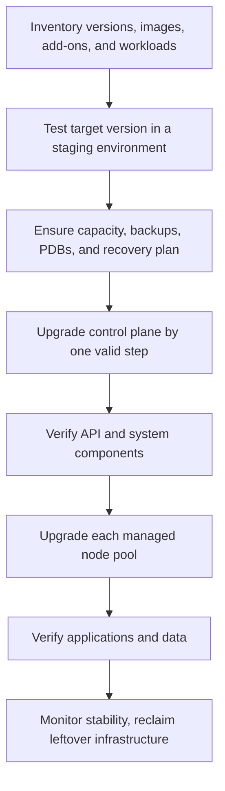

# Cluster Upgrades, Node Maintenance, and Disruption Control

## 1. Objectives and Scope

In the **Kubernetes with OKE** chapter of the **CLOUD_PROVIDERS_ORACLE** module, this lesson covers maintaining service availability during Oracle Kubernetes Engine (OKE) upgrades, worker node replacements, or Compute host maintenance beneath nodes.

A successful upgrade must satisfy three conditions simultaneously: infrastructure reaches the desired state, applications continue meeting business requirements, and data is preserved. An `ACTIVE` cluster status or `Ready` node status reflects only part of the outcome.

After this lesson, learners can:

- Sequence upgrades of the control plane, node pools, and add-on components according to compatibility constraints.
- Choose between replacing nodes in the existing pool or migrating workloads to a new pool.
- Coordinate PodDisruptionBudgets (PDBs), Pod distribution, reserve capacity, and graceful shutdown.
- Perform cordon, drain, verification, and returning a node to service.
- Define stop conditions, monitor disruptions, and prepare recovery options suited to OCI.

OKE operations in this lesson focus on **managed node pools**. For self-managed nodes or virtual nodes, use the procedures specific to that node type; do not mechanically apply managed node replacement workflows.

## 2. Identifying Exactly Which Layer Is Changing

| Layer | Example Change | What Must Be Verified |
|---|---|---|
| Control plane | Upgrading the cluster's Kubernetes version | API, admission webhooks, and controllers still work |
| Managed node pool config | Changing Kubernetes version or image for new nodes | Desired config matches the plan |
| Actual worker nodes | Replacing instances or boot volumes to apply config | Kubelet version, image, node status, and Pods |
| Add-ons, controllers | DNS, CNI, CSI, ingress, metrics | Compatibility with target version, network paths, and storage |
| Applications | Rolling out images or config changes | Readiness, shutdown, connections, and business behavior |
| Data | Backup, restore, changing Pod placement | Consistency, recovery time, and volume topology |

**Changing the version in a node pool's configuration does not automatically change the Kubernetes version on existing managed nodes.** You must follow up by replacing or cycling nodes through a supported mechanism. Therefore, cross-check pool configuration against the actual version on each node. [Source: updating managed node pools](https://docs.oracle.com/en-us/iaas/Content/ContEng/Tasks/update-node-pool.htm).

Oracle manages the control plane, yet operators remain responsible for testing applications and preparing worker node replacements. With virtual nodes, upgrading the control plane also impacts upgrading virtual nodes under OKE's mechanism; that is why you must inventory node types before scheduling. [Source: upgrading worker node types](https://docs.oracle.com/en-us/iaas/Content/ContEng/Tasks/contengupgradingworkernodes.htm).

## 3. Planning the Upgrade Path and Checking Compatibility

Do not hardcode a "latest" version in a long-lived runbook. At execution time, pick an OKE-supported version in your region, identify valid upgrade steps, and read release notes for all involved components. Avoid using previews for production environments.

For a typical minor upgrade step, the sequence is:



Kubernetes specifies that kubelet cannot be newer than kube-apiserver; `kubectl` typically sits within one minor version skew of the API server. Skew limits also depend on component versions and deployment tooling. Do not infer permission to skip minor versions merely because two versions can coexist. [Source: version skew policy](https://kubernetes.io/releases/version-skew-policy/).

Build a concrete matrix:

| Component | Current | Target | Required Evidence |
|---|---|---|---|
| Control plane | Value read from cluster | OKE-permitted version | Valid upgrade path |
| Each node pool | Pool config and kubelet on nodes | Compatible version/image | Node replacement plan |
| CNI, CSI, DNS | Running versions | Version supporting target cluster | Component upgrade guide |
| Webhooks, operators, CRDs | Current installed versions | Compatible versions | Admission and reconcile tests |
| Manifests, Helm charts | APIs currently used | APIs still served in target | Render and test on staging cluster |
| Operational tools | OCI CLI, kubectl, IaC providers | Compatible versions | Supported commands and schemas |

An important exception is the **OS image**: clusters running Oracle Linux 7 may need to move to a node pool with a supported image before certain Kubernetes upgrade milestones. For instance, Oracle provides specific guidance for OL7 managed nodes when moving to Kubernetes 1.35 or later. Resolve image constraints before applying the normal upgrade sequence. [Source: requirements for upgrading managed nodes to 1.35 or later](https://docs.oracle.com/en-us/iaas/Content/ContEng/Tasks/contengupgradingk8sworkernode_topic-Upgrading_managed_nodes_to_k8s_135.htm).

## 4. From Availability Requirements to Disruption Budgets

Suppose a service needs at least two healthy replicas to handle measured load. With three healthy replicas, moving one replica can stay within budget. If one replica is already unhealthy before maintenance, the two remaining replicas leave no headroom for the same operation.

Simple planning model:

```text
R = desired replicas
H = current healthy replicas
M = minimum healthy replicas required by operations

Preliminary move headroom = max(0, H - M)
```

This is a planning mental model, not a formula replacing `disruptionsAllowed` computed by the PDB controller. Pods with pending eviction requests or incomplete reconciliation can make instantaneous counts differ from the model.

Beyond replicas, you need enough resources **on nodes eligible to receive Pods**:

```text
Capacity available for workloads
  >= requests of workloads needing to move
   + buffer for load and system components
```

Summing cluster-wide CPU and RAM is only the first check. Pods are also constrained by taints, affinity, CPU architecture, max Pods per node, subnet IPs, volume topology, and resource quotas.

Self-constructed example: three nodes, each with 4 vCPUs and 12 GiB allocatable for application workloads. Total requests are 9 vCPUs and 24 GiB. When one node is unavailable, the two remaining nodes only have 8 vCPUs and 24 GiB. The system lacks CPU by requests even if actual CPU usage graphs before maintenance look very low. A suitable option may be adding a spare node or migrating to a new pool before draining.

Availability must also be measured by real requests: success rate, latency, connection drop duration, and transaction correctness. Three `Ready` Pods do not prove the payment flow works if all three lost connectivity to Oracle Database.

## 5. Understanding PodDisruptionBudgets Properly

PDBs limit voluntary evictions through the Eviction API. They do not prevent hardware failures, network loss, or direct Pod deletions. Pods made unavailable by outages still reduce remaining budget. An application controller performing a rolling update is not throttled by a PDB the same way drain is. [Source: disruptions in Kubernetes](https://kubernetes.io/docs/concepts/workloads/pods/disruptions/).

Example PDB for an application with three replicas:

```yaml
apiVersion: policy/v1
kind: PodDisruptionBudget
metadata:
  name: maintenance-web
  namespace: oke-maintenance-lab
spec:
  minAvailable: 2
  selector:
    matchLabels:
      app: maintenance-web
```

In this example:

| State Before Eviction | Expected Interpretation |
|---|---|
| Three healthy replicas | Headroom exists for one replica to be evicted |
| Two healthy replicas, one failed replica | Evicting another healthy replica is usually blocked |
| Single replica, minAvailable equal to one | No headroom to evict that healthy replica |
| Three replicas, all on one node | Drain must wait for healthy replacement Pods; node failure can still lose all three |

Declare only one of `minAvailable` or `maxUnavailable`. Selectors must match the exact workload and namespace. Under `policy/v1`, an empty selector `{}` matches every Pod in the namespace. Percentage values round up; for example, `maxUnavailable: "30%"` with one replica can allow disrupting that sole replica. [Source: configuring PDBs and rounding rules](https://kubernetes.io/docs/tasks/run-application/configure-pdb/).

Observe budgets:

```bash
kubectl get pdb -A
kubectl describe pdb maintenance-web -n oke-maintenance-lab
kubectl get pdb maintenance-web -n oke-maintenance-lab -o yaml
```

Read `currentHealthy`, `desiredHealthy`, `expectedPods`, and `disruptionsAllowed`. If zero budget remains, find the cause: unready Pods, missing replicas, an ongoing eviction, or a misconfigured PDB. Lowering a PDB must go hand in hand with assessing service capability.

## 6. Distinguishing Three Change-Limiting Mechanisms

| Mechanism | Unit | What It Controls |
|---|---|---|
| OKE maximum surge / maximum unavailable | Nodes in managed node pool | Extra capacity and how many nodes may go unavailable during cycling |
| Deployment maxSurge / maxUnavailable | Pods of a Deployment | How the controller swaps ReplicaSets during application rollouts |
| PodDisruptionBudget | Pods matched by selector | Remaining permitted voluntary evictions |

Setting Deployment `maxUnavailable: 0` does not create node pool capacity. PDB `minAvailable: 2` also does not force OKE to keep an extra node with spare resources. All three mechanisms must coordinate with the scheduler and the application.

For Deployments, `minReadySeconds` can require new Pods to stay ready for a period before counting as available for rollout progression. This is a separate control layer from PDBs. [Source: Deployment update strategies](https://kubernetes.io/docs/concepts/workloads/controllers/deployment/).

## 7. Preparing a Sample Workload for Maintenance

The example below uses three HTTP replicas to observe draining. Run in a test cluster with at least three eligible nodes. Commands use Bash, such as in OCI Cloud Shell; this is a hands-on guide, not a request to add files to the repository.

```bash
kubectl apply -f - <<'YAML'
apiVersion: v1
kind: Namespace
metadata:
  name: oke-maintenance-lab
---
apiVersion: apps/v1
kind: Deployment
metadata:
  name: maintenance-web
  namespace: oke-maintenance-lab
spec:
  replicas: 3
  minReadySeconds: 10
  strategy:
    type: RollingUpdate
    rollingUpdate:
      maxSurge: 1
      maxUnavailable: 0
  selector:
    matchLabels:
      app: maintenance-web
  template:
    metadata:
      labels:
        app: maintenance-web
    spec:
      terminationGracePeriodSeconds: 45
      topologySpreadConstraints:
        - maxSkew: 1
          topologyKey: kubernetes.io/hostname
          whenUnsatisfiable: DoNotSchedule
          labelSelector:
            matchLabels:
              app: maintenance-web
      containers:
        - name: web
          image: nginx:stable
          ports:
            - name: http
              containerPort: 80
          resources:
            requests:
              cpu: 100m
              memory: 64Mi
            limits:
              cpu: 500m
              memory: 128Mi
          readinessProbe:
            httpGet:
              path: /
              port: http
            periodSeconds: 3
            failureThreshold: 2
          lifecycle:
            preStop:
              exec:
                command: ["sh", "-c", "sleep 5"]
---
apiVersion: v1
kind: Service
metadata:
  name: maintenance-web
  namespace: oke-maintenance-lab
spec:
  selector:
    app: maintenance-web
  ports:
    - port: 80
      targetPort: http
---
apiVersion: policy/v1
kind: PodDisruptionBudget
metadata:
  name: maintenance-web
  namespace: oke-maintenance-lab
spec:
  minAvailable: 2
  selector:
    matchLabels:
      app: maintenance-web
YAML
```

`nginx:stable` serves as an illustration. In real workflows, use a vetted image and record its digest so recreation does not depend on mutable tags.

Verify:

```bash
kubectl rollout status deployment/maintenance-web -n oke-maintenance-lab --timeout=180s
kubectl get pods -n oke-maintenance-lab -o wide
kubectl get pdb -n oke-maintenance-lab
kubectl get endpointslice -n oke-maintenance-lab -l kubernetes.io/service-name=maintenance-web
```

Spread constraints by hostname help control Pod distribution; `DoNotSchedule` can leave Pods Pending when no valid placement remains. When availability domain fault tolerance is required, evaluate zone topology and actual node labels as well. Spread does not create nodes on its own. [Source: topology spread constraints](https://kubernetes.io/docs/concepts/scheduling-eviction/topology-spread-constraints/).

The five-second `preStop` sleep only illustrates a wait period for routing tables to converge. It does not replace application shutdown handling. Hook execution time counts inside `terminationGracePeriodSeconds`, so leave enough time for the application to exit after the hook. [Source: container lifecycle hooks](https://kubernetes.io/docs/concepts/containers/container-lifecycle-hooks/).

Real applications must handle SIGTERM, stop accepting new work, finish in-flight requests, close connection pools, and record job progress. Set timeouts based on load tests, transaction limits, and ingress/load balancer behavior. Once the grace period expires, containers can be forcefully terminated; readiness does not guarantee all open connections have finished. [Source: Pod lifecycle and termination](https://kubernetes.io/docs/concepts/workloads/pods/pod-lifecycle/).

## 8. Choosing a Managed Node Upgrade Strategy

### 8.1. Replacing Nodes in the Existing Pool

Keep the same node pool, update its target config, and replace nodes in batches. This fits when you want to limit duplicate infrastructure and the pool's existing deployment settings still meet requirements.

OKE has two cycling modes to distinguish:

- **Replace nodes / INSTANCE_REPLACE:** creates a replacement instance; the new instance gets a new OCID and network address.
- **Replace boot volume / BOOT_VOLUME_REPLACE:** replaces the boot volume while keeping the instance; applies only to attributes supported by this mode.

Managed node cycling requires an enhanced cluster. For basic clusters, look at manual managed node replacement or using a new pool. Do not upgrade cluster type just to try one convenience button without evaluating cost. [Source: replacing managed nodes](https://docs.oracle.com/en-us/iaas/Content/ContEng/Tasks/replace-worker-node-top.htm), [in-place cycling updates](https://docs.oracle.com/en-us/iaas/Content/ContEng/Tasks/contengupgradingimageworkernode_topic-Performing_an_InPlace_Worker_Node_Update_By_Cycling_an_Existing_Node_Pool.htm).

### 8.2. Migrating to a New Node Pool

Create a target pool, test new nodes, and migrate workloads off the old pool. This is convenient when changing images, shapes, architectures, or wanting a worker-layer fallback.

Both pools still share the same control plane. Therefore, keeping the old pool does not provide rollback to the pre-upgrade control plane. Oracle describes this as an out-of-place managed node upgrade. [Source: managed node upgrade methods](https://docs.oracle.com/en-us/iaas/Content/ContEng/Tasks/contengupgradingk8sworkernode.htm).

| Criterion | Replace in Existing Pool | New Pool |
|---|---|---|
| Duplicate resources | Depends on surge and cycling mode | Depends on pre-built size of new pool |
| Testing new worker config | Within node replacement mechanism | Can run canary workloads on target pool |
| Keeping old workers for rollback | Limited once replacement completes | Can retain old pool during observation period |
| Things to watch | Drain, batch size, image, and node status | Labels, taints, IAM, networking, and volume placement |
| Protection scope | Worker layer | Worker layer |

If you need to test an entire new control plane while keeping the source cluster untouched, the option is a separate cluster. That also requires designing traffic cutover, data sync, certificates, secrets, and rollback paths.

## 9. Preflight Checks on OCI and Kubernetes

### 9.1. Confirm Target and Action Permissions

Explicitly record tenancy, region, compartment, cluster OCID, node pool OCID, and Kubernetes context. Matching display names are not enough to identify an environment.

Check both permission layers:

- OCI IAM permits updating the exact cluster/node pool and using related resources.
- Kubernetes RBAC permits inspecting nodes, cordoning, and creating evictions within the required scope.

```bash
kubectl config current-context
kubectl cluster-info
kubectl version
kubectl auth can-i patch nodes
kubectl auth can-i create pods/eviction -n oke-maintenance-lab
```

Testing permissions in a sample namespace does not prove permissions across all namespaces. When maintaining a node running mixed workloads, evaluate the entire set of Pods on that node.

### 9.2. Record Initial Baseline State

```bash
kubectl get nodes -o wide
kubectl get nodes -L topology.kubernetes.io/zone
kubectl get pods -A -o wide
kubectl get deployments,statefulsets,daemonsets -A
kubectl get pdb -A
kubectl get pvc -A
kubectl get pv
kubectl get events -A --sort-by=.metadata.creationTimestamp
```

Use OCI CLI to read infrastructure configuration:

```bash
read -r -p "Cluster OCID: " CLUSTER_OCID
read -r -p "Node pool OCID: " NODE_POOL_OCID
oci ce cluster get --cluster-id "$CLUSTER_OCID"
oci ce node-pool get --node-pool-id "$NODE_POOL_OCID"
```

Cross-reference nodes in the OCI pool with `spec.providerID` on Kubernetes Nodes to avoid draining the wrong pool:

```bash
kubectl get nodes -o custom-columns='NAME:.metadata.name,PROVIDER_ID:.spec.providerID,KUBELET:.status.nodeInfo.kubeletVersion'
```

### 9.3. Verify Ability to Provision Replacement Nodes

Verify:

- Limits and quotas for Compute, boot volumes, and required VNICs/IPs.
- Capacity for the shape in the planned availability domain.
- Remaining free IPs in node and Pod subnets, depending on networking mode.
- Routes, NSGs/security lists, DNS, and paths to API server, registry, and OCI services.
- Image matching Kubernetes version, CPU architecture, and bootstrap requirements.
- Workload Identity or instance principals, dynamic groups, and policies still match new nodes.
- Labels, taints, and placement on the target pool suit the scheduler.

Do not assume "having quota" equals "having capacity." A surge plan that looks great on paper can still stall at instance creation.

### 9.4. Backups and Stop Conditions

Store declarative configs, chart versions, image digests, and infrastructure parameters in your operations change-management system. Back up data with application-appropriate mechanisms and verify restore capability.

For Oracle Database services outside OKE, do not treat Kubernetes node replacement as a database upgrade. Test reconnects, wallets/certificates, connection pools, and transaction behavior when Pods are replaced.

Do not start when backups lack restore evidence, critical workloads are already failing, capacity is missing, or backup operational access paths are absent.

## 10. Upgrading the Control Plane with Checkpoints

Before upgrading, OKE requires worker nodes to be READY and checks compatibility of both managed node pool config versions and actual node versions. An upgraded control plane cannot downgrade to an earlier version. [Source: control plane upgrade conditions](https://docs.oracle.com/en-us/iaas/Content/ContEng/Tasks/contengupgradingk8smasternode.htm).

Procedure:

1. Finish testing and resolve image/add-on constraints.
2. Select a valid upgrade step provided by OKE.
3. Execute the update via Console or CLI.
4. Track the Work Request to terminal status.
5. Verify API, webhooks, operators, and workloads before upgrading workers.

Bash example; supply a version confirmed from OKE:

```bash
read -r -p "Valid target control plane version: " TARGET_VERSION
oci ce cluster update --cluster-id "$CLUSTER_OCID" --kubernetes-version "$TARGET_VERSION"
```

Capture the Work Request OCID from the response or Console, then verify:

```bash
read -r -p "Work Request OCID: " WORK_REQUEST_OCID
oci ce work-request get --work-request-id "$WORK_REQUEST_OCID"
kubectl version
kubectl get --raw='/readyz'
kubectl get pods -n kube-system -o wide
kubectl get nodes
```

`/readyz` may require dedicated permissions. If access is denied, distinguish authorization errors from API health failures.

OKE designs the control plane for high availability during upgrades. However, maintenance plans must still measure application paths and client/controller health; control plane characteristics do not replace your system's SLO. [Source: OKE upgrade overview](https://docs.oracle.com/en-us/iaas/Content/ContEng/Concepts/contengaboutupgradingclusters.htm).

## 11. Upgrading Workers with Node Cycling

### 11.1. Choosing Bounds Matching the Mode

When **replacing instances**, you can choose to create extra nodes before removing old ones, e.g., `maximumSurge=1`, `maximumUnavailable=0`.

When **replacing boot volumes**, existing nodes must temporarily stop serving; do not apply the same surge logic as instance replacement. OKE requires `maximumUnavailable` greater than zero for this mode. With instance replacement, you cannot set both surge and unavailable to zero simultaneously. [Source: balancing availability and cost during cycling](https://docs.oracle.com/en-us/iaas/Content/ContEng/Tasks/balance-service-availability-cost.htm).

These values are node budgets, not guarantees of zero application disruption. Pick small batches until you have measurements for drain, startup, and volume attach times.

### 11.2. Updating Pool Config and Cycling the Entire Pool

For an enhanced cluster and managed pool, the illustrative CLI workflow below updates the version, matching image, and requests instance replacement. Verify input values before running:

```bash
read -r -p "Target Kubernetes version for workers: " WORKER_TARGET_VERSION
read -r -p "Compatible image OCID: " WORKER_IMAGE_OCID

NODE_SOURCE_JSON=$(printf '{"sourceType":"IMAGE","imageId":"%s"}' "$WORKER_IMAGE_OCID")
CYCLING_JSON='{"isNodeCyclingEnabled":true,"cycleModes":["INSTANCE_REPLACE"],"maximumSurge":1,"maximumUnavailable":0}'

oci ce node-pool update --node-pool-id "$NODE_POOL_OCID" --kubernetes-version "$WORKER_TARGET_VERSION" --node-source-details "$NODE_SOURCE_JSON" --node-pool-cycling-details "$CYCLING_JSON"
```

OCI CLI may prompt for confirmation on complex property updates by default; read the diff before confirming. Do not add auto-confirm flags to shared runbook commands.

OKE distinguishes cycling **an entire node pool to upgrade versions** from cycling an individual managed node; individual cycling does not upgrade the Kubernetes version on nodes under this mechanism. Do not use a single node cycle as proof the pool has been upgraded. [Source: upgrading managed nodes by replacing instances](https://docs.oracle.com/en-us/iaas/Content/ContEng/Tasks/contengupgradingimageworkernode_topic-InPlace_Worker_Node_Upgrade_By_Cycling_and_Replacing_Nodes.htm).

While OKE manages pool cycling, avoid running concurrent manual drains or instance terminations on the same pool. If you need controlled checkpoints between workload groups, design separate pools or use an appropriate manual migration procedure.

### 11.3. Tracking Progress

```bash
oci ce node-pool get --node-pool-id "$NODE_POOL_OCID"
kubectl get nodes -o wide
kubectl get pods -A -o wide
kubectl get pdb -A
```

Check the Work Request in Console or via CLI just as in the control plane upgrade step. Watch the application throughout the operation; do not wait until the Work Request finishes to look for errors.

### 11.4. Understanding OKE's Eviction Grace Period

OKE has a node-level cordon/drain wait period and an option to proceed with shutdown/termination when time expires even if drain has not finished. This wait period differs from each Pod's `terminationGracePeriodSeconds`.

Keep force options aligned with workload safety requirements; do not enable force just to make operations finish. If Pods fail to evict within the timeout, the pool can transition to `Needs attention` and the Work Request fails. Read logs, resolve the root cause, and retry based on actual state. [Source: cordon/drain and handling Needs attention](https://docs.oracle.com/en-us/iaas/Content/ContEng/Tasks/contengdeletingworkernodes_topic-Notes_on_cordon_and_drain.htm).

## 12. Migrating Using a New Pool

A practical sequence:

1. Create the target pool with vetted version/image and placement sufficient for workloads.
2. Preserve necessary business labels and configure intentional taints/tolerations.
3. Run a canary to verify image pulls, DNS, networking, volume mounts, and OCI access permissions.
4. Confirm target nodes are `Ready` and required DaemonSets are active.
5. Cordon source nodes per plan and drain one node at a time.
6. Wait for workloads to recover full serving capability before the next step.
7. Retain the source pool during an observation window if a fallback path is needed.
8. Delete the source pool after verification finishes and remaining costs are accounted for.

Cordoning the entire source pool can help shift Pods onto the target pool, but only do so after the target pool has sufficient capacity and satisfies scheduling conditions. Cordoning does not move already-running Pods on its own.

A common mistake is workloads having a `nodeSelector` pointing to a label unique to the old pool. New nodes with plenty of resources still will not receive Pods. Use labels expressing workload intent, such as `workload-tier=application`, and manage those values intentionally across appropriate pools.

Similarly, if policies or monitoring tools hardcode old instance OCIDs, replacing instances can leave new nodes without permissions or telemetry. Test identity and telemetry before shifting all traffic.

Coordinate Cluster Autoscaler and IaC/GitOps: prevent one tool from shrinking a standby pool while another migrates workloads. Document who owns pool size during the maintenance window and restore desired state afterward.

## 13. Maintaining a Single Node with Cordon and Drain

This procedure applies when an operator proactively manages one node, not overlapping with active pool cycling.

### 13.1. Pre-Drain Checks

```bash
read -r -p "Kubernetes node name to maintain: " NODE_NAME
kubectl get node "$NODE_NAME" -o wide
kubectl get pods -A --field-selector "spec.nodeName=$NODE_NAME" -o wide
kubectl describe node "$NODE_NAME"
kubectl get pdb -A
```

Identify controller-less workloads, Pods using local storage, long-running jobs, and volume constraints before proceeding.

### 13.2. Cordon Then Drain

```bash
kubectl cordon "$NODE_NAME"
kubectl drain "$NODE_NAME" --ignore-daemonsets --timeout=20m
```

`cordon` prevents the normal scheduler from placing new Pods while leaving existing Pods intact. `drain` uses eviction and waits for Pods in scope to terminate. DaemonSets and certain special Pods are not evicted like normal application Pods. Once the command completes, still verify replacement replicas and serving health; a succeeded drain does not prove workloads are Ready elsewhere. [Source: safely draining a node](https://kubernetes.io/docs/tasks/administer-cluster/safely-drain-node/).

If the command times out, the node may remain cordoned with some Pods already moved. Re-inventory state before the next action.

### 13.3. Understand Flags Before Using Them

| Flag | Effect to Remember |
|---|---|
| `--ignore-daemonsets` | Allows drain to proceed when DaemonSets exist; does not delete those DaemonSet Pods |
| `--delete-emptydir-data` | Accepts losing local data in `emptyDir` of evicted Pods |
| `--force` | Allows handling Pods lacking a controller; does not bypass PDBs |
| `--disable-eviction` | Uses DELETE instead of eviction, bypassing PDB checks |
| `--grace-period` | Overrides Pod termination grace period for this operation |
| `--timeout` | Limits how long the command waits |

Do not add data-deleting or eviction-bypassing flags as default error workarounds. [Source: kubectl drain reference](https://kubernetes.io/docs/reference/kubectl/generated/kubectl_drain/).

### 13.4. Maintaining and Returning the Node

Reboot or perform maintenance only after verifying drain completion and service health. For managed nodes, use appropriate OKE management operations; `kubectl delete node` only deletes the Kubernetes object, not the Compute instance replacement and pool management workflow.

If keeping the same node for continued service:

```bash
kubectl wait --for=condition=Ready "node/$NODE_NAME" --timeout=10m
kubectl describe node "$NODE_NAME"
kubectl get pods -n kube-system -o wide
```

After confirming CNI, CSI, resources, and workload readiness:

```bash
kubectl uncordon "$NODE_NAME"
```

Uncordoning does not automatically rebalance Pods that moved away. If an instance was replaced, the node name may change; identify the new node via its OCI instance relationship rather than reusing the old name.

## 14. Stateful Workloads and Database Services

StatefulSets provide stable identity and storage bindings for replicas, yet disruption tolerance depends on the application's replication, quorum, and recovery mechanisms. Increasing database Pod counts does not automatically create a proper HA database configuration. [Source: StatefulSet](https://kubernetes.io/docs/concepts/workloads/controllers/statefulset/).

Before moving stateful Pods, answer:

- Which replica is the leader and how does leader failover work?
- Does losing one replica preserve quorum and write availability?
- Can the volume attach to the target node?
- How long do detach/attach, mount, and log recovery take?
- Are backups consistent with application data and restore-tested?
- If clients time out, could retries cause duplicate writes or indeterminate transactions?

OCI Block Volumes are normally tied to an availability domain; the node receiving the Pod must match the volume's topology. Adding a node in a different AD does not make an existing volume attach there. Inspect PV node affinity, StorageClass, and actual placement. [Source: Block Volume availability domain scope](https://docs.oracle.com/en-us/iaas/Content/Block/Concepts/overview.htm).

```bash
kubectl get pvc -A
kubectl get pv
kubectl get storageclass
kubectl describe pod <pod-name> -n <namespace>
kubectl describe pv <pv-name>
```

Values inside `<...>` are placeholders to replace with actual names, not literal commands to run.

`Multi-Attach` or `volume node affinity conflict` errors must be handled according to attachment/topology state. Do not delete PVCs or force-detach volumes just to clear Pending state without verifying that writers on the old node have stopped.

For applications using Autonomous Database or Oracle Database outside the cluster, draining can still sever Pod TCP connections. Verify reconnects, timeouts, connection validation, and transaction idempotency. Worker maintenance and database maintenance are two coordinated plans, each with its own success criteria.

## 15. Monitoring and Stop Decisions

Monitor three signal layers throughout the change window:

| Layer | Signal | Operational Meaning |
|---|---|---|
| OCI | Work Requests, node pool state, instance creation errors | Shows whether operations are progressing or need intervention |
| Kubernetes | Ready, Pending, evictions, PDBs, mount events | Separates capacity, scheduling, and storage errors |
| Application | Errors, latency, transactions, queue lag, reconnects | Confirms actual user impact |

Example criteria **set by the operations team after load testing**, not OKE defaults:

| Criterion | Illustrative Threshold | Action |
|---|---|---|
| HTTP error rate | Above 1% for 5 minutes | Stop migrating further workloads |
| p95 latency | Over twice baseline for 5 minutes | Check capacity and downstream dependencies |
| Healthy replicas of sample service | Below two | Restore capacity first |
| Replacement Pod Pending | Over 5 minutes | Read Events, stop draining more nodes |
| Data service | Lost quorum or unconfirmed writes | Switch to data incident response |
| Work Request | Failed or Needs attention | Read errors, inventory actual state |

"Stop" means halting subsequent batches and stabilizing the current state. Do not assume closing a terminal cancels an OCI Work Request, or that an in-flight operation can always be safely canceled. Check the specific operation's control capabilities.

Basic diagnostic commands:

```bash
kubectl get pods -A --field-selector=status.phase=Pending
kubectl get events -A --sort-by=.metadata.creationTimestamp
kubectl describe pod <pod-name> -n <namespace>
kubectl describe pdb <pdb-name> -n <namespace>
oci ce node-pool get --node-pool-id "$NODE_POOL_OCID"
oci ce work-request get --work-request-id "$WORK_REQUEST_OCID"
```

For paths through OCI Load Balancer or ingress, send test requests from users or external test systems along that path. `kubectl port-forward` is helpful for diagnosing an individual Pod, yet does not verify the full traffic path.

## 16. Recovering at the Exact Affected Layer

| Scenario | Recovery Direction |
|---|---|
| New nodes fail to provision | Restore available capacity, resolve quota/IP/shape/image before continuing |
| Drain blocked by PDB | Recover unhealthy replicas, add scheduling room, or adjust disruption plan |
| Application fails on new pool | Shift back to compatible source pool with enough capacity |
| New node config is broken | Use known-good image/config and a supported node replacement method |
| Control plane already upgraded | Fix forward for compatibility or fail over to a prepared recovery cluster |
| Data inconsistency | Trigger dedicated data recovery workflow, verify RPO/RTO |

There is no OKE control plane downgrade command to reverse an upgrade. Recovering an application onto another cluster requires data, secrets, IAM permissions, networking, and traffic cutover.

Keeping the old pool is helpful while old nodes remain compatible with the current control plane. Before moving workloads back, confirm nodes are healthy, labels/taints match, and no Pod is writing conflicting data.

Backing up manifests is not backing up data. Volume snapshots must also be evaluated for application consistency. A reliable fallback is one that has been tested, has an assigned owner, and has clear trigger conditions.

## 17. Hands-On Scenario: Three Nodes, One Migration

### 17.1. Assumptions

A test cluster has three managed nodes. Workload `maintenance-web` has three replicas and a PDB requiring two healthy replicas. Pods are spread across eligible nodes. Learners have maintenance permissions and have set stop thresholds.

Open two terminal sessions:

- The first session watches Pods, PDBs, and Events.
- The second session cordons/drains a chosen node.

```bash
kubectl get pods -n oke-maintenance-lab -o wide --watch
```

In another observation window when needed:

```bash
kubectl get pdb maintenance-web -n oke-maintenance-lab --watch
```

Use an existing load-testing tool to continuously call the Service from a test workload, or call the endpoint through ingress/load balancer if evaluating external access paths.

### 17.2. Observing the First Move

1. Confirm three healthy replicas and available eviction budget.
2. Cordon the node hosting one replica.
3. Drain the node with the basic options listed above.
4. Observe the old Pod terminating and the replacement Pod creating and turning Ready.
5. Check error rate, latency, and healthy endpoint count.
6. Perform node maintenance only after confirming workload recovery.

If the new Pod stays Pending, read the scheduler's reason. With three nodes and hard spread constraints, Pod placement after cordoning depends on eligible nodes and the topology calculation of your running version. Do not assume replicas always auto-recover onto two remaining nodes.

### 17.3. Verifying an Insufficient-Budget Case

In the test environment, temporarily change the sample workload's PDB to `minAvailable: 3` while all three replicas are healthy, then try draining a node hosting one replica. Observe eviction being blocked and related Events. Then restore `minAvailable: 2` and re-verify state before continuing.

This exercise demonstrates that PDBs do not create extra replicas and that a drain pausing to wait can be the intended result of availability requirements.

Do not use eviction-bypass flags just to make the lab "finish." The goal is to explain the state, policy effect, and how to add capacity or adjust the plan.

### 17.4. Closing the Test Environment

If the node is retained, inspect it and uncordon. Return any configs altered during practice to desired state. When the lab is no longer needed, delete the sample namespace only after confirming it holds no shared resources:

```bash
kubectl delete namespace oke-maintenance-lab
```

Reclaim extra nodes/pools via OKE per a separate plan, and check for remaining billable volumes and resources.

## 18. Common Errors and How to Read Symptoms

| Symptom | Possibilities to Check | Next Step |
|---|---|---|
| Pool shows new version, yet kubelet is still old | Config updated, nodes not yet replaced | Complete an appropriate worker upgrade method |
| Eviction rejected | PDB out of budget or wrong selector | Inspect PDB and Pod health |
| New Pod Pending | Insufficient request capacity, IPs, or eligible placement | Read Events, labels, taints, and topology |
| Node Ready, yet app fails | Image, dependencies, permissions, or other connections broken first | Test business flow on the new node |
| Image pull error | DNS, routes, registry, or credentials | Verify network path and workload permissions |
| Pod waiting on volume | Attachment not released or wrong AD | Inspect CSI, PV, and Compute status |
| Pool Needs attention | Drain failed to complete or node operation failed | Read Work Request and node errors |
| After uncordon, Pods do not return | Scheduler does not automatically rebalance running Pods | Evaluate rebalancing needs separately |
| Cost increased after maintenance | Source pool, boot volumes, or surge not reclaimed | Reconcile resources against changes |

At completion, record actual versions of the control plane and each node, healthy replica counts, test transaction results, final Work Requests, and resources retained for recovery. Close the maintenance window only when infrastructure, applications, and data all meet defined criteria.
