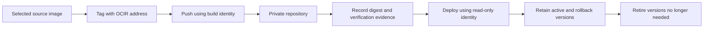

# Pushing Images, Configuring Permissions, and Managing Image Lifecycle

An image built successfully on a developer workstation still needs to be stored where deployment systems can access it. In Oracle Cloud Infrastructure, **Container Registry**, commonly referred to as **OCIR**, handles image storage and distribution. To operate effectively, the development team must also decide who can push, who can pull, which versions are deployed, and when data can be deleted.

This lesson belongs to the **Containers and Functions** chapter of the **CLOUD_PROVIDERS_ORACLE** module. It connects Container Registry with tenancy, compartment, and IAM, and places image publishing in the context of automation, cost control, and OCI infrastructure availability.

## 1. Objectives and Lab Scenario

Suppose a development team owns a Java service for order management. A pipeline produces an application image, pushes it to a dedicated repository, and the deployment system consumes the exact verified version.

Responsibilities are divided into three groups:

- **ImageBuilders**: pipeline identity, permitted to read and update images in the assigned repository.
- **ImagePullers**: identity used to fetch images for deployment, requiring only read permissions.
- **RegistryAdmins**: operations team, responsible for creating repositories, changing configurations, and managing lifecycle.

After this lesson, learners should be able to execute the following workflow:

1. Determine the correct registry endpoint, tenancy namespace, repository, and tag.
2. Prepare a private repository in the target compartment.
3. Log in using an auth token, tag, and push an image.
4. Verify the image in the registry, and record its digest and OCID.
5. Test permissions using an identity dedicated to pulling.
6. Design workflows for releasing, rolling back, retaining, and retiring images.

The lab uses the `hello-world` image to focus on the registry workflow. This is an illustrative image and does not contain a Java service. For a real application, replace the source image with your project's build output; permission management and image pushing steps follow the same workflow.

## 2. Reading Image Addresses Correctly

The Docker address used in this lesson has the form:

```text
<registry-host>/<tenancy-namespace>/<repository>:<tag>
```

Illustrative example:

```text
sin.ocir.io/axexample123/orders-dev:build-20261120-001
```

| Component | Illustrative Value | Meaning During Operations |
| --- | --- | --- |
| Registry host | `sin.ocir.io` | Container Registry endpoint in the Singapore region `ap-singapore-1` in the OC1 commercial realm |
| Tenancy namespace | `axexample123` | Tenancy's Object Storage namespace; replace with real value |
| Repository | `orders-dev` | Repository created in the image management compartment |
| Tag | `build-20261120-001` | Version label defined by the development team's convention |
| Compartment | `AppDelivery` | Scope for placing resources and applying permissions; not a required segment in the Docker address |

The registry has regional endpoints. For example, `sin.ocir.io` is listed by Oracle for Singapore; if using another region or realm, look up the corresponding endpoint rather than guessing from the display name. [Source: Preparing for Container Registry](https://docs.oracle.com/en-us/iaas/Content/Registry/Concepts/registryprerequisites.htm).

### 2.1. Distinguishing Namespace, Repository, and Compartment

The **tenancy namespace** is the Object Storage namespace value, not by default the tenancy name, identity domain name, or OCID. A repository belongs to a compartment, but the image address does not include the compartment as a path segment.

In this lesson, the single-segment repository name `orders-dev` avoids confusion over `/` characters. For a repository with **top-level capability** disabled, `team/orders` can be a complete repository name. When this capability is enabled on a repository named `team`, `team/orders:v1` is an image at a sub-path belonging to the `team` repository; the repository's permissions and visibility apply across the whole repository. [Source: Container Registry Concepts](https://docs.oracle.com/en-us/iaas/Content/Registry/Concepts/registryconcepts.htm).

Therefore, before writing IAM conditions based on repository names, identify the actual repository resource that owns the image. A path that looks like a directory does not automatically create an authorization boundary.

### 2.2. Tags, Digests, and OCIDs Serve Different Purposes

| Identifier | Example Format | When to Use |
| --- | --- | --- |
| Image tag | `build-20261120-001` | Humans and pipelines naming build outputs |
| Digest | `sha256:<64 hex characters>` | Referencing a specific manifest or image index content |
| Image OCID | `ocid1.containerimage...` | Managing image resources via OCI API or CLI |
| Repository OCID | `ocid1.containerrepo...` | Identifying a repository when listing and managing resources |

Tags can be reassigned to different content over time. When pulling by digest, Docker requests the exact content matching that digest. Docker displays the digest in push and pull outputs; do not use the local `IMAGE ID` column in place of the registry manifest digest. [Source: docker image pull](https://docs.docker.com/reference/cli/docker/image/pull/).

You must also distinguish an **image version tag** from an **OCI resource free-form tag/defined tag**. The version tag appears after `:`; OCI resource tags serve to categorize resources, such as assigning an owner or cost center.

## 3. Preparing the Workflow



The shell examples below use **Bash**, suitable for Linux or WSL with a working Docker installation. The OCI CLI commands in the administration sections require the CLI to be configured with its own authentication; a successful Docker login does not mean the OCI CLI is configured.

Prerequisites:

- Access to the tenancy and lab region.
- The `AppDelivery` compartment or an equivalent compartment provisioned by an administrator.
- Groups and identities for building, pulling, and administering.
- Docker CLI able to connect to the Docker daemon.
- Network path from the lab machine to the registry endpoint over HTTPS.
- Auth token for the exact identity being logged in.

Record the environment variables:

```bash
REGISTRY="sin.ocir.io"
OCI_REGION="ap-singapore-1"
TENANCY_NAMESPACE="REPLACE_WITH_OBJECT_STORAGE_NAMESPACE"
REPOSITORY="orders-dev"
VERSION="build-20261120-001"
SOURCE_IMAGE="hello-world:latest"

IMAGE_BASE="$REGISTRY/$TENANCY_NAMESPACE/$REPOSITORY"
IMAGE_REF="$IMAGE_BASE:$VERSION"
```

`VERSION` must be changed for each distinct build. Keep the commit ID and build number in your release system to trace which image came from which source; do not reuse a build tag for different outputs.

## 4. Configuring IAM by Responsibility

### 4.1. Understanding Permissions on `repos`

OCI uses the `repos` resource type for Container Registry resources. Differences that directly affect permission design include:

| Requirement | Permission or Verb to Note |
| --- | --- |
| List resources | `inspect repos` |
| Read and pull | `read repos` |
| Push to an existing repository | `REPOSITORY_READ` and `REPOSITORY_UPDATE` |
| Create a repository | `REPOSITORY_CREATE` |
| Delete a repository | `REPOSITORY_DELETE` |
| Change repository configuration | `REPOSITORY_MANAGE` |

For `repos`, the `use` verb adds no permissions compared to `read`. Additionally, `DeleteContainerImage`, `RestoreContainerImage`, and `RemoveContainerVersion` all use `REPOSITORY_UPDATE`. [Source: Details for Container Registry](https://docs.oracle.com/en-us/iaas/Content/Identity/Reference/registrypolicyreference.htm).

Design implication: granting the permissions needed to push can simultaneously allow deleting images. A condition selecting only `REPOSITORY_READ` and `REPOSITORY_UPDATE` narrows permissions compared to full repository administration, but it does not create an "append-only image" role.

Therefore, scope the build identity to the pipeline's repository, protect credentials, and control the release step. If a stricter boundary is needed between development and production environments, use separate repositories or compartments with separate publishing identities.

### 4.2. Policy for the Pull Identity

The examples use groups in the default identity domain and a compartment named `AppDelivery`. Replace names with actual resources; groups in another domain must be referenced according to the tenancy's IAM configuration.

```text
Allow group ImagePullers to read repos in compartment AppDelivery where target.repo.name = 'orders-dev'
```

The `target.repo.name` condition restricts which repository can be read. This policy does not guarantee that every listing operation in the Console will work, because a list operation may not have a single target repository to evaluate the condition against.

If the role needs to browse the resource list in the compartment, an administrator can add:

```text
Allow group ImagePullers to inspect repos in compartment AppDelivery
```

With this added, users can view compartment listing information. Evaluate this need before granting it, as metadata visibility extends beyond a single repository.

### 4.3. Policy for a Pipeline Pushing to an Existing Repository

```text
Allow group ImageBuilders to manage repos in compartment AppDelivery where all {
  target.repo.name = 'orders-dev',
  any {
    request.permission = 'REPOSITORY_READ',
    request.permission = 'REPOSITORY_UPDATE'
  }
}
```

If the pipeline needs to list via the OCI CLI or use the Console for diagnostics, `inspect repos` in the compartment can be granted as needed. A pipeline that already knows the image address should not by default be granted tenancy-admin permissions just to work around a push error.

The pattern of using permission conditions to narrow `manage repos` and requiring read/update permissions for pushing is described by Oracle in the policy documentation. [Source: Policies to Control Repository Access](https://docs.oracle.com/en-us/iaas/Content/Registry/Concepts/registrypolicyrepoaccess.htm).

### 4.4. Policy for the Repository Administration Group

```text
Allow group RegistryAdmins to manage repos in compartment AppDelivery
```

This is broad permission within the compartment, more appropriate for repository administration responsibilities than for a daily build identity. Managing region-wide retention has its own permission scope, covered in the retention section.

OCI policies are additive. To test a read-only role, use an identity that belongs only to the relevant groups; an account that also belongs to an admin group can mask missing or misconfigured restrictive policies.

## 5. Creating the Repository Before Pushing

In the Console, open **Container Registry**, select the target region, and create a repository with the following configuration:

| Setting | Lab Value |
| --- | --- |
| Compartment | `AppDelivery` |
| Repository type | `Standard` |
| Name | `orders-dev` |
| Visibility/Access | `Private` |
| Top-level capability | Disabled if the UI offers this option |

Standard repositories support push and pull; pull-through cache repositories do not accept client pushes. Creating the repository beforehand ensures the target compartment is chosen explicitly. The ability to auto-create a repository in the root compartment on the first push depends on corresponding settings and permissions; do not rely on that mechanism in this lab. [Source: Creating a Repository](https://docs.oracle.com/en-us/iaas/Content/Registry/Tasks/registrycreatingarepository.htm).

Record the repository OCID and compartment OCID for use in administration steps. Also check the currently active retention policy before placing data that needs to be kept into the repository.

**Private** vs. **public** is a distribution decision. A public repository allows anyone who knows the image address to pull over the internet; switching to public is not a fix for bad credentials. For internal applications, keep it private and grant permissions to the exact entities that need access.

## 6. Logging In, Tagging, and Pushing

### 6.1. Generating an Auth Token and Determining the Username

An auth token is created in the OCI user profile section. The token is displayed only at creation time, so it must be stored immediately in an appropriate secret store. It is a credential for the registry, not a Console password or API signing key. [Source: Getting an Auth Token](https://docs.oracle.com/en-us/iaas/Content/Registry/Tasks/registrygettingauthtoken.htm).

Docker usernames typically take the form:

```text
<tenancy-namespace>/<username>
```

For federated Oracle Identity Cloud Service identities, use the domain-qualified format matching your account details, for example:

```text
<tenancy-namespace>/oracleidentitycloudservice/<username>
```

Use the exact domain/username of the actual identity; do not automatically insert `oracleidentitycloudservice` for every account. Oracle documents these two formats in the push guide. [Source: Pushing Images Using the Docker CLI](https://docs.oracle.com/en-us/iaas/Content/Registry/Tasks/registrypushingimagesusingthedockercli.htm).

Interactive login example:

```bash
OCIR_USERNAME="$TENANCY_NAMESPACE/REPLACE_WITH_OCI_USERNAME"

docker login "$REGISTRY" --username "$OCIR_USERNAME"
```

When prompted for a password, enter the **auth token**. Pass only the hostname to `docker login`, without namespace, repository, or an `https://` prefix.

### 6.2. Preparing the Illustrative Image

```bash
docker pull "$SOURCE_IMAGE"
docker image ls "$SOURCE_IMAGE"
docker tag "$SOURCE_IMAGE" "$IMAGE_REF"
docker image ls "$IMAGE_REF"
```

`docker tag` creates an additional reference name for the local image; it does not upload data to OCIR. At this stage, seeing the image in `docker image ls` proves only that the local tag has been created.

For a Java application, the source image could be `orders-api:1.4.2` after the project's build and test steps. You must know the image architecture and target platform; retagging does not convert an `amd64` image into `arm64`, nor does it automatically generate all multi-architecture variants.

### 6.3. Pushing a Single Tag

```bash
docker push "$IMAGE_REF"
```

Successful output typically ends with the tag, digest, and manifest size. Record the **actual returned digest**. Seeing some layers already exist and skip re-uploading is normal; what must be confirmed is that the entire push completes successfully.

Tagging the target in the format `<registry>/<namespace>/<repository>:<version>` and running `docker push` is the standard workflow documented by Oracle. [Source: Pushing Images Using the Docker CLI](https://docs.oracle.com/en-us/iaas/Content/Registry/Tasks/registrypushingimagesusingthedockercli.htm).

Do not treat a tag named "release" as proof that an artifact has been released. Maintain a release record containing at least the commit ID, pipeline run, registry address, repository, tag, and digest.

### 6.4. Logging In Within CI

The example below assumes CI has provided `OCIR_AUTH_TOKEN` via a secret store and set `REGISTRY`, `OCIR_USERNAME`, `SOURCE_IMAGE`, and `IMAGE_REF`:

```bash
set -euo pipefail
set +x

trap 'docker logout "$REGISTRY" >/dev/null 2>&1 || true' EXIT

printf '%s' "$OCIR_AUTH_TOKEN" |
  docker login "$REGISTRY" \
    --username "$OCIR_USERNAME" \
    --password-stdin

docker tag "$SOURCE_IMAGE" "$IMAGE_REF"
docker push "$IMAGE_REF"
```

`--password-stdin` avoids placing the token directly in command history or password arguments. Docker may store credentials via a credential store or login config, so the runner environment itself must also be protected. [Source: docker login](https://docs.docker.com/reference/cli/docker/login/).

Use dedicated runners for pipelines with push permissions, mask secrets in logs, and restrict access to Docker configuration. Fail the job if the push command fails so that deployment steps do not proceed with an unverified tag.

## 7. Verifying the Image and Recording Identifiers

### 7.1. Checking in the Console

In the right region, compartment, and repository, open the newly pushed image. Verify the version, size, pusher, and push timestamp. Copy the image OCID for administrative operations when needed. The details page also displays layers, signatures, and scan results if available. [Source: Getting an Image's Details](https://docs.oracle.com/en-us/iaas/Content/Registry/Tasks/registryviewingimagedetails.htm).

Use three facts to tie a build to the resource: the expected tag, the digest from the push output, and the actual image in the repository. If a tag has been overwritten by another pipeline, looking only at the tag name can lead to recording the wrong release.

### 7.2. Listing via the OCI CLI

Using an identity with appropriate list permissions and a configured OCI CLI:

```bash
COMPARTMENT_OCID="REPLACE_WITH_COMPARTMENT_OCID"
REPOSITORY_OCID="REPLACE_WITH_REPOSITORY_OCID"

oci --region "$OCI_REGION" artifacts container image list \
  --compartment-id "$COMPARTMENT_OCID" \
  --repository-id "$REPOSITORY_OCID" \
  --all
```

`--repository-id` filters by repository OCID; `--all` retrieves all result pages. Specify the correct region in the CLI to avoid cases where the Console shows the resource while the command queries a different region. [Source: OCI CLI — container image list](https://docs.oracle.com/en-us/iaas/tools/oci-cli/latest/oci_cli_docs/cmdref/artifacts/container/image/list.html).

Once you have the image OCID:

```bash
IMAGE_OCID="REPLACE_WITH_IMAGE_OCID"

oci --region "$OCI_REGION" artifacts container image get \
  --image-id "$IMAGE_OCID"
```

### 7.3. Pulling by Digest

Replace the placeholder below with the full verified digest:

```bash
IMAGE_DIGEST="sha256:REPLACE_WITH_64_HEX_DIGEST"
PINNED_IMAGE="$IMAGE_BASE@$IMAGE_DIGEST"

docker pull "$PINNED_IMAGE"
docker run --rm "$PINNED_IMAGE"
```

With the `hello-world` image, the container prints an illustrative message and exits. For a real application image, run the corresponding application checks.

A digest pins the requested content, but does not guarantee that the data will be stored forever. Rollback workflows still require keeping the image in the registry or having a mechanism to restore the exact archived content.

## 8. Ensuring the Deployment Environment Can Actually Pull

Pulling once with the build account only proves the build account's permissions. Test on a clean machine or runner using the `ImagePullers` identity. Verify that this identity can pull the known image and cannot push a test tag.

In OKE, using a registry secret requires creating a secret containing pull credentials and referencing it via `imagePullSecrets` in the Pod spec. The secret must exist in the workload's Kubernetes namespace. [Source: Pulling Images from Container Registry during Kubernetes Deployment](https://docs.oracle.com/en-us/iaas/Content/Registry/Tasks/registrypullingimagesfromocir.htm).

The example below illustrates only the pull configuration in a Pod spec; replace the digest before use:

```yaml
spec:
  containers:
    - name: registry-check
      image: sin.ocir.io/REPLACE_WITH_NAMESPACE/orders-dev@sha256:REPLACE_WITH_DIGEST
  imagePullSecrets:
    - name: ocir-pull
```

Do not copy auth tokens into committed manifests. The cluster's pull identity should be separated from the build identity so that runtime credentials do not carry image update permissions.

For **image-based OCI Functions**, images are also managed in OCIR. Check repository read permissions for the deployment mechanism and the Functions service; Docker login on a build machine does not automatically grant permissions to the runtime. This scope differs from function workflows that supply only source code and a managed runtime. [Source: Scanning Images for Image-Based Functions for Vulnerabilities](https://docs.oracle.com/en-us/iaas/Content/Functions/Tasks/functionsimagescanning.htm).

Availability must be verified with a fresh pull from the target environment. A running container or a node with cached images does not prove that a new node or the next function initialization will be able to fetch the image.

## 9. Designing the Lifecycle from Build to Rollback

### 9.1. Tagging Conventions Are Part of the Release Process

One viable convention set:

| Purpose | Example Tag | Team Rule |
| --- | --- | --- |
| Identify a build | `build-20261120-001` | Each build output uses a unique tag |
| Trace back to source | `git-a1b2c3d4` | Include pipeline run if the same commit can be rebuilt |
| Business release | `release-1.4.2` | Record the approved digest |
| Environment pointer | `dev` or `staging` | Allowed to change in a controlled manner |
| Retained for rollback | `keep-rollback-1.4.1` | Has a review date and assigned owner |

These are recommended lesson conventions, not an immutability mechanism enforced by the service. To prevent overwriting release tags, pipelines must check state and enforce corresponding release permissions.

Commit-based tags help trace source code, but do not by themselves prove an image is reproducible: base images or dependencies can change between builds. Recording the digest solves identifying the exact released content.

### 9.2. Promotion Must Preserve Links to Tested Content

Example with a verified build:

```bash
docker pull "$PINNED_IMAGE"

RELEASE_REF="$IMAGE_BASE:release-1.4.2"
docker tag "$PINNED_IMAGE" "$RELEASE_REF"
docker push "$RELEASE_REF"
```

After pushing, re-verify the target's digest. This example illustrates promoting an image already pulled on the current platform. For multi-architecture images, use tools and workflows that copy the complete image index and all referenced manifests; do not treat a local tag operation as proof that all architectures are preserved.

In practice, development and production repositories may be separated. In that case, release records must map source digest, target digest, verification results, and the approving person or pipeline.

### 9.3. Rollback Requires Both Content and Accessibility

For each production release, retain at least:

- The currently running digest and digests within the rollback window.
- Deployment configuration accompanying each version.
- Valid credentials or read permissions.
- Evidence that the target environment can re-pull the image.
- Application compatibility check results, such as database schema changes.

Being able to pull the right image is a prerequisite for rolling back a Java service, while restoring behavior also depends on configuration and data. Do not delete old images immediately after a successful rollout if the system still commits to a recovery window.

## 10. Security Checks Before Release

### 10.1. Scanning and Release Decisions

OCIR integrates with OCI Vulnerability Scanning to detect vulnerabilities in images. Check the scanner configuration and service read permissions on the repository, then wait for results for the exact image before making a release decision. A successful push does not prove an image has passed a quality gate. [Source: Scanning Images for Vulnerabilities](https://docs.oracle.com/en-us/iaas/Content/Registry/Tasks/registryscanningimagesforvulnerabilities.htm).

Teams may define a rule blocking release when unresolved Critical vulnerabilities exist without an approved exception. That threshold is an organizational policy; the pipeline must enforce the block explicitly and tie the decision to a specific digest.

When base images need updating, rebuild as a new version, re-scan, and re-release. Keeping an old digest reproduces the previously used content; it also means that build does not automatically receive new patches.

### 10.2. Signatures and Publishing Provenance

OCIR supports signing images with appropriate asymmetric keys in OCI Vault. Signatures help verify provenance and integrity; permissions to use keys and permissions to manage images must be designed separately. [Source: Signing Images for Security](https://docs.oracle.com/en-us/iaas/Content/Registry/Tasks/registrysigningimages_topic.htm).

Production workflows should distinguish three questions: what content the image has, what verification results it achieved, and which entity published it. Digests, scans, and signatures provide different forms of evidence.

Place signature verification at the point that actually authorizes deployment. Generating signatures without verifying them when consuming images fails to achieve provenance control.

## 11. Designing Retention to Save Storage While Preserving Recovery

### 11.1. OCIR Retention Mechanisms

Each region has a global image retention policy, which retains all images by default. A custom policy applies to assigned repositories and overrides the global policy; each repository can belong to only one custom policy at a time.

Criteria include time since last pulled, time since unversioned, and exempt versions. **Exempt versions do not apply to the unversioned criterion.** Evaluation jobs run hourly; new or modified policies have a waiting period of several hours. Policies are region-scoped. [Source: Retaining and Deleting Images Using Retention Policies](https://docs.oracle.com/en-us/iaas/Content/Registry/Tasks/registrymanagingimageretention.htm).

Do not assume "an image not pulled for a long time is no longer needed." A long-running stable workload or a rarely used standby deployment may still need the image when launching new instances.

### 11.2. Separating Retention Needs by Environment

The following table is a **proposal for discussion**, not an Oracle default configuration:

| Image Group | Retention Intent | Condition to Verify |
| --- | --- | --- |
| Dev test builds | Retire promptly after branch ends | No test environments still using them |
| Staging builds | Retain across acceptance cycle | QA team confirms cycle completion |
| Active production | Always re-pullable | Listed in protected digests |
| Rollback builds | Retain until recovery window ends | Has expiration date and owner |
| Investigation builds | Retain per incident needs | Has provenance and release history evidence |

For example, a team might propose cleaning up unused dev images after 14 days while keeping separate protection workflows for production. The 14-day figure must be weighed against feature branch lifetimes and environment rebuild capabilities.

If using tag prefixes for exemption, assign who is allowed to attach or remove those tags. A list of actively deployed digests helps catch cases where an image must be kept even though it no longer has a tag matching retention rules.

### 11.3. Rolling Out Policies in a Controlled Manner

Before enabling automatic cleanup, list all running, standby, and investigation digests. Match each group against the intended criteria, apply the policy to dev repositories first, and monitor which images are slated for removal.

Keep a change plan with the rollout timestamp and rollback steps in case of misconfiguration. The waiting period before a policy takes effect is a window to review criteria, not a guarantee that images will be kept until the next edit.

Editing a global policy has a broad impact across the region, so assign it only to the role responsible for managing that region. Per Oracle documentation, editing the global policy and creating/editing custom policies require management permissions at the tenancy level; adding or removing a repository from a custom policy requires repository management permissions. [Source: Retaining and Deleting Images Using Retention Policies](https://docs.oracle.com/en-us/iaas/Content/Registry/Tasks/registrymanagingimageretention.htm).

## 12. Distinguishing Untagging, Deleting Images, and Restoring

### 12.1. Removing a Tag via Unversioning

OCI calls removing a version identifier **unversioning**. It removes the version label without directly deleting the image:

```bash
oci --region "$OCI_REGION" artifacts container image remove-version \
  --image-id "$IMAGE_OCID" \
  --image-version "$VERSION"
```

Confirm the matching `IMAGE_OCID` and `VERSION` before running. If an image has multiple tags, removing one tag does not remove all other tags. [Source: Unversioning an Image](https://docs.oracle.com/en-us/iaas/Content/Registry/Tasks/registryuntaggingimages.htm).

If the last tag is removed, re-evaluate how retention affects an unversioned image. Deployments referencing a digest still require the content to remain in the registry, so unversioning cannot be treated as having no lifecycle impact.

### 12.2. Deleting an Image After Confirming It Is No Longer Needed

Before deleting, cross-check the image OCID against the digest, repository, and associated deployments. Run the following command only on lab images confirmed to be disposable:

```bash
oci --region "$OCI_REGION" artifacts container image delete \
  --image-id "$IMAGE_OCID"
```

OCI may take up to 48 hours for deletion to take full effect and reclaim storage. Therefore, do not use storage metrics immediately after a delete command to conclude cleanup failed. [Source: Deleting an Image](https://docs.oracle.com/en-us/iaas/Content/Registry/Tasks/registrydeletingimages.htm).

`docker image rm` on a developer workstation removes only the local copy; it does not replace deleting the image in OCIR. Similarly, deleting a local container does not delete the image stored in the registry.

### 12.3. Restoring Within the Allowed Window

Oracle supports restoring an image within up to 48 hours from deletion via API or CLI; this operation cannot be performed through the Console:

```bash
oci --region "$OCI_REGION" artifacts container image restore \
  --image-id "$IMAGE_OCID"
```

After that window, the image is permanently removed from Container Registry. [Source: Undeleting (Restoring) an Image](https://docs.oracle.com/en-us/iaas/Content/Registry/Tasks/undelete-image.htm).

After restoring, verify digest pull capability and any required version identifiers. Also address the retention criteria or process that triggered the deletion to prevent recurrence.

A short restore window does not replace long-term retention and recovery planning. If an application requires recovery capability in another region, verify image storage locations and access permissions in that region as part of drills.

## 13. Troubleshooting Layer by Layer

The table below provides a recommended diagnostic order; a single error message may have multiple causes:

| Symptom | First Check | Next Action |
| --- | --- | --- |
| Docker login reports unauthorized | Namespace, username/domain, and auth token | Confirm token belongs to the right user; check token validity |
| Login succeeds but push is denied | Target repository and user IAM | Check read/update permissions, compartment, name conditions |
| Push to nonexistent repository fails | Whether repository is created and in right region | Create beforehand with admin role in target compartment |
| CLI does not see image while Console does | CLI region and compartment | Specify region explicitly, use correct repository OCID |
| Pull reports manifest not found | Tag/digest, repository, and lifecycle | Check release records, unversioning, deletions, and retention |
| Pull succeeds but container fails to run | Architecture and application content | Check platform, entrypoint, and application logs |
| Old node works, new node fails pull | Old cache, credentials, and new node network | Test a fresh pull from the target environment |
| Storage does not decrease immediately | Deletion timestamp and backend processing | Wait per service mechanics, re-check metrics later |
| Production image cleaned up unexpectedly | Active policy and exempt tags | Check custom/global policy, versioned criteria, and digest list |

To reduce troubleshooting time, divide checks into three layers:

1. **Connectivity**: DNS, proxy, network routes, and HTTPS to the registry.
2. **Identity and permissions**: logging in as the right user, valid token, policy targeting the right resource.
3. **Content and lifecycle**: correct tag/digest, image exists, and matching platform.

A successful login confirms only the authentication step. When changing regions or endpoint hostnames, re-check the Docker credentials stored for that exact host.

## 14. Completion Evidence and Operational Habits

Lab completion should include a record containing:

| Evidence | Details to Record |
| --- | --- |
| Storage location | Region, compartment, repository OCID, and visibility |
| Build | Unique tag, source image, and pipeline ID if applicable |
| Released content | Actual digest after push |
| Management resource | Corresponding image OCID |
| Permission check | Build identity can push; pull identity can only perform granted actions |
| Usage check | Pull by digest from a clean environment succeeds |
| Retention plan | Active policy, protected digests, and review date |
| Recoverability | Rollback build remains pullable and has an assigned owner |

Do not include auth tokens in evidence records. After the lab, log out on temporary machines and revoke credentials created specifically for the session per identity management procedures.

In routine operations, cross-check running digests against the list of retained images, investigate failed releases, monitor storage usage, and act on new scan results. A completed cleanup cycle must prove that unneeded images have been retired while builds still needed for deployment or rollback remain accessible.
