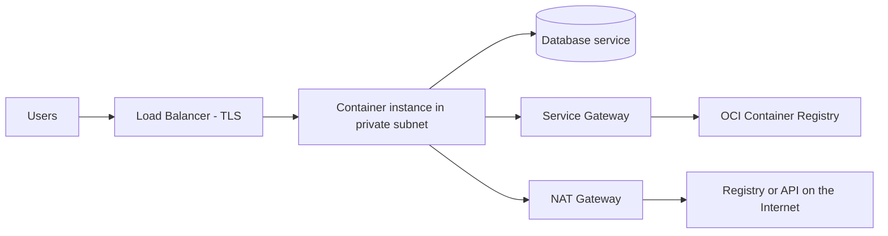
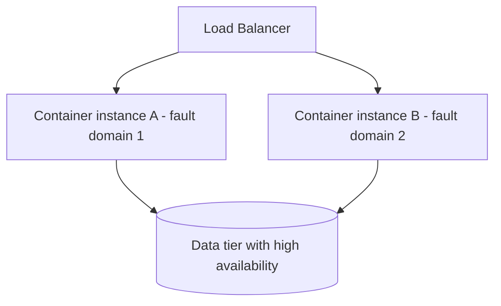

# Container Instances and Serverless Container Deployment

OCI Container Instances lets you run containerized applications without installing an operating system, Docker daemon, or managing underlying hosts yourself. Deployers still need to decide on the image, resources, access permissions, networking, data, and application recovery strategy. The service fits container workloads that do not yet require an orchestration platform like Kubernetes. [Overview of Container Instances](https://docs.oracle.com/en-us/iaas/Content/container-instances/overview-of-container-instances.htm).

Within the **Containers and Functions** chapter of the Oracle Cloud Infrastructure module, this lesson connects compartment, IAM, and VCN knowledge to container deployment. The goal is to create a service that can be tested, monitored, and cleaned up, while understanding the additional decisions required when moving to a production environment.

After this lesson, learners will be able to:

- Distinguish between an image, a container, and a container instance.
- Choose resources and design network paths for pulling images, receiving requests, and accessing data.
- Separate deployer permissions from permissions used to pull private images.
- Create a container instance via the Console or OCI CLI, test HTTP, and read logs.
- Design persistent data storage, new version releases, high availability, and cost control.

## 1. The Deployment Unit Is a Container Instance

An **image** is a package of an application along with its libraries and default configuration. A **container** is a process launched from an image. A **container instance** is an OCI resource providing an environment to run one or more containers with selected CPU, memory, and network configurations.

For example, an invoice-processing API might consist of an application container and a sidecar container forwarding observability data. Containers in the same instance can communicate over `localhost` because they share a network namespace. Therefore, two processes cannot bind to the same address and listening port; ports must be allocated explicitly. Oracle demonstrates this characteristic in [the Container Instances tutorial](https://docs.oracle.com/en/learn/manage-oci-container-instances/).

Co-locating containers is suitable when they share a tightly coupled lifecycle and need local communication. For APIs that need independent scaling, releasing, or permission isolation, consider separating them into distinct container instances.

One instance running three application containers is still a single infrastructure unit. It is not equivalent to three replicas placed across three independent fault domains. Stopping or replacing the instance affects the entire group.

| Oracle Manages | Application Team Manages |
| --- | --- |
| Host infrastructure and runtime environment provided by the service | Images and libraries inside the images |
| Resource allocation per requested configuration | Selecting shape, CPU, RAM, and container limits |
| Execution mechanism for lifecycle operations | Selecting restart policy and handling restarts |
| Networking and observability capabilities of the service | Appropriate IAM, routes, NSGs, health checks, and alarms |
| Underlying infrastructure beneath containers | Business data, backups, and application recovery |

With serverless container services, operational responsibility shifts to configuration and application behavior. A running container does not by itself prove that the API is fault-tolerant or preserves data.

## 2. Selecting a Service Based on Workload Requirements

| Primary Requirement | Selection Direction to Evaluate |
| --- | --- |
| Running a small API from an existing image with few components | Container Instances |
| Running a file-processing task or automated job with an endpoint | Container Instances with an appropriate restart policy |
| Needing the Kubernetes ecosystem, controllers, and multi-service management | Oracle Kubernetes Engine, abbreviated OKE |
| Organizing logic into functions invoked by events or requests | OCI Functions |
| Needing deep OS customization or direct host management | OCI Compute |

This table is an architectural guide that must be validated against specific requirements. For instance, a 20-minute data import job can fit Container Instances when the team already has an image and a mechanism to invoke the job. The team must still provide scheduling, result tracking, and duplicate-processing prevention.

If multiple services must be released independently, autoscale replicas, and continuously balance workloads, account for the cost of building orchestration tooling yourself. Calling an API to create a container instance only solves one part of that system.

## 3. Resources and Placement

### 3.1. Compartments and Fault Domains

Compartments organize resources and act as policy scopes. Regions determine where APIs are called and resources are deployed. Availability domains (ADs) and fault domains (FDs) describe physical placement and fault isolation distribution.

Deployment configurations should explicitly record the application compartment, the subnet/NSG compartment if different, the region, the actual AD name, the shape, and the image location. Do not copy an AD name from another tenancy and use it as-is. When a resource cannot be found, verify region and compartment before concluding the resource is gone.

### 3.2. Shapes and Container Limits

Container Instances offers flexible shapes, such as `CI.Standard.E4.Flex` and `CI.Standard.A1.Flex`. Check which shapes are supported in the target region/AD and select an image compatible with the CPU architecture. Available shapes and limits are published in [Container Instances Shapes](https://docs.oracle.com/en-us/iaas/Content/container-instances/container-instance-shapes.htm).

There are two configuration layers:

| Layer | Typical Configuration | Meaning |
| --- | --- | --- |
| Container instance | `ocpus`, `memoryInGBs` | Total resources allocated to the instance |
| Container | `vcpusLimit`, `memoryLimitInGBs` in `resourceConfig` | Limits on resources the container process may consume |

`vcpusLimit` is measured in logical CPUs; do not confuse it with `ocpus`. Without limits, a container can consume all corresponding available resources of the instance. [Container resource configuration](https://docs.oracle.com/en-us/iaas/tools/python/latest/api/container_instances/models/oci.container_instances.models.CreateContainerResourceConfigDetails.html).

Design example: an instance with 4 GB RAM runs an API and a helper process. You can cap the API at 2 GB, the helper process at 0.5 GB, and leave the remainder as headroom. This is an initial configuration for measurement, not a performance guarantee formula.

For Java, container RAM is not only for the heap. You must account for metaspace, thread stacks, direct buffers, and native memory. Setting heap close to the container RAM limit can cause the process to be terminated even before the JVM heap threshold is exceeded.

## 4. Networking: Image Pull Path and Serving Path

A container instance must be able to pull its image before the application can serve traffic. Afterward, the application also needs to receive requests and reach dependencies. Test these flows separately.



This diagram shows a reference design for a public-facing application. The lab below only creates a container instance in a private subnet and tests from a machine that already has connectivity into the VCN; the Load Balancer is an extension step.

### 4.1. Pulling Images

| Image Source | Typical Network Path |
| --- | --- |
| OCIR in the matching region | Service Gateway and routes to supported Oracle services |
| Public registry outside OCI | Private subnet with NAT Gateway and route to the Internet |
| Registry over the organization's private network | Private connectivity, DNS, and routes to the target endpoint |

Beyond routes, DNS, egress, and pull permissions are also required if the repository is private. Oracle describes registry access requirements in [the guide to creating a container instance](https://docs.oracle.com/en-us/iaas/Content/container-instances/creating-a-container-instance.htm).

A Service Gateway does not replace outbound Internet access to arbitrary external registries. A NAT Gateway enables outbound connections from a private subnet; it does not create an inbound path for Internet users to initiate connections to a container instance's private IP.

### 4.2. Receiving Traffic

The application must listen on an appropriate address, such as `0.0.0.0:8080`. If it listens only on `127.0.0.1:8080`, processes in the same network namespace can connect, but other hosts in the VCN cannot reach it via its private IP.

NSGs or security lists must permit the target port. Declaring `EXPOSE 8080` in a Dockerfile does not create OCI network rules and does not automatically open ports in the application.

| Flow | Design Rule for an API Behind a Load Balancer |
| --- | --- |
| Users to Load Balancer | TCP 443 scoped to the intended user range |
| Load Balancer to API | TCP 8080 from the Load Balancer's NSG |
| API to database | Data service port, from application NSG to specific target |
| API pulling images | HTTPS via the network path designed for the registry |

NSG and security list rules are additive in allowing traffic. An overly broad rule in a security list still takes effect even if an NSG has narrow rules. Inspect all applicable rule sets.

A private IP is also not automatically reachable from OCI Cloud Shell. The environment running `curl` must have a path into the VCN, such as a test Compute instance, VPN, or an appropriate private networking configuration.

## 5. IAM and Private Images

### 5.1. Deployment Permissions

The user or pipeline creating resources needs permissions on container instances and the referenced network resources. A starter policy set for the lab could be:

```text
Allow group CiDeployers to manage compute-container-family in compartment CiLab
Allow group CiDeployers to use virtual-network-family in compartment NetworkLab
```

Replace the names with actual groups/compartments. For non-default identity domains, qualify group names with the domain per tenancy configuration. Place policies at a level that can grant access to the named compartments.

`use virtual-network-family` is relatively broad permission for using pre-existing networking, not a least-privilege set for every system. Teams creating new network infrastructure need a separate permission set; administrators should narrow deployment permissions to the operations actually needed.

### 5.2. Pulling Private OCIR Images

Deployer permissions are distinct from permissions allowing Container Instances to pull images. For private OCIR, you can use the container instance's resource principal via a dynamic group.

A matching rule scoped to the application compartment:

```text
ALL {resource.type = 'computecontainerinstance', resource.compartment.id = '<CI_COMPARTMENT_OCID>'}
```

Grant permissions to the dynamic group named `CiImageReaders`:

```text
Allow dynamic-group CiImageReaders to read repos in compartment ImageLab
```

Resource types and policy patterns are based on [Container Instances IAM Policies](https://docs.oracle.com/en-us/iaas/Content/container-instances/permissions/policy-reference.htm).

If using the Console to browse OCIR, the deployer needs repository read and Object Storage namespace read permissions per IAM documentation. These OCIR browsing permissions are not required for a lab using only public images outside OCI.

Separate the pipeline's image publishing permissions from the runtime's pull-only permissions. Do not grant tenancy-admin permissions to containers to work around missing repository read permissions.

### 5.3. Authenticated Registries Outside OCI

OCI Vault can store image pull credentials. A secret contains JSON with `username` and `password` fields; Container Instances needs permission to read the secret bundle. `imagePullSecrets` is specified in the instance creation request and references the secret matching the registry. Private OCIR prefers the IAM/resource principal approach described above. [Vault Secrets for Image Pull Authorization](https://docs.oracle.com/en-us/iaas/Content/container-instances/vault-secrets-image-authorization.htm).

An image pull secret does not automatically provide the application with database passwords. Application credentials require a separate delivery mechanism. Avoid embedding passwords in images, Git, resource names, or commands that may be saved in shell history.

## 6. Data and Storage

### 6.1. Ephemeral Storage

The container writable layer and ephemeral storage suit regenerable data: extracted files, caches, or intermediate results. Restarting a container instance clears ephemeral data; do not treat the persistence of a file after one run as proof of durability. [Behavior on restart](https://docs.oracle.com/en-us/iaas/Content/container-instances/restarting-a-container-instance.htm).

Ephemeral space is also used to download and extract images, hold logs, and back the container writable layer. Smaller images reduce startup time and storage pressure. Monitor usage rather than counting only application file sizes. [Ephemeral storage](https://docs.oracle.com/en-us/iaas/Content/container-instances/container-instance-shapes.htm).

### 6.2. File Storage and External Data

Container Instances supports mounting OCI File Storage Service (FSS). You must specify the file system, mount target, export, permissions, and network connectivity. The file system is referenced when creating the instance; stopping or deleting the instance does not delete that file system. [Mounting File System Service Resources](https://docs.oracle.com/en-us/iaas/Content/container-instances/creating-mounting-fss.htm).

| Data | Recommended Design Approach |
| --- | --- |
| Regenerable cache | Memory or ephemeral storage, accepting loss on restart |
| Files needing a shared filesystem interface | FSS with appropriate mounts, permissions, and backups |
| Invoices, images, processing outputs | Object Storage via application API/SDK |
| Transactions and business state | Appropriate database service, such as Autonomous Database or Oracle Database |
| Session state across multiple replicas | Shared state store, avoiding binding to a single container |

This table lists design options, not an implication that every data service mounts like a disk. Writing invoices to Object Storage requires the application to invoke APIs and handle errors, retries, and access permissions.

FSS solves the need for a persistent filesystem; it does not automatically provide application-level backups, business locking, or full high availability for a database running inside a container. For critical data, evaluate backups, recovery, and operations at the data tier.

## 7. Lifecycle, Restart Policies, and Health Checks

### 7.1. Choosing a Restart Policy

The policy is configured on the container instance and applies to the containers inside. API values are `ALWAYS`, `ON_FAILURE`, and `NEVER`. [ContainerInstance model](https://docs.oracle.com/en-us/iaas/tools/python/latest/api/container_instances/models/oci.container_instances.models.ContainerInstance.html).

| Policy | Expected Behavior | Typical Use Case |
| --- | --- | --- |
| `ALWAYS` | Restarts whenever a container exits, even on success | Continuously running HTTP services |
| `ON_FAILURE` | Restarts only when a container exits with an error | Tasks that permit retries |
| `NEVER` | Does not automatically restart on exit | Tasks where an external orchestrator decides retries |

An invoice import job using `ON_FAILURE` must tolerate failing after writing partial data. You can store a job ID and mark each processed item so subsequent runs do not create duplicate invoices.

If a sidecar container runs indefinitely after the main processing container completes, the group still has an active process. Therefore, align on exit conditions for the entire group before using multiple containers for batch jobs.

### 7.2. Health Checks and Serving Verification

Resource state and application health are two distinct layers. An instance in the `ACTIVE` state still needs HTTP, log, and dependency verification before receiving live traffic.

An HTTP health check specifies port, path, interval, timeout, and failure threshold. The `KILL` action on check failure hands the container over to the restart policy mechanism; `NONE` monitors without taking that action. [HTTP health check model](https://docs.oracle.com/en-us/iaas/tools/python/latest/api/container_instances/models/oci.container_instances.models.CreateContainerHttpHealthCheckDetails.html).

One way to split application health endpoints:

- A liveness endpoint confirms the process is running and not deadlocked.
- A readiness endpoint reflects serving capacity so the Load Balancer can decide whether to route traffic to it.

This is an application design separation, not an implication that Container Instances provides Kubernetes' full suite of probes and rollout mechanics. Avoid making liveness checks overly dependent on a disrupted database, as restarting every container can worsen the outage.

### 7.3. Graceful Shutdown

Set `gracefulShutdownTimeoutInSeconds` to match request completion times. Applications should handle shutdown signals, stop accepting new work, and complete or return in-flight work. Related options are described in [CLI create](https://docs.oracle.com/en-us/iaas/tools/oci-cli/latest/oci_cli_docs/cmdref/container-instances/container-instance/create.html).

For Java, `ENTRYPOINT ["java", "-jar", "/app/app.jar"]` allows the Java process to receive signals directly. If using a shell script, use `exec java ...` as the final step to avoid keeping Java behind a shell that does not forward signals properly.

## 8. Lab: Web Container in a Private Subnet

### 8.1. Outcome and Prerequisites

The lab creates a container instance running NGINX from a public image, without assigning a public IP. A test machine with connectivity into the VCN makes an HTTP call to the instance's private IP. The goal is to verify the chain: **IAM → image pull → process → network → HTTP → logs**.

Prerequisites:

- Authenticated OCI CLI and correct region; the commands below use **Bash**, suitable for OCI Cloud Shell or Bash with OCI CLI installed.
- Provisioned deployment compartment and permissions to use the subnet and NSG.
- Private subnet with DNS, a `0.0.0.0/0` route via a NAT Gateway, and HTTPS egress to reach registries outside OCI.
- NSG for the instance allowing stateful TCP port 80 ingress from the test machine's private IP `/32` or NSG.
- Test machine with a route to the subnet and appropriate egress to reach port 80.
- AD and shape with available capacity within service limits/quotas.

The CLI can run in Cloud Shell to invoke OCI APIs. The HTTP call to the private IP must run from an environment with private network connectivity. These two requirements are independent.

The `stable` tag in the example reduces lab overhead and can change over time. For real releases, pick a verified version, pin its digest, and ensure the image supports the selected shape's architecture.

### 8.2. Setting Variables and Checking Shapes

Replace all placeholders with real values. Retrieve the AD name from your current tenancy.

```bash
export OCI_REGION='ap-singapore-1'
export CI_COMPARTMENT_ID='<compartment-ocid>'
export CI_AD='<tenancy-prefix>:AP-SINGAPORE-1-AD-1'
export CI_SUBNET_ID='<private-subnet-ocid>'
export CI_NSG_ID='<container-instance-nsg-ocid>'

oci container-instances container-instance list-shapes \
  --region "$OCI_REGION" \
  --compartment-id "$CI_COMPARTMENT_ID" \
  --availability-domain "$CI_AD" \
  --all
```

Proceed with `CI.Standard.E4.Flex` only if it is supported and capacity conditions fit. The shape list is not a guarantee that host capacity is available at the exact moment of creation. [CLI list-shapes](https://docs.oracle.com/en-us/iaas/tools/oci-cli/latest/oci_cli_docs/cmdref/container-instances/container-instance/list-shapes.html).

### 8.3. Creating the Container Instance

This example allocates 1 OCPU / 4 GB RAM to the instance and limits the container to 1 logical CPU / 1 GB RAM. The health check calls HTTP on port 80. The static-page container does not need a resource principal, so principal access is disabled for that container.

```bash
CI_CONTAINERS_JSON='[
  {
    "displayName": "web",
    "imageUrl": "docker.io/library/nginx:stable",
    "isResourcePrincipalDisabled": true,
    "resourceConfig": {
      "vcpusLimit": 1,
      "memoryLimitInGBs": 1
    },
    "healthChecks": [
      {
        "name": "web-http",
        "healthCheckType": "HTTP",
        "port": 80,
        "path": "/",
        "initialDelayInSeconds": 20,
        "intervalInSeconds": 10,
        "timeoutInSeconds": 3,
        "failureThreshold": 3,
        "successThreshold": 1,
        "failureAction": "KILL"
      }
    ]
  }
]'

CI_VNICS_JSON="[{\"subnetId\":\"$CI_SUBNET_ID\",\"isPublicIpAssigned\":false,\"nsgIds\":[\"$CI_NSG_ID\"]}]"

CI_ID=$(oci container-instances container-instance create \
  --region "$OCI_REGION" \
  --compartment-id "$CI_COMPARTMENT_ID" \
  --availability-domain "$CI_AD" \
  --display-name 'ci-web-lab' \
  --shape 'CI.Standard.E4.Flex' \
  --shape-config '{"ocpus":1,"memoryInGBs":4}' \
  --container-restart-policy 'ALWAYS' \
  --graceful-shutdown-timeout-in-seconds 30 \
  --containers "$CI_CONTAINERS_JSON" \
  --vnics "$CI_VNICS_JSON" \
  --freeform-tags '{"project":"ci-web-lab","environment":"lab"}' \
  --query 'data.id' \
  --raw-output) || { echo 'Resource creation failed'; exit 1; }

printf 'Container instance OCID: %s\n' "$CI_ID"
```

Container and principal options belong to [CreateContainerDetails](https://docs.oracle.com/en-us/iaas/tools/python/latest/api/container_instances/models/oci.container_instances.models.CreateContainerDetails.html). The `subnetId`, `isPublicIpAssigned`, and `nsgIds` fields belong to [CreateContainerVnicDetails](https://docs.oracle.com/en-us/iaas/tools/python/latest/api/container_instances/models/oci.container_instances.models.CreateContainerVnicDetails.html).

The example keeps the image's default command/arguments. Do not add a background command and let the main process exit, because container lifecycle is tied to the main process.

Save the returned OCID. The API accepting a creation request does not mean the application is ready yet.

### 8.4. Checking Status

```bash
oci container-instances container-instance get \
  --region "$OCI_REGION" \
  --container-instance-id "$CI_ID" \
  --query 'data.{id:id,state:"lifecycle-state",details:"lifecycle-details"}'
```

Repeat the command while the resource is provisioning. If `FAILED`, inspect `lifecycle-details` and Work Requests in the Console before trying to create another. If a script times out, check for the already-created resource by OCID or resource list before re-running create.

If using the create command's wait option, `--wait-for-state` tracks the **work request**, with states such as `SUCCEEDED` and `FAILED`; `ACTIVE` is the resource state. Match the right state type in [CLI create](https://docs.oracle.com/en-us/iaas/tools/oci-cli/latest/oci_cli_docs/cmdref/container-instances/container-instance/create.html).

### 8.5. Retrieving the Private IP and Testing HTTP

Once the instance finishes creating and the VNIC is available:

```bash
CI_VNIC_ID=$(oci container-instances container-instance get \
  --region "$OCI_REGION" \
  --container-instance-id "$CI_ID" \
  --query 'data.vnics[0]."vnic-id"' \
  --raw-output)

CI_PRIVATE_IP=$(oci network vnic get \
  --region "$OCI_REGION" \
  --vnic-id "$CI_VNIC_ID" \
  --query 'data."private-ip"' \
  --raw-output)

printf 'Private IP: %s\n' "$CI_PRIVATE_IP"
```

From the **test machine with connectivity into the VCN**, set the IP to the retrieved result and run:

```bash
CI_PRIVATE_IP='<retrieved-private-ip>'
curl --fail --show-error --connect-timeout 5 "http://$CI_PRIVATE_IP/"
```

The expected outcome is the NGINX page content and a `curl` exit code of 0. Timeouts suggest checking routes, ingress sources, and NSGs/security lists. Connection refused suggests checking the process and listening port. If HTTP returns an error code, inspect application logs before altering network rules.

### 8.6. Identifying the Container and Reading Logs

In a shell with OCI CLI and the variables from the creation step:

```bash
oci container-instances container list \
  --region "$OCI_REGION" \
  --compartment-id "$CI_COMPARTMENT_ID" \
  --container-instance-id "$CI_ID" \
  --all
```

Filtering by instance prevents accidentally picking up a container from another lab. [CLI container list](https://docs.oracle.com/en-us/iaas/tools/oci-cli/latest/oci_cli_docs/cmdref/container-instances/container/list.html).

Copy the OCID of the `web` container from the output and retrieve logs:

```bash
CI_CONTAINER_ID='<web-container-ocid>'

oci container-instances container retrieve-logs \
  --region "$OCI_REGION" \
  --container-id "$CI_CONTAINER_ID" \
  --file -
```

`--file -` writes to stdout. The **container** OCID is different from the **container instance** OCID; the command requires the container ID. [Log retrieval guide](https://docs.oracle.com/en-us/iaas/Content/container-instances/retrieve-logs.htm).

### 8.7. Equivalent Steps in the Console

Create the resource with the same decisions: selected compartment/AD, E4 Flex with 1 OCPU / 4 GB, restart policy `Always`, private subnet, no public IP assigned, prepared NSG, and image `docker.io/library/nginx:stable`. Add no extra storage for the static-page lab.

After creation, use Details to view the VNIC/IP, Containers to view containers/logs, Work Requests to track provisioning, and Monitoring to view resource metrics. Control names/locations may change; cross-check functionality in [the guide to creating a container instance](https://docs.oracle.com/en-us/iaas/Content/container-instances/creating-a-container-instance.htm).

## 9. Moving from Lab to an Authorized Application

A real-world invoice API could use the following design:

1. Pipeline builds, checks the image, and pushes it to a private OCIR repository.
2. The container instance only has read access to the repository needed to pull the image.
3. The API resides in a private subnet, receiving traffic from a Load Balancer via an NSG.
4. The application reads/writes transactions in the chosen Oracle Database service using an account with only business-required privileges.
5. Invoice files are stored in Object Storage; the container holds temporary files only while processing.
6. Alarms and observability data indicate when the API is slow, failing, or short on resources.

This is a recommended approach. Database connectivity and authentication must follow the specific service; deployments requiring TLS or wallets must deliver those files using an appropriate mechanism. Do not bake credentials into shared images for deployment convenience.

Helper containers that do not need to call OCI should have resource principal access disabled. Containers allowed to use the principal of the same container instance do not automatically become independent IAM identities; split into separate instances when distinct permission boundaries are needed. Enabling/disabling principal access is described in [CreateContainerDetails](https://docs.oracle.com/en-us/iaas/tools/python/latest/api/container_instances/models/oci.container_instances.models.CreateContainerDetails.html).

For team-built application images, run as a non-root UID/GID, restrict Linux capabilities, and use a read-only root filesystem if the application is compatible. Provision dedicated writable directories such as `/tmp` or cache paths. Do not blindly enable read-only mode on images that must write files on startup.

## 10. Monitoring and Diagnostics

Service metrics reside in the `oci_computecontainerinstance` namespace, including `CpuUtilization`, `MemoryUtilization`, and `EphemeralStorageUsed`. View them in the resource's Monitoring section and build alarms as needed. [Container Instance Metrics](https://docs.oracle.com/en-us/iaas/Content/container-instances/container-instance-metrics.htm).

API observability should connect three layers:

| Layer | What to Observe | Purpose |
| --- | --- | --- |
| Resource | CPU, RAM, ephemeral storage, instance state | Detect resource exhaustion or provisioning errors |
| Container | Logs, exit code, exit timestamp, restart count if any | Identify process crashes and restart loops |
| Application | Error rate, latency, health endpoint, request ID | Identify user impact |

Example starting thresholds to tune: sustained RAM above 80%, CPU above 80% alongside rising latency, or consecutive HTTP failures. These are operational assumptions for this lesson, not mandatory OCI thresholds.

`retrieve-logs` returns the most recent logs; you can fetch logs from the previous run with `--is-previous true`. It does not replace a long-term log store. If multi-day investigations are needed, design log forwarding to a centralized logging system. [CLI retrieve-logs](https://docs.oracle.com/en-us/iaas/tools/oci-cli/latest/oci_cli_docs/cmdref/container-instances/container/retrieve-logs.html).

Application logs should include timestamp, severity level, request ID, and actionable error messages. Avoid logging tokens, passwords, or connection strings containing credentials.

| Symptom | First Check | Resolution Direction |
| --- | --- | --- |
| Unable to create resource | IAM on app/network compartments, quota, AD/shape | Fix missing permissions/config; distinguish quota from host capacity |
| Unable to pull image | Image/tag/digest, DNS, egress, routes, repository permissions | Restore image pull path or corresponding permissions |
| Executable format error | Image architecture and entrypoint | Use an image matching the architecture; check path/execute permissions |
| Container exits immediately | Logs, command, arguments, exit code | Fix the main process or startup configuration |
| Continuous restarts | Previous run logs, RAM limit, health check | Find root cause instead of just increasing retries |
| HTTP timeout | Path from caller to private IP, NSG/security list | Permit right source/port and restore required routes |
| HTTP connection refused | Process, bind address, listening port | Fix port or configure application to listen on the right address |
| FSS fails to mount | Permissions, export, mount target, and required NFS connectivity | Fix FSS configuration and path to mount target |
| Files lost after restart | Whether write path was ephemeral | Move data that must persist to a durable service |

When requesting support, record the OCID, region, timestamp, work request, and specific error message. These details are far more useful than merely reporting "not running."

## 11. Releasing New Versions and High Availability

### 11.1. Instance Replacement Workflow

Do not assume every container property can be updated in place. For example, `container update` currently describes updating display name/tags rather than an image rollout mechanism. Verify the capabilities of the API/CLI you use before designing version upgrades. [CLI container update](https://docs.oracle.com/en-us/iaas/tools/oci-cli/latest/oci_cli_docs/cmdref/container-instances/container/update.html).

Release workflow via resource replacement:

1. Build the new image, verify it, and record its digest.
2. Create a new instance from source-controlled configuration.
3. Run health checks, smoke tests, and confirm dependency connectivity.
4. Add the new instance to the Load Balancer backend set and verify traffic.
5. Stop sending new requests to the old instance and wait for in-flight requests to finish.
6. Retain rollback capability to the old version for an agreed period, then delete the old resource.

This is a workflow designed and automated by the team itself. If the new version modifies the database schema, maintain compatibility while both versions coexist.

### 11.2. Replicas and Fault Domains

For an API that must remain available if one instance fails, place at least two container instances behind a Load Balancer, distributed across different FDs and across multiple ADs when both the region and data design support it.



This is a recommended architecture; replica count and placement depend on load, recovery objectives, and budget. Two instances sharing a single point of failure in the data tier can still go down together.

Restart policies handle container restart behavior. They do not create independent replicas, distribute traffic, or replace a recovery plan when a resource becomes unavailable.

### 11.3. Automation

Pipelines should store deployment configuration, secret references, image digests, and release identifiers. After create, monitor the work request, verify resource status, and test the application. On mid-flight failures, use the returned OCID to diagnose/clean up before creating additional instances.

If replica counts must scale with load, the team must design metrics collection, scaling decisions, backend registration, and instance retirement; do not assume those steps are automatic simply from the "serverless" label. When orchestration grows too complex, re-evaluate OKE or another service suited to the application model.

## 12. Cost and Cleanup

Costs must be estimated from provisioned resources, runtime duration, and accompanying services. An estimation model for discussion:

```text
Estimated total cost = Container Instances resources
                     + Load Balancer if used
                     + data and storage services
                     + billable network traffic
                     + logs and additional services
```

Do not use instantaneous CPU/RAM utilization as the sole basis for estimation. Idle containers still reside inside provisioned instances. Individual container limits do not automatically reduce the total provisioned instance configuration.

Under current service behavior, standard shapes stop billing Container Instances compute resources when the instance is stopped; stopped/failed resources may still count toward service limits. Services such as FSS or Load Balancers must be evaluated separately. [Lifecycle states and billing](https://docs.oracle.com/en-us/iaas/Content/container-instances/overview-of-container-instances.htm).

Controls suited for the lab:

- Apply project/environment tags to locate related resources.
- Use metrics to right-size configurations for future deployments.
- Clean up failed test resources and versions past their retention window.
- Account for overlap time when running two versions concurrently during releases.
- Check pricing tables and quotas at usage time; do not assume Container Instances is free based on image choice or account credits.

Once the lab is complete, use the saved OCID to delete the instance:

```bash
oci container-instances container-instance delete \
  --region "$OCI_REGION" \
  --container-instance-id "$CI_ID"
```

Confirm the resource at the CLI prompt, then track deletion in the Console. Delete the NSG, subnet, or gateway only if created specifically for the lab and no longer used by other resources. If you extended the lab with FSS, databases, or Load Balancers, handle each resource according to its own lifecycle.

## 13. Lab Completion Criteria

| Outcome | Evidence to Observe |
| --- | --- |
| Created in right scope | OCID, compartment, region, and shape match configuration |
| Image pulled | Container starts with no image pull errors |
| Networking matches design | No public IP; test machine with private connectivity can reach port 80 |
| Application serves traffic | `curl --fail` succeeds and returns web page content |
| Investigable | Container OCID identified, logs read, and metrics viewed |
| Data lifecycle understood | Identify what data is allowed in ephemeral storage vs. what must be stored externally |
| Cleanup completed | Lab instance deleted; accompanying resources reviewed |

When transitioning to a business API, add verification for data permissions, retries, shutdown signal handling, and instance replacement capability. A complete deployment must be able to explain how the application starts, serves, is observed, recovers, and ends its lifecycle.
