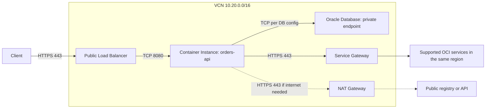
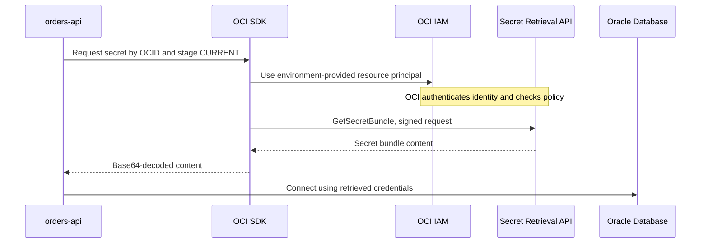

# Configuring Networking, Resources, and Secrets for Container Instances

## 1. Objectives and Deployment Scenario

In the **Containers and Functions** chapter of the **CLOUD_PROVIDERS_ORACLE** module, this lesson focuses on three decisions when running an application on Oracle Cloud Infrastructure (OCI) Container Instances: which networks the application communicates over, how many resources it is allocated, and how it retrieves secrets.

Container Instances lets you run one or more containers without managing servers. Deployers must still select appropriate subnets, shapes, resources, and IAM permissions. The service fits workloads that do not require a Kubernetes orchestration platform; see [Overview of Container Instances](https://docs.oracle.com/en-us/iaas/Content/container-instances/overview-of-container-instances.htm).

The running example is `orders-api`, a Java API receiving requests via a Load Balancer, connecting to an Oracle Database over a private address, and reading its password from OCI Secret Management. The CIDRs, ports, and resource sizes in this lesson are design assumptions for practice, not OCI defaults.

After this lesson, learners will be able to:

- Design network paths for incoming application traffic, image pulls, and calling dependent services.
- Allocate resources at the Container Instance level and set limits at the individual container level.
- Distinguish regular configuration, image pull credentials, and application secrets.
- Apply dynamic groups and IAM policies so containers read only the required resources.
- Deploy via the OCI CLI, observe outcomes, and diagnose errors layer by layer.

## 2. Mental Model to Grasp Before Configuring

A Container Instance is the infrastructure allocation unit for a group of containers. Containers within the same instance share resources and the network namespace; they can call one another via `localhost`. This characteristic is illustrated in [Oracle's Container Instances tutorial](https://docs.oracle.com/en/learn/manage-oci-container-instances/).

Direct design implications:

- Two containers cannot bind the same address and port simultaneously in the same network namespace. If the API listens on `0.0.0.0:8080`, a sidecar must choose a different port.
- `localhost` points only to the current instance, not to a database on another instance or an external OCI service.
- An NSG attached to a VNIC controls traffic over the VCN network; it does not create a boundary between two processes communicating over loopback inside the same instance.
- Only group containers that share a trust relationship and require tight coordination. Two applications needing independent secret access should be separated into distinct instances.

Do not transplant a local workstation Docker mental model directly to OCI. `EXPOSE 8080` in a Dockerfile does not create an ingress rule and does not configure a Load Balancer. For an application to be reachable via its VNIC, the process must listen on an appropriate address such as `0.0.0.0:8080`; binding only `127.0.0.1:8080` prevents clients outside the instance from connecting.

Three configuration layers serve different roles:

| Layer | Key Decisions | Example |
| --- | --- | --- |
| Container Instance | Total resources, subnet/VNIC, container group, restart policy | 2 OCPU, 8 GB RAM, private subnet |
| Container | Image, environment variables, resource limits, resource principal access | API capped at 3 vCPU and 6 GB RAM |
| Application | Listening port, connection pool, how secrets are fetched and refreshed | TCP 8080, read secret at stage CURRENT |

Changing one layer does not automatically fix errors in another layer. Increasing RAM does not fix DNS; adding secret read permissions does not create a network route to the Secret Retrieval API.

## 3. Designing Networking for an API in a Private Subnet

### 3.1. Example Architecture

Assume a VCN with CIDR `10.20.0.0/16` and three subnets:

| Subnet | Example CIDR | Component |
| --- | --- | --- |
| Ingress subnet | `10.20.10.0/24` | Public Load Balancer |
| Application subnet | `10.20.20.0/24` | Container Instance, no public IP |
| Data subnet | `10.20.30.0/24` | Private endpoint of Oracle Database |



The diagram shows connection flows and does not replace route table, NSG, listener, and backend set configurations. In the example, TLS terminates at the Load Balancer; the leg from the Load Balancer to the API uses HTTP on TCP 8080. If end-to-end encryption is required, add TLS on the backend and configure corresponding certificate verification.

Because the API is accessed through the Load Balancer, it does not need a public IP. For background jobs not serving HTTP, both the Load Balancer and the application port ingress rules can be omitted.

### 3.2. Route Tables Must Serve Startup as Well

A common setup in the application subnet:

| Destination | Next Hop | Purpose |
| --- | --- | --- |
| Supported OCI services in the region | Service Gateway | Access Oracle Services Network |
| `0.0.0.0/0`, if internet is actually needed | NAT Gateway | Reach registries outside OCI or public APIs |
| Addresses within the same VCN | Local VCN routing | Call Load Balancer and DB within VCN |

A Service Gateway serves only supported services in the same region. Select the appropriate service CIDR label; an Object Storage-only label does not cover all OCI services. A NAT Gateway serves outbound connections initiated by workloads to the internet and does not provide a public entry point to the API. These principles are described in [Service Gateway documentation](https://docs.oracle.com/en-us/iaas/Content/Network/Tasks/servicegateway.htm).

Trace the network path before the application process starts:

1. Resolve the registry hostname.
2. Connect to the registry and related endpoints to fetch the image.
3. Authenticate the image pull if the repository is private.
4. Start the application.
5. Call the Secret Retrieval API and connect to the database.

For example, even if the API uses only OCI services, if the image resides in an external public registry, the image pull step still needs an appropriate internet path. Succeeding in pulling the image does not prove that the secrets endpoint or DB is reachable.

With a public subnet, direct IPv4 connectivity through an Internet Gateway also requires a public IPv4 on the VNIC and corresponding rules. Simply selecting a public subnet does not automatically assign a public IP. VNIC, subnet, and public IP options are described in [the Container Instance creation workflow](https://docs.oracle.com/en-us/iaas/Content/container-instances/creating-a-container-instance.htm).

### 3.3. Role-Based NSGs and Minimum Rules

Define three NSGs: `nsg-orders-lb`, `nsg-orders-api`, and `nsg-orders-db`. The table below is a design for the example, not an exhaustive rule list for every tenancy:

| Where Applied | Direction | Source or Destination | Destination Protocol/Port | Purpose |
| --- | --- | --- | --- | --- |
| Load Balancer NSG | Ingress | Allowed client CIDR range | TCP 443 | Receive HTTPS |
| Load Balancer NSG | Egress | API NSG | TCP 8080 | Call backend and health endpoint |
| API NSG | Ingress | Load Balancer NSG | TCP 8080 | Receive requests from ingress tier |
| API NSG | Egress | DB NSG | TCP 1521 in example | Connect to chosen DB's Oracle Net |
| DB NSG | Ingress | API NSG | TCP 1521 in example | Accept connections from API |
| API NSG | Egress | Appropriate service CIDR label | TCP 443 | Call required OCI services |
| API NSG | Egress, when needed | Identified internet destination | TCP 443 | Pull images outside OCI or call external APIs |

TCP 1521 here assumes a DB using the corresponding listener. For Autonomous Database or TLS connections, obtain the actual port and connection string from the service; do not blindly substitute 1521 for every DB port.

For custom DNS, ensure the resolver is reachable, including UDP/TCP 53 when required by the architecture. Do not open a broad internet rule merely to work around an undiagnosed name resolution failure.

Using stateful rules in this example ensures return traffic for connections is tracked. If using stateless rules, you must also design the return direction. The effective rules on a VNIC are the union of rules from the subnet's security lists and attached NSGs: a narrow NSG does not revoke access already allowed by a broad security list. See [Security Rules](https://docs.oracle.com/en-us/iaas/Content/Network/Concepts/securityrules.htm).

An NSG is not a domain-name filter. If egress must be restricted by hostname or application layer, design an appropriate proxy or firewall; allowing TCP 443 to `0.0.0.0/0` permits far more destinations than a single registry.

### 3.4. DNS and Backend Addresses

Use DNS names for dependent services rather than hard-coding IPs that can change. If using private DNS, verify the private zone, resolver, and path to the resolver.

The Load Balancer requires the application's private IP and port as its backend. When replacing a Container Instance, do not assume the old IP is always preserved. Automation workflows must update the backend or use an address management mechanism aligned with the deployment lifecycle.

From a test machine that already has a path into the VCN, verify sequentially:

```bash
getent hosts orders-db.internal.example
curl --connect-timeout 3 --fail http://10.20.20.15:8080/health/ready
```

`10.20.20.15` is an example; replace it with the actual private IP. Do not send DB passwords in test URLs. If a minimal runtime lacks these utilities, run the checks from an authorized test point inside the VCN.

## 4. Allocating CPU and Memory at Two Levels

### 4.1. Total Instance Resources

Shape and `shapeConfig` determine the total resources of the Container Instance. Example:

```json
{
  "ocpus": 2,
  "memoryInGBs": 8
}
```

This lesson uses `CI.Standard.E4.Flex` as an example. On this x86 E4 shape, 2 OCPUs correspond to 4 vCPUs. Do not apply that conversion ratio to all CPU families. During deployment, check shape availability in the region, valid CPU/RAM ranges, service limits, and available capacity. Network bandwidth also depends on the shape and OCPU count, not just application CPU limits. See [Container Instances Shapes](https://docs.oracle.com/en-us/iaas/Content/container-instances/container-instance-shapes.htm).

Total resources form a shared budget. If you add a sidecar, account for the sidecar's CPU, RAM, ephemeral storage, and network traffic as well.

### 4.2. Per-Container Limits

OCI uses `resourceConfig.vcpusLimit` and `resourceConfig.memoryLimitInGBs` at the container level:

```json
{
  "displayName": "orders-api",
  "resourceConfig": {
    "vcpusLimit": 3.0,
    "memoryLimitInGBs": 6.0
  }
}
```

`vcpusLimit` is measured in logical CPUs and can be fractional. If these limits are omitted, a process can consume all corresponding resources available in the instance. These are consumption limits; do not interpret them as a resource reservation mechanism like Kubernetes requests. See [CreateContainerResourceConfigDetails](https://docs.oracle.com/en-us/iaas/tools/java/latest/com/oracle/bmc/containerinstances/model/CreateContainerResourceConfigDetails.html).

An illustrative budget if a sidecar is added later:

| Component | CPU Limit | RAM Limit | Reason |
| --- | --- | --- | --- |
| Java API | 3 vCPU | 6 GB | Request processing and connection pool |
| Sidecar | 0.5 vCPU | 1 GB | Collecting or forwarding operational telemetry |
| Unallocated across the two containers | 0.5 vCPU | 1 GB | Headroom buffer by design |

In the example, the sum of application and sidecar limits is less than total instance resources. This is a conservative starting choice for load testing, not a mandatory OCI headroom ratio.

Three practical rules:

1. Set limits on sidecars so they do not starve the primary application.
2. Monitor utilization of both individual containers and the instance.
3. Understand that lowering container limits does not automatically reduce allocated instance resources or cost.

### 4.3. Sizing Resources Based on Application Behavior

| Symptom | Possibility to Check | Next Experiment |
| --- | --- | --- |
| High CPU and latency rises with load | Insufficient CPU or excessive per-request work | Profile and increase CPU in a controlled way |
| Low CPU while requests wait a long time | Waiting on DB, DNS, network, or connection pool | Measure latency of each dependency call |
| RAM grows continuously over time | Unbounded cache, leak, or retaining too much data | Measure heap and process memory |
| Container exits abnormally under higher load | May be hitting memory limit | Cross-check state, logs, and metrics before exit |
| Image pull or temp file write fails | Insufficient ephemeral storage or network error | Check storage, work requests, and registry errors |

Do not conclude OOM with certainty from exit code 137 alone; that code indicates the process received SIGKILL in a Linux environment, and the underlying cause must be corroborated further.

### 4.4. Java-Specific Considerations

The container RAM limit covers more than the Java heap: metaspace, code cache, thread stacks, direct buffers, and native libraries. Setting `-Xmx` equal to the entire container RAM very easily causes out-of-memory errors outside the heap.

Starting example for a container with a 6 GB limit:

```text
JAVA_TOOL_OPTIONS=-Xms512m -Xmx3g
```

This is a parameter set for load testing, not an optimal formula for every JVM. Use a JDK that is container-limit aware, and monitor GC behavior, thread counts, and actual RSS. An API that heavily uses direct buffers may require larger non-heap headroom than an API processing small objects.

CPU limits also influence worker count and GC thread count choices. Increasing thread pools far beyond actual CPU availability may only increase contention and stack memory usage.

## 5. Regular Config, Image Pull Secrets, and Application Secrets

The following three categories of data must be handled separately:

| Category | Examples | Where Used |
| --- | --- | --- |
| Non-secret configuration | `APP_PORT`, `DB_HOST`, `LOG_LEVEL`, secret OCID | Environment variables or configuration files |
| Image pull credentials | Private registry username and token | Container Instances image pull configuration |
| Application secrets | DB password, API key, certificates, and private keys | Fetched at runtime by the application via a designed mechanism |

A secret OCID is an identifier used to call an API, not the secret content itself. Passing `DB_PASSWORD_SECRET_OCID` into the environment does not make OCI automatically substitute it with the password.

`imagePullSecrets` is for fetching images and does not automatically supply `DB_PASSWORD` to the application. If the application needs a DB password, it must include code or a component to retrieve the corresponding secret.

Avoid placing secret values in:

- Dockerfiles, image layers, and build arguments that may be persisted.
- Unprotected deployment configuration files or Terraform state.
- Command-line arguments, URLs, debug logs, and pipeline output.
- Environment variables filled in directly by deployers when a runtime secret retrieval mechanism can be used.

Base64 is a data encoding, not encryption for security. A file containing a base64-encoded password must still be protected just like the raw password.

## 6. Image Pull Authentication

### 6.1. Private Images in OCI Container Registry

For a private repository in OCI Container Registry (OCIR), use IAM permissions based on the Container Instance's resource principal.

Example dynamic group, scoped to the application compartment:

```text
ALL {
  resource.type = 'computecontainerinstance',
  resource.compartment.id = '<APP_COMPARTMENT_OCID>'
}
```

Policy allowing the dynamic group to read repositories in the compartment containing the images:

```text
Allow dynamic-group OrdersContainerInstances to read repos in compartment Images
```

`OrdersContainerInstances` and `Images` are example names that must be replaced with actual names. `resource.type` uses the value `computecontainerinstance`; this is not the `compute-container-family` resource type used in policies for managing the service.

The permissions of the user creating the Container Instance and the permissions of the Container Instance pulling the image belong to two distinct identities. A user being able to see an image in the Console does not mean the instance has been granted repository read permissions. Dynamic group and policy patterns are documented in [Container Instances IAM Policies](https://docs.oracle.com/en-us/iaas/Content/container-instances/permissions/policy-reference.htm).

### 6.2. Images in Private Registries Outside OCI

For external registries, OCI supports referencing a Vault secret containing credentials. The logical content of the secret looks like:

```json
{
  "username": "<REGISTRY_USERNAME>",
  "password": "<REGISTRY_TOKEN_OR_PASSWORD>"
}
```

Corresponding image pull configuration:

```json
[
  {
    "secretType": "VAULT",
    "registryEndpoint": "registry.example.com/team-orders/",
    "secretId": "<REGISTRY_CREDENTIAL_SECRET_OCID>"
  }
]
```

The registry endpoint must match the prefix of the image URL, such as `registry.example.com/team-orders/orders-api:1.0.0`. The Container Instance's dynamic group needs permission to read the corresponding secret bundle.

Per Oracle documentation, this Vault secret approach is for external registries; private OCIR uses the resource principal and policy pattern shown earlier. See [Vault Secrets for Image Pull Authorization](https://docs.oracle.com/en-us/iaas/Content/container-instances/vault-secrets-image-authorization.htm).

Do not use the same secret for registry tokens and DB passwords. The two secrets have different owners, rotation schedules, and permission scopes.

## 7. Retrieving Application Secrets Using a Resource Principal

### 7.1. Access Flow

The preferred design in this lesson is for the application to retrieve secrets itself:



The diagram illustrates the logical role of authentication and authorization; it does not imply that every secret read must perform a brand-new IAM token exchange.

Conditions for the flow to succeed:

1. The container is allowed to access the instance's resource principal.
2. The instance matches the configured dynamic group.
3. The dynamic group is granted permission to read the exact secret bundle.
4. DNS, routes, and security rules permit calling the secret retrieval endpoint.
5. The SDK selects the secret's region and the application handles the decoded format properly.

### 7.2. IAM Scoped to a Specific Secret

Assume the DB secret resides in the `AppSecrets` compartment. Policy permitting reads only for the secret bundle with the specified OCID:

```text
Allow dynamic-group OrdersContainerInstances to read secret-bundles in compartment AppSecrets where target.secret.id = '<DB_PASSWORD_SECRET_OCID>'
```

`read secret-bundles` grants permission to retrieve the content; reading `secrets` metadata alone is not equivalent to this permission. There is no need to grant `manage secret-family` merely for an application to read a password. See [policy reference for Vault and Secret Management](https://docs.oracle.com/en-us/iaas/Content/Identity/policyreference/keypolicyreference.htm).

A compartment-wide dynamic group is suitable if the compartment serves as the application's trust boundary. If a compartment contains multiple applications that should not read each other's secrets, narrow the membership condition—for example by resource ID—or separate compartments/dynamic groups. The `target.secret.id` condition restricts which secret can be read, but does not differentiate among instances that belong to the same dynamic group.

IAM policies must be placed at a scope capable of granting permissions over the target compartment. Do not assume a policy placed inside the application compartment can grant access to a sibling secrets compartment.

### 7.3. Enabling or Disabling Resource Principal Access Per Container

A container that needs to call the OCI SDK:

```json
{
  "displayName": "orders-api",
  "isResourcePrincipalDisabled": false
}
```

A helper container that does not need to call OCI APIs:

```json
{
  "displayName": "local-helper",
  "isResourcePrincipalDisabled": true
}
```

This flag controls whether a container can access the instance's resource principal; it does not create a distinct IAM identity per container. Containers with this capability enabled share the same instance identity. See [CreateContainerDetails](https://docs.oracle.com/en-us/iaas/tools/java/latest/com/oracle/bmc/containerinstances/model/CreateContainerDetails.html).

Because containers still share the network namespace and may share mounted volumes, do not treat disabling the resource principal as complete isolation between untrusted code.

### 7.4. Java Example for Reading a Secret

The application image must package the OCI Java SDK, including the `oci-java-sdk-secrets` module, authentication dependencies, and a compatible HTTP client. Pin a single SDK version in the build system; do not arbitrarily mix artifact versions.

The example below is a helper class running inside a Container Instance. The secret holds a UTF-8 text password; the method returns decoded bytes for connection initialization.

```java
import com.oracle.bmc.Region;
import com.oracle.bmc.auth.ResourcePrincipalAuthenticationDetailsProvider;
import com.oracle.bmc.secrets.SecretsClient;
import com.oracle.bmc.secrets.model.Base64SecretBundleContentDetails;
import com.oracle.bmc.secrets.requests.GetSecretBundleRequest;

import java.util.Base64;

public final class DbPasswordReader {
    private DbPasswordReader() {
    }

    public static byte[] readCurrentPassword() {
        String secretId = requireEnv("DB_PASSWORD_SECRET_OCID");
        String secretsRegion = requireEnv("SECRETS_REGION");

        var provider =
                ResourcePrincipalAuthenticationDetailsProvider.builder().build();

        try (SecretsClient client = SecretsClient.builder()
                .region(Region.fromRegionId(secretsRegion))
                .build(provider)) {

            var request = GetSecretBundleRequest.builder()
                    .secretId(secretId)
                    .stage(GetSecretBundleRequest.Stage.Current)
                    .build();

            var response = client.getSecretBundle(request);
            var content = response.getSecretBundle().getSecretBundleContent();

            if (!(content instanceof Base64SecretBundleContentDetails)) {
                throw new IllegalStateException("Unsupported secret content type");
            }

            var base64Content = (Base64SecretBundleContentDetails) content;
            return Base64.getDecoder().decode(base64Content.getContent());
        }
    }

    private static String requireEnv(String name) {
        String value = System.getenv(name);
        if (value == null || value.isBlank()) {
            throw new IllegalStateException("Missing configuration: " + name);
        }
        return value;
    }
}
```

The SDK uses the resource principal data provided by the environment; do not copy a user private key or `~/.oci/config` file into the image. The initialization mechanism is described in [ResourcePrincipalAuthenticationDetailsProvider](https://docs.oracle.com/en-us/iaas/tools/java/latest/com/oracle/bmc/auth/ResourcePrincipalAuthenticationDetailsProvider.html).

`GetSecretBundleRequest.Stage.Current` selects the version currently in the CURRENT stage. The content type and base64 getter are documented in [Base64SecretBundleContentDetails](https://docs.oracle.com/en-us/iaas/tools/java/latest/com/oracle/bmc/secrets/model/Base64SecretBundleContentDetails.html).

When integrating into a real application:

- Use the secret to initialize the connection and zero out temporary byte arrays when possible; DB libraries may still hold their own copies.
- Never print responses, base64 contents, or passwords to logs.
- Configure timeouts and bounded retries with backoff for transient errors.
- Distinguish configuration/permission errors from transient network errors; do not retry all errors indefinitely.
- If periodic reads are needed, reuse the client appropriately across the application lifecycle and implement cache refresh logic.

This snippet is a single read and does not yet implement caching, custom retries, connection pooling, or secret rotation schedules. If a mandatory read fails on startup, the API should not be marked ready to serve traffic.

## 8. When an Application Needs Secrets via Files

Legacy applications may only support `DB_PASSWORD_FILE` or a wallet directory. In that case, you can design a bootstrap step or helper component that fetches the secret and writes a file into a chosen storage area.

Example application-implemented flow:

1. The secret-fetching component uses the resource principal to call the Secret Retrieval API.
2. Write a temporary file with restricted permissions.
3. Rename the file within the same filesystem to publish complete content atomically.
4. The application waits for a valid file and reads it.
5. When rotating secrets, the application reloads or is replaced according to plan.

Container Instances offers volume types such as empty directories, file-based configs, and OCI File Storage; verify specific choices against [the instance creation and storage guide](https://docs.oracle.com/en-us/iaas/Content/container-instances/creating-a-container-instance.htm).

A configuration file supplied by the deployer does not automatically become a managed secret. Base64 content in a volume configuration request is still data that must be protected.

For secret files, actively design for:

| Concern | Choice in the Application |
| --- | --- |
| Avoid exposure via root filesystem/image | Use a dedicated mount path; do not bake secrets into the image |
| Restrict who can read | Appropriate UID/GID and file permissions |
| Application only needs to read | Mount read-only on the application side where appropriate |
| Avoid reading a partially written file | Write to a temp file, then rename |
| Containers starting out of expected order | Wait with a timeout and validate file contents |
| Files backed by memory | Count file size toward the RAM budget |
| Instance deletion/recreation | Have a mechanism to re-fetch secrets and recreate files |

This synchronization mechanism is built by the application. Do not assume Container Instances provides `initContainers`, `depends_on`, or Kubernetes Secret CSI simply because the setup has multiple containers.

For an Oracle Database wallet, classify the actual components: public certificates, private keys, and wallet passwords carry different protection levels. If placing an entire wallet bundle into a secret, verify secret size limits, decoding logic, and directory permissions before committing to that approach.

## 9. Deployment Example Using OCI CLI on PowerShell

This example uses a **private image in OCIR**, a single API container, and the approach where the application reads its secret directly. VCN, DB, secret, IAM, and Load Balancer must be prepared beforehand.

### 9.1. Preparation

Before running, you need:

- OCI CLI configured with the deployer's identity.
- Actual region and availability domain.
- Application compartment, private subnet, and API NSG.
- The `orders-api` image already pushed to a private OCIR repository.
- Dynamic group and policies to read the repository and the specific secret as covered above.
- Network paths to the registry, Secret Retrieval API, and DB.
- An application in the image listening for HTTP on 8080, exposing `/health/ready`, and containing secret-fetching code.

The deployer identity must have permission to manage Container Instances and use the associated network resources. If networking, images, or secrets live in other compartments, evaluate permissions on each compartment, not just the instance compartment.

The JSON files below are lab files created by the learner in their working directory. They contain only configuration and identifiers, not passwords.

### 9.2. Generating Three JSON Configuration Groups

Replace all placeholders before executing:

```powershell
$compartmentId = '<APP_COMPARTMENT_OCID>'
$availabilityDomain = '<AVAILABILITY_DOMAIN_NAME>'
$subnetId = '<PRIVATE_SUBNET_OCID>'
$apiNsgId = '<API_NSG_OCID>'

$shapeConfig = @{
    ocpus = 2
    memoryInGBs = 8
}

$vnics = @(
    @{
        subnetId = $subnetId
        isPublicIpAssigned = $false
        nsgIds = @($apiNsgId)
    }
)

$containers = @(
    @{
        displayName = 'orders-api'
        imageUrl = '<REGION_REGISTRY>/<NAMESPACE>/orders-api:1.0.0'
        isResourcePrincipalDisabled = $false
        environmentVariables = @{
            APP_PORT = '8080'
            LOG_LEVEL = 'INFO'
            DB_HOST = 'orders-db.internal.example'
            DB_PORT = '1521'
            DB_PASSWORD_SECRET_OCID = '<DB_PASSWORD_SECRET_OCID>'
            SECRETS_REGION = '<SECRET_REGION_ID>'
            JAVA_TOOL_OPTIONS = '-Xms512m -Xmx3g'
        }
        resourceConfig = @{
            vcpusLimit = 3.0
            memoryLimitInGBs = 6.0
        }
    }
)

$utf8WithoutBom = [System.Text.UTF8Encoding]::new($false)

[System.IO.File]::WriteAllText(
    (Join-Path $PWD.Path 'shape.json'),
    (ConvertTo-Json -InputObject $shapeConfig -Depth 10),
    $utf8WithoutBom
)

[System.IO.File]::WriteAllText(
    (Join-Path $PWD.Path 'vnics.json'),
    (ConvertTo-Json -InputObject $vnics -Depth 10),
    $utf8WithoutBom
)

[System.IO.File]::WriteAllText(
    (Join-Path $PWD.Path 'containers.json'),
    (ConvertTo-Json -InputObject $containers -Depth 10),
    $utf8WithoutBom
)
```

`REGION_REGISTRY` is the region's actual registry hostname, and `NAMESPACE` is the tenancy namespace. You can replace the version tag with an image digest to pin the exact verified content.

The variables `APP_PORT`, `DB_HOST`, and `DB_PORT` are the configuration contract of the `orders-api` image; the application must contain code to read them. They are not variables that OCI automatically interprets to configure Java or Oracle Net. JDBC URL, service name, account, and TLS options must still be configured properly in the application.

### 9.3. Sending the Creation Request

Using an argument array makes the PowerShell command readable and avoids line-continuation issues:

```powershell
$createArgs = @(
    'container-instances', 'container-instance', 'create',
    '--compartment-id', $compartmentId,
    '--availability-domain', $availabilityDomain,
    '--display-name', 'orders-api-ci',
    '--shape', 'CI.Standard.E4.Flex',
    '--shape-config', 'file://shape.json',
    '--vnics', 'file://vnics.json',
    '--containers', 'file://containers.json',
    '--container-restart-policy', 'ALWAYS',
    '--graceful-shutdown-timeout-in-seconds', '30'
)

oci @createArgs

if ($LASTEXITCODE -ne 0) {
    throw 'Container Instance creation request failed'
}
```

JSON parameter structures and flag names are described in [OCI CLI: container-instance create](https://docs.oracle.com/en-us/iaas/tools/oci-cli/latest/oci_cli_docs/cmdref/container-instances/container-instance/create.html).

The example omits `--image-pull-secrets` because it uses private OCIR with a resource principal. If switching to an external registry, add the appropriate image pull configuration and re-verify the network path.

`ALWAYS` suits a long-running API. For a job that must terminate when finished, this option would cause the task to repeat; choose the restart policy based on the workload lifecycle.

The 30-second shutdown timeout is an example value. The application must handle shutdown signals, stop accepting new requests, and close connection pools within the chosen period.

### 9.4. Verifying After Creation

Retrieve the OCID from the creation output, then run:

```powershell
$containerInstanceId = '<CREATED_CONTAINER_INSTANCE_OCID>'

$getArgs = @(
    'container-instances', 'container-instance', 'get',
    '--container-instance-id', $containerInstanceId
)

oci @getArgs
```

Inspect instance details, work requests, individual container states, and application logs in the Console. Then:

1. Confirm the VNIC is in the right private subnet and has no public IPv4 address.
2. Confirm the NSG is attached to the VNIC.
3. Verify the image was pulled successfully.
4. Verify the application retrieves the secret and establishes DB connections without logging passwords.
5. Call the health endpoint from an authorized source inside the VCN.
6. Register the private IP/port as a backend and wait for health checks to pass.
7. Call the API via the Load Balancer's TLS hostname.

`ACTIVE` at the instance level does not replace testing whether the API can actually serve requests. A running process may still fail to connect to the DB or fetch secrets.

## 10. Rotating Secrets Without Unexpected Disruption

Secrets have multiple versions; the secret OCID can stay constant while the content changes. Selecting the CURRENT stage lets the application fetch the designated active version. This concept is described in [Secret Management overview](https://docs.oracle.com/en-us/iaas/Content/secret-management/overview.htm) and [the guide to reading secret bundles](https://docs.oracle.com/en-us/iaas/Content/secret-management/Tasks/view-secret-properties-all-version.htm).

Choose a strategy matching the application's capabilities:

| Strategy | Suitable When | Trade-Off to Accept |
| --- | --- | --- |
| Read at startup | Simple apps with an instance replacement workflow | A new secret requires a restart or new deployment |
| Time-bounded cache | Long-running apps supporting connection refresh | Must handle version transitions and refresh errors |
| Read per request | Carefully evaluated special requirements | Increases API call count, latency, and runtime coupling |

Do not call the Secret Retrieval API on every request just to keep passwords fresh. A time-bounded cache paired with connection pool reload logic is usually easier to control.

A DB password rotation workflow must coordinate both the DB side and the application side:

1. Choose a credential transition method supported by the DB, such as dual accounts or a designed overlap window.
2. Create and verify the new secret version in the secrets management workflow.
3. Promote the target version to CURRENT per plan.
4. Refresh caches/connection pools or roll out replacement instances.
5. Verify new connections and live requests.
6. Revoke the old credential once no consumers still depend on it.

If the DB permits only one active password at a time, you cannot assume that switching CURRENT and restarting the application will be completely zero-downtime. You must design the sequence and transition window accordingly.

Updating a secret also does not retroactively update containers that already loaded the old value into environment variables or memory. Reload behavior is the responsibility of the application and operational workflow.

## 11. Observability, Cost, and High Availability

### 11.1. Monitoring Both the Instance and the Application

OCI provides metrics for Container Instances such as `CpuUtilization`, `MemoryUtilization`, `MemoryUsed`, `EphemeralStorageUsed`, and per-container metrics. See [Container Instance Metrics](https://docs.oracle.com/en-us/iaas/Content/container-instances/container-instance-metrics.htm).

For the example API, combine:

| Signal | Practical Meaning |
| --- | --- |
| CPU and RAM | Whether resources are sufficient for current load |
| Ephemeral memory and storage | Whether bootstrap, caching, or file processing is at risk |
| Secret retrieval latency and refresh errors | Whether the app maintains valid credentials |
| DB connections and pool wait times | Whether there is a bottleneck in the data tier |
| Latency, error rate, and health checks | Whether users can actually use the API |
| Work requests and configuration changes | Which infrastructure changes correlate with an incident |

Alert thresholds should be based on load testing and service requirements. 80% RAM utilization may warrant attention on one workload yet be normal operating behavior on another.

Logs should record only error codes, operation types, timestamps, and request IDs needed for investigation. Never log secret responses, authentication headers, or connection strings containing credentials.

### 11.2. Cost Depends on Provisioned Resources

An instance with 2 OCPU / 8 GB remains provisioned at that size even if the API container is capped at 3 vCPU / 6 GB. To reduce provisioned resources, adjust the instance configuration via supported operations or deploy a replacement configuration, then re-measure responsiveness.

In cost estimates, include the Load Balancer, DB, secrets service, logging, storage, and data transfer if applicable. Do not estimate total system cost solely from container count.

For lab environments, stop or delete resources when no longer needed and separately check any associated resources that remain. Stopped states and Container Instances billing are explained in [the service overview](https://docs.oracle.com/en-us/iaas/Content/container-instances/overview-of-container-instances.htm).

### 11.3. A Single Instance Is Still a Single Point of Failure

Placing two API containers inside the same instance does not create two independent fault domains. For an API requiring high availability, design at least two independent instances distributed across fault domains or availability domains suitable for the region, and place them behind a Load Balancer.

Avoid keeping user state solely in an instance's ephemeral filesystem. If data must persist, select an appropriate storage service and recovery mechanism; do not treat container restart capability as a durability guarantee.

An update workflow can provision a new instance, wait for readiness, add the new backend, drain the old backend, and only then release the old instance. Changing subnets or certain other properties may require recreating the resource, so verify the change plan before applying it.

## 12. Layer-by-Layer Troubleshooting

| Symptom | Check First | Resolution Direction |
| --- | --- | --- |
| Cannot pull image | Image URL/tag/digest, DNS, routes, and registry errors | Fix address or network path; then check authentication |
| Private OCIR returns permission error | Dynamic group and `read repos` policy | Grant instance permissions on the repository compartment |
| External registry returns unauthorized | Secret credentials, endpoint prefix, bundle read permission | Update the right secret and matching registry scope |
| Resource principal not found | Principal access flag, SDK, and runtime environment | Enable for the container that needs it and use the right auth provider |
| Secret read reports unauthorized or not found | OCID, region, dynamic group, and compartment policy | Cross-check each value; do not assume deletion from one error code |
| Secret read times out | DNS, routes, security rules, endpoint | Restore network path, then retry with bounds |
| API call via private IP fails | Bind address, port, and ingress from test source | Fix listener or rule for the right source |
| Backend unhealthy | Health path, port, health check source, and app state | Fix health check or readiness condition |
| API DB connection fails | DNS, port, listener, TLS/wallet, and credentials | Separate network errors, protocol errors, and auth errors |
| Container restarts continuously | Logs prior to exit, memory, health check, and restart policy | Fix root cause; do not just raise restart limits |
| Secret rotated but API still uses old password | Cache, environment variables, connection pool | Refresh or redeploy per chosen strategy |

A useful investigation sequence is **DNS → TCP/TLS connectivity → authentication → authorization → application behavior**. For infrastructure management operations, also inspect work requests and `lifecycleDetails`.

Do not open all ingress/egress or grant tenancy-admin permissions just to see if an error disappears. Adjusting based on specific hypotheses preserves evidence of the root cause.

## 13. Integrated Practice Lab

Practice in a learning compartment using test data and test secrets:

1. Prepare a private subnet, routes, and NSGs following the API → OCI services/DB flow.
2. Push the API image to private OCIR and grant pull permissions to the Container Instance.
3. Create a test password secret and a policy allowing read access only to that exact bundle.
4. Deploy the API with 2 OCPU / 8 GB; limit the API container to 3 vCPU / 6 GB.
5. Call the API from a valid source and observe CPU, RAM, latency, and DB connectivity.
6. From a source without matching ingress, verify the API port is unreachable.
7. Configure the app to attempt reading a different secret outside the policy; confirm it is denied without broadening the policy.
8. Rotate the test secret and execute your chosen refresh or instance-replacement mechanism.
9. If evaluating availability, add a second instance and drain one backend in a controlled manner.
10. When finished, clean up the lab resources and verify which related resources still remain.

Do not change credentials or disrupt backends of shared environments just to test this lesson.

Expected outcomes:

- The API serves via the designed ingress path while the Container Instance needs no public IP.
- Image pull, secret retrieval, and DB access each have distinct, verified network paths and permissions.
- Deployment configs contain no plaintext DB passwords or registry tokens.
- Resources are clearly allocated at both instance and container levels.
- New secrets take effect via the chosen mechanism, with an observable transition.
- Logs and metrics are sufficient to distinguish network errors, IAM errors, and resource errors.
