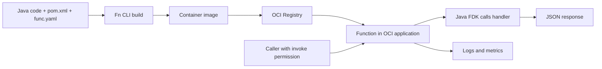

# Creating, Configuring, and Deploying a Java Function

## 1. Objectives and Scope

In the **Containers and Functions** chapter of the **CLOUD_PROVIDERS_ORACLE** module, this lesson builds a Java Function from source code to running on Oracle Cloud Infrastructure (OCI). The workflow connects Java knowledge with compartments, IAM, VCN, container registry, and monitoring on OCI.

The lab deliverable is the **java-quote** function: it accepts a JSON request, calculates a quote according to a discount configuration, and returns a JSON response. The example does not write data externally, keeping the focus on the input contract, configuration, packaging, and deployment.

Learners will be able to:

- Distinguish between application, function, container image, and Fn CLI context.
- Create a Java project using Fn Project CLI, declare a handler, and use the Java FDK.
- Pass configuration at the application or function level.
- Test the handler, build an image, push to OCI Registry, and deploy.
- Invoke with authentication, read logs, and diagnose errors layer by layer.
- Manage function versions, resources, access permissions, and costs.

This lesson uses an **image-based function**, packaged as a container image. OCI also offers a code-only workflow using archives and managed runtimes; do not mix parameters or packaging steps between the two workflows. [Source: How OCI Functions Deploys Functions](https://docs.oracle.com/en-us/iaas/Content/Functions/Concepts/functionshowitworks.htm).

The lab commands use Bash in a Linux environment with appropriate tooling, such as a pre-configured OCI development environment or WSL with working Docker. They are instructions for learners to execute, not output from an already-completed deployment.

## 2. Understanding the Components Before Acting

| Component | Role in This Lesson |
|---|---|
| Compartment | Scope for organizing resources and applying permissions |
| Application | Groups functions; holds network, architecture, and shared configuration choices |
| Function | Execution resource bound to handler, image, memory, and timeout |
| Java FDK | Translates invocation payloads to Java and Java outputs to responses |
| Fn CLI | Initializes, builds, deploys, configures, and invokes |
| Fn context | Selects provider, endpoint, compartment, registry, and working profile |
| OCI Registry, commonly called OCIR | Stores function container images |
| OCI Logging and Monitoring | Provides logs, metrics, and operational signals |

Do not confuse an **Fn application** with a continuously running Java process. It is an organizational and configuration object of the platform. A single function may have multiple execution environments created or reused on demand.

The lesson flow:



Three access paths must be verified independently: developer machine to OCI API, developer machine to registry, and function runtime to registry or downstream services. Success on one path does not prove the other two work.

## 3. Preparing the OCI Environment

### 3.1. Recording Target Details

Prepare the actual values:

| Value | How It Is Used |
|---|---|
| Region identifier | Selects the Functions API endpoint |
| Region registry host | Logs in and pushes images to the right region |
| Function compartment OCID | Where the application and function reside |
| Image compartment OCID | Where the image repository resides |
| Object Storage namespace | Segment in the registry path |
| VCN and subnet | Application networking |
| OCI CLI profile | Identity used when calling OCI APIs |
| Registry username and auth token | Authenticates Docker with OCIR |
| Application architecture | Must be compatible with the built image |

The Object Storage namespace is not always the same as the tenancy display name. The Functions API endpoint and registry host also follow different structures; obtain them from OCI region details and documentation rather than guessing from unverified abbreviations.

### 3.2. Distinguishing Identities

| Identity | Actions to Permit |
|---|---|
| Deployer user or pipeline | Manage applications/functions, use subnets, push images |
| Caller | Invoke functions within the intended scope |
| OCI Functions service | Access platform resources required to run functions |
| Running function | Read secrets, Object Storage, or call OCI services when authorized |

In an administrator-prepared lab, deployer policies can be scoped by compartment as follows. Replace group and compartment names with actual values; use appropriate identity domain syntax if required by your tenancy:

```text
Allow group FnDevelopers to manage functions-family in compartment FnLab
Allow group FnDevelopers to use virtual-network-family in compartment FnNetwork
Allow group FnDevelopers to manage repos in compartment FnImages
Allow group FnDevelopers to read objectstorage-namespaces in tenancy
```

This is a policy baseline for the core workflow and does not cover all logging, image signing, or shared resource options. Administrators must verify current Functions policies and the repository scope the platform needs to access. Do not solve deployment errors by granting `manage all-resources in tenancy` by default. [Source: Policies for Functions Network and Related Resources](https://docs.oracle.com/en-us/iaas/Content/Functions/Tasks/functionscreatingpolicies.htm).

### 3.3. Preparing Networking

For an application using a private subnet, prepare a service gateway and routes to required OCI services in the region; verify security rules and DNS. If the function also calls APIs on the Internet, evaluate a NAT gateway and appropriate egress as well. A service gateway does not replace paths to arbitrary Internet services. [Source: Service Gateway](https://docs.oracle.com/en-us/iaas/Content/Network/Tasks/servicegateway.htm), [Roles of Gateways](https://docs.oracle.com/en-us/iaas/Content/Security/Reference/networking_security.htm).

For image-based functions, account for the image pull path at startup, not just handler outbound connections. Even a function that calls no downstream services still requires working network infrastructure to run.

Placing an application in a private subnet does not automatically make its invoke endpoint internal-only. Controlling callers still requires IAM and proper access path design. [Source: Notes on Creating Applications](https://docs.oracle.com/en-us/iaas/Content/Functions/Tasks/functionscreatingapps.htm).

## 4. Preparing Tools and Choosing a Runtime

Check tools in the development environment:

```bash
fn version
fn init --help
docker version
oci --version
java -version
mvn -version
```

`docker version` must show a running Docker daemon. If only the client is present, container builds are not ready. Local Java and Maven are used for standalone testing; Fn builds also use a build image.

This lesson explicitly selects Java 21 as the runtime:

```bash
fn init --runtime java21 java-quote
cd java-quote
```

Valid runtime names depend on your Fn CLI version. If `java21` is not listed in help output, update the tools per OCI instructions before proceeding. Do not silently switch to another runtime while keeping compile settings unchanged.

Java 21 is listed among OCI's supported image-based FDK languages at the time of reference. When applying this lesson later, re-verify the supported language list and lifecycle. [Source: Languages Supported by OCI Functions](https://docs.oracle.com/en-us/iaas/Content/Functions/Tasks/languagessupportedbyfunctions.htm).

The generated project typically has the layout:

```text
java-quote/
├── func.yaml
├── pom.xml
└── src/
    ├── main/java/com/example/fn/HelloFunction.java
    └── test/java/com/example/fn/HelloFunctionTest.java
```

Keep the `HelloFunction` package and class name in this lesson to match the scaffold handler. The deployed function name remains `java-quote`; it does not have to match the Java class name.

## 5. Reading `func.yaml` and `pom.xml` Correctly

### 5.1. `func.yaml` Describes Packaging and Execution

After `fn init`, inspect the fields:

| Field | Meaning |
|---|---|
| `schema_version` | Fn file schema version |
| `name` | Function name |
| `version` | Version used in the build/deploy workflow |
| `runtime` | Runtime used by tooling to build the function |
| `build_image` | Image used for compiling and packaging |
| `run_image` | Base image for the execution environment |
| `cmd` | Java handler as fully qualified class and method |
| `memory` | Function memory limit |
| `timeout` | Configured maximum synchronous execution time |
| `config` | Function-specific configuration |

Keep the `runtime`, `build_image`, and `run_image` generated by your current tooling for Java 21. Record the specific versions for reproducible builds; do not copy old image tags from a different Java guide. Oracle recommends using the scaffold to pick the matching FDK build/runtime pair. [Source: Choosing FDK and Base Images](https://docs.oracle.com/en-us/iaas/Content/Functions/Tasks/functionssupportedlanguageversions.htm).

In `func.yaml`, add or update the fields below while preserving the rest of the scaffold fields and avoiding duplicate keys:

```yaml
name: java-quote
cmd: com.example.fn.HelloFunction::handleRequest
memory: 512
timeout: 30
config:
  DISCOUNT_PERCENT: "5"
  CURRENCY: "USD"
```

This is a **configuration snippet to update**, not a complete replacement file.

`cmd` has three parts that must match the source code: package `com.example.fn`, class `HelloFunction`, method `handleRequest`. This function does not open an HTTP server itself or run via `main()`; the FDK receives the invocation and calls the handler.

### 5.2. `pom.xml` Manages Dependencies

Keep the scaffold-generated `pom.xml`, including the Java FDK API and corresponding test dependencies. FDK artifacts should match the version selected in the project.

Confirm the compilation target is compatible with runtime 21. `UnsupportedClassVersionError` typically occurs when bytecode is compiled by a newer Java version than the executing JVM.

Add dependencies only when needed. Every framework, SDK, and library increases image size, pull time, and startup time. When adding the OCI SDK later, include only the modules for the services needed rather than bundling every module into the function.

## 6. Designing the Quote Contract

Example input:

```json
{
  "requestId": "req-001",
  "unitPrice": "100.00",
  "quantity": 2
}
```

Lesson conventions:

- `requestId` is 1 to 64 characters, consisting only of letters, digits, dots, underscores, or hyphens.
- `unitPrice` is a non-negative decimal string with up to 9 integer digits and 2 fractional digits.
- `quantity` is an integer from 1 to 10,000.
- `DISCOUNT_PERCENT` is a configuration value from 0 to 100, with up to 2 fractional digits.
- Monetary results in the example are rounded to 2 decimal places using `HALF_UP`.
- `CURRENCY` is a currency label in the example; no exchange rate conversion is performed.

Formula:

```text
subtotal = unitPrice × quantity
total = subtotal × (1 - DISCOUNT_PERCENT / 100)
```

With price 100, quantity 2, and a 5% discount, the result is 190.00. These are illustrative rules for this lesson; production systems must define their own business rounding and currency rules.

Successful response structure:

```json
{
  "code": "OK",
  "requestId": "req-001",
  "invocationId": "newly-generated-value",
  "environment": "dev",
  "currency": "USD",
  "total": "190.00",
  "message": "Quote calculated"
}
```

`requestId` correlates the business request. `invocationId` in the example is generated by application code for log lookup; it is not the OCI request ID and does not guarantee deduplication.

## 7. Writing the Complete Java Handler

Replace the contents of `src/main/java/com/example/fn/HelloFunction.java` in your lab project with the following code:

```java
package com.example.fn;

import com.fnproject.fn.api.FnConfiguration;
import com.fnproject.fn.api.RuntimeContext;

import java.math.BigDecimal;
import java.math.RoundingMode;
import java.util.UUID;
import java.util.regex.Pattern;

public class HelloFunction {

    private static final Pattern REQUEST_ID =
            Pattern.compile("[A-Za-z0-9._-]{1,64}");
    private static final Pattern PRICE =
            Pattern.compile("[0-9]{1,9}([.][0-9]{1,2})?");
    private static final Pattern PERCENT =
            Pattern.compile("[0-9]{1,3}([.][0-9]{1,2})?");

    private String environment;
    private String currency;
    private BigDecimal multiplier;

    @FnConfiguration
    public void configure(RuntimeContext context) {
        environment = context.getConfigurationByKey("APP_ENV")
                .orElse("dev");
        currency = context.getConfigurationByKey("CURRENCY")
                .orElse("USD");

        String rawDiscount = context
                .getConfigurationByKey("DISCOUNT_PERCENT")
                .orElse("0");

        if (!PERCENT.matcher(rawDiscount).matches()) {
            throw new IllegalStateException(
                    "DISCOUNT_PERCENT must be a decimal percentage");
        }

        BigDecimal discount = new BigDecimal(rawDiscount);
        if (discount.compareTo(new BigDecimal("100")) > 0) {
            throw new IllegalStateException(
                    "DISCOUNT_PERCENT must be between 0 and 100");
        }

        multiplier = BigDecimal.ONE.subtract(
                discount.movePointLeft(2));
    }

    public QuoteResponse handleRequest(QuoteRequest input) {
        long started = System.nanoTime();
        String invocationId = UUID.randomUUID().toString();

        QuoteResponse response = new QuoteResponse();
        response.invocationId = invocationId;
        response.environment = environment;
        response.currency = currency;

        if (input == null
                || input.requestId == null
                || !REQUEST_ID.matcher(input.requestId).matches()) {
            return invalid(response, started,
                    "requestId is missing or invalid");
        }

        response.requestId = input.requestId;

        if (input.unitPrice == null
                || !PRICE.matcher(input.unitPrice).matches()) {
            return invalid(response, started,
                    "unitPrice must be a non-negative decimal string");
        }

        if (input.quantity == null
                || input.quantity < 1
                || input.quantity > 10_000) {
            return invalid(response, started,
                    "quantity must be between 1 and 10000");
        }

        BigDecimal subtotal = new BigDecimal(input.unitPrice)
                .multiply(BigDecimal.valueOf(input.quantity));

        response.total = subtotal.multiply(multiplier)
                .setScale(2, RoundingMode.HALF_UP)
                .toPlainString();
        response.code = "OK";
        response.message = "Quote calculated";
        logOutcome(response, started);
        return response;
    }

    private QuoteResponse invalid(
            QuoteResponse response, long started, String message) {
        response.code = "INVALID_INPUT";
        response.message = message;
        logOutcome(response, started);
        return response;
    }

    private void logOutcome(QuoteResponse response, long started) {
        long durationMs = (System.nanoTime() - started) / 1_000_000;
        System.err.printf(
                "event=quote_complete invocationId=%s code=%s durationMs=%d%n",
                response.invocationId, response.code, durationMs);
    }

    public static class QuoteRequest {
        public String requestId;
        public String unitPrice;
        public Integer quantity;
    }

    public static class QuoteResponse {
        public String code;
        public String requestId;
        public String invocationId;
        public String environment;
        public String currency;
        public String total;
        public String message;
    }
}
```

The Java FDK can map JSON to an input POJO and serialize a returned POJO. The DTO classes in the example are `public static` with implicit no-arg constructors and public fields to make data binding explicit. [Source: Java FDK Data Binding](https://github.com/fnproject/fdk-java/blob/master/docs/DataBinding.md).

`@FnConfiguration` initializes configuration via `RuntimeContext` before processing requests. Use defaults only deliberately; an invalid discount configuration raises an error rather than silently substituting another number. [Source: Configuring via RuntimeContext](https://fnproject.io/tutorials/basics/UsingRuntimeContext/).

The sample stores only initialized configuration on instance fields and holds no per-customer data in shared state. Each request receives a fresh response object. This prevents data leakage across invocations if the runtime environment is reused.

Three outcome types must be distinguished:

| Case | Behavior in the Sample |
|---|---|
| Valid JSON conforming to rules | Returns `code=OK` |
| Bindable JSON with missing/invalid business data | Returns `code=INVALID_INPUT` |
| Malformed or unbindable JSON, or runtime config error | FDK or runtime may report an invocation failure |

`INVALID_INPUT` is a field in the example body contract and does not automatically become HTTP 400. If an API requires specific HTTP status codes, design `InputEvent`/`OutputEvent` or an appropriate integration layer; also test how API Gateway forwards responses.

## 8. Testing the Handler Before Building the Image

The initial scaffold includes a greeting test. After changing the handler to quote calculation, replace that test; keeping old tests masks contract failures.

Example contents of `src/test/java/com/example/fn/HelloFunctionTest.java`:

```java
package com.example.fn;

import com.fnproject.fn.testing.FnResult;
import com.fnproject.fn.testing.FnTestingRule;
import org.junit.Rule;
import org.junit.Test;

import static org.junit.Assert.assertTrue;

public class HelloFunctionTest {

    @Rule
    public final FnTestingRule testing = FnTestingRule.createDefault()
            .setConfig("APP_ENV", "test")
            .setConfig("CURRENCY", "USD")
            .setConfig("DISCOUNT_PERCENT", "5");

    @Test
    public void calculatesDiscountedQuote() {
        String json = """
                {"requestId":"req-001","unitPrice":"100.00","quantity":2}
                """;

        testing.givenEvent().withBody(json).enqueue();
        testing.thenRun(HelloFunction.class, "handleRequest");

        FnResult result = testing.getOnlyResult();
        assertTrue(result.isSuccess());
        assertField(result, "code", "OK");
        assertField(result, "total", "190.00");
        assertField(result, "environment", "test");
    }

    @Test
    public void rejectsZeroQuantity() {
        String json = """
                {"requestId":"req-002","unitPrice":"100.00","quantity":0}
                """;

        testing.givenEvent().withBody(json).enqueue();
        testing.thenRun(HelloFunction.class, "handleRequest");

        FnResult result = testing.getOnlyResult();
        assertTrue(result.isSuccess());
        assertField(result, "code", "INVALID_INPUT");
    }

    @Test
    public void rejectsNegativePrice() {
        String json = """
                {"requestId":"req-003","unitPrice":"-1.00","quantity":1}
                """;

        testing.givenEvent().withBody(json).enqueue();
        testing.thenRun(HelloFunction.class, "handleRequest");

        assertField(testing.getOnlyResult(), "code", "INVALID_INPUT");
    }

    @Test
    public void roundsAccordingToTheExampleContract() {
        String json = """
                {"requestId":"req-004","unitPrice":"0.10","quantity":1}
                """;

        testing.givenEvent().withBody(json).enqueue();
        testing.thenRun(HelloFunction.class, "handleRequest");

        assertField(testing.getOnlyResult(), "total", "0.10");
    }

    private void assertField(
            FnResult result, String field, String value) {
        String expected = "\"" + field + "\":\"" + value + "\"";
        assertTrue(result.getBodyAsString().contains(expected));
    }
}
```

The test suite uses JUnit 4 and `FnTestingRule` matching the scaffold's test dependencies. The rule supports configuration via `setConfig`, enqueuing events, and running the handler inside the FDK test harness. [Source: FnTestingRule](https://raw.githubusercontent.com/fnproject/fdk-java/master/testing-junit4/src/main/java/com/fnproject/fn/testing/FnTestingRule.java).

The field helper checks the compact JSON string emitted by the default serializer to keep the example brief. In real projects, parse the JSON and assert fields by data type, while also testing schemas, rounding boundaries, missing fields, and invalid configurations.

Run on a compatible JDK:

```bash
mvn test
```

The pass criterion for this step is tests passing, not just compiling cleanly. FDK tests do not verify IAM, subnets, image pull capability, or invoke permissions on OCI; those layers are verified after deployment.

## 9. Connecting Fn CLI to OCI and Registry

### 9.1. Configuring the Context

On a workstation using an OCI API signing profile, supply actual values:

```bash
read -r -p "Region identifier: " OCI_REGION
read -r -p "Functions compartment OCID: " FN_COMPARTMENT_OCID
read -r -p "Image compartment OCID: " IMAGE_COMPARTMENT_OCID
read -r -p "Registry host: " OCIR_HOST
read -r -p "Object Storage namespace: " TENANCY_NAMESPACE
read -r -p "OCI CLI profile: " OCI_PROFILE_NAME

FN_CONTEXT_NAME="java-functions-lab"
FN_APP_NAME="java-functions-lab"
FN_FUNCTION_NAME="java-quote"
OCIR_PREFIX="java-learning"

fn create context "$FN_CONTEXT_NAME" --provider oracle
fn use context "$FN_CONTEXT_NAME"
fn update context api-url "https://functions.$OCI_REGION.oci.oraclecloud.com"
fn update context oracle.compartment-id "$FN_COMPARTMENT_OCID"
fn update context oracle.image-compartment-id "$IMAGE_COMPARTMENT_OCID"
fn update context oracle.profile "$OCI_PROFILE_NAME"
fn update context registry "$OCIR_HOST/$TENANCY_NAMESPACE/$OCIR_PREFIX"
fn list contexts
```

The endpoint pattern above applies to OCI commercial regions following that format. For other realms, use the endpoint provided by OCI for that region.

If the context already exists, inspect and use or update the appropriate context instead of recreating the same name. On OCI Cloud Shell, a context for the current region may already exist; follow the application's Getting Started section to preserve Cloud Shell's authentication mechanism instead of copying a personal workstation configuration verbatim.

`oracle.image-compartment-id` selects the compartment for the repository. Omitting or misconfiguring it can cause the deployment flow to target an unintended repository scope or fail with permission errors. The `java-learning` prefix combines with the function name to form the repository path, and is not an OCID. [Source: Creating an Fn Context to Connect to OCI](https://docs.oracle.com/en-us/iaas/Content/Functions/Tasks/functionscreatefncontext.htm).

### 9.2. Logging In to the Registry

Use the OCIR username matching the account's identity domain and an auth token generated for a user with push permissions:

```bash
read -r -p "Registry username: " OCIR_USERNAME
docker login "$OCIR_HOST" --username "$OCIR_USERNAME"
```

Enter the auth token at Docker's password prompt. Do not use your Console login password in place of an auth token.

Usernames typically consist of the tenancy namespace and username; accounts in identity domains or federations may require the domain in the path. On authentication errors, verify the exact format for your account rather than trying to substitute the tenancy name for the namespace. [Source: Registry Login Errors During Deploy](https://docs.oracle.com/en-us/iaas/Content/Functions/Tasks/functionstroubleshooting_topic-Issues-deploying-applications-and-functions.htm).

OCI API signing and Docker registry login are two separate mechanisms. `fn list apps` working does not prove Docker can push; `docker login` succeeding does not prove permission to create functions.

## 10. Creating an Application with the Right Network and Architecture

In the OCI Console, open Functions, select the prepared region and compartment, and create an application:

- Name: `java-functions-lab`.
- Select the VCN and subnet reserved for the lab.
- Select the architecture matching the image to be built.
- Record the application OCID and networking details.

If your build host produces x86 images, use the `Generic_X86` application shape for this single-architecture workflow. If choosing ARM, images and native dependencies must target ARM. The `Generic_X86_ARM` shape requires running on both architectures; an x86-only image does not satisfy that choice.

Shape is a decision to get right upfront because it cannot be changed after the application is created under this model. [Source: Creating Applications and Choosing Shapes](https://docs.oracle.com/en-us/iaas/Content/Functions/Tasks/functionscreatingapps.htm).

Confirm the context sees the right application:

```bash
fn list apps
fn inspect app "$FN_APP_NAME"
```

Do not recreate the application with the CLI if you already created it in the Console. Check compartment and region if the expected name does not appear.

Set shared configuration:

```bash
fn config app "$FN_APP_NAME" APP_ENV dev
```

`APP_ENV` does not appear at the function level in `func.yaml`, allowing you to observe application configuration inheritance.

## 11. Building the Image and Deploying

### 11.1. Standalone Build

From the directory containing `func.yaml` and `pom.xml`:

```bash
fn build
```

Verify the build finishes. Read the output to distinguish Maven dependency resolution, compilation, testing, and runtime image creation. A successful build on the development machine does not mean the image is in OCI Registry yet.

The trio that must stay aligned is the Java version used to compile, Java in the runtime image, and image architecture. Native libraries used via JNI must also match the OS/runtime inside the image.

### 11.2. Deploying to the Application

```bash
fn -v deploy --app "$FN_APP_NAME"
```

For image-based functions, the deploy workflow builds, pushes the image, and creates or updates the function definition pointing to the image. Do not pass `--local` when deploying to OCI. [Source: OCI Functions Container Image Quickstart](https://docs.oracle.com/en-us/iaas/Content/Functions/Tasks/functionsquickstartlocalhost.htm).

Save the following evidence:

| Evidence | Purpose |
|---|---|
| Function name and OCID | Precisely identify the deployed resource |
| Image URI, tag, and digest | Know which artifact is running |
| Source/build version | Tie artifact back to source code |
| Memory, timeout, configuration | Reproduce function state |
| Region, compartment, application | Prevent environment mix-ups |

Fn CLI may increment the version during deploy per tooling behavior. After every deployment, read the actual state rather than assuming the tag stayed unchanged.

Verify:

```bash
fn list functions "$FN_APP_NAME"
fn inspect function "$FN_APP_NAME" "$FN_FUNCTION_NAME"
```

Cross-check the image, memory, timeout, and configuration in the Console. Do not assume a successful push line means the function resource update step also succeeded.

## 12. Invoking and Verifying the Contract

### 12.1. Successful Invocation

```bash
printf '%s' '{"requestId":"req-001","unitPrice":"100.00","quantity":2}' | fn invoke "$FN_APP_NAME" "$FN_FUNCTION_NAME"
```

The output should contain `code=OK`, `total=190.00`, `currency=USD`, `environment=dev`, and an `invocationId`.

The `dev` value comes from the application; discount and currency come from the function configuration. Verify the arithmetic and logs rather than merely checking that the CLI exited without error.

### 12.2. Invocation with Invalid Data

```bash
printf '%s' '{"requestId":"req-002","unitPrice":"100.00","quantity":0}' | fn invoke "$FN_APP_NAME" "$FN_FUNCTION_NAME"
```

Expect a body containing `code=INVALID_INPUT`. Because this sample explicitly returns a response for business validation errors, the invocation can still be counted as succeeding at the platform layer.

Test invalid JSON to observe binding errors:

```bash
printf '%s' '{invalid-json' | fn invoke "$FN_APP_NAME" "$FN_FUNCTION_NAME"
```

In this case, there is no guarantee of receiving the same `QuoteResponse` structure, because the failure can occur before the handler is called.

### 12.3. Authentication When Calling Outside Fn CLI

Fn CLI is suited for development. For production systems, use the OCI SDK, OCI CLI, or appropriate signed request/integration mechanisms. An invoke URL is not by default a public HTTP endpoint callable with unsigned `curl`. [Source: Methods for Invoking Functions](https://docs.oracle.com/en-us/iaas/Content/Functions/Tasks/functionsinvokingfunctions.htm).

When placing a function behind API Gateway, also design client authentication, Gateway permissions to invoke the function, request/response mapping, and traffic limits. Do not assume API Gateway's JSON payload matches your business POJO in every integration mode.

## 13. Managing Configuration After Deployment

### 13.1. Precedence Order

OCI merges application configuration with function-specific configuration. For identical keys, the function-specific value takes precedence. Custom keys are also injected into the runtime environment. [Source: Custom Configuration Model](https://docs.oracle.com/en-us/iaas/Content/Functions/Tasks/functionspassingconfigparams-about.htm).

Example overriding at the function level:

```bash
fn config function "$FN_APP_NAME" "$FN_FUNCTION_NAME" DISCOUNT_PERCENT 10
fn config function "$FN_APP_NAME" "$FN_FUNCTION_NAME" APP_ENV staging
```

Re-run the request with price 100 and quantity 2. Expect `180.00` and environment `staging`, even though the application still declares `APP_ENV=dev`.

In the sample code, configuration is read when the FDK environment initializes. After updating configuration, verify with a new invocation and do not assume in-flight processes change values mid-execution.

### 13.2. Keeping Deployment Configuration Consistent

If you update the discount via CLI to 10 while `func.yaml` still specifies 5, the next deploy may reapply the declared configuration. Decide on a single source of truth for desired values:

- Environment-specific configuration lives in the deployment system.
- Source code holds controlled defaults.
- Emergency changes in Console/CLI are recorded and synchronized afterward.

Changing configuration does not change the Java artifact. However, a configuration error can still break the function or produce wrong business calculations.

Key names should use letters, digits, and underscores, without starting with a digit. Total application/function configuration has a size limit; do not use it to store large documents or entire wallet bundles. [Source: Setting Configuration via CLI](https://docs.oracle.com/en-us/iaas/Content/Functions/Tasks/functionspassingconfigparams.htm).

### 13.3. Separating Secrets from Regular Configuration

`APP_ENV`, currency, and discount percentage are not credentials. For passwords, API tokens, or database credentials, use OCI Vault and appropriate access policies; function configuration can store the secret's reference OCID.

Never commit secrets into `func.yaml`, `pom.xml`, Java source code, test fixtures, or image layers. Deleting a file in a later Docker layer does not guarantee it disappears from earlier layers.

The quote sample requires no secrets, so Vault permissions are not added to the baseline lab.

## 14. Memory, Timeout, and Startup Time

In this lesson, `memory: 512` and `timeout: 30` are starting points for the lab, not optimal settings for every Java Function. Oracle recommends at least 256 MB for Java functions; load-test to pick appropriate values.

Function memory covers both the JVM heap and non-heap areas: metaspace, stacks, code cache, direct buffers, native libraries, and runtime. Setting `-Xmx` equal to the entire function memory can trigger out-of-memory failures even before the heap fills as expected.

Synchronous timeouts have a service ceiling; current OCI documentation states a maximum of 300 seconds. Detached invocations have separate settings and result delivery mechanisms outside this lesson's synchronous flow. [Source: Functions Memory and Timeout](https://docs.oracle.com/en-us/iaas/Content/Functions/Tasks/functionscustomizing.htm).

Measure separately:

| Metric | Question to Answer |
|---|---|
| First invocation when environment is cold | How long does it take to get a response? |
| Invocation when environment is reused | What is the steady-state latency? |
| p95/p99 latency | Does tail latency meet requirements? |
| Memory usage and OOM errors | Is there enough non-heap headroom? |
| Downstream duration | Is latency inside the handler or a dependency? |

Applications calling downstream services should enforce connect timeouts, read timeouts, and retry budgets shorter than the remaining invocation deadline. A caller timeout does not prove server-side work did not run; write operations require an idempotency strategy.

Trim dependencies, avoid heavy initialization on every request, and measure before changing memory. Do not increase timeouts to mask broken DNS or unbounded retries.

## 15. Connecting to OCI Resources and Databases

The pure-compute quote sample does not need the OCI SDK at runtime. When extending to Object Storage, Vault, or other OCI services:

1. Identify the function OCID or matching condition for selecting the function.
2. Add the function to a dynamic group.
3. Grant least-privilege policies on the target resources.
4. Use the resource principal provider in the function's SDK calls.
5. Also test routes, DNS, and security rules.

Example dynamic group matching rule for functions in a compartment:

```text
ALL {resource.type = 'fnfunc', resource.compartment.id = '<function-compartment-ocid>'}
```

Resource principals allow functions to use a resource identity instead of bundling a deployer's API private key. Function deployment permissions and function data-access permissions are two distinct scopes. [Source: Functions Accessing OCI Resources](https://docs.oracle.com/en-us/iaas/Content/Functions/Tasks/functionsaccessingociresources.htm).

If extending to connect to Oracle Database or Autonomous Database, also account for:

- Endpoints, private networking, and listener ports.
- TLS, wallets, and how credentials are delivered.
- Database connection limits as the function scales.
- Timeouts, retries, and determining whether a transaction committed.
- Controlled client/connection reuse, validating stale connections before use.

Do not keep a single transaction open across multiple invocations. Do not spawn background threads and return early assuming the environment will stay alive to finish those threads. For long-running or durable work, design explicit orchestration and progress persistence.

## 16. Logging and Monitoring

The sample code writes a summary line to `System.err` containing event, invocationId, code, and duration. It does not log full payloads, configuration values, or credentials.

On the application in the OCI Console, enable Functions invocation logs to OCI Logging, choosing an appropriate log group and retention. If structured logs are needed, emit valid JSON and configure the corresponding logging format. [Source: Enabling and Viewing Function Logs](https://docs.oracle.com/en-us/iaas/Content/Functions/Tasks/functionsexportingfunctionlogfiles.htm).

Troubleshooting workflow for a single invocation:

1. Record the invocation timestamp and caller outcome.
2. Obtain the sample's `invocationId` if the handler returned a response.
3. Search for the matching `event=quote_complete` log line.
4. Cross-reference the OCI request ID and platform invocation logs.
5. Inspect metrics for that function over that time window.

Missing handler logs may mean the handler never ran: image pull, runtime initialization, or binding failed first. Therefore, inspect platform logs as well.

Track invocation count, error count, execution duration, and resource usage in Monitoring. Separate business errors (`INVALID_INPUT`) from platform errors; because the sample returns business errors in the response body, service error metrics will not automatically count every rejected request.

## 17. Stage-by-Stage Troubleshooting

| Stage | Symptom | What to Check |
|---|---|---|
| Initialization | Runtime not recognized | Fn CLI version and valid runtimes |
| Compile/test | Class not found or old scaffold test fails | Package, `cmd`, dependencies, and test contract |
| Java startup | `UnsupportedClassVersionError` | Compile Java version vs. run image |
| Docker build | Cannot connect to daemon | Docker engine and developer machine permissions |
| Push image | Unauthorized or forbidden | Auth token, username/domain, repository, and policies |
| Create function | Image incompatible with shape | Image architecture vs. application architecture |
| Invoke | Unauthenticated/unauthorized | Context, signing profile, and caller permissions |
| Cold start | Image pull or container init timeout | Network, image size, memory, and FDK |
| Handler | JSON binding failure | Input JSON, data types, and serializer |
| Business logic | Discount differs from expected | Function config overriding application config |
| Downstream | Timeout despite successful deploy | DNS, routes, NSGs, endpoints, and runtime permissions |

For image pull or container init errors, read the exact error code rather than assuming a Java code bug. OCI provides dedicated guidance for invoke errors such as `FunctionInvokeImagePullTimeout` and `FunctionInvokeContainerInitTimeout`. [Source: Troubleshooting Invoke Errors](https://docs.oracle.com/en-us/iaas/Content/Functions/Tasks/functionstroubleshooting_topic-Issues-invoking-functions.htm).

You can begin an investigation with:

```bash
fn list contexts
fn inspect app "$FN_APP_NAME"
fn inspect function "$FN_APP_NAME" "$FN_FUNCTION_NAME"
docker version
```

When using tool debug modes, read and redact sensitive data before sharing logs. Tie errors to the exact region, compartment, and image version to avoid accidentally editing a different environment.

## 18. Release, Recovery, and Cost Control

### 18.1. A Release Needs Both Artifact and Configuration

An image tag can be overwritten if workflows permit it. Recording the digest, source revision, dependencies, and configuration identifies the exact deployment.

Before production, pipelines should verify:

- Unit/FDK tests and image build.
- Dependencies, base image, and architecture.
- Environment-scoped deployment permissions.
- Configuration, memory, timeout, and downstream access paths.
- Test invocation and logs after updating.

Run bounded load tests in an appropriate environment. Functions can scale faster than target databases or APIs; set limits and design downstream protection based on total system capacity.

### 18.2. Recovering a Known-Good Build

When a new release fails, recovery means redeploying or updating the function back to a verified-good artifact along with its matching configuration. Do not merely edit `version` in a local file and assume the function on OCI changed.

If recreating a new function, its OCID may change; re-verify dynamic groups, invoke permissions, and components referencing the OCID. If the function wrote data, rolling back the image does not automatically reverse written data.

For example, if a wrong discount stems from configuration, identify the source managing that value, fix that configuration, and test with a known input set. Avoid repeatedly redeploying unchanged code when the root cause is a configuration key.

### 18.3. Cost and Lab Cleanup

Costs depend on invocations, resources, and execution duration, plus accompanying services such as registry, logs, networking, or databases. Reconcile against current billing data rather than assuming a fixed cost in this lesson.

Ending the lab:

1. Confirm the application contains only this lesson's test resources.
2. Delete the lab function and application via the Console if no longer needed.
3. Check whether any other environments reference the repository/image before deleting it.
4. Adjust retention or delete lab logs as needed.
5. Revoke test auth tokens when no longer used.
6. Delete VCN/gateways/subnets only if they were created solely for the lab.

Do not delete the image of an active function: the next execution environment initialization may still need to pull that artifact.

## 19. Lab Completion Criteria

| Criterion | Evidence to Observe |
|---|---|
| Handler works | Valid request returns `190.00` with 5% discount |
| Input validation works | Quantity 0 returns `INVALID_INPUT` |
| Configuration works | `APP_ENV` inherits from application; function value wins on key conflict |
| Artifact matches | Function points to the recorded image and digest |
| Resources match | Memory and timeout on OCI match intended settings |
| Authentication works | Caller has invoke permissions and calls are properly signed |
| Observable | Invocation logs and matching handler log lines are found |
| Recovery path exists | Known artifact, configuration, and redeploy steps are documented |
| Lab controlled | Remaining resources and associated costs are identified |

Once you can explain the chain **Java code → FDK handler → image → function definition → invocation → logs**, you have the foundation to integrate Java Functions with API Gateway, Events, Object Storage, and Oracle database services under your environment's exact permissions and networking.
