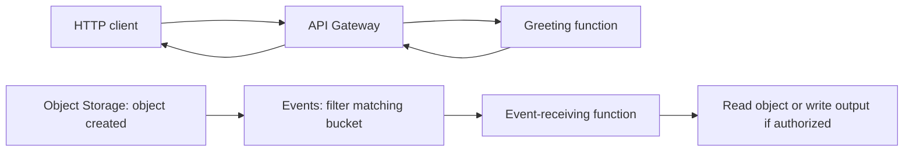
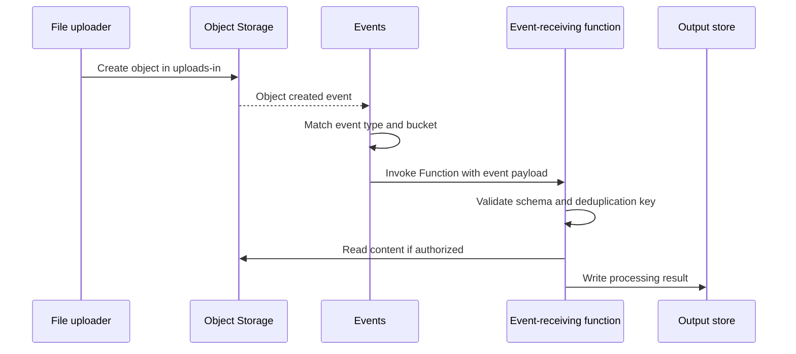

# Invoking Functions via API Gateway and OCI Services

A Function becomes a working component of a system only when something invokes it, passes well-defined input data, and verifies the result. In Oracle Cloud Infrastructure, API Gateway can provide an HTTP entry point for Functions; Events, Notifications, and Connector Hub can trigger Functions from platform state changes or data streams.

This lesson belongs to the **Containers and Functions** chapter of the **CLOUD_PROVIDERS_ORACLE** module. It connects Function invocation with compartments, IAM, VCN, monitoring, and automation, while examining cost, recoverability, and availability across the processing flow.

The objective is to build an API invoking a Function, set up an event-driven trigger from an OCI service, and explain the permissions, network paths, and execution evidence at each hop.

## 1. Distinguish Invocation Patterns Before Configuring

Three interaction patterns commonly appear in the same application:

| Interaction Pattern | Example | What Must Be Designed |
| --- | --- | --- |
| Client invokes Function via API | Web app calls a greeting API | HTTP routes, client auth, Gateway permission to invoke Function |
| OCI service triggers Function | Object Storage emits event, Events invokes Function | Filter conditions, event schema, permissions, and duplicate handling |
| Function calls OCI service | Function reads object or updates data | Resource principal, policies to target resources, network connectivity |

OCI supports integrating Functions with API Gateway, Events, Notifications, Connector Hub, and Oracle Integration. With Connector Hub, a Function can act as a data-processing task or a destination target. [Source: Invoking OCI Functions from Other Oracle Cloud Infrastructure Services](https://docs.oracle.com/en-us/iaas/Content/Functions/Tasks/functionsintegratingwithother.htm).

The first two patterns are the core focus of this lesson. The last pattern must be kept distinct because granting a service permission to invoke a Function does not automatically grant the Function permission to read buckets, streams, or databases.

### 1.1. Two Illustrative Flows



The HTTP flow fits when the client needs an answer within a short latency budget. The event-driven flow fits when work starts from an infrastructure change and does not need to hold open a user connection.

Do not force the same input schema across all callers. A plain-text person name, an event envelope, and a log batch represent three distinct contracts.

## 2. Preparing Resources and Identifiers

The lab uses two illustrative compartments:

- **ApiEdge**: holds the API Gateway and API deployment.
- **AppFunctions**: holds the application and Function.

The Object Storage integration section adds a **DataProcessing** compartment and a dedicated **uploads-in** bucket. You can reuse a single compartment in a learning environment, while still clearly identifying which resource is the caller and which is the callee.

| Value | How It Is Used |
| --- | --- |
| Region | Use a single consistent region for the lab |
| API Gateway OCID | Select the gateway when creating the deployment |
| Gateway compartment OCID | Scope the Gateway principal in IAM policies |
| Function OCID | Configure the native Functions backend |
| Application containing Function | Manage app configuration and logging |
| Function invoke endpoint | Used by OCI SDK or directly signed requests |
| API deployment endpoint | The HTTPS URL clients actually call |

Prepare an authenticated OCI CLI, appropriate admin permissions, and an already-deployed Function. Shell examples in this lesson use **Bash** on Linux or WSL. Replace all `REPLACE_WITH_...` placeholders with real values before running.

For image-based Functions, verify the image still exists and the runtime can pull it from the registry. This lesson uses this Function type to illustrate Java with Fn FDK; native backend wiring relies on the Function OCID.

## 3. Creating a Java Function with a Simple Contract

To simplify testing the invocation path, the initial Function accepts **plain text** and returns a greeting. Do not add database connections or write operations in this first verification step.

Once the `invocation-lab` application and OCI Fn context are ready, initialize the project:

```bash
fn init --runtime java hello-gateway
cd hello-gateway
```

In the sample project, use the `com.example.fn.HelloFunction` class:

```java
package com.example.fn;

public class HelloFunction {
    public String handleRequest(String payload) {
        String person = payload == null ? "" : payload.trim();
        if (person.isEmpty()) {
            person = "friend";
        }

        System.out.println(
            "operation=greet inputCharacters=" + person.length()
        );

        return "Hello, " + person + "!";
    }
}
```

The project's entry point must point to that method:

```yaml
cmd: com.example.fn.HelloFunction::handleRequest
```

This field belongs in the Function project configuration, not the API deployment. The Java FDK supports input/output binding and handler signatures taking `String` as shown here. [Source: Fn FDK for Java — guide and examples](https://github.com/fnproject/docs/blob/master/fdks/fdk-java/README.md).

Deploy using your configured Fn workflow:

```bash
fn -v deploy --app invocation-lab
```

Record the Function OCID after deployment. In production systems, deployment must live inside your team's pipeline and version management workflow.

### 3.1. Invoking Directly to Validate the Platform

```bash
OCI_REGION="ap-singapore-1"
FUNCTION_OCID="REPLACE_WITH_FUNCTION_OCID"

oci --region "$OCI_REGION" fn function invoke \
  --function-id "$FUNCTION_OCID" \
  --body 'Lan' \
  --file - \
  --fn-invoke-type sync
```

Expected response body:

```text
Hello, Lan!
```

`--file -` directs the CLI to print the response to stdout; `--body` is the input sent to the Function. The CLI locates and signs requests to the invoke endpoint using OCI mechanisms. [Source: OCI CLI — fn function invoke](https://docs.oracle.com/en-us/iaas/tools/oci-cli/latest/oci_cli_docs/cmdref/fn/function/invoke.html).

Save this output as your baseline: if direct invocation fails, resolve the Function, identity, or runtime environment before adding Gateway to the path.

A Functions invoke endpoint is not by default a public API callable via unauthenticated `curl`. Calling it directly over the OCI API requires request signature authentication; the CLI and SDK handle that signing. [Source: Invoking Functions](https://docs.oracle.com/en-us/iaas/Content/Functions/Tasks/functionsinvokingfunctions.htm).

## 4. Granting the Right Permissions to Each Entity

### 4.1. Permissions for API Configurers

An API deployment team can be granted policies matching this pattern:

```text
Allow group ApiDeployers to manage api-gateway-family in compartment ApiEdge
Allow group ApiDeployers to use functions-family in compartment AppFunctions
```

The example uses groups in the default identity domain. For other domains, use the corresponding domain-qualified group identifier per your tenancy setup. Creating networks or modifying IAM requires separate admin permissions according to assigned responsibilities.

Policies for deployment creators let them select and configure backends. **The Gateway identity at request time** still requires permission to invoke the Function.

### 4.2. Permissions for API Gateway to Invoke Functions

The official policy pattern scoped to Gateways in a compartment:

```text
Allow any-user to use functions-family in compartment AppFunctions where all {
  request.principal.type = 'ApiGateway',
  request.resource.compartment.id = 'REPLACE_WITH_API_GATEWAY_COMPARTMENT_OCID'
}
```

Where:

- `AppFunctions` is the compartment containing the target Function.
- The OCID in the condition is the compartment containing the **Gateway**.
- `request.principal.type = 'ApiGateway'` restricts the caller principal type.

This is Oracle's documented pattern for Gateway access to Functions. If resources reside in different compartments, place the policy at a scope capable of granting permissions across them, such as a shared parent compartment. [Source: Create Policies to Control Access to Network and API Gateway-Related Resources](https://docs.oracle.com/en-us/iaas/Content/APIGateway/Tasks/apigatewaycreatingpolicies.htm).

`any-user` combined with the conditions above does not allow anyone on the internet to invoke the Function directly. Whether a client may call the API is enforced by the authentication/authorization layer on the API deployment.

However, this pattern permits any Gateway satisfying the compartment condition, not just a single Gateway. When a compartment is shared across multiple application teams, re-evaluate the permission scope.

### 4.3. Mapping Permissions Hop by Hop

| Hop | Entity to Evaluate | Permission Scope |
| --- | --- | --- |
| Create or update deployment | Deployer user or pipeline | Configured API Gateway and Function |
| Client calls route | Identity authenticated by API | Route, scope, or business permission |
| Gateway invokes Function | API Gateway principal | Target Function compartment |
| Function reads object | Function resource principal | Permitted bucket/object |
| Connector invokes Function | Connector principal | Function used as task or target |

An administrator account may succeed with direct invocation while the Gateway is still denied. Therefore, testing with a personal account does not replace verifying permissions for every service in the chain.

## 5. Checking Networking Separately from IAM

IAM decides **what is allowed**. Route tables, network gateways, NSGs, and security lists decide **what can reach where**.

For the HTTP flow, verify three segments:

1. **Client to API Gateway**: DNS, TLS, public/private endpoint, HTTPS ingress, and client connectivity.
2. **Gateway to Functions**: invocation path to the Functions service under the chosen network model.
3. **Function to dependencies**: registry, OCI services, databases, or external systems required by code.

Oracle requires that the Functions backend be routable from the API Gateway's VCN, with an internet gateway or service gateway depending on the public/private model. [Source: Adding a Function in OCI Functions as an API Gateway Back End](https://docs.oracle.com/en-us/iaas/Content/APIGateway/Tasks/apigatewayusingfunctionsbackend.htm).

| Model | What to Verify |
| --- | --- |
| Public Gateway serving internet clients | Public endpoint, internet route, TCP 443 ingress from intended sources |
| Private Gateway | Clients have private connectivity to the endpoint and proper OCI service access path |
| Function in private subnet | Outbound path to OCI services and dependencies is explicitly configured |
| Function calling private database | DNS, routes, and database port rules across subnets/NSGs |

Choose ingress sources aligned with your lab environment or authorized user networks. Having a public Gateway does not require opening an additional web port inside the Function container like deploying an app on Compute.

If an image-based Function fails to initialize because it cannot pull its image, check both the image and the outbound path to the registry. `FunctionInvokeImageNotAvailable` is one indicator documented by Oracle for this condition. [Source: Issues invoking functions](https://docs.oracle.com/en-us/iaas/Content/Functions/Tasks/functionstroubleshooting_topic-Issues-invoking-functions.htm).

## 6. Creating an API Deployment with a Native Functions Backend

### 6.1. Route Specification

Save the following specification as `api-deployment.json` in your lab environment, replacing the Function OCID:

```json
{
  "routes": [
    {
      "path": "/hello",
      "methods": ["POST"],
      "backend": {
        "type": "ORACLE_FUNCTIONS_BACKEND",
        "functionId": "REPLACE_WITH_FUNCTION_OCID"
      }
    }
  ]
}
```

`ORACLE_FUNCTIONS_BACKEND` is API Gateway's native backend type. The `functionId` attribute takes the Function OCID, not an image name, application OCID, or custom HTTP URL. This structure is documented in Oracle's API deployment specification reference. [Source: Creating an API Deployment Specification](https://docs.oracle.com/en-us/iaas/Content/APIGateway/Tasks/apigatewaycreatingspecification.htm).

This minimal spec does not yet include client authentication policies. Use it only to verify the greeting in a controlled learning environment; APIs handling data or business actions require the protection controls covered later.

The route path is `/hello`. The deployment path prefix will be set separately to `/training`, making the final request path `/training/hello`.

### 6.2. Creating the Deployment

In the Console:

1. Open the Gateway in the right region and compartment.
2. Create a deployment with a recognizable name, such as `hello-api-v1`.
3. Set the path prefix to `/training`.
4. Upload the specification or define the route via the UI.
5. Verify method `POST`, backend type **Oracle Functions**, and the target Function.
6. Create the deployment and wait for its lifecycle state to become active.

If using the CLI:

```bash
API_COMPARTMENT_OCID="REPLACE_WITH_API_COMPARTMENT_OCID"
GATEWAY_OCID="REPLACE_WITH_API_GATEWAY_OCID"

oci --region "$OCI_REGION" api-gateway deployment create \
  --compartment-id "$API_COMPARTMENT_OCID" \
  --gateway-id "$GATEWAY_OCID" \
  --display-name "hello-api-v1" \
  --path-prefix "/training" \
  --specification file://api-deployment.json
```

The route specification and deployment settings combine to determine the final endpoint. Once deployed, retrieve the endpoint from the deployment page or corresponding management output. [Source: Deploying an API on an API Gateway by Creating an API Deployment](https://docs.oracle.com/en-us/iaas/Content/APIGateway/Tasks/apigatewaycreatingdeployment.htm).

### 6.3. Calling the API

Set `DEPLOYMENT_ENDPOINT` to the actual deployment endpoint, **already including** the `/training` path prefix and with no trailing `/`:

```bash
DEPLOYMENT_ENDPOINT="https://REPLACE_WITH_GATEWAY_HOST/training"

curl --silent --show-error --include \
  --request POST \
  --header 'Content-Type: text/plain; charset=utf-8' \
  --data-binary 'Lan' \
  "$DEPLOYMENT_ENDPOINT/hello"
```

Expect a successful response with body:

```text
Hello, Lan!
```

Do not append `/training` a second time if the endpoint already includes the prefix. Do not disable TLS certificate validation just to make a test call appear to succeed.

Test an empty body as well to verify the handler's default branch. For other methods or paths, inspect responses at the Gateway layer and confirm which route actually matched.

### 6.4. Do Not Mix Body Content with HTTP Metadata

The current handler reads plain text from the body. A query parameter `?name=Lan` does not automatically become the `Lan` body string passed to this Java method.

When you need to read HTTP method, path, headers, or query parameters, select the API context or event type supported by the FDK and write a matching adapter. The Java FDK includes the `fn-events` module and integration examples for API Gateway, Notifications, and Connector Hub. [Source: Fn FDK Java — OCI integration utilities](https://github.com/fnproject/fdk-java/blob/master/fn-events/README.md).

A JSON object with custom `statusCode` and `body` fields may simply be treated as business data. To control HTTP status codes or response headers, use the FDK's HTTP response mechanism and matching backend contract. For example, the Java FDK `HTTPGatewayContext` interface provides `setStatusCode` and `setResponseHeader`. [Source: Java FDK HTTPGatewayContext](https://github.com/fnproject/fdk-java/blob/master/api/src/main/java/com/fnproject/fn/api/httpgateway/HTTPGatewayContext.java).

## 7. Protecting the API Before Business Use

### 7.1. Client Authentication and Route Authorization

API Gateway supports built-in JWT verification or invoking an authorizer Function to validate tokens. Identity verification and access decisions are configured on the API deployment. [Source: Adding Authentication and Authorization to API Deployments](https://docs.oracle.com/en-us/iaas/Content/APIGateway/Tasks/apigatewayaddingauthzauthn.htm).

With the JWT approach, clearly define:

- Trusted identity provider and issuer.
- API audience.
- Public key source or appropriate JWKS endpoint.
- Header and token scheme sent by clients.
- Permissions or scopes required by each route.

Distinguish a **valid** token from a token **authorized to perform the business action**. A validly logged-in user still may not have permission to read another user's orders.

Once the route is protected, an example call looks like:

```bash
curl --silent --show-error --include \
  --request POST \
  --header "Authorization: Bearer $ACCESS_TOKEN" \
  --header 'Content-Type: text/plain; charset=utf-8' \
  --data-binary 'Lan' \
  "$DEPLOYMENT_ENDPOINT/hello"
```

`ACCESS_TOKEN` is a token issued under the configured API authentication mechanism, not an OCIR auth token used for Docker login.

### 7.2. Authorizer and Business Function Are Two Separate Roles

The authorizer decides whether the request may proceed and returns authorization context per its contract. The business Function executes the greeting, order processing, or data operation.

If using an authorizer, separately manage authentication errors, execution latency, and Gateway permission to invoke the authorizer. Do not treat a business Function returning an "unauthorized" string as proof that Gateway enforced a blocking policy.

### 7.3. Required Verification Cases

| Scenario | Expected Evidence |
| --- | --- |
| Missing token on an authenticated route | Request is rejected before business logic runs |
| Invalid or expired token | Appropriate authentication error returned |
| Valid token lacking permission | Route/business logic rejects per design |
| Valid token with sufficient permission | Function runs and returns expected result |
| Oversized request or wrong media type | Controlled error response returned |
| Sudden traffic spike | Rate limiting and processing capacity behave as intended |

CORS governs browser cross-origin access; it does not replace authentication, IAM, or business authorization.

## 8. Triggering Functions from Object Storage via Events

### 8.1. Event Flow Contract

Scenario: when a new object arrives in `uploads-in`, the system receives metadata and begins processing. The flow is:



An event describes a resource change; it does not by default contain the entire file contents. If the job needs file data, the Function must read Object Storage using the identifier in the event and its own permissions.

### 8.2. Enabling Object Event Emission

On your lab bucket, enable **Emit object events**. You can use the Console or:

```bash
OBJECT_NAMESPACE="REPLACE_WITH_OBJECT_STORAGE_NAMESPACE"

oci --region "$OCI_REGION" os bucket update \
  --namespace-name "$OBJECT_NAMESPACE" \
  --name "uploads-in" \
  --object-events-enabled true
```

This bucket setting enables emitting events when object state changes. Creating an Events rule alone is not enough if the source bucket is not emitting the desired event type. [Source: Managing Emitting Events for Object State Changes in an Object Storage Bucket](https://docs.oracle.com/en-us/iaas/Content/Object/Tasks/managingbuckets_topic-To_enable_or_disable_emitting_events_for_object_state_changes.htm).

### 8.3. Creating a Narrowly Scoped Rule

In Events:

1. Select the compartment matching the source resource.
2. Create a rule named `uploads-in-object-created`.
3. Select the **Object Storage** service and the object-created event type.
4. Add a condition restricting the bucket to `uploads-in`.
5. Use the rule logic preview and validate against a sample event.
6. Choose the **Functions** action, then pick the compartment, application, and target Function.
7. Create the rule and confirm both the rule and action are enabled.

Events supports filtering by event type, attributes, and tags; the Functions action selects an existing application and Function. [Source: Creating an Events Rule](https://docs.oracle.com/en-us/iaas/Content/Events/Task/create-events-rule.htm).

The person configuring the rule needs permissions to manage rules and use the selected action resource. Verify Events permissions against your actual tenancy/compartment scope; do not copy a policy with the `ApiGateway` principal for a different trigger source.

Avoid capturing every event across the entire tenancy when you only need new objects in a single bucket. For jobs that write outputs, use a dedicated destination bucket or sufficiently strict filters so outputs do not re-trigger the same processing pipeline.

### 8.4. Receiving and Inspecting the Event Payload

Sample excerpt of a payload:

```json
{
  "eventType": "com.oraclecloud.objectstorage.createobject",
  "eventID": "example-event-001",
  "data": {
    "resourceName": "incoming/orders-001.csv",
    "additionalDetails": {
      "namespace": "example_namespace",
      "bucketName": "uploads-in"
    }
  }
}
```

This example is abbreviated. Cross-check real events and schema versions before writing a parser. The OCI Events envelope includes fields identifying event type, timestamp, and resource data. [Source: Contents of an Event Message](https://docs.oracle.com/en-us/iaas/Content/Events/Reference/eventenvelopereference.htm).

In a dedicated event-receiving Function project, you can start with a minimal Java probe:

```java
package com.example.fn;

public class HelloFunction {
    public String handleRequest(String eventPayload) {
        int length = eventPayload == null ? 0 : eventPayload.length();
        System.out.println(
            "operation=event-probe payloadCharacters=" + length
        );
        return "received";
    }
}
```

The probe confirms only that an execution received input data. For real business logic, add a parser, validate event type, bucket, object, and deduplication key, and persist processing status in a durable store.

Once the rule is active, upload a new object with a unique name. Check Function logs and output results rather than relying solely on the upload succeeding.

## 9. Granting Functions Permission to Read Related Resources

To read files in the flow above, create a dynamic group containing only the required processing Function. A matching rule can be:

```text
resource.id = 'REPLACE_WITH_EVENT_FUNCTION_OCID'
```

Grant object read access on the source bucket:

```text
Allow dynamic-group ObjectEventWorkers to read objects in compartment DataProcessing where target.bucket.name = 'uploads-in'
```

`ObjectEventWorkers` is the name of the created dynamic group. If using a non-default identity domain, qualify the dynamic group name per your IAM configuration.

Resource principals combine a dynamic group and policies to let the Function authenticate to OCI services. Oracle supports matching rules by single Function OCID or by all Functions in a compartment. [Source: Accessing Other Oracle Cloud Infrastructure Resources from Running Functions](https://docs.oracle.com/en-us/iaas/Content/Functions/Tasks/functionsaccessingociresources.htm).

In Java, creating the authentication provider looks like:

```java
import com.oracle.bmc.auth.ResourcePrincipalAuthenticationDetailsProvider;

ResourcePrincipalAuthenticationDetailsProvider provider =
    ResourcePrincipalAuthenticationDetailsProvider.builder().build();
```

Pass this provider to the appropriate OCI SDK client in a project containing the matching SDK dependencies. The provider retrieves credentials from the runtime's resource principal environment. [Source: OCI Java SDK — ResourcePrincipalAuthenticationDetailsProvider](https://docs.oracle.com/en-us/iaas/tools/java/latest/com/oracle/bmc/auth/ResourcePrincipalAuthenticationDetailsProvider.html).

Never bundle a personal private key into the image to obtain these permissions. If the Function also needs to write outputs, grant the exact write permissions for the chosen destination resource.

Also validate the caller's business authorization. Even if a Function has permission to read an entire bucket, code must not allow an arbitrary request to pick any sensitive object solely because the SDK can read it.

## 10. Invoking Functions via Notifications

### 10.1. Topic and Subscription Model

The typical flow is:

```text
Alarm or publisher
    -> Notifications topic
    -> Function subscription
    -> Function receives message
```

In the Console, open the topic, create a subscription with the **Function** protocol, and select the application and Function. The user adding the subscription needs permission to invoke the Function. Function subscriptions do not require a confirmation step like email subscriptions. [Source: Creating a Function Subscription](https://docs.oracle.com/en-us/iaas/Content/Notification/Tasks/create-subscription-function.htm).

CLI example:

```bash
TOPIC_OCID="REPLACE_WITH_TOPIC_OCID"
TOPIC_COMPARTMENT_OCID="REPLACE_WITH_TOPIC_COMPARTMENT_OCID"
EVENT_FUNCTION_OCID="REPLACE_WITH_EVENT_FUNCTION_OCID"

oci --region "$OCI_REGION" ons subscription create \
  --topic-id "$TOPIC_OCID" \
  --compartment-id "$TOPIC_COMPARTMENT_OCID" \
  --protocol ORACLE_FUNCTIONS \
  --subscription-endpoint "$EVENT_FUNCTION_OCID"
```

Once the subscription is active, publish a test message:

```bash
oci --region "$OCI_REGION" ons message publish \
  --topic-id "$TOPIC_OCID" \
  --title "Function integration lab" \
  --body '{"operation":"probe","requestId":"ons-probe-001"}'
```

Publishing being accepted is evidence only of the publish hop. Confirm that the Function processed the message via logs and your own business state.

### 10.2. Contracts and Errors After Delivery

Messages delivered by Notifications must be parsed according to that integration's schema. Having a business JSON body does not mean the full received payload shares the same structure as OCI Events.

Oracle notes that Notifications has no visibility into the Function after it is invoked. Therefore, for tasks such as modifying configuration or writing data, monitor execution errors in Functions and persist processing outcomes in your application's systems. [Source: Creating a Function Subscription](https://docs.oracle.com/en-us/iaas/Content/Notification/Tasks/create-subscription-function.htm).

Clearly separate "sent", "received", and "completed" states. If business retries are required after an error inside the Function, design tracking and recovery flows rather than assuming every failure is automatically retried by the caller.

## 11. Invoking Functions from Connector Hub

Connector Hub moves data between OCI services. A Function can serve as:

| Role | Example | Meaning of Function Output |
| --- | --- | --- |
| **Task** | Normalize a log batch before writing to Object Storage | Processing result is passed back to the connector to continue |
| **Target** | Receive batches from Logging to perform final processing | Function executes and records required results itself |

Connector Hub batches by size and time; it uses an at-least-once delivery model. [Source: Overview of Connector Hub](https://docs.oracle.com/en-us/iaas/Content/connector-hub/overview.htm).

### 11.1. Configuration Steps

Example using log data as the source:

1. Select the Logging source and the log/log group to monitor.
2. Choose Functions as the target, or add a Functions task before another supported target.
3. Select the application and Function built for the source's contract.
4. Set batch size and batch time to fit latency, memory, and processing duration.
5. Review Console-suggested policies as well as permissions on source and target.
6. Activate the connector, generate new data, and verify the actual data flow.

Do not directly reuse a handler built for plain-text person names. The Function must understand the source's batch format, and when acting as a task it must return output matching the contract so the connector can continue.

### 11.2. Connector Permissions to Invoke Functions

Oracle's default policy pattern for a Function task or target includes:

```text
Allow any-user to use fn-function in compartment id REPLACE_WITH_FUNCTION_COMPARTMENT_OCID where all {
  request.principal.type = 'serviceconnector',
  request.principal.compartment.id = 'REPLACE_WITH_CONNECTOR_COMPARTMENT_OCID'
}

Allow any-user to use fn-invocation in compartment id REPLACE_WITH_FUNCTION_COMPARTMENT_OCID where all {
  request.principal.type = 'serviceconnector',
  request.principal.compartment.id = 'REPLACE_WITH_CONNECTOR_COMPARTMENT_OCID'
}
```

Check both compartments carefully: the compartment containing the target Function and the compartment containing the connector. This pattern applies to the connector principal and differs from API Gateway's conditions. [Source: Connector Hub — Default Policies](https://docs.oracle.com/en-us/iaas/Content/connector-hub/overview.htm).

In operations, larger batch sizes can reduce invocation count but increase memory consumption, execution duration, and the volume of data reprocessed on failure. Choose batch sizes from workload measurements rather than solely to minimize invocation count.

## 12. Designing Timeouts, Asynchrony, and Duplicate Handling

### 12.1. Timeouts Apply Across the Entire Chain

For synchronous APIs, client-observed latency consists of:

```text
DNS/TLS + Gateway processing + runtime init if needed
+ Function code + dependencies + response return
```

Timeout configurations must be reviewed across the client, Gateway, Function, and outbound calls. Increasing a Function's execution limit does not automatically raise timeouts at every other layer.

An illustrative team-defined latency budget might be: API must respond within 10 seconds, primary processing takes at most 6 seconds, leaving the remainder for connectivity, startup, and response delivery. This is a design target, not an OCI default limit.

Measure both calls after the runtime has been idle and consecutive calls. OCI Functions may prepare a fresh execution environment on the first call and reuse it on subsequent calls. [Source: OCI Functions Concepts](https://docs.oracle.com/en-us/iaas/Content/Functions/Concepts/functionsconcepts.htm).

### 12.2. Sync and Detached

Functions supports **Sync**, which returns results upon completion, and **Detached**, which returns control once execution starts. With Detached, the executing side must manage result tracking; Functions also supports configuring success/failure destinations for this invocation type. [Source: Invoking Functions](https://docs.oracle.com/en-us/iaas/Content/Functions/Tasks/functionsinvokingfunctions.htm).

Example direct call in Detached mode:

```bash
oci --region "$OCI_REGION" fn function invoke \
  --function-id "$EVENT_FUNCTION_OCID" \
  --body '{"operation":"probe","requestId":"detached-probe-001"}' \
  --file - \
  --fn-invoke-type detached
```

This option applies to the Functions API call. It does not automatically alter the contract of a previously created API Gateway route.

For long-running tasks triggered by HTTP clients, a traceable pattern is to accept the request, durably enqueue it in a queue or job store, return a job ID, and let a worker process it. Return an accepted status only after the enqueue operation is confirmed by design.

### 12.3. Handling Duplicate Messages

A request can be resent by a client that timed out waiting for a response, or a batch can be redelivered by a connector. Handlers producing side effects must tolerate repeated execution.

Recommended flow:

```text
1. Determine idempotency key from source.
2. Validate schema and business permissions.
3. Claim processing rights for the key via conditional write / unique constraint.
4. Perform required state changes.
5. Record completion state and result.
6. If an already-completed key arrives again, return or reuse the saved result.
```

| Source | Key to Consider |
| --- | --- |
| Client API | Client-supplied idempotency key bound to caller and operation payload |
| OCI Events | Event ID per delivery; add business identifier when needed |
| Object processing | Namespace, bucket, object, and relevant version if any |
| Connector batch | Per-record identifier from source, not just the batch ID |

Do not rely on an in-memory `alreadyProcessed` variable inside the Function. Runtimes can be recreated or multiple execution environments can run concurrently.

If a Function fails after producing a side effect but before marking completion, a retry can re-execute the operation. Use transactions, conditional writes, or idempotent target APIs to close that gap.

## 13. End-to-End Observability and Troubleshooting

### 13.1. Recording Evidence at Each Hop

Record the metadata required to correlate steps:

- UTC timestamp and environment.
- Deployment/route or event source.
- Application-managed request ID or source event ID.
- Function and deployed version.
- Received, started, completed, or failed status.
- Processing duration and dependency error codes when applicable.

Enable required API Gateway and Functions logs. Function logs should record selective diagnostic details; never log bearer tokens, credentials, or entire file contents just to debug a connectivity error.

OCI Functions uses Logging as the default and recommended option for accessing, searching, and retaining Function logs. [Source: Troubleshooting OCI Functions](https://docs.oracle.com/en-us/iaas/Content/Functions/Tasks/functionstroubleshooting.htm).

With Gateway, separate client request counts and client-side errors from backend invocation failures. A 2xx response confirms only that the HTTP contract completed; asynchronous jobs still require downstream status tracking.

### 13.2. Use Error Codes Alongside Logs, Not Just HTTP Status

API Gateway provides dedicated execution log codes for native Function backends, such as `functionBackend.notFoundOrNotAuthorized`, `functionBackend.timeout`, and `functionBackend.badResponse`. [Source: Details for API Gateway logging](https://docs.oracle.com/en-us/iaas/Content/Logging/Reference/details_for_api_gateway.htm).

| Symptom | Useful Checks |
| --- | --- |
| Direct invoke works, Gateway call fails | Function OCID in deployment, Gateway principal policy, network path |
| Route does not match | Path prefix, route path, method, and active deployment |
| Client rejected before Function runs | Authentication/authorization policies and token |
| `notFoundOrNotAuthorized` | Whether Function exists, right compartment/region, Gateway permissions |
| Timeout | Timeouts at each tier, cold start, and dependencies |
| Function runs but body is unexpected | Plain text vs. JSON, FDK adapter, and source schema |
| Event never reaches Function | Emit object events, rule scope, filters, action, and permissions |
| Topic publish succeeds but output missing | Subscription, invocation attempt, and internal Function logs |
| Connector slow or stalled | Batching, task/target errors, permissions, and source retention |
| Duplicate execution creates two records | Idempotency key, conditional writes, and transactions |

When receiving 5xx through Gateway, determine whether the error originated at Gateway or the backend before changing configuration. Gateway can forward backend errors or generate errors when the backend hop fails to complete. [Source: Unexpected response codes are returned through API Gateway](https://docs.oracle.com/en-us/iaas/Content/APIGateway/Tasks/apigatewaytroubleshooting_topic-unexpected_response_codes_returned.htm).

Do not blindly apply HTTP URL backend timeout options to native Functions backends. Verify configuration options for the exact backend type in use.

## 14. Controlling Cost and Maintaining Availability

Function traffic depends directly on trigger sources. An overly broad filter, an event feedback loop, or aggressive client retries can drive up invocations and log volume.

Build the following decisions into your design:

| Decision | Impact to Evaluate |
| --- | --- |
| Filter Events by exact bucket and event type | Eliminates non-business invocations |
| Separate input and output data paths | Prevents trigger feedback loops |
| Choose appropriate connector batching | Balances invocation count, latency, and reprocessing cost |
| Right-size Function memory via measurement | Balances runtime speed, memory footprint, and cost |
| Enforce API rate limits | Protects dependencies and budget |
| Set sensible log retention | Keeps sufficient operational evidence while controlling storage |
| Deploy configuration via pipelines | Makes routes, policies, and Functions reproducible and reversible |

Test cold initialization, image pull permissions, and dependency reachability after changes. A warm, steady environment does not prove that newly spun-up runtimes can initialize cleanly.

If cross-region recovery is required, prepare the Function, matching image or artifact, networking, IAM, deployment, and triggers in the standby region. Drill with a fresh request or event to validate the actual path.

After finishing the lab, clean up lab-only deployments, Gateways, or triggers scoped to the resources you created. Disabling triggers before deleting the Function prevents repeated failed invocations against retired resources.

## 15. Lab Completion Evidence

A completion record should verify:

| Item | Evidence |
| --- | --- |
| Function works | Direct invocation via OCI CLI returns expected body |
| API reaches backend | `POST /training/hello` returns the expected greeting |
| Gateway properly authorized | Policy covers Function compartment and matches Gateway compartment condition |
| Client properly protected | Valid, invalid, and under-privileged token cases tested |
| Events works | New object in target bucket triggers event-receiving execution |
| Filter sufficiently narrow | Out-of-scope objects do not trigger business processing |
| Function accesses resources with least privilege | Reads/writes only intended targets via resource principal |
| Notifications or Connector Hub | Evidence of publish/source, invocation, and completion |
| Fault tolerance planned | Failure states, retries, and duplicate handling defined |
| Operable | Latency, errors, traffic, and cost tracked per invocation source |

The essential outcome is being able to trace a request or event from source to final output, while explaining which entity is authorized for each hop and how to recover if any stage fails.
