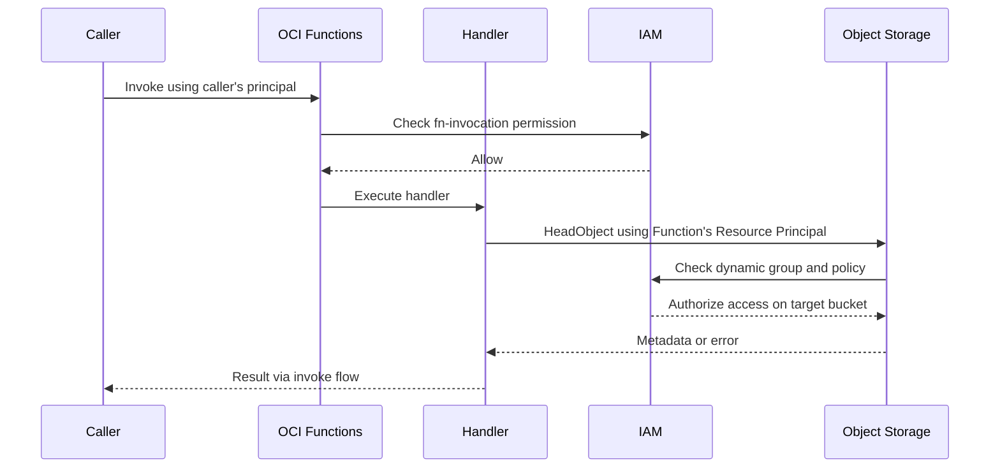

# Resource Principals, Timeouts, and Function Resource Limits

## 1. Objectives and Context

In the **Containers and Functions** chapter of the **CLOUD_PROVIDERS_ORACLE** module, a Function operates properly only when three decisions align: which resources it is permitted to access, how long it is allowed to run, and how many resources it can consume.

For example, a Function reading reports from Object Storage might be invoked successfully yet still fail to read the object due to a missing IAM policy. Another Function might have the right permissions yet get terminated while waiting on a database. Increasing timeouts will not fix access permissions; increasing memory will not automatically extend the client's wait timeout.

This lesson connects OCI Functions with tenancy, compartments, IAM, VCN, storage, and OCI monitoring. You will practice designing access via Resource Principals, setting time budgets, sizing memory, and recognizing concurrency limits.

After studying this lesson, you will be able to:

- Separate permission to invoke a Function from permission for the Function to call OCI services.
- Create dynamic groups and policies with appropriate scopes.
- Use a Resource Principal in the OCI SDK for Java.
- Distinguish Sync, Detached, client, and downstream call timeouts.
- Size memory, ephemeral storage, payloads, and concurrency needs.
- Inspect effective configuration, logs, and metrics to diagnose root causes.

The primary example is an **image-based Java Function** that reads object size from a specific bucket. The timeout and limit management sections apply to other Function types as well; update commands must match the Function type and tool version in use.

## 2. Two Independent Permission Flows

### 2.1. Who Invokes the Function?

The user, pipeline, or service invoking a Function requires invoke permission. The caller's principal may be a user principal, instance principal, or service identity matching the integration.

Example policy for a group allowed to invoke only one Function:

```text
Allow group FunctionCallers to use fn-invocation in compartment FunctionsWorkloads where target.function.id = '<FUNCTION_OCID>'
```

This policy uses a group name in the default identity domain; for another domain, adjust the group identifier per your tenancy's IAM configuration. The `use fn-invocation` permission grants execution rights, not permission to update the Function's source code or configuration. [Oracle: Controlling Access to Invoke and Manage Functions](https://docs.oracle.com/en-us/iaas/Content/Functions/Tasks/functionsrestrictinguseraccess.htm).

### 2.2. Which Identity Does the Function Use to Call Other Services?

While running on OCI, a Function can use its own **Resource Principal** to call Object Storage or other OCI services. The runtime supplies short-lived credential material; the SDK uses it to sign requests.

A Function's permissions are determined by dynamic groups and IAM policies applied to the Function resource. These permissions are not inherited from whichever caller invoked it. Oracle recommends using the resource principal provider in the SDK. [Oracle: Accessing OCI Resources from Functions](https://docs.oracle.com/en-us/iaas/Content/Functions/Tasks/functionsaccessingociresources.htm).



Two scenarios to distinguish:

| Scenario | Likely Outcome |
| --- | --- |
| Caller can invoke, but Function lacks bucket permissions | Handler runs, Object Storage call fails |
| Function has bucket permissions, but caller lacks invoke permissions | Request is rejected before the handler executes work |

If a Function serves multiple users, the handler must also enforce business authorization on which reports each user may access. A Resource Principal represents the Function itself; it does not automatically enforce per-end-user object authorization.

## 3. Dynamic Groups and Policies for the Target Resources

### 3.1. Identifying Where the Function and Data Reside

Deployment example:

| Element | Illustrative Value |
| --- | --- |
| Function compartment | `FunctionsWorkloads` |
| Bucket compartment | `ReportsData` |
| Bucket | `reports-input` |
| Dynamic group | `fn-report-metadata` |
| Prepared object | `reports/daily.csv` |

Replace example names and OCIDs with your lab resources. The compartment containing the Function and the compartment containing the data may differ.

### 3.2. Include Only the Required Function in the Group

Matching rule for a single Function:

```text
ALL {resource.type = 'fnfunc', resource.id = '<FUNCTION_OCID>'}
```

An alternative is matching all Functions in a compartment via a compartment condition. That is convenient for workloads sharing the same trust level, but any newly created Function matching that condition inherits the group's permissions. For this lab, selecting a specific OCID keeps the scope explicit.

If you delete and recreate the Function, the new OCID must be updated in the rule. Reusing the same display name does not make the old OCID match the new Function.

### 3.3. Grant Only the Permissions Required by the API Call

Because the lab uses `HeadObject`, which only reads metadata, you can use:

```text
Allow dynamic-group fn-report-metadata to inspect objects in compartment ReportsData where target.bucket.name = 'reports-input'
```

If the handler needs to download content via `GetObject`, `read objects` covers reading objects. If creating or overwriting objects is needed, determine the additional permissions required by those operations.

The Object Storage permission table distinguishes `OBJECT_INSPECT` from `OBJECT_READ`; choose policies after identifying the exact APIs being called. [Oracle: Policies for Object Storage](https://docs.oracle.com/en-us/iaas/Content/Identity/policyreference/objectstoragepolicyreference.htm).

Place the policy in the target compartment or an ancestor with authority over the target resource. In the example, `in compartment ReportsData` refers to where the bucket resides, not where the Function resides.

A common pitfall is adding `GetNamespace`, `ListBuckets`, or other API calls to code while evaluating permissions only for `HeadObject`. The Java example below reads the namespace from configuration, avoiding runtime namespace discovery calls.

### 3.4. IAM Permissions and Network Connectivity Must Both Be Right

Resource Principals solve identity and authorization; the network path from the Function to the endpoint must still work.

For an application in a private subnet, verify routes to the target service, DNS, NSGs/security lists, and HTTPS port. Service Gateway is one option for reaching supported Oracle services over the Oracle Services Network; external Internet endpoints may require a NAT Gateway depending on network design. [Oracle: Service Gateway](https://docs.oracle.com/en/learn/service_gateway/index.html).

Symptoms typically differ:

- Authentication or authorization failures: check principal, policy, resource, and region.
- DNS resolution failure or inability to establish a connection: check the network path.
- Connected but waiting a long time for a response: check target service, read timeouts, and retries.

Correct permissions do not prove working networking. Likewise, a successful call using an admin account on a personal laptop does not prove a Function inside the application subnet can reach the same endpoint.

## 4. Resource Principals in a Java Function

### 4.1. Using the SDK Provider

Core provider instantiation:

```java
ResourcePrincipalAuthenticationDetailsProvider provider =
    ResourcePrincipalAuthenticationDetailsProvider.builder().build();
```

This provider reads credentials from the Resource Principal environment supplied by OCI. Using the provider keeps credential loading and refreshing inside the SDK's mechanism rather than copying tokens into application configuration. [OCI Java SDK: ResourcePrincipalAuthenticationDetailsProvider](https://docs.oracle.com/en-us/iaas/tools/java/latest/com/oracle/bmc/auth/ResourcePrincipalAuthenticationDetailsProvider.html).

Relevant runtime variables:

| Variable | Meaning |
| --- | --- |
| `OCI_RESOURCE_PRINCIPAL_VERSION` | Resource Principal protocol version |
| `OCI_RESOURCE_PRINCIPAL_RPST` | Location of the Function's session token in the Functions environment |
| `OCI_RESOURCE_PRINCIPAL_PRIVATE_PEM` | Location of the key used to sign requests |
| `OCI_RESOURCE_PRINCIPAL_REGION` | Region where the Function is running |
| `FN_FN_ID` | Function OCID |
| `FN_MEMORY` | Memory configured for the Function |

These runtime variables are documented by Oracle in [Environment Variables Populated by OCI Functions](https://docs.oracle.com/en-us/iaas/Content/Functions/Tasks/functionsenvironmentvariables.htm). Log only necessary identifying fields; never print the full environment, token contents, or private keys.

Oracle notes that tokens are cached for 15 minutes. After changing a policy or dynamic group, account for token caching and IAM propagation time during verification rather than assuming the very next call reflects the new permission immediately. [Oracle: Resource Principals in Functions](https://docs.oracle.com/en-us/iaas/Content/Functions/Tasks/functionsaccessingociresources.htm).

### 4.2. Preparing Dependencies and Configuration

In the initialized Java FDK project, add the `oci-java-sdk-objectstorage` module and an HTTP client supported by the SDK. Keep OCI SDK modules aligned on the same version using a BOM or equivalent dependency management.

Java SDK 3.x requires explicitly selecting an HTTP client, such as `oci-java-sdk-common-httpclient-jersey3` when compatible with the project's runtime/dependencies. Retain the FDK dependencies and packaging configuration required by the project. [Oracle: Using the OCI Java SDK and HTTP Clients](https://docs.oracle.com/en-us/iaas/Content/API/SDKDocs/javasdkgettingstarted.htm).

Function-specific configuration:

```text
OBJECT_NAMESPACE=<OBJECT_STORAGE_NAMESPACE>
REPORTS_BUCKET=reports-input
OBJECT_STORAGE_REGION=<BUCKET_REGION>
```

The namespace is not the tenancy OCID. The client region must be the region of the accessed Object Storage resource; do not assume every target resource always resides in the same region as the Function.

### 4.3. Illustrative Handler: Reading Metadata with Timeouts

The example below accepts JSON with an `objectName` field, accepts only the business prefix `reports/`, calls `HeadObject`, and returns the object size:

```java
package example;

import com.oracle.bmc.ClientConfiguration;
import com.oracle.bmc.Region;
import com.oracle.bmc.auth.ResourcePrincipalAuthenticationDetailsProvider;
import com.oracle.bmc.model.BmcException;
import com.oracle.bmc.objectstorage.ObjectStorageClient;
import com.oracle.bmc.objectstorage.requests.HeadObjectRequest;
import com.oracle.bmc.objectstorage.responses.HeadObjectResponse;
import com.oracle.bmc.retrier.RetryConfiguration;

public final class ObjectMetadataFunction {
    private final ObjectStorageClient objectStorage;
    private final String namespace;
    private final String bucket;

    public ObjectMetadataFunction() {
        namespace = requiredEnv("OBJECT_NAMESPACE");
        bucket = requiredEnv("REPORTS_BUCKET");

        ResourcePrincipalAuthenticationDetailsProvider provider =
            ResourcePrincipalAuthenticationDetailsProvider.builder().build();

        ClientConfiguration http = ClientConfiguration.builder()
            .connectionTimeoutMillis(2_000)
            .readTimeoutMillis(5_000)
            .build();

        objectStorage = ObjectStorageClient.builder()
            .region(Region.fromRegionId(requiredEnv("OBJECT_STORAGE_REGION")))
            .configuration(http)
            .build(provider);
    }

    public Long handleRequest(Input input) {
        String objectName = input == null ? null : input.getObjectName();
        if (objectName == null || !objectName.startsWith("reports/")) {
            throw new IllegalArgumentException(
                "objectName must belong to the reports/ prefix");
        }

        long started = System.nanoTime();
        try {
            HeadObjectResponse response = objectStorage.headObject(
                HeadObjectRequest.builder()
                    .namespaceName(namespace)
                    .bucketName(bucket)
                    .objectName(objectName)
                    .retryConfiguration(
                        RetryConfiguration.NO_RETRY_CONFIGURATION)
                    .build());

            long elapsedMs = (System.nanoTime() - started) / 1_000_000L;
            System.out.printf(
                "event=object_head_ok elapsedMs=%d opcRequestId=%s%n",
                elapsedMs, response.getOpcRequestId());
            return response.getContentLength();
        } catch (BmcException error) {
            System.err.printf(
                "event=object_head_failed status=%d code=%s%n",
                error.getStatusCode(), error.getServiceCode());
            throw error;
        }
    }

    private static String requiredEnv(String key) {
        String value = System.getenv(key);
        if (value == null || value.trim().isEmpty()) {
            throw new IllegalStateException("Missing configuration: " + key);
        }
        return value;
    }

    public static final class Input {
        private String objectName;

        public String getObjectName() {
            return objectName;
        }

        public void setObjectName(String objectName) {
            this.objectName = objectName;
        }
    }
}
```

Point the project's Java handler to `example.ObjectMetadataFunction::handleRequest`. Example input:

```json
{"objectName":"reports/daily.csv"}
```

`HeadObjectResponse.getContentLength()` returns the size in bytes without loading the entire object content onto the heap. [OCI Java SDK: HeadObjectResponse](https://docs.oracle.com/en-us/iaas/tools/java/latest/com/oracle/bmc/objectstorage/responses/HeadObjectResponse.html).

The example disables retries at the request level to keep the single-call lab budget explicit. That is not the right policy for every workload. The SDK supports retry configuration at multiple levels; in production, decide retry behavior based on deadlines and operation safety. [Oracle: Java SDK retries](https://docs.oracle.com/en-us/iaas/Content/API/SDKDocs/javasdkconcepts.htm).

The client instance is retained on the handler so it can be reused when the runtime reuses the handler. Manage lifecycle and close clients when the host environment shuts down; never store data from a previous request in shared handler fields.

Checking the prefix in code is an additional business rule. The example policy still grants `inspect` across objects in the designated bucket, so evaluate both IAM permissions and business rules if stricter scoping is needed.

## 5. Understanding Timeouts Layer by Layer

### 5.1. Sync and Detached Have Separate Limits

Currently published Oracle configuration values:

| Property | Purpose | Value |
| --- | --- | --- |
| `timeoutInSeconds` | Execution duration for Sync invocations | Default 30 seconds; maximum 300 seconds |
| `detachedModeTimeoutInSeconds` | Execution duration for Detached invocations | From 5 to 3,600 seconds |
| Detached timeout unset | Value used for Detached | Defaults to `timeoutInSeconds` |

This table describes Function configuration limits, not how long every client or gateway is willing to wait. [Oracle: Memory and Timeout Settings](https://docs.oracle.com/en-us/iaas/Content/Functions/Tasks/functionscustomizing.htm).

Support for Detached execution up to one hour was added by Oracle in 2025. Therefore, consult current documentation for the exact invocation type when evaluating long-running work. [Oracle: Longer-Running Detached Functions](https://docs.oracle.com/en-us/iaas/releasenotes/functions/functions-long-running-functions.htm).

**Sync** fits when the caller waits for the result within one request. **Detached** returns control to the caller once execution starts, while the outcome must be tracked or persisted via an appropriate mechanism. An accepted response is not proof that business work has finished.

### 5.2. There Are at Least Four Timeout Layers

| Layer | Example | Question to Answer |
| --- | --- | --- |
| Caller | HTTP client, OCI CLI, SDK invoking Functions | How long does the caller wait for a response? |
| Intermediary | API Gateway, proxy, load balancer | Which component terminates the connection sooner? |
| OCI Functions | Sync or Detached execution timeout | How long does the runtime allow an execution to run? |
| Calls from handler | Object Storage SDK, JDBC, downstream HTTP | How long can each internal operation block the handler? |

For example, a Function might have a 120-second timeout while the client waits only 20 seconds. The caller will still hit an error at the 20-second mark. Conversely, a client waiting 180 seconds does not allow the Function to exceed its configured execution timeout.

OCI CLI provides `--read-timeout` during invoke; caller SDKs have their own client read timeouts. Oracle distinguishes invocation timeout from execution timeout in [the Functions invocation guide](https://docs.oracle.com/en-us/iaas/Content/Functions/Tasks/functionsinvokingfunctions.htm).

In the earlier Java handler, `connectionTimeoutMillis` and `readTimeoutMillis` bound the HTTP phases of the Object Storage call. They are not the Function's execution timeout. [OCI Java SDK: ClientConfiguration](https://docs.oracle.com/en-us/iaas/tools/java/latest/com/oracle/bmc/ClientConfiguration.ClientConfigurationBuilder.html).

### 5.3. Budget Time Before Setting Seconds

Suppose you design a workload with a 30-second execution timeout:

| Work Segment | Illustrative Budget |
| --- | --- |
| Input validation and decoding | 2 seconds |
| Accessing target service, including retries if any | 8 seconds |
| Business processing | 10 seconds |
| Building and returning response | 2 seconds |
| Variance headroom | 8 seconds |
| Total | 30 seconds |

This is an illustrative allocation for the lesson and must be re-measured on real workloads. End-to-end latency also includes environment preparation, network latency, and components in front of the handler.

If 8 seconds are allocated for the target service, two reads waiting 5 seconds each plus backoff already exceed that budget. Limiting retry count alone is not enough; you must bound the total time spent on them.

A conceptual algorithm:

```text
deadline = current_monotonic_time + handler_budget

before each operation:
    remaining = deadline - current_monotonic_time
    if remaining is insufficient for the operation and completion step:
        stop accepting additional work
        return status or save progress per business protocol
    choose an operation timeout smaller than the remaining budget
    retry only when the operation is safe and budget remains
```

A monotonic clock suits elapsed-time measurement; in Java, you can use `System.nanoTime()`. Connection and read timeouts alone do not create an overall deadline for the entire handler, especially when multiple API calls or retries occur.

### 5.4. A Timeout Does Not Prove the Operation Did Not Run

Consider this flow:

1. The Function sends a request to update an order status.
2. The target service commits the write successfully.
3. The response is delayed or lost.
4. The client observes a timeout and resends.

If reprocessed without deduplication, two writes, two notifications, or two business transactions can occur. Use task/idempotency keys, durable state, and result lookup mechanisms.

For a read-only operation like `HeadObject`, repetition is generally easier to tolerate than operations with business side effects. Still, retries consume time, call quota, and downstream capacity.

Detached tasks require an identifier to query status and a mechanism to store results. If using Functions' success/failure destinations, monitor both execution outcome and invocation record delivery to the destination; destination delivery requires separate IAM policies.

## 6. Memory, Ephemeral Storage, and Payloads

### 6.1. Sizing Memory for the Entire Process

Supported `memoryInMBs` tiers in current Oracle guidance are `128`, `256`, `512`, `1024`, `2048`, and `3072`. Oracle recommends at least 256 MB for Java Functions. [Oracle: Changing Memory and Timeout](https://docs.oracle.com/en-us/iaas/Content/Functions/Tasks/functionscustomizing.htm).

Function memory must accommodate multiple components:

```text
Required memory
  = Java heap
  + metaspace and code cache
  + thread stacks
  + direct/native buffers
  + FDK, SDK, and libraries
  + input/output copies during processing
  + headroom
```

Setting `-Xmx` to the Function's entire memory leaves no room for non-heap areas. Increasing memory should be paired with measuring startup time, processing duration, GC, and errors rather than looking solely at input file size.

For example, a 20 MB JSON file can occupy far more memory when held simultaneously as byte arrays, strings, a JSON tree, and domain objects. Use streaming or chunked processing to minimize copies when the workload permits.

In the metadata example, `HeadObject` avoids downloading content just to learn its size. If `GetObject` is needed later, close streams and bound read sizes rather than calling `readAllBytes()` on objects of unbounded business size.

### 6.2. When Does Increasing Memory Help?

| Symptom | Hypothesis to Test | Appropriate Action |
| --- | --- | --- |
| JVM or library startup fails | Insufficient memory, dependency, or image issue | Read startup logs, inspect image, and test suitable memory tier |
| Heavy GC, memory near limit | Heap or data structures too large | Profile, reduce copies, and tune memory |
| Handler stalls on DNS/connection | Misconfigured network path | Check VCN, DNS, and endpoint |
| Target API returns permission error | Incorrect policy or principal | Check IAM |
| Downstream is slow | Query, target service, or excessive load | Optimize calls and time budget |

Each row is an investigative lead, not a conclusion from a single HTTP code. The same surface error can originate from different stages.

### 6.3. `/tmp` Has Its Own Limits and Is Not Durable

Functions provide ephemeral scratch space at `/tmp`. Documented tiers by Oracle include:

| Configured Memory | Max `/tmp` Capacity | Max Files/Inodes |
| --- | --- | --- |
| 256 MB | 64 MB | 2,048 |
| 512 MB | 128 MB | 4,096 |
| 1024 MB | 256 MB | 8,192 |

Files from a previous execution can persist into the next call if the runtime environment is reused. Do not use the presence of a temp file as proof that a task already completed. [Oracle: Function Filesystem](https://docs.oracle.com/en-us/iaas/Content/Functions/Tasks/functionsaccessinglocalfilesystem.htm).

How to structure file processing:

1. Create a task-specific temp file name or directory.
2. Check input size and expected decompressed size.
3. Use streaming whenever possible.
4. Write final output to an appropriate durable store.
5. Delete temp files in a `finally` block or equivalent mechanism.

A `finally` block cleans up when the process can still handle exceptions, but it is not guaranteed to run if the runtime is terminated abruptly. Algorithms must tolerate leftover stale files.

### 6.4. Payloads and Configuration Are Budgets Too

OCI Functions publishes a maximum request payload and response payload of **6 MB in each direction**, which are fixed service limits. [Oracle: Capabilities and Limits](https://docs.oracle.com/en-us/iaas/Content/Functions/Concepts/functionsoverview.htm).

For large files, pass a reference to Object Storage rather than stuffing contents or base64 into the request:

```json
{
  "jobId": "report-2026-11-20-001",
  "objectName": "reports/daily.csv"
}
```

The input example above keeps the bucket and namespace in Function configuration, letting the handler constrain target resources. When accepting additional target details from callers, validate them against business scope and IAM.

Base64 encoding inflates data size by roughly one-third before JSON wrapping and other fields. Binary data near the limit can exceed the cap after encoding.

Total Function configuration keys/values also have a 4 KB ceiling per the Function update documentation; keys/values are counted in UTF-8 bytes. Configuration is for short parameters such as bucket, region, and processing thresholds, while larger data belongs in appropriate storage. [OCI CLI: Update Container Function](https://docs.oracle.com/en-us/iaas/tools/oci-cli/latest/oci_cli_docs/cmdref/fn/function/update/container-function.html).

## 7. Concurrency Limits and Cost Impact

### 7.1. Per-Invocation Memory Differs from Regional Total Memory

OCI Functions enforces service limits on application count, Function count, total concurrent execution memory, and provisioned concurrency. Actual values depend on tenancy and region.

In the Console, open **Limits, Quotas and Usage**, select the **Functions** service, target region, and tenancy scope to inspect:

| Limit Name | Quantity |
| --- | --- |
| `application-count` | Number of applications |
| `function-count` | Number of Functions |
| `total-concurrency-mb` | Total memory for concurrent execution |
| `provisioned-concurrency-mb` | Memory for provisioned concurrency |

Check current values in your tenancy, as a limit may have been raised previously. [Oracle: Viewing Functions Limits](https://docs.oracle.com/en-us/iaas/Content/Functions/Tasks/functionsviewinglimits.htm).

Planning example: suppose 8,192 units of memory are available for invocations of one Function:

```text
Memory per run: 512
Estimated capacity: floor(8192 / 512) = 16 concurrent runs

Memory per run: 1024
Estimated capacity: floor(8192 / 1024) = 8 concurrent runs
```

This is an estimate for one workload under assumed conditions, not a service default or concurrency guarantee for a single Function. In practice, other Functions, provisioned concurrency allocations, quotas, and capacity conditions also apply.

### 7.2. Slow Downstreams Can Exhaust Capacity

A model for estimating average concurrency:

```text
Concurrent executions ≈ arrival rate × average processing duration
```

At 20 requests/second and 0.4 seconds processing time, average demand is around 8 concurrent runs. If Object Storage or a DB slows down and pushes duration to 2 seconds, demand climbs to roughly 40 concurrent runs even with unchanged arrival traffic.

When hitting the concurrent memory limit, the service can return HTTP 429. Monitor allocated concurrent memory and apply backpressure instead of immediately retrying in bulk. [Oracle: Monitoring Concurrent Function Execution Memory](https://docs.oracle.com/en-us/iaas/Content/Functions/Tasks/functionsmonitoringcapacityusage_topic-Monitoring-concurrent-function-execution.htm).

For applications calling Oracle Database, each execution environment can open its own connections. For example, 40 environments each allowing up to 4 connections create a potential 160 connections. Evaluate DB capacity budgets before increasing concurrency and connection pool sizes.

### 7.3. Larger Memory Must Be Measured Alongside Duration

The following table uses hypothetical numbers to illustrate comparison:

| Memory | Processing Duration | Memory × Duration Product |
| --- | --- | --- |
| 512 | 1,200 ms | 614,400 |
| 1024 | 700 ms | 716,800 |

The 1024 configuration finishes faster in this example, yet its memory–time product is larger. Choose configurations based on latency targets, error rates, and actual costs; consult billing rules, rounding increments, and applicable pricing models before converting to monetary cost.

Provisioned concurrency can reduce environment startup latency by keeping capacity ready for a configured concurrency level. It requires its own budget and does not fix downstream timeouts or IAM permissions. [Oracle: Provisioned Concurrency](https://docs.oracle.com/en-us/iaas/Content/Functions/Tasks/functionsusingprovisionedconcurrency.htm).

## 8. Lab: Configuring and Verifying on OCI

### 8.1. Preparing the Lab Environment

You need:

- A Functions application for the lab, with prepared VCN/subnet and path to Object Storage.
- An image-based Java FDK project containing the handler and dependencies from section 4.
- The `reports-input` bucket containing the `reports/daily.csv` object.
- A deployer with permissions to deploy/update Functions, and someone authorized to configure IAM.
- OCI CLI, Fn CLI, and deploy context pointing to the right tenancy, compartment, application, and region.

When running on local Fn Server, input decoding and logic can be tested with mocks or a dedicated dev principal, but OCI Functions' Resource Principal must be verified when the Function runs on OCI. [Oracle: Limitations of Developing with Local Fn Server](https://docs.oracle.com/en-us/iaas/Content/Functions/Tasks/functionsusingwithfnserverlocally.htm).

### 8.2. Setting Source Config and Deploying

Merge the following values into `func.yaml` in your existing Java project, keeping the required runtime/image fields:

```yaml
memory: 512
timeout: 30
```

If the project uses the `cmd` field to point to the Java handler, the matching value for this example is:

```yaml
cmd: example.ObjectMetadataFunction::handleRequest
```

In the project directory, deploy using the configured Fn CLI:

```powershell
$appName = "<APPLICATION_NAME>"
fn deploy --app $appName
```

Record the created or updated Function OCID. Complete the dynamic group and policy from section 3, then set the three configuration keys from section 4 on the Function in the Console:

```text
OBJECT_NAMESPACE
REPORTS_BUCKET
OBJECT_STORAGE_REGION
```

Fill in your lab values. Function-level configuration overrides identically named keys in application-level configuration; verify effective values to avoid picking up a bucket or region from another config layer.

Editing `func.yaml` requires redeploying for changes to take effect on the service. Changes made directly on the service must also be recorded in deployment management configs so the next deploy stays consistent. [Oracle: Updating Functions](https://docs.oracle.com/en-us/iaas/Content/Functions/Tasks/functionsupdatingfunctions.htm).

### 8.3. Updating and Reading Back Effective Configuration

With an OCI CLI version that groups updates by Function type, the command for an image-based Function is:

```powershell
$functionId = "<FUNCTION_OCID>"
oci --version
oci fn function update --help
oci fn function update container-function --function-id $functionId --memory-in-mbs 512 --timeout-in-seconds 30 --detached-mode-timeout-in-seconds 120
oci fn function get --function-id $functionId
```

The `update container-function` command and its parameters are documented in [OCI CLI Command Reference](https://docs.oracle.com/en-us/iaas/tools/oci-cli/latest/oci_cli_docs/cmdref/fn/function/update/container-function.html). If your installed CLI differs in command structure, inspect `--help` for that version before applying.

In the returned output, verify at least:

| Field | Expected Lab Value |
| --- | --- |
| `id` | Function OCID assigned to the dynamic group |
| `memory-in-mbs` | 512 |
| `timeout-in-seconds` | 30 |
| `detached-mode-timeout-in-seconds` | 120 |
| `config` | Correct namespace, bucket, and region |
| `lifecycle-state` | Ready state for corresponding operations |

Reading the resource back from the service is how you confirm the effective configuration. Local source files and a submitted update command alone do not prove the final active configuration.

### 8.4. Sync Invocation with Explicit Input

In PowerShell, you can use a JSON file for CLI arguments to avoid quoting mistakes when passing a JSON body:

```powershell
$invokeArguments = @{
    functionId = $functionId
    body = '{"objectName":"reports/daily.csv"}'
    file = "-"
    fnInvokeType = "sync"
}
$utf8NoBom = [System.Text.UTF8Encoding]::new($false)
$invokePath = Join-Path (Get-Location).Path "invoke-sync.json"
[System.IO.File]::WriteAllText(
    $invokePath,
    ($invokeArguments | ConvertTo-Json),
    $utf8NoBom
)

oci fn function invoke --from-json file://./invoke-sync.json --read-timeout 45 --no-retry
```

In the example, the Sync execution timeout is 30 seconds and the CLI allows a 45-second read timeout. This ensures the caller-side timeout is not artificially shorter than the lab's processing limit, though networking and intermediaries still require consideration in production deployments.

`--file "-"` writes the response body to stdout; `--no-retry` prevents the CLI layer from automatically retrying during the test. Invoke parameters and `--from-json` are documented in [OCI CLI: invoke](https://docs.oracle.com/en-us/iaas/tools/oci-cli/latest/oci_cli_docs/cmdref/fn/function/invoke.html).

Expected output is the byte size of `reports/daily.csv`. Cross-check against object metadata and the `object_head_ok` log rather than concluding success solely because the CLI printed no error.

### 8.5. Detached Invocation and Tracking Completion

Use the same input while changing the invocation type:

```powershell
$invokeArguments.fnInvokeType = "detached"
$detachedPath = Join-Path (Get-Location).Path "invoke-detached.json"
[System.IO.File]::WriteAllText(
    $detachedPath,
    ($invokeArguments | ConvertTo-Json),
    $utf8NoBom
)

oci fn function invoke --from-json file://./invoke-detached.json --read-timeout 45 --no-retry
```

This test validates Detached invocation syntax without trying to create a long-running task. The 120-second value on the Function is the execution limit for Detached runs; the caller does not hold the connection open waiting for the business output.

If success/failure destinations are configured, Functions can deliver invocation records to Notifications, Queue, or Streaming. Record delivery requires separate IAM policies per documentation, potentially using the `fnapp` principal; the `fnfunc` dynamic group policy granting the handler bucket access does not automatically cover service record delivery. [Oracle: Detached Invocation and Destinations](https://docs.oracle.com/en-us/iaas/Content/Functions/Tasks/functionsinvokingfunctions.htm#Invoking_Functions_in_Detached_Mode).

Persist large business outputs in durable storage and use a task ID for lookups. An invocation record reports invocation status and is not a guarantee to carry full business output.

### 8.6. Designing Targeted Test Cases

| Test Case | Lab Data or Change | Evidence to Collect |
| --- | --- | --- |
| Valid permissions and network | Object exists in authorized bucket | Exact size returned, successful Object Storage call log |
| Input outside business scope | `objectName` does not start with `reports/` | Handler rejects before calling Object Storage |
| Nonexistent object | Object name absent from lab bucket | Error code from Object Storage and timestamp |
| Downstream budget | Test endpoint with controlled latency | Read timeout triggers before total deadline |
| Memory comparison | Same workload at 256, 512, 1024 | Duration, errors, measured memory, and cold/warm variance |
| Concurrent execution | Step up call rate within lab limits | Concurrency count, throttles, and allocated memory |

A metadata test is usually too light to determine optimal memory for file-processing jobs. Evaluating a data-transformation workload requires representative datasets and processing flows.

When testing IAM, allow sufficient time for caching/propagation, then test with the right principal and Function OCID. Record timestamps of permission edits so an old cached token's result is not mistaken for the final configuration.

## 9. Logs, Metrics, and Diagnostics

### 9.1. Measure the Exact Scope Under Observation

In the illustrative handler, `elapsedMs` measures only the `HeadObject` call starting right before that request. It does not include full container startup, JVM init, dependencies, or the constructor.

An investigation record should link:

- Task ID or caller correlation ID.
- Function OCID, invocation type, image version.
- Handler entry timestamp and downstream call milestones.
- Service error codes and request IDs needed for lookups.
- Memory, Sync timeout, Detached timeout, and active client timeout.

Avoid writing private keys, RPSTs, secret-bearing configs, or full payloads into logs. If object names must be logged for business troubleshooting, evaluate sensitivity and your system's log retention policies.

### 9.2. Available Metrics in `oci_faas`

| Metric | How to Use |
| --- | --- |
| `FunctionInvocationCount` | Observe invocation volume |
| `FunctionExecutionDuration` | Observe execution duration |
| `FunctionResponseCount` | Break down Success, Error, or Throttled responses |
| `AllocatedTotalConcurrency` | Track memory allocated for concurrent execution |
| `AllocatedProvisionedConcurrency` | Track provisioned concurrency allocation |
| `FunctionDetachedDeliveries` | Track Detached record delivery |

Select the right function/application, region, time range, and supported dimensions. Concurrency allocated memory is not the number of Java heap bytes used inside a single handler. [Oracle: Functions Metrics](https://docs.oracle.com/en-us/iaas/Content/Functions/Reference/functionsmetrics.htm).

Set alarms for throttles, abnormal error spikes, and concurrent memory approaching budget. Alert thresholds should align with real traffic and headroom needed for bursts.

### 9.3. Symptom-Based Diagnostic Table

| Symptom | Priority Check | Evidence-Based Action |
| --- | --- | --- |
| Invoke rejected before handler | Caller principal and `fn-invocation` | Fix caller permissions on the target Function/compartment |
| SDK cannot build Resource Principal provider | Runtime, dependencies, OCI environment | Confirm execution in the right environment and provider usage |
| Object Storage returns permission error or not found | OCID/rule, target compartment, bucket, region, object | Distinguish wrong resource from missing permission |
| Permissions just updated, old result persists | Edit timestamp, token cache, IAM propagation | Re-verify after an appropriate wait |
| `FunctionInvokeTooManyMatchingDGs` | Dynamic groups with overlapping rules | Narrow rule sets and check IAM limits |
| `FunctionInvokeContainerInitTimeout` | Startup logs, image/FDK, memory | Fix initialization phase instead of only extending business logic |
| `FunctionInvokeTimeout` or 504 | Execution timeout, individual API calls, and retries | Find slow step, reset budget, or split work |
| Caller times out while logs disagree | Client timeout, proxy, and handler timestamps | Check business state before resending |
| HTTP 429 | Concurrent execution memory, traffic, and related limits | Rate-limit, backoff with jitter, check capacity |
| Cannot write temp file | `/tmp` capacity/inodes, stale files | Reduce temp needs, clean up files, change processing approach |
| Payload rejected | Pre/post-base64 size and intermediaries | Switch to references to externally stored data |
| Detached accepted, no record delivered | Handler result, destination, delivery permissions, delivery metrics | Investigate execution and delivery separately |

Invoke and initialization errors are documented in [Oracle: Issues Invoking Functions](https://docs.oracle.com/en-us/iaas/Content/Functions/Tasks/functionstroubleshooting_topic-Issues-invoking-functions.htm). The same HTTP status code can originate from different layers, so record both service error codes and timestamps rather than capturing only the final HTTP code.

## 10. When Should You Split Work or Change Execution Model?

### 10.1. Work Longer Than One Request

A large report export task can be split into:

```text
Receive request
  -> create jobId and state record
  -> process a bounded chunk of data
  -> write checkpoint and chunk output
  -> dispatch next work unit via appropriate orchestration mechanism
  -> mark completed once all chunks are valid
```

Checkpoints must be stored durably; output names or idempotency keys must allow identifying already-processed chunks. If a run times out after writing output, the next run must know whether to resume or skip rather than producing uncontrolled duplicates.

Detached extends the execution budget but still has limits. If work needs sustained heavy CPU for a long time, large memory, long-lived process state, or deep environment control, evaluate Container Instances, OKE, or Compute based on actual requirements.

### 10.2. Scaling Functions Must Match Downstreams

When a Function calls a DB or API with lower capacity, you may need to:

- Rate-limit incoming requests or queue work.
- Cap parallel tasks to match DB/API capacity.
- Configure consistent timeouts, retries, and backoff.
- Monitor DB connection counts and pool wait times.
- Separate lightweight, fast-response tasks from heavy data processing.

IAM, timeouts, and memory are three independent axes that jointly determine whether work completes. An operational design must specify who can do what, how long each step may wait, and total resource demand at target load.

## 11. Completing the Lab and Handing Over Configuration

Record all verified values:

| Category | Details to Capture in Deployment Records |
| --- | --- |
| Identity | Function OCID, dynamic group, matching rule, policy scope |
| Data | Namespace, bucket, region, permitted APIs |
| Timing | Sync, Detached, caller, downstream timeouts, retry policy |
| Resources | Memory, `/tmp` needs, payload limits, concurrency budget |
| Observability | Metrics, logs, correlation IDs, and alarms |
| Results | Which tests passed/failed, evidence, and timestamps |

Once finished, stop any load generators; delete Functions, images, objects, and policies created solely for the lab following your environment's lifecycle process. Check if provisioned concurrency was enabled for testing and remove unneeded configurations.

Keep deployment configurations and IAM synchronized with active resources. A recreated Function with a new OCID, a bucket moved between compartments, or a deploy that overwrites memory/timeouts are all changes that must be tracked in the same operational record.
