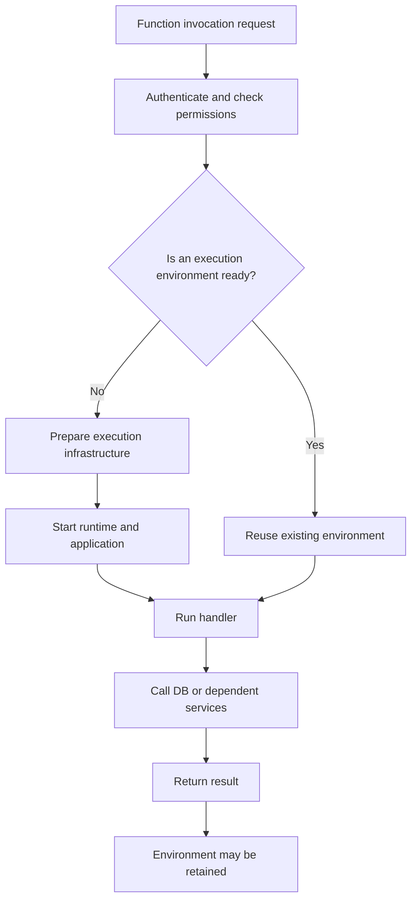

# Cold Starts, Concurrency, and Serverless Cost Optimization

## 1. Objectives and Context

In the **Containers and Functions** chapter of the **CLOUD_PROVIDERS_ORACLE** module, this lesson examines how OCI Functions starts up, scales with invocation volume, and calculates costs. The goal is to select configurations that meet latency requirements while keeping resources, Oracle Database connections, and budgets under control.

OCI Functions is an Oracle-managed function execution service. Learners do not operate servers for individual functions, yet must still design application code, networking, IAM, load limits, and observability. The service supports container-image functions and code-only functions with managed runtimes; see [Overview of OCI Functions](https://docs.oracle.com/en-us/iaas/Content/Functions/Concepts/functionsoverview.htm).

The running example is a Java function `quote-order`: it receives a shopping cart, reads pricing data, and calculates a quote. The function is invoked via API Gateway, uses a resource principal to access authorized OCI services, and connects to an Oracle Database over a configured network path. A notification task after order creation can be handled separately in an asynchronous flow.

Load numbers, durations, and budgets in this lesson are hypothetical figures used to illustrate calculation methods. They are not Oracle benchmarks or performance guarantees.

After this lesson, learners will be able to:

- Distinguish cold start, warm start, and business execution time.
- Estimate concurrency from arrival rate and processing duration.
- Read OCI Functions memory-based concurrency limits.
- Choose provisioned concurrency based on latency requirements and cost.
- Design measurements covering baseline load, idle periods, and sudden traffic spikes.
- Reduce cost per successful business operation while protecting downstream services.

## 2. What Is a Cold Start and When Does It Occur?

### 2.1. Lifecycle of an Execution Environment

When a function must run in a fresh environment, the platform prepares execution infrastructure and then starts the runtime and application code. For image-based functions, this may involve pulling the image from the registry. For code-only functions, the platform prepares an environment from the archive and selected runtime.

An environment that finishes serving a request may be retained for reuse. When more requests arrive while existing environments are busy, OCI Functions scales horizontally. After an idle period, environments may be reclaimed. These behaviors are described in [How OCI Functions Works](https://docs.oracle.com/en-us/iaas/Content/Functions/Concepts/functionshowitworks.htm).



A cold start is the path requiring preparation of a new environment. A warm start, also called a hot start, is the path reusing an existing environment.

Cold starts do not occur only on the very first invocation in a function's history. They can also occur when:

- The function is invoked infrequently and older environments have been reclaimed.
- Load increases beyond available warm environments.
- A deployment or change replaces execution environments.
- The platform provisions fresh environments during ongoing operations.

Do not build application contracts assuming an environment always stays alive for a fixed number of minutes. Empirical observations of warm retention times are not lifecycle guarantees.

### 2.2. Breaking User Wait Time into Components

A useful observability model:

```text
T_end_to_end =
    T_client_and_network
  + T_gateway_and_platform
  + T_environment_preparation_if_needed
  + T_runtime_and_application_initialization_if_needed
  + T_handler
  + T_dependencies
  + T_response_transfer
```

Segments may overlap or be measured at different boundaries; do not double-count two metrics covering the same interval.

If the handler log reports only 100 ms while the client waited 2 seconds, do not immediately blame business code. Conversely, if the DB call took 1.8 seconds, warming the infrastructure will not eliminate DB wait time.

Also distinguish:

| Concept | Meaning | How to Observe |
| --- | --- | --- |
| Infrastructure startup time | Preparing the environment needed to invoke the function | Correlate client-side and platform observations |
| Application initialization | Loading classes, config, SDKs, serializers, or pools | Measure initialization steps controlled by the app |
| Handler duration | Execution starting when the handler begins | Logs or tracing inside code |
| Dependency duration | DNS, TCP/TLS, DB, HTTP, or secret retrieval | Per-call spans or timers |
| Billable duration | Duration under metering rules | Actual usage reports and rate cards |

Do not treat total client latency directly as billable duration without knowing the service's metering boundaries.

### 2.3. Why Looking Only at Averages Misses Cold Starts

Suppose an aggregated dataset has:

- 97% of requests taking 180 ms.
- 3% of requests taking the cold-start path and taking 2,000 ms.

The mean is:

```text
0.97 × 180 + 0.03 × 2,000 = 234.6 ms
```

An average of ~235 ms may look acceptable, while the p99 of this dataset is 2 seconds. If the user target is p99 under 700 ms, that configuration fails to meet the target.

p95/p99 describe percentiles of the collected dataset. Do not average per-minute p99 values and call the result the daily p99; aggregate raw samples or proper histograms.

## 3. How Does Concurrency Differ from Invocation Rate?

### 3.1. Three Quantities to Distinguish

| Quantity | Question Answered | Unit |
| --- | --- | --- |
| Arrival rate or request rate | How many requests arrive per second? | Requests/second |
| Duration | How long does each execution hold resources? | Seconds |
| Concurrency | How many executions are running at one instant? | Concurrent executions |

A function receiving 60 requests/second does not necessarily need 60 concurrent executions:

```text
If each run takes ~0.25 seconds:
Average concurrency ≈ 60 × 0.25 = 15

If each run takes ~1 second:
Average concurrency ≈ 60 × 1 = 60
```

This applies the relationship between throughput, residence time, and work-in-progress in a relatively steady state. Keep boundaries consistent: execution hold time pairs with concurrent executions, while end-to-end wait time pairs with requests across the end-to-end system.

Average formulas do not guarantee sufficient capacity for every burst. Real sizing also requires latency distributions, traffic patterns, and headroom validated by load testing.

### 3.2. OCI Scales Using Execution Environments

When a running function receives concurrent calls, OCI Functions spins up additional execution environments within tenancy capacity and limits. See [OCI Functions Concurrency and Scalability](https://docs.oracle.com/en-us/iaas/Content/Functions/Concepts/functionsavailability.htm).

This model has two consequences:

1. `static` variables, caches, and connection pools inside one JVM belong solely to that environment.
2. Scaling environments also scales downstream connections, external requests, and allocated memory.

Do not use global in-memory variables in a function to maintain exact order counts or act as a system-wide lock. Durable business state belongs in stores supporting appropriate consistency and recovery.

### 3.3. OCI Concurrency Limits Are Expressed in Memory

OCI Functions enforces two key limits at the region level:

| Limit Name | Meaning |
| --- | --- |
| `total-concurrency-mb` | Total memory allocatable for concurrent execution |
| `provisioned-concurrency-mb` | Total memory allocatable for provisioned concurrency |

Check current tenancy values in the exact region; do not copy a default number and assume it reflects every account's capacity.

Calculation example: suppose 16,384 MiB of concurrent memory budget remains available and each function environment is configured at 512 MiB:

```text
Memory-equivalent environments ≈ floor(16,384 / 512) = 32
```

This is an estimate from a hypothetical memory budget, not a guarantee that 32 environments can be created instantaneously. Other functions in the same region, allocation mechanics, platform capacity, and network dependencies still affect results.

When multiple functions run concurrently, model them as:

```text
M_concurrent ≈ sum of (C_i × M_i)
```

Where `C_i` is the concurrent executions and `M_i` is the configured memory of function i.

When hitting the total concurrent memory limit, OCI may return HTTP 429. The `AllocatedTotalConcurrency` metric reports allocated memory, not active heap usage or exact in-flight request count. See [Monitoring Concurrent Function Execution](https://docs.oracle.com/en-us/iaas/Content/Functions/Tasks/functionsmonitoringcapacityusage_topic-Monitoring-concurrent-function-execution.htm).

### 3.4. Processing Duration Controls Concurrency

Suppose under normal DB performance, 60 requests/second with 0.25-second duration require an average of 15 concurrent executions. If DB slowness raises duration to 2 seconds:

```text
Average concurrency ≈ 60 × 2 = 120
```

If failures immediately trigger retries, actual load climbs even higher. Optimizing queries and dependency timeouts can therefore reduce latency, scaling pressure, and cost all at once.

Raising OCI limits without verifying DB capacity may simply shift the bottleneck down to the data tier.

## 4. Provisioned Concurrency: How Much Pre-Warming Is Enough?

### 4.1. Role of PCUs

Provisioned concurrency keeps infrastructure pre-warmed for a minimum level of concurrent invocations. OCI expresses this setting in **Provisioned Concurrency Units — PCUs**.

Per [the provisioned concurrency guide](https://docs.oracle.com/en-us/iaas/Content/Functions/Tasks/functionsusingprovisionedconcurrency.htm), valid PCU counts depend on configured RAM:

| Function Memory | Minimum PCUs | Increment Step |
| --- | --- | --- |
| 128 MB | 40 | 40 |
| 256 MB | 20 | 20 |
| 512 MB | 10 | 10 |
| 1024 MB | 10 | 10 |
| 2048 MB | 10 | 10 |
| 3072 MB | 10 | 10 |

For example, for a 512 MB function, you can choose 10, 20, or 30 PCUs; 15 is invalid under the table's increment step.

PCU is a pre-warmed minimum, not an upper cap on function concurrency. When demand exceeds provisioned capacity, the platform may scale further, and excess invocations should not be assumed to share the exact same latency as pre-warmed invocations.

### 4.2. Estimate a Starting Point, Then Verify

With hypothetical load:

```text
Baseline load:              60 requests/second
Measured duration:          ~0.25 seconds
Average concurrency:        ~15
Memory:                     512 MB
Initial test PCU:           20
```

20 is an experimental starting choice after rounding to the PCU step and adding headroom. It does not by itself guarantee SLOs.

If traffic bursts to 200 requests/second with duration still 0.25 seconds, average concurrency during the burst needs ~50 concurrent executions. A 20 PCU configuration will not cover all of it. You may need to:

- Increase PCUs if bursts occur frequently enough and latency SLOs are strict.
- Rate-limit ingress or queue work that does not need an immediate synchronous reply.
- Reduce duration.
- Define separate SLOs for interactive flows vs. background jobs.

Do not equate PCUs directly with request rate. 20 PCUs does not mean 20 requests/second; throughput still depends on per-execution duration.

### 4.3. PCUs Do Not Replace Application Optimization

Provisioned concurrency addresses infrastructure preparation latency. You must still measure:

- Branch-specific initialization that occurs only when a real request arrives.
- DB or TLS connections expiring after idle periods.
- Refreshing secrets, tokens, or configurations.
- Slow handlers, code locks, and slow DB queries.
- Load exceeding provisioned capacity.

Do not treat enabling PCUs as proof that every business cache is populated or every external connection remains valid.

### 4.4. Scheduling Enablement Based on Demand

| Workload Type | Reasonable Starting Point to Evaluate |
| --- | --- |
| Infrequent background task, latency-insensitive | Run on demand, accept cold starts |
| Low-traffic interactive API with strict p99 | Compare minimum PCU cost against an always-on service |
| API with steady baseline load | PCUs for measured baseline; evaluate bursts separately |
| Predictable business/sale hours | Automate enabling beforehand and disabling afterward if workflow supports it |
| Deferrable batch processing | Throttle intake and monitor job age |

Scheduled toggling must be performed by an automation mechanism via appropriate tooling or APIs, with IAM permissions and result verification. Do not assume the `CONSTANT` configuration automatically turns into a time-based schedule.

After updating, wait for the configuration to take effect and verify before directing production traffic to the function. Reading back saved config does not replace measuring serving readiness.

## 5. Optimizing Java and the Initialization Path

### 5.1. Reducing Mandatory Work Before the First Request

For Java, initialization time can stem from class count, libraries, reflection, frameworks, configuration, and external clients. Practical steps:

1. Remove unused dependencies and unneeded packaged resources.
2. Use runtime, FDK, and library versions compatible with the chosen function type.
3. For image-based functions, keep images lean and use appropriate build stages.
4. Avoid full classpath scanning or heavy framework bootstrap if the function performs a small task.
5. Separate rarely used paths from the mandatory startup path, then measure the first request of each branch.

Lazy initialization defers cost to first use. It helps for rarely taken branches, but does not eliminate the cost on the primary path.

Do not treat image size as the sole predictor of cold start duration. Two images of identical size can exhibit very different initialization times.

### 5.2. Reusing Clients and Bounded Pools

Reusing HTTP clients, SDK clients, or pools reduces connection setup overhead on subsequent calls. Oracle also provides guidance on [connection pooling to improve performance](https://docs.oracle.com/en-us/iaas/Content/Functions/Tasks/functionsusingconnectionpooling.htm).

However, pools live inside each individual environment:

```text
40 environments × max 3 DB connections/environment
= max 120 DB connections per pool config
```

That accounts for only one function; add all other DB consumers as well.

Keep pool sizes small to match needs, avoid eagerly opening unused connections, and validate stale connections before reuse. A warm environment does not guarantee sockets are still healthy.

A vital rule: reuse shared process-level resources, but never allow data from a previous request to leak into objects returned to a subsequent request.

### 5.3. Do Not Use In-Process Background Threads as a Queue

After the handler returns a result, do not rely on a self-spawned thread to finish critical business work. The environment may be reclaimed and provides no durable execution contract for background threads.

For decoupled work, persist state or tasks in an appropriate store and have a consumer process them with retries and idempotency. If choosing OCI Functions Detached invocations, design result handling and failure handling accordingly.

## 6. Measuring Cold Starts and Concurrency at the Right Boundaries

### 6.1. Collecting Multiple Observability Sources

Use at least three sources:

| Source | Required Data |
| --- | --- |
| Client or load generator | Send timestamp, latency, status, timeouts, actual requests sent |
| API Gateway and OCI Functions | Errors, duration, invocation count, allocated concurrency memory |
| Application | Fresh-environment indicator, initialization time, handler and per-dependency timings |

Attach a non-sensitive correlation ID to tie observations together. Logs should provide sufficient diagnostics without recording customer payloads, secrets, or tokens.

### 6.2. Java Example Logging a Fresh JVM Indicator

The class below illustrates logging the first call within a JVM. It can be integrated into an Fn Java project with the corresponding handler configured:

```java
import java.time.Instant;
import java.util.Locale;
import java.util.UUID;
import java.util.concurrent.atomic.AtomicBoolean;

public class QuoteFunction {
    private static final String PROCESS_ID = UUID.randomUUID().toString();
    private static final AtomicBoolean FIRST_CALL = new AtomicBoolean(true);

    public String handleRequest(String input) {
        boolean firstInProcess = FIRST_CALL.getAndSet(false);
        long started = System.nanoTime();
        boolean success = false;

        try {
            // Replace with business logic with controlled side effects and input validation.
            String result = "quote-ready";
            success = true;
            return result;
        } finally {
            double elapsedMs = (System.nanoTime() - started) / 1_000_000.0;
            System.err.printf(
                    Locale.ROOT,
                    "{\"event\":\"handler_complete\","
                            + "\"time\":\"%s\","
                            + "\"process_id\":\"%s\","
                            + "\"first_in_process\":%s,"
                            + "\"success\":%s,"
                            + "\"handler_ms\":%.3f}%n",
                    Instant.now(),
                    PROCESS_ID,
                    firstInProcess,
                    success,
                    elapsedMs
            );
        }
    }
}
```

`first_in_process=true` indicates the application serving its first call inside that JVM. It is not an official OCI cold-start metric and does not capture full infrastructure preparation time before the JVM/handler runs.

If the JVM is replaced while underlying infrastructure remains warm, this indicator can still appear. Conversely, if the FDK or libraries initialize before this class is invoked, the handler timer does not capture that portion.

Do not emit `process_id` as a high-cardinality metric dimension without a storage plan; keep it in logs for investigation instead.

### 6.3. Load-Testing Matrix

| Scenario | What You Want to Learn | Notes When Interpreting Results |
| --- | --- | --- |
| After deploy or fresh environment | Cold initialization path | Record code and config versions |
| Continuous sequential calls | Warm reuse performance | Not representative of concurrent load |
| After an idle interval | Likelihood of fresh environment after idle | An idle pause does not guarantee a cold start |
| Step-up load | Scaling behavior and limits | Monitor DB and HTTP 429/503 as well |
| Sudden burst | Latency when additional environments are needed | Cannot be extrapolated from sequential runs |
| With and without PCUs | Latency improvement vs. corresponding cost | Keep payload, network, and limits identical |
| Controlled slow DB | Backpressure and timeouts | Run in a test environment |

For comparative tests, hold region, function source type, architecture, runtime/FDK version, payload, dependencies, and load-generator location constant. Changing one factor at a time yields clearer conclusions.

Load generators must record failed requests too. Computing percentiles solely from successful requests makes overloaded configurations appear faster than reality.

A closed-loop client that waits for each response before sending the next slows itself down when the system degrades. To test an independent arrival rate, use an open-loop load model/tool and verify the actual achieved send rate.

### 6.4. OCI Metrics to Inspect

The OCI Functions namespace is `oci_faas`. Useful metrics:

| Metric | Meaning |
| --- | --- |
| `FunctionInvocationCount` | Number of invocations |
| `FunctionExecutionDuration` | Execution duration reported by service metrics |
| `FunctionResponseCount` | Success, error, or throttled responses |
| `AllocatedTotalConcurrency` | Memory allocated for concurrency |
| `AllocatedProvisionedConcurrency` | Memory allocated for provisioned concurrency |

Check exact metric names, units, and dimensions against [Function Metrics](https://docs.oracle.com/en-us/iaas/Content/Functions/Reference/functionsmetrics.htm).

Example MQL query viewing concurrent memory allocated for an application:

```text
AllocatedTotalConcurrency[1m]{resourceId = "<APPLICATION_OCID>"}.max()
```

Do not substitute a function OCID when the metric is scoped at the application level. Conversely, `AllocatedProvisionedConcurrency` can be filtered per function according to provisioned concurrency documentation.

One-minute charts can smooth over very brief bursts. Combine per-request telemetry and logs when investigating tail latency.

## 7. Serverless Cost Model

### 7.1. Three Distinct Components

For OCI Functions, separate:

1. Invocation count.
2. Memory resource multiplied by execution duration.
3. Unused provisioned concurrency.

Also account for API Gateway, DB, logging, storage, data transfer, and related services.

Per the [OCI Price List](https://www.oracle.com/cloud/price-list/) referenced on 20/11/2026, USD list pricing for Functions includes:

| Item | Published Rate |
| --- | --- |
| First 2 million invocations per month | Free |
| Invocations beyond free tier | $0.0000002 USD / invocation |
| First 400,000 GB-memory-seconds per month | Free |
| Execution time beyond free tier | $0.00001417 USD / GB-memory-second |
| Unused provisioned concurrency | 25% of execution time unit rate |
| PCUs actively executing functions | No extra PCU surcharge; execution billed under standard rules |

These are reference list prices; for real budgeting, consult your applicable rate card and subscription terms. Do not assume each individual function gets a separate free tier or that idle PCUs are offset by the execution free tier.

### 7.2. Execution and Invocation Formulas

Let:

- `N`: metered invocations in the period, including retries that trigger invocations.
- `M_i`: memory allocated for invocation i in GB-memory.
- `D_i`: billable duration of invocation i in seconds.
- `p_exec`: unit price per GB-memory-second.
- `p_inv`: unit price per invocation beyond the free tier.

```text
E = sum of (M_i × D_i)

C_execution = max(0, E - E_free_available) × p_exec
C_invocation = max(0, N - N_free_available) × p_inv
```

`E_free_available` and `N_free_available` represent the effective remaining free allowance for the period after accounting for all relevant workloads.

Use metered duration, including any rounding rules. A timer inside a handler and a latency chart do not by themselves prove the GB-memory-seconds billed on the invoice.

Purely illustrative calculation assuming this is the entire usage in the period and the full free tier above is available:

```text
N = 10,000,000 invocations
M = 0.5 GB-memory
D = 0.25 billable seconds/invocation

E = 10,000,000 × 0.5 × 0.25
  = 1,250,000 GB-memory-seconds

Execution above free tier:
1,250,000 - 400,000 = 850,000

C_execution = 850,000 × 0.00001417
            = 12.0445 USD

Invocations above free tier:
10,000,000 - 2,000,000 = 8,000,000

C_invocation = 8,000,000 × 0.0000002
             = 1.60 USD

Sum of both items ≈ 13.64 USD
```

This example excludes idle PCUs and other services, as well as contract discounts, taxes, and actual usage variance.

### 7.3. Provisioned Concurrency Creates Baseline Cost

Model for unused PCUs:

```text
U = time integral of
    [provisioned PCU memory - actively executing PCU memory]

C_PCU_idle ≈ U × p_idle
p_idle = 0.25 × p_exec per reference list price
```

If enabling 10 PCUs for a 512 MiB function, the example model converts each PCU to 0.5 GB-memory:

```text
Provisioned memory = 10 × 0.5 = 5 GB-memory

Assuming a 30-day month:
T = 30 × 24 × 3,600 = 2,592,000 seconds

If all PCUs remain unused over that period:
U = 5 × 2,592,000 = 12,960,000 GB-memory-seconds

p_idle = 0.25 × 0.00001417
       = 0.0000035425 USD/GB-memory-second

C_PCU_idle ≈ 45.91 USD
```

This is a 100%-idle PCU scenario showing the baseline cost. When PCUs are actively used, that time incurs execution charges rather than idle PCU charges. Do not double-charge both idle PCU and active PCU fees for the same slice of resources.

The design takeaway is to weigh latency gains against enabled hours and PCU utilization. A very rarely invoked function may have tiny execution charges while baseline PCUs dominate total cost.

## 8. Choosing Memory by Cost per Successful Business Operation

### 8.1. The Smallest Memory Is Not Always the Cheapest

Memory size affects execution headroom and can alter completion duration. Do not assume duration scales linearly down as RAM increases; test with your actual workload.

The table below shows hypothetical measurements before applying any free tier:

| Memory | Assumed Billable Duration | GB-memory-seconds / Invocation |
| --- | --- | --- |
| 256 MiB | 0.90 seconds | 0.225 |
| 512 MiB | 0.35 seconds | 0.175 |
| 1024 MiB | 0.20 seconds | 0.200 |
| 2048 MiB | 0.17 seconds | 0.340 |

In this dataset, 512 MiB yields the smallest memory × duration product. If SLOs require faster execution than 512 MiB achieves, 1024 MiB may still be the right choice.

Evaluate simultaneously:

- Cold/warm and end-to-end percentiles.
- Out-of-memory errors, timeouts, and GC overhead.
- Concurrency demand under the new duration.
- PCU step increments and required pre-warmed memory.
- DB connections and dependency costs.

[Changing Default Memory and Timeout Settings](https://docs.oracle.com/en-us/iaas/Content/Functions/Tasks/functionscustomizing.htm) lists supported RAM tiers and recommends at least 256 MB for Java. Starting choices must still be validated against real code.

### 8.2. Economic Metrics Should Tie to Business Outcomes

A more useful metric than price per invocation:

```text
Cost / 1,000 successful quotes =
    total cost allocated to the quote flow
    / number of successful quotes
    × 1,000
```

If shrinking RAM causes 10% of requests to time out and retry, per-invocation cost may look low while cost per successful business operation climbs. Account for errors, retries, reprocessed tasks, and downstream fees.

Do not optimize cost by turning off essential logs or skipping permission checks. Doing so sacrifices diagnostic visibility and invites business errors not captured in usage tables.

## 9. Protecting Concurrency and Downstream Services

### 9.1. Rate Limits Differ from Concurrency Limits

API Gateway can throttle request rate over time via request policies. This helps smooth incoming traffic; see [Limiting Requests to API Gateway Back Ends](https://docs.oracle.com/en-us/iaas/Content/APIGateway/Tasks/apigatewaylimitingbackendaccess.htm).

A rate limit of 60 requests/second does not guarantee at most 60 concurrent runs. If each request takes 2 seconds, average concurrency already reaches ~120. Therefore, combine rate limits, timeouts, connection limits, and backpressure.

### 9.2. Avoiding Retry Amplification

If the client, Gateway, and DB-calling code all retry uncoordinatedly, a brief outage can generate far more work than the original traffic.

For example, if each of three layers attempts up to 3 tries, one initial request can trigger up to:

```text
3 × 3 × 3 = 27 attempts at the innermost layer
```

This is a worst-case hypothetical model, not OCI's default retry behavior.

Retry designs should include:

- Total time budgets and maximum attempt caps.
- Exponential backoff with jitter for appropriate transient errors.
- Distinguishing 429, 503, and timeouts from data or permission errors.
- Idempotency keys and durable tracking for operations with side effects.
- Clean failure returns once budget is exhausted.

A client timeout does not prove a DB transaction did not commit. Retrying order creation without checking idempotency can create duplicate orders while amplifying both load and cost.

### 9.3. Queues Shift Timing Requirements, Not Eliminate Cost

If work tolerates deferred processing, enqueue tasks and use an explicitly designed consumer/invoker mechanism. Do not assume simply provisioning OCI Queue causes functions to be invoked automatically without integration.

Monitor job age, backlog depth, processing rate, retries, and dead-letter storage. Queuing flattens bursts, yet still incurs queue, execution, and storage charges; business completion latency also changes.

### 9.4. Timeouts Must Align Across the Entire Chain

Account for timeouts across the client, API Gateway, function invocation, and DB/HTTP dependencies. Set dependency timeouts inside the remaining handler budget so the handler can still process and respond.

OCI distinguishes Sync and Detached invocations along with their respective timeout boundaries. Detached returns control when execution begins, not when business work finishes. See [Invoking Functions](https://docs.oracle.com/en-us/iaas/Content/Functions/Tasks/functionsinvokingfunctions.htm).

Raising timeouts causes requests to hold resources longer when dependencies are slow. Do so only after understanding the root cause and business requirements.

## 10. Lab: Changing Memory and PCUs

### 10.1. Prerequisites and Scope

Perform this on a deployed test function with appropriate IAM permissions to update/invoke the function and read metrics. Use synthetic data to avoid generating real orders or notifications.

The examples below target a container-image function. The referenced OCI CLI version provides the `update container-function` subcommand; inspect `--help` on your installed CLI. Code-only functions have corresponding source update commands; do not apply image-update commands across all function types.

Do not run heavy load before confirming tenancy limits and DB capacity.

### 10.2. Configuring PCUs in a JSON File

The lab file `pcu-20.json` contains:

```json
{
  "strategy": "CONSTANT",
  "count": 20
}
```

For a 512 MB function, 20 PCUs is valid according to the table in section 4.

In PowerShell, after saving the JSON in your lab directory:

```powershell
$functionId = '<FUNCTION_OCID>'

$updateArgs = @(
    'fn', 'function', 'update', 'container-function',
    '--function-id', $functionId,
    '--memory-in-mbs', '512',
    '--provisioned-concurrency', 'file://pcu-20.json',
    '--wait-for-state', 'SUCCEEDED'
)

oci @updateArgs

if ($LASTEXITCODE -ne 0) {
    throw 'Function update did not complete successfully'
}
```

Parameters and work request tracking are documented in [OCI CLI: update container-function](https://docs.oracle.com/en-us/iaas/tools/oci-cli/latest/oci_cli_docs/cmdref/fn/function/update/container-function.html).

Enabling pre-warmed resources can incur charges. This is simply a configuration update step in the lab, not an autoscaling system adjusting PCUs to load.

### 10.3. Sending a Test Request

The example below targets a test handler accepting the payload `sample-order`:

```powershell
$invokeArgs = @(
    'fn', 'function', 'invoke',
    '--function-id', $functionId,
    '--body', 'sample-order',
    '--file', '-',
    '--fn-invoke-type', 'sync'
)

$watch = [System.Diagnostics.Stopwatch]::StartNew()
oci @invokeArgs
$invokeExitCode = $LASTEXITCODE
$watch.Stop()

[pscustomobject]@{
    ExitCode = $invokeExitCode
    ClientElapsedMs = [Math]::Round($watch.Elapsed.TotalMilliseconds, 2)
}
```

The invoke command and body/output flags are described in [OCI CLI: function invoke](https://docs.oracle.com/en-us/iaas/tools/oci-cli/latest/oci_cli_docs/cmdref/fn/function/invoke.html).

This timer includes starting the OCI CLI, signing the request, networking, and rendering output. It is handy for functional checks but not an accurate standalone cold-start benchmark. For load measurements, use a long-lived client or dedicated load tool while also recording handler-side timing.

### 10.4. Controlled Comparison

Proceed step by step:

1. Record the baseline configuration in a managed lab log.
2. Run on-demand invocations and record data for each scenario in section 6.
3. Change one memory tier while keeping other factors steady, then re-measure.
4. Select a memory tier meeting both SLOs and cost goals.
5. Enable a valid PCU count, wait for the update to finish, and verify metrics.
6. Measure baseline load and bursts exceeding the PCU allocation.
7. Calculate execution, invocation, and idle PCU costs from matching usage data.
8. Restore configuration or disable PCUs when finished.

Do not use a single invocation to judge p99 or claim cold starts have vanished.

### 10.5. Disabling PCUs After the Lab

File `pcu-none.json`:

```json
{
  "strategy": "NONE"
}
```

Update:

```powershell
$disableArgs = @(
    'fn', 'function', 'update', 'container-function',
    '--function-id', $functionId,
    '--provisioned-concurrency', 'file://pcu-none.json',
    '--wait-for-state', 'SUCCEEDED'
)

oci @disableArgs

if ($LASTEXITCODE -ne 0) {
    throw 'Provisioned concurrency was not disabled successfully'
}
```

Afterward, inspect function details and metrics over an appropriate window. If a pipeline automatically redeploys PCU configuration, update that source configuration as well to prevent unintended re-enablement.

## 11. Monitoring Limits and Budgets

### 11.1. Alerts Must Pair with Actions

| Signal | Initial Interpretation | Action to Consider |
| --- | --- | --- |
| p99 rises while handler remains steady | Time spent outside handler may be rising | Check fresh environments, Gateway, and networking |
| DB duration rises | Possible connection shortage or slow queries | Inspect pool, sessions, and queries |
| HTTP 429 rises | May be hitting rate limits or concurrency limits | Identify which layer returned 429 and throttle load |
| HTTP 503 during bursts | Capacity may be insufficient during spikes | Bounded backoff; check PCUs and capacity |
| Allocated concurrency memory nears limit | Little headroom left to scale | Optimize duration, throttle, or request limit increase |
| High PCU allocation with low usage | Possible over-provisioning | Reduce PCU count or enabled hours after measurement |
| Cost per 1,000 operations rises | Possible excessive retries or rising duration | Break down execution, PCU, and downstream costs |

Read status codes alongside error codes/messages. HTTP 429, 503, and startup failures are covered by Oracle in [Issues invoking functions](https://docs.oracle.com/en-us/iaas/Content/Functions/Tasks/functionstroubleshooting_topic-Issues-invoking-functions.htm).

### 11.2. Monitor PCUs Using the Right Metric

`AllocatedProvisionedConcurrency` reflects memory allocated for PCUs, not directly the percentage of PCUs actively busy. Looking at this metric alone is therefore insufficient to compute utilization rates or exact idle costs.

Also monitor traffic load, duration, and metered usage. Check the `provisioned-concurrency-mb` limit in the target region, especially when multiple functions enable PCUs simultaneously. See [Monitoring Provisioned Concurrency](https://docs.oracle.com/en-us/iaas/Content/Functions/Tasks/functionsmonitoringcapacityusage_topic-Monitoring-provisioned-concurrency.htm).

### 11.3. Budgets Are Soft Alerts

Configure budgets per compartment or appropriate allocation structure, attach owner/environment tags, and track Cost Analysis. A budget does not automatically halt function execution when a spend threshold is crossed; it is a soft limit and alerting mechanism, as explained in [OCI usage and cost management guidance](https://docs.oracle.com/en/solutions/oci-best-practices/track-and-manage-usage-and-cost1.html).

Operational control also requires rate limits, retry budgets, timeouts, resource caps, and PCU enable/disable workflows. Billing alerts carry reporting latency and do not replace real-time load throttling.

## 12. Common Misconceptions

| Misconception | Correction |
| --- | --- |
| Serverless always costs zero when there are no requests | Idle PCUs and supporting services can still incur charges |
| Periodic ping calls eliminate cold starts | A ping only touches one environment slice; it does not ensure burst capacity |
| 20 PCUs means a maximum of 20 concurrent requests | PCU is a pre-warmed minimum, not a concurrency cap |
| 60 requests/second needs exactly 60 environments | Demand also depends on duration and arrival distribution |
| Increasing timeouts helps the system handle load better | It can hold resources and connections open longer |
| Setting a large DB pool per JVM speeds things up | Total connections can explode across many scaled environments |
| Raising RAM always increases cost | Evaluate memory × duration product and success rate |
| Static data persists across the entire function | Static state belongs to one process and disappears when environments cycle |
| First call in a JVM measures the entire cold start | It is only an application signal and excludes platform startup steps |
| Enabling PCUs removes the need to optimize handlers | DB, networking, branch initialization, and bursts still matter |
| Budgets guarantee spending will not exceed the cap | Budgets are soft alerts requiring separate technical controls |

Do not use keep-warm pings as a guaranteed substitute for provisioned concurrency. Beyond technical limitations, pings generate invocations and can trigger side effects if the handler is not designed to ignore them.

## 13. Lab Completion Criteria

An evaluable outcome must clearly document:

- Function, region, code/runtime version, source type, and memory configuration.
- Actual arrival rate, duration, and estimated concurrency at consistent boundaries.
- p50/p95/p99, error rate, timeouts, and fresh-environment indicators per scenario.
- Current concurrency limit values alongside shared workloads.
- Valid PCU count, enabled hours, and behavior when bursts exceed provisioned capacity.
- DB connection count, dependency latency, and retry/idempotency behavior.
- Cost per successful business operation, including PCUs and supporting services.
- Evidence that baseline config was restored or PCUs were disabled after the lab.

The final choice must tie to concrete SLOs. If a low-traffic API still requires consistently low latency yet minimum PCUs impose high baseline costs, also compare against an always-on service on Container Instances or another suitable platform. Any comparison must hold availability, networking, security, and operational effort requirements constant.
