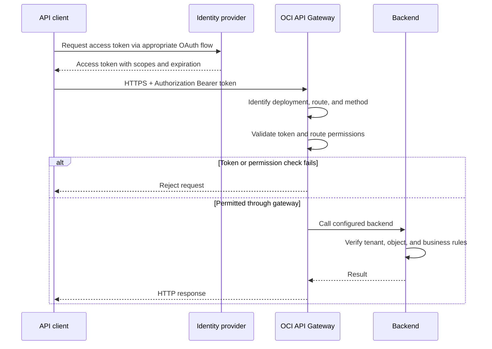

# Routing, JWT authentication, and API access control

## 1. Objectives and scope

In the **APIs, Events, and Integration** chapter of the **CLOUD_PROVIDERS_ORACLE** module, this lesson covers routing APIs through OCI API Gateway, validating JWTs, and restricting permissions per operation. The content connects API policies with compartments, IAM, VCN, backends, and monitoring on Oracle Cloud Infrastructure.

A properly protected API must answer three questions:

1. Which route and backend should the request be forwarded to?
2. Was the token issued by a trusted source and is it intended for this API?
3. What data operations is the token's subject authorized to perform?

The lab uses an orders API with two independent scopes: `orders:read` and `orders:write`. First, the backend returns a sample response to verify routing and policies. Next, the guide transitions to an HTTP backend or OCI Functions and adds data access control.

The goal is to explain and verify both accepted requests and rejected requests. Being able to call an endpoint with a token is not enough to prove the API enforces authorization properly.

## 2. Control layers and responsibility boundaries

| Layer | Question addressed | Example |
|---|---|---|
| Network and TLS | Can the client reach the endpoint, and is the connection trusted? | Public/private gateway, NSG, certificate |
| Routing | Which operation do the path and method belong to? | GET /orders differs from POST /orders |
| Token authentication | Is the token valid for the API? | Signature, issuer, audience, expiration |
| Route authorization | Does the token have the scope for the operation? | orders:read |
| Business authorization | Does the subject have permission on the specific object? | Reading only the tenant's own orders |
| Backend invoke permission | Is the gateway allowed to call the target service? | Permission to invoke an OCI Function |
| OCI administrative permission | Who can create or modify the gateway/deployment? | IAM policy in the compartment |

OCI API Gateway can consolidate multiple backends behind one endpoint and apply policies for authentication, authorization, request transformation, CORS, or rate limiting. Public/private endpoints are a networking choice; they do not replace API permission layers. [Source: OCI API Gateway overview](https://docs.oracle.com/en-us/iaas/Content/APIGateway/Concepts/apigatewayoverview.htm).

**An API deployment's request policy is different from an IAM policy.** Someone with permission to update a deployment in OCI does not automatically have the business scopes of an API caller; likewise, a valid JWT does not grant OCI administrative permissions. [Source: request and response policies](https://docs.oracle.com/en-us/iaas/Content/APIGateway/Tasks/apigatewayaddingrequestpolicies.htm).

## 3. Request processing model



The diagram shows decision boundaries, not the full internal order of all policies. When adding CORS, validation, or transformations, follow the processing order for each policy type.

Selecting a route selects the handler location, not proof that the request is authorized. Every path to sensitive data, including direct paths to the backend, must have appropriate controls.

## 4. Designing routes with paths and HTTP methods

### 4.1. Distinguishing gateway, deployment, and route

Suppose a deployment is created with the path prefix:

```text
/shop/v1
```

A route inside the deployment has path `/orders`. The client calls the URL:

```text
https://<gateway-hostname>/shop/v1/orders
```

`pathPrefix` is a property of the **deployment**. In the deployment specification, `routes[].path` is relative to that prefix. Do not duplicate `/shop/v1` into every route if the deployment already has that prefix. [Source: deployment specification structure](https://docs.oracle.com/en-us/iaas/Content/APIGateway/Tasks/apigatewaycreatingspecification.htm).

Design matrix for this lesson:

| Method | Route path | Purpose | Required permission |
|---|---|---|---|
| GET | /session | Verify token validity | Authentication only |
| GET | /orders | List orders | orders:read |
| POST | /orders | Create an order | orders:write |
| GET | /orders/{orderId} | Read a single order | orders:read and backend object check |

Do not infer read scope from write scope. If the product requires a user to both read and write, the IdP must issue both scopes or the system must define explicit permission rules.

### 4.2. Path parameters and wildcards

`/orders/{orderId}` captures a single path segment as the `orderId` value. A wildcard such as `/files/{remainingPath*}` can match multiple segments, one segment, or zero trailing segments under OCI rules. Therefore, wildcards must be reviewed as part of the access scope. [Source: path parameters and wildcards](https://docs.oracle.com/en-us/iaas/Content/APIGateway/Tasks/apigatewayaddingparamswildcards.htm).

Avoid letting a broad wildcard with a weak policy cover administrative paths. Do not rely on line ordering in JSON to conclude that a specific route is always protected. Test overlapping paths, trailing slashes, encoded characters, and undeclared methods.

For example, a public `/{all*}` route serving general content must be carefully checked if the same deployment also contains `/admin`, `/orders`, or internal paths.

### 4.3. Mapping external paths to backend URLs

When you need to route:

```text
/shop/v1/orders/A123
```

to:

```text
https://orders.internal.example.com/orders/A123
```

the backend URL must express that mapping. Do not assume the gateway automatically appends every portion of the request path to the target URL.

OCI stores path parameters in the `request.path` context table. In the URL, you can use expressions like `${request.path[orderId]}` to insert the value. Query/header values are client-supplied inputs; they do not become authenticated identities on their own. [Source: context variables](https://docs.oracle.com/en-us/iaas/Content/APIGateway/Tasks/apigatewaycontextvariables.htm).

Keep the backend hostname in controlled configuration. Do not construct the target hostname directly from an arbitrary client query parameter.

## 5. What is a JWT and what needs to be verified?

### 5.1. Reading the payload does not prove the token is valid

A signed JWT in JWS compact form typically consists of:

```text
base64url(header).base64url(payload).signature
```

Base64url is a data encoding format, not security encryption. Anyone can read claims without a key; doing so does not prove the claims were issued by the IdP. Likewise, never put secrets or sensitive data inside a JWT just because the token is signed.

JWTs have many forms and profiles. This lesson focuses on signed access tokens that OCI Gateway can validate using a public key. [Source: JWT definition](https://www.rfc-editor.org/rfc/rfc7519.html).

### 5.2. Components to align with the IdP

| Component | Meaning | What must be verified |
|---|---|---|
| alg | Signing algorithm | Algorithm accepted in the trust configuration |
| kid | Key identifier | Matching public key found in the trusted key set |
| iss | Issuer | Matches an allowed issuer |
| aud | Token audience | Includes the audience of the protected API |
| exp | Expiration time | Token is still valid within policy/profile limits |
| nbf | Not valid before this time | Token is not used prematurely |
| sub | Subject | Interpreted by the backend according to token type |
| scope | Access permissions | Matches the route's required scope |
| tenant_id | Custom claim for the extended example | Issued by a trusted IdP with usage rules |

A valid signature alone is not enough: the token could be meant for a different API or be expired. Do not select the verification algorithm solely from the sender-provided header; enforce trust rules for algorithm, keys, issuer, and audience. [Source: JWT Best Current Practices](https://www.rfc-editor.org/rfc/rfc8725.html).

For timestamps, use synchronized clocks and a small, deliberate clock skew. Clock skew is not a long grace period allowing expired tokens to keep working.

### 5.3. Access token, ID token, and refresh token

| Token | Primary purpose | Used to call this lesson's API? |
|---|---|---|
| Access token | Access resource servers per granted permissions | Yes, if profile and audience match |
| ID token | Convey authentication info to an OIDC client | Do not use in place of an access token |
| Refresh token | Obtain a new access token | Do not send to resource APIs |

Do not accept a token merely because it has three segments or was signed by a familiar IdP. The JWT access token profile defines specific requirements to prevent token confusion across contexts. [Source: JWT Profile for OAuth 2.0 Access Tokens](https://www.rfc-editor.org/rfc/rfc9068.html).

In machine-to-machine flows, the subject may represent an application/client rather than an end user. The backend must not assume every `sub` is a customer account.

## 6. Choosing how to validate tokens in OCI API Gateway

For new configurations, Oracle recommends the `TOKEN_AUTHENTICATION` policy type. The legacy `JWT_AUTHENTICATION` policy is still supported but is no longer recommended for new deployments. [Source: note on JWT_AUTHENTICATION](https://docs.oracle.com/en-us/iaas/Content/APIGateway/Tasks/apigatewayusingjwttokens-requestpolicy.htm).

Validation options:

| Approach | Mechanism | Operational considerations |
|---|---|---|
| Remote JWKS | Fetch public keys from a trusted URI, validate JWT | Network path to IdP, TLS, caching, and key rotation |
| Static keys | Declare public keys in configuration | Controlled key updates |
| OAuth introspection | Query the authorization server about the token | Connectivity, secrets, and response caching |
| Custom authorizer | Invoke an OCI Function to decide | Authorizer contract, IAM, timeouts, and caching |

Built-in token validation and custom authorizers are options chosen based on requirements; not every API needs a custom authorizer. This lesson uses Remote JWKS because it fits asymmetrically signed JWT access tokens. [Source: token validation options](https://docs.oracle.com/en-us/iaas/Content/APIGateway/Tasks/apigatewayusingjwttokens.htm).

Remote JWKS fetches **public keys** and does not send private signing keys to the deployment. Nor do public keys allow the gateway to mint IdP tokens itself.

## 7. Preparing the IdP and configuration details

Before creating the deployment, you need an authorization server/IdP configured for the lab's resource API:

- Audience: for example `api://orders-api`.
- Read scope: `orders:read`.
- Write scope: `orders:write`.
- Exact token issuer.
- JWKS URI reachable from the gateway's network.
- Test client(s) permitted to request the respective scopes.

The example uses `https://idp.example.com/` and an illustrative JWKS URI. Replace them with real IdP details before deploying.

With OCI IAM Identity Domains, do not assume the issuer is the domain hostname. Issuer, audience, and JWKS URI are determined by the IdP configuration; Oracle documentation lists provider-specific details. [Source: issuer, audience, and JWKS by IdP](https://docs.oracle.com/en-us/iaas/Content/APIGateway/Tasks/apigatewayusingjwttokens-identityprovider.htm).

Prepare test access tokens issued by the IdP:

| Label used in lesson | Desired permissions |
|---|---|
| TOKEN_READ | Only orders:read |
| TOKEN_WRITE | Only orders:write |
| TOKEN_BOTH | Both orders:read and orders:write |
| TOKEN_OTHER_AUD | Real token, but intended for a different resource API |
| TOKEN_NO_SCOPE | Valid token for the API, but without order scopes |

Read and write tokens can use different test clients or users. Inspect the actual scopes in the returned token; requesting scopes does not guarantee the authorization server granted those exact scopes.

Use the OAuth flow appropriate for the client type. Client credentials is suitable for authorized service applications; do not use a client secret in public frontend code.

## 8. Complete deployment specification for the lab

The specification below creates four routes, all requiring a token. The backend returns sample data directly at the gateway to verify policies before integrating a real service.

Learners can save the content as `orders-deployment.json` in their lab directory:

```json
{
  "requestPolicies": {
    "authentication": {
      "type": "TOKEN_AUTHENTICATION",
      "tokenHeader": "Authorization",
      "tokenAuthScheme": "Bearer",
      "isAnonymousAccessAllowed": false,
      "maxClockSkewInSeconds": 10,
      "validationPolicy": {
        "type": "REMOTE_JWKS",
        "uri": "https://idp.example.com/.well-known/jwks.json",
        "isSslVerifyDisabled": false,
        "maxCacheDurationInHours": 1,
        "additionalValidationPolicy": {
          "issuers": [
            "https://idp.example.com/"
          ],
          "audiences": [
            "api://orders-api"
          ]
        }
      }
    }
  },
  "routes": [
    {
      "path": "/session",
      "methods": [
        "GET"
      ],
      "backend": {
        "type": "STOCK_RESPONSE_BACKEND",
        "status": 200,
        "headers": [
          {
            "name": "Content-Type",
            "value": "application/json"
          },
          {
            "name": "Cache-Control",
            "value": "no-store"
          }
        ],
        "body": "{\"demo\":true,\"route\":\"session\"}"
      },
      "requestPolicies": {
        "authorization": {
          "type": "AUTHENTICATION_ONLY"
        }
      }
    },
    {
      "path": "/orders",
      "methods": [
        "GET"
      ],
      "backend": {
        "type": "STOCK_RESPONSE_BACKEND",
        "status": 200,
        "headers": [
          {
            "name": "Content-Type",
            "value": "application/json"
          },
          {
            "name": "Cache-Control",
            "value": "no-store"
          }
        ],
        "body": "{\"demo\":true,\"route\":\"list-orders\"}"
      },
      "requestPolicies": {
        "authorization": {
          "type": "ANY_OF",
          "allowedScope": [
            "orders:read"
          ]
        }
      }
    },
    {
      "path": "/orders",
      "methods": [
        "POST"
      ],
      "backend": {
        "type": "STOCK_RESPONSE_BACKEND",
        "status": 202,
        "headers": [
          {
            "name": "Content-Type",
            "value": "application/json"
          },
          {
            "name": "Cache-Control",
            "value": "no-store"
          }
        ],
        "body": "{\"demo\":true,\"route\":\"create-order\",\"persisted\":false}"
      },
      "requestPolicies": {
        "authorization": {
          "type": "ANY_OF",
          "allowedScope": [
            "orders:write"
          ]
        }
      }
    },
    {
      "path": "/orders/{orderId}",
      "methods": [
        "GET"
      ],
      "backend": {
        "type": "STOCK_RESPONSE_BACKEND",
        "status": 200,
        "headers": [
          {
            "name": "Content-Type",
            "value": "application/json"
          },
          {
            "name": "Cache-Control",
            "value": "no-store"
          }
        ],
        "body": "{\"demo\":true,\"route\":\"get-order\"}"
      },
      "requestPolicies": {
        "authorization": {
          "type": "ANY_OF",
          "allowedScope": [
            "orders:read"
          ]
        }
      }
    }
  ]
}
```

`idp.example.com` values are placeholders, not a token-issuing service for this lesson. The responses have `demo: true`; POST returns 202 to demonstrate the route, **does not create an order, and does not persist data**.

Stock response is a backend type where the gateway returns the configured status, headers, and body. The JSON body is held inside a string, so inner quotes must be escaped. [Source: stock response backend](https://docs.oracle.com/en-us/iaas/Content/APIGateway/Tasks/apigatewayaddingstockresponses.htm).

In the JWT policy:

- `tokenHeader` and `tokenAuthScheme` select `Authorization: Bearer ...`.
- `isAnonymousAccessAllowed: false` keeps the lab routes behind authentication.
- `validationPolicy.type: REMOTE_JWKS` selects the public key source.
- `additionalValidationPolicy` specifies the issuer and audience.
- `isSslVerifyDisabled: false` keeps TLS certificate verification enabled for JWKS.
- `maxCacheDurationInHours: 1` is a lab choice and should be reassessed based on key rotation requirements.

This is the structure of `TOKEN_AUTHENTICATION`; do not mix legacy JWT policy fields into arbitrary positions. [Source: configuring token authentication with JSON](https://docs.oracle.com/en-us/iaas/Content/APIGateway/Tasks/apigatewayusingjwttokens-usinjson.htm).

## 9. Route and scope authorization

### 9.1. AUTHENTICATION_ONLY

The `GET /session` route accepts any authenticated principal without requiring order scopes. The response is only a lab signal, not a user profile.

Use this only for operations every valid API caller is allowed to perform. If an authorization policy is omitted on a route in a deployment that has authentication, OCI applies the default semantics equivalent to `AUTHENTICATION_ONLY`; therefore, review every route's permissions when authoring the configuration.

### 9.2. ANY_OF

`allowedScope: ["orders:read"]` requires the read scope.

If you declare:

```json
{
  "type": "ANY_OF",
  "allowedScope": ["orders:read", "orders:write"]
}
```

then either scope is sufficient. This configuration **does not require both simultaneously**. If an operation requires multiple conditions together, enforce the appropriate policy in an authorizer/backend or design a dedicated scope representing that permission.

Scope values are case-sensitive. Claims like `roles`, `groups`, or a custom IdP claim do not automatically substitute for `scope` in this policy. [Source: route authorization and allowedScope](https://docs.oracle.com/en-us/iaas/tools/terraform-provider-oci/latest/docs/r/apigateway_deployment.html).

### 9.3. ANONYMOUS

To add a public route in a deployment that has authentication, you must combine:

- Allowing anonymous access in the authentication policy.
- Setting authorization on that specific route to `ANONYMOUS`.

Do not switch every route to `AUTHENTICATION_ONLY` and call it scope-based authorization. Likewise, do not merely enable anonymous access deployment-wide and assume every route is public.

For a simple public health endpoint, you can create a separate deployment like `/public/v1` to reduce mixing authentication requirements. If you choose to mix them, test both requests without tokens and requests with invalid tokens according to the active policy behavior. [Source: authorization types in Console token configuration](https://docs.oracle.com/en-us/iaas/Content/APIGateway/Tasks/apigatewayusingjwttokens-usingconsole.htm).

## 10. Creating the deployment and verifying the environment

### 10.1. Infrastructure prerequisites

Before taking action, confirm the region, compartment, gateway OCID, subnet, DNS, and path to JWKS. For a public gateway, open only the required ingress; for a private gateway, the test machine must have network reachability to the endpoint.

The deployer needs IAM permissions to create/update deployments in the target compartment. If using a Functions backend or introspection with secrets, add the related permissions; do not grant those permissions simply because this lesson uses JWTs. [Source: IAM for API Gateway](https://docs.oracle.com/en-us/iaas/Content/APIGateway/Tasks/apigatewaycreatingpolicies.htm).

### 10.2. Creating via Console or CLI

In the Console, select the gateway for the target environment and create a deployment with:

| Parameter | Lab value |
|---|---|
| Name | orders-jwt-lab |
| Path prefix | /shop/v1 |
| Specification | JSON content updated with IdP details |
| Initial backend | Stock response |
| Authentication | Token authentication with Remote JWKS |

If using the OCI CLI on Bash:

```bash
read -r -p "Compartment OCID: " COMPARTMENT_OCID
read -r -p "Gateway OCID: " GATEWAY_OCID

oci api-gateway deployment create --compartment-id "$COMPARTMENT_OCID" --display-name orders-jwt-lab --gateway-id "$GATEWAY_OCID" --path-prefix /shop/v1 --specification file://orders-deployment.json --wait-for-state ACTIVE
```

Choose only one creation method. If the deployment already exists, inspect and update the existing resource rather than creating a duplicate with the same prefix.

Save the deployment OCID, endpoint, and related Work Request if applicable. The `ACTIVE` state reflects configuration deployment; you still must test tokens, routes, and networking at request time. [Source: creating an API deployment](https://docs.oracle.com/en-us/iaas/Content/APIGateway/Tasks/apigatewaycreatingdeployment.htm).

All commands in this lesson are hands-on instructions for the learner's environment; they are not evidence that a deployment is already running.

## 11. Testing with real tokens

The following commands use Bash. Obtain access tokens from the configured IdP; do not manually edit a token payload and reuse the old signature.

### 11.1. Enter the endpoint and tokens

Enter the deployment endpoint without a trailing slash, for example `https://<gateway-hostname>/shop/v1`:

```bash
read -r -p "Deployment endpoint: " API_BASE_URL
read -r -s -p "Access token with orders:read only: " TOKEN_READ
printf '\n'
read -r -s -p "Access token with orders:write only: " TOKEN_WRITE
printf '\n'
```

Tokens are hidden while typing. Do not enable shell tracing in test sessions containing credentials, and do not copy tokens into reports.

Bearer tokens must be protected in storage and transit; using HTTPS and the Authorization header avoids many token leaks caused by URLs. [Source: Bearer Token Usage](https://www.rfc-editor.org/rfc/rfc6750.html).

### 11.2. Without a token

```bash
curl -i "$API_BASE_URL/orders"
```

With the lab configuration and default authentication response, the request is not allowed to reach the stock backend. By default, token authentication returns HTTP 401 when a token is missing or invalid; no OAuth redirect or custom failure response is configured in this example.

### 11.3. Read token calling a read route

```bash
curl -i --header "Authorization: Bearer $TOKEN_READ" "$API_BASE_URL/orders"
```

Expect HTTP 200 and a body identifying `list-orders`.

Test the parameterized route:

```bash
curl -i --header "Authorization: Bearer $TOKEN_READ" "$API_BASE_URL/orders/A123"
```

Expect the `get-order` stock response. This response only proves the route/policy matched, not that order A123 exists or that the principal is authorized to read it.

### 11.4. Read token calling a write route

```bash
curl -i --request POST --header "Authorization: Bearer $TOKEN_READ" --header "Content-Type: application/json" --data '{"item":"demo","quantity":1}' "$API_BASE_URL/orders"
```

The request must be rejected for lacking the write scope. Distinguish this result from an invalid-signature token: one case is insufficient authorization, while the other is authentication failure. With standard HTTP responses, a missing scope is indicated by 403; check logs if the system customizes responses.

### 11.5. Write token calling a write route

```bash
curl -i --request POST --header "Authorization: Bearer $TOKEN_WRITE" --header "Content-Type: application/json" --data '{"item":"demo","quantity":1}' "$API_BASE_URL/orders"
```

Expect HTTP 202 with body `persisted: false`.

Test the write token on GET to confirm there is no implicit scope inheritance:

```bash
curl -i --header "Authorization: Bearer $TOKEN_WRITE" "$API_BASE_URL/orders"
```

If the token truly only has the write scope, GET must be rejected.

### 11.6. Testing a tampered token

```bash
BAD_TOKEN="x$TOKEN_READ"
curl -i --header "Authorization: Bearer $BAD_TOKEN" "$API_BASE_URL/orders"
unset BAD_TOKEN
```

A tampered token must be rejected. For wrong audience, issuer, timestamp, or scope cases, use test tokens issued by the IdP with those properties. Manually editing a payload only tests a malformed/invalid-signature token and does not isolate claim checks.

## 12. Required design verification matrix

This matrix is a verification plan for the lab environment, not already-executed results:

| Case | Request | Expected outcome |
|---|---|---|
| No token | GET /orders | Authentication rejected, 401 by default |
| Corrupted signature/token | GET /orders | Authentication rejected |
| Expired token | GET /orders | Rejected beyond allowed skew |
| Token not yet valid | GET /orders | Rejected when nbf is not yet reached |
| Wrong issuer | GET /orders | Rejected even if signing algorithm is valid |
| Wrong audience | GET /orders | Rejected even if token is valid for another API |
| Read token | GET /orders | 200 from stock backend |
| Read token | POST /orders | Authorization rejected |
| Write token | POST /orders | 202 from stock backend |
| Write token | GET /orders | Rejected if read scope is absent |
| Token without order scopes | GET /session | Permitted if token is still valid for the API |
| Token without order scopes | GET /orders | Authorization rejected |
| Token with sufficient scopes | Undeclared method | Must not fall through to another valid operation |
| Token with sufficient scopes | Unmatched path | Must not fall through to a sensitive backend |
| Client spoofs identity header | Real backend route | Must not override authenticated identity |
| Tenant A token | Tenant B object | Rejected by backend |

Record the status, body, matched route, and logs. Do not draw conclusions from a status code alone, as responses may come from the gateway, IdP integration, or backend.

After testing, clear variables containing tokens from the terminal session:

```bash
unset TOKEN_READ TOKEN_WRITE
```

## 13. Moving to an HTTP backend and passing identity securely

Once the lab policy works, you can replace the single-order read route with the following HTTP route. This is **one replacement route**, not the entire deployment; retain the configured global authentication policy:

```json
{
  "path": "/orders/{orderId}",
  "methods": [
    "GET"
  ],
  "backend": {
    "type": "HTTP_BACKEND",
    "url": "https://orders.internal.example.com/orders/${request.path[orderId]}",
    "isSslVerifyDisabled": false
  },
  "requestPolicies": {
    "authorization": {
      "type": "ANY_OF",
      "allowedScope": [
        "orders:read"
      ]
    },
    "headerTransformations": {
      "setHeaders": {
        "items": [
          {
            "name": "X-Authenticated-Subject",
            "values": [
              "${request.auth[sub]}"
            ],
            "ifExists": "OVERWRITE"
          },
          {
            "name": "X-Authenticated-Tenant",
            "values": [
              "${request.auth[tenant_id]}"
            ],
            "ifExists": "OVERWRITE"
          }
        ]
      }
    }
  }
}
```

In this extended example, the IdP must issue the appropriate `tenant_id` claim and the backend must reject requests when required claims are missing. The placeholder backend hostname must be replaced with a real endpoint that has proper DNS, routing, and TLS.

Header transformation extracts claims from `request.auth` after authentication. `ifExists: OVERWRITE` replaces any same-named values supplied by the client to reduce header-spoofing risks. [Source: transforming JWT claims into headers](https://docs.oracle.com/en-us/iaas/Content/APIGateway/Tasks/apigatewaymodifyingresponsesrequests-transformexamples.htm).

Only trust those headers when the backend has a clear trust boundary:

- Only accept traffic from permitted gateway paths or with additional service authentication.
- Verify the request source via network architecture and service identity.
- Do not expose a direct Internet path that can send the same headers.
- Do not allow an anonymous route to reach the same operation with invalid identity headers.
- Do not treat a header with a matching name as cryptographic proof.

Alternatively, the backend can validate the access token itself according to trust policy. Choose the approach suited to your access paths and service architecture, and test gateway-bypass scenarios.

The HTTP backend must be routable from the gateway subnet; DNS, TLS, and timeouts are requirements independent of JWT. Keep TLS certificate verification enabled when calling HTTPS backends. [Source: HTTP/HTTPS backend](https://docs.oracle.com/en-us/iaas/Content/APIGateway/Tasks/apigatewayusinghttpbackend.htm).

## 14. Scopes do not solve object-level permissions

Suppose user A's token has `orders:read`. That may allow calling the order-reading route, but it does not allow A to read every order in the system.

The backend must combine:

```text
Allow read =
  trusted token/identity source
  AND has read operation permission
  AND matching tenant
  AND permission on the specific order
  AND business state permits access
```

Example Oracle Database query with bind parameters in the data access layer:

```sql
SELECT order_id, owner_subject, status
FROM orders
WHERE tenant_id = :tenant_id
  AND order_id = :order_id
```

`:tenant_id` comes from the authenticated identity, not directly from a client-chosen query parameter or body. After retrieving the record, also verify the owner or permitted support role if business rules require it.

Business decision pattern:

```text
principal = authenticated identity
require scope orders:read
require principal.tenantId has a valid value

order = find order by principal.tenantId and orderId
require order exists within allowed scope
require principal is owner or has support permission per policy
return allowed fields
```

The policy on returning 403 versus 404 for out-of-scope objects should be designed consistently to avoid leaking resource existence.

Similarly, a write scope does not automatically allow clients to modify `tenant_id`, `owner_subject`, price, payment status, or administrative fields. Field-level validation and authorization still belong to the backend.

## 15. Custom claims, multi-tenancy, and dynamic routing

You can require a custom claim using `verifyClaims` inside `additionalValidationPolicy`. Example fragment for the lab tenant only:

```json
{
  "verifyClaims": [
    {
      "key": "tenant_id",
      "values": ["t-demo"],
      "isRequired": true
    }
  ]
}
```

This is a global condition of the authentication policy, so it affects every route in that deployment. Do not add this fragment unless the IdP already issues the corresponding claim.

OCI's custom claim matching follows specific rules; do not treat the `values` field as an expression language to compare a claim against the path or body. Checking that the token's `tenant_id` equals an object's tenant still requires appropriate business logic.

For multiple per-tenant backends, OCI provides dynamic routing based on context such as `request.auth[tenant_id]`. This can select a backend from the authenticated identity, but you still need a default when nothing matches and per-backend permissions. Never select a trusted tenant from a client-supplied header. [Source: dynamic backend selection](https://docs.oracle.com/en-us/iaas/Content/APIGateway/Tasks/apigatewaydynamicroutingbasedonrequest_topic.htm).

Maintain the trusted set of issuers, audiences, and keys deliberately. Adding an issuer as a "quick fix" for a rejected token can expand the accepted principal set beyond the API's intended scope.

## 16. OCI Functions backend and gateway permissions

When using an OCI Function, the route backend takes the form:

```json
{
  "type": "ORACLE_FUNCTIONS_BACKEND",
  "functionId": "<function-ocid>"
}
```

The user's JWT addresses client-side API access. The gateway invokes the function using OCI's integration mechanism and requires corresponding IAM permissions; the `orders:read` scope does not automatically grant permission to invoke the function.

Verify each separately:

1. The deployer has permission to select and configure the function.
2. The gateway has permission to invoke the target function.
3. The function has runtime permissions to access OCI resources if needed.
4. The function continues enforcing business permissions from the designed identity.
5. The function's request/response contract matches the integration mechanism.

Do not assume the JSON sent to the route is identical to the payload a Java handler receives in every integration mode. Verify the event shape, body, headers, and how HTTP responses are returned. [Source: OCI Functions as an API backend](https://docs.oracle.com/en-us/iaas/Content/APIGateway/Tasks/apigatewayusingfunctionsbackend.htm).

For the Java quotation exercise in another learning track, only switch to a real function after confirming the gateway policies and function contract; this lesson's stock backend can be kept as a diagnostic baseline.

## 17. CORS, validation, and access limits

### 17.1. CORS is a browser mechanism

CORS lets browsers decide which frontend origins may read cross-origin responses. CLI tools or backend services are not protected solely by CORS configuration.

If a frontend needs to call the API from `https://shop.example.com`, configure the required origins, methods, and headers, including `Authorization` and `Content-Type` when used. Test OPTIONS preflight and actual requests with the active authentication policy. Do not switch the whole API to anonymous just to make preflight succeed. [Source: CORS in OCI API Gateway](https://docs.oracle.com/en-us/iaas/Content/APIGateway/Tasks/apigatewayaddingcorssupport.htm).

When cookies or browser credentials are involved, configure explicit origins and also evaluate CSRF based on the client model. Bearer tokens and session cookies have different operational characteristics.

### 17.2. Validation and rate limiting

After knowing a request is permitted onto a route, you still need to check:

- Content-Type and body structure.
- Required fields and payload sizes.
- Path/query parameters per the API contract.
- Request rate limits and downstream capacity.
- Timeouts and retry handling.

OCI supports request validation before forwarding to the backend, but schema validation does not replace business authorization. [Source: request validation](https://docs.oracle.com/en-us/iaas/Content/APIGateway/Tasks/apigatewayaddingrequestvalidation.htm).

Rate limiting or usage plans help manage load and consumption. They do not prove the caller has permission to read an object. A client with a valid subscription must still pass the API's authentication and authorization policies.

Do not infinitely auto-retry on 401/403. For POST operations, define idempotency clearly to avoid creating duplicate orders if the caller times out and retries.

## 18. Key rotation, caching, and token revocation

Remote JWKS introduces an operational dependency outside the business backend. The gateway must reach the URI, verify TLS, and find the key matching the token.

Key rotation should have an overlap window:

1. Publish the new public key in JWKS.
2. Allow validators to refresh keys according to cache behavior.
3. Switch token issuance to the new key.
4. Keep the old key long enough for existing valid tokens and the calculated cache lifetime.
5. Remove the old key after verifying impact.

The JWKS cache duration is a **key** cache, not a guarantee that a newly suspended user's token will be rejected immediately. Locally validated JWTs can remain valid until expiration without an additional revocation mechanism.

When near-real-time revocation is required, consider introspection, a denylist, or an appropriate authorizer/backend. Introspection itself may involve caching and network dependencies, which must be factored into change propagation time.

Do not remove everyone's signing key just to revoke a single token without assessing blast radius. Do not disable TLS verification or drop audience checks when the IdP has an incident. Recovery procedures must preserve the API's trust conditions.

## 19. Logging, diagnostics, and operations

OCI provides two useful log groups:

| Log | Used to inspect |
|---|---|
| Access log | Summary of requests and responses through the deployment |
| Execution log | Processing steps and errors inside the gateway |

Setting the log level in the specification or Console does not replace creating and enabling the corresponding logs in OCI Logging. You can enable each log type on the deployment's Logs tab, selecting a log group and retention. [Source: enabling logging for an API deployment](https://docs.oracle.com/en-us/iaas/Content/APIGateway/Tasks/apigatewayaddinglogpolicies.htm).

Record request ID, timestamp, deployment, path, method, and status for correlation. Avoid writing Authorization headers, full tokens, refresh tokens, or sensitive data into application and proxy logs.

Diagnostic table:

| Symptom | What to distinguish | Check step |
|---|---|---|
| Client cannot connect | DNS, routes, NSG, private/public endpoint | Check networking before JWT policy |
| No route matched | Wrong prefix, path, method | Compare endpoint and specification |
| Token rejected | Signature, issuer, audience, timestamps | Check execution log and controlled test token |
| Valid token but forbidden | Insufficient scope, failed claim/policy | Check route authorization |
| JWKS fetch error | URI, DNS, egress, TLS, key format | Check path from gateway subnet |
| Stock route works, real backend fails | Routing/policy passed, backend unreachable/failing | Check network, TLS, timeouts, and backend IAM |
| Backend returns business error | Object permissions or data state | Compare principal against data |
| Browser-only failure | CORS/preflight or credential handling | Inspect OPTIONS and response headers |
| Scope change not taking effect | Old token, cache, or client requested wrong token | Obtain fresh token and inspect actual claims |

Key-retrieval errors or backend errors can produce 5xx; do not attribute every token-related failure to 401. Likewise, OCI administrative CLI error codes are not the error codes seen by clients calling the deployment endpoint.

Monitor 4xx/5xx rates, latency, traffic, and downstream errors. An increase in 401s may indicate clients using expired tokens; an increase in 5xxs may indicate IdP/JWKS or backend issues. Distinguishing them requires both processing logs and client-side results.

## 20. Change management, availability, and cost

### 20.1. Releasing policies with evidence

Before updating a production deployment, save the active specification, region, OCID, endpoint, and verified positive/negative test suite. Use a lab/staging environment to validate changes to issuer, audience, scopes, or wildcards first.

A small policy change can have wide impact: removing authorization on a write route can reduce it to authentication-only, while changing `ANY_OF` can open access to a broader group than intended.

Acceptance criteria should include:

- Correct routing with no unintended open methods.
- Missing or invalid tokens blocked.
- Tokens lacking required scopes do not reach the backend.
- Identity cannot be overridden by client headers.
- Backend enforces tenant/object permissions.
- Clients continue working through the designed key-rotation window.

### 20.2. Incident recovery

If a new policy blocks legitimate clients, compare the previous configuration against actual issuer, audience, and scopes. Restore a known-good specification through a controlled update process.

If a new backend fails, you can roll the route back to a verified backend while keeping the appropriate authentication and authorization policies intact. A succeeding stock response only helps isolate faults; it cannot replace a production business service.

No valid recovery plan relies on opening sensitive operations to anonymous access just to "restore traffic."

### 20.3. Availability and cost

Assess availability across the entire path: client, gateway, IdP/JWKS, backend, database, and networking. Do not measure only whether the gateway still returns responses.

Lab costs may include gateway/API usage, logs, networking, functions, and backends. Use current usage/billing data to reconcile; choose appropriate log retention and test cadence.

At the end of the lab, delete any dedicated deployment or gateway if no longer needed; check other APIs sharing the gateway before deleting it. Revoke test clients/tokens and clean up logs as planned. Do not delete shared VCNs, subnets, or policies simply because this lesson is complete.

## 21. Completion criteria

| Criterion | Evidence |
|---|---|
| Accurate routing | Prefix, path, and method reach the right route |
| Token validated | Invalid issuer, audience, signature, and timestamps are rejected |
| Scopes enforced | Read token cannot invoke write operations and vice versa when lacking permission |
| New config uses right policy type | TOKEN_AUTHENTICATION with appropriate validationPolicy |
| Identity passed securely | Authenticated claims used; spoofed headers cannot override principal |
| Business authorization enforced | Tenant and object checked by backend |
| Clear OCI integration | Distinguishes admin permissions, caller permissions, and gateway backend-invoke permissions |
| Observable | Logs, request IDs, and layered diagnostics in place |
| Operable | Plans for key rotation, policy rollback, and cost control |

A complete design preserves the trust chain from the **IdP-issued token**, through **gateway routes and scopes**, to **backend data permissions**. Each layer requires independent testing and evidence for cases that must be rejected.
