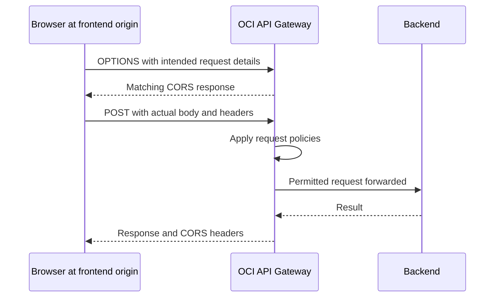

# Rate limiting, CORS, and request processing policies

When an API is brought onto Oracle Cloud Infrastructure, routing to a backend only solves the request path. The system also needs to limit traffic, allow only the right web applications to read responses, and reject invalid requests before they consume downstream resources.

This lesson belongs to the **APIs, Events, and Integration** chapter of the **CLOUD_PROVIDERS_ORACLE** module. We use OCI API Gateway to connect HTTP-layer decisions with IAM, VCN networking, monitoring, automation, and cost and availability goals.

The practical objective is to configure rate limiting, CORS, validation, and transformation in an API deployment; verify both allowed and rejected cases; and understand which responsibilities still belong to the backend.

## 1. Each policy answers a different question

Suppose a retail web application calls an order-creation API. The backend may be a Java service on Compute/OKE or a Function.

| Mechanism | Question to answer | Example |
| --- | --- | --- |
| Authentication | Who is the client? | Token verification |
| Authorization | What is the client allowed to do? | Allowed to create orders for this tenant? |
| Rate limiting | How many requests are allowed within a time window? | Protecting the backend from traffic exceeding capacity |
| CORS | May the browser share the response with the calling origin? | Allowing a frontend from a chosen domain |
| Request validation | Does the request have the required protocol elements? | Required headers, query parameters, media type |
| Request transformation | In what form will the backend receive headers/query parameters? | Setting an internal header or renaming a parameter |
| Business validation | Is the data valid in the application domain? | Product in stock, positive quantity, valid order owner |

API Gateway request/response policies are declared in the API deployment specification. They differ from IAM policies used to grant permissions on OCI resources. [Source: Adding Request Policies and Response Policies to API Deployment Specifications](https://docs.oracle.com/en-us/iaas/Content/APIGateway/Tasks/apigatewayaddingrequestpolicies.htm).

An origin in a CORS list does not identify the user. Similarly, a request containing all required headers does not prove the data inside those headers is trustworthy.

### 1.1. Global and route scope

A specification typically has two places to set request policies:

```json
{
  "requestPolicies": {
  },
  "routes": [
    {
      "path": "/orders",
      "methods": ["POST"],
      "backend": {
        "type": "STOCK_RESPONSE_BACKEND",
        "status": 200
      },
      "requestPolicies": {
      }
    }
  ]
}
```

`requestPolicies` outside `routes` is deployment-level; `requestPolicies` inside a route applies only to that route for supported policy types.

Not every policy can be placed in both locations. OCI applies **rate limiting across the entire API deployment**, whereas CORS can be configured at either the deployment or route level. Validation and the transformations in this lesson are placed at the route level. [Source: API Gateway request policies](https://docs.oracle.com/en-us/iaas/Content/APIGateway/Tasks/apigatewayaddingrequestpolicies.htm).

When the same policy type appears at multiple levels, verify which configuration actually takes effect for the route; do not assume lists or values merge automatically as you might expect.

## 2. Rate limiting: bounding traffic entering a deployment

### 2.1. Choosing the request aggregation key

The policy has two main properties:

```json
{
  "requestPolicies": {
    "rateLimiting": {
      "rateKey": "TOTAL",
      "rateInRequestsPerSecond": 20
    }
  }
}
```

| `rateKey` | Meaning | Suitable use case |
| --- | --- | --- |
| `TOTAL` | Aggregate threshold across clients calling the deployment | Protecting a shared processing budget |
| `CLIENT_IP` | Threshold per client IP address | Preventing a single caller source from consuming too many resources |

With `CLIENT_IP`, Oracle tracks individual IPv4 addresses and groups IPv6 clients by **/64** prefix. The policy cannot be set per individual route within the same deployment. [Source: Limiting the Number of Requests to API Gateway Back Ends](https://docs.oracle.com/en-us/iaas/Content/APIGateway/Tasks/apigatewaylimitingbackendaccess.htm).

If you want to test per client, replace `rateKey` with `CLIENT_IP` and choose a suitable threshold. The threshold values in this lesson are practice choices, not defaults or recommendations for every system.

### 2.2. Consequences of the key choice

With `TOTAL`, a high-volume client can consume a significant share of the shared budget. With `CLIENT_IP`, multiple users behind the same NAT or proxy can be grouped into one bucket, whereas a caller distributed across many IPs may not be throttled like a single user.

Therefore, an IP is not equivalent to a user, tenant, or customer contract. When a CDN, reverse proxy, or load balancer sits in front, check which IP the Gateway actually observes; do not assume a client-supplied `X-Forwarded-For` header is a trusted identity.

If `/catalog` and `/reports` are in the same deployment, they share that deployment's rate-limiting policy. To allocate budgets suited to backends with vastly different costs, reconsider how deployments are split or add limiting mechanisms at another layer.

Nor does the limit become an aggregate budget across all deployments in a tenancy. Two deployments targeting the same database must still be considered together during capacity design.

### 2.3. RPS differs from concurrency and quota

**RPS** measures request rate; **concurrency** measures work currently in flight; **quota** measures usage budget over a longer period.

A steady-state estimate:

```text
Average concurrent requests ≈ request rate × average processing time

Design example:
20 requests/sec × 0.2 sec ≈ 4 concurrent requests
20 requests/sec × 3 sec   ≈ 60 concurrent requests
```

This is a capacity estimate, not a guarantee of OCI's internal enforcement mechanism. The same RPS limit can produce vastly different backend load if database queries slow down.

If usage must be managed per subscriber, OCI provides **usage plans** with entitlements, rate limits, and quotas. That is a separate mechanism, not setting `rateKey` to a username in the policy above. [Source: Creating a Usage Plan](https://docs.oracle.com/en-us/iaas/Content/APIGateway/Tasks/apigatewaydefiningusageplans_topic-Creating-a-usage-plan.htm).

### 2.4. Clients need to handle throttling

HTTP `429 Too Many Requests` indicates that the client is sending too many requests. The response may include `Retry-After`. [Source: RFC 6585, section 4](https://www.rfc-editor.org/rfc/rfc6585.html#section-4).

Clients should have:

- A finite number of retries and an overall deadline.
- Wait intervals following server guidance when provided.
- Backoff with jitter so multiple clients do not retry simultaneously.
- Ways to slow down request cadence or prompt the user to wait.
- Safeguards against duplicate processing for operations with side effects.

`Retry-After` can be a number of seconds or an HTTP date per the HTTP standard. Parsers must handle the actual format rather than always casting to an integer. [Source: RFC 9110, Retry-After](https://www.rfc-editor.org/rfc/rfc9110.html#section-10.2.3).

Do not use unbounded retries for an order-creation `POST`. A timeout or network error can occur after the backend has already committed the change; idempotency must be designed into the application contract.

## 3. CORS: understanding origin and preflight properly

### 3.1. What is an origin?

For standard HTTP URLs, origin comparison is based on **scheme, host, and port**. [Source: HTML Standard — Origins](https://html.spec.whatwg.org/multipage/browsers.html#origin).

| URL | Compared to `https://shop.example.com` |
| --- | --- |
| `https://shop.example.com/orders` | Same origin; path does not create a new origin |
| `https://api.example.com` | Different host |
| `http://shop.example.com` | Different scheme |
| `https://shop.example.com:8443` | Different port |
| `http://localhost:3000` | Separate development origin |

In a CORS allowlist, declare an origin like `https://shop.example.com`; do not include the `/orders` path to represent an origin.

### 3.2. Preflight checks sharing conditions beforehand

For requests requiring preflight, the browser sends `OPTIONS` first:

```http
OPTIONS /policy-lab/orders?channel=web HTTP/1.1
Origin: https://shop.example.com
Access-Control-Request-Method: POST
Access-Control-Request-Headers: content-type,x-correlation-id
```

The gateway must return CORS headers matching the intended origin, method, and headers. A valid preflight uses a success response status, such as 200 or 204. [Source: Fetch Standard — CORS protocol](https://fetch.spec.whatwg.org/#http-cors-protocol).

Illustrative flow:



A `POST` sending `application/json` or a request using custom headers usually requires preflight. Not every cross-origin request has this step.

For some requests that do not require preflight, the request may already reach the server before the browser decides whether to share the response with JavaScript. Therefore, **CORS does not replace authentication, authorization, or side-effect controls**.

### 3.3. Reading OCI's CORS fields accurately

```json
{
  "cors": {
    "allowedOrigins": ["https://shop.example.com"],
    "allowedMethods": ["POST"],
    "allowedHeaders": ["Content-Type", "X-Correlation-Id"],
    "exposedHeaders": ["Retry-After", "opc-request-id"],
    "isAllowCredentialsEnabled": false,
    "maxAgeInSeconds": 60
  }
}
```

| Field | Decision to make |
| --- | --- |
| `allowedOrigins` | Which frontend origins may share responses |
| `allowedMethods` | Actual request methods permitted under CORS |
| `allowedHeaders` | Request headers the browser is allowed to send under CORS |
| `exposedHeaders` | Additional response headers JavaScript is allowed to read |
| `isAllowCredentialsEnabled` | Whether response sharing is supported for credentialed requests |
| `maxAgeInSeconds` | How long preflight results are cached |

OCI provides these fields in the CORS request policy and maps them to CORS response headers. [Source: Adding CORS support to API Deployments](https://docs.oracle.com/en-us/iaas/Content/APIGateway/Tasks/apigatewayaddingcorssupport.htm).

`allowedHeaders` and `exposedHeaders` operate in opposite directions. To let the client send `X-Correlation-Id`, declare it in `allowedHeaders`. To let JavaScript read `Retry-After` or a diagnostic header outside the default safelist, consider `exposedHeaders`.

Listing a name in `exposedHeaders` does not generate that header. The response must actually include the header, and the response itself must still pass CORS checks.

### 3.4. Credentials, wildcards, and caching

If the frontend needs to send cross-origin cookies, client-side configuration such as `credentials: "include"` must pair with a matching server-side policy. In this credentials mode, a wildcard `Access-Control-Allow-Origin: *` cannot substitute for a specific origin; the response must allow credentials per the standard. [Source: Fetch Standard — CORS protocol and credentials](https://fetch.spec.whatwg.org/#cors-protocol-and-credentials).

A production design should explicitly define allowed origins, cookie/token mechanisms, and CSRF protection if the app uses cookies for authentication. CORS does not grant permission to read an account's data.

`maxAgeInSeconds` caches the **preflight** result, not the business response lifetime. When changing CORS, browsers may still use cached preflight results; test in a clean browser environment or wait for the cache to expire.

If there is a shared cache or CDN, check the cache key and `Vary: Origin` when responses vary by origin. A cache configuration that ignores origin can serve one origin's response headers to another client.

Do not use `mode: "no-cors"` to fix an API whose response needs to be read: that mode does not make the response arbitrarily readable from JavaScript.

## 4. Request validation: blocking contract violations at the protocol layer

OCI supports policies validating headers, query parameters, and request body content types. Three modes:

| `validationMode` | Usage |
| --- | --- |
| `ENFORCING` | Non-compliant requests receive 4xx and are not forwarded to the backend |
| `PERMISSIVE` | Still forwards requests while logging validation errors to assess impact |
| `DISABLED` | Disables enforcement for that policy |

Validation is applied after CORS and authentication/authorization, and before transformation. [Source: Adding Request Validation to API deployments](https://docs.oracle.com/en-us/iaas/Content/APIGateway/Tasks/apigatewayaddingrequestvalidation.htm).

### 4.1. Requiring a header

```json
{
  "headerValidations": {
    "headers": [
      {
        "name": "X-Correlation-Id",
        "required": true
      }
    ],
    "validationMode": "ENFORCING"
  }
}
```

`headers` is a list of validation items, matching the OCI SDK model. [Source: HeaderValidationRequestPolicy](https://docs.oracle.com/en-us/iaas/tools/java/latest/com/oracle/bmc/apigateway/model/HeaderValidationRequestPolicy.html).

Requiring presence does not prove the value has UUID format, reasonable length, or identifies a principal. The backend or a dedicated validator must still validate values against the contract.

In this lesson, the correlation ID is for request tracing. It is not a trusted user ID merely because the client sent the header.

### 4.2. Requiring a query parameter

```json
{
  "queryParameterValidations": {
    "parameters": [
      {
        "name": "channel",
        "required": true
      }
    ],
    "validationMode": "ENFORCING"
  }
}
```

`parameters` is also a list in OCI's policy model. [Source: QueryParameterValidationRequestPolicy](https://docs.oracle.com/en-us/iaas/tools/java/latest/com/oracle/bmc/apigateway/model/QueryParameterValidationRequestPolicy.html).

This example does not check whether `channel` belongs to `web`, `mobile`, or another set. Nor does it prove the caller is authorized to use a self-declared tenant or business channel.

### 4.3. Validating body media type

```json
{
  "bodyValidation": {
    "required": true,
    "content": {
      "application/json": {
        "validationType": "NONE"
      }
    },
    "validationMode": "ENFORCING"
  }
}
```

With `validationType: "NONE"`, this policy restricts the content type as configured; it does not perform JSON Schema validation. [Source: Adding Request Validation to API deployments](https://docs.oracle.com/en-us/iaas/Content/APIGateway/Tasks/apigatewayaddingrequestvalidation.htm).

Even when a request declares `Content-Type: application/json`, the backend must still parse the payload and validate required fields. A non-JSON string can pass this example's media-type check.

Checks such as `quantity > 0`, product existence, buyer permissions, business size limits, and transaction integrity need an explicit enforcement point.

### 4.4. Rolling out validation for an API with existing clients

One operational approach is using `PERMISSIVE` to observe which requests would be affected, fixing the contract or clients, and then switching to `ENFORCING` once sufficient evidence is gathered.

During the permissive phase, the backend still receives contract-violating requests. Only choose this rollout when the current backend can safely handle those requests by design; it is not an error-blocking state.

## 5. Request transformation: normalizing data before the backend

Transformations can filter, rename, or set headers/query parameters. Example setting an internal header:

```json
{
  "headerTransformations": {
    "setHeaders": {
      "items": [
        {
          "name": "X-Internal-Channel",
          "values": ["policy-lab"],
          "ifExists": "OVERWRITE"
        }
      ]
    }
  }
}
```

| `ifExists` | Design meaning |
| --- | --- |
| `OVERWRITE` | Replace existing value with the policy-selected value |
| `APPEND` | Append value, potentially creating multiple values for the same header |
| `SKIP` | Keep existing value |

OCI uses the `setHeaders.items` structure with `values` and the behavior when a header already exists. Certain protected headers cannot be transformed by this policy. [Source: Adding Header Transformation Request Policies](https://docs.oracle.com/en-us/iaas/Content/APIGateway/Tasks/apigatewaymodifyingresponsesrequests-addingheadertransformrequestpolicies.htm).

### 5.1. Trust boundaries when propagating identity

On a token-authenticated route, verified claims can be forwarded to the backend:

```json
{
  "headerTransformations": {
    "setHeaders": {
      "items": [
        {
          "name": "X-Authenticated-Subject",
          "values": ["${request.auth[sub]}"],
          "ifExists": "OVERWRITE"
        }
      ]
    }
  }
}
```

This example only applies when an authentication policy has populated the `request.auth[sub]` context. Oracle provides patterns for passing verified claims as backend headers. [Source: Transformation Examples](https://docs.oracle.com/en-us/iaas/Content/APIGateway/Tasks/apigatewaymodifyingresponsesrequests-transformexamples.htm).

For headers representing identity, preserving client-sent values via `SKIP` can break the trust boundary. The backend must also block direct access paths that would allow clients to bypass the Gateway and inject the same header themselves.

The static header `X-Internal-Channel: policy-lab` in this lesson is only a processing label; it does not become a credential on its own.

### 5.2. Validation runs before transformation

If you require clients to send the `X-Correlation-Id` header, do not simultaneously assume a downstream transformation will inject that header to rescue a request missing it.

Likewise, if the client sends `locale` and the Gateway renames it to `region`, incoming request validation must match the name the client actually sends. Renaming does not retroactively affect a validation step that already ran.

Keys inside a JSON object do not specify policy execution order. Moving `headerTransformations` above `headerValidations` in the file does not alter the processing order defined by the service.

### 5.3. Controlled query parameter renaming

Example mapping a public parameter to the name expected by the backend:

```json
{
  "queryParameterTransformations": {
    "renameQueryParameters": {
      "items": [
        {
          "from": "locale",
          "to": "region"
        }
      ]
    }
  }
}
```

OCI supports filtering, renaming, and setting query parameters in request transformations. [Source: Adding Query Parameter Transformation Request Policies](https://docs.oracle.com/en-us/iaas/Content/APIGateway/Tasks/apigatewaymodifyingresponsesrequests-addingqueryparamtransformrequestpolicies.htm).

Before renaming, check what happens if a request contains both `locale` and `region` or if a parameter has multiple values. Explicitly choose how the backend receives and interprets the data so different layers do not use two different values for the same decision.

## 6. Complete practice specification

The lab uses a **stock response backend**: the Gateway itself returns a preconfigured response. This allows testing policies without yet creating a Java service, Function, or database. Oracle supports this backend type with fixed status, headers, and body. [Source: Adding Stock Responses as an API Gateway Back End](https://docs.oracle.com/en-us/iaas/Content/APIGateway/Tasks/apigatewayaddingstockresponses.htm).

Deployment targets:

| Component | Choice for this lesson |
| --- | --- |
| Deployment path prefix | `/policy-lab` |
| Route | `POST /orders` |
| Rate limit | `TOTAL`, 2 requests/second |
| Frontend origin | `https://shop.example.com` |
| Required input header | `X-Correlation-Id` |
| Required query parameter | `channel` |
| Input media type | `application/json` |
| Sample result | Fixed JSON, does not create an order |
| Response label | `X-Lab-Policy: policy-demo` |

`shop.example.com` is an illustrative origin. When testing from a real web application, replace it with the actual origin you control. If using `http://localhost:3000` for a dev frontend, declare that exact origin rather than writing only `localhost`.

### 6.1. JSON of the API deployment specification

```json
{
  "requestPolicies": {
    "rateLimiting": {
      "rateKey": "TOTAL",
      "rateInRequestsPerSecond": 2
    },
    "cors": {
      "allowedOrigins": ["https://shop.example.com"],
      "allowedMethods": ["POST"],
      "allowedHeaders": [
        "Content-Type",
        "X-Correlation-Id"
      ],
      "exposedHeaders": [
        "Retry-After",
        "opc-request-id",
        "X-Lab-Policy"
      ],
      "isAllowCredentialsEnabled": false,
      "maxAgeInSeconds": 60
    }
  },
  "routes": [
    {
      "path": "/orders",
      "methods": ["POST"],
      "backend": {
        "type": "STOCK_RESPONSE_BACKEND",
        "status": 200,
        "headers": [
          {
            "name": "Content-Type",
            "value": "application/json"
          },
          {
            "name": "X-Lab-Policy",
            "value": "policy-demo"
          }
        ],
        "body": "{\"accepted\":true,\"mode\":\"policy-lab\"}"
      },
      "requestPolicies": {
        "headerValidations": {
          "headers": [
            {
              "name": "X-Correlation-Id",
              "required": true
            }
          ],
          "validationMode": "ENFORCING"
        },
        "queryParameterValidations": {
          "parameters": [
            {
              "name": "channel",
              "required": true
            }
          ],
          "validationMode": "ENFORCING"
        },
        "bodyValidation": {
          "required": true,
          "content": {
            "application/json": {
              "validationType": "NONE"
            }
          },
          "validationMode": "ENFORCING"
        },
        "headerTransformations": {
          "setHeaders": {
            "items": [
              {
                "name": "X-Internal-Channel",
                "values": ["policy-lab"],
                "ifExists": "OVERWRITE"
              }
            ]
          }
        }
      }
    }
  ]
}
```

Deployment-level and route-level placements are chosen according to the supported scope of each policy. Stock responses use `headers` with `name`/`value` pairs; transformations use `setHeaders.items` with `values` as a list.

This version is for technical verification and does not yet add authentication or authorization for business data. The body `accepted: true` is only a fixed stock response output and does not confirm an order was saved.

### 6.2. Create the deployment

Prerequisites:

- An API Gateway in the assigned region and compartment.
- An account with permission to manage deployments in that compartment.
- Network connectivity from the test machine to the Gateway endpoint.
- Required logging enabled to verify policies.

In the Console:

1. Open the Gateway in the right region.
2. Create a dedicated deployment for this lesson.
3. Name it, for example `request-policies-lab`.
4. Set path prefix `/policy-lab`.
5. Upload the JSON specification saved in your lab environment.
6. Review deployment-level and route-level policies.
7. Create the deployment, wait for the active state, then copy the endpoint.

OCI allows configuring rate limiting, CORS, and other policies during API deployment creation. [Source: Deploying an API on an API Gateway by Creating an API Deployment](https://docs.oracle.com/en-us/iaas/Content/APIGateway/Tasks/apigatewaycreatingdeployment.htm).

If using the OCI CLI with the prepared `api-policy-lab.json` file:

```bash
OCI_REGION="ap-singapore-1"
API_COMPARTMENT_OCID="REPLACE_WITH_API_COMPARTMENT_OCID"
GATEWAY_OCID="REPLACE_WITH_GATEWAY_OCID"

oci --region "$OCI_REGION" api-gateway deployment create \
  --compartment-id "$API_COMPARTMENT_OCID" \
  --gateway-id "$GATEWAY_OCID" \
  --display-name "request-policies-lab" \
  --path-prefix "/policy-lab" \
  --specification file://api-policy-lab.json
```

Capture the actual deployment endpoint, which already includes the `/policy-lab` prefix:

```bash
DEPLOYMENT_ENDPOINT="https://REPLACE_WITH_GATEWAY_HOST/policy-lab"
API_URL="$DEPLOYMENT_ENDPOINT/orders"
```

The shell examples below use Bash. Do not append the prefix a second time if the endpoint already contains it.

## 7. Verifying CORS and validation case by case

With an aggregate limit of only 2 requests/second, run contract test cases at a slow pace and allow the limit to recover between cases. If you receive 429, resolve the rate-limit condition before concluding a validation case failed.

### 7.1. Valid preflight

```bash
curl --silent --show-error --include \
  --request OPTIONS \
  --header 'Origin: https://shop.example.com' \
  --header 'Access-Control-Request-Method: POST' \
  --header 'Access-Control-Request-Headers: content-type,x-correlation-id' \
  "$API_URL?channel=web"
```

Check the response:

- Status suitable for a successful preflight.
- `Access-Control-Allow-Origin` matches the allowed origin.
- `Access-Control-Allow-Methods` allows `POST`.
- `Access-Control-Allow-Headers` allows the requested headers.
- Preflight cache info reflects the active policy.

Preflight lists custom header names in `Access-Control-Request-Headers`; it does not send the actual request's `X-Correlation-Id` value. Do not "fix" issues by requiring browsers to attach tokens or business bodies to standard preflight requests.

In the example, the business route only declares `POST`. The CORS handler is responsible for handling preflight; listing `OPTIONS` in `allowedMethods` does not replace allowing the actual `POST` method.

### 7.2. Valid actual request

```bash
curl --silent --show-error --include \
  --request POST \
  --header 'Origin: https://shop.example.com' \
  --header 'Content-Type: application/json' \
  --header 'X-Correlation-Id: policy-probe-001' \
  --data '{"sku":"BOOK-001","quantity":1}' \
  "$API_URL?channel=web"
```

Expected at a low pace:

```json
{"accepted":true,"mode":"policy-lab"}
```

Check status, CORS response headers, `Content-Type`, and `X-Lab-Policy`. Inspecting the body alone is not enough to confirm a browser can read the response.

### 7.3. Missing required header

Keep the query parameter and body, omit `X-Correlation-Id`:

```bash
curl --silent --show-error --include \
  --request POST \
  --header 'Content-Type: application/json' \
  --data '{"sku":"BOOK-001","quantity":1}' \
  "$API_URL?channel=web"
```

Expect validation to block with 4xx and matching evidence in the execution log. Do not assume every kind of violation uses the exact same status code.

### 7.4. Missing required query parameter

```bash
curl --silent --show-error --include \
  --request POST \
  --header 'Content-Type: application/json' \
  --header 'X-Correlation-Id: policy-probe-002' \
  --data '{"sku":"BOOK-001","quantity":1}' \
  "$API_URL"
```

A request missing `channel` must be blocked when the policy is in `ENFORCING` mode.

Next, try an unexpected value, such as `channel=unknown`. A presence check may still let it through; if the application only accepts a fixed set of values, the backend must validate that set.

### 7.5. Disallowed media type

```bash
curl --silent --show-error --include \
  --request POST \
  --header 'Content-Type: text/plain' \
  --header 'X-Correlation-Id: policy-probe-003' \
  --data 'hello' \
  "$API_URL?channel=web"
```

Expect the media-type policy to block the request in enforcing mode.

To understand the policy's boundary, send a non-JSON body while still declaring `application/json`:

```bash
curl --silent --show-error --include \
  --request POST \
  --header 'Content-Type: application/json' \
  --header 'X-Correlation-Id: policy-probe-004' \
  --data 'this-is-not-json' \
  "$API_URL?channel=web"
```

With stock response and `validationType: NONE`, this case may still receive the sample output because there is no business JSON parser yet. When replaced with a real backend, the backend must reject unparseable data.

### 7.6. Disallowed origin

Try preflight with another origin:

```bash
curl --silent --show-error --include \
  --request OPTIONS \
  --header 'Origin: https://unlisted.example.net' \
  --header 'Access-Control-Request-Method: POST' \
  --header 'Access-Control-Request-Headers: content-type,x-correlation-id' \
  "$API_URL?channel=web"
```

The result must not grant CORS permission to an origin outside the allowlist. Evaluate based on headers and browser behavior, not solely on a fixed status code.

If using `curl` to send the actual request directly, that tool does not enforce browser response-sharing policies. Such a request can reach the server even when the origin is not permitted to read the response in JavaScript.

### 7.7. Header or method outside the CORS contract

You can keep a valid origin while changing:

```http
Access-Control-Request-Method: DELETE
```

Or requesting an undeclared header:

```http
Access-Control-Request-Headers: content-type,x-correlation-id,x-debug-mode
```

Verify that the policy does not grant permission for that method/header. Allowing a method in CORS also does not automatically create a corresponding business route.

## 8. Verifying from a browser

Run JavaScript in a frontend served from the declared origin. The browser sets `Origin` automatically and performs preflight when needed:

```javascript
const response = await fetch(
  "https://REPLACE_WITH_GATEWAY_HOST/policy-lab/orders?channel=web",
  {
    method: "POST",
    headers: {
      "Content-Type": "application/json",
      "X-Correlation-Id": crypto.randomUUID()
    },
    body: JSON.stringify({
      sku: "BOOK-001",
      quantity: 1
    })
  }
);

console.log("status", response.status);
console.log("policy", response.headers.get("X-Lab-Policy"));
console.log("retryAfter", response.headers.get("Retry-After"));
console.log("body", await response.text());
```

In Developer Tools:

1. Check the page's actual origin.
2. Inspect the `OPTIONS` request and requested headers.
3. Verify whether the `POST` request is sent after preflight.
4. Check CORS headers on the actual response.
5. Confirm JavaScript can read `X-Lab-Policy`.

The `Retry-After` header may be `null` on a successful response because the server has no reason to generate it. Adding it to `exposedHeaders` only allows reading it when the header is present.

If `fetch` fails at the CORS layer, JavaScript code may be unable to read the real status/body. Cross-check the Network tab and Gateway logs to tell whether the root cause is CORS, rate limiting, authentication, or the backend.

Also check CORS on **error responses**, especially when the frontend needs to read 429 and retry info. A successful response having the right headers does not prove every blocked response can be shared the same way.

## 9. Generating a small traffic burst to observe rate limiting

Run this example only against this lesson's dedicated stock response deployment. The following burst sends at most 30 requests with a timeout per command:

```bash
for n in $(seq 1 30); do
  curl --silent --show-error \
    --max-time 10 \
    --output /dev/null \
    --write-out '%{http_code}\n' \
    --request POST \
    --header 'Content-Type: application/json' \
    --header "X-Correlation-Id: rate-probe-$n" \
    --data '{"sku":"BOOK-001","quantity":1}' \
    "$API_URL?channel=web" &
done
wait
```

The goal is to see requests throttled by the policy when traffic exceeds the threshold, then cross-check logs. Do not require every test run to produce exactly 2 successful responses and 28 rejected responses: arrival timing, execution time, and prior limiter state all affect the observation.

Capture one throttled response with `curl --include` to inspect retry guidance headers. After the burst ends and the wait window passes, valid low-rate requests should succeed again.

### 9.1. Comparing TOTAL and CLIENT_IP

To compare, update only `rateKey` and repeat controlled tests:

| Test case | What to observe |
| --- | --- |
| `TOTAL`, multiple clients on same deployment | Shared aggregate budget |
| `CLIENT_IP`, same outbound Internet address | Requests may be bucketed together by IP |
| `CLIENT_IP`, different network sources | Identify client groupings observed by Gateway |
| Calling two routes in same deployment | Understand deployment scope of rate policy |
| Calling two deployments to same backend | Assess total load the backend can receive |

Do not assume preflight is exempt from limits in every configuration. When measuring browser traffic, separate `OPTIONS` requests from business requests and verify actual behavior in logs.

### 9.2. Choosing thresholds for production systems

Measure backend capacity under representative conditions: processing time, errors, database connection counts, and resource usage. Then leave headroom for variance, retries, and other callers.

If the gateway caps at 100 requests/second but each request triggers multiple queries or downstream calls, edge limits do not reflect total internal load.

Thresholds need an owner and rationale. Raising the rate limit just to make 429s disappear can turn the problem into timeouts or database errors.

## 10. Verifying transformation with an observable backend

Stock responses do not reveal which headers an external backend actually received. To verify transformations, use a team-controlled test HTTP backend or Function that only returns the metadata under test.

Example test:

1. Client sends `X-Internal-Channel: client-value`.
2. Gateway applies `OVERWRITE` to `policy-lab`.
3. Backend logs or echoes the value actually received.
4. Verify the backend only receives the value per the intended contract.

Keep this observation inside the lab environment; do not echo all headers in responses since they may contain sensitive information.

If implementing identity headers from `request.auth[sub]`, also test requests with valid tokens, invalid tokens, missing tokens, and clients attempting to spoof identity headers. Only trust the value when authentication policy, transformation, and backend ingress all establish a trust boundary.

When the backend is an OCI Function or another OCI service, IAM is still required for the calling principal. Request transformation does not grant invoke permissions or replace OCI authentication.

## 11. Inspecting logs and distinguishing error causes

Enable **access logs** to see requests/status/timing and **execution logs** to understand which policy processed or rejected a request.

OCI provides execution log codes:

| Log code | Diagnostic meaning |
| --- | --- |
| `rateLimiting.requestDenied` | Denied by rate-limiting policy |
| `rateLimiting.requestPermitted` | Request passed rate limiting |
| `requestValidation.validationError` | Violated validation policy |
| `requestValidation.validationPermitted` | Passed validation |
| `headerTransformation.protectedHeaderTransformed` | Attempted to transform a protected header |
| `tokenAuthentication.authenticationFailed` | Token authentication error per policy |

These codes are documented by Oracle in API Gateway Logging documentation. [Source: Details for API Gateway](https://docs.oracle.com/en-us/iaas/Content/Logging/Reference/details_for_api_gateway.htm).

A request that passes rate limiting can still fail at a later step. Do not use `requestPermitted` alone as proof that business processing succeeded.

### 11.1. Information to correlate across layers

Record the deployment, route, UTC timestamp, method, status, latency, and request ID. The backend can log the correlation ID to link logs with calls, while still sanitizing the length and format of client-supplied values.

Log data for metrics should separate:

- Business requests vs. preflight requests.
- Policy errors vs. backend errors.
- Deployment-level rate limits vs. usage-plan limits if any.
- Errors from outdated clients during contract changes vs. anomalous errors.
- Cases where browsers cannot read responses vs. root errors on the server.

Do not log full bearer tokens, cookies, or order bodies just to locate a missing field.

### 11.2. Quick troubleshooting table

| Symptom | Direction to check |
| --- | --- |
| `curl` succeeds, browser fails | Actual origin, preflight, credentials, and CORS response headers |
| Browser cannot read `Retry-After` | Is the header present, is it exposed, and did the response pass CORS? |
| CORS changed recently, browser uses old behavior | Preflight cache and intermediate caches |
| Missing header still passes | Right deployment/route, and is mode permissive/disabled? |
| Invalid JSON body still returns 200 in lab | Stock response and `validationType: NONE` do not parse JSON |
| Transformation does not rescue missing header | Validation runs before transformation |
| A group of users all hit 429 | NAT/proxy and client IP grouping |
| Raising RPS causes more backend errors | Backend capacity, execution time, and concurrency |
| Client sets a header resembling identity | Authentication context, overwrite, and direct backend bypass paths |
| Test gets 429 instead of expected validation error | Slow down test pace, let rate limit recover, and re-test |

## 12. Operationalizing policies and change management

API deployment specifications should be version-controlled with reproducible deployment procedures. For each change, record the rationale, route/deployment scope, client impact, and a rollback-ready configuration.

A rollout sequence can include:

1. Test on a learning or staging deployment with an observable backend.
2. Verify both successful requests and blocked request categories.
3. Audit which origins, headers, and media types existing clients use.
4. Size rate limits against backend capacity.
5. Switch validation to enforcing under a compatibility plan.
6. Monitor post-deployment and roll back on evidence of unintended impact.

Do not assume rolling back a policy immediately clears preflight results cached by browsers. When changing allowlists or headers, factor cache lifetime into the transition plan.

### 12.1. Cost control and availability

Rate limiting can reduce load forwarded to the backend, but it is not a guarantee that total OCI costs are capped at a fixed number. Costs also depend on Gateway, Functions/Compute, logs, data, and related services.

Trade-offs to weigh:

| Decision | Benefit and trade-off |
| --- | --- |
| Tighter limit | Reduces backend pressure, may increase rejected valid requests |
| Using `CLIENT_IP` | Throttles a single IP source, may affect users sharing NAT |
| Using `TOTAL` | Protects aggregate budget, requires monitoring fairness across clients |
| Increasing preflight cache | May reduce OPTIONS calls, CORS changes take longer to take effect |
| Reducing log data | Reduces volume, must retain enough diagnostic metadata |
| Normalizing internal headers | Simplifies backend, must protect the trust boundary |

If there are multiple deployments or standby regions, check policies in each location. Recreating routes while omitting rate limits or CORS can produce different behavior during traffic failover.

### 12.2. Boundary of responsibilities between Gateway and backend

The Gateway should handle selected protocol checks and access policies. The Java backend or Function still needs to:

- Parse and validate actual payloads.
- Enforce authorization on business resources.
- Implement idempotency and transactions when needed.
- Set timeouts for dependencies and manage connections.
- Return appropriate errors so clients know whether to retry.
- Protect paths that bypass the Gateway using network architecture and identity.

The same 200 response at the API edge does not always prove business data was persisted, especially with stock responses or asynchronous work.

## 13. Lab completion evidence

| Item | Required evidence |
| --- | --- |
| Policies at right scope | Rate limit at deployment level; validation/transformation at route level |
| Valid request | Receives expected stock response and headers at low rate |
| Valid preflight | Requested origin, method, and headers are allowed |
| CORS not overly broad | Origins/headers/methods outside the contract are not granted sharing |
| Validation works | Missing header, missing query, or wrong media type blocked when enforcing |
| Understand body validation limit | Distinguishes media type from parsing/JSON Schema/business checks |
| Rate limiting works | Throttled responses observed with matching `rateLimiting.requestDenied` logs |
| Client can read needed info | Browser reads exposed response/headers as designed |
| Transformation works | Test backend receives transformed values |
| Operable | Tracks errors, latency, client groups, and rollback configuration |

After this lesson, learners should be able to explain why a request passed or was blocked, which policy made that decision, and which checks still must run in the backend.
