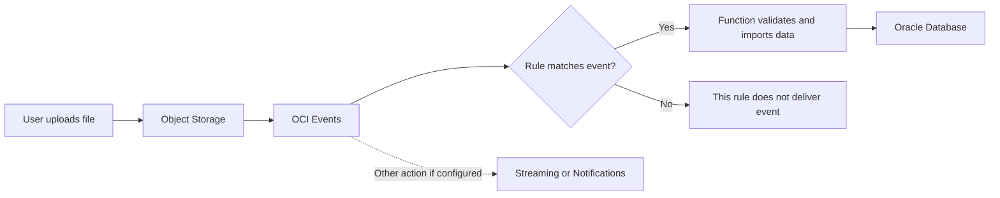

# OCI Events and the CloudEvents structure

## 1. Objectives and integration scenario

In the **APIs, Events, and Integration** chapter of the **CLOUD_PROVIDERS_ORACLE** module, this lesson covers how OCI Events receives events from Oracle Cloud Infrastructure resources, selects events via rules, and routes them to processing services. The focus is on reading the CloudEvents structure used by OCI, designing filters, and building operationally reliable consumers.

Running scenario: a user uploads a CSV file into the logical folder `incoming/` of the `incoming-documents` bucket. Object Storage emits an object-created event; Events selects the right event and invokes a Function to validate the file, then writes the imported results into Oracle Database.

Objectives after this lesson:

- Distinguish between producer, event, rule, action, and consumer.
- Read the OCI Events envelope and service-specific payloads.
- Distinguish OCI's CloudEvents 0.1 envelope from CloudEvents 1.0.
- Author conditions with accurate JSON paths and compartment scope.
- Understand event delivery limits regarding ordering, retries, and business completion.
- Design parsers, idempotency, monitoring, and verification labs.

Bucket names, OCIDs, event IDs, and data in the examples are illustrative values. Deployment commands should only be run after replacing placeholders and preparing test resources.

## 2. Where does OCI Events fit in the architecture?

### 2.1. From resource change to action

An event describes something that happened, such as an object being created, a backup completing, or a resource changing state. The producer provides information about the occurrence; the consumer decides how to react.

OCI Events routes events using rules consisting of a matching condition and target actions. The direct destination types listed in the documentation are Notifications, Streaming, and Functions. See [Overview of Events](https://docs.oracle.com/en-us/iaas/Content/Events/Concepts/eventsoverview.htm).



Roles to distinguish:

| Component | Role in the example |
| --- | --- |
| Producer | Object Storage emitting object state events |
| Event | JSON record describing the object creation |
| Rule | Selects create-object for the target bucket and prefix |
| Action | Configuration delivering the event to a Function |
| Consumer | Function code reading the event and processing the file |
| Final business outcome | Valid data rows written to the DB |

A rule can have multiple actions. Do not treat actions as a sequential pipeline or a shared transaction: action A succeeding does not prove action B has finished.

### 2.2. Infrastructure events differ from business events

`ObjectCreated` reports a change to an object; it does not by itself confirm:

- That the file matches the CSV format supported by the application.
- That the uploader intended to submit a new invoice.
- That records in the file have not been imported previously.
- That the entire import workflow succeeded.

If you want to publish `InvoiceImported`, the application must determine when that business milestone completes and choose an appropriate publishing mechanism.

CloudEvents standardizes how events are described. It does not by itself provide a broker, an arbitrary event-ingestion API, or a DB transaction commit mechanism. Writing valid CloudEvents JSON does not mean you can send that JSON into every system claiming CloudEvents support.

### 2.3. Events differ from logs, audit, and streams

| Need | What to choose |
| --- | --- |
| Automatically react to OCI resource changes | Events rule and appropriate action |
| Investigate who called an API and what operation they ran | Audit and related logs |
| Retain a sequence of records for consumers to replay | Streaming or a designed storage layer |
| Orchestrate multi-step stateful workflows | Orchestration mechanism with workflow state storage |
| Process jobs with ack/completion controls | Queue or equivalent job mechanism |

Do not assume every API call emits an event that Events can select. Look up the event type for the exact service and operation in [Services that Produce Events](https://docs.oracle.com/en-us/iaas/Content/Events/Reference/eventsproducers.htm).

## 3. Reading the OCI Events envelope accurately

### 3.1. Envelope version documented by OCI

The OCI Events documentation referenced for this lesson specifies an envelope using **CloudEvents 0.1**, with fields such as `eventID`, `eventType`, and `cloudEventsVersion`. Do not replace them with `id`, `type`, and `specversion` when writing filters for native OCI events.

Field definitions are in [Contents of an Event Message](https://docs.oracle.com/en-us/iaas/Content/Events/Reference/eventenvelopereference.htm).

An event has two main parts:

- **Envelope**: common context for identification and routing.
- **`data` payload**: producer-supplied details that vary by resource type.

### 3.2. Illustrative object-created event

The example below is based on the object event structure in the producer documentation, with sample values for the lab:

```json
{
  "cloudEventsVersion": "0.1",
  "eventID": "4f5d29a8-82ef-48ab-9d34-9248b676b151",
  "eventType": "com.oraclecloud.objectstorage.createobject",
  "source": "objectstorage",
  "eventTypeVersion": "2.0",
  "eventTime": "2026-11-20T02:15:30Z",
  "contentType": "application/json",
  "extensions": {
    "compartmentId": "ocid1.compartment.oc1..exampleintegrationlab"
  },
  "data": {
    "compartmentId": "ocid1.compartment.oc1..exampleintegrationlab",
    "compartmentName": "IntegrationLab",
    "resourceName": "incoming/invoice-001.csv",
    "resourceId": "",
    "availabilityDomain": "all",
    "additionalDetails": {
      "eTag": "21af9b1c-6d37-49f2-b120-43b2f77f6101",
      "namespace": "acmedemo",
      "archivalState": null,
      "bucketName": "incoming-documents",
      "bucketId": "ocid1.bucket.oc1.ap-singapore-1.exampleincoming"
    }
  }
}
```

Object event types include create, update, and delete; sample object payloads can have an empty `resourceId`. Cross-check the Object Storage section in [Oracle's producer catalog](https://docs.oracle.com/en-us/iaas/Content/Events/Reference/eventsproducers.htm).

Therefore, the consumer in this example fetches the object using namespace, bucket, and `resourceName`. Not every event is guaranteed to have a non-empty resource OCID.

### 3.3. Fields to read by role

| OCI field | How it is used |
| --- | --- |
| `cloudEventsVersion` | Determines how to interpret the envelope |
| `eventID` | Identifies the event for tracing and duplicate-delivery handling |
| `eventType` | Selects the operation/handler type |
| `eventTypeVersion` | Selects the data contract for the event type |
| `source` | Identifies the source per producer convention |
| `eventTime` | Time the occurrence happened, not when the consumer received it |
| `contentType` | Payload data type |
| `extensions` | OCI envelope extension context |
| `data` | Resource and operation details |

Preserve exact key casing. `eventID`, `eventId`, and `eventid` are distinct JSON keys.

`eventID` identifies the event; `resourceId` identifies the resource. Two changes on the same resource can have two different event IDs. An API call's request ID, if provided elsewhere, is not an event ID either.

### 3.4. Payloads do not share a universal schema across services

In the example:

```text
data.resourceName                      → object name
data.additionalDetails.bucketName      → bucket name
data.additionalDetails.namespace       → Object Storage namespace
data.additionalDetails.eTag            → ETag included by the producer in the event
```

In a Compute or Database event, `resourceName` and `additionalDetails` have different meanings. Do not write a global parser assuming `resourceName` is always a bucket or always an OCID.

Some events include tags in `data`, but do not assume every event contains both `freeFormTags` and `definedTags`. Only filter on a field after confirming the producer actually emits it.

`availabilityDomain: "all"` does not mean the consumer can pick an AD from this string. It is a producer context value; do not use it as deployment configuration.

### 3.5. Events describe the past; APIs usually read the present

By the time the Function receives the event, the object may already have been updated or deleted. Fetching the object by name at processing time may return a different version than the one that triggered the event.

If business logic requires the exact content from that point in time, design immutable object names, use versioning when appropriate, or check ETags/conditional reads supported by the API. Do not assume payloads always include a full version ID.

Treat ETag as an opaque value per the service contract. Do not assume every ETag is an MD5 checksum or a monotonically increasing sequence number.

## 4. How does CloudEvents 1.0 differ from OCI's structure?

### 4.1. Four required attributes of 1.0

CloudEvents 1.0 has four required context attributes:

| Attribute | Role |
| --- | --- |
| `specversion` | Envelope version, value `1.0` |
| `id` | Non-empty ID, unique within the scope of source |
| `source` | Source context as a URI-reference |
| `type` | Event type |

Fields like `time`, `subject`, `datacontenttype`, and `dataschema` are optional in the standard. An application may require them in its own contract. See [CloudEvents Core 1.0.2](https://github.com/cloudevents/spec/blob/v1.0.2/cloudevents/spec.md).

The specification document release number `1.0.2` does not make the `specversion` value `1.0.2`; the value on the event remains `1.0`.

### 4.2. Mapping table for understanding, not automatic renaming

| Native OCI Events | CloudEvents 1.0 equivalent | Decision to make |
| --- | --- | --- |
| `cloudEventsVersion` | `specversion` | Actually convert the envelope |
| `eventID` | `id` | Keep stable when forwarding the same event |
| `eventType` | `type` | Preserve event type semantics |
| `source` | `source` | Choose a clear source namespace |
| `eventTime` | `time` | Preserve original occurrence time |
| `contentType` | `datacontenttype` | Describes data; do not confuse with HTTP Content-Type |
| `eventTypeVersion` | No standard field with this name | Use an extension or schema contract |
| OCI `extensions` | Appropriate extensions | Do not lift an entire object as a context extension |
| `data` | `data` | Preserve JSON type and content |

In CloudEvents 1.0 JSON, extension context attributes are placed at the top level; names use lowercase ASCII letters and digits. Serialization rules are specified in [CloudEvents JSON Event Format 1.0.2](https://github.com/cloudevents/spec/blob/v1.0.2/cloudevents/formats/json-format.md).

Do not merely add `"specversion": "1.0"` to a legacy OCI event and declare it a valid 1.0 event. Context fields, serialization, and consumer contracts must be handled consistently.

### 4.3. Example output of an application-designed adapter

Suppose an organization needs to convert OCI events to CloudEvents 1.0 for another integration pipeline. An adapter could produce:

```json
{
  "specversion": "1.0",
  "id": "4f5d29a8-82ef-48ab-9d34-9248b676b151",
  "source": "urn:example:oci:objectstorage:demo-tenancy:ap-singapore-1",
  "type": "com.oraclecloud.objectstorage.createobject",
  "subject": "incoming-documents/incoming/invoice-001.csv",
  "time": "2026-11-20T02:15:30Z",
  "datacontenttype": "application/json",
  "ocieventversion": "2.0",
  "ocisource": "objectstorage",
  "ocicompartmentid": "ocid1.compartment.oc1..exampleintegrationlab",
  "data": {
    "compartmentId": "ocid1.compartment.oc1..exampleintegrationlab",
    "compartmentName": "IntegrationLab",
    "resourceName": "incoming/invoice-001.csv",
    "resourceId": "",
    "availabilityDomain": "all",
    "additionalDetails": {
      "eTag": "21af9b1c-6d37-49f2-b120-43b2f77f6101",
      "namespace": "acmedemo",
      "archivalState": null,
      "bucketName": "incoming-documents",
      "bucketId": "ocid1.bucket.oc1.ap-singapore-1.exampleincoming"
    }
  }
}
```

This is an adapter convention in this lesson, not a default OCI output or an Oracle-mandated standard extension namespace.

Adapter design choices:

- `source` is built from trusted source configuration with stable tenancy/region identifiers.
- `id` preserves the original event ID so re-delivered events are recognizable.
- `subject` is an integration resource-naming convention, not assumed to be an Object Storage URL.
- `eventTypeVersion` is preserved in a dedicated extension.
- The `data` payload remains a JSON object, not stringified JSON.
- Do not replace `eventTime` with the conversion timestamp.

The identity key in CloudEvents 1.0 is the `source + id` pair. If an adapter mints a new source or id on every replay, consumers will struggle to recognize duplicate events.

If you want to emit a new business event after importing data, such as `com.example.invoice.imported`, that is a different occurrence: it needs its own ID and business schema, while linking back to the input event per tracing conventions.

## 5. Event structure and HTTP transport modes

### 5.1. Structured mode

In CloudEvents 1.0 JSON structured mode, both envelope and data reside in the body; the HTTP Content-Type identifies the CloudEvents format:

```http
POST /integration/events HTTP/1.1
Host: consumer.example.com
Content-Type: application/cloudevents+json

{
  "specversion": "1.0",
  "id": "demo-event-001",
  "source": "urn:example:integration:lab",
  "type": "com.example.file.accepted",
  "datacontenttype": "application/json",
  "data": {
    "fileName": "invoice-001.csv"
  }
}
```

`Content-Type: application/cloudevents+json` describes the entire envelope over HTTP. `datacontenttype: application/json` describes `data` specifically.

### 5.2. Binary mode

The same event can be transmitted with context in HTTP headers and data in the body:

```http
POST /integration/events HTTP/1.1
Host: consumer.example.com
ce-specversion: 1.0
ce-id: demo-event-001
ce-source: urn:example:integration:lab
ce-type: com.example.file.accepted
Content-Type: application/json

{
  "fileName": "invoice-001.csv"
}
```

Binary mode does not mean the payload is necessarily raw binary bytes. It describes how context and data are mapped across the protocol.

Both transport modes are defined in [CloudEvents HTTP Protocol Binding 1.0.2](https://github.com/cloudevents/spec/blob/v1.0.2/cloudevents/bindings/http-protocol-binding.md).

Do not mechanically apply these HTTP 1.0 examples to assume every OCI Events action delivers events using `ce-*` headers. Always inspect the actual contract of the delivery path.

### 5.3. Target service wrappers

If an event passes through Notifications, a stream record, or another integration layer, the consumer may receive an additional wrapper or encoding. The right reading procedure is:

1. Identify the transport protocol and packaging layer of the delivering service.
2. Decode or unwrap according to that contract.
3. Identify the inner event envelope.
4. Validate and map to the application model.

Do not blindly loop `JSON.parse` until strings stop unwrapping without checking structure. That makes it easy to accept malformed data or lose the boundary between transport message and payload.

## 6. Writing rules with the right JSON structure

### 6.1. Condition matching created objects

Filter for this lesson's scenario:

```json
{
  "eventType": [
    "com.oraclecloud.objectstorage.createobject"
  ],
  "data": {
    "compartmentId": [
      "ocid1.compartment.oc1..exampleintegrationlab"
    ],
    "resourceName": [
      "incoming/*"
    ],
    "additionalDetails": {
      "namespace": [
        "acmedemo"
      ],
      "bucketName": [
        "incoming-documents"
      ]
    }
  }
}
```

The condition expresses: matching event type, compartment, namespace, bucket, and object name with the selected prefix.

OCI requires fields to follow the same nested structure as the event. All specified fields must match; multiple values in an array act as alternatives for matching that field. Unspecified fields do not participate in filtering. See [Matching Events with Filters](https://docs.oracle.com/en-us/iaas/Content/Events/Concepts/filterevents.htm).

A common mistake is putting `bucketName` directly under `data`, whereas object events place it under `data.additionalDetails`.

### 6.2. Compartment scope matters as much as the condition

A rule applies to events from the compartment containing the rule and its child compartments as defined by the service scope. A rule placed in a sibling compartment does not automatically see a source simply because the condition lists that source's OCID.

In the lab, place the rule in the same compartment as the bucket. If placing it in a parent compartment for centralized management, a specific `data.compartmentId` condition narrows the source.

Do not move compartments just to make a wrong-path filter start matching; determine whether the issue is scope or condition.

### 6.3. Wildcards, null, and schema

Rules to keep in mind:

- The `*` wildcard appears inside values, not in place of key names.
- Wildcards are not full regular expressions.
- A `*` value does not imply matching null or missing fields.
- An empty condition `{}` is very broad within the rule's scope.

Only filter on fields needed for routing. Filtering on too many mutable fields means producer or tag updates could stop valid events from matching.

Conversely, an overly broad condition can invoke the consumer unnecessarily and cause side effects on unintended resources.

### 6.4. Conditions are not schema validators

A rule matching the right bucket does not prove the event contains all data needed for business logic. The consumer must still validate version, required fields, and input values.

Nor should the `source` field in JSON be treated as authentication proof. Anyone able to send data to an unprotected endpoint can set `source` arbitrarily; endpoint access and delivery-channel trust must be enforced separately.

## 7. IAM permissions and networking in the event flow

Separate the permission scopes:

| Principal or step | Permissions to consider |
| --- | --- |
| Deployer | Manage rules in the assigned compartment |
| Action configurator | Access target resources to select and configure them |
| Event delivery mechanism | Permitted to execute the action under applicable policies |
| Business Function | Read the right object, write to the right DB table/store |
| Operator | Read rules, metrics, and required logs |

A compartment-scoped rule-management policy using example names:

```text
Allow group EventRuleEditors to manage cloudevents-rules in compartment IntegrationLab
```

This line only illustrates rule-management permission; it is not the full policy set for a flow involving Functions and Object Storage. Policy templates must be checked against [Events and IAM Policies](https://docs.oracle.com/en-us/iaas/Content/Events/Concepts/eventspolicy.htm), then narrowed by target and usage scope.

A Function's permission to read objects is a separate runtime permission, typically designed with a resource principal and matching policies. Letting a deployer manage rules does not automatically grant Function code permission to read buckets.

On the network side, the Function must have DNS, routes, and security rules to reach Object Storage or the DB per the chosen architecture. Successful event delivery to the Function does not create a network path from the Function to a private DB endpoint.

Do not embed DB credentials or tokens in rules, event names, or payloads to avoid designing IAM. Secrets must be managed and accessed via an appropriate mechanism.

## 8. Lab: creating a rule with the OCI CLI

### 8.1. Prepare resources

Use a test compartment and the same region for the example resources:

- Bucket `incoming-documents`, with real namespace and compartment.
- A deployed Function that accepts OCI JSON events and produces minimal logs.
- Permissions to update the bucket, create rules, and use the action under applicable policies.
- Runtime permissions and network path for the Function if it reads files or writes to a DB.
- Synthetic CSV data, avoiding real customer data.

The JSON files in the commands are lab files created by the learner in their working directory.

### 8.2. Enable object events on the bucket

Object state-change events are not enabled by default on every bucket. With the CLI:

```powershell
$namespace = '<OBJECT_STORAGE_NAMESPACE>'
$bucketName = 'incoming-documents'

$bucketArgs = @(
    'os', 'bucket', 'update',
    '--namespace-name', $namespace,
    '--name', $bucketName,
    '--object-events-enabled', 'true'
)

oci @bucketArgs

if ($LASTEXITCODE -ne 0) {
    throw 'Could not enable object events'
}
```

See [Managing Emitting Events for Object State Changes](https://docs.oracle.com/en-us/iaas/Content/Object/Tasks/managingbuckets_topic-To_enable_or_disable_emitting_events_for_object_state_changes.htm).

Enabling object event emission is source configuration. Enabling the rule is routing configuration. Both are required for the lab to work.

### 8.3. Create the rule request, keeping condition as a JSON string

The rule API expects `condition` to be a **JSON-encoded string**, whereas `actions` is a JSON structure. When using `--from-json`, preserve those exact types.

```powershell
$sourceCompartmentId = '<BUCKET_COMPARTMENT_OCID>'
$functionId = '<FUNCTION_OCID>'

$condition = @{
    eventType = @('com.oraclecloud.objectstorage.createobject')
    data = @{
        compartmentId = @($sourceCompartmentId)
        resourceName = @('incoming/*')
        additionalDetails = @{
            namespace = @($namespace)
            bucketName = @($bucketName)
        }
    }
}

$ruleRequest = @{
    compartmentId = $sourceCompartmentId
    displayName = 'incoming-document-created'
    description = 'Route incoming object events to the import function'
    isEnabled = $true
    condition = (ConvertTo-Json -InputObject $condition -Depth 10 -Compress)
    actions = @{
        actions = @(
            @{
                actionType = 'FAAS'
                functionId = $functionId
                isEnabled = $true
            }
        )
    }
}

$ruleJson = ConvertTo-Json -InputObject $ruleRequest -Depth 20
$ruleFile = Join-Path $PWD.Path 'rule.json'
$utf8WithoutBom = [System.Text.UTF8Encoding]::new($false)

[System.IO.File]::WriteAllText(
    $ruleFile,
    $ruleJson,
    $utf8WithoutBom
)

oci events rule create --from-json file://rule.json --wait-for-state ACTIVE

if ($LASTEXITCODE -ne 0) {
    throw 'Event rule creation did not complete successfully'
}
```

Action types and their structure are illustrated in [Getting Started with Events](https://docs.oracle.com/en-us/iaas/Content/Events/Concepts/eventsgetstarted.htm). Parameter syntax is in [OCI CLI: events rule create](https://docs.oracle.com/en-us/iaas/tools/oci-cli/latest/oci_cli_docs/cmdref/events/rule/create.html).

`FAAS` is the discriminator for an action invoking a Function. For Notifications and Streaming, the target resource and action properties differ; do not swap `functionId` for another OCID while leaving the action type unchanged.

When inspecting `rule.json`, escaped quotes inside `condition` are the result of serializing a JSON string inside a JSON request. Do not strip them via manual string replacement.

### 8.4. Trigger a controlled real event

Once the rule is active:

1. Create a small CSV file using synthetic data.
2. Upload an object with a new name, such as `incoming/invoice-001.csv`.
3. Observe metrics for published and matched events.
4. Check action delivery and Function logs.
5. Verify the bucket/object name, event ID, and business outcome.

Directly invoking the Function with sample JSON only tests the consumer. It does not prove the bucket emits events, the rule is in the right compartment, or the action is properly configured.

Similarly, a sample-based condition tester only verifies filter matching; confirming the full pipeline requires triggering a real change in the test environment.

## 9. Java parser tailored to a specific event contract

### 9.1. Validate before business processing

The consumer should perform:

1. Input size and JSON structure checks within system limits.
2. Identification of supported envelopes.
3. Handler dispatch by event type and version.
4. Validation of required business fields.
5. Verification against allowed sources from trusted configuration.
6. Idempotency check before side effects.
7. Completion acknowledgment only after results are persisted by design.

Do not create a single DTO requiring every field from every OCI service. Separate the shared envelope from per-event-type payloads.

### 9.2. Java 17 and Jackson example

The example below only parses OCI object-created events under the `eventTypeVersion=2.0` contract. It is not a generic CloudEvents parser and does not yet implement Object Storage reads or DB writes.

The project requires Jackson Databind managed consistently in the build.

```java
import com.fasterxml.jackson.databind.JsonNode;
import com.fasterxml.jackson.databind.ObjectMapper;

import java.io.IOException;
import java.time.Instant;

public final class OciObjectCreatedParser {
    private static final ObjectMapper JSON = new ObjectMapper();

    private static final String EVENT_TYPE =
            "com.oraclecloud.objectstorage.createobject";

    public record ObjectCreated(
            String eventId,
            String eventTypeVersion,
            String source,
            Instant eventTime,
            String compartmentId,
            String namespace,
            String bucketName,
            String objectName,
            String eTag
    ) {
    }

    public static ObjectCreated parse(String body) throws IOException {
        JsonNode root = JSON.readTree(body);
        if (root == null || !root.isObject()) {
            throw new IllegalArgumentException("Expected an event object");
        }

        if (!"0.1".equals(text(root, "cloudEventsVersion"))) {
            throw new IllegalArgumentException("Unsupported OCI envelope");
        }
        if (!EVENT_TYPE.equals(text(root, "eventType"))) {
            throw new IllegalArgumentException("Unsupported event type");
        }
        if (!"2.0".equals(text(root, "eventTypeVersion"))) {
            throw new IllegalArgumentException("Unsupported event type version");
        }
        if (!"application/json".equals(text(root, "contentType"))) {
            throw new IllegalArgumentException("Unsupported content type");
        }
        if (!"objectstorage".equals(text(root, "source"))) {
            throw new IllegalArgumentException("Unexpected event source");
        }

        JsonNode data = object(root, "data");
        JsonNode details = object(data, "additionalDetails");
        JsonNode extensions = object(root, "extensions");

        String compartmentId = text(data, "compartmentId");
        if (!compartmentId.equals(text(extensions, "compartmentId"))) {
            throw new IllegalArgumentException("Conflicting compartment context");
        }

        return new ObjectCreated(
                text(root, "eventID"),
                text(root, "eventTypeVersion"),
                text(root, "source"),
                Instant.parse(text(root, "eventTime")),
                compartmentId,
                text(details, "namespace"),
                text(details, "bucketName"),
                text(data, "resourceName"),
                text(details, "eTag")
        );
    }

    private static JsonNode object(JsonNode parent, String name) {
        JsonNode value = parent.get(name);
        if (value == null || !value.isObject()) {
            throw new IllegalArgumentException("Missing object field: " + name);
        }
        return value;
    }

    private static String text(JsonNode parent, String name) {
        JsonNode value = parent.get(name);
        if (value == null || !value.isTextual() || value.textValue().isBlank()) {
            throw new IllegalArgumentException("Missing text field: " + name);
        }
        return value.textValue();
    }
}
```

The code intentionally ignores `data.resourceId`, since sample object events may leave it empty. Unknown fields are kept outside this model or ignored; required contract fields must still be checked.

After parsing, validate compartment, namespace, bucket, and prefix against the application's allowed processing configuration. Rules are a routing layer, not a substitute for consumer-side checks.

Never concatenate `objectName` directly into shell commands or local file paths without validation. Object names are Object Storage keys, not guaranteed-safe filesystem paths on the consumer host.

### 9.3. Classifying parser errors and transient failures

| Error type | Handling in design |
| --- | --- |
| Malformed JSON or missing required fields | Capture evidence safely, route to designed quarantine |
| Unsupported event type/version | Alert on contract drift and handle per policy |
| Object no longer exists | Determine whether valid state or data loss needing recovery |
| Transient network/DB error | Bounded retry with backoff |
| Invalid access permissions | Fix IAM/config; do not retry infinitely |
| Event already processed | Return duplicate-ignored outcome per contract |

If the consumer successfully persists the failed event to durable storage for later handling, it may acknowledge receipt as designed. If that persistence fails, never just log the error and return success, or the recovery path may be lost.

## 10. Duplicate delivery, ordering, and idempotency

### 10.1. Successful delivery does not mean exactly-once processing

Consumers must be prepared for duplicate event delivery and out-of-order arrivals. Oracle's FAQ documents duplicate delivery possibilities, lack of ordering guarantees, and recommends idempotent consumers; see [Events Service FAQ](https://www.oracle.com/webfolder/technetwork/tutorials/faqs/oci/events-faq.pdf).

Do not interpret retry capability as a guarantee that the destination will always receive events regardless of prolonged outages. Event delivery can fail; monitoring and recovery must be designed.

CloudEvents is a context format; it does not provide exactly-once delivery or exactly-once processing.

### 10.2. Choosing a deduplication key

For native OCI events, a practical identification key can include:

```text
consumer_name + trusted_source_scope + eventID
```

`trusted_source_scope` is determined by ingress configuration, such as tenancy, region, and producer. It should not be an arbitrary field that external clients can self-report.

When converted to CloudEvents 1.0, use the conversion contract's source/id pair together with the consumer name so each consumer tracks its own progress independently.

Do not use `resourceName` alone as the event key: the same object can change multiple times. Delivery deduplication also differs from business deduplication: two distinct event IDs can still represent a user submitting the same invoice twice.

### 10.3. Inbox within the same DB transaction

If all business side effects live in the same Oracle Database, you can use an inbox table in the same transaction:

```sql
CREATE TABLE integration_event_inbox (
    consumer_name VARCHAR2(64 CHAR) NOT NULL,
    source_scope  VARCHAR2(256 CHAR) NOT NULL,
    event_id      VARCHAR2(128 CHAR) NOT NULL,
    recorded_at   TIMESTAMP WITH TIME ZONE DEFAULT SYSTIMESTAMP NOT NULL,
    payload       CLOB,
    CONSTRAINT pk_integration_event_inbox
        PRIMARY KEY (consumer_name, source_scope, event_id),
    CONSTRAINT ck_integration_event_payload
        CHECK (payload IS JSON)
);
```

Conceptual flow:

```text
BEGIN TRANSACTION

INSERT into inbox with consumer/source/eventID key
    If duplicate of an already-committed event key:
        exit with "already processed" result

Apply business changes in the same DB
COMMIT

Then report processing success to caller
```

If the process crashes before commit, both the inbox row and business changes roll back together. If commit succeeds but the response is lost, redelivery hits the existing inbox key and avoids repeating side effects.

Do not commit the inbox row first and then run business logic without a state-recovery mechanism. That pattern can mark an event processed while the work never finished.

Only treat duplicate key errors on the inbox primary key itself as duplicate events; unique constraint violations on other business tables must be handled according to their own semantics.

### 10.4. External side effects need their own contract

An Oracle DB transaction does not cover sending emails or calling partner APIs. For those operations, consider a transactional outbox and sender worker, combined with receiver-side idempotency keys when supported.

Do not promise exactly-once behavior for an external API simply because you added an inbox table.

Inbox retention must cover the retry/replay window the organization needs to support. Purging keys too early can cause replayed events to be processed as new events.

### 10.5. Do not infer ordering from eventTime

Two events can arrive in a different order than their occurrence times. Timestamps are not resource version numbers and are insufficient for concurrency locking.

For example, an update event arrives after a delete event has already been processed. If the business goal is syncing current state, the consumer can re-read the resource and process the latest state. If exact history is required, versioning, ordering, or reconciliation aligned with the producer is necessary.

Do not adopt a policy of dropping every event older than a cutoff timestamp without understanding whether dropped events carry independent business information.

## 11. Retries, audit trails, and recovery

### 11.1. Separating each delivery hop

A pipeline may span multiple hops:

```text
Producer → Events → Streaming → Consumer → Database
```

Each hop has its own acknowledgment, retry, storage, and failure modes. Streaming accepting a message does not mean the consumer wrote to the DB; a Function returning success is also insufficient if the code caught a business error and still returned success.

In the design, document explicitly:

| Boundary | What is confirmed |
| --- | --- |
| Events delivers action | Target service accepted per contract |
| Consumer receives | Data entered the process or durable storage |
| Consumer finishes | Business result has been persisted |
| External delivery | What level of acknowledgment the receiver gave |

### 11.2. Do not treat Events as a default replay store

If replay after several days is required, store events in a suitable target/storage tier with explicit retention, access control, and replay procedures.

Adding Streaming as an action can provide an event retention path, but that action is still an independent hop that can fail. Do not treat it as a recovery guarantee without monitoring delivery into the stream itself.

Do not assume a built-in DLQ action or infinite retention exists on every rule. Quarantine locations and recovery paths in this lesson are architectural components you must deliberately choose.

### 11.3. Replays must preserve identity and stay scoped

When replaying a stored event for consumer reprocessing:

- Preserve the ID and source context of the original event per contract.
- Record timestamp, operator, and replay reason separately.
- Scope target consumer, time window, and volume to process.
- Throttle replay rate to avoid overwhelming Functions or the DB.
- Only allow repeating side effects when an explicit business procedure permits it.

If fixing data and re-running as a new job, model a new task/event linking back to the original. Never silently alter event IDs to bypass deduplication.

## 12. Observability and cost control

### 12.1. Events metrics

The metrics namespace is `oci_cloudevents`. Key metrics:

| Metric | Question it helps answer |
| --- | --- |
| `PublishedEvents` | Are sources in the compartment emitting events? |
| `MatchedEvents` | Did the rule match those events? |
| `DeliverySucceedEvents` | Did action delivery succeed? |
| `DeliveryFailedEvents` | Are there delivery failures to address? |

Check the right dimensions and rule/compartment scope per [Events Metrics](https://docs.oracle.com/en-us/iaas/Content/Events/Reference/eventsmetrics.htm).

A rule with multiple actions can produce multiple deliveries for a single matched event. Do not equate delivery count with completed business workflows or infer duplicate delivery solely by dividing two aggregate metrics.

Missing chart data can also result from picking the wrong time range, region, or compartment; cross-check against actual changes triggered.

### 12.2. Application metrics to add

Consumers should log or measure:

- Events received by type/version.
- Valid, quarantined, and unsupported event counts.
- Ignored duplicate counts.
- Business successes and failures.
- Latency from event timestamp to receipt/processing, accounting for clock skew.
- DB, Object Storage, and retry durations.
- Backlog or items awaiting recovery in the chosen store.

Logs can include event ID, event type, version, rule/correlation context, and outcome. Avoid logging full payloads by default because object names, tags, and metadata may contain sensitive data.

Event IDs are generally suited for searchable logs; do not use them as high-cardinality metric dimensions without evaluating observability costs and limits.

### 12.3. Filters and loops affect cost

A broad condition can invoke a Function for many unnecessary events. Fan-out, retries, logging, Streaming, and DB access also generate usage.

Compounding example: 10,000 input objects, where a Function writes outputs back into the same bucket and prefix, causing every output to match the rule again. A setup thought to trigger 10,000 runs can create a self-triggering loop.

Design safeguards:

- Separate input and output prefixes or buckets.
- Filter tightly on target resource and event type.
- Re-validate allowed processing scope inside the consumer.
- Enforce limits on file size, record count, and execution time.
- Monitor output/input ratios, retry counts, and invocation rates.
- Use compartment budgets/alerts paired with operational throttling.

Do not rely solely on the create-object event type to prevent loops: new outputs can emit that exact same event type.

## 13. Verification matrix and troubleshooting

### 13.1. Lab scenarios to cover

| Scenario | Expected outcome |
| --- | --- |
| New object created in matching bucket and prefix | Rule selects and consumer processes |
| Object created with different prefix | Example rule does not select |
| Object created in different bucket | Example rule does not select |
| Object events not enabled | Diagnose from source, not only by editing Function |
| Same event ID redelivered | Does not repeat committed side effects |
| Two different events on same object name | Not treated as duplicates just for matching name |
| Event missing required fields | Classified and saved for recovery per design |
| Non-breaking extra fields added | Consumer still processes if contract stays compatible |
| Unsupported event version | Alert and apply versioning policy |
| Transient DB error | Does not falsely mark business step complete |
| Output written | Does not trigger a loop through the input rule |

Duplicate delivery can be tested by invoking the test consumer twice with the same sample payload. That test verifies consumer idempotency logic, not Events' full retry behavior.

### 13.2. Hop-by-hop diagnostics

| Symptom | Check first |
| --- | --- |
| No events published | Whether event type is supported, region, object event emission enabled |
| Published but not matched | Rule compartment, field paths, values, and wildcards |
| Matched but delivery failed | Action enabled/state, target OCID, permissions, and receiver availability |
| Delivered successfully but no data | Consumer logs, parser, object read, DB transaction |
| Parser cannot find `id` | Reading OCI 0.1 with a 1.0 parser? |
| Bucket filter does not match | Is `bucketName` placed under `additionalDetails`? |
| CloudEvents SDK reports missing `specversion` | Need an adapter or parser for the native envelope |
| Duplicate DB write error | Distinguish duplicate event from business key collision |
| Object read differs from expected content | Delayed event, object mutated, missing versioning mechanism |
| Invocation count spikes rapidly | Broad rule, multiple actions, retries, or output loop |

Do not widen IAM permissions tenancy-wide or change the filter to `{}` and leave that running long-term just to see if errors disappear. Test one hypothesis at a time with a bounded test source.

## 14. Lesson completion criteria

A complete lab result should include:

- A native OCI event accurately identified by envelope, event type, and event type version.
- Explanation of the roles of event ID, resource ID, event time, and additional details.
- A structurally valid condition with clear compartment scope and data source.
- A working rule/action with evidence of a real event traversing the full pipeline.
- A consumer validating the contract before side effects and not requiring a non-empty resourceId for object events.
- Durable idempotency storage verified against redelivery.
- Clear distinction between delivery success and business completion.
- Error storage, monitoring, and recovery paths suited to requirements.
- If converting to CloudEvents 1.0, explicit mapping rules that preserve stable identity.

At the end of the lab session, disable or delete test rules as needed, restore object event emission settings if appropriate, and clean up unused destinations/resources. Check remaining Functions, streams, buckets, and logs separately to manage costs.
