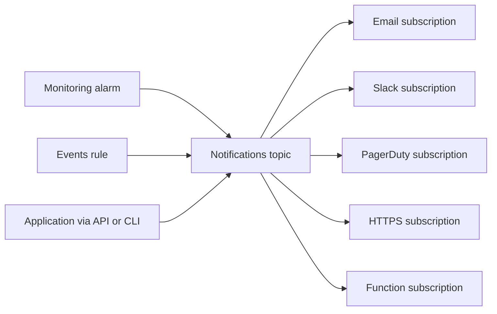
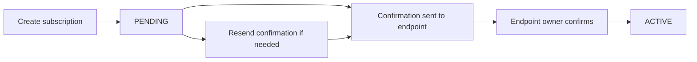

# Notifications, topics, subscriptions, and notification channels

In the **APIs, Events, and Integration** chapter of the **CLOUD_PROVIDERS_ORACLE** module, OCI Notifications is the link that delivers information from infrastructure to operators or processing programs. A system can detect high CPU, Compute changes, or abnormal Oracle database conditions; however, if that information does not reach the right people, over the right channel, and at the right time, monitoring remains incomplete.

This lesson guides you through designing topics, creating subscriptions, controlling permissions in a compartment, sending test notifications, and tracing message delivery. The objective is to build an operable notification channel in OCI while recognizing limits affecting security, cost, and availability.

After this lesson, you can:

- Distinguish between publisher, topic, subscription, endpoint, and message.
- Choose an appropriate channel among email, Slack, PagerDuty, HTTPS, Functions, or SMS.
- Create and confirm a subscription, then send a test message using the OCI CLI.
- Design duplicate handling, monitor delivery, and troubleshoot when notifications do not arrive.

## 1. The publisher → topic → subscriptions model

**OCI Notifications** is a managed publish–subscribe service. Publishers send messages to a topic; Notifications distributes messages to the topic's active subscriptions. A single publish call can serve multiple recipients or multiple target systems. [OCI Notifications Overview](https://docs.oracle.com/en-us/iaas/Content/Notification/Concepts/notificationoverview.htm).

| Component | Meaning | Example in a retail system |
| --- | --- | --- |
| Publisher | Component emitting information | Monitoring alarm reporting high CPU on an app server |
| Topic | Logical channel grouping recipients for one type of info | `prod-orders-critical-sin` |
| Subscription | Binding between a topic, protocol, and endpoint | `EMAIL` subscription for the on-call ops team |
| Endpoint | Target address or resource | Mailbox, Slack webhook, HTTPS URL, or function OCID |
| Message | Published content | Environment, resource, severity, timestamp, and action guidance |



The diagram shows distribution relationships and does not imply every source is compatible with every protocol. SMS has specific restrictions covered in the channel selection section.

A topic is not an email address. Nor does a topic detect incidents on its own: triggering conditions reside in alarms, Events rules, connectors, or publishing applications. Decoupling publishers from recipient lists lets you add operations teams without modifying each application.

For example, a message sent to a topic with two email subscriptions and one Slack subscription generates multiple deliveries. Subscriptions each receive the information; they do not split work one item per subscription like competing workers reading from a queue.

## 2. Where does Notifications fit in OCI integration flows?

Separate three questions when designing:

1. **What happened?** The data source can be a metric, a resource event, or a business outcome.
2. **When should it alert?** Alarms, rules, or application code decide the condition and frequency.
3. **Who receives it and how?** Topics and subscriptions determine the output.

| Need | Where primary logic lives | Role of Notifications |
| --- | --- | --- |
| Compute CPU exceeds threshold over a window | Monitoring alarm | Distributes info to the owning team |
| Resource management event needs alerting | Events rule matching the event type | Forwards messages to endpoints |
| Data or logs need to traverse an integration flow | Connector Hub with supported source and target | Acts as notification target when supported by configuration |
| Application finishes a workflow and wants to report outcome | Application code calling API/SDK | Decouples recipient list from application code |

This is the architectural separation of responsibilities. Notifications does not run SQL queries to check an Oracle database, does not replace a logging system, and does not decide who is on call in a complex rotation schedule. Emitters, incident management systems, and processing logic must handle those respective parts.

If the main requirement is buffering jobs for workers to pull, managing backlog processing, or replaying history by offset, evaluate an appropriate queueing or streaming service. Relying solely on a topic having received a message will not satisfy those requirements.

## 3. Choosing protocols and notification channels

Protocol values in the API/CLI must be distinguished from display labels in the Console. Custom HTTPS uses `CUSTOM_HTTPS`; `HTTPS` is a deprecated legacy value for PagerDuty integration, so new examples use `PAGERDUTY`. [Subscription creation command reference](https://docs.oracle.com/en-us/iaas/tools/oci-cli/latest/oci_cli_docs/cmdref/ons/subscription/create.html).

| Channel | Protocol | Endpoint | When to use |
| --- | --- | --- | --- |
| Email | `EMAIL` | Email address or group alias | Routine operational alerts, content needing review |
| Slack | `SLACK` | Slack channel incoming webhook | Team coordination |
| PagerDuty | `PAGERDUTY` | PagerDuty integration endpoint | Paging on-call staff and incident management |
| Custom HTTPS | `CUSTOM_HTTPS` | Public URL meeting OCI requirements | Integrating custom receiver systems |
| OCI Functions | `ORACLE_FUNCTIONS` | Function OCID | Processing or automation via code |
| SMS | `SMS` | E.164 phone number in supported region | Short alerts from supported sources |

### 3.1. Email, Slack, and PagerDuty serve different workflows

Email subscriptions can use personal addresses or distribution list aliases. For ops teams, an alias lets the mail system manage membership, though you must still assign ownership for confirming and maintaining that address. [Creating an email subscription](https://docs.oracle.com/en-us/iaas/Content/Notification/Tasks/create-subscription-email.htm).

Slack subscriptions require the target endpoint webhook. The webhook URL contains a token; manage it like a credential and avoid putting it in repositories, screenshots, or public logs. The existence of a webhook does not prove the subscription has been confirmed. [Creating a Slack subscription](https://docs.oracle.com/en-us/iaas/Content/Notification/Tasks/create-subscription-slack.htm).

PagerDuty fits when on-call rotations and escalations are handled by an incident management platform. The subscription uses a PagerDuty integration endpoint and requires confirmation via information delivered there. Do not equate creating an incident with an on-call engineer having acknowledged responsibility. [Creating a PagerDuty subscription](https://docs.oracle.com/en-us/iaas/Content/Notification/Tasks/create-subscription-pagerduty.htm).

A practical organization sends warning-level alerts to Slack and email, while critical alerts go to a topic with a PagerDuty subscription. Severity decisions should sit at the emitter or routing layer before the topic, rather than sending everything to all recipients.

### 3.2. SMS has restrictions on emitters and countries

Per Oracle documentation checked on 20/11/2026, SMS subscriptions apply only in the OC1 commercial realm and support messages only from **Announcements, Monitoring, and Connector Hub**. Messages from unsupported sources are dropped; therefore, direct publishing or Events rules are not valid tests to verify SMS works.

Phone numbers must use E.164 format and belong to the list of supported countries/regions. At the time of review, the referenced list did not include Vietnam; you cannot assume `+84` numbers work. Re-check documentation and international SMS delivery capability when deploying. [Creating an SMS subscription and supported list](https://docs.oracle.com/en-us/iaas/Content/Notification/Tasks/create-subscription-sms.htm).

In this lab, use email as the baseline output. SMS is only an optional addition once all prerequisites are verified.

### 3.3. Function subscriptions require dedicated permissions and handler design

A Function subscription points to an OCI Function; when a message arrives, the function is invoked. This subscription type does not require link confirmation. The creator needs `FN_INVOCATION` permission on the function. [Creating a function subscription](https://docs.oracle.com/en-us/iaas/Content/Notification/Tasks/create-subscription-function.htm).

If the function further calls Compute, Object Storage, or database services, permissions to access those resources are a separate layer. Configure principals and IAM for the specific workload; topic-management permissions do not automatically grant the function permission to modify infrastructure. [Notifications Security](https://docs.oracle.com/en-us/iaas/Content/Security/Reference/notifications_security.htm).

For high-impact automation, start with status checks, recording recommendations, or creating tickets. Only allow resource mutations when guardrails, scope limits, and safe idempotent handling are in place.

## 4. Subscription lifecycle and confirmation step

For channels requiring confirmation, the basic flow is:



The confirmation URL is valid for three days and can be resent if needed. Email receives a link in mail, Slack receives it in the channel, PagerDuty receives it via a confirmation incident, and HTTPS receives the info in the confirmation request. For HTTPS, the URL is in the `X-OCI-NS-ConfirmationURL` header or the `ConfirmationURL` field in the body. Functions are the exception and require no confirmation. [Confirming a subscription](https://docs.oracle.com/en-us/iaas/Content/Notification/Tasks/confirm-subscription.htm).

A `PENDING` subscription must not be treated as a ready notification channel. After confirming, verify the state and send a new test message; do not expect previously missed notifications to be replayed automatically.

Confirmation and unsubscribe URLs can mutate subscription state. Do not copy them into broadly shared documents, do not automatically fetch URLs from unverified requests, and do not let log analyzers accidentally trigger them.

From a governance standpoint, explicitly assign topic owners and endpoint owners. The person creating OCI resources may not have access to open the mailbox, manage the Slack channel, or access PagerDuty to confirm.

## 5. Designing topics by compartment, environment, and recipients

A topic belongs to a region; select the right region when using Console and CLI. Region is also a dimension in Notifications metrics. [Metrics reference](https://docs.oracle.com/en-us/iaas/Content/Notification/Reference/notificationmetrics-reference.htm).

When designing cross-region redundancy, prepare the corresponding configuration in the target region and test the delivery path during regional failover drills. Do not assume configuration replicates across regions simply because they share a tenancy.

A topic has an OCID and a name; topic names must be unique within the tenancy. Names should convey purpose without containing secret data. [Creating a topic](https://docs.oracle.com/en-us/iaas/Content/Notification/Tasks/create-topic.htm).

A convention you can use is:

```text
<environment>-<service>-<severity>-<region>

dev-orders-info-sin
prod-orders-warning-sin
prod-orders-critical-sin
prod-database-critical-sin
```

This is an organizational convention, not a mandatory OCI format. Within the same tenancy, adapt the naming convention to prevent collisions across teams.

| Decision | Rationale |
| --- | --- |
| Separate development and production topics | Reduces risk of paging on-call teams due to tests |
| Separate routine and critical alerts | Matches recipient lists and escalation workflows |
| Place in a compartment with clear ownership | Easier to scope permissions and trace accountability |
| Tag owner, environment, and service appropriately | Supports inventory, operations, and cost governance |
| Re-audit when team ownership changes | Avoids orphaned endpoints with no active responders |

When created, a subscription must be in the same compartment as its parent topic; afterward, the subscription can be moved to another compartment. This lab keeps both in the same compartment to simplify permission scoping. [Creating a subscription](https://docs.oracle.com/en-us/iaas/Content/Notification/Tasks/create-subscription.htm).

## 6. IAM: separating resource management from message publishing

Notifications defines resource types `ons-topics`, `ons-subscriptions`, and aggregate `ons-family`. Do not infer permissions solely from verb names: for `ons-topics`, `use` covers both publishing messages and corresponding subscription operations, not just sending alerts. [Notifications IAM details](https://docs.oracle.com/en-us/iaas/Content/Identity/Reference/notificationpolicyreference.htm).

Assume the lab compartment is `LearnIntegration`, the admin group is `NotificationAdmins`, and the sender group is `NotificationSenders`. Replace these names with real principals in your tenancy.

```text
Allow group NotificationAdmins to manage ons-family in compartment LearnIntegration

Allow group NotificationSenders to use ons-topics in compartment LearnIntegration
```

The first policy is for people managing Notifications resources in the compartment. The second is a simple setup for a group using topics; note that it is broader than publish-only access. Examples of managing and using topics are presented in Oracle's [Notifications security guide](https://docs.oracle.com/en-us/iaas/Content/Security/Reference/notifications_security.htm).

When a publisher should only send messages, restrict the permission in the policy:

```text
Allow group NotificationSenders to use ons-topics in compartment LearnIntegration where request.permission = 'ONS_TOPIC_PUBLISH'
```

This constrained example allows only publishing under the condition. Senders do not automatically gain permissions to list, read topics, or manage subscriptions from that policy. If an application needs resource discovery, grant the exact read permissions separately. `PublishMessage` requires `ONS_TOPIC_PUBLISH`, while creating subscriptions requires `ONS_TOPIC_SUBSCRIBE`. [Permissions by API](https://docs.oracle.com/en-us/iaas/Content/Identity/Reference/notificationpolicyreference.htm).

With identity domains, use the group naming syntax matching your tenancy's domain. For workloads running on OCI, consider instance principals or resource principals with dynamic group policies instead of embedding an admin's API key in the application.

Distinguish two authentication layers:

- **Publisher → OCI:** OCI authenticates the principal and evaluates IAM before accepting the API call.
- **OCI → endpoint:** The endpoint verifies delivery requests per protocol mechanism; publish permission does not replace webhook request verification.

## 7. Lab: creating a topic and sending a test via OCI CLI

### 7.1. Preparation

The example uses **PowerShell** with an installed and authenticated OCI CLI. Prerequisites:

- A lab compartment and permissions to create topics, subscriptions, publish, and read them back.
- A usable region in the tenancy.
- A mailbox or alias you control to receive confirmation.

Replace placeholder values before running. These commands are for learners to execute in their lab environment; sample OCIDs and emails are not pre-existing resources.

```powershell
$region = 'ap-singapore-1'
$compartmentId = 'ocid1.compartment.oc1..REPLACE_WITH_REAL_ID'
$recipientEmail = 'REPLACE_WITH_YOUR_EMAIL'
$topicName = 'lab-notify-sin-' + [Guid]::NewGuid().ToString('N').Substring(0, 8)
```

Keep the region consistent across the entire sequence. The random suffix helps prevent topic name collisions within the tenancy.

### 7.2. Create the topic and retrieve its OCID

```powershell
$topicCreateArgs = @(
    'ons', 'topic', 'create',
    '--compartment-id', $compartmentId,
    '--name', $topicName,
    '--description', 'OCI lab notification channel',
    '--region', $region,
    '--query', 'data.id',
    '--raw-output'
)

$topicId = & oci @topicCreateArgs
if ($LASTEXITCODE -ne 0) {
    throw 'Could not create topic; stop the lab to inspect the error.'
}
$topicId = ($topicId -join "`n").Trim()
$topicId
```

Save the returned OCID for subsequent steps. `--compartment-id` is where the resource is created; a display name cannot substitute for an OCID when an API requires a topic identifier. [`oci ons topic create` reference](https://docs.oracle.com/en-us/iaas/tools/oci-cli/latest/oci_cli_docs/cmdref/ons/topic/create.html).

### 7.3. Create an email subscription

```powershell
$subscriptionCreateArgs = @(
    'ons', 'subscription', 'create',
    '--compartment-id', $compartmentId,
    '--topic-id', $topicId,
    '--protocol', 'EMAIL',
    '--subscription-endpoint', $recipientEmail,
    '--region', $region,
    '--query', 'data.id',
    '--raw-output'
)

$subscriptionId = & oci @subscriptionCreateArgs
if ($LASTEXITCODE -ne 0) {
    throw 'Could not create subscription.'
}
$subscriptionId = ($subscriptionId -join "`n").Trim()
$subscriptionId
```

Open your mailbox and confirm the subscription using the email sent by OCI. Then read back the state:

```powershell
$subscriptionOutput = & oci ons subscription get --subscription-id $subscriptionId --region $region
if ($LASTEXITCODE -ne 0) {
    throw 'Could not read subscription.'
}
$subscription = ($subscriptionOutput -join "`n") | ConvertFrom-Json
$subscription.data.'lifecycle-state'

if ($subscription.data.'lifecycle-state' -ne 'ACTIVE') {
    throw 'Subscription is not ACTIVE yet; complete confirmation before sending a test.'
}
```

The output should be `ACTIVE`. If it is still `PENDING`, resolve confirmation before continuing.

### 7.4. Retrieve the publish endpoint and send a message

A topic has an `api-endpoint` used for publishing. Read the value returned by OCI rather than constructing hostnames manually from region names. [Publish and topic endpoint reference](https://docs.oracle.com/en-us/iaas/tools/oci-cli/latest/oci_cli_docs/cmdref/ons/message/publish.html).

```powershell
$topicOutput = & oci ons topic get --topic-id $topicId --region $region
if ($LASTEXITCODE -ne 0) {
    throw 'Could not read topic.'
}
$topic = ($topicOutput -join "`n") | ConvertFrom-Json
$topicEndpoint = $topic.data.'api-endpoint'
if ([string]::IsNullOrWhiteSpace($topicEndpoint)) {
    throw 'Topic did not return a valid api-endpoint.'
}

$eventId = [Guid]::NewGuid().ToString()
$message = "event_id=$eventId; environment=lab; service=orders; severity=info; text=Testing OCI Notifications delivery path"

$publishArgs = @(
    'ons', 'message', 'publish',
    '--topic-id', $topicId,
    '--title', '[LAB] OCI Notifications Check',
    '--body', $message,
    '--endpoint', $topicEndpoint,
    '--region', $region
)

& oci @publishArgs
if ($LASTEXITCODE -ne 0) {
    throw 'Publish failed.'
}
```

The example uses a text string to focus on the delivery path. Record `event_id`, send timestamp, and API response, then find the matching message in your mailbox.

Title is used as the email subject and has specific usage in PagerDuty; do not assume HTTPS, Slack, or SMS all use title. Put critical details in the body. [Publishing messages to a topic](https://docs.oracle.com/en-us/iaas/Content/Notification/Tasks/publishingmessages.htm).

### 7.5. Evaluate results and clean up lab resources

A valid test requires evidence from both ends:

1. Topic and subscription in the right compartment and region; subscription is `ACTIVE`.
2. Publish succeeded with the test run's correlation ID.
3. Target mailbox received content containing that exact ID.
4. Metrics checked after a reasonable propagation interval.

If there are multiple channels, verify each endpoint; receiving an email does not prove Slack or a webhook also works.

Once finished and no emitters reference the lab resources anymore, delete only the subscription and topic created for the lab:

```powershell
oci ons subscription delete --subscription-id $subscriptionId --region $region
# Only proceed after the subscription deletion command succeeds.
oci ons topic delete --topic-id $topicId --region $region
```

Ensure the variables still hold the lab OCIDs. Never run this command sequence against production or shared topics.

## 8. Custom HTTPS integration: the endpoint must satisfy the contract

Not every webhook URL can be used directly with Notifications. Custom HTTPS must be publicly reachable, accept POST, and use a certificate issued by a valid CA. Private VCN endpoints and self-signed certificates do not meet the requirement. When HTTP authentication is needed, the service supports Basic Access Authentication and does not support adding arbitrary custom headers; query parameters in the URL are also unsupported. The endpoint must answer the `401`/`WWW-Authenticate` challenge of that mechanism.

Both connection and read timeouts are fixed at five seconds per current documentation. The endpoint must accept requests quickly and offload long-running work to background processing. [HTTPS subscription requirements](https://docs.oracle.com/en-us/iaas/Content/Notification/Tasks/create-subscription-https.htm).

For applications with only private IPs inside a VCN, one design option is placing a controlled public HTTPS ingress layer in front, then forwarding verified content to the private system. Authentication compatibility must be checked upfront; an API requiring caller-supplied OAuth bearer tokens in headers will need an appropriate integration layer.

The handler should distinguish subscription confirmation requests from business notification requests. Do not route confirmation messages into incident workflows like a real alarm.

```text
Upon receiving a request:
    verify trusted topic and sender source
    verify signature per OCI specification, if provided by protocol
    classify as subscription confirmation or business message
    validate schema, size, and required fields
    persist durably before returning a success response
    let a worker handle long-running work
```

Headers `X-OCI-NS-MessageId`, `X-OCI-NS-TopicOcid`, and `X-OCI-NS-MessageType` assist with identification and classification. Signature metadata includes `X-OCI-NS-Signature`, timestamp, and signing certificate URL. A header naming a topic is not authentication proof; apply an appropriate verification procedure. [Standard Notifications metadata](https://docs.oracle.com/en-us/iaas/Content/Notification/Concepts/notificationoverview.htm).

The verifier must control certificate retrieval and confirmation URL access. Never blindly fetch arbitrary URLs supplied by untrusted requests.

## 9. Designing messages for both humans and programs

A useful notification must answer: which resource, which environment, what happened, how severe it is, and what the next step is. For application-emitted notifications, you can define a custom schema such as:

```json
{
  "schemaVersion": 1,
  "eventId": "orders-api-cpu-20261120T031500Z-001",
  "occurredAt": "2026-11-20T03:15:00Z",
  "environment": "production",
  "service": "orders-api",
  "severity": "critical",
  "region": "ap-singapore-1",
  "resourceId": "ocid1.instance.oc1.ap-singapore-1.EXAMPLE",
  "summary": "CPU exceeded operational threshold",
  "runbookId": "orders-high-cpu",
  "correlationId": "incident-orders-20261120-001"
}
```

This is an **illustrative application-defined schema**, not the default payload of OCI Monitoring or Events. Consumers must recognize the actual emitter and schema; do not apply the same field set to every OCI message.

Business JSON can be sent as a string body and parsed by the receiver per contract. You do not need to select the old `message-type JSON` mode to send a string containing JSON; that mode parameter has been deprecated. [Publish command body reference](https://docs.oracle.com/en-us/iaas/tools/oci-cli/latest/oci_cli_docs/cmdref/ons/message/publish.html).

Principles to follow:

- Include a schema version so consumers recognize structural changes.
- Use timestamps with explicit timezones, preferring UTC across systems.
- Keep the event ID stable when retrying the same business event.
- Provide enough context to open the runbook without embedding full logs or customer data.
- Link to access-controlled systems for details; avoid putting token-bearing auth URLs in emails.

Never send database passwords, private keys, access tokens, connection strings with credentials, or SQL containing personal data inside messages. Fan-out multiplies the places content may be stored, especially across email and external collaboration tools outside OCI.

## 10. Delivery, retries, and duplicate handling

Notifications uses at-least-once delivery; consumers must handle receiving the same message again. When an endpoint fails to acknowledge receipt, the service retries with a default two-hour window and backoff. Once the retry window expires, the message may be dropped. Do not interpret "at-least-once" as an eventual guarantee of delivery even if the endpoint stays down indefinitely. [Notifications delivery FAQ](https://www.oracle.com/cloud/cloud-native/notifications/faq/).

You can update a subscription's delivery policy, including maximum retry duration. Choose values based on endpoint recovery time and acceptable latency, and verify current configuration limits. [Updating a subscription](https://docs.oracle.com/en-us/iaas/Content/Notification/Tasks/update-subscription.htm).

### 10.1. Choosing a deduplication key by emitter

Oracle suggests different keys depending on the trigger: for alarms, you can combine `dedupekey` and `timestampEpochMillis`; for Events, use `eventID`; for directly published messages, you can use `X-OCI-NS-MessageId` in the header. Applications can also supply a business key in the body. [Duplicate handling](https://docs.oracle.com/en-us/iaas/Content/Notification/Concepts/notificationbestpractices.htm).

A publish call's message ID and a business event ID address two different layers. If an application republishes the same event as a new request, do not expect the service-assigned ID to match the previous attempt. Preventing two tickets for the same incident usually requires an application-managed event ID or business key.

### 10.2. When to mark "processed"?

An error-prone approach is saving the "done" key before creating a ticket, and then crashing midway. Redelivery gets skipped even though no ticket exists. Conversely, creating the ticket first and saving the key afterward can produce two tickets if the process crashes right after ticket creation.

A durable ingestion design can look like:

```text
1. Verify request and compute business key.
2. Within a transaction, insert an inbox row in RECEIVED state with a unique key.
3. Return success only after the record is durably persisted.
4. Worker picks work from inbox, transitions to PROCESSING via safe claim.
5. Call target system with an idempotency key if supported.
6. Mark DONE once result is confirmed; failed jobs have a recovery path.
```

The unique key prevents duplicate inbox inserts; state tracking and recovery prevent records from getting stuck. If the external operation lacks idempotency support, reconcile state before retrying. A simple `if key exists then return` is insufficient to cover all failure modes.

For Functions that auto-scale or mutate infrastructure, add current-state checks and cooldown windows between changes. Do not scale up once per duplicate copy of the same alarm.

### 10.3. Retain evidence yourself if reprocessing is needed

Do not design recovery assuming a topic is a history store you can arbitrarily replay. If reprocessing after a long outage is required, maintain dedicated storage such as an inbox, queue, or appropriate event store.

Likewise, do not rely on arrival order across channels to determine final state. "Resolved" and "firing" messages should carry timestamps or versions so consumers can recognize stale data.

## 11. Monitoring delivery paths and troubleshooting

Monitor the emitter, Notifications, and the endpoint. The metrics namespace is `oci_notification`; key metrics include:

| Metric | What to observe |
| --- | --- |
| `PublishedMessagesCount` | Number of messages received in service requests |
| `DeliveredMessagesCount` | Number of messages successfully delivered to endpoints |
| `FailedMessagesCount` | Number of undelivered messages; metric appears when errors occur |
| `PublishedMessagesSize`, `DeliveredMessagesSize`, `FailedMessagesSize` | Message sizes in each group |

Filter topics using an appropriate dimension such as `resourceId`; for deliveries, you can inspect `endpointType`. Some error dimensions only appear when corresponding data exists. [Notifications metrics reference](https://docs.oracle.com/en-us/iaas/Content/Notification/Reference/notificationmetrics-reference.htm).

One publish to multiple subscriptions can generate multiple deliveries. Therefore, do not mechanically assert `PublishedMessagesCount == DeliveredMessagesCount`. When testing one message with two active emails and one active Slack channel, check each receiver, the same time window, and metric filter conditions.

A success response from an endpoint also does not prove business completion. A webhook might save the request while the worker has not yet created a ticket; a function might be invoked while a subsequent database write fails. Consumer metrics, logs, and business state are needed to verify the rest.

### 11.1. Tracing the flow instead of just clicking resend

| Symptom | Check first |
| --- | --- |
| Zero publishes | Did the emitter condition trigger or did application code run? |
| Published, but email does not arrive | Subscription state, address, spam folder, and suppression |
| Subscription stays `PENDING` | Did confirmation arrive and get confirmed? |
| HTTPS does not receive confirmation | Public reachability, TLS, POST support, and auth requirements |
| Email arrives, SMS does not | Are the emitter source and country supported? |
| Subscription disappeared | Audit logs for delete or unsubscribe actions |

Root-cause categories and how to correlate emitters with topics are described in the [Notifications troubleshooting guide](https://docs.oracle.com/en-us/iaas/Content/Notification/Tasks/troubleshootingnotifications.htm).

For example, if publishing via CLI directly to email succeeds while an alarm produces no notification, the basic email path has evidence of working. The next step is checking whether the alarm changed state during the expected window, whether the target topic is right, and whether integration permissions/configs match. Adding another email subscription at that point does not address the unverified hop.

Do not send alarms about delivery failures solely to the exact channel that is failing. For critical alerting paths, maintain an independent check channel and end-to-end test schedule to detect dead endpoints.

## 12. Controlling volume, cost, and availability

Published message size is currently documented at a 64 KB limit per request. The service also enforces publish and delivery rate limits by subscription type; check current documentation and tenancy service limits before designing high-throughput flows. Never treat one successful test message as load-handling proof. [Publishing limits](https://docs.oracle.com/en-us/iaas/Content/Notification/Tasks/publishingmessages.htm).

To estimate operational volume, you can start with:

```text
Baseline deliveries ≈ published messages × matching active subscriptions
```

This is a fan-out estimate, not a billing formula. Retries, protocols, actual traffic, and current pricing tables must be evaluated separately. For example, 100 messages sent to four subscriptions produce about 400 baseline deliveries before accounting for retries and delivery limits.

Decisions that help control cost and alert noise:

- Tune alarm thresholds and pending windows to avoid flapping around thresholds.
- Separate critical alerts from routine informational streams.
- Throttle repeat alerts and prevent one event from taking two unintended paths.
- Audit subscriptions that no longer have an owner or business need.
- Account for downstream Function, log, storage, and processing system costs.

For availability, multiple channels increase the chance humans see a message, but do not guarantee full independence. Email, Slack, and PagerDuty can still share an underlying identity provider, device, or on-call process. Test realistic failure modes: dead endpoints, revoked webhooks, departed staff, or regional failover.

Automation creating resources via CLI or IaC should explicitly manage names, OCIDs, and desired config. However, for channels requiring endpoint-owner confirmation, a tool finishing subscription creation is not proof the channel works. Deployment workflows must verify `ACTIVE` state and run an end-to-end test.

## 13. Design example for an application using an Oracle database

Suppose the `orders-api` application runs on OCI Compute and uses an Oracle database service. The ops team wants application alerts, recovery notices, and backup verification results. It can be organized as follows:

| Information group | Designed emitter | Topic | Recipient person/system |
| --- | --- | --- | --- |
| Compute anomaly | Monitoring alarm on appropriate metric | `prod-orders-warning-sin` | App team Slack and email |
| Critical incident | Alarm or health-check application | `prod-orders-critical-sin` | PagerDuty and on-call email |
| Backup check result | Verification job publishes after completion | `prod-database-status-sin` | DBA email |
| Reconciliation ticket needed | App-controlled schema message | Dedicated integration topic | HTTPS receiver storing to inbox |

The table is an illustrative architectural plan. Verify the metrics, event types, and integration capabilities of the specific database service used; do not assume every backup operation uses the same event type or payload.

In this plan, IAM allows emitters to publish only to the needed topic scope; infrastructure admins control subscriptions. The ticket-creating receiver uses a business key to deduplicate. Messages carry resource identifiers and runbook pointers, never passwords or copies of customer data.

Operational tests should prove the full chain: safe synthetic trigger → emitter → topic → endpoint → receiving human or program → processing outcome. When an incident ends, recovery notices should link to the same resource or incident ID so on-call engineers never have to guess whether two messages belong to the same event.

## 14. Key deployment takeaways

- Topics organize distribution paths; alerting conditions live at the emitter.
- Subscriptions need the right protocol, endpoint, and active state; creation alone does not mean messages are received.
- Choose channels to match workflows; verify SMS restrictions and HTTPS contracts separately.
- Scope IAM by duty, especially since `use ons-topics` includes subscription operations.
- Consumers must handle duplicate deliveries, timeouts, and business failures after delivery succeeds.
- Monitor the full delivery path, test each endpoint, and prepare dedicated storage if recovery or reprocessing is needed.

A reliable Notifications setup combines the right recipients, least-privilege permissions, tested endpoints, and evidence-backed operations. That is the foundation for turning OCI infrastructure and Oracle database events into timely, accurate action.
