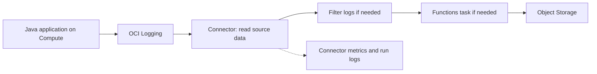

# Service Connector Hub and moving data between services

In Oracle Cloud Infrastructure (OCI), Service Connector Hub is now called **Connector Hub**. The service helps define and operate data flows between OCI services. CLI commands still use the `sch service-connector` group. [Connector Hub Overview](https://docs.oracle.com/en-us/iaas/Content/connector-hub/overview.htm), [OCI CLI Reference](https://docs.oracle.com/en-us/iaas/tools/oci-cli/latest/oci_cli_docs/cmdref/sch/service-connector/create.html).

This lesson belongs to the **APIs, Events, and Integration** chapter of the Oracle Cloud Infrastructure module. The focus is building paths for logs, metrics, and messages, tying those flows to compartments, IAM, monitoring, and cost. The running example sends logs from a Java application into Object Storage for archival and incident inspection.

## 1. Objectives and use case

After this lesson, you can:

- Choose a source, task, and target suited to data-movement requirements.
- Distinguish deployer permissions from permissions the connector needs at runtime.
- Deploy a Logging → Object Storage flow and prove data reached the destination.
- Design duplicate-record handling, detect stalled flows, and plan recovery.
- Manage configuration, data retention, and resources created by integration flows.

Suppose the `checkout-api` application runs on Compute. Logs already appear in OCI Logging, and the operations team wants to store investigation records separately in a bucket. If they write their own scheduled program to read logs and upload them to a bucket, the team must manage scheduling, read checkpoints, access permissions, retries, and monitoring for that program.

With Connector Hub, the team describes the flow through configuration. Remaining responsibilities are selecting the right data, granting the right permissions, defining error handling, and verifying results at the destination. A successfully created flow does not by itself prove retention requirements are met.

## 2. The source → task → target model

A connector describes a flow from one source service to one target service; a task is an optional processing step. To send data to multiple targets, design multiple flows. [Connector, source, task, and target concepts](https://www.oracle.com/application-development/connector-hub/faq/).

| Component | Design question | Lesson example |
| --- | --- | --- |
| Source | What data needs fetching, and where is it? | A log inside a Logging log group |
| Task | What filtering or transformation is needed before sending? | Filter error logs; redact sensitive fields |
| Target | Where is the data finally received? | Bucket dedicated to log archival |
| Connector | Who owns and operates the flow? | Connector in the integration compartment |



In the basic lab, skip both filtering and Functions to observe the shortest delivery path. Add tasks only after proving source reads and target writes work.

A connector is also a resource with its own OCID and compartment. The compartment holding the connector can differ from the compartment holding the source or target; this separation is useful when an integration team manages flows while app teams own data. [Resource and compartment model in connector creation](https://docs.oracle.com/en-us/iaas/tools/oci-cli/latest/oci_cli_docs/cmdref/sch/service-connector/create.html).

## 3. Choosing supported service combinations

The table below shows source–target combinations from Oracle documentation at the time of writing. A dash “—” indicates a combination not supported in this matrix.

| Source | Functions | Log Analytics | Monitoring | Notifications | Object Storage | Streaming |
| --- | --- | --- | --- | --- | --- | --- |
| Logging | Yes | Yes | Yes | Yes | Yes | Yes |
| Monitoring | Yes | — | — | — | Yes | Yes |
| Queue | Yes | — | — | Yes* | Yes | Yes |
| Streaming | Yes | Yes | — | Yes* | Yes | Yes |

`*`: Functions tasks are not supported for Queue → Notifications and Streaming → Notifications. Logging tasks apply only to Logging sources. [Official source–target matrix](https://docs.oracle.com/en-us/iaas/Content/connector-hub/overview.htm).

How to apply the matrix in design:

- **Log archival:** start with Logging → Object Storage.
- **Forwarding logs for downstream processing:** consider Logging → Streaming.
- **Processing messages with app code:** consider Queue → Functions.
- **Saving metrics for separate analytics:** consider Monitoring → Object Storage.
- **Loading data into Oracle Database:** requires an execution component, such as a Functions target, that opens the DB connection and writes data. Database is not a direct target in the matrix above.

Selecting a valid combination only solves connectivity capability. You still need to define output format, acceptable latency, and responsibility when the target receives the same record again.

In particular, do not create two connectors reading the same queue expecting each connector to receive a complete copy. With a Queue source, successfully transferred messages are deleted from the source queue; two such flows will compete as consumers. If multiple copies are needed, design a separate fan-out mechanism upstream of the queues. [Queue source consumption behavior](https://docs.oracle.com/en-us/iaas/Content/connector-hub/create-service-connector-queue-source.htm).

## 4. Tasks: filtering data and processing with Functions

### 4.1. Filtering a Logging source

Filters reduce forwarded data, but must match the actual schema. For instance, with Audit logs, you can select object-deletion events with the expression below; replace the placeholder with your compartment OCID:

```text
search "<compartment_ocid>/Audit"
| where type = 'com.oraclecloud.objectstorage.deleteobject'
```

This is an Audit log example, separate from the application custom log used in the lab. Do not apply this `type` field to application logs and then conclude the connector dropped data when no records match.

Connector Hub supports a subset of the Logging Query Language, using streaming operators `search` and `where`. Therefore, an analytical query that runs in Logging Search may not be valid inside a connector. [Log query reference](https://docs.oracle.com/en-us/iaas/Content/connector-hub/queryreference.htm).

When adding a filter, keep one sample record that must pass and one sample record that must be excluded. Record the distinguishing marker of both samples so verification has clear evidence.

### 4.2. Functions task vs. Functions target

These two positions have different contracts:

| Position | Design role | Output handling |
| --- | --- | --- |
| Functions task | Transforms data between source and target | Must return data formatted for forwarding |
| Functions target | Executes work at the end of the flow | Connector does not use return data to forward to another target |

A Functions task can return JSON with `Content-Type: application/json` or binary with `application/octet-stream`. The connector writes task output to the target without interpreting business semantics itself. Functions are invoked synchronously; documentation specifies a 6 MB payload limit and a 5-minute maximum execution time in this context. [Configuring Functions tasks and targets](https://docs.oracle.com/en-us/iaas/Content/connector-hub/create-service-connector.htm).

An illustrative transformation normalizes service names and masks email addresses:

```json
{
  "eventId": "checkout-evt-1042",
  "service": "checkout-api",
  "level": "ERROR",
  "customerEmail": "customer@example.invalid"
}
```

Desired business output:

```json
{
  "eventId": "checkout-evt-1042",
  "service": "checkout-api",
  "severity": "ERROR",
  "customerEmail": "[REDACTED]",
  "schemaVersion": 1
}
```

The two JSON snippets above only illustrate business content, not the full envelope an OCI Function is guaranteed to receive. When implementing, inspect the source's actual payload, handle batches/lists of records, and preserve a stable identifier for reconciliation.

If a task only masks data before archival, keep it as a pure transformation. Having a task both return data and call APIs that create transactions makes retries hard to control: re-invoking the task can create duplicate transactions even though the archived output looks fine.

## 5. IAM: deployment permissions vs. runtime flow permissions

Map out resources before writing policies:

| Resource | Illustrative compartment | Owner |
| --- | --- | --- |
| Application custom log | `AppDev` | Application team |
| Connector | `IntegrationDev` | Integration team |
| Archive bucket | `ArchiveDev` | Storage team |
| Connector run logs | `IntegrationDev` | Operations team |

Compartment names are examples; replace them with real names or OCIDs before applying policies.

Deployers need permission to manage connectors. The example below uses group `OciIntegrationBuilders` in the default identity domain:

```text
Allow group Default/OciIntegrationBuilders to manage serviceconnectors in compartment IntegrationDev
```

The group also needs appropriate permissions to view and select source and target resources. `manage serviceconnectors` does not automatically grant full permissions on logs, buckets, or functions. [IAM for users and services](https://docs.oracle.com/en-us/iaas/Content/Security/Reference/sch_security.htm).

At runtime, the connector uses its own resource identity. Example policy allowing connectors in a compartment to write to a specific bucket:

```text
Allow any-user to manage objects in compartment ArchiveDev where all {request.principal.type='serviceconnector', request.principal.compartment.id='<connector_compartment_ocid>', target.bucket.name='oci-log-archive-lab'}
```

The three conditions restrict principal type, the connector's compartment, and bucket name respectively. `any-user` must always be read together with those conditions—never copy it and drop the conditions. This template is based on the default policy for an Object Storage target; it does not equate to least privilege for every system. [Object Storage target policy](https://docs.oracle.com/en-us/iaas/Content/connector-hub/overview.htm#Default_Policies).

For other flows, check permissions for the exact source, task, and target. The Console suggests default policies based on configuration when needed. When deploying via CLI or Terraform, prepare the matching permissions before expecting data to flow. [Granting permissions when creating a connector](https://docs.oracle.com/en-us/iaas/Content/connector-hub/create-service-connector-logging-source.htm).

In multi-team environments, evaluate who can create connectors in `IntegrationDev`: compartment-scoped policies can apply to multiple connectors inside it. If two teams have different trust boundaries, consider separating compartments or designing granular policies.

If a Functions target writes directly to Autonomous Database, also evaluate the function's identity, secrets, and network connectivity permissions. Permission for the connector to invoke the function only covers the connector → function hop.

## 6. Lab: Logging → Object Storage

### 6.1. Preparation

Run in a lab environment within a single region:

1. An application custom log already receiving data in OCI Logging.
2. A private bucket named `oci-log-archive-lab`, or another name of your choice.
3. A compartment for the connector.
4. Permissions to create connectors, view log configurations, and inspect objects in the bucket.
5. Runtime flow permissions prepared by an admin or creatable via the suggested default policy.

Record these values:

| Value | Used for |
| --- | --- |
| Region | Selecting the right region in Console and CLI |
| Log compartment OCID | `source.logSources[].compartmentId` |
| Log group and log OCIDs | Specifying source data |
| Connector compartment OCID | `--compartment-id` |
| Object Storage namespace | `target.namespace` |
| Bucket name | `target.bucketName` |

The bucket is an existing resource the connector writes to. This lesson does not require the Java app to write directly to the bucket itself.

### 6.2. Creating the flow via the Console

1. Locate **Connector Hub** in the Console, and select the right region and connector compartment.
2. Create a connector named `checkout-logs-to-archive`.
3. Select source **Logging**, then select the application's compartment, log group, and custom log.
4. Keep the initial flow simple: omit filters and Functions tasks for now.
5. Select target **Object Storage**, and choose the prepared compartment and bucket.
6. Set an object prefix, such as `checkout/`, to make data easy to locate.
7. Use default batching or settings accepted by the Console for lab goals; review suggested policies.
8. Inspect the preview, create the connector, and wait for it to become active.

Configuration fields and object formats are described in the [Logging source guide](https://docs.oracle.com/en-us/iaas/Content/connector-hub/create-service-connector-logging-source.htm). Objects are written to Object Storage gzip-compressed.

For clearer observability, enable the connector's service log and choose a dedicated log group for flow operations. [How to enable service logs](https://docs.oracle.com/en-us/iaas/Content/connector-hub/enable-logs.htm).

### 6.3. Proving data traversed the entire flow

Once the connector is active, generate a new application log via a known lab action. Include a unique marker, such as `SCHLAB-20261120-001`, in the log message.

Verify in order:

1. Locate the marker in the exact source log.
2. Wait for batch rollover and processing, then look for a new object under prefix `checkout/`.
3. Download the object, gunzip it, and find the marker inside the contents.
4. Record the log emission time, the time data appeared at the target, and the connector OCID.
5. Inspect run logs to correlate the corresponding run.

Do not rely on an old log written before connector creation as sole proof. For Logging sources, the stream starts from connector creation time; Connector Hub's catch-up window is 24 hours. That is a separate limit from the log retention configured in Logging. [Logging source start time and retention](https://docs.oracle.com/en-us/iaas/Content/connector-hub/create-service-connector-logging-source.htm#Retention_Period_Logging_Source).

To verify completeness by count, generate a small batch with a distinct `eventId` per record. Count **distinct identifiers** appearing at the target and reconcile against the source set. Object counts or read counts do not directly tell you how many distinct business events were stored.

### 6.4. Automating with the OCI CLI

The JSON files below are illustrative configurations learners create in their lab environment. Replace all placeholders and ensure the bucket and permissions are ready.

Contents of `source.json`:

```json
{
  "kind": "logging",
  "logSources": [
    {
      "compartmentId": "<source_compartment_ocid>",
      "logGroupId": "<log_group_ocid>",
      "logId": "<log_ocid>"
    }
  ]
}
```

Contents of `target.json`:

```json
{
  "kind": "objectStorage",
  "namespace": "<object_storage_namespace>",
  "bucketName": "oci-log-archive-lab",
  "objectNamePrefix": "checkout/",
  "batchRolloverSizeInMBs": 10,
  "batchRolloverTimeInMs": 60000
}
```

Target fields and units are defined in [ObjectStorageTargetDetails](https://docs.oracle.com/en-us/iaas/tools/typescript/latest/modules/_sch_lib_model_object_storage_target_details_.objectstoragetargetdetails.html). In the example, the batch rollover time is 60,000 milliseconds; that setting is not a guarantee that data appears at the target after exactly 60 seconds.

Example run from PowerShell in the directory containing both JSON files:

```powershell
$connectorCompartmentId = "<connector_compartment_ocid>"
$ociRegion = "<region_identifier>"

oci sch service-connector create `
  --compartment-id $connectorCompartmentId `
  --display-name "checkout-logs-to-archive" `
  --source file://source.json `
  --target file://target.json `
  --region $ociRegion
```

Save the connector OCID from the output. You can review the configuration in the Console and repeat the marker check. The `file://` syntax and JSON skeleton generation for complex parameters are described in the [`create` command](https://docs.oracle.com/en-us/iaas/tools/oci-cli/latest/oci_cli_docs/cmdref/sch/service-connector/create.html).

The `create` command creates a new resource; re-running it is not an automatic update. Across multiple environments, manage OCIDs and resource lifecycles with infrastructure as code. The OCI Terraform provider includes the `oci_sch_service_connector` resource; configuration, policies, and dependent resources should be managed together. [Terraform reference](https://docs.oracle.com/en-us/iaas/tools/terraform-provider-oci/latest/docs/r/sch_service_connector.html).

## 7. Batching, latency, and data load

When batching is configured by both size and time, whichever condition is reached first triggers sending the batch. [Batching mechanism](https://docs.oracle.com/en-us/iaas/Content/connector-hub/overview.htm#Batch_Settings).

Break down latency to set realistic targets:

```text
End-to-end latency
≈ source data availability delay
+ batch rollover wait
+ task execution time
+ target write time
+ retry wait time if any
```

This is an analytical model, not an Oracle SLA formula. For example, lowering batch rollover time from several minutes to one minute improves only one component. If a function times out or the target is rate-limited, users will still see data arrive very late.

| Design adjustment | Potential benefit | What to measure |
| --- | --- | --- |
| Smaller batches | Lower wait time at low data rates | Function invocation count, small-object count |
| Larger batches | Aggregate more records per execution | Wait time, payload size, memory |
| Early filtering | Reduce data volume and target work | Whether needed records are accidentally dropped |
| Split flows by source | Easier permissioning and fault isolation | Overlapping data or quota exhaustion |

For Java applications, emit structured logs and keep individual record sizes reasonable. A long stack trace or a payload dumping entire requests can raise throughput significantly even when request counts stay flat.

Do not infer end-to-end flow availability from individual services appearing healthy. A flow only meets its target when source, task, and destination together satisfy the same latency and data-loss requirements.

## 8. Retries, duplicate records, and recoverability

Connector Hub uses **at-least-once** delivery. Failed transfers are retried before moving on to subsequent batches; exceeding source retention can prevent data delivery. [Delivery details](https://docs.oracle.com/en-us/iaas/Content/connector-hub/overview.htm#Delivery_Details).

### 8.1. Why do duplicate records occur?

Consider a hypothetical scenario:

1. The Function wrote event `checkout-evt-1042` to the database.
2. The connection dropped before the caller received the success acknowledgment.
3. The batch is invoked again.
4. If the Function blindly inserts another row, the event is recorded twice.

Therefore, target design needs idempotency: reprocessing the same event must not repeat business side effects. One approach is a unique key on `eventId`, combining completion tracking and business updates inside the same transaction.

```text
Begin transaction
  Attempt to register eventId in an inbox table with a unique key
  If eventId is already completed:
    Exit without repeating business side effects
  If new event:
    Update business data
    Mark completed
Commit
```

This is design pseudocode, not a built-in Connector Hub API. If side effects occur outside the database, such as calling a payment system, add appropriate idempotency keys or an outbox pattern at that hop. An in-memory `Set` inside a function does not protect across restarts or multiple instances.

Never generate a fresh UUID on every retry as the deduplication key. The key must stay tied to the source event and remain unchanged across retries.

### 8.2. Retention and replay

| Source | What to know for recovery plans |
| --- | --- |
| Logging | Connector catch-up window is 24 hours |
| Monitoring | Source retention in Connector Hub is 24 hours |
| Streaming | Depends on stream retention and starting read offset |
| Queue | Depends on queue config and consumed message state |

These limits are documented per source: [Logging](https://docs.oracle.com/en-us/iaas/Content/connector-hub/create-service-connector-logging-source.htm), [Monitoring](https://docs.oracle.com/en-us/iaas/Content/connector-hub/create-service-connector-monitoring-source.htm), [Streaming](https://docs.oracle.com/en-us/iaas/Content/connector-hub/create-service-connector-streaming-source.htm), [Queue](https://docs.oracle.com/en-us/iaas/Content/connector-hub/create-service-connector-queue-source.htm).

With a Streaming source, `Latest` starts from data arriving after connector creation, whereas `Trim Horizon` starts from the oldest retained message. Picking the wrong offset during a migration can skip needed records or replay large volumes of old data. [Configuring read position](https://docs.oracle.com/en-us/iaas/Content/connector-hub/create-service-connector-streaming-source.htm).

For example, if a team needs data within 10 minutes and cannot lose logs from a shift, set alarms well below the 24-hour window and maintain an authoritative source for reconciliation. Waiting until the window nearly expires leaves very little time to recover.

For Queue → Functions, partial batch failure is not supported: a failed batch can cause already-succeeded messages in that batch to be redelivered. Delivery counts still increment and messages can land in a dead letter queue per queue configuration. [Queue → Functions error handling](https://docs.oracle.com/en-us/iaas/Content/connector-hub/queue-to-function.htm#Error_Handling_When_Processing_Queues).

Do not assume every source includes a dead letter queue out of the box. Explicitly document where failed data is persisted and how it is re-injected into processing for each flow.

### 8.3. Configuration changes

Updating a source, task, or target can internally reset the connector and cause data to be re-read. [Behavior on configuration updates](https://docs.oracle.com/en-us/iaas/Content/connector-hub/overview.htm#Updated_Connectors_are_Internally_Reset).

A cutover plan should define upfront:

1. Timestamp or marker used for reconciliation.
2. When the old flow stops.
3. Where the new flow starts reading.
4. Which key the target uses to deduplicate.
5. How missing gaps are detected and backfilled.

If running two flows in parallel during testing, do so only when source semantics allow it and duplicates are accounted for. For queues, pay special attention to competing-consumer behavior.

## 9. Monitoring and troubleshooting

Connector Hub emits metrics in the `oci_service_connector_hub` namespace. Metrics are available automatically and can be filtered by `connectorId`. [Metrics reference](https://docs.oracle.com/en-us/iaas/Content/connector-hub/metrics-reference.htm).

| Signal | How to use during investigation |
| --- | --- |
| `ErrorsAtSource` | Isolate errors reading the source |
| `ErrorsAtTask` | Isolate errors inside the task |
| `ErrorsAtTarget` | Isolate errors writing to the target |
| `ServiceConnectorHubErrors` | Check errors belonging to Connector Hub |
| `DataFreshness` | Track age of the most recently processed data |
| `BytesWrittenToTarget` | General indicator of bytes written to target |

`DataFreshness` uses milliseconds and reflects the newest record in the last processed batch; it does not prove the entire backlog is cleared. Bytes read and written can differ due to compression or transformation. `BytesWrittenToTarget` is not emitted for Monitoring targets. [Metric definitions and notes](https://docs.oracle.com/en-us/iaas/Content/connector-hub/metrics-reference.htm).

Alerting design should cover both technical errors and data signals:

- Alerts on sustained errors at source, task, or target.
- Alerts when latency exceeds the flow's specific SLA.
- Periodic canary/marker record checks when proof of liveness is required.
- Reconciliation of business identifiers at the target for completeness-critical flows.

Thresholds and evaluation windows must reflect real traffic. A source emitting no logs overnight differs from a source producing logs that the connector fails to write. Comparing source and target distinguishes the two.

Service logs use event type `com.oraclecloud.sch.serviceconnector.runlog`; entries include run start, run end, and success or error details. [Run log structure](https://docs.oracle.com/en-us/iaas/Content/Logging/Reference/details-for-service-connector-hub.htm).

| Symptom | Priority check |
| --- | --- |
| Connector is active but bucket has no data | Check new logs at source, region, filter, and batch rollover time |
| `NotAuthorizedOrNotFound` | Check both OCIDs/resource names and policies in the right compartment |
| Task reports invalid JSON | Compare actual payload with function `Content-Type` |
| Rate-limit errors appear | Inspect load and limits of the failing hop |
| Flow stops after prolonged errors | Check connector state and service notices |

This table is a triage order, not an automatic diagnosis from a single error code. Oracle may disable connectors experiencing prolonged errors under certain conditions; after fixing, re-enable the connector and verify target data. [Troubleshooting guide](https://docs.oracle.com/en-us/iaas/Content/connector-hub/troubleshooting.htm).

Avoid configuring a connector to collect its own run logs and thereby generate monitoring data in a feedback loop. Use a separate operational log group and scope sources explicitly.

## 10. Cost, sensitive data, and networking

According to Oracle, Connector Hub itself carries no separate service fee; costs arise from participating services. [Pricing info in FAQ](https://www.oracle.com/application-development/connector-hub/faq/).

When estimating, list costs along the actual data path:

| Item to track | Control question |
| --- | --- |
| Logging | Are too many debug logs collected or retained longer than needed? |
| Object Storage | Daily storage growth, object count, and retention period? |
| Functions | Duration per batch, and do retries inflate invocation counts? |
| Streaming or Queue | Is throughput and retention sized appropriately for recovery goals? |
| Re-reads, downloads, and external integrations | Any extra retrieval or data-transfer costs to factor in? |

You can start with `average daily volume × retention days` to estimate stored data. Then adjust for actual compression ratios, replicas, duplicates, and lifecycle policies. This calculation aids planning and does not replace each service's pricing sheet.

For data hygiene, select only fields truly required for investigation. Strip unnecessary secrets and PII right where logs are emitted; a mid-flow masking task only protects hops after the task, while the source log may still retain original data.

For Streaming private endpoints, Connector Hub supports them provided IAM prerequisites and documented ingress/egress rules are met. Not every connector using a public stream can be switched directly to private; in some cases the connector must be recreated. [Private endpoint prerequisites for streams](https://docs.oracle.com/en-us/iaas/Content/connector-hub/create-service-connector-streaming-source.htm#Private_Endpoint_Prerequisites_for_Streams).

When designing a flow where Functions calls a private database or internal API, also verify the function's network path to that system. A connector invoking a function does not prove the function can reach downstream resources.

## 11. Completing the lab and cleaning up resources

The lab meets its goal when you have sufficient evidence:

- Identified the source log, connector, bucket, and corresponding compartments.
- Observed the marker string in both the source log and the decompressed target object.
- Explained which policies apply to deployers and which apply to the running flow.
- Located metrics and run logs and explained how to detect a stalled flow.
- Described duplicate-record handling and source catch-up limits.

At the end of the lab, stop or delete the connector to halt the flow. Then check objects, buckets, run logs, and any Functions, Streaming, or Queue resources created exclusively for the lab. Delete lab resources only once reconciliation data is no longer needed.

Automatically created policies may persist after deleting a connector; review and remove unused policies after checking dependencies from other flows. [Note on policies after deleting a connector](https://docs.oracle.com/en-us/iaas/Content/connector-hub/create-service-connector-logging-source.htm).
