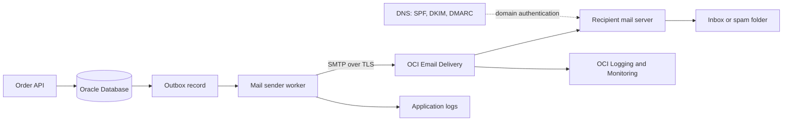

# OCI Email Delivery and application email configuration

## 1. Objectives and deployment scenario

In the **APIs, Events, and Integration** chapter of the **CLOUD_PROVIDERS_ORACLE** module, this lesson guides you through sending application transactional emails via Oracle Cloud Infrastructure (OCI) Email Delivery. Learners combine tenancy, compartments, IAM, VCN networking, and monitoring to build an operable email-sending pipeline.

The running scenario is a Java application sending a confirmation after an order is committed to an Oracle database. The example uses compartment `app-prod`, sending domain `notify.example.com`, and address `orders@notify.example.com`. `example.com` is an illustrative domain: in practice, replace it with a domain whose DNS you administer and a recipient mailbox you control.

After this lesson, learners can:

- Distinguish between email domain, approved sender, SMTP credential, and recipient address.
- Grant compartment-scoped sending permissions, configure DNS, and establish TLS-encrypted SMTP connections.
- Configure a Spring Boot application to send UTF-8 emails, keep secrets out of source code, and set timeouts.
- Monitor acceptance, relay, bounces, and suppression; design bounded retries.
- Prepare quotas, costs, and region-failover plans before going live.

## 2. Role of Email Delivery in the application flow

Email Delivery provides outbound email relay for transactional and campaign mail. The application is responsible for selecting recipients, rendering content, and deciding when to send; the service handles message relay. Do not use this service as a replacement for an employee inbox system. See [OCI Email Delivery overview](https://docs.oracle.com/en-us/iaas/Content/Email/Concepts/overview.htm) and [Oracle's deliverability best practices](https://docs.oracle.com/en-us/iaas/Content/Email/Reference/deliverabilitybestpractices_topic-bestpractices.htm).

A recommended architecture for order confirmation emails:



In this design, the order and the outbox record are created in the same database transaction. A background worker reads the outbox and sends emails. This structure keeps the order API from blocking on SMTP connections and provides durable storage when the mail service is temporarily unavailable.

Name statuses accurately according to the evidence you have:

| Milestone | Evidence | What cannot be concluded yet |
| --- | --- | --- |
| Queued | App persisted job in outbox | OCI accepted the message |
| Accepted by OCI | Successful submission result or matching log | Target mail server received it |
| Relayed | Service reports successful relay to target server | Email landed in the inbox |
| User confirmed | Recipient confirms or completes business action | All future emails will land in the inbox |

Therefore, the order API can return "email request recorded." Do not display "customer received the email" right when the SMTP send call returns normally.

## 3. Components to distinguish

| Component | Role | Example in this lesson |
| --- | --- | --- |
| Tenancy | OCI account and governance scope | Organization's tenancy |
| Compartment | Resource grouping and permission boundary | `app-prod` |
| Email domain | Resource representing the sending domain for auth and logs | `notify.example.com` |
| Approved sender | Address permitted for sending | `orders@notify.example.com` |
| SMTP credential | Username/password pair issued by OCI for an IAM user | Secret for the mail-sending process |
| SMTP endpoint | Mail submission server in the selected region | Value retrieved from Email Delivery Configuration |
| Suppression | Blocks sending to recipients due to hard bounce or complaint | Address excluded from sending pipeline |

The email domain must be under the configurator's DNS control; you cannot arbitrarily use a public webmail provider's domain. Creating an email domain also does not create an `orders@...` mailbox. See [managing email domains](https://docs.oracle.com/en-us/iaas/Content/Email/Tasks/configureemaildomains.htm).

An approved sender is scoped to a region and compartment. Applications must submit to the endpoint of the region where the sender is configured. When submitting via SMTP, keep the envelope `MAIL FROM` address aligned with the `From` header; different addresses may require both to be approved. In this lab, create a single approved sender rather than authorizing the entire domain. See [creating an approved sender](https://docs.oracle.com/en-us/iaas/Content/Email/Reference/gettingstarted_topic-Create_an_approved_sender.htm).

Distinguish additional message fields:

- **`From` header**: the address users see in their mail client.
- **SMTP envelope `MAIL FROM`**: the address used by the client in the SMTP session; distinct from the display header.
- **`Reply-To`**: where the app wants recipients to reply; requires a real receiving mailbox system.
- **`Return-Path`**: reflects the bounce-handling path on the relay side. Let the service manage it per return-path configuration; do not set this header manually as a substitute for DNS setup.

## 4. Preparing IAM and credentials

### 4.1. Separating administration and sending roles

A recommended permission split uses an `EmailAdmins` group to configure resources and an `AppMailSenders` group strictly for the application process to send mail. With an identity domain named `Default`, illustrative policies:

```text
Allow group 'Default'/'EmailAdmins' to manage email-family in compartment app-prod
Allow group 'Default'/'AppMailSenders' to use approved-senders in compartment app-prod
```

Replace identity domain, group names, and compartment with actual values. The IAM user owning the SMTP credential must belong to the group with send permissions. `use approved-senders` includes `SmtpSend`; there is no need to grant `manage email-family in tenancy` to a mail-sending process. See [Email Delivery IAM details](https://docs.oracle.com/en-us/iaas/Content/Identity/Reference/emailpolicyreference.htm).

The admin policy above is a starting point for email resources in the compartment; managing Logging, reading Monitoring, or retrieving secrets requires permissions for those respective services. Keep approved senders inside the application compartment to avoid broadening permissions tenancy-wide.

### 4.2. Creating SMTP credentials

Use a dedicated IAM user for the application; never reuse credentials from a daily admin account. On the user details page, open **SMTP credentials**, generate a credential, and store the username/password in a secrets manager as soon as they appear. The password cannot be viewed again once the dialog closes. See [creating SMTP credentials](https://docs.oracle.com/en-us/iaas/Content/Email/Reference/gettingstarted_topic-create-smtp-credentials.htm).

An SMTP username/password is an Oracle-generated string, not a Console login email, Console password, auth token, or API signing key. IAM documentation specifies at most two SMTP credentials per user and notes they do not expire automatically; rotate them proactively. See [SMTP credential lifecycle](https://docs.oracle.com/en-us/iaas/Content/Identity/access/working-with-smtp-credentials.htm).

Recommended rotation procedure:

1. Generate a new credential while there is room for a second credential.
2. Store the new secret version in OCI Vault or your organization's secrets manager.
3. Update configuration and perform a rolling restart of sender workers.
4. Send a test email and confirm all workers have switched to the new credential.
5. Revoke the old credential once no workers use it.

Never store passwords in Git, config screenshots, CLI flags, or SMTP debug logs. Reading a secret from Vault only supplies the secret to the app; it does not replace the `SmtpSend` permission of the IAM user owning the credential.

## 5. Configuring the sending domain and DNS

### 5.1. Creating the email domain, approved sender, and enabling logs

In the Console, select the target region and compartment and open **Email Delivery**. Create an email domain for `notify.example.com`; configure DKIM per the next section; create approved sender `orders@notify.example.com` in the same region.

Enable appropriate logs on the email domain before sending tests. The two categories for tracking delivery are **Outbound Accepted** and **Outbound Relayed**. Choose a log group, set retention, and grant read access to operators. Logs not enabled at send time will not appear retroactively. See [enabling logs for Email Delivery](https://docs.oracle.com/en-us/iaas/Content/Email/Tasks/enablelogs_using-the-console.htm).

### 5.2. SPF: authorizing infrastructure to send on behalf of the domain

SPF is a TXT record publishing which sources are allowed to send for the domain SPF evaluates. For an example sending only through Asia/Pacific commercial regions, illustrative content on the sending domain is:

```dns
notify.example.com. IN TXT "v=spf1 include:ap.rp.oracleemaildelivery.com ~all"
```

Use the include matching your sending region and realm per [OCI's official SPF table](https://docs.oracle.com/en-us/iaas/Content/Email/Tasks/configurespf.htm). This record assumes it is the sole sender for the illustrative domain; if other senders exist, merge all valid mechanisms into the existing SPF policy. Never create multiple independent `v=spf1` records for the same domain name.

SPF checks identity at the SMTP layer; it does not directly verify every address in the `From` header. When inspecting real mail, check both the `smtp.mailfrom` domain and DMARC alignment results.

### 5.3. DKIM: verifying the sending domain's signature

Inside the email domain, add DKIM with a distinct selector, such as prefix `orders-prod`. OCI generates the DNS record name and value to publish; for the commercial realm, the UI provides a CNAME. Copy the exact generated values—do not guess the target from region or OCID. Conceptual record format:

```text
<OCI-generated-selector>._domainkey.notify.example.com
    CNAME <OCI-provided-target>
```

Add the record at the domain's authoritative DNS, wait for propagation, and verify the status in OCI. If DNS is hosted outside OCI, make the change at that DNS provider. See [configuring DKIM](https://docs.oracle.com/en-us/iaas/Content/Email/Tasks/configure-dkim-using-the-console.htm).

A common mistake is DNS interfaces auto-appending the zone: entering a FQDN into a relative-name field can produce `...example.com.example.com`. Inspect the actual DNS record name if DKIM reports validation issues, per [Oracle's troubleshooting guide](https://docs.oracle.com/en-us/iaas/Content/Email/Concepts/troubleshooting.htm).

### 5.4. DMARC and alignment

DMARC links the domain in the `From` header with an identity authenticated via SPF or DKIM. To pass DMARC, at least one mechanism must both authenticate and align with the `From` domain. Therefore, seeing `spf=pass` on a provider's return-path domain alone is not enough to conclude DMARC passes.

Starter observation example, once a report-receiving mailbox exists:

```dns
_dmarc.notify.example.com. IN TXT "v=DMARC1; p=none; rua=mailto:dmarc-reports@notify.example.com"
```

`p=none` requests monitoring mode; it is not an enforcement policy rejecting spoofed mail. After inventorying senders and reviewing reports, the organization can roll out `quarantine` or `reject` appropriately. The reporting mailbox must be hosted by a real mail-receiving system. See [Oracle's DMARC recommendations](https://docs.oracle.com/en-us/iaas/Content/Email/Reference/deliverabilitybestpractices_topic-bestpractices.htm).

Beyond DNS, inbox placement depends on content, reputation, and receiver requirements. When sending to Gmail, consult [Google's email sender guidelines](https://support.google.com/mail/answer/81126) directly to verify rules applicable to your volume.

## 6. SMTP connectivity and networking

### 6.1. Choosing the endpoint and TLS mode

Obtain the **Public endpoint**, port, and security info from **Email Delivery → Configuration** in your region. This lesson chooses port **465** with TLS from connection open, also called implicit TLS. OCI requires transport encryption from the application to the service. See [configuring the SMTP connection](https://docs.oracle.com/en-us/iaas/Content/Email/Reference/gettingstarted_topic-Configure_the_SMTP_connection.htm).

Distinguish the two client configurations:

| Connection mode | Port typically used in this config | What the client must do |
| --- | --- | --- |
| Implicit TLS | `465` | Complete TLS handshake before SMTP exchange |
| STARTTLS | `587`, when supported by endpoint | Start SMTP, require TLS upgrade before authenticating |

Do not change only the port while leaving TLS flags unchanged. For example, using port 465 while waiting for an SMTP banner before starting TLS can hang or time out. With STARTTLS, require the upgrade to succeed; enabling "opportunistic TLS if available" is insufficient. The [Eclipse Angus SMTP provider docs](https://eclipse-ee4j.github.io/angus-mail/docs/api/org.eclipse.angus.mail/org/eclipse/angus/mail/smtp/package-summary.html) describe these SSL and STARTTLS properties.

### 6.2. When the application sits in a private subnet

For the public endpoint in this lesson, the application needs DNS resolution and outbound connectivity. A recommended design is a private subnet routing through a NAT Gateway, paired with NSG/security list egress and OS firewall rules for TCP 465. An Internet Gateway attached to a VCN does not grant Internet access to instances with only private IPs.

This is an outbound connection initiated by the app; opening inbound port 465 on the app host does not fix sending failures. If using stateless rules, account for return traffic. Do not assume a Service Gateway replaces the path to a public SMTP endpoint; verify actual capabilities and network paths for the endpoint used.

Test layer by layer from the actual runtime environment. PowerShell example:

```powershell
Resolve-DnsName -Name $env:SMTP_HOST
Test-NetConnection -ComputerName $env:SMTP_HOST -Port 465
```

On a host with OpenSSL and the `SMTP_HOST` environment variable, you can also test TLS:

```bash
openssl s_client \
  -connect "${SMTP_HOST}:465" \
  -servername "${SMTP_HOST}" \
  -verify_hostname "${SMTP_HOST}" \
  -verify_return_error \
  -brief
```

These commands do not send an email and do not verify SMTP credentials. TCP success only proves reachability to the port; TLS handshake success proves TLS works from the test environment. Never pass the SMTP password into diagnostic commands.

## 7. Java integration with Spring Boot

### 7.1. Dependencies and configuration variables

This example is for a Spring Boot project using Jakarta Mail, such as Boot 3+, already having a starter setup and dependency version management via Spring Boot parent or BOM. Add the starter below to the lab project's `pom.xml`:

```xml
<dependency>
    <groupId>org.springframework.boot</groupId>
    <artifactId>spring-boot-starter-mail</artifactId>
</dependency>
```

Spring Boot auto-configures `JavaMailSender` when the library and matching host settings are present. Set explicit timeouts because some defaults wait indefinitely. See [Spring Boot email documentation](https://docs.spring.io/spring-boot/reference/io/email.html).

Prepare the following variables through your deployment and secrets management system:

| Variable | Content | Recommended management |
| --- | --- | --- |
| `SMTP_HOST` | Public endpoint copied from OCI Configuration | Per-region configuration |
| `OCI_SMTP_USERNAME` | SMTP credential username | Secret configuration |
| `OCI_SMTP_PASSWORD` | Corresponding password | Vault or secret store |
| `MAIL_FROM` | Full approved sender | Per-environment configuration |

Environment variables are just the injection mechanism in this example; not every platform shields environment variables from users with process-admin privileges. In production, choose a secret-delivery mechanism suited to Compute, OKE, or your runtime environment.

### 7.2. Configuring implicit TLS on port 465

Illustrative content for the application's `application.yml`:

```yaml
spring:
  mail:
    host: ${SMTP_HOST}
    port: 465
    protocol: smtp
    username: ${OCI_SMTP_USERNAME}
    password: ${OCI_SMTP_PASSWORD}
    default-encoding: UTF-8
    properties:
      "[mail.smtp.auth]": true
      "[mail.smtp.ssl.enable]": true
      "[mail.smtp.ssl.checkserveridentity]": true
      "[mail.smtp.starttls.enable]": false
      "[mail.smtp.starttls.required]": false
      "[mail.smtp.connectiontimeout]": 5000
      "[mail.smtp.timeout]": 10000
      "[mail.smtp.writetimeout]": 10000
      "[mail.smtp.from]": ${MAIL_FROM}
      "[mail.debug]": false

app:
  email:
    from: ${MAIL_FROM}
```

The configuration keeps `protocol: smtp` and sets `mail.smtp.*` properties; `ssl.enable: true` initiates TLS at connect time. Disabling STARTTLS here does not disable encryption: TLS is already established upon connection. `mail.smtp.from` sets the envelope sender; `app.email.from` is used by the Java class for the `From` header. See property semantics in the [SMTP provider docs](https://eclipse-ee4j.github.io/angus-mail/docs/api/org.eclipse.angus.mail/org/eclipse/angus/mail/smtp/package-summary.html).

The three timeouts in the example are in milliseconds and are starting values. Tune them to actual latency, job processing budgets, and worker claim behavior. Never set `mail.smtp.ssl.trust=*` or disable hostname checks to bypass certificate errors.

If choosing STARTTLS on port 587 after confirming endpoint support, update these settings together while keeping other settings consistent:

```properties
spring.mail.port=587
spring.mail.properties[mail.smtp.ssl.enable]=false
spring.mail.properties[mail.smtp.starttls.enable]=true
spring.mail.properties[mail.smtp.starttls.required]=true
```

These are changes for the alternative mode, not a block to append onto the port 465 config without considering property precedence.

### 7.3. Order confirmation sending service

Place the class below in a Spring-scanned package. It accepts one recipient per job, sends UTF-8 text, and attaches an internal correlation header for tracing:

```java
package com.example.notification;

import java.nio.charset.StandardCharsets;
import java.util.Objects;
import java.util.UUID;

import jakarta.mail.MessagingException;
import jakarta.mail.internet.MimeMessage;

import org.springframework.beans.factory.annotation.Value;
import org.springframework.mail.javamail.JavaMailSender;
import org.springframework.mail.javamail.MimeMessageHelper;
import org.springframework.stereotype.Service;

@Service
public class OrderEmailService {

    private final JavaMailSender mailSender;
    private final String from;

    public OrderEmailService(
            JavaMailSender mailSender,
            @Value("${app.email.from}") String from) {
        this.mailSender = mailSender;
        this.from = from;
    }

    public void sendOrderConfirmation(
            String recipient,
            String orderReference,
            UUID notificationId) throws MessagingException {

        Objects.requireNonNull(notificationId, "notificationId");
        Objects.requireNonNull(orderReference, "orderReference");

        MimeMessage message = mailSender.createMimeMessage();
        MimeMessageHelper helper = new MimeMessageHelper(
                message, false, StandardCharsets.UTF_8.name());

        helper.setValidateAddresses(true);
        helper.setFrom(from);
        helper.setTo(recipient);
        helper.setSubject("Order Confirmation");
        helper.setText(
                "We have received your order " + orderReference
                + ".\nYou can check its status in the application.",
                false);

        message.setHeader(
                "X-App-Notification-Id", notificationId.toString());

        mailSender.send(message);
    }
}
```

Callers must obtain `recipient` from authorized business data. Syntax validation alone does not prove the mailbox exists or the owner consented to receive mail. Never expose a public API allowing arbitrary callers to send email to arbitrary addresses via this service.

`MessagingException` can occur while building the message; send errors can also be surfaced by Spring as `MailException`. The worker must classify the error, update job state, and apply the retry policy from the next section. Never catch all exceptions and mark the job successful.

The `X-App-Notification-Id` header aids application-side correlation. It does not provide idempotency in OCI and does not guarantee every intermediate system preserves the header. Nor does the method above implement an outbox or retries; both belong in the orchestrating worker.

When HTML is required, use escaping templates and provide a plain-text alternative. When attachments are needed, calculate MIME size after encoding; prefer expiring links to content in the application or Object Storage when business rules permit. Do not put unnecessary sensitive data in email subjects.

## 8. Sending via HTTPS: an alternative integration option

OCI also supports **HTTPS email submission** via the data plane; not all Email Delivery APIs are solely for managing senders and domains. The HTTPS mechanism can use standard OCI SDK authentication such as API keys, instance principals, or resource principals. Retrieve the regional endpoint from Configuration or the config API. See [HTTPS email submissions](https://docs.oracle.com/en-us/iaas/Content/Email/Concepts/email-submission-using-https.htm).

| Criterion | SMTP | HTTPS submission |
| --- | --- | --- |
| Best fit | Apps already using SMTP libraries or mail relays | Apps integrating directly with OCI SDK/API |
| Authentication | SMTP username/password | Supported OCI SDK authentication mechanisms |
| Network path | SMTP port and matching TLS mode | HTTPS to data-plane endpoint |
| Operational work | Storing and rotating SMTP credentials | Managing principals, policies, and SDK configuration |

For apps running on OCI Compute, HTTPS with an instance principal can reduce the need to store SMTP passwords. The principal still requires matching IAM policies; switching protocols does not bypass sender, DNS, or sending permission requirements. [Oracle's HTTPS tutorial](https://docs.oracle.com/en/learn/send-email-with-ociemaildelivery-http/) illustrates instance principals and dynamic groups.

This lesson's Spring Boot example uses SMTP to align with apps already using `JavaMailSender`. Never use SMTP credentials as API signing keys, nor paste an instance principal token into the SMTP password field.

## 9. Resilient delivery and retry design

### 9.1. Outbox bridges the gap between data and email

There is no single distributed database transaction spanning both committing an order and delivering an email across the Internet. Sending before commit risks sending confirmations for rolled-back orders. Sending synchronously right after commit risks crashing between steps and losing the email request.

The recommended outbox design persists at least these fields in the same transaction as the order:

| Field | Purpose |
| --- | --- |
| `notification_id` | Stable identifier for one business notification |
| `business_key` | Key like `order-confirmation:<order-id>` to prevent duplicate creation |
| `recipient_ref` | Recipient reference; protect addresses per data policy |
| `template_version` | Tracks which content template version was used |
| `state` | Internal processing state |
| `attempts`, `next_attempt_at` | Retry scheduling |
| `expires_at` | Prevents sending stale content after expiry |
| `last_error_class` | For operations; never store passwords or full message bodies |

Workers claim jobs via claim/lease or database locking so two workers do not actively send the same job. With lease-based workers, size lease duration for processing time and renew when needed; a lease expiring mid-send can still cause duplicates.

### 9.2. Classifying outcomes before retrying

The states below are application design suggestions, not an official OCI enum:

```text
PENDING -> PROCESSING -> SUBMITTED
                     -> RETRY_WAIT -> PROCESSING
                     -> FAILED_PERMANENT
                     -> UNKNOWN
PENDING / RETRY_WAIT  -> EXPIRED
```

`SUBMITTED` means the app recorded a successful submission. Downstream bounce or relay signals must be tracked separately and not assumed from this state.

| Scenario | Recommended handling |
| --- | --- |
| Connection failed or transient error before submission | Retry with backoff, jitter, and max attempts |
| Service throttled due to send rate | Slow down entire pipeline; reschedule within rate windows |
| Wrong credentials, missing IAM, or unapproved sender | Pause per-message auto-retries; fix shared configuration |
| Address suppressed or confirmed permanent error | Route to recipient data remediation; do not retry infinitely |
| Timeout after sending body without final response | Record unknown outcome; reconcile before deciding to resend |
| Transactional content expired | Transition to `EXPIRED` or regenerate per business rules |

Inspect response codes and failure phase; a `timeout` exception alone does not tell you whether the service accepted the message. An illustrative backoff for transient errors could start at 30 seconds, 2 minutes, 10 minutes, then move to manual handling; that is a design choice, not an Oracle-mandated schedule. OTP deadlines are much shorter and require separate policies.

A `business_key` prevents the app from creating two records for the same intent, but does not eliminate the case where the service accepted the mail before the app lost connectivity. SMTP does not provide end-to-end exactly-once guarantees. For order confirmations, a small duplicate rate after reconciliation may be acceptable; for sensitive notices, define an explicit `UNKNOWN` handling workflow.

When using a dedicated queue to transport jobs, that queue is part of your architecture. Do not assume OCI Email Delivery automatically pushes every bounce into OCI Queue or calls an application webhook; build status ingestion using your chosen Logging/API capabilities.

## 10. Monitoring delivery and suppression

### 10.1. Combining application logs with OCI Monitoring

Application logs should include `notification_id`, notification type, start/end timestamps, attempt count, region, and outcome category. To search by recipient, log a reference or hashed/masked identifier instead of raw addresses in every log line. Never log OTP codes, password-reset links, or SMTP passwords.

OCI provides metrics in the `oci_emaildelivery` namespace, filterable by approved sender or sending domain. Categories to monitor include accepted, relayed, hard bounce, soft bounce, suppressed, and complaint. Custom application headers do not automatically become metric dimensions. See [guide to metrics and logs](https://docs.oracle.com/en-us/iaas/Content/Email/Reference/guide-to-metrics-logs.htm).

Example MQL queries from Email Delivery's metrics system:

```text
EmailsAccepted[1m].count()
EmailsRelayed[1d]{resourceDomain = "notify.example.com"}.count()
EmailsHardBounced[1d].count()
EmailsSuppressed[1d]{resourceId = "<approved-sender-ocid>"}.count()
```

In the last query, `resourceId` is the approved sender OCID, not the email address. Select the namespace, compartment, region, and time window in Metrics Explorer before interpreting numbers. See [official metrics query guide](https://docs.oracle.com/en-us/iaas/Content/Email/Reference/metrics-guide.htm).

With this lesson's architecture, add application metrics for oldest queued job age, outbox depth, authentication failures, and unknown-outcome sends. These are signals the relay service cannot know completely on the app's behalf.

Example internal target: most confirmation emails are submitted within two minutes of order commit. From that, alert when job age exceeds two minutes or queue depth keeps growing. Avoid alerting solely when send count drops to zero: overnight periods with no orders will legitimately produce zero sends.

Do not subtract `accepted - relayed` over a short window as an absolute backlog count. The two milestones have latency lag, can fall in different time buckets, and are affected by other delivery outcomes. Correlate logs by timestamp and message cohort when investigating.

### 10.2. Suppression is a data-quality signal

OCI may automatically place recipient addresses on the suppression list upon hard bounces or complaints; suppressed addresses will stop receiving mail through that flow. Managing suppression requires tenancy-level policies, even though operationally you still select the appropriate region. See [managing the suppression list](https://docs.oracle.com/en-us/iaas/Content/Email/Tasks/managingsuppressionlist.htm) and [Email Delivery regional scope](https://docs.oracle.com/en-us/iaas/Content/Email/Concepts/overview.htm).

Recommended workflow when suppression is detected:

1. Check cause and timestamp from suppression info or enabled logs.
2. Stop scheduling new sends for the blocked purpose in application data.
3. Investigate typos, closed mailboxes, aliases containing bad members, or complaints.
4. Only consider removing suppression after verified remediation and confirmation.
5. Enforce block/opt-out decisions at the application tier so all flows and regions honor them.

Never run a periodic job clearing the entire suppression list to "restore sending." Nor switch regions to keep emailing recipients who filed complaints. Separate marketing lists from transactional mail and track contact consent cleanly in application data.

## 11. Symptom-based diagnostics

Troubleshoot from the network layer up to the business layer. Test from the exact VM, container, or pod sending mail to avoid drawing conclusions from a laptop with a different network path.

| Symptom | Check first | Resolution path |
| --- | --- | --- |
| Cannot resolve endpoint | `SMTP_HOST`, DNS resolver | Re-copy endpoint for the right region; fix environment DNS |
| TCP timeout | Route, NAT, egress, firewall | Restore outbound path to chosen endpoint and port |
| TLS handshake or certificate error | 465/587 mode, hostname, JDK, trust store | Update trust environment; never disable TLS verification |
| SMTP authentication failed | Credential pair, user state, copy whitespace | Reissue or fix secret; never use Console password |
| Sender rejected | `From`, envelope sender, approved sender, region, IAM | Align addresses and grant permissions in right compartment |
| DKIM not active | Record name, target, authoritative DNS | Fix record, check relative vs. FQDN name, wait for propagation |
| Submitted OK, no email seen | Relay logs, bounce, suppression, quarantine/spam | Trace further in service and destination mail system |
| Lands in spam | Auth results, alignment, reputation, content | Fix root cause and monitor across multiple sends |
| Throttled when scaling workers | Aggregate rate, daily quota, message size | Cap concurrency and rate; request limit increase if needed |
| Duplicate emails sent | Lease duration, duplicate outbox rows, post-send timeout | Fix business key and unknown-outcome reconciliation |

Oracle provides an [SMTP/HTTPS error table and troubleshooting guide](https://docs.oracle.com/en-us/iaas/Content/Email/Concepts/troubleshooting.htm). Use actual service responses to diagnose; never infer a single root cause solely from an application exception name.

## 12. Quotas, cost, and availability

### 12.1. Controlling volume and cost

Before deploying, check current tenancy and region limits for send rate, message size, sender/domain counts, and limit-increase criteria. Never treat a figure from an example or trial account as a universal limit across all tenancies. Oracle explains how to check and request increases in [Limits by Service](https://docs.oracle.com/en-us/iaas/Content/General/service-limits/default.htm).

Recommended capacity planning table:

| Data to estimate | Impact on design |
| --- | --- |
| Messages per hour/day | Quotas, backlog-drain plans, and budget |
| Recipients per transaction | One business action may generate multiple deliveries |
| Encoded MIME size | Size limits and applicable traffic accounting |
| Max retry attempts | Extra load during incidents |
| Peak traffic | Worker throughput and queue capacity |
| Log/outbox retention | Storage cost and operational data scope |

The formulas below are for design estimation only and do not replace service billing formulas:

```text
max attempts = messages × recipients per message × max attempts per recipient
minimum queue drain time ≈ remaining jobs / allowed send rate
```

For example, a queue with 9,000 jobs at a hypothetical allowed rate of 30 jobs/minute with one recipient each takes at least 300 minutes just to drain, excluding new messages and errors. That rate is not a default OCI quota. Adding more workers once you hit the rate limit will not drain the queue any faster.

When budgeting, check current pricing for Email Delivery, Logging, networking, and supporting components in your account. Log enough for investigation, run tests in small volumes, and prevent unbounded retries. Never hardcode unit prices in application configuration.

### 12.2. Preparing for region failover

SMTP credentials are identity assets usable across regions; approved senders and suppressions are regional resources. Therefore, changing `SMTP_HOST` alone is not a complete failover plan. See [configuring a new region](https://docs.oracle.com/en-us/iaas/Content/Email/Concepts/overview.htm).

A recommended region-failover plan prepares upfront:

- Senders, domains, DKIM, and SPF policies matching the standby region/realm.
- Verified principal or IAM user permissions, endpoints, network paths, and quotas.
- Blocklists and opt-out decisions enforced consistently by the application.
- Single job coordinator so both regions do not independently send the same message.
- Logs, alerts, test sends, and failback criteria to the primary region.

You can run multiple sender workers within a region to avoid single-host dependency, while still enforcing claims/leases and a shared rate cap. For critical flows like account recovery, define a business fallback if email is delayed; switching regions does not guarantee inbox placement.

## 13. Controlled deployment lab

Practice in a dedicated learning compartment and send only to mailboxes you control. Never run load tests by sending bulk emails to real user addresses.

1. **Choose environment:** identify tenancy, compartment, region, DNS domain, sending address, and receiving mailbox. Replace all example domains with a real domain you administer.
2. **Grant permissions:** create admin and sender groups; create a dedicated IAM user for SMTP and apply compartment-scoped policies. Confirm the app does not need tenancy-wide admin rights.
3. **Prepare domain:** create email domain, enable logs, configure SPF/DKIM, and set up monitoring DMARC if a report mailbox exists. Wait for records to verify.
4. **Prepare sender and secret:** create approved sender, generate SMTP credential, and store it in a secret store. Verify `MAIL_FROM` matches the created sender.
5. **Verify connectivity:** copy endpoint from Configuration; test DNS, TCP, and TLS from where the app runs. Record the tested region and port.
6. **Integrate Java:** add the starter to the lab project, apply the 465 config, and call `sendOrderConfirmation` once from an internal test flow. Keep a UUID to trace the message.
7. **Verify across layers:** inspect app result, accepted/relayed logs, sender metrics, and actual email in the receiving inbox. Inspect raw email headers to verify SPF, DKIM, and DMARC.
8. **Safe fault test:** on a test config, supply an invalid password to verify error classification and retry halting; then restore the real secret. Never intentionally trigger complaints or damage domain reputation via bulk test sends.
9. **Wrap up:** record observations, revoke unused test credentials, stop test workers, and check pending jobs. Delete only lab-specific resources/DNS records to avoid affecting other senders.

Lab results meet requirements when there is evidence for every layer: sender in the right region, verified DNS, valid TLS connection, recorded submission, and independently verified arrival in the target mailbox. If an email has not arrived, document the last verified milestone and next diagnostic step; never mark status "received" just to finish the lab.

## 14. Pre-production self-check

- Endpoint, approved sender, and compartment match the deployment region.
- Sending IAM user has only required permissions; credentials are secured with a rotation procedure.
- SPF/DKIM are verified; DMARC results are checked on real messages.
- Port and TLS mode match; hostname verification is active; timeouts are configured.
- Recipients come from authorized business flows; abuse controls are in place.
- Sending jobs have stable IDs, deadlines, finite retries, and unknown-outcome handling.
- Logs were enabled before sending; dashboards distinguish accepted, relayed, bounced, and suppressed.
- Quotas, aggregate worker rate, budget, and recovery plans have been tested at appropriate scale.
