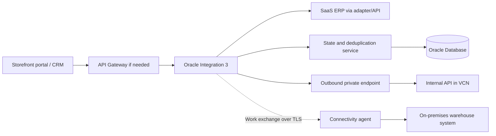
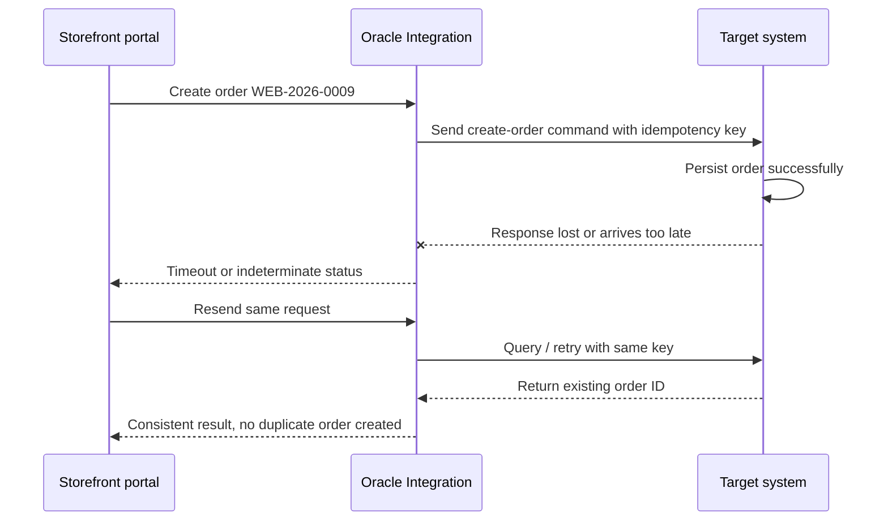

# Oracle Integration and enterprise application connectivity

## 1. Objectives and scope

In the **APIs, Events, and Integration** chapter of the Oracle Cloud Infrastructure module, Oracle Integration is the layer connecting business systems: CRM, ERP, HCM, internal applications, and databases. This lesson uses **Oracle Integration 3** as the terminology baseline; older documentation may use Oracle Integration Cloud or OIC.

After this lesson, learners can:

- Distinguish between adapter, connection, trigger, invoke, and integration.
- Choose synchronous, asynchronous, scheduled, or event-driven flows.
- Design connections to SaaS and private-network systems with appropriate access permissions.
- Explain deduplication, fault recovery, and data reconciliation.
- Build a REST flow, observe runs, and prepare a plan to promote to production.

The exercise centers on receiving orders from a storefront portal and forwarding them to an order-processing system. The JSON structures, integration names, and business APIs below are **illustrative contracts designed for this lesson**. When connecting to a real Oracle Fusion Cloud ERP, select the exact objects, operations, schemas, and permissions supported by the adapter/API.

## 2. What problem does Oracle Integration solve?

Suppose an enterprise operates three systems:

1. CRM managing customers and sales opportunities.
2. ERP recording vouchers and financial transactions.
3. Warehouse system in an on-premises data center managing fulfillment.

If each system directly calls every other system, each pair must independently handle authentication, code mappings, error handling, and tracing. When ERP changes a schema, multiple applications may have to change at once.

Oracle Integration provides a design and execution environment with adapters, data mappers, and flow monitoring. As a result, development teams can centralize connectivity logic in one place. Oracle positions the service around connecting applications, data, and automating workflows. [Source: Oracle Integration concepts](https://docs.oracle.com/en/cloud/paas/application-integration/integrations-user/watch-video.html).

In enterprise design, you must still identify the **system of record**. For example, ERP owns the official invoice ID; the integration layer maintains the mapping between the storefront order ID and the ERP ID. Placing a middleware tool in the middle does not automatically resolve data conflicts or guarantee distributed transactions across multiple applications.

| Architecture component | Responsibility to assign |
| --- | --- |
| Oracle Integration | Orchestrate connectivity, transform messages, invoke apps, and handle integration faults |
| API Gateway | Manage API entry points via configured authentication, routing, and traffic-control policies |
| Business applications | Validate domain rules and decide document state |
| Database or state service | Persist outcomes, deduplication keys, and long-lived progress |
| Queue or streaming platform | Buffer, distribute, and process messages per the chosen technology's capabilities |

The table above assigns responsibilities for a reference architecture. Not every flow requires all components.

## 3. Concepts to use accurately

| Concept | Meaning | Example in this lesson |
| --- | --- | --- |
| Adapter | Mechanism for interacting with a specific protocol or application | REST Adapter, Oracle ERP Cloud Adapter |
| Connection | Adapter-based connection config to a system, including endpoint and security | `ORDER_SERVICE_INVOKE` to the test order API |
| Trigger | Entry point receiving a request or signal that starts an integration | REST `POST /orders` |
| Invoke | A step calling out from an integration to another system | Calling the create-order API on the target system |
| Mapper | Field mapping and data structure transformation | `orderId` to `externalOrderId` |
| Lookup | Value translation table across systems | `WEB_VN` to `ONLINE_VN` |
| Integration | Flow comprising start point, mappings, conditions, actions, and invokes | Order-creation flow |
| Integration instance | A single execution of a flow | Processing run for order `WEB-2026-0009` |
| Project | Space to organize, manage lifecycle, and monitor a group of integration assets | Order fulfillment solution |
| Business identifier | Business field used to search runs | `orderId` |

A connection can be reused across multiple steps or flows per its configured sharing scope. A successful connection test does not prove the entire business flow works: the account may authenticate yet lack document-creation privileges, or metadata may look valid while real payloads fail validation.

In Oracle Integration 3, projects group assets and manage deployments. Group by business solution sharing a lifecycle, such as `ORDER_FULFILLMENT`, rather than dumping every enterprise flow into one monolithic project. [Source: About Projects](https://docs.oracle.com/en/cloud/paas/application-integration/integrations-user/integration-projects.html).

## 4. Choosing invocation patterns and response handling

**How a flow starts** and **how the caller waits for results** are two distinct decisions.

### 4.1. Application integration

The flow starts upon receiving a request or signal from an application via an appropriate trigger. With REST, you can design:

- **Synchronous:** the caller waits for the integration to return the processing result.
- **Asynchronous:** the caller submits the request; business outcomes are tracked or returned via a separate mechanism.

Synchronous suits short operations needing immediate results with predictable latency. Asynchronous fits better when waiting on ERP bulk imports, high volumes, or multi-system orchestration. Oracle outlines this choice in its guide on application integrations. [Source: Synchronous and asynchronous integrations](https://docs.oracle.com/en/cloud/paas/application-integration/integrations-user/how-choose-between-synchronous-asynchronous-integrations.html).

An HTTP acknowledgment confirming receipt does not prove ERP recorded the order. If the API returns `202 Accepted`, the contract must specify how to fetch final status; this HTTP status code does not create a durable queue or lookup API on its own.

### 4.2. Schedule integration

Flows run on a schedule, fitting scenarios such as periodic change polling, batch file processing, or end-of-day reconciliation. In incremental extraction designs, persist progress watermarks and advance them only after the corresponding slice is safely processed.

For example, if fetching customer updates from 08:00 to 08:05 fails midway, advancing the watermark immediately to 08:05 can lose unprocessed records. One approach is pagination, checkpointing, and deduplication keys when reading overlapping time windows. That is application logic you must explicitly design. [Reference for Application and Schedule starter patterns: Oracle tutorial](https://docs.oracle.com/en/cloud/paas/application-integration/integrations-user/build-your-first-integration-from-scratch.html).

### 4.3. Event integration

Oracle Integration supports defining events, publishing from one integration, and subscribing via event integrations. This lets publishers and subscribers maintain relatively independent lifecycles. [Source: About Event Integrations](https://docs.oracle.com/en/cloud/paas/application-integration/integrations-user/event-integrations.html).

Distinguish three event sources in the architecture:

- Business events emitted by SaaS applications, received via adapters and matching app configuration.
- Publish/subscribe events internal to Oracle Integration.
- OCI resource events handled by the OCI Events service.

Do not assume these three mechanisms share schemas, permissions, or transport paths. When bridging them, explicitly specify the receiver, authentication, transformation, and forwarding components.

## 5. Architecture for connecting SaaS and private networks

The diagram below depicts a reference architecture. Each branch uses its own connection; API Gateway is an option when a centrally governed entry point is needed.



### 5.1. Connecting to public SaaS

Choose an application adapter when it supports the exact operation required. REST/SOAP is the fallback when the target endpoint exposes a suitable API lacking a needed operation in the dedicated adapter.

Oracle ERP Cloud Adapter supports published Oracle APIs and business events, including bulk data imports and completion callbacks. During implementation, verify operations, event-enablement prerequisites, and ERP-side permissions. [Source: Oracle ERP Cloud Adapter Capabilities](https://docs.oracle.com/en/cloud/paas/application-integration/erp-adapter/oracle-erp-cloud-adapter-capabilities.html).

Business design should separate "import request submitted" from "import job succeeded." For batches, also check accepted row counts versus rejected row counts. Never write directly into a SaaS database to bypass business APIs.

### 5.2. Private endpoints for outbound calls

Oracle Integration private endpoints serve outbound connections to private resources, with support depending on the adapter. Configuring a "private endpoint" does not mean all inbound/outbound traffic of the instance has been switched to private. [Source: Private Endpoint vs. Connectivity Agent](https://docs.oracle.com/en-us/iaas/application-integration/doc/private-endpoint-vs-connectivity-agent.html).

Before testing business logic, the infrastructure team must verify:

1. DNS resolves to the right IP for the target hostname.
2. Routing to the destination and return path exist.
3. NSGs, security lists, and OS firewalls permit the target port.
4. TLS certificates match the hostname and trust chain.
5. The adapter/connection selects the right access mode.

Compartments organize resources and admin permission boundaries; placing the instance and database in the same compartment does not create network connectivity automatically.

### 5.3. Connectivity agent for on-premises/internal systems

The connectivity agent runs in an environment able to reach internal applications. The agent initiates outbound connections, polls work from Oracle Integration, and returns results over TLS. REST/SOAP callbacks do not travel back through the agent; they call the Oracle Integration endpoint directly. Therefore, do not treat the agent as a reverse proxy for all inbound calls. [Source: About the Connectivity Agent](https://docs.oracle.com/en/cloud/paas/application-integration/integrations-user/connectivity-agent.html).

In the warehouse design, document two separate paths: integration calling the warehouse, and the warehouse sending callbacks. If callbacks are blocked by a firewall, a successful invoke test still does not prove the bidirectional workflow operates.

## 6. Authorization and managing connection credentials

Three permission layers must be configured separately:

| Permission layer | Question to answer |
| --- | --- |
| OCI IAM for resources | Who may create, edit, or manage instances in the compartment? |
| Roles in Oracle Integration | Who may design, monitor, or invoke integrations? |
| Target application permissions | Which data can the integration account manipulate in ERP, CRM, or databases? |

Oracle Integration defines built-in roles such as `ServiceAdministrator`, `ServiceDeveloper`, `ServiceMonitor`, and `ServiceInvoker`. `ServiceInvoker` is for invoking flows; it does not grant access to the admin UI or Developer APIs. Never assign `ServiceAdministrator` to every client just to bypass permission errors. [Source: Service Roles](https://docs.oracle.com/en-us/iaas/application-integration/doc/oracle-integration-roles.html).

With OAuth, inbound auth, outbound auth, and Developer APIs are separate configuration scenarios. Developer APIs require OAuth; grant types and roles must match the called API. [Source: Where Can You Use OAuth?](https://docs.oracle.com/en/cloud/paas/application-integration/integrations-user/where-can-you-use-oauth-oracle-integration.html).

During deployment:

- Use dedicated technical identities per environment and purpose.
- Store credentials in service-supported security configurations; never put tokens or passwords into mappers, lookups, Git, or sample payloads.
- Grant least-privilege read/write access in target systems, including data access scoped by business unit.
- Track token, secret, and certificate expirations; rehearse credential rotation.
- Restrict payload viewing access since logs may contain customer information.

If placing API Gateway in front, explicitly design the identity the gateway uses when calling the backend. Client authentication at the gateway does not automatically grant permission to invoke Oracle Integration.

## 7. Data contracts and business mappings

A good contract defines structure, field semantics, versioning, error rules, and replay behavior. Providing sample JSON alone is insufficient to determine required fields or valid bounds.

Illustrative message from the storefront portal:

```json
{
  "schemaVersion": "1.0",
  "messageId": "msg-web-2026-0009-v1",
  "orderId": "WEB-2026-0009",
  "sourceSystem": "WEB_VN",
  "occurredAt": "2026-11-20T09:00:00+07:00",
  "customerCode": "CUST-010",
  "currency": "VND",
  "lines": [
    {
      "lineNumber": 1,
      "sku": "BOOK-OCI",
      "quantity": 2,
      "unitPrice": 250000
    }
  ]
}
```

This contract specifies:

- `messageId` identifies a single message; redelivering the same message must keep the same ID.
- `orderId` identifies the order in the source system.
- `occurredAt` includes a timezone offset; do not use context-free timestamp strings.
- `currency` is the currency code; quantities and prices must be validated against business rules.
- `lines` must contain at least one element; each line requires a valid item code and quantity.
- Breaking changes require a versioning and transition plan for consumers.

A valid update to an existing order may share `orderId` while carrying a new `messageId`, paired with a business version if updates are supported. Therefore, deduplication keys must bind to the **operation**, rather than picking one field for all scenarios.

### 7.1. Mapping to the target contract

| Source data | Illustrative target data | Rule |
| --- | --- | --- |
| `orderId` | `externalOrderId` | Preserve verbatim for reconciliation |
| `sourceSystem` | `salesChannel` | Lookup from `WEB_VN` to `ONLINE_VN` |
| `customerCode` | `customerReference` | Validate customer ID mapping between both systems |
| `lines[].sku` | `items[].itemCode` | Cross-check product catalog |
| `lines[].quantity` | `items[].orderedQuantity` | Preserve numeric type, validate greater than 0 |
| `occurredAt` | `sourceTimestamp` | Normalize format accepted by target API |

If ERP uses its own customer IDs, do not assume CRM's `CUST-010` is the ERP primary key. Use a cross-reference table or a lookup service with a clear data owner.

Lookups fit small, governed code translation tables. Never use lookups to store secrets or replace a transactional datastore. Oracle notes that editing a lookup used by an active integration generally takes effect without reactivating the flow; therefore, lookup edits must be governed just like behavior changes. [Source: Manage Lookups](https://docs.oracle.com/en/cloud/paas/application-integration/integrations-user/managing-lookups.html).

### 7.2. Distinguishing missing, empty, and default data

For example, omitting `currency` does not necessarily mean the same thing as `currency: ""`. Defaulting every request to VND can silently record foreign-currency orders incorrectly without raising a technical error.

For each field, decide explicitly: required, nullable/empty allowed, default value, or reject. Monetary values also require rounding and precision rules; never rely on implicit string-to-number coercion.

## 8. End-to-end flow design

An order-creation flow can follow this sequence:

1. Receive and authenticate the request.
2. Validate schema and basic business preconditions.
3. Derive the deduplication key for the create-order operation.
4. Translate codes and enrich required data.
5. Invoke the target application.
6. Record the target ID and processing outcome.
7. Return response or update status for the caller.
8. Route unresolved failures into a recovery workflow with an assigned owner.

In the lab, the synchronous flow calls only a mock API. In real deployments, if ERP requires lengthy import processing, decouple ingestion from final completion. The ingestion layer must persist the request or place it on a durable channel before acknowledging receipt.

### 8.1. Tracking with business identifiers

Use `orderId` as the primary business identifier and `messageId`, `sourceSystem` as two additional tracking fields if needed. Oracle Integration allows up to three business identifiers, one of which is primary; values are extracted from appropriate source fields. [Source: Assign Business Identifiers](https://docs.oracle.com/en/cloud/paas/application-integration/integrations-user/assign-business-identifiers-tracking-fields-messages.html).

Business identifiers help locate runs. They **do not enforce uniqueness**, lock orders, or prevent two parallel runs.

The target system's business key, such as `targetOrderId`, must still be persisted in reconciliation records and responses. Never rely solely on the integration runtime's history retention window.

### 8.2. Keeping flows maintainable

Each integration should have one clear purpose: ingesting orders, invoking order creation, handling callbacks, or reconciling. Packing an entire multi-department workflow into one integration makes testing and fault isolation difficult.

Splitting flows also introduces extra error boundaries and tracing needs. Therefore, split only when justified by differing latency profiles, access scopes, reusability, or release lifecycles.

## 9. Deduplication and cross-system consistency

### 9.1. Timeouts create unknown outcomes

Consider this scenario:



The safe lookup or idempotent retry in the diagram is a **target application design requirement**. Oracle Integration does not automatically add this capability to arbitrary APIs.

Treating a timeout as "definitely not created" and issuing a brand-new command can create two orders. Before retrying a write operation, confirm whether the target supports idempotency keys, unique external references, or lookup operations.

### 9.2. An illustrative state model

An enterprise-built state service can store:

| Field | Purpose |
| --- | --- |
| `sourceSystem`, `operation`, `orderId` | Business key for the create-order operation |
| `messageId` | Identifies the message and redeliveries |
| `payloadHash` | Detects same key with conflicting payload |
| `status` | `PROCESSING`, `SUCCEEDED`, `REJECTED`, `UNKNOWN` |
| `targetOrderId` | Reference to the record created at the target |
| `updatedAt`, `attemptCount` | Supports progress tracking and recovery |

Claiming the key must be atomic, such as via a unique constraint and controlled writes in Oracle Database. Separate "SELECT not found" then "INSERT" steps still race. Never hold an open database transaction across network calls.

Recommended reaction rules:

- **Already succeeded, identical payload:** return the persisted result.
- **In progress:** return current status; do not initiate another execution.
- **Same key, different payload:** reject conflict per contract.
- **Unknown target outcome:** route to reconciliation; do not assume it never executed.
- **Worker crashed mid-flight:** use processing leases and a recovery sweep that checks target state.

An intermediate deduplication store still leaves a gap: the target may succeed before the integration updates the state store. Closing that gap requires target-side deduplication or lookups. You cannot claim "exactly once" guarantees merely because a state table exists.

### 9.3. Multiple steps do not form a shared transaction

Suppose ERP order creation succeeds while warehouse stock reservation fails. Rolling back a local database transaction does not undo the ERP order created over an API.

Choose an explicit business policy: leave the order pending, retry inventory reservation, escalate to manual handling, or call a cancel-order operation if valid. Compensating actions can themselves be rejected—for example, if the order already moved to shipping—so compensations must also be tracked.

## 10. Error handling, retries, and resubmits

### 10.1. Classifying faults before choosing actions

| Scenario | Recommended design action |
| --- | --- |
| Missing customer code or invalid type | Reject with clear reason; source fixes data before resending |
| 401/403 | Check token, scope, role, and data permissions; avoid pointless retries |
| 429 | Throttle down, honor `Retry-After` if present, cap attempts |
| Connection error or 5xx | Assess transience and safety of repeating the operation |
| Timeout after create command | Query target outcome or retry with same idempotency key |
| Missing lookup mapping | Raise configuration-data fault; never substitute a random code |

These are recommended architectural policies, not defaults built into every adapter.

### 10.2. Scopes and global fault handlers

Use a Scope to group steps sharing an error-handling boundary. For instance, wrap mapping and the create-order invoke in a scope; the handler captures the fault alongside `orderId` and decides whether to return an error, retry, or route to reconciliation.

Oracle notes that for invokes using the connectivity agent, faults must be handled through the scope's default fault handler rather than relying on named fault handlers. [Source: Scope Action](https://docs.oracle.com/en/cloud/paas/application-integration/integrations-user/manage-group-actions-scope-action.html).

The global fault handler is the flow-wide catch layer. If the handler finishes handling the fault, the run may appear as `Succeeded`. Therefore, track business status separately; sending an error-notification email successfully does not mean the order was created. [Source: Global Fault Handling](https://docs.oracle.com/en/cloud/paas/application-integration/integrations-user/add-global-faults-orchestrated-integrations.html).

### 10.3. Retrying an invoke vs. resubmitting an instance

**Retrying an invoke** repeats a call inside flow logic. The **Add Retry Logic** feature in projects generates retry logic around invokes; current documentation notes it covers all invoke fault types, not just network faults. Inspect generated logic before applying it to write operations. [Source: Add Retry Logic](https://docs.oracle.com/en/cloud/paas/application-integration/integrations-user/retry-invoke-connections-project.html).

With custom policies, you can design exponential backoff, attempt and total-time caps, plus jitter to avoid synchronized retry storms. Implement these rules explicitly using supported constructs; never assume the Add Retry Logic button provides them all automatically.

**Resubmitting** recovers a failed integration instance. Oracle Integration does not automatically resubmit every failed message. Synchronous flows cannot be resubmitted; asynchronous flow recovery has exceptions—including scheduled flows with scheduled parameters—and is subject to a recovery window. Where execution resumes depends on design. [Source: Resubmit Failed Messages](https://docs.oracle.com/en/cloud/paas/application-integration/integrations-user/resubmit-failed-messages.html).

Before resubmitting, operators must know:

1. Has the root cause been fixed?
2. Which steps already produced side effects in target apps?
3. Will replay reuse the same deduplication key?
4. If target status was unknown, has the target been queried?
5. Who tracks recovery results and closes the incident?

Never bulk-resubmit simply because the endpoint came back online.

## 11. Technical observability and business reconciliation

Oracle Integration provides instance tracking, business identifiers, and execution activity streams. Use these to find the exact run and pinpoint the failing step. [Source: Track Integration Instances](https://docs.oracle.com/en/cloud/paas/application-integration/integrations-user/track-integration-instances.html).

In operations, monitor two metric groups:

| Group | Examples | Decision supported |
| --- | --- | --- |
| Technical | Throughput, error rate, p95 latency, target call counts | Detect slowdowns or connectivity failures |
| Progress | Pending requests, age of oldest pending request | Detect backlogs |
| Business | Source orders vs. orders with target IDs, batches with rejected rows | Detect incomplete business data |
| Recovery | Retry counts, UNKNOWN requests, unreconciled duration | Prioritize incident response |
| Dependencies | Agent, credentials, certificates, target APIs | Locate disruption points |

Recommended business and state metrics should be collected from applications or reconciliation stores if not natively provided by the runtime.

For Oracle Integration's internal asynchronous backlog, Oracle exposes a metric for queue depth and guidance for alarms. Never treat queue capacity as infinite. [Source: Asynchronous Message Queue Depth](https://docs.oracle.com/en-us/iaas/application-integration/doc/asynchronous-queue-depth.html).

An illustrative SLO is "99% of valid requests reach final outcome within 5 minutes." This SLO differs from "99% of HTTP requests accepted." End-of-day reconciliation should compare by key, counts, and business totals; comparing total row counts alone can miss one missing order canceled out by one duplicate order.

When enabling detailed tracing for investigation, bound its duration and scope. Useful logs should include integration/version, instance ID, business key, failing step, and sanitized error codes; avoid logging full tokens or customer details.

## 12. Lab: REST from storefront portal to order-processing service

### 12.1. Prerequisites and lab scope

Prepare a development Oracle Integration 3 instance, appropriate design roles, and an OAuth client authorized to invoke integrations. Provision the instance in the compartment and region matching your learning environment.

For the invoke step, prepare a **learner-controlled mock API** with valid HTTPS and network reachability from Oracle Integration. Never use production endpoints or send real personal data to public test services.

The mock API must satisfy a minimal contract:

- Accept `POST /orders`.
- Accept requests matching the payload below.
- Return HTTP 200 with JSON matching the response sample.
- Support switching to HTTP 500 to test invoke failures.
- Provide a way to inspect received requests to verify mappings.

Mock API request contract:

```json
{
  "externalOrderId": "WEB-2026-0009",
  "salesChannel": "ONLINE_VN",
  "customerReference": "CUST-010",
  "currencyCode": "VND",
  "items": [
    {
      "itemCode": "BOOK-OCI",
      "orderedQuantity": 2,
      "unitPrice": 250000
    }
  ]
}
```

Sample response from the mock API:

```json
{
  "targetOrderId": "MOCK-0009",
  "status": "CREATED"
}
```

This is a learning API for integration mechanics; `MOCK-0009` is not a real ERP document. The minimal lab does not yet implement a deduplication store. Deduplication testing is only performed after adding the state service and target API meeting the design in Section 9.

### 12.2. Create project, connections, and lookup

1. In Projects, create project `ORDER_FULFILLMENT_LAB`.
2. Create a REST trigger connection named `ORDER_REST_TRIGGER`.
3. Select inbound security matching your environment's OAuth setup.
4. Create a REST invoke connection `ORDER_SERVICE_INVOKE`, configuring base URL and security for the mock API.
5. Test connections. Fix authentication, TLS, or connectivity errors before building business logic.
6. Create lookup `SALES_CHANNEL_MAP` with source/target columns and row `WEB_VN → ONLINE_VN`.

Never attach production credentials to lab connections. Supplement Connection Test results with actual operation tests.

### 12.3. Build the application integration

Create application integration `CREATE_ORDER_LAB`, with an initial version following your instance convention.

Design in sequence:

1. Add the REST trigger, choosing `POST`, resource path `/orders`.
2. Declare the request using the JSON from Section 7 and success response per the sample below. This is a synchronous flow.
3. Add a Switch checking `orderId`, `customerCode`, line items list, and quantities. Design the error branch using Throw New Fault for invalid inputs.
4. Validate the source system has a valid mapping; for this lab accept only `WEB_VN`. Do not use a default value to mask unmapped codes.
5. Add a Scope around the target service call.
6. Add a REST invoke `POST /orders`, declaring the mock API request/response schemas.
7. In the pre-invoke mapper, map fields and line items per the table in Section 7; use the lookup for `salesChannel`.
8. In the response mapper, map `orderId` from trigger, `targetOrderId` from invoke, and set business status `COMPLETED` when invoke succeeds.
9. Assign `orderId` as the primary business identifier; add `messageId` and `sourceSystem` if needed.
10. In the fault handler, preserve tracking details and let unresolved faults propagate through fault handling. Never return a `COMPLETED` response on a failed invoke branch.
11. Resolve any canvas validation errors, save, and activate the integration.

Use Expression Builder to choose field paths, types, and functions matching the actual schema; do not copy namespaced XPath expressions from another integration.

Success response of the integration:

```json
{
  "orderId": "WEB-2026-0009",
  "targetOrderId": "MOCK-0009",
  "status": "COMPLETED"
}
```

The `/orders` path in the wizard is the resource path; the full invocation URL includes the endpoint prefix generated by Oracle Integration. After activation, copy the **actual runtime endpoint** from the instance. Do not use the Developer API URL or manually guess paths from the integration name.

### 12.4. Test call with PowerShell

Set `OIC_ORDER_ENDPOINT` and `OIC_ACCESS_TOKEN` in your shell environment per your provisioned configuration. The token must carry the right audience/scope and invoke permissions for the instance; the snippet does not perform token acquisition.

```powershell
$endpoint = $env:OIC_ORDER_ENDPOINT
$accessToken = $env:OIC_ACCESS_TOKEN

if ([string]::IsNullOrWhiteSpace($endpoint) -or
    [string]::IsNullOrWhiteSpace($accessToken)) {
    throw 'Missing OIC_ORDER_ENDPOINT or OIC_ACCESS_TOKEN.'
}

$payload = @{
    schemaVersion = '1.0'
    messageId = 'msg-web-2026-0009-v1'
    orderId = 'WEB-2026-0009'
    sourceSystem = 'WEB_VN'
    occurredAt = '2026-11-20T09:00:00+07:00'
    customerCode = 'CUST-010'
    currency = 'VND'
    lines = @(
        @{
            lineNumber = 1
            sku = 'BOOK-OCI'
            quantity = 2
            unitPrice = 250000
        }
    )
} | ConvertTo-Json -Depth 6

$invokeParameters = @{
    Method = 'Post'
    Uri = $endpoint
    Headers = @{ Authorization = "Bearer $accessToken" }
    ContentType = 'application/json; charset=utf-8'
    Body = $payload
}

$response = Invoke-RestMethod @invokeParameters
$response | ConvertTo-Json -Depth 6
```

Do not print tokens to the screen or save them into submitted documentation. The expected output is the configured business response with matching `orderId` and `targetOrderId` from the mock.

### 12.5. Verify results and run controlled fault tests

Open the project's Observe tab or Observability view, search by `orderId`, and compare the activity stream against the request logged at the mock.

| Test case | What to observe |
| --- | --- |
| Valid request | Mock receives mapped data; response contains target ID |
| `quantity = 0` | Validation branch raises fault before invoke |
| Unsupported source system | Flow does not send a wrong default target code |
| Invalid token | Rejected at authentication layer; may not create a business instance |
| Mock returns HTTP 500 | Invoke fails; no fake success business response returned |
| Enable retry on invoke and mock fails | Activity stream shows the designed number of retries |

If you need to return 400/422 status codes and a stable public error payload, configure a matching REST fault contract and test separately. Throw New Fault in the lab does not automatically guarantee enterprise-specific HTTP codes and error bodies.

To extend into deduplication, add the state store and target-side mechanism, then test sending the same request twice, two concurrent requests, and losing the response after the target wrote data. Each case must verify actual persisted record counts, not just response text.

When finished, disable schedules if any, deactivate unused integrations, and revoke test credentials per environment procedures. Deactivating a flow does not automatically stop all costs of the instance and dependent infrastructure.

## 13. Version management and deployment automation

Maintain clear boundaries between development, test, and production. Use separate endpoints, identities, and datasets; prevent a test run from accidentally calling production ERP.

A recommended release workflow:

1. Create a new version for changes in development.
2. Run critical contract and fault tests against sandbox systems.
3. Create a project deployment containing the exact versions to release.
4. Export the artifact and store it alongside version metadata, expected config, and recovery plan.
5. Import into the target environment.
6. Verify endpoints, connections, credentials, certificates, lookups, and schedules.
7. Activate in the agreed sequence; run smoke tests and reconcile outputs.
8. Monitor the initial rollout window, then close the change.

Oracle supports exporting projects/project deployments as `.CAR` files. Remotely shared connection resources and certain overrides follow specific export rules; artifacts should not be treated as complete copies of every environment dependency. [Source: Export a Project](https://docs.oracle.com/en/cloud/paas/application-integration/integrations-user/export-project.html).

Supported operations can be automated using Developer APIs with dedicated identities and OAuth. Pipelines must wait for import/activation completion before running runtime tests. "Deployment API succeeded" and "end-to-end business flow succeeded" are two separate checks.

A rollback plan to a previous version must answer:

- Are endpoints/schemas still compatible with callers?
- Which records did the new version already create in target systems?
- Do schedules or event subscriptions risk duplicate execution?
- Does the deduplication store recognize messages across both versions?

Restoring an older artifact does not undo documents already created.

## 14. Availability and recovery planning

A managed service reduces runtime server operations, yet end-to-end availability still depends on DNS, networking, agents, tokens, target apps, and state stores.

For agent groups, Oracle instructs running up to two agents placed on two separate hosts for host-level fault tolerance; both must reach the same endpoints. Two processes on a single VM still fail together if that VM goes down. [Source: Workflows for the Connectivity Agent](https://docs.oracle.com/en/cloud/paas/application-integration/integrations-user/workflow-using-connectivity-agent.html).

In enterprise designs, rehearse:

- One agent host goes down.
- ERP API experiences an outage window.
- A secret or certificate expires.
- A flow fails after an intermediate step already wrote data.
- Restoring the state store from backup.
- Regional failover per the chosen DR plan.

Define **RTO** as the target time to restore service and **RPO** as the acceptable time window of data loss. Targets must cover ingestion records, deduplication state, and target-application data.

If using the service's built-in DR capabilities, check edition, regional availability, and supported configurations. If building a custom recovery plan, metadata export is only one piece; you also need credentials, connectivity, DNS, durable data, and flow reactivation ordering.

After recovery, reconcile before bulk replay. Avoid letting two environments simultaneously run the same schedule or consume the same source without explicit partitioning and deduplication.

## 15. Capacity and cost control

### 15.1. Understanding consumption units accurately

Oracle Integration uses message packs under its consumption and licensing models. Current documentation distinguishes Universal Credits (with new packs), BYOL, and SaaS subscriptions; hourly or monthly units can differ. For instance, new Universal Credits packs are described at 5,000 billing messages/hour per pack. Do not apply this number blindly to every contract. [Source: Consumption Models](https://docs.oracle.com/en-us/iaas/application-integration/doc/consumption-models.html).

A billing message does not always equal one order or one HTTP request. Large payloads, large invoke responses, and certain add-on features affect calculation. Current rules describe a 50 KB threshold for certain message calculations; read the full rules for your specific flow. [Source: How Features Impact Billing Messages](https://docs.oracle.com/en-us/iaas/application-integration/doc/how-billing-message-usage-is-calculated-based-feature.html).

### 15.2. Estimating from measured load

You can start with an internal model:

```text
Hourly volume:
    original requests + replayed requests + scheduled load

Approximate concurrency demand:
    arrival rate per second × average processing time in seconds

Total solution cost:
    Oracle Integration
    + API Gateway / networking
    + agent hosts
    + database / state storage
    + observability and dependent services
```

For example, 2 requests/second with an average processing time of 3 seconds suggests roughly 6 concurrent requests in steady state. This is a queueing estimate, not a capacity guarantee or billing-message formula.

Also measure peak hours, p95/p99 latency, payload sizes, and retry ratios. Adding message packs cannot immediately fix an ERP API rate limit or a slow database query.

Recommended cost and load controls:

- Schedule at business cadence rather than overly aggressive polling.
- Filter at the source, paginate, and pull deltas when APIs support them.
- Cap retries so one incident does not generate storm traffic.
- Transfer large files using appropriate mechanisms rather than passing full payloads repeatedly across steps.
- Assign owners, cost tags, and monitor dependent resources too.
- Review message pack sizing in dev environments when no longer actively used.

Changing the number of message packs is an administrative action affecting billing and provisioning time; base it on actual metrics and licensing model. [Source: Edit the Number of Message Packs](https://docs.oracle.com/en-us/iaas/application-integration/doc/edit-number-message-packs.html).

## 16. Diagnosing common failures

| Symptom | Direction to check |
| --- | --- |
| Cannot call runtime endpoint | Check post-activation URL, DNS/TLS, networking, and inbound policies |
| Receiving 401/403 | Check token expiry, audience/scope, service roles, and target app permissions |
| Connection test passes, order creation fails | Check operation, data permissions, required fields, and business rules |
| Private API unreachable | Check connection mode, adapter support, DNS, routes, and firewalls |
| Agent shows active, invoke fails | Check path from agent host to target, credentials, certificates, and permitted logs |
| Invoke succeeds, callback never arrives | Check callback endpoint separately and target app's outbound access to Oracle Integration |
| Order missing from history | Check instance/version, time window, business identifier, and whether request passed auth |
| Runtime shows Succeeded, ERP lacks order | Check whether fault handler swallowed error, import job status, and reconciliation data |
| Duplicate orders appear after recovery | Check business key, atomic key locking, and target-side deduplication/lookup |
| Queue grows despite low error rate | Check target speed, concurrency, scheduled bursts, and processing duration |
| Flow runs twice after release | Check schedules, subscriptions, old endpoints, and two environments reading one source |

From lab to enterprise deployment, completion criteria must include data written accurately to the system of record, searchable by business key, and an explicit workflow for unknown states. A successful REST call is evidence of one step; end-to-end business outcomes must be verified through responses, state, and reconciliation.
