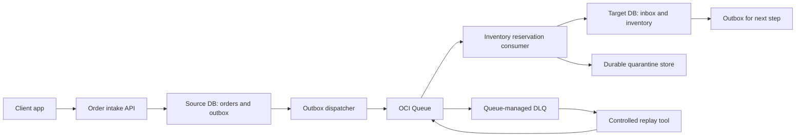

# Designing asynchronous integration flows with retries and idempotency

## 1. Problem statement and design objectives

In the **APIs, Events, and Integration** chapter of the **CLOUD_PROVIDERS_ORACLE** module, this lesson designs a background processing flow on Oracle Cloud Infrastructure (OCI). The focus is coordinating queues, databases, and applications so work continues processing across failures while avoiding duplicate business side effects.

Consider a retail system:

1. The API accepts an order and persists it in Oracle Database.
2. The application publishes an `OrderAccepted` event to OCI Queue.
3. A consumer receives the event and reserves inventory for each order line item.
4. When the database is temporarily unreachable, the job is retried.
5. If the consumer stops after reserving stock but before acknowledging the queue, the next delivery must recognize the previous outcome.

Asynchrony keeps the API from blocking on the entire workflow. However, it introduces windows where the producer, queue, and consumer do not yet share the same view of the outcome.

The design must preserve these invariants:

- When the API reports durable acceptance, the system has persisted both the business request and the event-publishing intent.
- A completed reservation operation is never executed a second time even if the message is redelivered.
- Never acknowledge completion to the queue before the outcome or quarantine decision has been durably persisted.
- Every retry is bounded by attempt count, elapsed time, and load limits.
- Unprocessed work has an owner, tracked state, and a recovery path.

Timing, load, and attempt-count settings in this lesson are **design assumptions for practice**. Tune them using metrics from the actual target deployment.

## 2. Clearly separating message delivery from business completion

### 2.1. Three distinct outcomes

| Outcome | Meaning | What is not yet proven? |
| --- | --- | --- |
| API returns `202 Accepted` | System accepted background processing per API contract | Does not mean stock is reserved or invoice created |
| Producer receives Queue acknowledgment | Queue accepted the message | Does not mean a consumer has processed it |
| Consumer commits business outcome | Side effects in the transaction are persisted | Does not mean the message is deleted from the Queue |

The API should return an `operationId` and a status-polling location. Example:

```http
HTTP/1.1 202 Accepted
Location: /operations/op-order-20261120-1042
Content-Type: application/json

{
  "operationId": "op-order-20261120-1042",
  "status": "ACCEPTED"
}
```

The status endpoint must enforce authorization by customer and tenant. When business logic finishes, it returns outcomes like `SUCCEEDED` or `REJECTED`, rather than inferring completion from an empty queue.

### 2.2. Designing consumers for redelivery

OCI Queue hides a received message during an invisibility window, after which it can be redelivered if the consumer has not deleted it. Consumers must handle redeliveries safely. This lesson therefore uses an **application-level at-least-once design model**: a job can arrive multiple times within the retention window, and every arrival must be safe. Receive, extend, and delete mechanics are described in [Consuming Messages](https://docs.oracle.com/en-us/iaas/Content/queue/consume-messages.htm).

Do not infer a promise that "business logic always runs exactly once" from queue durability. A message can still expire before processing; a producer may resend after a lost response; a consumer may crash between two operations.

**Idempotency** is the property that re-executing the same intent produces the same business effect as the first valid execution. For example, re-invoking "reserve 2 units for line L1 of order ORD-1042" must not subtract 2 more units.

The target in this design is **one committed side effect per operation key within a defined protection window**. That window depends on transactions, unique keys, history retention, and data recovery procedures.

## 3. Selecting OCI components and assigning responsibilities

| Component | Role in design |
| --- | --- |
| API Gateway and API application | Entry point receiving requests, authenticating, and creating business operations |
| Oracle Database or Autonomous Database | Stores orders, outbox, inbox, and business state within each service's transaction boundary |
| OCI Queue | Buffers work between producers and consumers |
| Worker on Compute or OKE | Self-polls Queue; actively manages per-message processing, retries, and deletion |
| Connector Hub and OCI Functions | Option for connector-orchestrated batch processing |
| OCI Events | Reacts to OCI resource events when flows originate from infrastructure |
| Logging, Monitoring, and Alarms | Tracks errors, latency, backlogs, and recoverability |
| IAM, compartments, and Vault | Resource access control, environment isolation, and secrets management |

OCI Queue fits when decoupling work and scaling consumer counts independently of producers. [Overview of Queue](https://docs.oracle.com/en-us/iaas/Content/queue/overview.htm) explains that messages are retained until deleted or retention expires.

OCI Events and business events serve different roles. `OrderAccepted` is emitted by the application after saving the order. State-change events for OCI resources can be routed by OCI Events to Functions, Notifications, or Streaming via rules. To push such an event into Queue, specify a bridge component, such as a Function calling the Queue API. Rule targets are documented in [Managing Rules for Events](https://docs.oracle.com/en-us/iaas/Content/Events/Task/managingrules.htm).

Oracle Database also offers AQ/TxEventQ integrated with database transactions. That is a different architectural option; never ascribe AQ/TxEventQ transactional properties to network calls against OCI Queue. See [Introduction to Transactional Event Queues and Advanced Queuing](https://docs.oracle.com/en/database/oracle/oracle-database/26/adque/aq-introduction.html).

### Two ways to run consumers

- **Self-polling worker:** the app calls `GetMessages`, `UpdateMessage`, and `DeleteMessage`; the app decides when each message completes.
- **Queue → Connector Hub → Functions:** the connector pulls and dispatches batches; invocation outcomes drive connector behavior.

The detailed implementation example in this lesson uses a self-polling worker. A dedicated Functions section highlights what changes under that operational model.

## 4. Reference architecture and transaction boundaries



Source DB and Target DB represent two independent transaction boundaries. They may belong to two separate services. Only tables participating in the same transaction share atomicity.

Normal flow:

1. The API persists the order and an outbox row in **one source DB transaction**.
2. The dispatcher reads the outbox, pushes the event to Queue, and marks it sent.
3. The consumer receives the event, validates the contract, and checks the idempotency key.
4. The consumer writes the inbox row and updates inventory in **one target DB transaction**.
5. After commit, the consumer deletes the message using the current delivery's receipt.
6. If a downstream step is needed, the consumer writes a new outbox row inside step 4's transaction.

There is no single atomic transaction spanning Oracle Database `COMMIT` and OCI Queue `DeleteMessage` in this design. The inbox closes that gap on the receiving side; the outbox closes the gap between persisting data and publishing messages on the sending side.

## 5. Message contract and identifier types

The example below represents reserving inventory for one line item:

```json
{
  "eventId": "evt-20261120-1042-L1",
  "eventType": "com.example.orders.accepted.v1",
  "schemaVersion": 1,
  "occurredAt": "2026-11-20T02:15:00Z",
  "tenantId": "retail-a",
  "aggregateId": "ORD-1042",
  "aggregateVersion": 7,
  "operationKey": "reserve:ORD-1042:L1:v1",
  "correlationId": "op-order-20261120-1042",
  "data": {
    "orderId": "ORD-1042",
    "lineId": "L1",
    "sku": "SKU-USB-C",
    "quantity": 2
  }
}
```

This is an application JSON contract, not a mandatory schema of OCI Queue or OCI Events.

| Identifier | Scope and usage |
| --- | --- |
| `eventId` | Identifies one logical event; kept identical when dispatcher resends or replays the same event |
| Queue message ID | Identifies a copy inside the transport system; may change on republish |
| `receipt` | Operates on the current delivery lease; never use as a business key |
| `operationKey` | Identifies the business intent to deduplicate |
| `correlationId` | Links logs across steps of a workflow; does not replace an idempotency key |
| `replayId` | If present, identifies an operational replay batch; does not replace `eventId` |

Consumer deduplication keys should be scoped as:

```text
(consumer_name, tenant_id, operation_key)
```

For example `(reserve-inventory-v1, retail-a, reserve:ORD-1042:L1:v1)`.

Using only `eventId` allows two events with different IDs requesting the same reservation to cause duplicate effects. Using only `orderId` can block multiple line items or distinct valid operations on the same order.

### Protecting key consistency

The consumer also stores `request_hash`, computed from a canonical representation of the effect-determining fields: tenant, operation type, business contract version, order, line, SKU, and quantity.

- Same key and same hash: valid duplicate delivery.
- Same key but different hash: contract conflict; quarantine and investigate.
- A valid business amendment: use a new operation/version per agreed rules.

Do not hash raw JSON strings directly if property ordering or numeric formatting can vary. Exclude `correlationId`, replay timestamp, and delivery attempt count from the semantic business hash.

The consumer must verify tenant and operation type from a trusted source or bound to producer identity. A payload self-declaring a `tenantId` does not grant authorization to mutate that tenant's data.

## 6. Reliable producers with a transactional outbox

### 6.1. Two common inconsistency bugs

**Commit order first, then send to Queue:** crashing after commit leaves an order persisted with no inventory reservation job.

**Send to Queue first, then commit order:** the consumer may observe an event for an order that ultimately rolls back.

The outbox stores publishing intent in the same transaction as source data:

```sql
CREATE TABLE integration_outbox (
    event_id       VARCHAR2(80 CHAR) PRIMARY KEY,
    aggregate_id   VARCHAR2(80 CHAR) NOT NULL,
    event_type     VARCHAR2(120 CHAR) NOT NULL,
    payload        CLOB NOT NULL,
    publish_state  VARCHAR2(12 CHAR) DEFAULT 'PENDING' NOT NULL,
    created_at     TIMESTAMP WITH TIME ZONE DEFAULT SYSTIMESTAMP NOT NULL,
    published_at   TIMESTAMP WITH TIME ZONE,
    CONSTRAINT ck_outbox_state
        CHECK (publish_state IN ('PENDING', 'SENT')),
    CONSTRAINT ck_outbox_payload CHECK (payload IS JSON)
);

CREATE INDEX ix_outbox_pending
    ON integration_outbox (publish_state, created_at);
```

Inside the order-creation transaction:

```sql
-- Bind parameters are passed from the application.
INSERT INTO orders (order_id, tenant_id, order_status)
VALUES (:order_id, :tenant_id, 'ACCEPTED');

INSERT INTO integration_outbox (
    event_id, aggregate_id, event_type, payload
) VALUES (
    :event_id, :order_id, :event_type, :payload
);

COMMIT;
```

The `orders` table is assumed to exist in the application. This outbox illustrates the minimal storage contract, not a full retail system DDL script.

### 6.2. Dispatchers can still send duplicates

The dispatcher performs:

1. Select a batch of unsent outbox rows.
2. Publish the payload with the stored `eventId`, never generating a new ID per attempt.
3. Inspect the publish result for each record.
4. Mark `SENT` only for records acknowledged as accepted.

If Queue accepted the message but the dispatcher lost the response or crashed before step 4, the dispatcher will resend. That is why the outbox and an idempotent consumer belong together.

When running multiple dispatchers, use timed claims or leases with recovery for abandoned rows. Never hold a DB lock open arbitrarily while waiting on network calls. When publishing batches, handle partial results when the API reports per-item success/failure.

An outbox cannot stop a client from calling the API twice to create two different orders. The intake API also needs a client/tenant idempotency key, storing the key, request hash, and response within the same order-creation transaction. A client resending the same key receives the same accepted operation.

## 7. Idempotent consumers when side effects live in one Oracle Database

### 7.1. Inbox and business side effects must commit together

```sql
CREATE TABLE integration_inbox (
    consumer_name  VARCHAR2(80 CHAR) NOT NULL,
    tenant_id      VARCHAR2(80 CHAR) NOT NULL,
    operation_key  VARCHAR2(160 CHAR) NOT NULL,
    event_id       VARCHAR2(80 CHAR) NOT NULL,
    request_hash   VARCHAR2(64 CHAR) NOT NULL,
    process_state  VARCHAR2(12 CHAR) NOT NULL,
    outcome_code   VARCHAR2(80 CHAR),
    completed_at   TIMESTAMP WITH TIME ZONE,
    CONSTRAINT pk_integration_inbox
        PRIMARY KEY (consumer_name, tenant_id, operation_key),
    CONSTRAINT ck_inbox_state
        CHECK (process_state IN ('PROCESSING', 'COMPLETED', 'REJECTED'))
);
```

Inventory tables need their own keys and constraints. For instance, `inventory_reservations` has unique key `(tenant_id, operation_key)`; reserved quantity must be positive.

Transaction sequence:

```text
BEGIN
  INSERT inbox with unique key and PROCESSING state
  UPDATE inventory conditionally where stock is sufficient
  INSERT reservation record
  Write outbox for result if downstream step exists
  UPDATE inbox to COMPLETED
COMMIT

After COMMIT:
  DeleteMessage using current delivery's receipt
```

In this variant, `PROCESSING` is solely an uncommitted state inside the transaction. The consumer never commits a `PROCESSING` row and then goes off to do work. An existing inbox row that has not reached a terminal state must not be assumed successful.

### 7.2. Use conditional updates instead of check-then-write

Example inventory update:

```sql
UPDATE inventory_stock
SET available_quantity = available_quantity - :quantity
WHERE tenant_id = :tenant_id
  AND sku = :sku
  AND available_quantity >= :quantity;
```

The application must inspect the updated row count:

- One row: proceed to insert the reservation and result.
- Zero rows: handle per the "insufficient stock" or "invalid SKU" contract.

In this example, insufficient stock is a `REJECTED` business outcome: store the inbox result and rejection event in the same transaction and commit. Retries of the same request must return that same outcome. If the system supports backorders, model a separate waiting state/workflow with a deadline.

### 7.3. Handling races across concurrent consumers

Never use "SELECT not found → INSERT" as the sole deduplication barrier. Two consumers can pass the SELECT step concurrently.

The inbox's unique key is the database barrier. When two transactions insert the same key concurrently, one may block waiting for the other's outcome. The duplicate-key branch must:

1. Confirm the error specifically came from `pk_integration_inbox`, rather than treating every unique constraint violation as a successful duplicate.
2. Roll back the failing transaction.
3. Re-read the inbox in an appropriate transaction.
4. Compare the hash and verify a terminal state.
5. Acknowledge the message only if a corresponding committed outcome is found.

If re-reading finds no terminal outcome, let the job retry or investigate. Never assume an exception always means no side effect occurred.

### 7.4. Java-style pseudocode for the processing boundary

The snippet below is **Java-style pseudocode**, not directly compilable code. The adapters `database`, `queue`, `quarantine`, and `retryLedger` represent contracts to implement.

```java
void handle(ReceivedMessage message) {
    final Envelope event;
    try {
        event = validateAndDecode(message.content());
    } catch (InvalidMessage error) {
        // Durably store payload or reference, fingerprint, and root cause.
        quarantine.persistInvalid(message, error);
        queue.delete(message.receipt());
        return;
    }

    BusinessResult result;
    try {
        result = database.inTransaction(tx -> {
            InboxInsert insert = tx.inbox().insertOrFindCommitted(
                CONSUMER_NAME,
                event.tenantId(),
                event.operationKey(),
                event.eventId(),
                semanticHash(event)
            );

            if (insert.isDuplicate()) {
                insert.requireSameHash();
                return insert.requireTerminalResult();
            }

            // SQL only inside the same transaction; no HTTP calls here.
            BusinessResult outcome = reserveInventoryOrReject(tx, event);
            tx.outbox().appendOutcomeIfRequired(event, outcome);
            tx.inbox().finish(event, outcome);
            return outcome;
        });
    } catch (IdempotencyConflict error) {
        quarantine.persistConflict(event, error);
        queue.delete(message.receipt());
        return;
    } catch (RetryableFailure error) {
        RetryDecision decision = retryLedger.recordAndDecide(event, error);
        if (decision.shouldRetry()) {
            queue.updateVisibility(
                message.receipt(), decision.delaySeconds()
            );
        } else {
            quarantine.persistExhausted(event, decision);
            queue.delete(message.receipt());
        }
        return;
    }

    // Commit confirmed or valid prior terminal result read.
    // If delete fails, let redelivery occur; never roll back committed business work.
    queue.delete(message.receipt());
}
```

`insertOrFindCommitted` must properly implement the concurrency protocol in Section 7.3; you cannot merely swallow the exception and continue on the failed transaction.

Delete and visibility-extend calls are separate network operations. If deletion or quarantine persistence fails, the orchestration loop must record the failure and allow redelivery. Quarantine tables also need unique keys so redeliveries do not spawn infinite copies of the same failed record.

When a commit loses its response, the DB outcome may be uncertain. The app must resolve it via the inbox on a fresh connection/transaction or a supported commit-outcome check before deciding to delete. Never repeat an external side effect to "compensate" for an uncertain DB commit.

## 8. Side effects outside the DB require a different protocol

An Oracle Database transaction does not cover HTTP calls to a payment gateway, email service, or independent ERP system.

Dangerous example:

```text
Payment call succeeds
Application crashes
COMPLETED not yet saved in inbox
Message redelivered
Payment called a second time
```

Keeping a DB transaction open around an HTTP call does not eliminate the gap above. One of the following contracts is needed:

| Target system capability | Approach |
| --- | --- |
| Supports durable idempotency keys | Send the same business key on every call; verify target key scope and retention |
| Queryable by unique external reference | After timeout, query outcome before deciding to resend |
| Offers prepare/confirm or matching transaction protocol | Design workflow strictly per target contract |
| Neither deduplication nor lookup supported | Record unknown outcome, reconcile, or handle manually |

A state machine may include:

```text
PENDING -> IN_PROGRESS -> SUCCEEDED
                    \-> RETRY_WAIT
                    \-> UNKNOWN -> RECONCILING
                    \-> REJECTED
```

This is a multi-step committed state variant, distinct from the single-transaction inbox in Section 7. If multiple workers may take over:

- Claim work with a timed lease and conditional updates.
- Use a generation/fencing token so a stale worker cannot overwrite a new owner's result.
- Keep the idempotency key unchanged when calling the external system.
- Set network timeouts and record attempts, request references, and known outcomes.

Database fencing only prevents stale state writes to the DB. It does not prevent an old in-flight request from mutating the external system; the target still requires an idempotency contract or reconciliation.

If a later step fails after payment already succeeded, issuing a refund is a **new compensating operation** with its own identifier and idempotency. It is not a rollback of the original transaction.

## 9. Classifying errors before retrying

| Error category | Examples | Action |
| --- | --- | --- |
| Transient | Brief DB disconnect, recoverable lock contention | Roll back uncommitted work; retry within budget |
| Rate limited | HTTP `429` from target service | Honor valid `Retry-After`, reduce concurrency |
| Recoverable service error | Certain HTTP `5xx` responses | Retry if operation is safe and budget remains |
| Invalid payload/contract | Missing SKU, negative quantity, unsupported version | Quarantine durably; do not keep retrying |
| Business rejection | Insufficient stock per example contract | Commit `REJECTED`, publish result if needed, then delete |
| Misconfiguration or permissions | Missing IAM policy, bad connection config | Alert, pause/slow polling, and fix configuration |
| Unknown external side effect | Timeout after sending payment request | Query/reconcile; retry only under idempotency contract |

Do not classify every HTTP `4xx` as permanent or every `5xx` as safe to retry. Understand API semantics, operation type, and whether side effects could have occurred.

A prolonged permission error affecting the entire consumer should not burn every message's retry budget. Pause consumption, keep alerting active, and resume after fixing configuration within retention limits.

## 10. Retries with backoff, jitter, and explicit budgets

### 10.1. Exponential backoff

For retry number `k`, starting at `k = 1` after the initial processing attempt:

```text
cap(k)   = min(max_delay, base_delay × 2^(k - 1))
delay(k) = random_uniform(0, cap(k))
```

This is full jitter. Example with `base_delay = 2 seconds`, `max_delay = 30 seconds`:

| Retry | Delay cap | Random wait range |
| --- | --- | --- |
| 1 | 2 seconds | 0–2 seconds |
| 2 | 4 seconds | 0–4 seconds |
| 3 | 8 seconds | 0–8 seconds |
| 4 | 16 seconds | 0–16 seconds |
| 5 | 30 seconds | 0–30 seconds |

Jitter spreads out retry timing across workers. It does not replace concurrency caps or rate limits. When a service specifies a valid minimum wait via `Retry-After`, do not randomize below that minimum.

### 10.2. Budgets must survive redelivery

Illustrative application configuration:

```yaml
# Application-defined configuration contract; not an OCI resource schema.
retry:
  max_business_attempts: 6
  max_elapsed_seconds: 1800
  base_delay_seconds: 2
  max_delay_seconds: 30

consumer:
  processing_timeout_seconds: 20
  initial_visibility_seconds: 60
  max_concurrency: 8
```

`max_business_attempts: 6` covers the initial attempt plus up to five retries. The consumer persists attempt counts and start timestamps in a durable retry ledger keyed by operation key; in-memory counters vanish on process restart.

The budget must check at least:

- How many times the app actually started an attempt.
- Elapsed time since the operation was accepted.
- Business deadline.
- Remaining time before the message expires.
- Target system capacity and quotas.

The retry ledger must update atomically when multiple workers contend for work. For strict post-crash limits, increment attempt count before starting; an aborted attempt still consumes budget under this rule.

Queue delivery count is a transport counter, distinct from business attempts. A redelivery of an already-completed job may skip business execution; conversely, multiple HTTP calls inside one delivery can create multiple attempts while Queue counts only one delivery.

### 10.3. Avoiding multiplicative retry amplification

If an SDK retries 3 times, outer HTTP code retries 4 times, and the queue redelivers 6 times, one job can generate up to `3 × 4 × 6 = 72` calls when layers nest.

Designate which layer owns business retries, audit SDK retry settings, and enforce an overall deadline. Short network retries inside an attempt still count toward execution time and target load.

A circuit breaker halts calls to a dependency suffering prolonged failures. When open, the consumer slows or pauses pulling new jobs rather than pulling continuously and throwing them back, which still adds load and consumes delivery counts.

## 11. Visibility timeout, receipts, and scheduling retries on OCI Queue

### 11.1. Visibility is a transport-layer lease

A delivery returns a `receipt` for extending or deleting. Un-deleted messages can reappear when visibility expires. API details are in [Consuming Messages](https://docs.oracle.com/en-us/iaas/Content/queue/consume-messages.htm).

When aiming to finish most jobs within 15 seconds, starting with a 60-second visibility leaves room for commit, delete, and latency spikes. This is the lab's choice.

Too short a timeout increases the chance a new worker starts while the old worker is still running. Too long a timeout slows recovery after a crash.

Message visibility expiry does not cancel an in-flight SQL statement or HTTP request. Therefore, visibility does not replace unique keys, business leases, or target-side idempotency.

### 11.2. Extending leases for long-running work

Use heartbeats when execution duration varies. For example, before remaining visibility gets too low, the worker calls `UpdateMessage` and verifies the extension succeeded.

OCI allows increasing or decreasing visibility using the receipt; visibility cannot extend past the message's retention expiry. See [Updating Messages](https://docs.oracle.com/en-us/iaas/Content/queue/update-messages.htm).

If lease ownership can no longer be confirmed or extension fails, the worker must stop assuming exclusive execution. Cancelable work should abort; non-cancelable work must be guarded by the designed business contract.

### 11.3. Using visibility to delay redelivery

For a self-polling worker after a transient error:

1. Ensure any uncommitted transaction rolled back.
2. Durably record the attempt and retry decision.
3. Compute the wait delay.
4. Update visibility using the current receipt.
5. Finish the attempt without deleting the message.

The wait delay sets invisibility from the update call; it is not an exact scheduled execution guarantee. Once it expires, the system simply makes the message eligible for redelivery again.

If a retry schedule requires waiting longer or beyond the message retention window, use a durable job table with `next_attempt_at` and a persistent scheduler. Moving from Queue to that store must be durably persisted before deleting the source message, and the scheduler must resume safely after crashes.

Never sleep a thread for a long time while ignoring visibility state. That wastes resources and can still let another worker pick up the same job.

### 11.4. Using the right endpoint and receipt

Producers/consumers need the queue's messages endpoint, retrievable from queue details or `GetQueue`. Its role differs from the control-plane management endpoint. See [Message Management](https://docs.oracle.com/en-us/iaas/Content/queue/messages.htm).

The receipt for the current delivery must never be replaced with the Queue message ID or `eventId`. Once delivery ownership changes, operations with an old receipt can fail. If delete fails after commit, log it and allow redelivery so the inbox returns the prior outcome.

## 12. DLQ, quarantine stores, and controlled replay

OCI Queue automatically creates a dead letter queue alongside the main queue. Messages whose failed deliveries reach the configured threshold move to the DLQ; messages in the DLQ are still subject to retention. The DLQ is not an indefinite error archive. See [Dead Letter Queues](https://docs.oracle.com/en-us/iaas/Content/queue/deadletterqueues.htm).

### 12.1. Distinguishing the two failure paths

| Handling path | Who decides? | When appropriate? |
| --- | --- | --- |
| Queue-attached DLQ | Queue based on delivery count and config | Consumer repeatedly fails to process/delete, including crashes |
| App-managed quarantine store | Application after classifying the error | Malformed payload, key conflict, exhausted business budget, early triage needed |

The quarantine store can be a DB table storing errors and payloads or references to Object Storage. Persistence must be durable and idempotent before deleting the source message.

If persisting to quarantine fails, do not delete the message. If persistence succeeds but source deletion fails, the next delivery must recognize the existing quarantine decision.

Do not assume OCI Queue provides a "move arbitrary message straight to DLQ now" command inside application flow. Proactive quarantine here is an application-built mechanism; the native DLQ continues operating under Queue delivery policies.

### 12.2. Data to retain for investigation

- `eventId`, operation key, tenant, and schema version if parseable.
- Content fingerprint and protected payload reference.
- First ingestion timestamp, attempt history, and latest failure cause.
- Side-effect state: not executed, committed, or unknown.
- Replay batch, operator/tool identity, and outcome.
- Action deadline before source data hits retention expiry.

For unparseable messages, use transport identifiers and content fingerprint for quarantine; never trust an unverified business key.

### 12.3. Replay procedure

1. Identify the root cause and fix the code or configuration.
2. Inspect prior effects in the inbox, reservations, and external systems.
3. Select the target message set and verify business preconditions still hold.
4. Keep `eventId`, operation key, and business payload unchanged when replaying the exact same event.
5. Add operational metadata such as `replayId`, excluding it from the semantic hash.
6. Replay a small batch with rate limits, monitor outcomes, then ramp up.
7. Delete the source DLQ/quarantine entry only after handoff is confirmed or a durable replay intent is recorded.

Republishing typically creates a new transport copy. Therefore, do not use the new copy's delivery count to reset the business budget. The original ledger remains the source of truth for remaining attempts; replay payloads must not silently override counters.

If the budget is exhausted yet retrying after a fix is required, record an audited operational decision to grant a fresh budget. If business content must change, create a new corrective event/operation linked to the original; never reuse the same key for two different intents.

### 12.4. Inbox retention period

Retain inbox records at least across the entire window during which a duplicate of an operation could return: slow outbox publishing, retries, DLQ residency, operational replays, and incident recovery.

For instance, if tooling allows replaying events up to 30 days after initial receipt, purging the inbox after 3 days removes protection even if the main queue retains data for only 3 days. Keep the inbox through at least the 30-day window plus a safety margin, or block replays outside the protected window.

External systems' idempotency-key retention must also align. An expired key at a payment gateway may no longer protect replays from older history.

## 13. When using Queue → Connector Hub → Functions

OCI supports Queue-to-Functions flows via Connector Hub. Per [Scenario: Sending Queue Messages to a Function](https://docs.oracle.com/en-us/iaas/Content/connector-hub/queue-to-function.htm), a failure processing a batch can cause the entire batch to be redelivered, including messages already processed successfully; partial batch acknowledgment is not supported.

Design implications:

- The Function must enforce per-message idempotency.
- Never substitute a single "batch succeeded" row for per-operation inbox records.
- The Function reports invocation success only once every item has a durable outcome or contract-compliant quarantine entry.
- Never catch all exceptions and return success, or the connector may assume data was delivered.
- When one item hits a transient failure and fails the invocation, already-committed items are safely skipped on redelivery.

Example batch with A, B, C: A committed, B hit a DB error, C has not run. The next invocation reads A's committed outcome instead of reserving stock again, then retries B and C.

Larger batch sizes reduce overhead but widen the retry blast radius when one item fails. Size batches based on execution time, duplicate-guard overhead, and dependency capacity.

In the connector variant, the connector manages pulling and deleting source messages. Do not mechanically copy self-polling `DeleteMessage` calls into the Function; success/failure signaling happens at the invocation/connector boundary.

## 14. IAM, networking, and data protection

### 14.1. Separating permissions along the data flow

Separate publishers, consumers, and replay tools into distinct identities with tailored permissions. For workers on Compute using instance principals, dynamic groups must match the exact deployed instances.

Example policies—replace compartments, dynamic groups, and OCIDs with real values:

```text
Allow dynamic-group OrderPublishers to use queue-push in compartment integration-prod where target.queue.id = 'ocid1.queue.oc1..replace_with_queue_ocid'
Allow dynamic-group InventoryWorkers to use queue-pull in compartment integration-prod where target.queue.id = 'ocid1.queue.oc1..replace_with_queue_ocid'
```

`queue-push` grants publish access; `queue-pull` grants receive, update, and delete access. If the app needs `GetQueue` for endpoint discovery or stats, grant scoped queue read permissions too. Cross-check [Queue Policies](https://docs.oracle.com/en-us/iaas/Content/queue/policy-reference.htm).

Replay typically needs read access to the error store and write access to the target. Never grant `manage queues in tenancy` to every worker just to simplify deployment.

The consumer's DB account only needs privileges on the inbox and relevant business tables. DB permissions and Queue IAM are separate layers; permission to pull messages does not imply permission to alter every schema.

### 14.2. Connectivity and secrets

- Ensure workloads have HTTPS reachability to the Queue's actual messages endpoint in the deployment region.
- Verify DNS, VCN routing, egress rules, and DB connectivity from the actual worker environment.
- Manage DB credentials and connection secrets via an appropriate secret store, such as OCI Vault.
- Validate payload size, version, and structure before processing.
- Log IDs, states, and error codes; redact customer PII, secrets, tokens, and receipts.

For large or sensitive payloads, pass an Object Storage reference with version/checksum. Ensure read permissions and object retention span the entire retry/replay window. A reference pointing to a deleted object turns a recoverable job into an unretryable failure.

## 15. Monitoring, capacity, and cost

### 15.1. Measuring business outcomes alongside queue health

| Signal | Operational meaning |
| --- | --- |
| Age of oldest unfinished job | Detects processing SLA breaches that small backlog counts may hide |
| Visible and in-flight messages | Distinguishes queued waiting work from actively leased work |
| DLQ message count and error age | Detects sustained failures and retention expiry risk |
| Failed attempt rate by error type | Separates dependency, payload, and config issues |
| Blocked duplicates, hash conflicts | Verifies redelivery handling and detects contract bugs |
| `PENDING` outbox age | Detects stuck publishers even while the API still accepts orders |
| `UNKNOWN` operation count | Tracks work requiring reconciliation |
| p95/p99 latency and calls per operation | Evaluates timeouts, retry amplification, and cost |

Queue visible/in-flight stats are approximate; never use a single stats read as proof all business work finished. See [Getting Queue Statistics](https://docs.oracle.com/en-us/iaas/Content/queue/queue-statistics.htm).

Signals like outbox age, hash conflicts, and `UNKNOWN` counts are application-emitted or data-derived metrics; do not assume they are built-in OCI metric names.

Each attempt log should correlate `eventId`, `operationKey`, `correlationId`, consumer, attempt number, and outcome. Do not turn every ID into a metric label, as high cardinality increases cost and hurts aggregation.

### 15.2. Backlogs and backpressure

Suppose the system ingests 20 jobs/sec but successfully processes only 15 jobs/sec. The backlog grows by approximately:

```text
(20 - 15) × 60 = 300 jobs/minute
```

Once intake stops surging, draining 3,000 jobs at a net drain rate of 10 jobs/sec takes roughly 300 seconds, excluding retries and load variance.

Adding workers helps only when the DB or downstream system has headroom. If the DB is already saturated, raising concurrency causes more timeouts and retries.

Apply backpressure via in-flight job caps, bounded connection pools, per-dependency rate limits, and reduced polling when circuits open. API deadlines, worker timeouts, and retention must leave enough room for the system to drain backlogs.

### 15.3. Cost drivers

Retries multiply API calls, Compute/Functions runtime, DB load, and log volume. Continuous polling on an empty queue also generates requests. Long polling reduces empty receive cycles; this mechanism is described in [Consuming Messages](https://docs.oracle.com/en-us/iaas/Content/queue/consume-messages.htm).

Cap retry counts, avoid logging redundant payloads, set deliberate log retention, and monitor resources per compartment. Treat budget alerts as financial warnings; never assume the system halts resource consumption automatically.

Do not hardcode fixed unit prices in logic. Estimate costs from publish/receive/update/delete call counts, execution time, stored data, and log volume at current deployment pricing.

## 16. Ordering, availability, and recovery

### 16.1. Idempotency does not fix out-of-order events

Two events `OrderAccepted` and `OrderCancelled` with different keys can still be processed in an adverse order. Do not rely on observed Queue order to guarantee business state.

Use `aggregateVersion`, state machines, and conditional updates:

- Permit only valid state transitions.
- For snapshot events, older versions can be ignored per contract.
- For delta events requiring a complete sequence, detect version gaps and wait/reconcile rather than silently skipping.
- Canceling an order after reservation requires its own idempotent release operation.

Never apply a blanket "drop any smaller version" rule across every event type.

### 16.2. Multiple workers and infrastructure failures

Workers should keep decision state in the DB rather than local host memory. Deploy multiple replicas across fault domains or availability domains supported by the region, sharing one consistent idempotency store.

Plan across Queue, DB, and workloads together. Multiple workers cannot compensate for a DB lacking an appropriate availability design.

When failing over to another region or restoring the DB from backup:

- Preserve original event IDs and operation keys when re-ingesting data.
- Assess inbox/outbox loss according to RPO.
- Reconcile side effects that occurred after the backup point.
- Prevent two regions from concurrently emitting or processing the same work without coordination.
- Verify whether external services' idempotency scopes span regions.

If the DB restores to a point before a completed payment, the old inbox entry may be gone while the external charge still exists. Replay then requires reconciling against the target. Never assume durability in one region means Queue copies and deduplication history exist in another region.

## 17. Implementation lab and fault-injection verification

### 17.1. Environment preparation

1. Use a dedicated lab compartment with resource and cost tracking tags.
2. Create the Queue and record its OCID and messages endpoint.
3. Set retention for the recovery window; for example, the lab uses 3 days, initial visibility 60 seconds, and a Queue dead-letter delivery threshold of 8 per the corresponding config field.
4. Create the lab DB or schema, outbox/inbox tables, and inventory data.
5. Grant publisher/consumer permissions via dynamic groups scoped to the queue.
6. Deploy the API, dispatcher, and worker; configure a business budget of at most 6 attempts and a 30-minute deadline.
7. Enable logs, application metrics, and alerts for outbox backlog or error records.

Queue's delivery threshold and six business attempts are two independent bounds. The app may quarantine sooner when its budget runs out; Queue still protects against worker crashes failing to persist that decision.

Queue retention must be set at creation time; documentation notes it cannot be changed after the queue is created. See [Creating a Queue](https://docs.oracle.com/en-us/iaas/Content/queue/queue-create.htm).

### 17.2. Scenarios to observe

| Fault injection point | Expected outcome |
| --- | --- |
| API stops after committing order/outbox | Dispatcher still finds the event and publishes later |
| Dispatcher stops after publish before marking `SENT` | May duplicate send; only one reservation commits |
| Worker stops before commit | Transaction rolls back; next delivery can process |
| Worker stops after commit before delete | Next delivery reads inbox outcome; does not deduct stock again |
| Two workers process same key | Unique key and outcome-read protocol prevent double effect |
| Same key with altered quantity | Hash conflict; quarantined without deducting extra stock |
| Brief DB outage | Exponential backoff retries; attempt count persists across restarts |
| External service times out after succeeding | Same key/lookup resolves outcome; no fresh operation sent |
| Queue delete fails after quarantine | Redelivery recognizes existing quarantine decision |
| Batch Function fails on middle item | Already-committed items are safely skipped when batch redelivers |
| Replay after process redeployment | Uses durable history; never resets budget unconditionally |

These are practice scenarios for learners to execute. Reading this lesson or saving documentation does not mean tests were run on a live tenancy.

### 17.3. Verifying side effects rather than only checking logs

After submitting the same operation multiple times, querying reservations must show only one business record:

```sql
SELECT tenant_id, operation_key, COUNT(*) AS reservation_count
FROM inventory_reservations
WHERE tenant_id = :tenant_id
  AND operation_key = :operation_key
GROUP BY tenant_id, operation_key;
```

Inspect the inbox:

```sql
SELECT consumer_name, tenant_id, operation_key,
       request_hash, process_state, outcome_code, completed_at
FROM integration_inbox
WHERE consumer_name = 'reserve-inventory-v1'
  AND tenant_id = :tenant_id
  AND operation_key = :operation_key;
```

In the example where a SKU starts with 10 units and reserves 2, the final stock after all redeliveries must be 8 units. A single reservation row with stock reduced to 6 is still wrong; verify both the business effect and the deduplication record together.

When finishing the lab, stop workers and dispatchers, handle or archive any error records needed, and decommission lab resources as planned. Idempotency data used for real recovery should only be purged once the permitted replay window closes.

## 18. Decisions to finalize before going live

| Decision | Outcome to specify concretely |
| --- | --- |
| Transaction boundaries | Which tables commit together; which steps call external services |
| Idempotency key | Consumer/tenant/operation scope and canonical hash rules |
| Duplicates and conflicts | How prior outcomes return, payload-drift detection, and race handling |
| Retries | Error classification, backoff, deadline, total attempts, and load caps |
| Delivery ownership | Visibility, heartbeat, receipt handling, and behavior on lost lease |
| Acknowledgment | Sufficient conditions to delete source or return invocation success |
| Failures | DLQ thresholds, quarantine store, unknown states, and owner |
| Replay | Preserving IDs, audit trail, rate limits, and budget-grant authority |
| Retention | Retention of messages, inbox, outbox, payloads, and target-side keys |
| Operations | Business metrics, alerts, access control, and recovery runbooks |

An asynchronous integration flow is protected when every possible failure point yields a deterministic outcome: unfinished work has a retry path, committed work has history blocking duplicate effects, and uncertain work enters reconciliation. On OCI, these properties are built by combining Queue, Oracle Database transactions, application contracts, and operational procedures.
