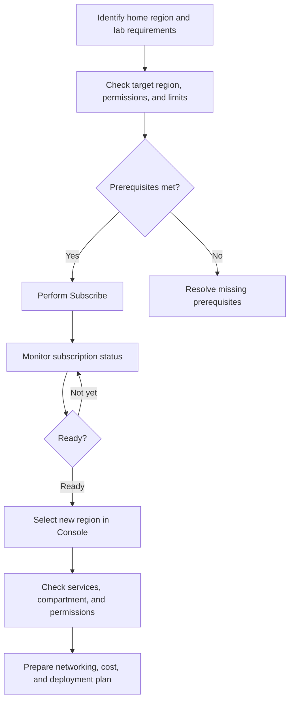

# Setting Up Your Home Region and Subscribing to Additional Regions

## Objectives and Context

In the **Account and Lab Setup** chapter of the **CLOUD_PROVIDERS_ORACLE** module, choosing a region is a preparatory step before deploying a VCN, Compute, storage, or Oracle Database. This decision affects connection experience, service availability, identity governance, and cost planning for your lab environment.

This lesson covers two distinct scenarios: choosing a **home region** when creating a tenancy and subscribing to an additional **infrastructure region** for an existing tenancy. You will also verify your active region, distinguish a region identifier from a region key, and recognize what is not automatically provisioned after a successful subscription.

After this lesson, you will be able to:

- Explain the role of the home region and why it must be chosen carefully.
- Identify the home region of an existing tenancy.
- Evaluate an additional region based on lab requirements.
- Subscribe to and verify a region using the Console or OCI CLI when permissions and limits permit.
- Prepare governance, networking, and cost controls before creating resources in a new region.

## 1. Distinguishing Key Concepts from the Start

| Concept | Meaning in this lesson |
| --- | --- |
| Region | Geographic area where OCI infrastructure is deployed |
| Home region | Root region bound to the tenancy when the tenancy is provisioned |
| Subscribed region | Region that the tenancy has subscribed to for use |
| Current region | Region currently selected in the Console or in CLI/API calls |
| Region identifier | Identifier string such as `ap-singapore-1` |
| Region key | Short code such as `SIN`, used in certain operations and conditions |
| Realm | Group of regions sharing the same OCI infrastructure isolation boundary |

Example names and codes:

| Display name | Region identifier | Region key |
| --- | --- | --- |
| Singapore (Singapore) | `ap-singapore-1` | `SIN` |
| Japan East (Tokyo) | `ap-tokyo-1` | `NRT` |

The name and code pairs above only illustrate how to identify them and are not mandatory recommendations for every learner. A tenancy belongs to a single realm and can only subscribe to eligible regions within that realm. [OCI regions list and concepts](https://docs.oracle.com/en-us/iaas/Content/General/Concepts/regions.htm).

### Three Actions Often Loosely Called "Changing Region"

```text
Choose home region when creating tenancy
  → determines the tenancy's root region

Subscribe to an additional region
  → expands the regions available for use by the tenancy

Switch current region
  → changes where you are viewing or sending service requests
```

Changing the selection in the Console's Region menu does not turn the newly selected region into your home region. Likewise, changing the `region` attribute in an OCI CLI profile only changes the default value for commands using that profile.

## 2. Role of the Home Region

The home region stores account metadata and the root IAM definitions associated with the tenancy. Once the tenancy is provisioned, **the home region cannot be changed**. Therefore, treat this choice as a long-term initial decision. [Home region and region management rules](https://docs.oracle.com/en-us/iaas/Content/Identity/Tasks/managingregions.htm).

This does not mean all of an organization's workloads must be deployed in the home region. When the tenancy is authorized to use other regions and meets service conditions, applications and data can be deployed in whichever subscribed region fits best.

### IAM Is Tenancy-Wide but Has a Root Management Location

A compartment can be used to organize resources across multiple regions. Seeing a compartment in a new region does not mean a separate compartment was recreated for that region.

For tenancy-level IAM administrative operations that require the home region, CLI/API calls must target the appropriate endpoint. The Console can route IAM administrative requests to the home region on the user's behalf. IAM updates can also take a few minutes to propagate to other regions. [IAM behavior and home region](https://docs.oracle.com/en-us/iaas/Content/Identity/Tasks/managingregions.htm).

### Notes When a Tenancy Uses Identity Domains

Do not generalize that all identity domains share the same replication configuration.

The default identity domain has its home region tied to the tenancy's home region and is automatically replicated to regions the tenancy subscribes to. Additional identity domains may have their own home region and replication settings within supported limits. When troubleshooting logins or cross-region identity integration, verify the exact domain in use. [Identity domain home region and replication](https://docs.oracle.com/en-us/iaas/Content/cloud-adoption-framework/iam-security-structure.htm).

For basic labs, you only need to note your tenancy's home region and current login domain. There is no need to create extra domains just to subscribe to an infrastructure region.

## 3. Choosing a Home Region Before Completing Account Registration

Do not choose a region merely because the name sounds familiar or an older tutorial uses it. Start from your lab goals and the services you need to learn.

### 3.1. Identify Required Resources

For example, a practice track might require:

- A VCN and subnets to deploy a private network.
- Compute instances to run a Java application.
- Block Volume or Object Storage for data.
- An Oracle Database service aligned with the lesson.
- Corresponding logging, monitoring, and automation tools.

For each service, check availability and required features in the candidate region. A region having Compute does not guarantee every shape or every database variant is available to your tenancy.

### 3.2. Evaluate Latency and Access

For learners working in Vietnam, a nearby regional candidate is worth evaluating. However, actual latency depends on routing, ISP, and access endpoints; geographic distance is only one factor.

You can build a selection table:

| Criterion | Question to answer |
| --- | --- |
| Users | Where do learners or application users connect from? |
| Services | Does the region offer the exact services and features needed for practice? |
| Account | Which resources does the account type allow creating there? |
| Capacity | Do current service limits and provisioning capacity meet your needs? |
| Data | Has the organization confirmed an appropriate storage location? |
| Operations | Are supporting staff familiar with the region and managing resources there? |
| Cost | How are the planned resources and data transfer flows billed? |

There is no need to turn region selection into a complex optimization exercise for a small lab. The goal is having enough information to avoid picking a location that fails mandatory requirements.

### 3.3. Check Free Tier and Always Free Eligibility

The home region is especially important for learners using free entitlements. According to Free Tier documentation, Always Free Compute instances and Autonomous Databases are provisioned under the corresponding home region rules. Do not assume subscribing to another region unlocks another set of the same free resources there. [OCI Free Tier home region rules](https://docs.oracle.com/en-us/iaas/Content/FreeTier/freetier.htm).

Distinguish between:

- **Entitlement eligibility:** do the resource type and configuration fall within the program scope?
- **Available limit:** is the tenancy still permitted to provision additional resources?
- **Available capacity:** does OCI have capacity to provision that resource at the time of request?

Meeting one condition does not guarantee the other two are met. Choosing a home region is not a promise that Always Free resources can always be provisioned immediately.

### 3.4. Finalize Your Choice Before Creating the Tenancy

Before submitting the account creation form, cross-check the region name, lab requirements, and account terms. If your organization mandates a specific region, follow the confirmed choice.

If the tenancy already exists, stop looking for an "Edit home region" option to move it. Identify whether your actual need is deploying workloads elsewhere, subscribing to an additional region, or adjusting application configuration.

## 4. Identifying the Home Region of an Existing Tenancy

### Method 1: View the Tenancy Details Page

In the Console, locate the tenancy information page and read the home region field. Record the tenancy OCID alongside it to avoid confusing it with another account you also have access to.

This value is a configuration fact, not whichever region was last selected in the menu. [How to view tenancy and home region](https://docs.oracle.com/en-us/iaas/Content/General/tenancy/managingtenancy.htm).

### Method 2: View the Region Subscriptions List

In the Region menu, open the infrastructure regions management page. Identify the region marked as home and the regions to which the tenancy is subscribed.

When queried via CLI/API, a region subscription record shows the region, subscription status, and an indicator of whether it is the home region. [Region subscription object](https://docs.oracle.com/en-us/iaas/tools/oci-cli/latest/oci_cli_docs/cmdref/iam/region-subscription.html).

### Practice Record Template

```text
Tenancy OCID:          <active-tenancy-ocid>
Home region:           <region-identifier>
Current region:        <currently-viewed-region>
Identity domain:       <active-login-domain>
Lab compartment:       <lab-compartment-ocid>
Goal for adding region:<specific-reason-or-not-needed-yet>
```

Do not record API keys, passwords, private keys, or credentials in this template. Recording the configuration helps operators confirm the exact scope before creating resources.

## 5. Checking Prerequisites Before Subscribing to an Additional Region

### 5.1. Region Subscription Management Permissions

A subscription is a tenancy-level configuration. It does not apply only to the person who clicked Subscribe or to a single compartment.

The person performing the action needs appropriate IAM permissions. Tenancy administrators have the required permissions under default administrative setup; members of an application group should not grant themselves tenancy-wide privileges solely to complete a lab step.

In an organizational environment, ask the tenancy owner to perform the action or grant proper region management permissions through existing procedures. There is no need to hand administrator login credentials to learners.

### 5.2. Subscribed Region Limit

The ability to subscribe to multiple regions depends on account type and tenancy limits. According to current limit documentation, Trial, Free Tier, and Pay As You Go accounts start with a limit of one subscribed region; Pay As You Go accounts can request a limit increase. Actual limits and request outcomes must be verified on the active tenancy. [Subscribed region limits and requesting increases](https://docs.oracle.com/en-us/iaas/Content/General/Concepts/regions.htm).

Therefore:

- Free Tier accounts should not assume they can subscribe to extra regions for every lab.
- Upgrading an account does not mean every limit increase request is approved immediately.
- If a tenancy already has additional regions enabled, still verify the subscription status before using them.

If restricted by limits, you can complete the observation and design portions of this lesson. Do not create extra accounts or upgrade billing merely to make an error message disappear.

### 5.3. Region Matches Your Needs and Realm

Choose a region listed as available for your tenancy, in the right realm, and offering the planned services. Do not use a region key found in an Internet example without verifying it against the current list.

### 5.4. Understand the Permanence of a Subscription

OCI does not support unsubscribing from an infrastructure region once subscribed. That is why you need a clear purpose before proceeding. Cleaning up resources in that region is a separate task from canceling a region subscription. [Subscribing to an infrastructure region and unsubscribe restriction](https://docs.oracle.com/en-us/iaas/Content/Identity/regions/To_subscribe_to_an_infrastructure_region.htm).

In practice exercises, only subscribe if the tenancy and its owner have approved using an additional region. If you are only learning how to check your home region, do not click Subscribe.

## 6. Subscribing via the Console

The following procedure assumes you have confirmed permissions, limits, and the target region. Control names and locations may vary with Console updates; look for infrastructure region management under the Region menu.

### Step 1: Confirm the Tenancy

Re-read the tenancy name and home region. If your browser has multiple sessions or login profiles, ensure you are operating inside the intended lab tenancy.

### Step 2: Open the Infrastructure Regions List

Open the Region menu and select region management. Distinguish the list of available regions from the list of active subscriptions.

### Step 3: Verify the Target Region

Cross-check the display name and identifier. Confirm the region is not yet subscribed and aligns with your stated objective.

If a subscription is already in progress, monitor that subscription rather than submitting a duplicate request.

### Step 4: Click Subscribe

Select Subscribe for the target region using the provided UI. Read the operation result; if a limit or permission message appears, resolve the underlying cause before continuing.

### Step 5: Monitor Until Ready

Activating your tenancy in a new region can take several minutes. Wait until the subscription status becomes ready before deploying resources there. [Console steps for subscribing to a region](https://docs.oracle.com/en-us/iaas/Content/Identity/regions/To_subscribe_to_an_infrastructure_region.htm).

### Step 6: Switch Current Region and Inspect

Select the new region from the Region menu. Open a service page you plan to use and select the proper lab compartment.

An empty Compute or VCN list can be completely expected: a subscription does not create any workload resources for your lab.



The diagram stops at deployment preparation. It does not represent a workflow that builds an automated failover system.

## 7. Checking and Subscribing via OCI CLI

The commands below are for PowerShell with OCI CLI installed and authentication configured. These are sample commands for learners to run in an authorized environment, not operations already executed against a tenancy.

### 7.1. Read Existing Subscriptions

Retrieve the tenancy OCID and home region from the Console first:

```powershell
$tenancyId = '<your-tenancy-ocid>'
$ociHomeRegion = '<home-region-identifier>'

$subscriptionJson = oci iam region-subscription list `
    --tenancy-id $tenancyId `
    --region $ociHomeRegion `
    --output json

if ($LASTEXITCODE -ne 0) {
    throw 'Failed to read region subscription list.'
}

$subscriptions = ($subscriptionJson | ConvertFrom-Json).data

$subscriptions |
    Select-Object 'region-name', 'region-key', 'is-home-region', status
```

Inspect the fields:

- `region-name`: region identifier in the subscription record.
- `region-key`: region code.
- `is-home-region`: whether that region is the home region.
- `status`: subscription status.

The list command reads the tenancy's subscriptions, which differs from listing all regions OCI offers. [region-subscription list command reference](https://docs.oracle.com/en-us/iaas/tools/oci-cli/latest/oci_cli_docs/cmdref/iam/region-subscription/list.html).

### 7.2. Read the List of Available Regions

```powershell
oci iam region list `
    --region $ociHomeRegion `
    --output json

if ($LASTEXITCODE -ne 0) {
    throw 'Failed to read region list.'
}
```

Use the output to cross-check identifiers and keys. A region appearing in this list does not mean the tenancy already has an active subscription there. [region list command reference](https://docs.oracle.com/en-us/iaas/tools/oci-cli/latest/oci_cli_docs/cmdref/iam/region/list.html).

### 7.3. Submit a Subscription Request When Permitted

Example targeting Tokyo:

```powershell
$targetRegionKey = 'NRT'
$targetRegionName = 'ap-tokyo-1'

oci iam region-subscription create `
    --tenancy-id $tenancyId `
    --region-key $targetRegionKey `
    --region $ociHomeRegion

if ($LASTEXITCODE -ne 0) {
    throw 'Region subscription request did not succeed.'
}
```

The three parameters have distinct roles:

| Parameter | Illustrative value | Role |
| --- | --- | --- |
| `--tenancy-id` | Tenancy OCID | Tenancy receiving the subscription |
| `--region-key` | `NRT` | Target region to subscribe to |
| `--region` | Home region identifier | Region endpoint used for the administrative call |

`--region-key` does not accept a VCN, compartment, or tenancy OCID. Nor should it be replaced with an identifier just because `--region` uses an identifier. [region-subscription create command reference](https://docs.oracle.com/en-us/iaas/tools/oci-cli/latest/oci_cli_docs/cmdref/iam/region-subscription/create.html).

This operation modifies tenancy configuration; do not run this block merely to test syntax or without first checking existing subscriptions.

### 7.4. Re-read Status After the Request

```powershell
$subscriptionJson = oci iam region-subscription list `
    --tenancy-id $tenancyId `
    --region $ociHomeRegion `
    --output json

if ($LASTEXITCODE -ne 0) {
    throw 'Failed to read subscription status.'
}

$targetSubscription = (($subscriptionJson | ConvertFrom-Json).data) |
    Where-Object { $_.'region-name' -eq $targetRegionName }

$targetSubscription |
    Select-Object 'region-name', 'region-key', 'is-home-region', status
```

If still processing, check again after an appropriate interval. Only proceed to deploying resources once the subscription reaches a ready state, typically shown as `READY`.

Do not treat a zero exit code from the create request as proof that Compute, databases, or quotas in the target region are ready for every configuration.

### 7.5. Explicitly Select Endpoints for Subsequent Commands

Once the target region is ready, commands that read or create regional resources must specify the right target region as well as the proper compartment required by the service.

In a lab session spanning two regions, pass `--region` explicitly to every command. That prevents accidentally creating resources in your home region because your default CLI profile still points there.

## 8. What a Subscription Does Not Do Automatically

Suppose a tenancy has Singapore as its home region and just subscribed to Tokyo. The state at this point looks like:

```text
Tenancy
├── Singapore Subscription: home, ready
│   └── Resources already deployed in Singapore
└── Tokyo Subscription: ready
    └── No workload resources yet
```

A new subscription does not automatically:

- Copy VCNs, subnets, or security rules from the old region.
- Create corresponding instances and boot volumes.
- Replicate Object Storage or database data.
- Establish private network connectivity between the two regions.
- Configure DNS routing and application failover.
- Validate recoverability or guarantee recovery time objectives.

Resources such as instances, VCNs, and buckets are viewed within the region where they exist; switching the current region only changes the service view scope. [Working with regions](https://docs.oracle.com/en-us/iaas/Content/GSG/Concepts/working-with-regions.htm).

To achieve disaster recovery or redundancy, you must design and build target infrastructure, data synchronization, networking, identity, monitoring, and cutover procedures. Subscribing to a region is only a prerequisite for that design.

## 9. Reviewing Permissions When Adding a Region

Existing policies may continue to apply in the new region unless restricted by region. Therefore, operators should review whether adding a region expands access for existing groups.

For example, a group permitted to read Compute in the lab compartment without a region condition can read eligible resources in that compartment across all subscribed regions. To restrict access explicitly to a single region, use an appropriate IAM condition.

Example policy assumed to be created at root, where the group already exists in the Default domain and compartment `OCI-Lab` sits under root:

```text
Allow group Default/LabComputeReaders to read instance-family in compartment OCI-Lab where request.region = 'NRT'
```

The IAM condition `request.region` in this example uses the region key, not the string `ap-tokyo-1`. Do not carry this short-code rule unchanged into every configuration language: quota policies use different syntax for expressing regions. [Region variables in IAM policies](https://docs.oracle.com/en-us/iaas/Content/Identity/Reference/policyreference.htm), [region scope in policies](https://docs.oracle.com/en-us/iaas/Content/Identity/policysyntax/location.htm).

This is an example of Compute read permission, not a complete permission set for creating networks or databases. If users still hold broader grants from another policy, adding one narrow statement like the above does not revoke those broader grants.

In organizations with multiple teams, document who owns new resources, who monitors costs, who is allowed to deploy, and who handles incidents in the additional region.

## 10. Preparing Cost Controls and Operations for Multi-Region Labs

### Resource Scope to Inventory

If a lab only has resources in the home region, checking one region is usually simple. With two regions, resource inventories must be reconciled by both region and compartment.

Suggested management table:

| Region | Compartment | Resource group | Owner | Cleanup schedule |
| --- | --- | --- | --- | --- |
| Home region | OCI-Lab | Primary practice resources | Study group | Per lab plan |
| Additional region | OCI-Lab | Cross-region test resources | Lab owner | After testing |

Do not include private keys, database passwords, or tokens in this tracking table.

### Cost Control Across the Entire Practice Exercise

Before creating resources in a new region, estimate Compute, volumes, databases, backup copies, logs, and related data transfer. Do not assume home-region free entitlements automatically apply across all regions.

If using budgets, understand that they are tracking and alerting mechanisms, not a guarantee that all resources will automatically stop when a threshold is hit. When a lab only needs to observe a subscription, do not spin up paid workloads just to prove the subscription exists.

### Cleanup Must Cover Both Regions

After a multi-region lab, check resources in every region you used. An empty Compute list in the home region does not prove that volumes, databases, or buckets from the lab in another region have been cleaned up.

Delete test resources as permitted. The region subscription itself remains; do not try to delete system resources or delete the tenancy just to remove a region from the menu.

## 11. Diagnosing Common Scenarios

| Symptom | What to inspect |
| --- | --- |
| Subscribe button missing or action denied | Current identity, subscription management permissions, account type, and limits |
| Region appears in OCI list but cannot be used | Whether the tenancy has subscribed, whether it is in the right realm, and whether status is ready |
| Subscription processing longer than expected | Current status and error details; avoid submitting duplicate requests |
| Switched region and old instances disappeared | Which region and compartment the instances belong to |
| Resource creation fails with limit exceeded | Limits for the specific service, region, or availability domain |
| Limit is available but shape cannot be provisioned | Provisioning capacity and service error message |
| Edited IAM but new region does not reflect changes yet | Propagation delay, management endpoint, and effective policies |
| CLI creates resources in the wrong region | Default profile and the command's `--region` value |
| Cannot find an option to change home region | Home region cannot be changed after tenancy provisioning |
| Cannot find an unsubscribe action | OCI does not support canceling an infrastructure region subscription |

A capacity error when creating Compute does not mean the subscription failed. Conversely, seeing a region name in the menu does not prove a user has permission to create resources in every compartment.

When seeking support, provide the region identifier, timestamp, action performed, error code, and request ID if available. Do not include authentication secrets in support requests or screenshots.

## 12. Practice Exercise and Expected Outcomes

### Part A: Observation Only on Existing Configuration

This part works even when you are not yet permitted to add regions:

1. Identify the tenancy OCID and home region.
2. Record the current region in the Console.
3. Read the subscription list and identify the home record.
4. Switch between ready regions if the tenancy has multiple subscribed regions.
5. Open the same service and the same compartment to observe the display scope.
6. Explain why resource lists in two regions can differ.

### Part B: Subscribing to an Additional Region When Eligible

1. State a concrete objective requiring a second region.
2. Check services, permissions, limits, and account terms.
3. Confirm both the identifier and region key of the target region.
4. Subscribe using the Console or CLI within your authorized scope.
5. Re-check status until ready.
6. Verify that the home region has not changed.
7. Record which workload resources already exist and what still needs to be deployed.

If prerequisites are not met, record the exact missing prerequisite instead of reporting a successful subscription. Do not upgrade the account or request a limit increase if the current lesson's goal does not yet require cross-region deployment.

### Completion Evidence Template

```text
Tenancy:                 <tenancy-OCID>
Home region:             <identifier>
Planned extra region:    <identifier-and-key>
Subscription before:     <none/in-progress/ready>
Action taken:            <read-only/create-subscription>
Subscription after:      <actual-status>
Current regions tested:  <identifier>
New workloads created:   <none/list-if-any>
Missing prerequisites:   <none/specify>
```

Evidence should reflect what was actually observed or performed. Do not write "cross-region failover ready" if you only created a region subscription.

## 13. Key Takeaways

**The home region is an immutable root attribute of the tenancy; the current region is a switchable operational scope.** Subscribing to additional infrastructure regions expands where you can use services when permissions, limits, and account terms are satisfied.

For an OCI learning environment, choose your home region deliberately, verify the exact identifier and key, wait for the subscription status to become ready, and only then create resources. Networking, databases, storage, monitoring, costs, and recovery plans in a new region still need to be designed and tested separately.