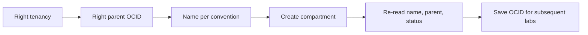

# Creating a Learning Compartment and Naming Conventions

## Objectives and Context

In the **Account and Lab Setup** chapter of the **CLOUD_PROVIDERS_ORACLE** module, a learning compartment organizes resources before practicing VCN, Compute, storage, and Oracle Database labs. Preparing the right compartment helps learners know which scope resources belong to, who manages them, and what to check when ending a lab.

This lesson focuses on one concrete deliverable: creating a learning compartment under the right parent, verifying it by OCID, and applying a naming convention usable across all OCI labs.

After this lesson, you will be able to:

- Choose the right parent and administrative scope for labs.
- Distinguish compartment name, compartment path, OCID, and service resource names.
- Create a compartment using the Console or OCI CLI.
- Verify the name, parent, status, and usage permissions.
- Name resources and attach ownership metadata consistently to support search, automation, and resource cleanup.

## 1. Practice Deliverable

Assume an organization already has a `Training` compartment dedicated to training. A learner is allowed to create a child compartment for practicing Java on OCI.

Target tree:

```text
Tenancy / root
└── Training                         ← existing parent
    └── lab-oci-java-an01             ← compartment created in this lesson
```

In this example:

- `lab` indicates the learning purpose.
- `oci` indicates the platform.
- `java` is the project or practice track code.
- `an01` is a hypothetical owner code, not a pre-created account.

If you are using a personal tenancy without `Training`, the parent can be root when you hold the appropriate permissions. Do not create an extra `Training` compartment merely to mirror the illustration.

This lesson only requires creating the compartment. You do not yet need to create Compute instances, databases, or storage resources to prove preparation is complete.

### Completion Criteria

| Item | Result to verify |
| --- | --- |
| Name | Follows the chosen convention |
| Parent | Matches the OCID of `Training` or assigned parent |
| Status | Compartment is ready for use |
| Description | States purpose and owner |
| Identifier | Recorded the OCID of the new compartment |
| Permissions | Learner knows what actions they are permitted inside the compartment |
| Lifecycle | Plan exists for inventorying and cleaning up lab resources |

A matching name is only part of the result. If the name is right but the parent is wrong, the exercise has not yet met its governance objective.

## 2. What a Learning Compartment Helps With and What Must Supplement It

A compartment is a resource organization scope within a tenancy. Learners select this compartment when creating service resources that support compartments.

Example in later lessons:

```text
lab-oci-java-an01
├── VCN for networking labs
├── Compute running Java applications
├── Volumes for lab machines
└── Test database when required by a lesson
```

The list above illustrates administrative organization. It does not yet describe network relationships or dependencies among resources.

A dedicated compartment helps with:

- Locating the lab's exact group of resources.
- Granting permissions scoped to learning.
- Tracking ownership and related costs.
- Inventorying before cleaning up the environment.
- Passing the exact compartment OCID to automation tools.

However, a name containing `lab` does not automatically cap costs, block Internet access, or schedule resource deletion. You still must design IAM, networking, quotas, budgets, and cleanup procedures according to actual requirements.

A compartment is also not a resource confined to a single region. When deploying regional resources, you still must select the right region separately. [Compartment scope and usage](https://docs.oracle.com/en-us/iaas/Content/Identity/Tasks/managingcompartments.htm).

## 3. Preparing Before Creation

### 3.1. Identify the Exact Tenancy and Parent

Before opening the compartment creation form, record:

```text
Tenancy:            <tenancy-OCID>
Home region:        <home-region-identifier>
Parent:             <parent-compartment-OCID>
Planned name:       lab-oci-java-an01
Owner:              an01
Purpose:            OCI practice for Java applications
```

Tenancy OCID and compartment OCID must not be substituted interchangeably. The tenancy is the root compartment; passing the tenancy OCID as parent creates the compartment directly under root.

In a multi-learner environment, obtain the parent OCID from the administrator instead of picking a compartment solely because its name sounds right.

### 3.2. Distinguish Compartment Creation Permissions from Workload Creation Permissions

The operator needs compartment management permissions in the appropriate scope. That permission can be exercised by a tenancy administrator or delegated within a specific parent. [Compartment management permissions](https://docs.oracle.com/en-us/iaas/Content/Identity/compartments/managingcompartments.htm).

Being able to create a compartment does not mean a learner can create every service inside it. For example, a Compute lab may also require permissions on instances, volumes, images, and related subnets.

Before starting a lab series, agree on:

| Role | Responsibility |
| --- | --- |
| Tenancy administrator | Choose the parent and grant the required permission scope |
| Learner | Create or use the exact assigned compartment |
| Lab lead | Confirm naming conventions and permitted resource scope |
| Resource owner | Inventory, monitor usage, and clean up resources after labs |

There is no need to grant tenancy-wide administrator rights just to give learners a place to practice.

### 3.3. Check Whether the Compartment Already Exists

If the same lab was prepared previously, cross-check the name, OCID, parent, and owner. Do not create a brand-new compartment every time a study session begins.

If a compartment with the same name already exists with an unclear purpose, pause creation and verify with the administrator. Do not keep appending suffixes like `02`, `03` to dodge name collisions; doing so fragments the environment.

## 4. OCI Rules and Internal Conventions Are Two Separate Layers

According to compartment creation documentation, the name must be unique within its parent, at most 100 characters long, and use supported characters such as letters, numbers, periods, hyphens, or underscores. The description is separate metadata and can be updated. [Requirements when creating a compartment](https://docs.oracle.com/en-us/iaas/Content/Identity/compartments/To_create_a_compartment.htm).

An organization may choose stricter conventions for readability. In this lesson, the proposed convention is:

```text
lab-oci-<project>-<owner>
```

Examples:

```text
lab-oci-java-an01
lab-oci-java-binh02
lab-oci-orders-team01
```

This convention is a choice for this lesson, not a mandatory Oracle template.

### Chosen Internal Rules

| Element | Lesson convention |
| --- | --- |
| Letter case | ASCII lowercase |
| Separator | Hyphen `-` |
| Project | Short, stable code, a single alphanumeric group |
| Owner | Agreed user or team code |
| Target length | At most 48 characters for readability |
| Word count | Contains only identifying information |
| Frequently changing info | Placed in description or tags |

The 48-character limit is an internal target, smaller than the technical compartment limit. Using plain ASCII without diacritics is also a choice to simplify CLI operations, not a claim that every OCI name shares the same character set.

With this pattern, a convention check could use the expression:

```text
^lab-oci-[a-z0-9]+-[a-z0-9]+$
```

This expression checks only the lesson's naming pattern. It does not replace length checks, collision checks, or OCI API rules.

### Comparing Names

| Name | Evaluation under this lesson's convention |
| --- | --- |
| `lab-oci-java-an01` | Clear purpose, platform, project, and owner |
| `Lab_Java_An01` | May differ from agreed casing and separator rules |
| `test` | Hard to tell which lab or who is responsible |
| `new-final-test-2` | Shows naming iteration history rather than a stable purpose |
| `lab-oci-java-an01-password123` | Contains information that should never appear in a name |
| `Training:lab-oci-java-an01` | This is path notation, not a child compartment name |

Names, descriptions, and tags should never contain passwords, private keys, or secrets. They appear across many administrative screens and operational tools. [OCI resource identifiers and names](https://docs.oracle.com/en-us/iaas/Content/General/Concepts/identifiers.htm).

## 5. Distinguishing Name, Path, and OCID

These three values serve different purposes:

```text
Name:    lab-oci-java-an01
Path:    Training:lab-oci-java-an01
OCID:    <lab-compartment-ocid>
```

- **Name** helps operators recognize the item in lists.
- **Path** describes its position in the compartment hierarchy.
- **OCID** is the identifier issued by Oracle for that specific object.

In deployment tooling, pass the verified OCID. Do not look up a resource solely by name and pick the first match without checking its parent.

### Paths in Policies

Assuming `Training` sits directly under root, group `LabReaders` already exists in the Default identity domain, and the policy is created at root:

```text
Allow group Default/LabReaders to read instance-family in compartment Training:lab-oci-java-an01
```

The colon describes the path to the child compartment. If the policy is placed elsewhere, the reference syntax must match that placement. OCI also supports specifying a compartment by OCID. [How scope is specified in policies](https://docs.oracle.com/en-us/iaas/Content/Identity/policysyntax/location.htm).

This example illustrates read permission on the Compute instance family only, not a complete permission set for Compute or database labs.

### Renaming Does Not Create a Different Compartment

A compartment can be renamed through supported administrative operations. However, operators must review lookup scripts, documentation, catalogs, and related conventions beforehand.

Renaming is not moving parents or recreating the environment. When checking afterward, use the OCID to confirm you are still working with the same object. [Renaming a compartment](https://docs.oracle.com/en-us/iaas/Content/Identity/compartments/To_update_a_compartments_name.htm).

## 6. Creating a Compartment via the Console

### Step 1: Open the Compartments List

Under Identity & Security in the Console, locate Compartments. Check the active tenancy and select the exact authorized parent branch.

If the parent is `Training`, open the `Training` details before creating the child compartment.

### Step 2: Fill in Details

Enter the lesson's values:

| Field | Illustrative value |
| --- | --- |
| Name | `lab-oci-java-an01` |
| Description | `OCI training for Java; owner=an01; temporary lab resources.` |
| Parent compartment | `Training`, cross-checked by OCID |
| Tags | Per organization convention or the sample tag set in Section 9 |

The description should state the purpose and owner; there is no need to stuff the entire study plan into the name.

### Step 3: Verify Parent Before Creating

If the form defaults to root while your target is `Training`, fix the parent before saving. Having the same child compartment name does not make two hierarchy locations equivalent.

### Step 4: Create and Monitor Result

Run Create compartment. Read the success or error message and check the new compartment's ready state.

### Step 5: Re-read Details

Open the newly created compartment and cross-check its name, description, parent, status, and OCID. Do not rely solely on seeing a row appear with the expected name.

The Console workflow and fields above are described in [Oracle's compartment creation guide](https://docs.oracle.com/en-us/iaas/Content/Identity/compartments/To_create_a_compartment.htm).



Re-reading at the end catches a wrong parent before VCNs, Compute instances, or databases depend on that structure.

## 7. Illustrative Creation with OCI CLI on PowerShell

This section is for machines with OCI CLI installed and authentication configured. Commands are examples for learners to execute in an authorized lab environment; this lesson does not execute operations against a tenancy.

Use the home region for IAM calls that require the home region management endpoint. Replace placeholder values with confirmed details.

### 7.1. Confirm the Parent

```powershell
$ociHomeRegion = '<home-region-identifier>'
$parentCompartmentId = '<Training-compartment-ocid>'
$labName = 'lab-oci-java-an01'

oci iam compartment get `
    --compartment-id $parentCompartmentId `
    --region $ociHomeRegion

if ($LASTEXITCODE -ne 0) {
    throw 'Failed to read parent compartment.'
}
```

Inspect the output to ensure this is the assigned parent. If your organization uses root as the parent, `$parentCompartmentId` holds the tenancy OCID instead of Training's OCID.

### 7.2. Check Names Among Direct Child Compartments

```powershell
$existingJson = oci iam compartment list `
    --compartment-id $parentCompartmentId `
    --name $labName `
    --all `
    --region $ociHomeRegion `
    --output json

if ($LASTEXITCODE -ne 0) {
    throw 'Failed to check existing compartments.'
}

$existingCompartments = @(($existingJson | ConvertFrom-Json).data)

if ($existingCompartments.Count -gt 0) {
    $existingCompartments |
        Select-Object name, id, 'compartment-id', 'lifecycle-state'

    throw 'Name already exists under parent; cross-check OCID and purpose before reusing.'
}
```

The list command on a parent normally returns direct child compartments. The `--all` flag fetches all pages of results; it does not mean traversing deeper nested branches automatically. [compartment list command reference](https://docs.oracle.com/en-us/iaas/tools/oci-cli/latest/oci_cli_docs/cmdref/iam/compartment/list.html).

The check stops when the name already exists instead of blindly adopting an unverified compartment as the lesson's resource. In full production automation, add state management and concurrency handling for simultaneous creators; a single `list` before `create` does not solve every race condition.

### 7.3. Create the New Compartment

Proceed only when no compartment with the same purpose exists:

```powershell
if ($labName.Length -gt 48 -or
    $labName -cnotmatch '^lab-oci-[a-z0-9]+-[a-z0-9]+$') {
    throw 'Name does not follow lab convention.'
}

$labCompartmentId = oci iam compartment create `
    --compartment-id $parentCompartmentId `
    --name $labName `
    --description 'OCI training for Java; owner=an01; temporary lab resources.' `
    --wait-for-state ACTIVE `
    --max-wait-seconds 180 `
    --region $ociHomeRegion `
    --query 'data.id' `
    --raw-output

if ($LASTEXITCODE -ne 0) {
    throw 'Compartment creation not confirmed; re-read state before retrying.'
}
```

In the create command, `--compartment-id` is the **parent's OCID**, not the OCID of the compartment being created. `--wait-for-state ACTIVE` instructs the CLI to wait until the object reaches Active state within the specified timeout. [compartment create command reference](https://docs.oracle.com/en-us/iaas/tools/oci-cli/latest/oci_cli_docs/cmdref/iam/compartment/create.html).

If the wait times out, do not conclude the resource was definitely not created. Re-read the list and status before submitting another creation request.

### 7.4. Re-read the Newly Created Object

```powershell
$labJson = oci iam compartment get `
    --compartment-id $labCompartmentId `
    --region $ociHomeRegion `
    --output json

if ($LASTEXITCODE -ne 0) {
    throw 'Failed to re-read compartment.'
}

$lab = ($labJson | ConvertFrom-Json).data

if ($lab.name -cne $labName -or
    $lab.'compartment-id' -ne $parentCompartmentId -or
    $lab.'lifecycle-state' -ne 'ACTIVE') {
    throw 'Readback metadata does not match lab target.'
}

$lab |
    Select-Object name, id, 'compartment-id', 'lifecycle-state'
```

Only after this step does `$labCompartmentId` become the verified OCID used to target the lab compartment for resources in later lessons.

This sample script does not recreate the compartment on a second run. If the compartment already exists, use the verified OCID rather than deleting it just to make the script run from scratch.

## 8. Extending Naming Conventions to Lab Resources

A learning compartment does not replace individual resource names. When deploying workloads, you can use a display name pattern:

```text
<type>-<project>-<env>-<region>-<sequence>
```

Examples for resources in Singapore:

| Resource type | Illustrative display name |
| --- | --- |
| VCN | `vcn-java-lab-sin-01` |
| Subnet | `subnet-java-lab-sin-01` |
| Route table | `rt-java-lab-sin-01` |
| NSG | `nsg-java-lab-sin-01` |
| Compute instance | `vm-java-lab-sin-01` |
| Block Volume | `vol-java-lab-sin-01` |
| Database resource with an appropriate display name field | `db-java-lab-sin-01` |

This is a lab display name convention. Each service type still enforces its own name field rules, lengths, and uniqueness constraints.

### Why Does the Compartment Name Not Contain a Region?

In the example, `lab-oci-java-an01` omits `sin` because a compartment can organize resources across multiple regions. Individual resources include the region code so operators can identify them easily during cross-region labs.

A code in a name is only a label. An instance whose name contains `sin` must still have its actual region verified in the Console or API.

### Choosing Meaningful Sequences

Use `01`, `02` to distinguish resources playing the same role when genuinely needed. Do not use incrementing numbers solely as a way to track lab rerun history.

For instance, `vm-java-lab-sin-01` might be an application machine and `vm-java-lab-sin-02` a test machine. If roles need clearer distinction, you can standardize a role segment in the convention:

```text
vm-java-app-lab-sin-01
vm-java-test-lab-sin-01
```

Once a role-inclusive variant is chosen, apply it consistently across the team instead of mixing formats on each creation.

### Display Name Is Not a Unique Identifier Key

Many OCI resources allow non-unique display names. Therefore, searching by name can return multiple objects; always verify OCID, compartment, and region before modifying or deleting. [OCIDs and display names](https://docs.oracle.com/en-us/iaas/Content/General/Concepts/identifiers.htm).

## 9. Do Not Use the Same Pattern for Every Technical Name

A single resource can have multiple fields meaning "name," each with different rules.

### VCN and Subnet Examples

A VCN can use:

```text
Display name: vcn-java-lab-sin-01
DNS label:    javalab
```

A subnet can use:

```text
Display name: subnet-java-lab-sin-01
DNS label:    app01
```

VCN and subnet DNS labels have their own rules: up to 15 alphanumeric characters, starting with a letter; hyphens and underscores are not allowed. Therefore, do not copy the display name above directly into the DNS label field. [DNS labels and hostnames in VCNs](https://docs.oracle.com/en-us/iaas/Content/Network/Concepts/dns.htm).

### Database and Object Storage Examples

Fields such as database name, service name, unique name, or bucket name have service-specific requirements. `db-java-lab-sin-01` in the table is only an illustrative display name where supported.

Before creating a resource, read each field's description rather than assuming every field accepts lowercase letters and hyphens. An error on a technical name field does not mean you need to change the entire compartment naming convention.

### Decision Rule

```text
Is this field a display name?
  → apply the display name pattern if it meets service constraints

Is this field a DNS label, hostname, or technical database name?
  → use that field's specific rules

Does tooling require a specific resource identifier?
  → use the OCID or identifier required by the API
```

This distinction prevents errors right from declaring infrastructure via CLI or Terraform.

## 10. Using Descriptions and Tags for Governance Metadata

Names should remain stable, while descriptions and tags hold supplemental classification metadata.

Illustrative tag set:

| Key | Sample value | Purpose |
| --- | --- | --- |
| `Purpose` | `training` | Identify learning resources |
| `Project` | `java` | Associate with a track or project |
| `Environment` | `lab` | Classify the environment |
| `Owner` | `an01` | Identify the responsible owner |
| `ReviewAfter` | `<YYYY-MM-DD>` | Remind when to re-evaluate need |

Replace the sample date with an actual agreed date. The `ReviewAfter` tag does not automatically trigger a deletion job; if lifecycle automation is needed, a process or tool must read and act on tags.

### Free-Form Tags and Defined Tags

Free-form tags are key-value pairs usable for labs where permitted. Defined tags require a pre-managed namespace and keys, helping organizations standardize values and related governance controls.

If your team already has a tag namespace and policies, use that tag set instead of inventing another. For cost tracking via OCI tagging, check supported tag types and configurations; do not assume every free-form tag is a cost-tracking tag. [OCI tagging overview](https://docs.oracle.com/en-us/iaas/Content/Tagging/Concepts/taggingoverview.htm).

### Tags on a Compartment Do Not Automatically Attach to Every Resource

Attaching `Owner=an01` to a compartment does not mean every instance or database created later inherits the same tag.

If an organization uses tag defaults, configure and verify that mechanism for new resources within supported scopes. Do not assume existing resources will have their tags updated retroactively. [Tag defaults mechanism](https://docs.oracle.com/en-us/iaas/Content/Tagging/Tasks/managingtagdefaults.htm).

In a small lab, you can apply tags when creating each resource and read them back to verify. Only add tag automation once resource counts grow.

## 11. Verifying Permissions and Preparing to Use the Compartment in Later Lessons

Once the compartment is Active, verify that learners can see the right branch and hold their assigned permissions.

Examples of different verification levels:

| Check | What can be concluded |
| --- | --- |
| Can read compartment details | The identity can retrieve this governance object |
| Can view Compute list in lab | Corresponding read/list permission path exists |
| Can create a lab VCN per networking lesson | Holds permissions for the network actions performed |
| Cannot modify resources outside the lab | Matches objective if the identity is scoped only to the lab |

Do not use a tenancy-wide administrator account to conclude that a learner group's permissions are properly restricted. Nor should you create billable resources solely to test permissions if the lesson does not yet need them.

When creating resources in subsequent lessons, cross-check this trio:

```text
Target region
Compartment OCID
Resource name and purpose
```

A resource with `lab` in its name placed outside the learning compartment can still undermine permission boundaries and inventories.

### Cost and Availability Preparation

Compartments establish scope for usage tracking, but do not inherently enforce a budget or resource limit. Before Compute/database labs, agree on allowed configurations, cost alerting, and retention periods.

Similarly, placing two machines in the same compartment does not provide redundancy. High availability depends on service deployment architecture, fault domains, data replication, and failover mechanisms; specialized lessons will build those on top of the governance scope prepared here.

## 12. Troubleshooting Common Errors

| Symptom | What to check |
| --- | --- |
| Name rejected | Length, characters, collision under parent, and exact API error message |
| Compartment is in the wrong branch | Cross-check parent OCID, not just the name in a list |
| Newly created compartment not visible | Tenancy, identity, list scope, lifecycle state, and propagation time |
| List does not show a deeply nested compartment | Listing a parent normally shows direct children only |
| Can create compartment but cannot create VCN | Compartment permissions and service permissions are separate requirements |
| CLI times out waiting for Active | Re-read the object before sending another create request |
| DNS label rejects display name | Follow DNS label-specific rules |
| Resource named `lab` missing from lab view | Check its actual compartment and region |
| Added `Owner` tag but child resources lack it | Check per-resource tags or tag defaults configuration |
| Cannot delete compartment | Inventory remaining resources, child compartments, and policies |

### If Created Under the Wrong Parent

While the new compartment is still empty, determine the remediation plan with an authorized administrator. Once resources exist inside it, do not move or delete it solely to make the tree match an illustration.

Moving a compartment can change inherited parent policies and affect tools relying on the old path. Know its contents and dependencies before acting.

### If the Naming Convention Changes

Prioritize planned updates: name catalogs, lookup tooling, and operational docs. Do not mass-rename active lab resources merely because you thought of a prettier format.

The purpose of a convention is making operations clear and consistent, not generating endless renaming chores.

## 13. Ending Labs and Cleaning Up Resources

After finishing a series of lessons, learners need to know which resources remain in use and which must be reclaimed.

Suggested management sequence:

1. List resources inside the exact compartment across every region used.
2. Confirm owners and resources still needed by other lessons.
3. Delete or stop resources according to each service's rules.
4. Check remaining volumes, backups, databases, storage, and logs.
5. Revoke lab-only policies or configurations when appropriate.
6. Delete the compartment only if it is no longer needed and meets deletion conditions.

A compartment must be emptied before deletion; policies attached to it must also be reviewed. Deletion is asynchronous and can fail if dependencies remain. [Compartment deletion conditions](https://docs.oracle.com/en-us/iaas/Content/Identity/compartments/To_delete_a_compartment.htm).

Do not assume a name starting with `lab-` is sufficient grounds for bulk deletion. Names assist discovery; deletion decisions still require verifying OCID, scope, and actual usage.

If the compartment will be reused for future sessions, you can keep the governance structure and clean up the workloads inside according to an agreed schedule.

## 14. Practice Exercise and Completion Evidence

Execute within your authorized scope:

1. Choose a project code and owner code for your lab.
2. Format the name using `lab-oci-<project>-<owner>`.
3. Confirm the parent by OCID.
4. Check whether the compartment already exists before creating.
5. Create it via Console or CLI, then re-read its state and parent.
6. Draft planned names for a VCN, subnet, Compute instance, and database display name.
7. Separate DNS labels from display names in your design notes.
8. Record tags, owner, and environment review date.

You do not need to create workload resources just to complete items 6 and 7.

Handover template:

```text
Tenancy OCID:           <actual-value>
Parent name:            <parent-name>
Parent OCID:            <parent-ocid>
Lab compartment name:   <name-following-convention>
Lab compartment OCID:   <lab-ocid>
Lifecycle state:        <readback-state>
Owner:                  <owner-code>
Purpose:                <lab-purpose>
Naming convention:      <agreed-pattern>
Review after:           <actual-date>
Confirmed permissions:  <assigned-scope>
Workload resources:     <none-created/list-if-any>
```

Match the template against actual observed results. If you do not yet have permission to create a compartment, record the exact missing prerequisite instead of reporting completion merely because you drafted a name.

## 15. Key Takeaways

A useful lab compartment needs **the right parent, the right permission scope, a verified OCID, and a clear owner**. Naming conventions help learners locate and understand resources, while tags and descriptions supply governance metadata.

In upcoming OCI lessons, use your confirmed compartment OCID, specify regions explicitly, and apply field-specific naming rules. This preparation keeps VCN, Compute, storage, and database deployments consistent while making inventory and cleanup straightforward.
