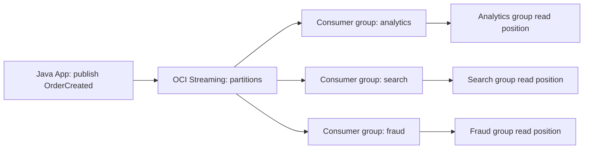
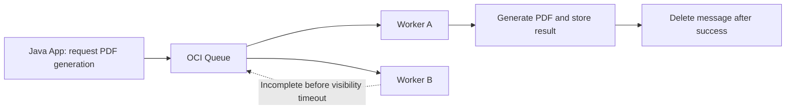
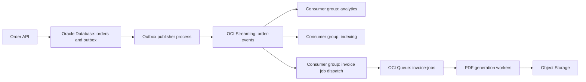

# Choosing Between OCI Streaming and OCI Queue

In Oracle Cloud Infrastructure (OCI), **Streaming** is well-suited when an application needs to retain a stream of events so multiple consumers can read independently and replay data. **Queue** is well-suited when you need to deliver individual messages to workers, track processing, and retry incomplete work. Both help decouple data producers from processors, but they have different data lifecycles. [Streaming Overview](https://docs.oracle.com/en-us/iaas/Content/Streaming/Concepts/streamingoverview.htm), [Queue Overview](https://docs.oracle.com/en-us/iaas/Content/queue/overview.htm).

This opening lesson of the **Streaming and Queue** chapter focuses on how to choose the right service for OCI infrastructure and Java applications. The goal is a well-grounded decision covering consumption model, ordering, recoverability, IAM, monitoring, and cost—not merely picking a service name based on data type.

## 1. Start from the Data Lifecycle

Before comparing products, answer three questions:

1. After one consumer finishes processing, does the data need to be kept for another consumer to read or for re-running logic?
2. Does a message represent an event that already happened, or a job that needs to be completed?
3. When a worker fails mid-way, how does the system determine what work has already been completed?

For example, an e-commerce system has two needs:

- `OrderCreated`: an event indicating an order was created, used for analytics, updating search models, and fraud detection.
- `GenerateInvoicePdf`: a job to generate an invoice file, which can be assigned to any eligible worker in a pool.

Both messages may contain `orderId`, but their operational requirements differ. The analytics team may want to replay yesterday's data; the PDF worker primarily needs to know which jobs remain unfinished.

The distinction between an event and a job is a starting point, not a rigid rule. An event can also be delivered via Queue; what decides the choice is how data must be retained, delivered, acknowledged, and replayed.

## 2. Understand the Two Processing Models

### 2.1. Streaming: Partitioned Log with Read Positions

A stream is an append-only log divided into partitions. Messages have offsets within a partition. Consumers read data using a read position; reading a message does not delete it immediately. Data remains available for the retention period. [Streaming Model](https://docs.oracle.com/en-us/iaas/Content/Streaming/Concepts/streamingoverview.htm).



Within a consumer group, instances share the partitions; each partition is assigned to one instance at a time. Different groups maintain independent progress. When the number of instances exceeds the number of partitions, the extra instances receive no partitions to read. [Streaming Consumer Groups](https://docs.oracle.com/en-us/iaas/Content/Streaming/Tasks/using_consumer_groups.htm).

For example, the `search-indexer` group has three instances and the stream has three partitions. When one instance stops, the group can redistribute partitions among the remaining instances. The `fraud-analysis` group still keeps independent progress and does not share a completion checkpoint with `search-indexer`.

The key design decision is the partition key. If events for the same order must preserve order, you can use `orderId` as the key. Messages with the same key go to the same partition; ordering guarantees apply within a partition, not across the entire stream. [Partitions and Ordering](https://docs.oracle.com/en-us/iaas/Content/Streaming/Concepts/partitioningastream.htm).

This guarantee also does not automatically make parallel business calls inside a consumer finish in order. If a consumer reads sequentially and then submits every message to an unconstrained thread pool, the application can still update order state out of order.

### 2.2. Queue: Message Delivery, Temporary Hiding, and Completion Acknowledgment

With the basic queue model, workers on the same consumption path compete to receive jobs:



When a worker receives a message, Queue hides it from other workers for the duration of the visibility timeout. The worker can extend this timeout. After processing succeeds, the worker must delete the message; if it is not deleted and the visibility timeout expires, the message can be delivered again. [Consumption and Visibility Timeout](https://docs.oracle.com/en-us/iaas/Content/queue/consume-messages.htm).

The delete request uses the `receipt` obtained from the receive call, rather than relying only on a business identifier in the payload. [Deleting Messages](https://docs.oracle.com/en-us/iaas/Content/queue/delete-messages.htm).

Three time intervals have distinct meanings:

| Concept | Meaning When Choosing Queue |
| --- | --- |
| Retention | Maximum time a message is kept if not deleted |
| Visibility timeout | How long a delivery is reserved for a worker |
| Polling timeout | How long a receive request waits for data |

If a task takes two minutes but the visibility timeout is shorter than the processing time, another worker may pick up the same job while the first worker is still running. You must choose an appropriate timeout or extend it based on progress, while also handling extension failures.

## 3. Decision Comparison Table

| Criterion | OCI Streaming | OCI Queue |
| --- | --- | --- |
| Primary organizational unit | Stream, partition, offset | Queue, message, consumption path |
| After successful processing | Record read progress; data still subject to retention | Delete message for the corresponding consumption path |
| Reading history again | Read from an offset or timestamp still within retention | Cannot retrieve deleted messages by rewinding like a stream |
| Load distribution | Distribute partitions within a consumer group | Multiple workers pull available messages |
| Ordering | Within each partition | Best-effort; do not rely on strict FIFO |
| Failed job handling | Application designs retry, error isolation, and checkpointing | Visibility timeout, delivery count, and DLQ support processing lifecycle |
| Multiple independent consumers | Consumer groups with separate progress | Consumer groups and fan-out when the corresponding feature is enabled |
| Deciding question | "How do we need to retain and replay the data stream?" | "How do we need to deliver and complete each message?" |

Read-position differences are based on [Streaming consumer groups](https://docs.oracle.com/en-us/iaas/Content/Streaming/Tasks/using_consumer_groups.htm); message lifecycle is based on [Queue](https://docs.oracle.com/en-us/iaas/Content/queue/overview.htm) and [DLQ](https://docs.oracle.com/en-us/iaas/Content/queue/deadletterqueues.htm). Current FAQ documentation describes OCI Queue as a standard queue with best-effort ordering. [Queue Ordering](https://www.oracle.com/cloud/queue/faq/).

Do not assume "at-least-once" delivery means "exactly-once business effect." A message can be redelivered after a network failure or when a worker fails to acknowledge completion. You must design idempotent / duplicate-safe processing for either choice.

## 4. OCI Queue Also Has Fan-Out and Consumer Groups

One important update to consider when choosing: Oracle announced fan-out to multiple consumer groups for OCI Queue on February 2, 2026. Therefore, the "multiple recipients" criterion alone is no longer enough to select Streaming. [Queue Consumer Groups Release Notes](https://docs.oracle.com/en-us/iaas/releasenotes/queue/ConsumerGroups.htm).

When enabled, Queue has a primary consumer group; other groups can receive messages using filters on **message attributes**. Filters do not inspect the JSON body directly. Groups have independent delivery paths and tracking. [Queue Fan-Out Model](https://docs.oracle.com/en-us/iaas/Content/queue/fanout-top.htm).

For example, an order event is delivered to two groups:

| Group | Purpose |
| --- | --- |
| `invoice-jobs` | Processes messages requesting invoice generation |
| `customer-updates` | Processes messages requiring customer updates |

If you only run multiple workers in the same group, they share that group's work. For two different functions to each receive the relevant messages, you must configure two groups and their corresponding delivery filters.

You can leave a group's filter empty to receive all messages as described in the group creation guide. [Creating a Queue Consumer Group](https://docs.oracle.com/en-us/iaas/Content/queue/fanout-manage-consumer-group-create.htm).

Notes that directly affect the decision:

- Filters are evaluated when a message is published; modifying a filter does not re-evaluate older data.
- If the primary group is disabled and no group matches, a message can be dropped.
- Fan-out does not provide an offset mechanism to rewind deleted messages like Streaming.

The first two points are documented by Oracle in [filter evaluation rules](https://docs.oracle.com/en-us/iaas/Content/queue/fanout-top.htm). When you need to add a new consumer later and have it reprocess historical data, you must evaluate the replay requirement separately.

## 5. Requirements-Based Selection Process

### Step 1: Identify Replay Needs

Prioritize evaluating Streaming when you have requirements such as:

- Rebuilding a search index from retained events.
- Re-running an algorithm after fixing a logic bug.
- Allowing an analytics group to read data at its own pace.
- Continuously reading operational or telemetry data.

With Queue, once a message has been processed and deleted, a new worker cannot fetch it again from the queue as an unprocessed message. If the organization needs history, you must have another storage source or choose an event-log architecture.

### Step 2: Define the Ordering Scope

Write down clearly which entity ordering applies to:

```text
Clear requirement:
  Changes for the same orderId must be applied in version order.

Ambiguous requirement:
  Every message must be in strict order.
```

The first requirement can map to partitioning by `orderId` in Streaming combined with sequential per-key processing. The second requirement can limit parallelism across the entire system and must be clarified before choosing a product.

If jobs are independent, such as generating thumbnails for different files, workers finishing out of order usually causes no issue. In that case, the Queue model is worth considering.

### Step 3: Define Job Completion and Recovery

For a job, be able to describe:

- When is it considered successful?
- If a worker stops immediately after writing the result, what does the next attempt do?
- Where are messages with bad data isolated?
- Who is responsible for re-submitting fixed messages for processing?

Queue supports routing failed deliveries to a DLQ based on delivery count and the configured maximum delivery attempts. A DLQ still has retention; it requires operators and a remediation process, not indefinite data storage. [Dead Letter Queues](https://docs.oracle.com/en-us/iaas/Content/queue/deadletterqueues.htm).

With Streaming, define a policy for a poison record: halt the partition to fix it, or persist it to an isolation store and move on. If you choose to move on, you must be able to reconcile isolated records and have a reprocessing path.

### Step 4: Check Clients and Integrations

For Java applications already using a Kafka client, Streaming provides a Kafka API compatibility layer. However, current documentation lists several unimplemented features, such as transactions, idempotent production, and dynamic partition addition. Do not copy assumptions wholesale from another Kafka system without checking compatibility. [Streaming Kafka API Support](https://docs.oracle.com/en-us/iaas/Content/Streaming/Tasks/kafkacompatibility.htm).

OCI Queue provides a REST API, SDKs, and the STOMP protocol. Library convenience should be evaluated alongside the delivery semantics the application requires. [Queue Access Protocols](https://www.oracle.com/cloud/queue/faq/).

### Step 5: Check Operations and Cost

Finalize the choice only after verifying peak load, tolerable downtime, IAM, networking paths, and observability. A service that matches the client interface but fails recovery-window requirements is still the wrong fit.

## 6. Applying to Common Use Cases

| Illustrative Requirement | Initial Choice | Must Verify |
| --- | --- | --- |
| Collect user behavior for multiple analytics pipelines | Streaming | Retention, partition key, per-group progress |
| Generate invoice PDFs using a worker pool | Queue | Visibility timeout, deduplication, DLQ |
| Rebuild a read model from order events | Streaming | Whether required historical data is still within retention |
| Deliver updates to multiple groups by attributes | Queue fan-out or Streaming | Whether replay and per-key ordering are needed |
| Process independent tasks accumulated during peak hours | Queue | Catch-up processing rate, downstream resource limits |
| Store multi-month history for auditing | Add long-term storage | Retention period and search/reconciliation capability |

These are design recommendations for the scenarios listed in the table, not a restriction that each service can serve only one kind of workload.

### Combined Example in an Order System

An architecture can use both:



In this illustrative design:

1. The order-creation transaction writes both the order and an outbox record in the same database.
2. A separate process publishes events from the outbox.
3. Consumer groups read the stream independently; the invoicing group turns relevant events into jobs.
4. Workers process jobs from the queue and store the output files.

Outbox is an application design pattern; drawing the diagram does not make Oracle Database publish messages automatically. You must implement the publisher process, result marking, and deduplication.

The Streaming → Queue hop is also not inherently atomic. If a job is published successfully before the stream checkpoint is committed, the process can publish it again. Use a stable job identifier, such as `invoice:<orderId>:<invoiceVersion>`, so the destination can handle redelivery without creating duplicate invoices.

Do not introduce both services into a system just because they can be combined. Every hop adds monitoring, reconciliation, and incident-response overhead; only add a stage when it solves a concrete requirement.

## 7. Designing Java Applications to Tolerate Redelivery

### 7.1. Business Identifiers Must Be Stable

An illustrative payload:

```json
{
  "eventId": "evt-order-2048-created-v1",
  "eventType": "OrderCreated",
  "aggregateId": "order-2048",
  "aggregateVersion": 1,
  "occurredAt": "2026-11-20T02:00:00Z",
  "schemaVersion": 1,
  "data": {
    "currency": "VND",
    "total": 580000
  }
}
```

The fields serve different purposes:

| Field | Role in Design |
| --- | --- |
| `eventId` | Identifies the same event across deliveries |
| `aggregateId` | Associates the event with the business entity |
| `aggregateVersion` | Checks version and detects invalid or out-of-order updates |
| `occurredAt` | Records when the event occurred per the application contract |
| `schemaVersion` | Helps consumers know how to interpret the payload |

This is an application-designed payload contract, not a mandatory OCI schema. If Queue fan-out by event type is needed, the producer must also send the corresponding message attribute; having an `eventType` field in the body is not enough for Queue filters to read it.

### 7.2. Complete Business Work Before Acknowledging the Message

The pseudocode below illustrates the processing order for a Queue worker; these are not OCI Java SDK method names:

```text
Receive message and receipt

Begin database transaction
  If jobId is already completed:
    Do not repeat business side effects
  If jobId is not yet completed:
    Record jobId with a unique constraint
    Perform business updates
    Mark jobId as completed
Commit

Delete message using the receipt from the receive call
```

If the worker stops after committing but before deleting the message, the redelivery sees that the job is already completed and does not repeat the updates. Checking and recording must have proper atomicity; a plain "check-then-insert" without a unique constraint can be executed concurrently by two workers.

If the job calls an external service or creates a file, a single database transaction does not cover all those side effects. You need an idempotency key on the external service, stable file naming rules, or an appropriate reconciliation process.

For Streaming, the same principle applies before checkpointing: do not commit completion past records that have not yet been durably processed. When processing in parallel, progress tracking must respect per-partition ordering.

Streaming consumer groups can redeliver a batch if a consumer stops before committing. Auto-commit or manual-commit behavior must be chosen and well understood according to the API in use. [Consumer Group Semantics and Commits](https://docs.oracle.com/en-us/iaas/Content/Streaming/Tasks/using_consumer_groups.htm).

## 8. Retention, Capacity, and Catch-Up Rate

### 8.1. Retention Must Cover Incidents

According to current documentation:

- OCI Streaming retains messages from 24 hours up to a maximum of 7 days; expired messages are deleted whether read or not.
- OCI Queue has a maximum retention of 7 days; messages can also be deleted earlier after successful processing.

See [Streaming Limits](https://docs.oracle.com/en-us/iaas/Content/Streaming/Concepts/streamingoverview_topic-Limits_on_Streaming_Resources.htm) and [Queue Limits](https://docs.oracle.com/en-us/iaas/Content/queue/overview.htm).

Do not treat retention as a guarantee that the application will catch up in time. Plan for:

```text
Required recovery window
= detection time
+ incident resolution time
+ backlog drain time
+ safety buffer
```

If you need to retain history longer than the service allows, use a dedicated storage layer. Putting data into a stream or DLQ does not replace a long-term storage design.

### 8.2. Workers Must Process Faster Than Incoming Data

Let:

- `λ`: new messages per second.
- `μ`: successfully processed messages per second.
- `B`: number of backlogged messages.

When `μ > λ`, the estimated time to drain the backlog is:

```text
T ≈ B / (μ - λ)
```

For example, with 120,000 backlogged messages, incoming rate of 1,000 messages/second, and processing rate of 1,200 messages/second:

```text
T ≈ 120000 / (1200 - 1000)
  = 600 seconds
  = 10 minutes
```

This is a simplified steady-rate model that excludes retries or slow tasks. If `μ ≤ λ`, the backlog cannot shrink sustainably at current capacity.

With Streaming, adding instances in a group does not scale parallelism indefinitely because it is bounded by the partition count. A hot key concentrating traffic into one partition can create a bottleneck. Stream partition count and retention cannot be changed after creation per current documentation; you must plan to create a new stream and cut over when needed. [Partition Design](https://docs.oracle.com/en-us/iaas/Content/Streaming/Concepts/partitioningastream.htm).

With Queue, adding workers can also overload downstream databases, target APIs, or connection pools. Scale concurrency in line with end-to-end capacity and monitor service limits.

### 8.3. Message Size Affects the Choice

Current documented limits are 1 MB per Streaming message and 256 KB per Queue message; requests also have their own size limits. [Streaming Limits](https://docs.oracle.com/en-us/iaas/Content/Streaming/Concepts/streamingoverview_topic-Limits_on_Streaming_Resources.htm), [Queue Limits](https://docs.oracle.com/en-us/iaas/Content/queue/overview.htm).

For PDF files or large documents, consider storing the content in Object Storage and sending only a reference plus required metadata. Consumers need object read permissions, and the object lifecycle must last long enough for both retries and recovery.

## 9. IAM, Networking, and Monitoring

### 9.1. Role-Based Access Control

In an OCI tenancy, you can place lab resources in a dedicated compartment and separate roles:

| Role | Permissions to Consider |
| --- | --- |
| Deployer | Create, update configuration, and manage resource lifecycle |
| Producer | Publish data to the designated stream or queue |
| Consumer | Read data and perform appropriate acknowledgment actions |
| Operator | View configuration, metrics, and error data within job scope |

For Queue, there are `queue-push` and `queue-pull` resource types to separate producers from consumers. When using consumer groups, policies can restrict access by `target.consumer-group.id`. [Queue IAM Reference](https://docs.oracle.com/en-us/iaas/Content/queue/policy-reference.htm).

Having permission to create queues is no reason to grant queue administration rights to every worker. When applications run on Compute, consider resource principals and appropriate dynamic groups rather than embedding personal credentials in code.

For Streaming, stream pools offer encryption options and private endpoints. Private endpoints require appropriate VCN routing; they do not replace IAM. [Streaming Security](https://docs.oracle.com/en-us/iaas/Content/Streaming/Concepts/streamsecurity.htm).

When testing Queue or Streaming, verify the correct data endpoint, region, DNS, and network path from the application runtime environment. An application residing in a private subnet does not automatically prove it can reach the service endpoint.

### 9.2. Monitoring Processing Outcomes

| Service | Signals to Monitor | Operational Question |
| --- | --- | --- |
| Streaming | Errors, throttling, and PUT/GET throughput | Is data entering and being read successfully? |
| Streaming | Business progress of each group, age of processed events | Which group is falling behind requirements? |
| Queue | Visible and in-flight message counts, message age | Are jobs waiting or delivered without finishing? |
| Queue | Delivery count, DLQ, and business outcomes | Are retries looping pointlessly? |
| Queue fan-out | Messages dropped because no group matched | Are filters and group configs dropping data? |

Streaming metrics belong to the `oci_streaming` namespace, including signals like `PutMessagesThrottling.Count` and `GetMessagesFault.Count`. [Streaming Metrics Reference](https://docs.oracle.com/en-us/iaas/Content/Streaming/Reference/metric-ref.htm).

Queue uses the `oci_queue` namespace, including `MessagesInQueueCount`, `ConsumerLag`, and `DroppedMessagesCount`. Queue's `ConsumerLag` measures time in minutes, not the count of queued messages. [Queue Metrics](https://docs.oracle.com/en-us/iaas/Content/queue/metrics.htm).

Add business metrics such as "time from request to invoice ready." A successful GET API response only proves the data was read, not that the consumer finished the job.

## 10. Cost Comparison for the Same Workload

Oracle pricing separates Streaming into storage capacity by GB-hour and PUT/GET data transfer by GB; Queue charges per request with size-based unit conversion rules. Use your tenancy's current price list and terms for calculations. [OCI Price List](https://www.oracle.com/cloud/price-list/).

A meaningful comparison must hold the same assumptions constant:

| Assumption | Impact on Comparison |
| --- | --- |
| Message count and average size | Volume of data transfer or billed requests |
| Number of independent readers | Total data read and processing work |
| Retention | Amount of data that must be stored |
| Retry and replay rate | Operation counts, data transfer, and app load |
| Polling and batching strategy | Call counts, latency, and processing efficiency |
| Compute, database, and auxiliary storage | Costs outside the messaging service itself |

Do not compare one Queue read against three Streaming consumer groups and conclude which product is cheaper. First ensure both options satisfy the same business requirements.

Queue long polling avoids tight polling loops when no messages are available. However, polling wait time is not worker processing time; that remains the visibility timeout. [Long Polling](https://docs.oracle.com/en-us/iaas/Content/queue/consume-messages.htm).

For learning environments, use clear naming and tags, pick small configurations sufficient for validation, track existing resources, and clean up resources when finished.

## 11. Lab to Validate Your Decision

The goal of this section is to observe data-lifecycle differences in an OCI lab environment. Prepare a separate compartment, appropriate permissions, and a producer/consumer using an SDK, CLI, or configured tool. Do not use production data for failure testing.

### 11.1. Observing Replay with Streaming

1. Create a lab stream with a small partition count and appropriate retention.
2. Publish a set of events with clear `eventId`, `aggregateId`, and version fields.
3. Have the first lab consumer group read and record the results.
4. Create a **new consumer group with a different name**, choosing `TRIM_HORIZON`, while the data is still within retention.
5. Verify that the new group reads the retained events.
6. Publish more data with the same key and observe the partition, offset, and read order.

You must use a new group name in step 4 so the test is easy to interpret: for an existing group, Streaming uses the group's committed offsets rather than re-applying the start type passed when creating the group cursor. [Consumer Group Starting Position](https://docs.oracle.com/en-us/iaas/Content/Streaming/Tasks/using_consumer_groups.htm).

Record the event ID, partition, and offset. Do not mechanically subtract two offsets to count messages; offsets are not guaranteed to be contiguous.

### 11.2. Observing Redelivery with Queue

1. Create a lab queue and configure a visibility timeout short enough to observe, yet within service limits.
2. Publish a message with a distinct `jobId`.
3. Have worker A receive the message without deleting it.
4. During the visibility window, verify that worker B does not receive that same message.
5. Wait for the visibility timeout to expire, then have worker B receive it again.
6. Complete the business work and delete the message using the receipt from the corresponding receive call.
7. Verify there are no pending deliveries of that message left on that consumption path.

If testing via Console polling, note that polling also increments the delivery count and affects visibility. It is not a completely non-intrusive observation action. [Notes on Consumer Group Polling](https://docs.oracle.com/en-us/iaas/Content/queue/consume-messages-consumer-group.htm).

If you want to observe fan-out, enable consumer groups, create the groups before publishing test messages, and use clear attributes. Demonstrate which group receives the message, which does not, and that completion per group is independent.

### 11.3. Recording the Decision

A short decision record can follow this structure:

```text
Requirement:
  Generate a PDF for each invoice; independent jobs.

Choice:
  OCI Queue with a pool of PDF generation workers.

Rationale:
  Needs job dispatch, per-message retries, and failed-job isolation.
  No requirement to rewind completed jobs from the queue.

Implementation conditions:
  Stable jobId and duplicate-safe processing.
  Appropriate visibility timeout; extend when needed.
  Alerts for slow jobs, DLQ, and a reprocessing procedure.

When to revisit:
  When a requirement arises to retain an event stream and rebuild history.
```

At the end of the lab, stop the producers and consumers, verify if any data still needs to be kept, then delete the stream, queue, and any resources created specifically for the experiment. Keep your decision record and measurements so you can explain why the choice meets the requirements.
