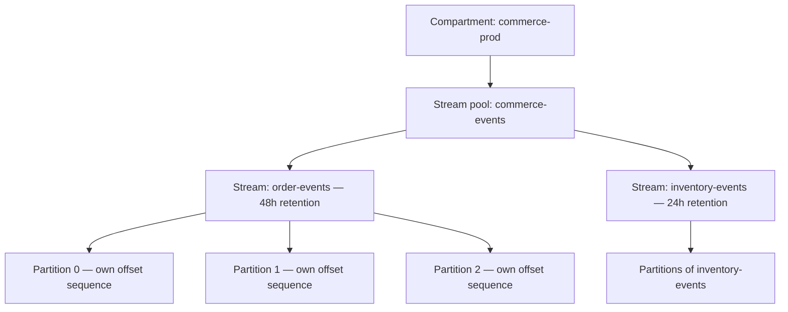

# Stream Pools, Streams, Partitions, and Retention

In the **Streaming and Queue** chapter of the **CLOUD_PROVIDERS_ORACLE** module, this lesson focuses on four foundational decisions when deploying OCI Streaming: which pool to group streams into, how to split data into separate streams, how many partitions to use, and how long to retain messages. Those decisions tie directly into compartments, IAM, VCNs, recoverability, and operational cost on Oracle Cloud Infrastructure.

The running example is an e-commerce system emitting order events. The payment, inventory update, and analytics services need to read events at their own pace; when a consumer stops operating, the operations team needs to know whether data will remain available long enough to catch up.

## 1. Learning Objectives

After this lesson, learners will be able to:

- Distinguish the roles and configuration scopes of stream pool, stream, partition, and retention.
- Choose a message key suited to ordering and load-distribution requirements.
- Estimate partition counts from write throughput, concurrency needs, and load skew.
- Choose retention based on outage duration, catch-up rate, and replay requirements.
- Create test resources, inspect live configuration, and observe partitioning behavior using the OCI CLI.
- Identify changes that require creating a new stream and prepare a data migration plan.

This lesson uses the resource model of **OCI Streaming** with the native Streaming API and stream pool Kafka compatibility. The limits cited below apply to this model; always verify the exact service in use before incorporating them into a design.

## 2. The Four Concepts and Their Relationships

OCI Streaming stores data as a partitioned, append-only log. A stream pool groups streams and manages shared settings. Offsets identify a message's position within each partition; retention determines the time window for which data is kept. See [OCI Streaming Overview](https://docs.oracle.com/en-us/iaas/Content/Streaming/Concepts/streamingoverview.htm).

| Concept | Role | Typical Decision |
| --- | --- | --- |
| Stream pool | Group of streams sharing Kafka and security configuration | Pool for testing or production; public or private endpoint |
| Stream | Event stream with its own identity and configuration | Separate order events from telemetry |
| Partition | Subset of a stream used for data distribution and parallel reading | Partition count; key selection to avoid load skew |
| Retention | Duration for which a stream retains messages | Retain 24, 48, or 72 hours per recovery needs |



The diagram shows a sample layout within a single compartment. It does not mean a stream pool replaces a compartment or that every stream in a pool must share the same retention. Compartments organize resource governance; pools handle grouping streams and sharing Streaming configurations.

For the e-commerce system, `order-events` and `inventory-events` can be placed in the same pool if they share connectivity, encryption, and governance requirements. However, each stream still needs to be sized for its own traffic and recovery window.

## 3. Stream Pool: Organizing Streams and Defining Shared Configuration

### 3.1. What Configuration Lives in a Pool?

A stream pool organizes streams, defines endpoints, and selects encryption keys. When using the Kafka API, the pool acts as the root of a virtual Kafka cluster; cluster-level operations are scoped to that pool. Stream names must be unique within a pool. See [Managing Stream Pools](https://docs.oracle.com/en-us/iaas/Content/Streaming/Tasks/managing-stream-pools.htm).

Sample layout:

| Proposed Pool | Sample Streams | Reason for Grouping |
| --- | --- | --- |
| `commerce-dev` | `order-events`, `inventory-events` | Development team integration testing |
| `commerce-prod` | `order-events`, `inventory-events` | Shared production operational procedures |
| `security-prod` | `access-events` | Separate key management and access control requirements |

You do not need a separate pool for every data table or application version. Start from real administrative boundaries: who operates it, what network path applications use to connect, and which datasets may share security policies.

### 3.2. Public Endpoint and Private Endpoint

A private endpoint is configured when creating the pool and requires a VCN and private subnet with appropriate DNS. You can attach network security groups according to your network design. A public endpoint still requires authentication and authorization on API calls. Configuration instructions are in [Creating a Stream Pool](https://docs.oracle.com/en-us/iaas/Content/Streaming/Tasks/creating-stream-pools.htm).

In a production design, the architecture team should document the path for producers and consumers:

1. Where does the application run: Compute, OKE, on-premises network, or another environment?
2. What IP address does the endpoint hostname resolve to from that location?
3. Do routing tables and network rules permit connections to the endpoint?
4. Does the application's identity have permissions for the required operations?

An application with valid IAM permissions can still fail to connect due to DNS or network rules. Conversely, a successful TCP connection does not prove the application has permission to write to or read from the stream.

### 3.3. Encryption and Blast Radius

Streaming data is encrypted in transit and at rest. You can use Oracle-managed keys or customer-managed keys via OCI Vault; the encryption choice is managed at the pool level. See [Stream Security](https://docs.oracle.com/en-us/iaas/Content/Streaming/Concepts/streamsecurity.htm).

If you choose a customer-managed key, key administration becomes an operational dependency for the associated streams. For example, changing key-usage permissions or disabling a key must be evaluated alongside all applications using the pool. This is a practical reason to separate datasets that have different administrators and change-management workflows.

### 3.4. Pool Defaults Do Not Modify Existing Streams

A pool can configure Kafka auto-topic creation, default partition count, and default retention for streams created via that mechanism. Updating those defaults does not replace designing each stream individually. See [Updating Stream Pools](https://docs.oracle.com/en-us/iaas/Content/Streaming/Tasks/updating-stream-pools.htm).

For example: setting the pool's default retention to 72 hours does not extend the data window of an existing `order-events` stream created with 24-hour retention. You must inspect the stream's own configuration to see the active values.

## 4. Stream: Data Boundary and Processing Window

### 4.1. Choosing Streams by Usage Needs

In the sample design, `order-events` might contain:

```json
{
  "eventId": "evt-000123",
  "eventType": "OrderPaid",
  "schemaVersion": 1,
  "orderId": "ORD-2048",
  "sequence": 2,
  "occurredAt": "2026-11-20T03:15:00Z",
  "amount": 1250000,
  "currency": "VND"
}
```

The intended message key is `ORD-2048`. The payload includes `eventId` to identify the event and `sequence` so the application can detect missing or out-of-order business events. This is a convention designed by the e-commerce system; the Streaming service does not infer business rules from JSON fields.

Consider splitting streams when datasets differ significantly in:

- Owners and authorized consumers.
- Retention, replay, or catch-up requirements.
- Traffic patterns, message sizes, and processing needs.
- Data contract change cadence.

For example, high-volume continuous telemetry that only needs short retention may belong in its own stream rather than being mixed into an order stream with stricter recovery requirements.

### 4.2. Reading a Message Does Not Make It Disappear

How far a consumer has read and how long data is retained are two separate states. Streaming allows replay during the retention period; successful processing does not automatically delete messages. Delivery semantics may deliver the same message to a consumer multiple times. See [Streaming Retention and Delivery Characteristics](https://docs.oracle.com/en-us/iaas/Content/Streaming/Concepts/streamingoverview.htm).

Therefore, a consumer writing results to a database should have a way to recognize already-processed events, such as storing `eventId` inside the same transaction that updates order state. During replay, the application can distinguish old events from new business actions.

Do not treat retention as a task-processing timeout. A slow consumer does not keep a message around indefinitely just because it has not finished processing.

## 5. Partition: Load Distribution, Ordering, and Parallelism

### 5.1. Keys Group Related Data Together

In the native Streaming API, the service maps the message key to a partition; messages with the same key go to the same partition. If you omit the key, the service generates a random key. This API does not directly accept a target partition to write to. See [Message Put Rules](https://docs.oracle.com/en-us/iaas/tools/oci-cli/latest/oci_cli_docs/cmdref/streaming/stream/message/put.html).

For the order stream:

| Message | Key | Relationship to Preserve |
| --- | --- | --- |
| `OrderCreated` for ORD-2048 | `ORD-2048` | Grouped with events for ORD-2048 |
| `OrderPaid` for ORD-2048 | `ORD-2048` | Same group as the order-creation event |
| `OrderCreated` for ORD-4096 | `ORD-4096` | Can be distributed independently |

Two different keys can still land in the same partition. Do not build applications assuming `ORD-2048` always maps to partition 0, and do not try to guess the hashing algorithm from a single example.

### 5.2. Ordering Only Matters Within the Right Scope

OCI guarantees ordering within a partition. When using a consumer group, each partition is read by one group member at a time; partition count therefore limits how many members can be assigned partitions concurrently. See [Partition and Consumer Group Design](https://docs.oracle.com/en-us/iaas/Content/Streaming/Concepts/partitioningastream.htm).

Suppose messages are written as follows:

```text
Partition 0:
  offset a -> OrderCreated(ORD-2048)
  offset b -> OrderPaid(ORD-2048)

Partition 1:
  offset x -> OrderCreated(ORD-4096)
  offset y -> OrderCancelled(ORD-4096)
```

The offset labels here merely illustrate positions within each partition. Do not directly compare an offset from partition 0 with an offset from partition 1.

If ordering per order is needed, `orderId` is a sensible key candidate. Using a random key per event can scatter a single order's event sequence across different partitions.

Even with the right key, the application still needs to ensure proper publishing and processing behavior:

- Two concurrent producers can emit business events in an unexpected order.
- A consumer dispatching messages into multiple asynchronous tasks can finish them out of read order.
- A timestamp in the payload represents application-supplied business time; it does not replace application-level ordering logic.

If business logic requires `OrderCreated` to be applied before `OrderPaid`, control publish ordering, check `sequence`, and define how to handle missing events.

### 5.3. Choosing Keys to Avoid Hot Partitions

A hot partition occurs when one partition receives excessive load while other partitions have spare capacity. Keys with too few distinct values or with one value accounting for most traffic often cause this problem.

| Candidate Key | Notes in the E-Commerce Example |
| --- | --- |
| `country` | Few distinct values; one major market can dominate traffic |
| `status` | Many orders in the same status can concentrate load |
| `orderId` | Good fit when per-order ordering is needed and many independent orders exist |
| `customerId` | Need to evaluate customers with spiky traffic |
| Random key per event | Distributes better under some traffic patterns but breaks per-order grouping |

For example, if one key produces 1.4 MB/s, adding more partitions will not split that single key's stream. You must reconsider the ordering unit or throttle the producer source.

You can intentionally use a key format like `merchantId:bucket` to split load for a large merchant. However, the system must then accept per-bucket ordering or perform a downstream merge step; this changes the data processing contract.

## 6. Estimating Partition Count Before Creating a Stream

### 6.1. Start from Write Throughput

According to limits documentation, each partition supports up to 1 MB/s write throughput and up to 5 GET requests per second per consumer group. A stream's partition count cannot be changed after creation. In addition to per-partition limits, tenancy resource limits and quotas apply. See [Streaming Limits](https://docs.oracle.com/en-us/iaas/Content/Streaming/Concepts/streamingoverview_topic-Limits_on_Streaming_Resources.htm).

Initial estimation model:

```text
W_peak = N_peak × S

P_write = ceil(W_peak / (L_write × u))

N_peak : peak messages per second
S      : average message size used for estimation
L_write: write limit of one partition
u      : target utilization ratio, less than 1
```

Suppose the development team measures the following inputs:

- 2,500 messages/second at peak.
- Average 2,000 bytes per message, including the associated key overhead in the estimate.
- Using decimal units in the calculation: 1 MB = 1,000,000 bytes.
- Design target is roughly 65% of nominal write capacity.

Then:

```text
W_peak  = 2,500 × 2,000
        = 5,000,000 bytes/second
        ≈ 5 MB/s

P_write = ceil(5 / (1 × 0.65))
        = 8 partitions
```

This is an estimate with headroom chosen by the designer, not a performance guarantee for every key distribution. You must measure actual sizes, burst traffic, and key skew; eight partitions will not help enough if traffic concentrates on one partition.

### 6.2. Cross-Check Against Consumer Processing Rate

Suppose each consumer instance in the sample system processes 400 events/second at steady state, including database write time. To handle 2,500 events/second:

```text
Required instances by processing capacity = ceil(2,500 / 400) = 7
```

With eight partitions, the consumer group can deploy enough members to utilize that concurrency. If you only create two partitions and scale to seven instances, partition assignment within a single consumer group will not create seven active reading threads.

Conversely, if consumers are bottlenecked by database lock contention, adding partitions may not improve throughput. You must distinguish bottlenecks in Streaming, application CPU, network latency, and downstream resources.

### 6.3. Check Read Patterns Too

Request count and byte volume are two different quantities. A consumer calling GET repeatedly with tiny batches can hit request limits even when receiving very little data.

Design batch reading and measure:

- Amount of data received per read call.
- Number of read calls per partition or assigned share.
- Batch processing time before the next poll.
- Additional read traffic from replays and independent consumer groups.

Each business group reading the full stream increases total system read volume. Partition sizing should therefore tie into the full data consumption map rather than counting producers alone.

## 7. Retention: Time Budget for Recovery and Replay

### 7.1. Limits and Meaning

When creating a stream, retention accepts values from **24 to 168 hours**, with a default of **24 hours**. Stream retention cannot be modified after creation; messages past their retention period are deleted even if unread. See [Stream Creation Parameters](https://docs.oracle.com/en-us/iaas/Content/Streaming/Tasks/creatingstreamsandstreampools_create-stream.htm) and [Retention Limits](https://docs.oracle.com/en-us/iaas/Content/Streaming/Concepts/streamingoverview_topic-Limits_on_Streaming_Resources.htm).

For example, with 48-hour retention, a consumer processing a message 5 minutes later does not cause it to disappear immediately. Conversely, a consumer down for too long may no longer be able to read back the segment of data it missed.

The `occurredAt` field in the payload is application-supplied data. Do not try to manipulate this field as a way to alter the service's retention window.

### 7.2. Calculating Catch-Up Time

A conservative design model budgets retention to cover the entire outage duration, catch-up duration, and a safety margin:

```text
T_budget = T_outage + T_catchup + T_margin
```

Suppose a consumer group has stable rates:

```text
Incoming event rate λ = 1,200 events/second
Post-recovery processing rate μ = 2,000 events/second
Outage duration = 12 hours
Chosen safety margin = 6 hours

Backlog = 1,200 × 12 × 3,600
        = 51,840,000 events

Backlog drain rate = μ - λ
                   = 800 events/second

T_catchup = 51,840,000 / 800
          = 64,800 seconds
          = 18 hours

T_budget = 12 + 18 + 6
         = 36 hours
```

Under these assumptions, the team could select 48-hour retention for the initial design.

This calculation is an overall budget with margin, not a formula describing the exact expiration time of individual messages. Data continues aging during recovery; you must monitor the age of the unprocessed tail and advance rate per partition.

If `μ <= λ`, the backlog never shrinks under the steady-rate model. Extending retention only buys extra time before data expires; you must speed up processing or reduce input rate for the consumer to catch up.

### 7.3. Distinguish Retaining Data from Saving Checkpoints

A checkpoint or committed offset identifies where to read next. Retention determines whether the data at that position still exists.

In operations, separate three situations:

| Situation | Action |
| --- | --- |
| Data still present, checkpoint valid | Resume from recorded position |
| Data still present, need to re-run business logic | Choose replay position and handle duplicates |
| Required data has expired past retention | Recover from another storage source or original source of truth |

Never automatically reset a consumer to the latest position without assessing the consequences of skipping data. For payment or inventory-deduction events, that gap can corrupt business state.

### 7.4. When Retention Needs to Exceed the Streaming Window

If you need 30 days or a year of history, design an additional long-term storage pipeline, such as shipping events to Object Storage with a reload workflow. OCI supports using Connector Hub with Streaming and Object Storage; see [Integration Overview](https://docs.oracle.com/en-us/iaas/Content/Streaming/Concepts/streamingoverview.htm).

In this approach, you must decide on storage format, time partitioning, missing-data checks, and duplicate detection during reload. Simply having a bucket storing data does not prove you can accurately restore application state.

## 8. IAM and Stream-Scoped Operations

Managing resources and writing/reading data require different permissions. In Streaming IAM, `stream-push` grants permission to publish messages, `stream-pull` grants permission to consume, and `read streams` reads resource metadata. See [Streaming IAM Reference](https://docs.oracle.com/en-us/iaas/Content/Identity/Reference/streamingpolicyreference.htm).

Example policies for a lab environment, assuming the groups exist and `StreamingLab` is the compartment name:

```text
Allow group StreamingLabAdmins to manage stream-family in compartment StreamingLab

Allow group OrderProducers to read streams in compartment StreamingLab
Allow group OrderProducers to use stream-push in compartment StreamingLab

Allow group OrderConsumers to read streams in compartment StreamingLab
Allow group OrderConsumers to use stream-pull in compartment StreamingLab
```

The example above grants data permissions at the lab compartment scope. When multiple streams have different audiences, design narrower policies following real IAM practices. For applications on Compute or OKE, design appropriate workload identities instead of operator credentials.

For private pools or customer-managed keys, add network or Vault permissions as required by the deployment design. Granting Streaming permissions alone does not satisfy the full dependency chain.

## 9. Hands-On Lab: Creating a Pool, Stream, and Observing Partitions

The commands below are **Bash**, suitable for running step-by-step in OCI Cloud Shell or an equivalent environment. You need an authenticated OCI CLI, `jq`, `base64`, a test compartment, and permissions to create, read, and write resources. The example uses the default public endpoint and Oracle-managed keys; resources may incur charges when used.

This is a guide for learners to run in their own tenancy, not the output of a pre-provisioned deployment.

### 9.1. Create a Stream Pool

Replace the OCID and region with values from your lab environment:

```bash
set -euo pipefail

export OCI_CLI_REGION="ap-singapore-1"
COMPARTMENT_ID="ocid1.compartment.oc1..REPLACE_ME"

POOL_ID="$(oci streaming admin stream-pool create --compartment-id "$COMPARTMENT_ID" --name "commerce-lab-pool" --query 'data.id' --raw-output)"

oci streaming admin stream-pool get --stream-pool-id "$POOL_ID"
```

The create command may return while the resource is still provisioning. Re-run the GET command until `data.lifecycle-state` is `ACTIVE`; if it enters a failed state, inspect the details and resolve before continuing. See [CLI Stream Pool Create](https://docs.oracle.com/en-us/iaas/tools/oci-cli/latest/oci_cli_docs/cmdref/streaming/admin/stream-pool/create.html).

### 9.2. Create a Stream with Three Partitions and 48-Hour Retention

```bash
STREAM_ID="$(oci streaming admin stream create --stream-pool-id "$POOL_ID" --name "order-events-lab" --partitions 3 --retention-in-hours 48 --query 'data.id' --raw-output)"

oci streaming admin stream get --stream-id "$STREAM_ID"
```

When `--stream-pool-id` is passed, do not also pass `--compartment-id` in the same stream create command. See [CLI Stream Create](https://docs.oracle.com/en-us/iaas/tools/oci-cli/latest/oci_cli_docs/cmdref/streaming/admin/stream/create.html).

Proceed only after the stream is `ACTIVE`. In the GET output, verify:

| Field | Value to Verify |
| --- | --- |
| `id` | Matches the newly created stream |
| `stream-pool-id` | Matches `POOL_ID` |
| `partitions` | `3` |
| `retention-in-hours` | `48` |
| `messages-endpoint` | Endpoint used for data operations |
| `lifecycle-state` | `ACTIVE` |

Capture the endpoint from the live resource:

```bash
MESSAGES_ENDPOINT="$(oci streaming admin stream get --stream-id "$STREAM_ID" --query 'data."messages-endpoint"' --raw-output)"
```

Do not construct the endpoint URL manually from the pool name or copy an endpoint from an example in another region.

### 9.3. Send Two Events with the Same Key

The native API uses Base64 for keys and values. The two sequential writes below use the same key `ORD-2048`:

```bash
KEY_B64="$(printf '%s' 'ORD-2048' | base64 | tr -d '\r\n')"

for SEQ in 1 2; do
  VALUE_B64="$(printf '{"eventId":"lab-%s","orderId":"ORD-2048","sequence":%s}' "$SEQ" "$SEQ" | base64 | tr -d '\r\n')"
  MESSAGES_JSON="$(jq -nc --arg key "$KEY_B64" --arg value "$VALUE_B64" '[{key:$key,value:$value}]')"

  PUT_RESULT="$(oci streaming stream message put --endpoint "$MESSAGES_ENDPOINT" --stream-id "$STREAM_ID" --messages "$MESSAGES_JSON")"
  printf '%s\n' "$PUT_RESULT"
  printf '%s\n' "$PUT_RESULT" | jq -e '.data.failures == 0' >/dev/null
done
```

Expected observation: both messages are written successfully and share the same partition in the returned entries. Do not assume in advance that this partition must be `0`. See [CLI Message Put Reference](https://docs.oracle.com/en-us/iaas/tools/oci-cli/latest/oci_cli_docs/cmdref/streaming/stream/message/put.html).

Checking `failures` matters: a successful HTTP response can still contain per-message failures. If a write fails, inspect the corresponding entry before deciding to retry; see [Troubleshooting Errors and Throttling](https://docs.oracle.com/en-us/iaas/Content/Streaming/Reference/troubleshootingstreaming.htm).

### 9.4. Read from the Start of Each Partition's Retention Window

```bash
for PARTITION in 0 1 2; do
  CURSOR="$(oci streaming stream cursor create-cursor --endpoint "$MESSAGES_ENDPOINT" --stream-id "$STREAM_ID" --partition "$PARTITION" --type TRIM_HORIZON --query 'data.value' --raw-output)"

  printf 'Partition %s\n' "$PARTITION"
  oci streaming stream message get --endpoint "$MESSAGES_ENDPOINT" --stream-id "$STREAM_ID" --cursor "$CURSOR" --limit 100
done
```

`TRIM_HORIZON` starts from the oldest message still within the partition's retention. `LATEST` reads data appended after cursor creation, so it is unsuitable when looking for the two messages sent beforehand. Cursors have their own expiration and are not equivalent to retention. See [CLI Cursor Create](https://docs.oracle.com/en-us/iaas/tools/oci-cli/latest/oci_cli_docs/cmdref/streaming/stream/cursor/create-cursor.html).

The command above reads only a single batch per partition for observation. A full consumer must use the next cursor from the response to continue reading, handle errors, and manage progress. See [CLI Message Get](https://docs.oracle.com/en-us/iaas/tools/oci-cli/latest/oci_cli_docs/cmdref/streaming/stream/message/get.html).

In the output, values remain Base64-encoded; you can decode any individual value you want to inspect:

```bash
printf '%s' 'REPLACE_WITH_BASE64_VALUE' | base64 --decode
```

### 9.5. Verify Observations and Clean Up Resources

Learners should confirm that:

- Both events with the same key landed in the same partition.
- Reading again from the start of the window still returns the data even though it was read previously.
- Retention remains 48 hours when inspecting the stream configuration.
- Partitions with no messages may return an empty data list.

After completing the lab, delete the test stream, wait for deletion to finish, and then delete the pool if no resources need to be kept:

```bash
oci streaming admin stream delete --stream-id "$STREAM_ID"
```

The command prompts for confirmation by default. After confirming the stream is deleted, run:

```bash
oci streaming admin stream-pool delete --stream-pool-id "$POOL_ID"
```

Double-check the OCIDs and lab scope before confirming. These cleanup commands apply only to the resources created during this exercise.

## 10. Monitoring and Cost Control

### 10.1. Track Service Signals and Business Progress

The Streaming metric namespace is `oci_streaming`. Useful metrics include `PutMessagesThroughput.Bytes`, `PutMessagesThrottling.Count`, `GetMessagesThroughput.Bytes`, and `GetMessagesThrottling.Count`; you can filter by stream OCID. See [Metrics Reference](https://docs.oracle.com/en-us/iaas/Content/Streaming/Reference/metric-ref.htm).

| Signal | What to Check in the Sample Design |
| --- | --- |
| Write throttling | Traffic spike, bursts, or skewed key distribution |
| Read throttling | Polling cadence, batch size, and number of reader threads |
| Writes succeed but backlog grows | Consumers processing slower than input rate |
| One order group consistently lags | Hot key or bottleneck in business processing |
| Age of unprocessed data nears retention | Risk of losing the recovery window |

In addition to service metrics, the application should track the age of the oldest unprocessed message and the catch-up rate. If you use `occurredAt` to measure business latency, distinguish it from message ingestion time to avoid false alarms caused by late-arriving events.

Alert thresholds should derive from the operations team's response time. With a 48-hour retention stream, an alert firing when unprocessed data is already close to 48 hours may not leave enough time to remediate.

### 10.2. How Retention Affects Stored Data Volume

Streaming bills for PUT/GET data transfer and storage capacity in GB-hours. See [Streaming Pricing FAQ](https://www.oracle.com/cloud/streaming/faq/). For workloads exceeding default limits, also check minimum-usage billing terms in the [Oracle Cloud Price List](https://www.oracle.com/cloud/price-list/).

Illustrative estimate for the sample system, ignoring variance and overhead:

```text
Average incoming throughput = 0.5 MB/s
Retention                   = 48 hours

Steady-state window size ≈ 0.5 × 48 × 3,600
                         = 86,400 MB
                         ≈ 86.4 GB
```

Keeping data for 168 hours at the same input rate increases the stored window size in this model by about 3.5x. This is a capacity estimate, not a bill.

Besides retention, the number of groups reading the full stream and the frequency of replays increase GET volume. When budgeting, separate steady-state ingestion, business reads, expected replays, and long-term storage; then reconcile Cost Analysis with actual usage metrics.

## 11. Redesigning When Partition Count or Retention No Longer Fits

OCI supports moving a stream to another pool or updating tags. Those operations do not turn partition count and retention into mutable attributes. See [Updating Streams](https://docs.oracle.com/en-us/iaas/Content/Streaming/Tasks/updating-streams.htm).

If `order-events-v1` has three partitions and 24-hour retention, but new requirements call for eight partitions and 48 hours, plan to create `order-events-v2`.

A suggested cutover workflow for the sample application:

1. Create the new stream and verify endpoint, permissions, partitions, and retention.
2. Define a cutover point using an event identifier or business checkpoint.
3. Design how still-needed data gets to the new stream; if dual-publishing, use durable tracking to monitor failures per destination.
4. Prepare consumers to handle duplicate events and support the current schema.
5. Reconcile data and business outcomes before completing the switch.
6. Stop old writers, drain remaining data, and only then delete the old stream.

Do not copy old offsets and assume they carry the same meaning in the new stream. The two streams have different histories and partition layouts; use proper data identifiers and cutover markers.

A migration also needs a rollback plan if errors surface. If the old stream is still within retention and producers can re-emit according to the defined plan, recovery can be easier than deleting the old stream as soon as the new app starts running.

## 12. Availability and Common Design Mistakes

Oracle manages the infrastructure and replicates Streaming data across availability domains in multi-AD regions, or across fault domains in single-AD regions. This does not replace application-level or cross-region recovery planning. See [Streaming Durability and Availability](https://docs.oracle.com/en-us/iaas/Content/Streaming/Concepts/streamingoverview.htm).

The application team must still protect its own components: producers, consumers, credentials, network connectivity, and destination stores. A healthy stream does not guarantee consumers processed business logic correctly.

| Misconception | Real-World Consequence | Proper Design Approach |
| --- | --- | --- |
| Adding a pool speeds up an existing stream | Does not bypass per-partition limits | Measure load, keys, and stream configuration |
| Adding consumers always increases speed | Extra instances sit idle without partitions | Align partitions and processing bottlenecks |
| Multiple partitions give global stream order | Errors when merging events across partitions | Define ordering scope by business entity |
| Reading a message removes it | Misjudging replay capability | Separate read progress from retention |
| Longer retention always fixes slow consumers | Backlog still grows if processing lags input | Measure actual input and processing rates |
| Updating pool defaults updates old streams | Live stream settings remain unsuitable | Inspect streams directly and plan replacements |
| Data is replicated so monitoring isn't needed | Missed application bugs or expired data | Monitor both service metrics and business progress |

When taking a design to deployment, the team's specification should explicitly document: pool and network path, purpose of each stream, key, partition count, load assumptions, retention, and expected recovery window. Resource creation commands or infrastructure-as-code configs should declare these values explicitly so new environments do not accidentally inherit defaults that differ from the design.
