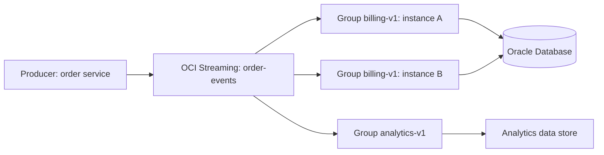

# Producers, Consumer Groups, and Offset Management

## 1. Objectives and Scope

In the **Streaming and Queue** chapter of Oracle Cloud Infrastructure (OCI), producers, consumer groups, and offsets form the mechanism for ingesting events, distributing processing work, and resuming work after failures. This lesson focuses on **OCI Streaming with the native OCI API**; the final section highlights differences to note when using the Kafka compatibility layer.

After this lesson, you will be able to:

- Choose a message key to balance load and preserve required business ordering.
- Distinguish multiple consumers within the same group from multiple independent groups.
- Design read, process, and commit loops that safely tolerate message reprocessing.
- Recover a consumer without accidentally skipping events or producing duplicate side effects.
- Combine IAM, endpoints, monitoring, and resource limits when deploying producers and consumers on OCI.

The running example is an e-commerce application: the order service publishes events to the `order-events` stream; the invoicing service and analytics service read the same stream at their own pace. The invoicing consumer can run on OCI Compute or OKE and persist results to Oracle Database/Autonomous Database.

Prerequisite knowledge includes tenancy, compartment, IAM policy, stream, partition, and database transaction concepts. You do not need a Kafka cluster to practice the native Streaming API.

## 2. Stream, Partition, and Read-Progress Model

OCI Streaming stores messages in an append-only log divided into partitions. Ordering is guaranteed within each partition; already-read messages remain available during the retention period to support replay. Committing read progress is not a message deletion operation. [Source: Overview of Streaming](https://docs.oracle.com/en-us/iaas/Content/Streaming/Concepts/streamingoverview.htm).

| Component | Role | Example in the Order Application |
| --- | --- | --- |
| Producer | Sends events into the stream | Order service publishes `OrderConfirmed` |
| Key | Groups events that require consistent routing | `order-1001` |
| Partition | Ordered storage scope and unit of read parallelism | Partition `0`, `1`, `2` |
| Consumer instance | A member reading and processing data | `billing-pod-a` |
| Consumer group | Set of consumers sharing work for one purpose | `billing-v1` |
| Offset | Position of a message within a partition | Offset `104` in partition `1` |
| Cursor | Service-issued token to continue reading or act on a group | Value returned from `CreateGroupCursor` |



The two instances of `billing-v1` share partitions between themselves. `analytics-v1` reads independently and does not alter `billing-v1`'s checkpoint. In the diagram, edges from the stream to consumers represent data delivery capability; they do not mean every message is delivered to every instance in the same group.

## 3. Producer Design

### 3.1. Event Contract and Stable Identity

A useful payload needs to indicate what event occurred, which entity it belongs to, and how it can be recognized again on retry. The following example is an application-designed contract, not a mandatory OCI schema:

```json
{
  "eventId": "evt-order-1001-confirmed-v3",
  "eventType": "OrderConfirmed",
  "schemaVersion": 1,
  "aggregateId": "order-1001",
  "aggregateVersion": 3,
  "occurredAt": "2026-11-20T03:10:00Z",
  "traceId": "trace-7f21",
  "payload": {
    "orderId": "order-1001",
    "amount": 1250000,
    "currency": "VND"
  }
}
```

- `eventId` identifies the **business event**. When resending that exact event, the producer preserves the same ID.
- `aggregateId` identifies the related order and can serve as the message key.
- `aggregateVersion` helps detect stale events, missing versions, or events arriving outside business expectations.
- `schemaVersion` helps consumers decode the payload as the data structure evolves.
- `occurredAt` supports measuring business latency; account for clock skew across hosts.

Offsets are assigned after a message is written, so they cannot replace `eventId`. Publishing the same event twice can produce two records with different offsets.

### 3.2. Choosing Keys by Ordering and Load-Distribution Needs

With the native `PutMessages` API, OCI determines the partition from the key on the service side. Messages with the same key go to the same partition; empty keys are routed randomly. This API does not let the producer specify a target partition directly. [Source: Publishing Messages](https://docs.oracle.com/en-us/iaas/Content/Streaming/Tasks/publishing.htm).

| Key Choice | Design Impact | When Appropriate |
| --- | --- | --- |
| `orderId` | Groups the change sequence of one order | Confirming, paying, canceling the same order |
| `customerId` | Groups activity by customer | Business logic requires sequential processing per customer |
| A single constant | Concentrates all load onto one partition | Only when intentionally accepting this limitation |
| Random value or empty key | Spreads events without keeping per-entity affinity | Independent events with no per-order ordering needed |

A good key both reflects the required ordering scope and avoids concentrating too much load on a few values. Multiple different keys can still map to the same partition, so key count is not partition count. [Source: Partitioning a Stream](https://docs.oracle.com/en-us/iaas/Content/Streaming/Concepts/partitioningastream.htm).

Suppose one customer generates 60% of total events. If you pick `customerId`, adding consumers may not resolve the hot partition. Switching to `orderId` is only valid if business rules allow dropping customer-wide ordering.

The same key also does not solve every ordering problem. When two concurrent producers emit versions `3` and `4`, the order they reach the service may differ from the intended business order. Producers must coordinate emission or consumers must validate versions; consumers must also preserve sequential execution when applying changes to the same entity.

### 3.3. Handling Batches and Per-Message Failures

`PutMessages` can partially succeed. An HTTP `200` is not enough to conclude every entry was written; the producer must inspect each entry's result. When the entire request is throttled, the service can return `429`. [Source: Troubleshooting Streaming](https://docs.oracle.com/en-us/iaas/Content/Streaming/Reference/troubleshootingstreaming.htm).

Example of a producer sending three events:

| Entry | Assumed Result | Application Action |
| --- | --- | --- |
| A | Partition and offset returned | Mark as successfully sent |
| B | Transient failure due to overload | Retry B alone with the same `eventId` |
| C | Partition and offset returned | Do not resend merely because B failed |

Design-level producer algorithm:

```text
pending = unacknowledged events
while pending is not empty and retry budget not exceeded:
    result = PutMessages(pending)
    match each result with its corresponding input entry
    persist status of succeeded entries
    retain entries with retryable errors
    route data/permission errors to an appropriate handling flow
    wait exponential backoff with jitter before next send
```

If the connection drops after the service wrote the record but before the producer received the response, the publish outcome is unknown. Resending is typically necessary to avoid losing events, but it can create duplicates. Therefore, keeping `eventId` stable and deduplicating on the consumer side remain necessary even when retrying only failed entries.

### 3.4. Avoiding Gaps Between Database Updates and Publishing

An application can commit an order to the database and then crash before publishing. Reversing the order can also publish an event while the order transaction fails to commit. This is a two-system coordination problem that cannot be solved by HTTP retries alone.

One design option is the **transactional outbox**:

1. Within the same Oracle Database transaction, update the order and insert an outbox row containing `eventId`, key, and payload.
2. A publisher reads the outbox and sends messages to OCI Streaming.
3. Upon receiving successful per-entry results, the publisher marks the corresponding entries as sent.
4. Consumers deduplicate because the publisher can fail after publishing but before marking the outbox.

Outbox is the application design pattern recommended for this example. It does not turn a database transaction and Streaming publish into an automatic distributed transaction.

## 4. Consumer Groups: Sharing Work and Separating Processing Purposes

### 4.1. Same Group to Share Load, Different Groups to Read Independently

Within a group, each partition is assigned to one instance at a time. One instance can receive multiple partitions; if the instance count exceeds the partition count, some instances receive no data. The service automatically rebalances when membership changes. [Source: Using Consumer Groups](https://docs.oracle.com/en-us/iaas/Content/Streaming/Tasks/using_consumer_groups.htm).

For a stream with four partitions, the following layouts illustrate achievable parallelism; exact assignment is decided by the service:

| Group | Instance Count | Illustrative Assignment |
| --- | --- | --- |
| `billing-v1` | 1 | One instance processes all four partitions |
| `billing-v1` | 2 | Each instance processes roughly two partitions |
| `billing-v1` | 4 | Each instance processes roughly one partition |
| `billing-v1` | 6 | At most four instances get partitions, two sit idle |
| `analytics-v1` | 2 | Has its own independent assignment over the same four partitions |

Do not create a new group per replica of the same invoicing service. Doing so turns each replica into an independent stream reader and can bill the same event multiple times. Conversely, if the analytics service shares a group with the invoicing service, they split messages between each other, preventing either workload from receiving the full stream it needs.

### 4.2. Group Name and Instance Name

`CreateGroupCursor` specifies the pair of group name and instance name. Use a stable group name for a processing purpose, while instance names must be unique across concurrently running members. Group start modes are `TRIM_HORIZON`, `AT_TIME`, and `LATEST`; this type only takes effect when creating a new group. For an existing group, the committed progress is used. [Source: create-group-cursor CLI Reference](https://docs.oracle.com/en-us/iaas/tools/oci-cli/latest/oci_cli_docs/cmdref/streaming/stream/cursor/create-group-cursor.html).

Naming suggestion for the example:

```text
groupName    = billing-v1
instanceName = billing-<pod-uid-or-process-uuid>
```

Keep `billing-v1` across restarts or new application deployments when the goal is to continue the same progress. Create `billing-replay-20261120` when a separate replay stream is needed. Do not share the same instance name across multiple concurrent processes.

| Start Type | Meaning for a New Group | Choice in the Example |
| --- | --- | --- |
| `TRIM_HORIZON` | Read from the oldest retained data | Rebuild state from available history |
| `AT_TIME` | Start at a requested timestamp | Re-read a specific incident window |
| `LATEST` | Wait for data published after cursor creation | Follow only new events |

Do not restart a consumer with a random group name and `LATEST` to work around cursor errors. That changes processing progress rather than recovering it.

## 5. Offsets, Cursors, and Checkpoints

### 5.1. Offsets Are Scoped Per Partition

A read position must be tied to both a stream and a partition. Offset `104` in partition `0` does not represent the same message as offset `104` in partition `1`.

A group's checkpoint should be thought of as a collection of progress markers:

```text
billing-v1:
    partition 0 -> own committed position
    partition 1 -> own committed position
    partition 2 -> own committed position
```

Offsets increase monotonically but may not be contiguous; for example, two consecutive records can have offsets `42` and `45`. A gap does not by itself prove message loss. When managing progress manually with an individual consumer, the application stores processed offsets per partition and can use `AFTER_OFFSET` to resume. [Source: Using Individual Consumers](https://docs.oracle.com/en-us/iaas/Content/Streaming/Tasks/using_a_single_consumer.htm).

Do not add `+1` to an offset to fabricate the next read position. Likewise, do not treat the difference between two offsets as an exact message count.

### 5.2. A Cursor Is a Continuation Token

The API workflow is to create a cursor, use it to call `GetMessages`, and then use `opc-next-cursor` from the response for the next step. Treat this token as an opaque value: do not parse its internals, modify it, or synthesize it from offsets. [Source: Getting Messages](https://docs.oracle.com/en-us/iaas/Content/Streaming/Tasks/get-message.htm).

Cursors and checkpoints serve two distinct roles:

- A cursor lets a read session issue the next request.
- A committed checkpoint lets the group recover progress when a member fails.

Saving a cursor in a local variable or logging an offset is not a commit. Similarly, reading a message does not mean business changes have been durably saved.

## 6. Commit Timing Determines Failure Behavior

### 6.1. `commitOnGet=true`: Reading Next Commits the Previous Batch

With OCI's group API, `commitOnGet=true` is the default: the subsequent `GetMessages` request commits progress for the previous batch. If the consumer stops before that request, the uncommitted batch can be redelivered. [Source: Offsets and Commits](https://docs.oracle.com/en-us/iaas/Content/Streaming/Tasks/using_consumer_groups.htm).

The offset numbers below are illustrative and do not imply offsets are always contiguous:

```text
GetMessages(C0) -> batch A: 100, 103, 104; returns C1
process A and wait for database transactions to complete
GetMessages(C1) -> commits progress of A, returns batch B and C2
process B
...
```

A common mistake is handing batch A off to a thread pool and immediately calling `GetMessages(C1)`. Progress for A can then be committed while tasks are still running. If the process crashes, the group may resume past unfinished work.

With this mechanism, a sequential read loop must wait for all work in the batch to succeed before reading next. If you choose asynchronous processing, you need proper completion tracking and commit management; simply queuing a future is not enough.

### 6.2. `commitOnGet=false`: Manual Commit After Processing

When `commitOnGet` is disabled, the application calls `ConsumerCommit` to confirm progress associated with the cursor. The API returns an updated cursor to continue. This API does not accept an arbitrary offset calculated by the application. [Source: Manually Committing an Offset](https://docs.oracle.com/en-us/iaas/Content/Streaming/Tasks/commit-consumer-group.htm).

Design cycle:

```text
C0 = CreateGroupCursor(commitOnGet=false)
R  = GetMessages(C0)
C1 = R.opc-next-cursor

wait for successful processing of all R.messages
C2 = ConsumerCommit(C1).cursor

GetMessages(C2)
```

If a batch contains multiple messages, do not commit a cursor representing the entire batch while any message remains unprocessed. To shrink the rework blast radius, you can reduce batch size; in return, request volume may increase.

### 6.3. Failure Windows

Suppose a consumer receives A, B, and C and writes results to the database:

| Failure Timing | Business State | Expected Behavior |
| --- | --- | --- |
| Before processing A | Unchanged | Batch may be read again |
| After writing A, before B | A has taken effect | Re-read may encounter A again |
| After writing full batch, before Streaming commit | Database is complete | Full batch may be read again |
| After Streaming commit, before client receives response | Commit outcome unknown to client | Recover group and rely on deduplication |
| Streaming commit before database write | Progress may jump ahead of actual work | Risk of skipping business processing |

This analysis leads to the example's core principle: **durably persist processing results first, commit progress afterward, and make re-reading safe**. A failure window still exists between the database and Streaming; changing operation order does not automatically create exactly-once processing across two systems.

## 7. Idempotency and Parallel Processing

### 7.1. Deduplication Using an Inbox Table in Oracle Database

For invoicing logic, you can store processed event identities within the same transaction that creates the invoice. The following schema illustrates the inbox table:

```sql
CREATE TABLE processed_stream_event (
    consumer_name VARCHAR2(100) NOT NULL,
    event_id      VARCHAR2(200) NOT NULL,
    processed_at  TIMESTAMP DEFAULT SYSTIMESTAMP NOT NULL,
    CONSTRAINT pk_processed_stream_event
        PRIMARY KEY (consumer_name, event_id)
);
```

Recommended application algorithm:

```text
BEGIN DATABASE TRANSACTION
    INSERT processed marker (billing-v1, eventId)
    if duplicate hits the exact primary key of the processed marker:
        exit processing branch as a previously completed event
    if not present:
        update order / create invoice
COMMIT DATABASE TRANSACTION

once every message in the batch has completed or been recognized as duplicate:
    commit OCI Streaming progress
```

The processed marker and business changes must commit together. If you insert and commit the marker separately and invoice creation later fails, a re-read will see the marker and may skip the unfinished work. When the business transaction fails, the marker for that attempt must roll back too.

The composite key includes `consumer_name` and `event_id` so two independent workloads can process the same event. When implementing duplicate error handling, treat only a violation of the exact inbox constraint as an already-processed signal; do not swallow every unique-constraint error in the entire transaction.

This example protects changes inside the same database transaction. If you also call a payment gateway or send email, you need idempotency on the receiver side or an outbox for external actions. You should also define a retention period for deduplication markers long enough to cover expected retries and replays.

### 7.2. Do Not Commit Past Incomplete Work

Suppose three messages in the same partition have offsets `80`, `84`, and `89`, dispatched to three workers:

| Offset | Status |
| --- | --- |
| 80 | Completed |
| 84 | Waiting on database |
| 89 | Completed |

Picking `89` as the completion mark simply because it is the highest number would mask the unfinished work at `84`. The proper condition is that every received message up to the commit point has reached a completed state per your processing policy.

With the batch commit example in this lesson, wait for the whole batch. To increase parallelism, prefer adding consumers in the same group to split partitions before adding worker pools inside each consumer. Per-partition or per-key processing must preserve business ordering and use bounded queues to prevent unbounded memory growth.

## 8. Timeouts, Heartbeats, and Rebalances

Distinguish cursor lifetime from member inactivity timeout. A cursor expires after roughly five minutes if not used to continue reading; the default member timeout is 30 seconds and can trigger partition reassignment if the consumer fails to interact in time. These are two different recovery scenarios. [Source: OCI Streaming FAQ](https://www.oracle.com/cloud/streaming/faq/).

### 8.1. Batch Size Must Fit Processing Speed

If one message averages 200 ms and a batch has 300 messages processed sequentially, simple compute time alone is roughly 60 seconds, excluding I/O and load variance. Such a batch must be redesigned before relying on default timeouts.

Application-level options:

- Lower `limit` so each batch finishes with clear headroom.
- Optimize database transactions and bound concurrent connections.
- Add heartbeats if legitimate work takes a long time to process.
- Cap in-place retries so a single event does not stall the consumer indefinitely.

`ConsumerHeartbeat` keeps a member active; you must use the returned cursor in the proper response chain. Heartbeating does not mean business work succeeded and does not replace committing. If using a dedicated heartbeat thread, coordinate cursor ownership with the read/commit loop. [Source: Sending a Heartbeat](https://docs.oracle.com/en-us/iaas/Content/Streaming/Tasks/send-heartbeat-consumer-group.htm).

### 8.2. Losing Partition Reservation

If a consumer takes too long, partitions can be reassigned. The `Trying to commit unreserved partition` error is a signal to inspect timeouts and rebalances. The old consumer must not keep forcing commits on an invalidated cursor. [Source: Troubleshooting Streaming](https://docs.oracle.com/en-us/iaas/Content/Streaming/Reference/troubleshootingstreaming.htm).

Recommended recovery workflow for the application:

1. Stop reading further and assess in-flight tasks on the old instance.
2. Do not treat a commit error as proof that the database rolled back.
3. Recreate the group cursor with the **same group name** to resume from the group's progress.
4. Allow uncommitted events to be reprocessed through the inbox mechanism.
5. Tune batch size, heartbeats, or processing time to prevent recurrence.

During graceful shutdown, stop fetching new work, finish the current batch within the allowed time budget, commit completed progress, and close the client. If an emergency stop is required, prioritize preserving reprocessability over marking unfinished work as done.

## 9. Java Example: Processing a Batch Then Committing

The following snippet illustrates the happy path using the **OCI Java SDK** and the `oci-java-sdk-streaming` module. The application invokes methods with a `StreamClient` configured with an authentication provider and the **stream's messages endpoint**, not the resource administration endpoint. SDK initialization is documented in the [Java Streaming Quickstart](https://docs.oracle.com/en-us/iaas/Content/Streaming/Tasks/streaming-quickstart-oci-sdk-for-java.htm).

```java
import java.util.UUID;
import java.util.function.Consumer;

import com.oracle.bmc.streaming.StreamClient;
import com.oracle.bmc.streaming.model.CreateGroupCursorDetails;
import com.oracle.bmc.streaming.model.Message;
import com.oracle.bmc.streaming.requests.ConsumerCommitRequest;
import com.oracle.bmc.streaming.requests.CreateGroupCursorRequest;
import com.oracle.bmc.streaming.requests.GetMessagesRequest;
import com.oracle.bmc.streaming.responses.GetMessagesResponse;

public final class GroupConsumerExample {
    private GroupConsumerExample() {}

    public static void consumeBatches(
            StreamClient client,
            String streamId,
            String groupName,
            int maxPolls,
            Consumer<Message> durableHandler) throws InterruptedException {

        String cursor = client.createGroupCursor(
                CreateGroupCursorRequest.builder()
                        .streamId(streamId)
                        .createGroupCursorDetails(
                                CreateGroupCursorDetails.builder()
                                        .groupName(groupName)
                                        .instanceName("billing-" + UUID.randomUUID())
                                        .type(CreateGroupCursorDetails.Type.TrimHorizon)
                                        .commitOnGet(false)
                                        .build())
                        .build())
                .getCursor().getValue();

        for (int poll = 0; poll < maxPolls; poll++) {
            GetMessagesResponse response = client.getMessages(
                    GetMessagesRequest.builder()
                            .streamId(streamId)
                            .cursor(cursor)
                            .limit(10)
                            .build());

            String nextCursor = response.getOpcNextCursor();

            for (Message message : response.getItems()) {
                // Return only when the business transaction has committed,
                // or the event is confirmed to have been processed previously.
                durableHandler.accept(message);
            }

            if (response.getItems().isEmpty()) {
                cursor = nextCursor;
                Thread.sleep(500);
                continue;
            }

            cursor = client.consumerCommit(
                    ConsumerCommitRequest.builder()
                            .streamId(streamId)
                            .cursor(nextCursor)
                            .build())
                    .getCursor().getValue();
        }
    }
}
```

`ConsumerCommitResponse.getCursor()` provides the updated cursor for the next iteration. [Source: Java SDK ConsumerCommitResponse](https://docs.oracle.com/en-us/iaas/tools/java/latest/com/oracle/bmc/streaming/responses/ConsumerCommitResponse.html).

Conditions for using this example:

- `durableHandler` must wait for actual completion; do not just submit an async task and return.
- If the handler throws an exception, the method exits before committing. An outer coordinator can restart with the same group and accept redelivery via deduplication.
- The snippet does not implement heartbeats; the entire batch plus commit request must complete within the allowed activity window. `limit(10)` is illustrative and does not guarantee this for every workload.
- The snippet does not include error classification, backoff, shutdown hooks, or poison-message handling; those belong to the application's operational layer.
- `maxPolls` caps poll iterations for lab convenience. When the group already exists, `TrimHorizon` in the cursor creation call does not reset group progress.

In the Java SDK, `message.getValue()` is raw byte data. The consumer decodes it according to the agreed contract, such as UTF-8 for JSON. Do not Base64-decode it again when the SDK already returns raw bytes; Base64 primarily appears in REST/CLI JSON representations.

## 10. IAM, Endpoints, and Access Scope on OCI

Producers need publish permissions; consumers need read and group-operation permissions. You can separate dynamic groups for the two workloads in the same learning compartment:

```text
Allow dynamic-group OrderProducerDG to use stream-push in compartment LearningStreaming
Allow dynamic-group BillingConsumerDG to use stream-pull in compartment LearningStreaming
```

The names above are examples and must match actual dynamic groups and compartments. `stream-push` permits `PutMessages`; `stream-pull` covers operations such as cursor creation, reading, committing, heartbeating, and updating groups. Therefore, group read permissions also need careful governance. [Source: Details for the Streaming Service](https://docs.oracle.com/en-us/iaas/Content/Identity/Reference/streamingpolicyreference.htm).

A dynamic group is not a consumer group: a dynamic group defines which principals IAM permits to call APIs, whereas a consumer group coordinates stream reading work. A consumer group name does not by itself create an authorization boundary.

Applications running on Compute can use instance principals when configured accordingly. For OKE or Functions, choose the workload identity mechanism suited to that environment rather than baking personal API keys into container images.

For connectivity, retrieve the messages endpoint from the stream details. If the stream pool uses a private endpoint, workloads must have proper routing and DNS to the endpoint inside the VCN. IAM access permission does not automatically establish network connectivity; conversely, a successful TCP connection does not prove sufficient permissions. [Source: Managing Streams](https://docs.oracle.com/en-us/iaas/Content/Streaming/Tasks/managingstreams.htm).

## 11. Lab: Partition Assignment, Commits, and Restarts

### 11.1. Preparation

Use an active learning stream with three partitions and sufficient retention for the session. Record the stream OCID, compartment, and messages endpoint. Prepare a producer capable of sending multiple distinct keys and a results table with an inbox table in your test database.

To observe load distribution, publish enough events across many `orderId` values; a handful of keys can coincidentally hash to the same partition and fail to demonstrate distribution. Each log entry should record `groupName`, `instanceName`, `eventId`, partition, and offset.

### 11.2. Creating a Group Cursor with the OCI CLI

The commands below use **Bash**, suited for a terminal with OCI CLI configured and connectivity to the messages endpoint. Replace values inside `<...>` before running; these are illustrative commands for learner practice.

```bash
export STREAM_ID='<stream_ocid>'
export MESSAGES_ENDPOINT='<messages_endpoint>'
export GROUP_NAME='billing-lab-v1'

oci streaming stream cursor create-group-cursor \
  --stream-id "$STREAM_ID" \
  --group-name "$GROUP_NAME" \
  --instance-name 'billing-cli-a' \
  --type TRIM_HORIZON \
  --commit-on-get false \
  --endpoint "$MESSAGES_ENDPOINT"
```

The command returns `data.value` as the initial cursor. [Source: Creating a Group Cursor](https://docs.oracle.com/en-us/iaas/Content/Streaming/Tasks/create-group-cursor.htm).

Read a batch, replacing `<cursor_from_create>` with the value just received:

```bash
oci streaming stream message get \
  --stream-id "$STREAM_ID" \
  --cursor '<cursor_from_create>' \
  --limit 10 \
  --endpoint "$MESSAGES_ENDPOINT"
```

Inspect the response, capture `opc-next-cursor`, decode payloads per contract, and process the data. Only after the entire batch succeeds, commit using the next cursor:

```bash
oci streaming stream group commit \
  --stream-id "$STREAM_ID" \
  --cursor '<opc-next-cursor_from_get>' \
  --endpoint "$MESSAGES_ENDPOINT"
```

Subsequent reads use the updated cursor from the commit response. The commit command operates on the group's cursor and does not take a manually computed `--offset` value. [Source: commit CLI Reference](https://docs.oracle.com/en-us/iaas/tools/oci-cli/latest/oci_cli_docs/cmdref/streaming/stream/group/commit.html).

Manual CLI steps can exceed timeouts while learners pause to inspect output. Use the Java example for continuous runs; do not take an expired cursor and try to commit when the instance no longer holds the partition.

### 11.3. Observation Rounds

| Round | Action | Expected Observation |
| --- | --- | --- |
| 1 | Run two consumers in `billing-lab-v1` with different instance names | Partitions are split within the same group |
| 2 | Run a fourth consumer on a three-partition stream | Active consumers with work do not exceed partition count |
| 3 | Run group `analytics-lab-v1` from `TRIM_HORIZON` | Analytics group reads retained history with independent progress |
| 4 | Stop consumer after database commit but before Streaming commit | On redelivery, event may appear again; inbox prevents duplicate side effects |
| 5 | Restart the same group | Resumes from committed progress instead of jumping back to the start |
| 6 | Re-publish an event with the same `eventId` | May create a new stream record, but only one business effect within inbox scope |

In round 4, intentionally place a breakpoint in the test program; never perform this on a production consumer. Inspect both delivery logs and business table rows: looking at message receive count alone cannot verify whether side effects were duplicated.

## 12. Replay, Retention, and Unprocessable Messages

### 12.1. Purposeful Replay

Replay is useful when fixing calculation bugs or rebuilding aggregate views. A separate replay group preserves the active processing pipeline's progress. Before replaying, clearly decide the intended effect:

- If duplicate invoices must be avoided, keep the same business identifier in the deduplication mechanism.
- If rebuilding a new projection table, write to a new target or use a controlled processing scope.
- If events trigger external actions such as sending notifications, specify which actions are allowed to re-run.

`UpdateGroup` resets the processing position of **all instances in the group**. It is a group-wide coordination action, not a way to rewind only a single failing consumer to the start of the stream. [Source: Updating a Consumer Group](https://docs.oracle.com/en-us/iaas/Content/Streaming/Tasks/update-consumer-group.htm).

Replay groups and retention are independent concerns: creating a new group does not bring back data that has expired past retention. If the target offset lies outside retained data, identify the missing window and recover from an alternate source such as an archive store or source database; do not silently switch to `LATEST` and treat processing as complete.

### 12.2. Poison / Permanently Failing Messages

An invalid payload can cause a batch to fail repeatedly. With OCI Streaming, the application must design how to handle this case rather than assuming a built-in dead-letter mechanism like a queue service.

Example application policy:

1. Classify errors: transient infrastructure errors, schema errors, and unrecoverable business errors.
2. Perform bounded retries for transient errors while maintaining heartbeats or shrinking batch sizes appropriately.
3. For errors requiring isolation, durably record an error entry containing payload or safe reference, `eventId`, stream, partition, offset, and failure reason.
4. Consider the message completed per policy only after the isolation write succeeds.
5. Commit the batch once the remaining messages have also reached completed state.

If publishing to a quarantine stream, that publish and the source stream commit still share a failure window. The quarantine target must deduplicate by `eventId` plus source, or use a database outbox to coordinate forwarding.

## 13. Monitoring, Capacity, and Cost

OCI provides metrics for latency, throughput, faults, and throttling on publish/read operations. Configure alerts on signals such as publish failures, throttled records, and rising read errors. [Source: Streaming Metrics](https://docs.oracle.com/en-us/iaas/Content/Streaming/Reference/streamingmetrics.htm).

Beyond service metrics, the application should emit:

| Application Signal | Meaning | Investigation Direction |
| --- | --- | --- |
| Latency from event time to successful processing | Degree of business data lag | Compare incoming rate and processing rate |
| Batch processing time and commit duration | Ability to sustain the read loop | Check database, timeouts, and batch size |
| Duplicates caught by the inbox | Actual retry/replay rate | Correlate with producer retries and consumer restarts |
| Partition reservation loss errors | Consumer may be timing out | Inspect heartbeats and long-running tasks |
| Quarantined message count | Data or contract problems | Group by event type and schema version |
| Observed rebalance count | Consumer group stability | Check scaling, restarts, and network connectivity |

Because offsets are not contiguous, do not convert offset differences into exact message backlogs. Event-age lag and concrete application counters usually provide clearer assessment of business impact.

Application-defined estimation example: one consumer sustains 100 events/second, input is 250 events/second, and backlog is 30,000 events. With three consumers and fairly even partition distribution, theoretical capacity is 300 events/second; the 50 events/second surplus needs roughly `30,000 / 50 = 600 seconds` to catch up. With only two consumers, or if the database caps throughput at 180 events/second, the system lacks spare capacity to drain the backlog.

This is an estimation model that must be re-measured under real workloads because hot partitions, payload sizes, and downstream limits alter the numbers. Scaling replicas beyond partition count mostly adds consumer compute cost. Adding replay groups increases read operations and compute load. Longer retention aids recovery but requires weighing storage capacity and service cost under current pricing.

You can inspect group state with `GetGroup` or the CLI command below. Combine assignment state with application logs when investigating; do not infer that all business side effects completed merely because a group is active. [Source: Getting the Current State of a Consumer Group](https://docs.oracle.com/en-us/iaas/Content/Streaming/Tasks/get-consumer-group.htm).

```bash
oci streaming stream group get \
  --stream-id "$STREAM_ID" \
  --group-name "$GROUP_NAME" \
  --endpoint "$MESSAGES_ENDPOINT"
```

## 14. Distinguishing Native OCI API, Kafka, and OCI Queue

| Aspect | Native OCI Streaming API | Kafka Client Connecting to OCI Streaming |
| --- | --- | --- |
| Publishing messages | `PutMessages` | Kafka Producer API |
| Reading data | Cursor and `GetMessages` | `poll()` via Kafka Consumer API |
| Progress confirmation | `commitOnGet` or `ConsumerCommit` | Kafka client commit APIs/configs |
| Partition routing | Service computes from key | Depends on Kafka client-side partitioning |
| App configuration | OCID, messages endpoint, OCI authentication | Kafka endpoint and corresponding security config |

Do not put `commitOnGet` into Kafka properties expecting it to take effect. Likewise, do not mechanically apply Kafka offset rules to OCI cursor tokens.

The Kafka compatibility layer does not cover every Kafka feature. Current OCI documentation lists transactions and idempotent production among unimplemented features; do not assume `transactional.id` or `enable.idempotence=true` provides exactly-once guarantees on OCI Streaming. When migrating an existing Kafka application, verify the support matrix against the exact service in use. [Source: Using Streaming with Apache Kafka](https://docs.oracle.com/en-us/iaas/Content/Streaming/Tasks/kafkacompatibility.htm).

Within the scope of this chapter, keep the boundary clear: this lesson uses the log, group, and checkpoint model of **Streaming**. OCI Queue uses a queue message model with its own receive/process semantics; do not carry `CreateGroupCursor` or `ConsumerCommit` calls over to Queue.

## 15. Principles to Uphold in Deployment

A reliable producer does more than make successful API calls: it preserves event identity across retries, checks per-entry results, and avoids publish gaps after business data commits. A reliable consumer does more than read fast enough: it durably persists results before committing, tolerates reprocessing, and stays within allowed activity windows.

For the lesson's order application, the complete design includes keying by `orderId`, a producer-side outbox, a stable `billing-v1` group, unique instance names, an inbox table inside the Oracle Database transaction, and end-to-end latency monitoring through successful processing. This combination aligns Streaming mechanics with operational goals on OCI: proper permissions, failure recovery, observable progress, and consumer counts matched to partition and database capacity.
