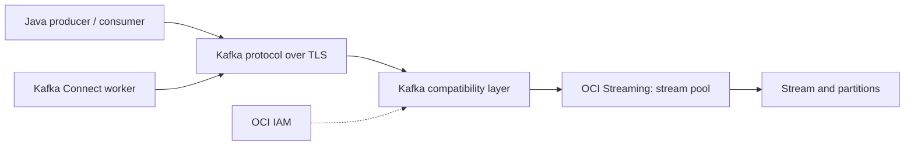
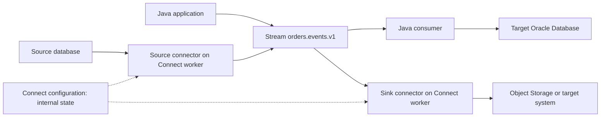

# Streaming Kafka Compatibility and Kafka Ecosystem Integration

## 1. Lesson Objectives and Scope

In the **Streaming and Queue** chapter of the **CLOUD_PROVIDERS_ORACLE** module, this lesson explains how to use Kafka applications and tools with **OCI Streaming through the Kafka compatibility layer**. Learners need to understand what can be kept as-is, what must be reconfigured, and what requires architectural changes before integration.

The running scenario is an e-commerce system with:

- A Java application publishing order events.
- A consumer updating analytics data in Oracle Database.
- A Kafka Connect process moving data to a target system.
- Requirements to monitor latency, reprocess on failure, and control access permissions.

The practical goal is to reuse Kafka interfaces where appropriate while preserving data contracts, processing acknowledgment semantics, and the characteristics of the chosen OCI service.

### Distinguishing Two Similarly Named Services

| Service | Model to Recognize |
| --- | --- |
| **OCI Streaming** | Serverless streaming service with a partial Kafka compatibility layer |
| **OCI Streaming with Apache Kafka** | Managed Apache Kafka cluster service with its own resources and operational model |

Oracle clearly distinguishes the two options in [Overview of Streaming with Apache Kafka](https://docs.oracle.com/en-us/iaas/Content/kafka/overview.htm). This lesson focuses on the first option. Do not apply broker settings, ACLs, or feature guarantees from the second option to an OCI Streaming stream pool.

Batch sizes, timeouts, and resource names in the examples are illustrative configurations. The code snippets and lab steps below have not been executed against a live tenancy.

## 2. What Does "Kafka Compatible" Mean?

A Kafka client communicates with the service using the Kafka protocol. OCI Streaming provides a protocol ingestion layer so producers and consumers can use familiar APIs.



The compatibility layer does not turn a stream pool into a self-managed Kafka cluster where users have full control over broker settings. Compatibility must be evaluated at three levels:

1. **Protocol:** can the client connect, authenticate, produce, fetch, and manage groups?
2. **Features:** does the application require transactions, compaction, or specialized admin APIs?
3. **Operational semantics:** do retries, ordering, checkpoints, throughput limits, and recovery still meet requirements?

A program that sends and reads back a JSON string only proves basic connectivity. It does not prove a CDC pipeline, stateful processing job, or multi-task connector can be migrated unchanged.

### Concept Mapping

| Kafka Concept | How It Maps in OCI Streaming |
| --- | --- |
| Cluster from client view | Stream pool acts as the virtual cluster scope |
| Business topic | Stream with the corresponding name inside the pool |
| Partition | Stream partition |
| Record key/value | Message key and payload |
| Consumer group | Group coordinating reads and saving progress |
| Offset | Read position per partition in the Kafka interface |
| Bootstrap servers | Address allowing clients to discover connection endpoints |
| Kafka broker configuration | Not exposed by default for OCI Streaming users to tune |

Stream names must be unique within a pool. The pool also centralizes shared Kafka and security settings. See [Managing Stream Pools](https://docs.oracle.com/en-us/iaas/Content/Streaming/Tasks/managing-stream-pools.htm).

When a consumer commits an offset, it does not delete the record from the stream. Independent consumer groups can still read data remaining within retention. This differs from deleting after processing in a job queue.

## 3. API Scope and Limits That Shape Architecture

The documentation [Using Streaming with Apache Kafka](https://docs.oracle.com/en-us/iaas/Content/Streaming/Tasks/kafkacompatibility.htm) lists the Producer, Consumer, Connect, Admin, and Group Management API groups. It also notes features that are not implemented:

| Feature | Status in the Referenced Compatibility Layer |
| --- | --- |
| Producer, Consumer, Group Management | Supported per documentation scope |
| Kafka Connect | Integration mechanism supported |
| Admin API | Supported; verify specific operations |
| Kafka Streams | Not supported |
| Compaction for arbitrary business topics | Not supported |
| Kafka transactions | Not supported |
| Idempotent production | Not supported |
| Dynamic partition addition for existing streams | Not supported |

Based on these limits, the design in this lesson configures producers without Kafka idempotence and implements deduplication on the consumer side at the application layer.

### Implications to Understand

**Producer retries can create duplicates.** If the service persisted a record but the response was lost, resending can append another record carrying the same business event.

**There are no Kafka transactions for the read–write–commit loop.** Do not build atomicity promises by calling `beginTransaction()`, producing records, and calling `sendOffsetsToTransaction()` against this backend.

**Compaction and retention solve different problems.** Retaining data longer does not create a "keep latest value per key" state table. If a design needs a state table, choose an appropriate store or platform.

**Do not assume every library in the Kafka ecosystem is guaranteed to work.** A tool may use standard Producer APIs, yet its startup routine might create a compacted topic, open a transaction, or demand broker config changes.

The three internal Kafka Connect configuration topics are a special case provisioned by the service, covered in section 10. Do not extrapolate that case into general support for arbitrary compacted topics.

## 4. Reference Integration Architecture



There are three layers to deploy and operate independently:

| Layer | Resources / Responsibilities |
| --- | --- |
| Streaming service | Stream pool, stream, partitions, retention, endpoints, and IAM |
| Application runtime | Java processes, Connect workers, connector plugins, and converters |
| Data source/sink | DB permissions, schemas, storage endpoints, business keys, and deduplication |

A source connector reads from a source and publishes to Streaming. A sink connector reads from Streaming and writes to a target. Source/sink roles are defined relative to the streaming system.

A Kafka Connect configuration in OCI does not install JDBC drivers, provision worker JVMs, or provide network connectivity to the source DB. You must specify where workers run, how plugins are updated, and who responds when a task stops.

## 5. Preparing Resources and Getting Accurate Connection Details

### 5.1. Preparing the Stream Pool and Stream

In a lab environment:

1. Choose the region and compartment.
2. Create or select a stream pool.
3. Decide whether to use a public endpoint or private endpoint.
4. Create the `orders.events.v1` stream with the calculated partition count and retention.
5. Record the stream OCID, stream pool OCID, and Kafka connection settings.

Do not use the stream OCID in place of the stream pool OCID in the Kafka login string. Those two identifiers belong to different resources.

Retrieve pool details with the OCI CLI:

```powershell
oci streaming admin stream-pool get --stream-pool-id "<STREAM_POOL_OCID>"
```

Read the bootstrap server value from the pool configuration or **Kafka connection settings**. The CLI returns fields such as `kafka-settings.bootstrap-servers`; the hostname may include a cell component. See [Getting Details for a Stream Pool](https://docs.oracle.com/en-us/iaas/Content/Streaming/Tasks/get-stream-pool.htm).

In this lesson, topics are created explicitly. Do not rely on auto-create so a typo cannot silently create a new stream with the wrong configuration.

### 5.2. Values to Distinguish

| Value | Example Format | Where to Obtain |
| --- | --- | --- |
| Kafka bootstrap server | `<host>:9092` | Pool's Kafka connection settings |
| Stream pool OCID | `ocid1.streampool...` | Stream pool details |
| Topic name | `orders.events.v1` | Created stream name |
| SASL username | String containing tenancy/domain/user/pool | Connection string for the user |
| SASL password | OCI auth token | Token for that exact user |
| Native Streaming endpoint | Endpoint used with OCI API/SDK | OCI stream/API details |

Do not put the OCI API HTTPS URL into `bootstrap.servers`. An SDK signing HTTP requests with an API key and a Kafka client using SASL are two separate authentication paths.

## 6. Authentication, IAM, and Network Connectivity

### 6.1. SASL/PLAIN over TLS

Basic configuration uses:

```properties
bootstrap.servers=<BOOTSTRAP_SERVERS_FROM_POOL>
security.protocol=SASL_SSL
sasl.mechanism=PLAIN
sasl.jaas.config=org.apache.kafka.common.security.plain.PlainLoginModule required username="<SASL_USERNAME_FROM_CONSOLE>" password="<OCI_AUTH_TOKEN>";
ssl.endpoint.identification.algorithm=https
```

The documentation [Using Kafka APIs](https://docs.oracle.com/en-us/iaas/Content/Streaming/Tasks/kafkacompatibility_topic-Configuration.htm) covers auth tokens, SASL/PLAIN, and the `tenancyName/domain/username/streamPoolId` username format. Some examples for older account models show a shorter string; use the exact string provided for your identity domain and pool rather than stripping the domain segment yourself.

The password is an auth token, not the Console login password. The token is bound to a user; access permissions are still governed by that identity's IAM policies.

`<...>` markers in this lesson are placeholders that must be replaced before running. A Java properties file does not automatically expand environment variable names into secrets.

Do not hardcode tokens in source code or commit populated configuration files. Use OCI Vault and your deployment mechanism to materialize secret files with restricted permissions, or use a principal mechanism suited to your runtime.

### 6.2. Instance Principal for the Kafka Java Client

Oracle provides a SASL add-on for the Kafka Java client with the `OCI-RSA-SHA256` mechanism and `InstancePrincipalsLoginModule`. This requires the corresponding dependency and JAAS module; you cannot just remove the token from a PLAIN config and expect the client to pick up instance principals automatically. Official setup instructions are in [Instance Principal Authorization for the Java SDK](https://docs.oracle.com/en-us/iaas/Content/Streaming/Tasks/kafkacompatibility_topic-Configuration.htm#Instance_Principal_Authorization_for_the_Java_SDK).

When using this approach, the instance must belong to the proper dynamic group and have the required Streaming policies. The remaining examples use auth tokens to focus on standard Kafka client structure.

### 6.3. Role-Based Policies

Example policies for groups in the `Default` identity domain:

```text
Allow group Default/OrderEventProducers to use stream-push in compartment streaming-lab
Allow group Default/OrderEventConsumers to use stream-pull in compartment streaming-lab
```

Add metadata read permissions as required by actual client operations. Accounts that create streams, pools, or Kafka Connect configurations need corresponding administrative permissions; do not share a broad admin account across all applications.

Resource types include `stream-push`, `stream-pull`, `stream-pools`, and `connect-harness`. Cross-check permissions in [Details for the Streaming Service](https://docs.oracle.com/en-us/iaas/Content/Identity/Reference/streamingpolicyreference.htm).

The example compartment policies apply compartment-wide. For narrower scoping, add conditions on supported resources or separate resources into dedicated compartments.

### 6.4. Checking Private Networking vs. Authentication

A private endpoint is configured at the stream pool level and attached to a VCN. Clients need proper routing, DNS resolution, and network security rules from where the workload runs. See [Security Best Practices for Streaming](https://docs.oracle.com/en-us/iaas/Content/Streaming/Concepts/streamsecurity.htm).

Example TCP check on Windows:

```powershell
Test-NetConnection -ComputerName "<HOST_FROM_BOOTSTRAP_SERVERS>" -Port 9092
```

A successful TCP connection does not prove TLS, SASL, or IAM succeeded. Follow up by testing with a fully configured Kafka client.

For on-premises clients reaching a private endpoint, design network connectivity and DNS across VPN/FastConnect or the equivalent network topology. Do not test from a bastion/admin host and conclude that workers in another subnet also have access.

## 7. Java Producer: Explicitly Configuring Error-Prone Defaults

### 7.1. Illustrative Producer Configuration

The producer properties file uses the connection settings from section 6, plus:

```properties
client.id=orders-api-producer
key.serializer=org.apache.kafka.common.serialization.StringSerializer
value.serializer=org.apache.kafka.common.serialization.StringSerializer

acks=all
enable.idempotence=false
max.in.flight.requests.per.connection=1

retries=5
retry.backoff.ms=500
request.timeout.ms=30000
delivery.timeout.ms=120000

max.request.size=900000
linger.ms=5
compression.type=none
```

These numbers are a starting point for a lab, not a universally optimal tuning profile.

Many modern Kafka clients enable idempotence by default. Because this backend does not implement idempotent production, this configuration explicitly sets `enable.idempotence=false`. Do not declare `transactional.id`.

For a non-idempotent producer with retries, `max.in.flight.requests.per.connection=1` prevents out-of-order writes caused by multiple in-flight batches on the same connection. It does not create global ordering across all producers or all partitions. These configuration semantics are described in [Apache Kafka Producer Configs](https://kafka.apache.org/41/configuration/producer-configs/).

`acks=all` is not a substitute for idempotency. It governs write acknowledgment; business duplicates can still occur when retrying after an ambiguous error.

`max.request.size` is chosen with headroom below the service limit. You must still measure actual key, value, and batch sizes. Never raise client limits trying to exceed backend limits.

### 7.2. Example Sending One Event

This example requires a Java version supporting text blocks and the `org.apache.kafka:kafka-clients` dependency pinned in the project. Pick a version tested with your runtime; do not treat the presence of an API in the client library as proof that the backend supports it.

The properties file passed in must contain both connection and producer settings. Example:

```java
import java.io.Reader;
import java.nio.charset.StandardCharsets;
import java.nio.file.Files;
import java.nio.file.Path;
import java.util.Properties;

import org.apache.kafka.clients.producer.KafkaProducer;
import org.apache.kafka.clients.producer.ProducerRecord;
import org.apache.kafka.clients.producer.RecordMetadata;

public final class SendOrderEvent {
    public static void main(String[] args) throws Exception {
        if (args.length != 2) {
            throw new IllegalArgumentException(
                "Expected: <producer-properties-path> <topic-name>"
            );
        }

        Properties properties = new Properties();
        try (Reader reader = Files.newBufferedReader(
                Path.of(args[0]), StandardCharsets.UTF_8)) {
            properties.load(reader);
        }

        String event = """
            {
              "eventId": "evt-order-1042-v1",
              "schemaVersion": 1,
              "orderId": "ORD-1042",
              "eventType": "OrderAccepted",
              "totalMinorUnits": 25000000,
              "currency": "VND"
            }
            """;

        try (KafkaProducer<String, String> producer =
                new KafkaProducer<>(properties)) {
            ProducerRecord<String, String> record =
                new ProducerRecord<>(args[1], "ORD-1042", event);

            RecordMetadata metadata = producer.send(record).get();

            System.out.printf(
                "topic=%s partition=%d offset=%d%n",
                metadata.topic(),
                metadata.partition(),
                metadata.offset()
            );
        }
    }
}
```

`send()` returns a future; calling `get()` in the example blocks for the result so learners can observe errors. A high-throughput system typically handles callbacks/futures asynchronously with bounded in-flight work rather than blocking sequentially on every record.

The hardcoded `eventId` here illustrates a single event. In a real system, generate the ID when the business event is persisted and keep that same ID across all retries.

If a send times out, the outcome may be indeterminate. Never generate a new business ID merely because a response was not received. When source data lives in a DB, an outbox persists the publishing intent within the source transaction.

## 8. Partition Key, Ordering, and Data Contract

The key `ORD-1042` groups events for the same order according to the Kafka producer's partitioner strategy. To rely on per-order ordering, you must simultaneously control:

- Consistent key serialization and partitioner logic.
- Producers using uniform partitioning rules.
- Publishing order across sources generating events for the same order.
- Processing completion order inside the consumer.

If you have both Kafka producers and native OCI API producers, test partition routing. Do not assume both API paths use the exact same hashing algorithm just because the key string is identical.

A consumer can also break ordering on its own by dispatching records from the same partition across multiple threads that finish arbitrarily. Reading in order does not mean database writes will complete in order.

### Designing Events for Replayability

An event envelope should include at least:

| Field | Purpose |
| --- | --- |
| `eventId` | Identifies the same event across duplicate copies |
| `schemaVersion` | Selects decoding rules |
| Aggregate key such as `orderId` | Partitioning and business correlation |
| Event type | Distinguishes processing semantics |
| Business timestamp if needed | Latency analysis and late-event handling |
| Aggregate version if needed | Detects stale or out-of-sequence events |

A schema version inside the payload does not automatically guarantee compatibility. Teams must agree on which fields can be added, which are required, and how currency, timestamps, and null values are represented.

Records with a `null` value should not be emitted assuming the backend will compact and delete old state for that key. Tombstone semantics in a pipeline must be verified for each specific source and sink.

## 9. Java Consumer: Process First, Commit Progress Afterward

### 9.1. Illustrative Consumer Configuration

Use the shared connection properties and add:

```properties
client.id=orders-analytics-worker
group.id=orders-analytics-v1

key.deserializer=org.apache.kafka.common.serialization.StringDeserializer
value.deserializer=org.apache.kafka.common.serialization.StringDeserializer

enable.auto.commit=false
auto.offset.reset=earliest
max.poll.records=100
max.poll.interval.ms=300000
session.timeout.ms=30000
max.partition.fetch.bytes=1048576
```

For clients that expose `group.protocol`, you can set `group.protocol=classic` as a baseline configuration for verification. Using newer group protocols must be evaluated separately rather than assumed just because the client library was upgraded.

`auto.offset.reset=earliest` applies when no valid offset exists per client/backend rules. It does not reset a group with existing progress back to the beginning on every restart. Consumer property semantics are documented in [Apache Kafka Consumer Configs](https://kafka.apache.org/41/configuration/consumer-configs/).

### 9.2. Committing the Next Offset After a Completed Batch

The snippet below is a logic skeleton to place inside a Java class with the corresponding imports. `applyIdempotently` is supplied by the application: it returns only after the side effect has committed or a valid prior result was recognized.

```java
static void consume(
        Properties properties,
        String topic,
        java.util.function.Consumer<
            org.apache.kafka.clients.consumer.ConsumerRecord<String, String>
        > applyIdempotently) {

    try (var consumer =
            new org.apache.kafka.clients.consumer.KafkaConsumer<String, String>(
                properties)) {

        consumer.subscribe(java.util.List.of(topic));

        while (!Thread.currentThread().isInterrupted()) {
            var records = consumer.poll(java.time.Duration.ofSeconds(1));

            var completedOffsets = new java.util.HashMap<
                org.apache.kafka.common.TopicPartition,
                org.apache.kafka.clients.consumer.OffsetAndMetadata>();

            for (var partition : records.partitions()) {
                var partitionRecords = records.records(partition);

                for (var record : partitionRecords) {
                    // Exceptions must exit this processing loop.
                    applyIdempotently.accept(record);
                }

                if (!partitionRecords.isEmpty()) {
                    long nextOffset = partitionRecords
                        .get(partitionRecords.size() - 1)
                        .offset() + 1;

                    completedOffsets.put(
                        partition,
                        new org.apache.kafka.clients.consumer.OffsetAndMetadata(
                            nextOffset
                        )
                    );
                }
            }

            if (!completedOffsets.isEmpty()) {
                consumer.commitSync(completedOffsets);
            }
        }
    }
}
```

The committed offset is the next position to read, so if a record at offset 42 completes, the next checkpoint is 43. This follows [KafkaConsumer](https://kafka.apache.org/41/javadoc/org/apache/kafka/clients/consumer/KafkaConsumer.html) semantics.

If one record fails, this skeleton exits via an exception and skips committing the current batch. Records in that batch that already applied side effects may be delivered again, so `applyIdempotently` must be safe under repetition.

Do not modify this skeleton to catch exceptions, log them, and proceed to the shared `commitSync()`. Doing so can advance the checkpoint past an unprocessed record.

### 9.3. The Gap Between DB Commit and Offset Commit

Safe flow at the database side-effect level:

```text
Begin Oracle Database transaction
  Insert event/operation key into an inbox table with a unique constraint
  Write or update business data
  Mark completion result
Commit DB

Then commit Kafka offset
```

If the process stops after DB commit but before offset commit, the event is read again. The inbox shows the effect already occurred and the consumer simply advances the checkpoint.

If the offset is committed before the DB, stopping in between can leave the side effect unperformed while the group has already moved past the record.

The inbox table and business data must live in the same transactional boundary. An in-memory worker cache provides no protection across replica replacements or restarts.

For services outside the DB, you need a target-side idempotency contract or reconciliation. Manual offset commits alone do not make a payment API call safe to repeat.

### 9.4. Rebalances and Long-Running Work

Consumers must continue polling within the configured timeout window. If batch processing takes too long, the group may reassign partitions and commits can fail.

The skeleton above suits bounded synchronous processing. For longer workloads:

- Reduce `max.poll.records` and set timeouts on downstream dependencies.
- If offloading to worker threads, track completion state per partition.
- Commit only up to the contiguous range of completed offsets, without jumping over gaps.
- Handle partition revocation and prevent stale workers from confirming work afterward.
- Keep `KafkaConsumer` operations within the threading model supported by the client library.

A failed commit after a successful DB commit is a replayable situation, not a reason to immediately compensate already-committed database state.

## 10. Kafka Connect Configuration and Connect Workers

### 10.1. Two Distinct Components

| Component | Function |
| --- | --- |
| OCI Kafka Connect configuration, also called a harness | Resource backing Connect's internal configuration/state data |
| Connect worker | Process running connectors, scheduling tasks, serializing data, and talking to sources/sinks |
| Connector plugin | Specific integration code such as JDBC source, JDBC sink, or storage sink |
| Connector instance | Configuration for one integration pipeline registered on the Connect runtime |

Create a harness in the target compartment:

```powershell
oci streaming admin connect-harness create --name "orders-connect-lab" --compartment-id "<COMPARTMENT_OCID>"
```

After creation, retrieve the **Kafka Connect storage topics** shown in the Console. The official procedure is in [Creating a Kafka Connect Configuration](https://docs.oracle.com/en-us/iaas/Content/Streaming/Tasks/create-connect-harness.htm).

OCI creates three internal topics suffixed with `-config`, `-offset`, and `-status` tied to the harness OCID. They are reserved for Connect, carry their own constraints, and a configuration works only with streams in the same compartment. See [Using Kafka Connect](https://docs.oracle.com/en-us/iaas/Content/Streaming/Tasks/kafkacompatibility_topic-Kafka_Connect.htm).

Do not publish order events into these internal topics. Likewise, do not create three regular business streams with matching names as a substitute for a harness.

### 10.2. Illustrative Worker Configuration

Below is a baseline lab configuration using string keys and values. Replace all placeholders before running and use the exact storage topic names provided by OCI.

```properties
bootstrap.servers=<BOOTSTRAP_SERVERS_FROM_POOL>
group.id=orders-connect-workers-lab

config.storage.topic=<HARNESS_OCID>-config
offset.storage.topic=<HARNESS_OCID>-offset
status.storage.topic=<HARNESS_OCID>-status

key.converter=org.apache.kafka.connect.storage.StringConverter
value.converter=org.apache.kafka.connect.storage.StringConverter
plugin.path=/opt/kafka/plugins

security.protocol=SASL_SSL
sasl.mechanism=PLAIN
sasl.jaas.config=org.apache.kafka.common.security.plain.PlainLoginModule required username="<SASL_USERNAME_FROM_CONSOLE>" password="<OCI_AUTH_TOKEN>";

producer.security.protocol=SASL_SSL
producer.sasl.mechanism=PLAIN
producer.sasl.jaas.config=org.apache.kafka.common.security.plain.PlainLoginModule required username="<SASL_USERNAME_FROM_CONSOLE>" password="<OCI_AUTH_TOKEN>";
producer.enable.idempotence=false
producer.acks=all
producer.max.in.flight.requests.per.connection=1
producer.max.request.size=900000

consumer.security.protocol=SASL_SSL
consumer.sasl.mechanism=PLAIN
consumer.sasl.jaas.config=org.apache.kafka.common.security.plain.PlainLoginModule required username="<SASL_USERNAME_FROM_CONSOLE>" password="<OCI_AUTH_TOKEN>";
consumer.max.partition.fetch.bytes=1048576

exactly.once.source.support=disabled
```

The worker, source connector producer, and sink connector consumer act as distinct client roles. Verify effective configuration for each role; setting SASL in only one place may not propagate to every client created by the runtime or plugins.

Connect has an exactly-once source feature built on transactions. For this backend, the baseline choice is to keep it disabled. Worker and converter properties are documented in [Apache Kafka Connect Configs](https://kafka.apache.org/41/configuration/kafka-connect-configs/).

The snippet above does not replace operational settings such as REST listeners, REST API protection, plugin storage paths, JVM flags, truststores, and secret loading. Workers in the same cluster must share the same `group.id`, storage topics, and compatible plugins. Two independent clusters must never accidentally share the same state topics.

### 10.3. Registering a Small Connector to Observe the Path

In a single-worker lab, you can use FileStream sink if the plugin is installed in your runtime:

```http
POST /connectors
Content-Type: application/json

{
  "name": "orders-file-lab",
  "config": {
    "connector.class": "org.apache.kafka.connect.file.FileStreamSinkConnector",
    "tasks.max": "1",
    "topics": "orders.events.v1",
    "file": "/var/lib/kafka-connect-lab/orders.jsonl"
  }
}
```

This request goes to the **Connect worker's REST API**, not the OCI Streaming API. Verify installed plugins via `GET /connector-plugins` and status via `GET /connectors/orders-file-lab/status` on the deployed runtime.

The file sink is solely for observing data flowing through Connect. A local file depends on the host running the task; it is not a highly available target store and can contain duplicate lines after recovery.

In production, pick an appropriate target connector and verify its write contract. With multiple workers, tasks can migrate between hosts; target data must exist independently of any single worker's local filesystem.

## 11. Selecting Connectors by Both API and Data Contract

### 11.1. JDBC Source and CDC

A polling-based JDBC source reads rows using queries, timestamps, or incrementing columns depending on connector capabilities. CDC reads changes from the source database's change-capture mechanism.

The two approaches differ significantly:

| Criterion | Polling JDBC | Log/Change-Based CDC |
| --- | --- | --- |
| Source of changes | Periodic query results | Database change stream per source technology |
| Record deletions | Needs custom design if source does not retain tombstones | Can be represented as delete events depending on connector |
| Transaction boundaries | Does not inherently preserve full source transactions | Depends on CDC format and contract |
| Load on DB | Query and index scan load | Capture overhead and configuration for change mining |
| Recovery position | Connector-managed offset | Log/checkpoint position and associated history |

Do not label a "rows with timestamp greater than last run" query as full CDC if it misses deletes or updates under source rules.

For Oracle Database, evaluate Oracle GoldenGate or a suitable CDC connector against product documentation, DB privileges, and licensing terms. Also check metadata/schema history topics created by the connector; a connector that requires compaction where the backend does not provide it can fail even if regular data records publish fine.

### 11.2. JDBC Sink and Converters

Converters transform records between Kafka Connect's data model and bytes in the stream. A sink connector may require typed schemas, structured keys, or primary-key fields.

In the section 10 lab, `StringConverter` treats JSON as an opaque string. It does not automatically turn JSON into a schema-backed record for a JDBC sink.

Before wiring a JDBC sink, settle:

- Whether payloads carry schemas or are schemaless JSON.
- How record keys map to primary keys.
- Types for currency, timestamps, nulls, and nested fields.
- Insert/upsert/delete behavior.
- Deduplication when writes succeed before progress is saved.

For example, upserting a snapshot by `orderId` can be safer than blind inserts. However, upsert does not by itself make balance increments or inventory deductions safe; cumulative mutations require operation keys and dedicated protocols.

### 11.3. Object Storage and S3-Interface Connectors

A connector built for Amazon S3 does not automatically work with every S3-compatible object store. When targeting OCI Object Storage via a compatibility path, verify the endpoint, bucket addressing style, credentials, request signing, multipart behavior, and object naming.

Choosing deterministic object names by partition/offset or batch when supported aids reconciliation and reduces duplicate writes. Know exactly whether the connector overwrites, creates new objects, or skips on retry.

### 11.4. Schema Registry

A registry and Avro/Protobuf/JSON Schema formats are additional pipeline components. Do not assume a stream pool includes a Schema Registry just because its endpoint speaks the Kafka protocol.

If using an external registry, verify:

1. Can serializers/converters reach the registry's HTTP endpoint?
2. Which backend stores registry metadata?
3. Does that registry backend require compacted topics or transactions?
4. Do consumers use the same wire format and have access to fetch schemas?
5. Do backup/restore procedures preserve schema ID mappings?

This is an architectural dependency analysis. It is not claiming Avro payloads cannot travel over Streaming: payload bytes and the schema management service are two separate parts.

## 12. Spark, Kafka Streams, and Replication Tools

### 12.1. Spark Is Not Kafka Streams

Kafka Streams is a processing library with dependencies such as state stores, repartition/changelog topics, and mode-specific transaction semantics. It sits on the list of unsupported features for this backend.

Another engine using a Kafka source/sink is a separate integration path. Oracle documents Spark Structured Streaming with OCI Data Flow in [Getting Started with Spark Streaming](https://docs.oracle.com/en-us/iaas/Content/data-flow/using/streaming-get-started.htm).

With Spark, query checkpoints and consumer offsets are states that must be managed carefully. Restarting from a checkpoint can resume the prior position; changing start options does not automatically make a query replay full history. Sinks still need an appropriate contract when a micro-batch re-executes.

Do not apply Kafka Streams' `processing.guarantee=exactly_once_v2` setting and assume a pipeline achieves exactly-once on OCI Streaming.

### 12.2. MirrorMaker and Cross-Environment Replication

Replication is more than reading records and writing them to a topic of the same name. Tools may also:

- Create internal topics and sync metadata.
- Synchronize topic configurations or ACLs.
- Track offset mappings between both sides.
- Emit checkpoints to support consumer failover.
- Require specialized features from the target backend.

These setting groups are listed in [Apache Kafka MirrorMaker Configs](https://kafka.apache.org/41/configuration/mirrormaker-configs/). Combined with OCI Streaming limits, evaluate every feature required by your chosen tool version before treating it as a turnkey migration path.

This is an architectural verification requirement, not a blanket statement that every MirrorMaker version either works or fails. For a custom bridge, you must also design deduplication, checkpointing, data-loss detection, and reconciliation yourself.

Never copy raw source offset numbers to a target group without proving the mapping. The same event published to another environment can receive a different transport offset.

## 13. Partitions, Retention, and Load Estimation

[Limits on Streaming Resources](https://docs.oracle.com/en-us/iaas/Content/Streaming/Concepts/streamingoverview_topic-Limits_on_Streaming_Resources.htm) states constraints to factor in early: retention from 24 hours to 7 days, maximum 1 MB per message, 1 MB/s write rate per partition; stream partition count and retention are immutable after creation.

Verify numbers against documentation and tenancy quotas at deployment time. Do not treat default quotas as guaranteed capacity provisioned for every account.

### 13.1. Estimating Partitions

Suppose expected incoming throughput is 2.4 MB/s. To operate around 60% of the published write limit for fluctuation headroom:

```text
Planned capacity per partition = 1 × 0.6 = 0.6 MB/s
Minimum partitions by calculation = ceil(2.4 / 0.6) = 4
```

This is only an aggregate calculation. If most records share the same key, a single hot partition can still bottleneck. Measure key distribution, batch sizes, and growth trends.

Since partition count cannot change on an existing stream, scaling up may require creating a new stream and executing a planned cutover. Stream cutovers must address ordering, checkpoints, and the overlap window between both streams.

### 13.2. Consumer Groups and Parallelism

With four partitions, a group using standard partition assignment has at most four consumers usefully owning partitions. Scaling from four to eight consumers does not double the group's read capacity.

Multiple independent groups reading concurrently add read and processing load. Two groups, "analytics" and "audit," do not split data between them by default; each group tracks its own progress.

A connector's `tasks.max` is an upper bound on tasks the connector is allowed to spawn, not a guarantee that all of them will actively run or achieve that many effective write streams.

### 13.3. Retention Is a Finite Recovery Window

Suppose retention is 24 hours, yet a sink stops for 30 hours. Unread records can still expire. Having a saved offset does not bring expired data back.

Choose retention based on detection time, fix time, backlog drain rate, and replay requirements. If long-term storage is needed, design an Object Storage archive pipeline or other historical store along with a recovery procedure.

Distinguish "retaining source data long enough" from "retaining idempotency history long enough." If you may replay from an archive weeks later, consumers must still hold corresponding deduplication records.

## 14. Error Handling and Pipeline Observability

### 14.1. Diagnostic Matrix

| Symptom | Cause Area to Check | Verification Step |
| --- | --- | --- |
| TCP timeout | DNS, routing, NSG/security list, private endpoint | Test from the exact workload host/subnet |
| TLS handshake error | Wrong host, truststore, proxy, TLS version | Verify trust chain and endpoint |
| SASL authentication error | Invalid token, wrong user/domain, or pool in username | Cross-check connection string and identity |
| Authenticates but cannot publish/consume | Policy scope or role mismatch | Verify groups and resource permissions |
| Topic not found | Wrong pool, region, or stream name | Check pool OCID and topic name |
| API/version error on producer init | Client requests unsupported backend feature | Check idempotence, transactions, and effective configs |
| Connect worker runs but task fails | Missing plugin/driver, converter, or source/target rights | Inspect task status and root exception |
| Duplicate records in target | Retries or crash after write before checkpoint | Check event IDs and idempotency contract |
| Lag increasing | Slow sink, hot partition, throttling, or stopped task | Analyze ingress/egress rates and load skew |

Long-lived Kafka connections may be rebalanced by the service via disconnect and reconnect. Oracle describes this behavior in [Using Streaming with Apache Kafka](https://docs.oracle.com/en-us/iaas/Content/Streaming/Tasks/kafkacompatibility.htm). Clients need bounded retries and delivery tracking; neither treat every disconnect as a config bug nor ignore persistent failures.

### 14.2. What to Measure

- Publish success/failure rate and acknowledgment latency.
- Consumer successful processing rate and business latency.
- Committed progress per partition and pending backlog.
- Consumer/worker rebalances, commit failures, and task restarts.
- Retries, throttling, schema errors, and blocked duplicates.
- Reachability of DB, registry, and target storage.
- Age of unprocessed records relative to retention.

Do not assume every metric from a self-managed Kafka cluster exists on the compatibility layer. Combine OCI-published metrics with client/JMX metrics and actual application metrics.

Record-count lag alone is insufficient for assessing latency when payload sizes and processing times vary widely. Include event age or business timestamps. Avoid using millions of `eventId` values as metric labels; keep IDs in logs or tracing instead.

### 14.3. Retries and Unprocessable Records

Schema-invalid records should not stall an entire partition indefinitely without alerts. You can quarantine the record and failure reason into a durable store under an operational contract.

Because the backend does not provide a Kafka transaction for "write error to another stream and commit source offset," handle the failure gap explicitly:

1. Durably persist the quarantine decision keyed by record/event key.
2. If forwarding to an error stream, use an outbox or safe handoff protocol.
3. Advance the checkpoint only after the decision for the source record is saved.
4. Deduplicate in both the error store and target consumers if the operation runs again.

An error store and replay workflow are components you must design; they do not appear automatically just because a client has a retry setting.

## 15. Migrating an Existing Kafka Application to OCI Streaming

### 15.1. Inventory Dependencies Before Switching Endpoints

For each producer, consumer, and connector, document:

| Item | Questions to Answer |
| --- | --- |
| Client/runtime | Language, client version, Java version, and plugins |
| APIs used | Produce/fetch/group/admin or transactions |
| Data | Key/value, converters, registry, and wire format |
| Topics | Partitions, retention, compaction, names, and auto-create |
| Progress | Group IDs, checkpoints, reset rights, and replay window |
| Targets | Insert/upsert/side effects and deduplication approach |
| Security | SASL, IAM, secret rotation, and network path |
| Operations | Throughput, RPO/RTO, metrics, alerts, and on-call owner |

If the application strictly requires Kafka Streams, transactions, or arbitrary compacted topics, select another platform or redesign before migrating data. Do not let a simple producer connection success mask these dependencies.

### 15.2. Reconcilable Cutover Sequence

1. Provision target resources with planned partitions and retention.
2. Configure permissions and network paths from the actual runtime.
3. Run a small pipeline with identifiable IDs and expected outcomes.
4. Load test and exercise crash points before/after checkpoints.
5. Define historical backfill and consumer starting positions.
6. Reconcile by event ID, business key, or source watermark.
7. Cut over producers on schedule, recording cutover time and data boundaries.
8. Monitor late data, duplicates, and unconverted consumers.
9. Keep a rollback path with clear conditions so two systems do not emit uncontrolled side effects simultaneously.

Dual-writing to two systems introduces a new distributed protocol: one side can accept while the other fails. If used, establish a source of truth, an outbox/checkpoint, and a reconciliation path.

Comparing record counts helps but is insufficient: one missing record plus one duplicate produces the same total. Verify identifiers and business outcomes.

## 16. Availability, Automation, and Cost

### 16.1. Which States Must Be Protected?

A managed backend does not eliminate the need to protect:

- Stream pool/stream configuration and IAM.
- Worker images, plugins, JDBC drivers, and converter configs.
- Checkpoints/groups and Connect harnesses.
- Replayable source data.
- Idempotency stores and target data.
- Secrets and token rotation procedures.
- External registries or metadata outside Streaming.

Running multiple Connect workers lets tasks fail over if one worker crashes, provided plugins, networking, and configs match. It does not turn a local file sink into shared storage.

Regional recovery plans must detail how resources are recreated, data fetched, checkpoints initialized, and duplicate processing prevented. Never assume switching bootstrap servers preserves offsets, groups, and all records.

### 16.2. Controlled Automation

Manage pools, streams, policies, and runtime resources using appropriate infrastructure tools. Keep non-secret configuration separate from tokens and DB passwords.

Pin client and plugin versions in deployment configs. When upgrading, check defaults that might shift: idempotence, group protocol, security protocols, and internal topic creation.

Do not manually create or rename internal topics during worker startup. Harness and storage topic names are part of the state contract; changing them mistakenly can cause Connect to lose track of old configs or progress.

### 16.3. End-to-End Pipeline Cost

Cost estimates should cover Streaming and all accompanying components:

| Component | Factors Driving Consumption |
| --- | --- |
| Streaming | Data written/read, retention, group count, and replays under current pricing |
| Compute/OKE/Data Flow | Workers, tasks, JVMs, and runtime hours |
| Source/target databases | Polling, CDC, retry re-writes, indexes, and connection pools |
| Object Storage | Stored data, requests, and historical recovery |
| Network | Cross-region traffic, on-premises links, and external targets |
| Logging/Monitoring | Payload logging, log retention, and metric cardinality |
| Plugins/integrated products | Licensing and support terms per vendor |

Increasing `tasks.max`, adding consumer groups, or replaying an entire stream can create fresh load on sources and targets. Bound concurrency and replay rate to match database capacity and budget.

Use tags and compartments to allocate costs. Budget alerts are observability tools; do not assume they automatically stop workers or cut off traffic.

## 17. Minimal Integration Lab

### 17.1. Preparation

1. Create a lab compartment, stream pool, and stream `orders.events.v1`.
2. Choose two partitions to observe read assignment; set retention to fit the lab window.
3. Create producer/consumer identities and policies.
4. Retrieve connection settings and auth token, and test connectivity from the Java host.
5. Create two separate client config files without committing secrets to a repository.
6. Prepare a target table with a business key or deduplication inbox.
7. If practicing Connect, create a harness and run a worker with the chosen plugin.

### 17.2. Observation Steps

| Step | Action | What to Prove |
| --- | --- | --- |
| 1 | Send an event with a fixed event ID | Publish acknowledged; topic/partition/offset observed |
| 2 | Read using a new group | Payload decoded and processed accurately |
| 3 | Restart the same group | Resumes from committed progress |
| 4 | Read using an independent group | Second group tracks its own progress within the data window |
| 5 | Re-send the same event | Business target applies no duplicate side effect |
| 6 | Stop after DB commit, before offset commit | Safe replay thanks to deduplication history |
| 7 | Produce a schema-invalid record | Clear alert and handling/quarantine decision triggered |
| 8 | Start Connect sink lab | Distinguish running worker, running task, and data reaching target |
| 9 | Stop and restart the task | Observe potential duplicates; do not equate checkpoints with exactly-once |
| 10 | Simulate brief network disruption | Bounded retries, connection recovery, and result reconciliation |

Every group reset or `group.id` change should be intentional. If you only need to inspect historical data, use a dedicated lab group so you do not alter the progress of an active business consumer.

Do not test intentional failure scenarios on production streams. Labs should have isolated data and resources so consequences can be observed without impacting other consumers.

### 17.3. Lab Completion Criteria

- Producer and consumer use the intended pool, topic, identity, and TLS.
- Publish outcomes are verified, not fire-and-forget `send()` calls.
- Consumer commits only after durable side effects and remains safe on redelivery.
- Connect worker and connector/task states and logs are observable.
- Business data topics are clearly separated from harness state topics.
- Incompatible dependencies for planned tools have been identified.
- Runtimes are stopped, lab tokens revoked, and unused resources cleaned up.

These steps guide learners to implement and verify on their own. Creating this document does not imply the tests were executed on OCI.

## 18. Architectural Decisions to Document

| Decision | Details to Lock Down |
| --- | --- |
| Target service | OCI Streaming or OCI Streaming with Apache Kafka |
| Kafka scope | APIs and features the application actually uses |
| Resource identifiers | Pool, stream, topic, harness, and consumer groups |
| Security | SASL/principal mechanism, IAM, and network path |
| Data format | Serializers/converters, keys, schemas, and registry |
| Correctness | Ordering, deduplication, commits, and external side effects |
| Capacity | Partitions, hot keys, batches, concurrency, and retention |
| Connect operations | Worker hosting, plugins, tasks, metadata, and checkpoints |
| Recovery | Archive storage, replay, reconciliation, and regional recovery |
| Cost | Per-component load, alerts, and cost ownership |

The value of the Kafka compatibility layer lies in reusing existing interfaces, skills, and integration components. A reliable deployment must additionally verify data contracts and failure windows so switching backends preserves business correctness and operability.
