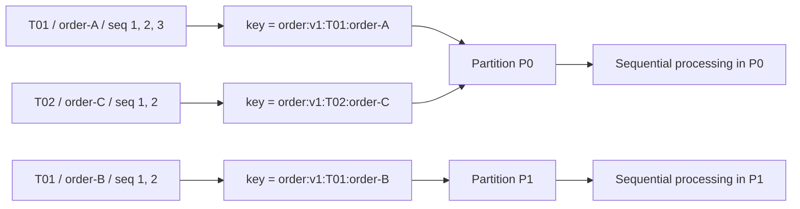

# Designing Partition Keys and Guaranteeing Event Ordering

## 1. Objectives and Scope

In an order-processing system on Oracle Cloud Infrastructure (OCI), the `OrderCreated` event needs to be applied before `OrderPaid` for the same order. Meanwhile, two independent orders can be processed in parallel. Partition key design is the step that decides which events must follow a single sequential stream and which events can be spread out to increase throughput.

This lesson belongs to the **Streaming and Queue** chapter of the **CLOUD_PROVIDERS_ORACLE** module and focuses on OCI Streaming using streams, partitions, and the `PutMessages` API. Design choices are framed for applications running on OCI Compute or OKE, storing business state in Oracle Database, authorized via IAM, and operating at reasonable cost.

After this lesson, learners will be able to:

- Choose a key matching the scope that requires business ordering.
- Distinguish partition order from processing-completion order and data-update order.
- Design producers, retries, consumers, and checkpoints to avoid dropped events or out-of-order application.
- Handle hot keys, change key strategies, and migrate to a new stream.
- Recognize when OCI Queue is appropriate and when OCI Streaming's ordering capability is needed.

The serialization, outbox, deduplication, and migration policies below are **application design recommendations**; only guarantees backed by Oracle documentation represent service-provided behavior.

## 2. Understanding Ordering Guarantees Accurately

OCI Streaming is an append-only log divided into partitions. Ordering guarantees live within each partition; an application does not get a global order across an entire multi-partition stream. See [OCI Streaming Overview](https://docs.oracle.com/en-us/iaas/Content/Streaming/Concepts/streamingoverview.htm).

Four kinds of ordering must be separated:

| Order Type | Meaning | Component to Control |
| --- | --- | --- |
| Business order | Order transitions from version 1 to 2 to 3 | Data transactions, version, or sequencer |
| Stream write order | Which event is appended to the partition earlier or later | Producer and Streaming service |
| Read order | Consumer reads positions within the same partition | Cursor and Streaming read mechanism |
| Application order | Results are durably written to a database or external system | Consumer, transactions, and task scheduling |

A consumer that receives `Created` before `Paid` yet submits both to an unconstrained thread pool can still complete `Paid` first. A partition guarantee does not automatically propagate into an application side-effect guarantee.

Example of what a partition contains:

```text
Partition P0
offset 420: order-A, sequence 1, OrderCreated
offset 425: order-B, sequence 1, OrderCreated
offset 429: order-A, sequence 2, OrderPaid
```

Events for `order-A` can interleave with events for `order-B`. What matters is preserving the version sequence for each order.

**Offset is a position in a partition; sequence is an order defined by business logic.** Oracle notes that offsets increase monotonically but are not necessarily contiguous. Therefore, do not use `offset + 1` to detect missing business events and do not compare offsets across two partitions. See [Offsets and Commits in Consumer Groups](https://docs.oracle.com/en-us/iaas/Content/Streaming/Tasks/using_consumer_groups.htm).

Timestamps also cannot replace sequence numbers: clocks across hosts can drift, multiple events can share the same timestamp, and event generation time can differ from when a producer successfully publishes.

## 3. What Does the Partition Key Determine?

With the native Streaming API, messages with the same key go into the same partition. Different keys can still land in the same partition. If the key is `null`, the service uses a random value for routing; you cannot rely on an empty key to group events. See [Key-to-Partition Mapping](https://docs.oracle.com/en-us/iaas/Content/Streaming/Concepts/partitioningastream.htm).

Conceptual model:

```text
key -> Streaming routing mechanism -> one partition in the stream
```

This is not a formula for calculating partition IDs yourself. Applications using the native API should supply the key and let the service route, rather than assuming a specific hash function.

An illustrative mapping might look like:



The diagram does not predict actual partitions. It shows that a key must remain stable, while multiple keys can share a partition.

Two things commonly confused:

- `eventId` identifies **a single event** for deduplication.
- The partition key identifies **the group of events** that must stay ordered.

Using a fresh UUID per event as the partition key defeats the goal of grouping events for the same order.

## 4. Choosing the Smallest Ordering Scope That Satisfies Business Rules

Start with the question: "Which two events, if swapped, could produce an incorrect business outcome?"

| Workload | Required Ordering Scope | Suggested Key | Consequences to Evaluate |
| --- | --- | --- | --- |
| Order lifecycle | Per order | `tenantId + orderId` | Independent orders can be processed in parallel |
| Balance changes | Per account | `tenantId + accountId` | High-traffic accounts can become hot keys |
| Device telemetry | Per device | `tenantId + deviceId` | Need device-restart handling if sequence resets |
| Inventory by warehouse and SKU | One warehouse-SKU pair | `warehouseId + sku` | Fast-selling SKUs may dominate load |
| Independent logs | No per-entity ordering required | Suitable distribution key or `null` | Cannot promise per-entity sequence reconstruction |

Using `tenantId` alone can pack an entire large customer into one partition. Using `tenantId + orderId` usually narrows the scope better when only per-order ordering is needed.

However, if a funds transfer touches two accounts, keying by account does not create an atomic transaction across two partitions. That design also needs source transactions, a saga, or a coordination mechanism matching consistency requirements. Never try to solve multi-entity coordination solely by changing the partition key.

Keys must also reflect immutable identifiers. Email addresses, display names, order statuses, or shipping addresses can change; using them as keys can split a single business sequence across different partitions.

## 5. Evaluating Load Distribution and Hot Keys

Having a large number of distinct keys is not enough to conclude load is well-balanced. A million keys where one key accounts for 60% of bytes can still create a bottleneck.

Measure at least:

- Messages per second and bytes per second by key.
- Traffic share of the largest keys.
- High-percentile message sizes.
- Processing throughput and queue wait times for each business group.

According to [OCI Streaming Limits](https://docs.oracle.com/en-us/iaas/Content/Streaming/Concepts/streamingoverview_topic-Limits_on_Streaming_Resources.htm), each partition has a 1 MB/s write limit; a stream's partition count cannot change after creation. When planning for production, cross-check current limit documentation, quotas, and workload characteristics.

A simple estimation model:

```text
B_peak = total bytes written per second at peak load
C_plan = planned write capacity to utilize per partition
P_min  = ceil(B_peak / C_plan)
```

For example, suppose after load testing the team picks `C_plan = 750,000 bytes/s` for headroom. Peak load of `6,000,000 bytes/s` yields `P_min = 8`. This is a lower bound based on aggregate load and does not prove eight partitions suffice: multiple heavy keys can hash to the same partition, and consumers or the target database can become the bottleneck.

If one key alone generates `1,200,000 bytes/s`, adding partitions will not split that key's stream. Options include reducing payload volume, coalescing updates per business rules, offloading large payloads to appropriate storage, or revisiting the ordering scope.

Adding a random or bucketed suffix:

```text
account-42:bucket-0
account-42:bucket-1
account-42:bucket-2
```

splits one account into multiple streams. Use this only when business rules allow independent streams or when you have designed a merge layer with durable sequencing and state. Salting cannot simultaneously preserve account-wide ordering and eliminate all coordination overhead.

## 6. Standardizing the Key as a Data Contract

Producers must agree on both the meaning and the representation of the key. Example:

```text
order:v1:<tenant-id>:<order-id>
```

A key contract should specify:

| Attribute | Example Convention |
| --- | --- |
| Scope | Events for the same order within the same tenant |
| Encoding | UTF-8 |
| Identifier | Immutable internal ID |
| Delimiter | `:` character; ID components must not contain this delimiter |
| Case sensitivity | Follow the published identifier normalization rules |
| Missing value | Reject publish and route to input error handling |
| Format change | Planned migration, never ad-hoc changes at deploy time |

For example, `order:v1:T01:O314` and `order:v1:t01:O314` are two different byte sequences. One producer lowercasing while another preserves case breaks consistency.

The native Streaming API performs partitioning server-side, whereas the Kafka API performs partitioning client-side. Because of this difference, a **design recommendation** is not to assume both paths always pick the same partition merely because they pass the same key string; standardize the publish path and test configuration before mixing them for one business sequence. See [Publishing Messages](https://docs.oracle.com/en-us/iaas/Content/Streaming/Tasks/publishing.htm).

Key version tracks the routing rule version. It is independent of payload schema version. Adding a backward-compatible JSON field usually does not require changing `order:v1` to `order:v2`.

Avoid placing personal data or secrets directly inside keys. Keys may appear in operational logs, diagnostic tools, or analytics datasets.

## 7. Event Envelope and Business Sequence

Example payload, with the metadata key sent separately as `order:v1:T01:O314`:

```json
{
  "eventId": "1ef3d934-0a13-4c87-b78a-394a9895e0a2",
  "eventType": "OrderPaid",
  "schemaVersion": 1,
  "tenantId": "T01",
  "aggregateType": "Order",
  "aggregateId": "O314",
  "aggregateVersion": 2,
  "occurredAt": "2026-11-20T03:15:00Z",
  "correlationId": "checkout-846",
  "data": {
    "currency": "VND",
    "amount": 250000
  }
}
```

In this design:

- `eventId` is generated once when recording the event and stays unchanged across retries.
- `aggregateVersion` is assigned within the transaction that mutates order state.
- `schemaVersion` helps consumers interpret the payload structure.
- `occurredAt` supports tracing and temporal analysis.
- The key is built from `tenantId` and `aggregateId`; consumers verify consistency between them.

The contiguous rule `1, 2, 3...` is valid only if this represents the complete emitted sequence for the aggregate. If a consumer subscribes to only a subset of event types, or one aggregate version emits multiple events, define a dedicated `eventSequence` or an appropriate sequence contract. Do not treat a version jump as data loss if the source model does not promise contiguity.

When rebuilding a projection from mid-history, you must have a valid snapshot or starting version. You cannot initialize empty state and arbitrarily apply event version 48.

## 8. Producers Must Form the Sequence Correctly Before Sending

### 8.1. Multiple Producers Sharing a Key

Using the same key only keeps those events in the same partition; it does not help the service infer business order between two competing requests.

```text
Producer A generates sequence 10 but hits a network delay.
Producer B sends sequence 11 and gets written first.
Producer A successfully sends sequence 10 afterward.

The partition may contain: 11 -> 10
```

One approach is assigning versions inside a database transaction and writing a **transactional outbox** in that same transaction:

```text
BEGIN
  lock or check the order's version
  update state and increment version
  write outbox(event_id, aggregate_id, sequence, payload)
COMMIT

Relay:
  pick the next event for each aggregate
  send to OCI Streaming
  verify send result
  mark as published per recovery policy
```

An outbox closes the "database committed, app crashed before sending" gap. However, multiple relays reading the outbox concurrently can still publish out of order unless send ownership is coordinated per aggregate. You need a single valid owner per key, or a claim algorithm guaranteeing only the next version of that key is published.

If the relay crashes after the service accepts the message but before marking it published, recovery may re-send it. Therefore, an outbox still requires consumer-side deduplication.

### 8.2. Retries and Partial Failures

A successful HTTP status is not enough to conclude every message in a batch was written. Check each entry's result in `PutMessages`; successful entries return partition and offset, while failed entries return an error. See [PutMessagesResult Model](https://docs.oracle.com/en-us/iaas/tools/dotnet/latest/api/Oci.StreamingService.Models.PutMessagesResult.html).

Counterexample:

```text
Send batch [sequence 10, sequence 11] for the same key
10 fails, 11 succeeds
Retry 10 alone
Observable result: 11 -> 10
```

When strict order is required, an easy-to-reason-about approach is allowing at most one unresolved in-flight event per key at a time. Publish the next version only after resolving the current version. Independent keys can still be sent in parallel.

On timeout, the producer may not know whether the service accepted the message. Pause sending for that key, retry with the same `eventId`, and accept the possibility of duplicates. Retries need bounded backoff, jitter, and separation between transient errors and data or authorization errors. After exhausting the retry budget, record a durable failure state and alert; never silently drop an event and continue with the key.

## 9. Java Example Sending One Event with a Stable Key

The snippet below uses the OCI Java SDK, assuming `StreamClient` is configured with authentication and the stream's **messages endpoint**. In labs, personal SDK config can be used; on Compute, instance principals require matching IAM policies. The project needs the Streaming SDK dependency matching the SDK version in use.

This method sends one event. The caller remains responsible for serializing sends per key, persisting the outbox, and preserving exact content across retries.

```java
import com.oracle.bmc.streaming.StreamClient;
import com.oracle.bmc.streaming.model.PutMessagesDetails;
import com.oracle.bmc.streaming.model.PutMessagesDetailsEntry;
import com.oracle.bmc.streaming.model.PutMessagesResultEntry;
import com.oracle.bmc.streaming.requests.PutMessagesRequest;
import com.oracle.bmc.streaming.responses.PutMessagesResponse;

import java.nio.charset.StandardCharsets;
import java.util.Collections;

public final class OrderEventPublisher {
    private OrderEventPublisher() {
    }

    private static void validateId(String value) {
        if (value == null || !value.matches("[A-Za-z0-9_-]{1,64}")) {
            throw new IllegalArgumentException("Invalid stable ID");
        }
    }

    public static String partitionKey(String tenantId, String orderId) {
        validateId(tenantId);
        validateId(orderId);
        return "order:v1:" + tenantId + ":" + orderId;
    }

    public static PutMessagesResultEntry publishOne(
            StreamClient client,
            String streamId,
            String tenantId,
            String orderId,
            String eventJson) {

        String key = partitionKey(tenantId, orderId);

        PutMessagesDetailsEntry message = PutMessagesDetailsEntry.builder()
                .key(key.getBytes(StandardCharsets.UTF_8))
                .value(eventJson.getBytes(StandardCharsets.UTF_8))
                .build();

        PutMessagesResponse response = client.putMessages(
                PutMessagesRequest.builder()
                        .streamId(streamId)
                        .putMessagesDetails(PutMessagesDetails.builder()
                                .messages(Collections.singletonList(message))
                                .build())
                        .build());

        if (response.getPutMessagesResult().getEntries().size() != 1) {
            throw new IllegalStateException("Unexpected result count");
        }

        PutMessagesResultEntry result =
                response.getPutMessagesResult().getEntries().get(0);

        if (result.getError() != null && !result.getError().isEmpty()) {
            throw new IllegalStateException(
                    "Publish failed: " + result.getError());
        }

        // Record the result in the outbox before publishing the next event with the same key.
        // Do not log payloads or sensitive information.
        return result;
    }
}
```

The ID validation rule in the example is an application choice. The SDK takes key and value as `byte[]`; do not manually Base64-encode them again before passing to these builders. Reference [PutMessagesDetailsEntry.Builder](https://docs.oracle.com/en-us/iaas/tools/java/latest/com/oracle/bmc/streaming/model/PutMessagesDetailsEntry.Builder.html) and [Java Streaming Quickstart](https://docs.oracle.com/en-us/iaas/Content/Streaming/Tasks/streaming-quickstart-oci-sdk-for-java.htm).

One successful call only confirms that single event's publish result. The static method above does not create a distributed lock and does not coordinate ordering across multiple JVMs. Connection errors or returned errors must be handled by the relay layer before invoking the next sequence.

## 10. Consumers: Preserving Order Through Data Updates

### 10.1. Sequential Within a Partition, Parallel Across Partitions

An operationally straightforward starting point is sequential processing per partition and parallel processing across partitions. Consumer groups coordinate partitions across instances; one partition is assigned to one instance in the group at a time. See [Streaming FAQ](https://www.oracle.com/cloud/streaming/faq/).

Do not assume a thread pool inside an instance is also coordinated by the service. The application must enforce:

```text
Read event A1 -> apply A1 successfully -> apply A2
Read event B1 -> apply B1 independently of chain A if business rules allow
```

When per-key parallelism within a partition is needed, you can build per-key sequential queues. In exchange, checkpoints must wait until the entire leading prefix of read messages finishes.

Example:

```text
In read order of P0:
offset 420 / key A / processing
offset 425 / key B / processed
offset 429 / key C / processed

Cannot checkpoint past the event at offset 420 yet.
```

The "completed prefix" means contiguous messages in partition read order, not contiguous offset numbers. If you checkpoint past an unapplied event and the consumer crashes, recovery may skip that event.

### 10.2. Commit After Results Are Durable

With native consumer groups and `commitOnGet=true`, the next `GetMessages` call commits offsets from the prior read. Therefore, a simple loop must finish the batch before calling for the next batch. If using `commitOnGet=false`, the application controls commits explicitly via `ConsumerCommit` and uses the returned cursor. See [Using Consumer Groups](https://docs.oracle.com/en-us/iaas/Content/Streaming/Tasks/using_consumer_groups.htm).

The pseudocode below illustrates the sequence for sequential reading with commit-on-get:

```text
cursor = create or restore group cursor

loop:
    batch, nextCursor = GetMessages(cursor)

    for each event in returned order:
        validate envelope and key
        apply idempotently inside data transaction
        if unresolved failure:
            halt batch progress, do not proceed to next read

    cursor = nextCursor
    // The next GetMessages call happens only after the batch finishes processing.
```

In production deployments, keep the consumer alive with appropriate heartbeats during long processing; heartbeating is not proof the event was applied. If using prefetching or async processing, design commit and cursor management explicitly rather than keeping this loop and merely replacing the `for` loop with a thread pool.

### 10.3. Deduplication and Sequence Checks Inside the Transaction

An application design can store:

```text
processed_event(
    consumer_name,
    event_id,
    processed_at,
    UNIQUE(consumer_name, event_id)
)

order_projection(
    tenant_id,
    order_id,
    last_sequence,
    business_state,
    PRIMARY KEY(tenant_id, order_id)
)
```

If `eventId` is only unique per tenant, the deduplication constraint must include `tenant_id`. If multiple projections consume the same event, `consumer_name` must accurately scope the projection or projection version being deduplicated.

With a contiguous sequence contract and a defined starting point:

```text
BEGIN
  lock projection row or use conditional versioned update

  if eventId already processed:
      confirm duplicate, do not repeat side effects
      COMMIT
      done

  if sequence == last_sequence + 1:
      apply business change
      update last_sequence
      insert eventId into processed_event
      COMMIT

  if sequence > last_sequence + 1:
      ROLLBACK
      handle gap per published policy

  if sequence <= last_sequence but eventId never processed:
      ROLLBACK
      reconcile stale event or sequence conflict
```

Having the same sequence with different content can indicate a producer bug. Do not blindly treat every old sequence number as a duplicate and ignore it.

The processed marker and business update must share the same transaction. If you mark deduplication first and crash before updating, a retry may skip unapplied business work. If you update first and record the marker in a separate transaction, a retry may apply the change twice.

This pattern achieves idempotency for changes within the same database. Calling a payment gateway, sending email, or updating another system requires target-side idempotency keys, a downstream outbox, or corresponding coordination; a local transaction does not cover external side effects.

## 11. Recovery, Rebalances, and Poison Events

### 11.1. When a Consumer Crashes After Updating

Consider the sequence:

```text
1. Consumer updates projection and inserts processed_event successfully.
2. Consumer crashes before the offset is committed.
3. Replacement consumer re-reads the event.
4. Checking eventId reveals the side effect already completed.
5. Skip duplicate side effects, then allow checkpoint to advance.
```

This is the scenario deduplication is designed to handle. Ensure deduplication records persist long enough for the replay window your system allows; purging them too early lets a historical replay repeat side effects.

### 11.2. Rebalances and In-Flight Tasks

When an instance loses partition ownership, an older task may still be running inside the application. For sensitive target operations, combine stopping tasks upon ownership loss, version-conditioned locks/updates, and durable deduplication.

If fencing is required, the application can issue an increasing epoch or token from a consistent coordinator; the target system must verify that token to reject work from the stale owner. That is an added application mechanism, not an automatic field in OCI Streaming events.

The goal is preventing two competing executions from mutating state concurrently, even after service-side partition assignment has moved to a new instance.

### 11.3. Poison Events and "Skip to Continue"

Suppose an order sequence is:

```text
sequence 8: OrderCreated
sequence 9: OrderPaid       <- processing error
sequence 10: OrderShipped
```

Writing event 9 to an error store and immediately applying event 10 breaks business ordering. Choose and publish a clear policy:

| Application Policy | What Is Preserved | Trade-Off |
| --- | --- | --- |
| Halt partition at failing event | Simple ordering across the entire partition | Other keys on the same partition are also blocked |
| Block only that key, durably persist pending tail | Independent keys can continue | Requires pending store, sequence management, and recovery workflow |
| Skip under a controlled business decision | Keeps progress moving per accepted rules | Output diverges from full processing; needs audit and reconciliation |

With per-key blocking, checkpoint past an unapplied event only after both that event and recovery metadata are durably written to the pending store. The pending store then becomes a mandatory part of the recovery path; holding messages only in RAM is insufficient.

A parking store or error stream in this model is designed by the application. Do not assume native Streaming consumer groups automatically route business-error messages to a DLQ while preserving sequence order for the consumer.

For sequence gaps, a consumer can wait within a bounded window, query the source, or replay history. Beyond that limit, trigger alerts and a remediation workflow. Waiting indefinitely raises latency and risks exceeding data retention.

## 12. Changing Keys or Increasing Partitions Using a New Stream

Because a stream's partition count is fixed at creation, scaling capacity this way requires a new stream. Changing how keys are constructed is also a routing change, even if payloads stay identical. Renaming a prefix from `order:v1` to `order:v2` does not automatically coordinate two active streams.

An application cutover plan along sequence boundaries:

1. Create stream B with the calculated partition count; prepare IAM, endpoints, and consumers.
2. Pick a test cohort of keys; consumers track source and routing generation explicitly.
3. Pause the relay for each migrating key while optionally continuing outbox writes at the source.
4. Confirm all events up to sequence `N` have been published to stream A.
5. Wait for projections to apply continuously through `N`; reconcile any gaps or pending errors.
6. Switch routing ownership, preventing the old relay from publishing that key to A.
7. Publish from `N + 1` onward to B and have new consumers process against the controlled version state.
8. Keep stream A queryable for reconciliation during the chosen recovery window before concluding the migration.

Do not compare offsets in A against offsets in B to prove order. Use business sequences and durably persisted cutover markers.

Dual-writing to A and B can produce duplicate data and two different observed orders. If used for shadow validation, separate comparison consumers from consumers authorized to apply real side effects, and maintain deduplication across both sources.

Rollback also requires a sequence marker and stopping the current publish path before switching back. Changing an endpoint configuration alone does not prove business sequence continuity.

## 13. OCI Queue and Ordering Limits

OCI Queue fits worker-dispatch models. Per the [OCI Queue FAQ](https://www.oracle.com/cloud/queue/faq/), standard queues provide **best-effort ordering**; do not use them as a strict per-key FIFO queue.

Key distinctions:

| Requirement | Selection Direction |
| --- | --- |
| Replay an order's event sequence by key | OCI Streaming with sequence and consumer controls |
| Independent tasks with competing workers | OCI Queue |
| Reprocessing after worker failure | Design idempotency for both |
| Business FIFO needed on Queue | Must add an external coordinator/state or reconsider service choice |

Putting `orderId` inside a Queue payload tells the application which order a message belongs to; it does not turn that field into a partition key with Streaming-like guarantees.

Channels should also not be treated as a FIFO guarantee. The [OCI Queue features](https://www.oracle.com/cloud/queue/) documentation describes channels as serving capabilities such as message selection and fair scheduling. If a design needs per-entity ordering, the application still has to handle out-of-order receipt and concurrent workers.

Visibility timeout protects a message during processing; it does not order an entire sequence for an order. Delete a message only after completing processing or durably handing off processing responsibility per design. See [OCI Queue overview](https://docs.oracle.com/en-us/iaas/Content/queue/overview.htm).

Do not equate OCI Queue, OCI Streaming, and internal queuing mechanisms inside Oracle Database: each has its own APIs, processing model, and guarantees.

## 14. Design Verification Lab on OCI

The objective is observing the difference between "reading in order" and "applying in order." The steps below are a hands-on guide and do not assume resources already exist.

### 14.1. Preparation

- A lab compartment and appropriate IAM permissions.
- A test stream with multiple partitions, such as three partitions, sized and retained for the lab scope.
- A Java producer configured with stream OCID, messages endpoint, and authentication.
- A consumer group with projection and deduplication tables in a test database.
- Two simulated tenants and a set of mock orders; avoid sensitive data.

Resources can be declared via Terraform or OCI Resource Manager for repeatability. Separate resource creation permissions from data publish/read permissions; do not grant tenancy-wide admin rights to an app just to test sending events.

### 14.2. Sending Controlled Sequences

For each order, generate three events:

```text
sequence 1: OrderCreated
sequence 2: OrderPaid
sequence 3: OrderShipped
```

Send sequentially per key, and concurrently across multiple orders. Record `eventId`, key, sequence, partition, and offset in the lab environment.

Verify that events for the same key land in the same partition. Do not require two distinct keys to always land in two distinct partitions. When inspecting order, sort by offset **within each partition**, not by log line order across multiple threads.

### 14.3. Observing Critical Scenarios

| Test Action | What to Observe |
| --- | --- |
| Re-send same eventId and same sequence | Projection applies no duplicate side effect |
| Intentionally send sequence 3 before sequence 2 | Consumer detects the gap under the contiguous contract |
| Artificially slow down sequence 1 in an unconstrained thread pool | Completion can flip order even though reads were ordered |
| Stop consumer after DB commit, before checkpoint | Re-reading does not apply business updates again |
| Trigger a business error on one event | Blocking and recovery policy executes as designed |
| Make one key generate most of the load | Adding workers does not remove that single chain's bottleneck |
| Send with a null key | No fixed partition can be assumed for the sequence |
| Migrate one key to a new stream at sequence N | Do not apply N + 1 before N completes |

When testing network failures, distinguish unsent failures from unknown-outcome failures. Both may look like timeouts on the application side yet carry different duplication risks.

At the end of the lab, record configurations, observed data, and resources to clean up per created scope. Retain needed reconciliation markers before deleting resources containing test history.

## 15. Monitoring, Availability, and Cost

An ordering design can be logically sound yet operationally unacceptable if one key stays blocked for hours without anyone noticing.

Add application metrics:

| Signal | Investigation Meaning |
| --- | --- |
| Bytes/s and events/s of top keys | Detect hot keys and load skew |
| Latency from source timestamp to applied state | Measure actual business experience |
| Sequence gap count and longest wait time | Detect producer bugs, routing issues, or source data loss |
| Blocked duplicate count and version conflicts | Separate normal retries from bad data |
| Pending outbox size and oldest event age | Detect stalled producer relays |
| Events waiting in parking store | Track off-stream recovery ownership |
| Publish errors, throttling, and DB write latency | Isolate service vs. application bottlenecks |

Combine these metrics with OCI Monitoring and logs. Do not create metric labels for every `orderId` because cardinality can explode; use aggregate statistics, top-key groups, and controlled detailed tracing.

Stream retention should exceed expected outage windows plus backlog drain time within service limits. Replay is meaningful only while data remains available or has been archived elsewhere by design.

Place consumers across fault/availability domains suited to your deployment environment to reduce blast radius when an instance fails. Higher availability does not permit multiple owners to apply one chain freely; ownership and version checks must still hold.

For cost, increase partitions only after checking key distribution, consumer speed, and database capacity. Scaling instances beyond useful parallelism can raise compute cost without reducing wait time. Apply least-privilege IAM, isolate lab environments from production, and manage infrastructure configuration as code to track changes.

## 16. Design Readiness Criteria

A design is ready for implementation when it clearly answers:

1. Is the ordering scope per order, per account, or another entity, and what is the business rationale?
2. Is the key immutable, consistently formatted, and sufficiently well-distributed?
3. Which component assigns sequence numbers, and are sequences truly contiguous for the subset of events the consumer receives?
4. How does the producer handle concurrent sends, timeouts, and partial batch errors?
5. Within what boundary does the consumer preserve order through durable writes and deduplication?
6. Under what conditions could a checkpoint advance past unprocessed work, and who owns recovery?
7. What reconciliation markers exist for poison events, hot keys, rebalances, and stream cutovers?
8. Which metrics and alerts detect a stalled entity chain?

The partition key is the starting point of an end-to-end chain of responsibility: establishing order at the source, keeping routing stable, sending safely, applying idempotently, and advancing checkpoints only when processing responsibility is durably secured.
