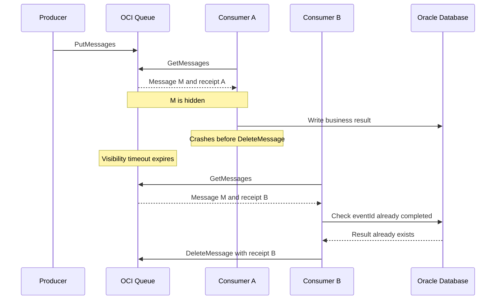

# Queue Messages, Visibility Timeout, and Redelivery Mechanisms

## 1. Context and Objectives

In the **Streaming and Queue** chapter of the **CLOUD_PROVIDERS_ORACLE** module, this lesson focuses on how a consumer receives, processes, and acknowledges completion of jobs using **OCI Queue**. The running scenario is a service that accepts invoice-generation requests, places jobs onto a queue, and lets workers on OCI Compute or OKE process them against Oracle Database.

Suppose a worker writes an invoice to the database but stops immediately before notifying the queue of completion. If you assume "received means done," the application can drop jobs. If you assume "redelivered means never processed before," the application can generate an invoice twice. Consumer design must handle both possibilities.

After this lesson, learners will be able to:

- Distinguish messages that are waiting, in-flight, and deleted.
- Explain the roles of visibility timeout, receipt, and delivery count.
- Choose visibility timeouts, extend them when needed, and intentionally allow early redelivery.
- Design idempotent processing when a job is delivered multiple times.
- Practice message redelivery with the OCI CLI and identify key monitoring signals.

The examples use a standard work queue where consumers compete for jobs, without enabling consumer groups to fan out the same event to multiple independent groups. Timeout values and resource names in the examples are chosen for instructional purposes.

## 2. Messages Do Not Disappear When Read

With OCI Queue, producers send messages via `PutMessages`; consumers receive via `GetMessages`, change the visibility duration via `UpdateMessage` or `UpdateMessages`, and delete via `DeleteMessage` or `DeleteMessages`. Receiving a message does not automatically delete it. [Oracle: OCI Queue Overview](https://docs.oracle.com/en-us/iaas/Content/queue/overview.htm)

You can think of a queue like a job-ticket board:

1. The producer places a ticket into the queue.
2. Consumer A picks up the ticket; for a period of time, consumer B cannot receive that exact ticket.
3. A executes the business logic.
4. A removes the ticket after the outcome is durably saved.
5. If A fails to complete step 4 in time, the ticket can be handed out again.

OCI Queue provides at-least-once delivery within the message lifecycle limits. Consumers must therefore tolerate repeated delivery; delivery order should also not be relied upon as strict FIFO ordering. [Oracle: Queue Features](https://www.oracle.com/cloud/queue/)

| State Used in This Lesson | Meaning for the Application | Typical Next Action |
| --- | --- | --- |
| Visible | Eligible to be received by a consumer | Call `GetMessages` |
| In-flight | Received and currently within its visibility window | Process, extend, or delete |
| Visible again | Previous attempt did not acknowledge completion in time | Next consumer receives it again |
| In DLQ | Message quarantined per delivery-attempt limit config | Investigate and recover under control |
| Deleted or retention expired | Message is no longer available from that queue | Reconcile from business data if needed |

This is a conceptual lifecycle model, not a list of enum values on a per-message `status` field.

## 3. Three Time Durations to Distinguish

| Parameter | Question It Answers | Meaningful Starting Point |
| --- | --- | --- |
| Polling timeout | How long at most does a receive call wait when no job is ready? | When the service receives the polling request |
| Visibility timeout | How long is a newly delivered message hidden? | When the message is delivered, or when visibility is updated |
| Retention | How long does a message stay alive before expiring? | Tied to publish time and message expiration |

**Polling timeout** controls how long a receive request waits. OCI Queue supports `timeoutInSeconds` from 0 to 30 seconds; 0 returns immediately. **Visibility timeout** uses `visibilityInSeconds` to control how long a message stays hidden after receipt. These two parameters solve different problems. [Oracle: Consuming Messages](https://docs.oracle.com/en-us/iaas/Content/queue/consume-messages.htm)

**Retention** is a lifespan limit, not a worker execution allowance. Extending visibility cannot extend past the message's retention expiration. [Oracle: Updating Messages](https://docs.oracle.com/en-us/iaas/Content/queue/update-messages.htm)

Example configuration to analyze:

```text
polling timeout:     20 seconds
visibility timeout:  60 seconds
retention:           24 hours
```

A receive call may return after 2 seconds because work is available. The received message is still hidden for the chosen visibility duration, not just the remaining 18 seconds. Conversely, waiting the full 20 seconds and receiving an empty list does not mean an in-flight message elsewhere has expired.

If only 15 seconds of retention remain, extending visibility by several minutes cannot guarantee the message stays alive. Applications must observe actual expiration times and define policies for overdue jobs.

## 4. The Receipt Belongs to the Current Delivery

A message receive result provides content, ID, receipt, delivery count, and timing metadata. The ID identifies the message for tracking; the receipt is the token used for update or delete operations. Never substitute the message ID for the receipt. [Oracle: GetMessage Model](https://docs.oracle.com/en-us/iaas/tools/go/latest/queue/index.html#GetMessage)

The example below is an abbreviated representation using API field names, not verbatim OCI CLI output:

```json
{
  "id": 101,
  "content": "{\"eventId\":\"invoice-create-7301\",\"orderId\":\"ORD-7301\",\"schemaVersion\":1}",
  "receipt": "<opaque-receipt>",
  "deliveryCount": 1,
  "visibleAfter": "2026-11-20T03:01:00Z",
  "expireAfter": "2026-11-21T03:00:00Z"
}
```

Distinguish three identifiers in the example:

| Value | Who Issues or Decides It? | Purpose |
| --- | --- | --- |
| Message ID | Queue service | Tracks a message inside the queue |
| Receipt | Queue service upon delivery | Updates or deletes that specific delivery |
| `eventId` | Producer application | Identifies the business job across retries |

Once visibility expires and another consumer receives the message, the previous consumer no longer has authority to update or delete using the prior delivery's receipt. Oracle's documentation clearly illustrates this handoff from consumer A to consumer B. [Oracle: Message Management Lifecycle](https://docs.oracle.com/en-us/iaas/Content/queue/messages.htm)

Accordingly, consumers should follow these rules:

- Keep the receipt scoped to the processing context of that exact receive call.
- Use the receipt obtained from the current `GetMessages` call when updating or deleting.
- Never derive a receipt from the ID or treat a receipt as a stable business identifier.
- Never write full receipts into standard logs; use message ID, `eventId`, and request ID for correlation.
- When processing ownership is no longer certain, stop producing new side effects if possible, and let idempotency protect business state.

A receipt does not replace IAM. API calls must still be authenticated and authorized properly.

## 5. How Does Redelivery Happen?

Suppose there is a single message M with 30-second visibility, still within retention and below the DLQ threshold.

| Relative Time | Event | Consequence |
| --- | --- | --- |
| 0 seconds | A receives M | M is hidden; A holds this delivery's receipt |
| 10 seconds | B calls receive | B does not receive M |
| 18 seconds | A crashes before deleting | Queue does not know how far business work got |
| After 30 seconds | Visibility window expires | M becomes eligible for redelivery |
| 34 seconds | B calls receive and gets M | B processes using the new delivery's receipt |
| 39 seconds | B finishes and deletes M | M does not return again |

Becoming eligible again does not mean the message is pushed immediately to a consumer. A subsequent receive call and service availability are still required.



Two scenarios both lead to redelivery yet require different actions:

- **A has not written the result:** B must execute the business work.
- **A committed the result but did not delete the message:** B must recognize the job is already done and only acknowledge to the queue.

Visibility timeout cannot distinguish these two scenarios. Business data and idempotency design are what allow the consumer to decide correctly.

## 6. Choosing Visibility Timeout Based on Real Processing Time

A visibility timeout that is too short causes redelivery while the first worker is still running. A visibility timeout that is too long leaves jobs stuck longer when a worker crashes. Base your choice on measurements, not averages alone.

Suppose the invoice-generation system collects these measurements:

```text
p50 processing:                         2 seconds
p95 processing:                         6 seconds
p99 processing:                        12 seconds
budget for commit, delete,
network latency, and operational jitter: 8 seconds
```

You could start with 25–30 seconds of visibility for this job class, then monitor redelivery rates and recovery delay. This is a starting point for the illustrative scenario, not a universal default for every system.

A helpful budgeting formula is:

```text
initial visibility
  > wait time inside worker
  + processing time at target percentile
  + result persistence and delete time
  + variance margin
```

Wait time inside the worker is easy to overlook. Receiving a batch of 10 messages and processing them sequentially at 8 seconds each means the last message may not even start before a 30-second visibility timeout expires.

Mitigations include:

- Receiving only as many messages as you have free worker slots.
- Running bounded concurrency matched to database and downstream service capacity.
- Extending visibility individually for incomplete messages.
- Separating long and short job classes when processing profiles differ sharply.

Do not simply add more workers when Oracle Database is already saturated. Doing so increases processing times, triggers more redeliveries, and compounds load further.

## 7. Extending and Shortening Visibility

### 7.1. Extending on Progress

A consumer can call `UpdateMessage` with the receipt to lengthen or shorten visibility. The new value is computed relative to when the server receives the request, rather than adding onto the old deadline. [Oracle: UpdateMessageDetails](https://docs.oracle.com/en-us/iaas/tools/go/latest/queue/index.html#UpdateMessageDetails)

Example:

```text
t = 0:   received with 60s visibility
         expected deadline: t = 60

t = 40:  update visibility to 60s
         new deadline approximately: t = 100
```

This example assumes the update request reaches the server near t = 40 and is accepted. In real applications, rely on the expiration timestamp returned by the service, accounting for latency and clock skew.

One strategy for long jobs is starting with 90-second visibility, checking progress, and attempting an extension around 30 seconds. Leave enough time for network retries before the current deadline. Never wait until the final second to send the request.

Extension heartbeats must have stop conditions:

- Stop when business work finishes and deletion is about to happen.
- Stop when the task is canceled or fails to make progress within the allowed budget.
- Never extend a wedged job indefinitely.
- When an extension fails, assess remaining time; do not assume processing ownership still holds.
- Synchronize extension and deletion so one thread cannot keep updating after another thread deleted the message.

Visibility only restricts queue redelivery while active. It is not a business lock on database rows and cannot forcibly stop a thread that ran past its deadline.

### 7.2. Allowing Early Redelivery

When a consumer knows it cannot process a message yet, it can shorten visibility, even to 0 at the message level. That allows a subsequent receive call to pick up the message sooner. This is a visibility update operation rather than a separate NACK verb in the APIs covered here. [Oracle: CLI update-message](https://docs.oracle.com/en-us/iaas/tools/oci-cli/latest/oci_cli_docs/cmdref/queue/messages/update-message.html)

Do not reset visibility to 0 continuously while the database is down. If every worker receives, fails, and immediately returns the message, the system creates a tight retry storm without improving the odds of success.

## 8. Retries, Delivery Count, and DLQ

**Delivery count tracks message deliveries**, not how many times the application retried a SQL statement within the same delivery. Even receiving a message to peek at it with visibility 0 increments the delivery count. [Oracle: CLI get-messages](https://docs.oracle.com/en-us/iaas/tools/oci-cli/latest/oci_cli_docs/cmdref/queue/messages/get-messages.html)

Distinguish two retry tiers:

| Tier | Example | Relationship to Delivery Count |
| --- | --- | --- |
| Within the same delivery | Retrying a transiently failed HTTP request | Does not create a new delivery just from app retries |
| Redelivery from the queue | Message visibility expires and `GetMessages` delivers it again | Creates a new delivery |

For in-delivery retries, total retry duration must fit within the visibility budget or be paired with valid extensions.

An application-designed backoff policy might look like:

```text
delay(n) = min(60 seconds, 5 seconds × 2^(n - 1)) + jitter from 0 to 3 seconds
```

For n = 1, 2, 3, base waits are 5, 10, and 20 seconds respectively. If using visibility updates to delay the next delivery, the application must compute and send the delay itself. This is not claiming OCI applies that formula automatically.

For permanent errors such as a payload missing `orderId` or an unsupported schema version, immediate retries rarely help. Log the cause and let the quarantine policy handle it.

OCI Queue creates an accompanying DLQ for the queue. Messages move there once they meet the configured failed delivery count threshold; DLQs remain subject to retention and are not indefinite storage. [Oracle: Dead Letter Queues](https://docs.oracle.com/en-us/iaas/Content/queue/deadletterqueues.htm)

A recovery workflow should include:

1. Identify the root cause: bad data, missing permissions, deployment bug, or downstream outage.
2. Fix the root cause and verify a consumer version capable of handling it.
3. Check whether the job already applied partial side effects.
4. Reintroduce in bounded batches, keeping `eventId` for deduplication.
5. Observe outcomes before scaling up recovery throughput.

Never build operational runbooks assuming "no message in the DLQ ever wrote data." A worker might have committed first and failed only at the delete step.

## 9. Delete After Commit and Idempotent Processing

### 9.1. Acknowledgment Order

The standard sequence for a data-mutating job is:

```text
Receive message
  → validate payload
  → execute business logic and persist completion marker
  → commit
  → delete message using current receipt
```

OCI Queue requires the consumer to call the delete API to prevent redelivery after processing. [Oracle: Deleting Messages](https://docs.oracle.com/en-us/iaas/Content/queue/delete-messages.htm)

Deleting before committing risks losing the ability to retry if the process crashes before business work completes. Committing before deleting leaves a window for redelivery; hence deduplication is mandatory.

### 9.2. Using a Stable Business Key

Suppose the producer sends `eventId = invoice-create-7301`. The producer must preserve that key when resending the same request, even when uncertain whether the prior send succeeded.

In Oracle Database, completion markers can be persisted in a table:

```sql
CREATE TABLE processed_queue_events (
    consumer_name VARCHAR2(100 CHAR) NOT NULL,
    event_id      VARCHAR2(200 CHAR) NOT NULL,
    processed_at  TIMESTAMP WITH TIME ZONE DEFAULT SYSTIMESTAMP NOT NULL,
    CONSTRAINT pk_processed_queue_events
        PRIMARY KEY (consumer_name, event_id)
);
```

This table is one application design option in the example. Including the consumer name in the key lets independent business functions process the same event once each as needed.

Inside the **same transaction**:

1. Insert `(consumer_name, event_id)`.
2. Create or update the invoice.
3. Commit both the processed marker and the invoice data.

If the business step fails, roll back both changes. When the same key already exists from a previously committed transaction, a redelivery does not create the invoice a second time.

Running an unprotected "check if exists, then insert" in two separate steps is not enough: two workers can both observe that the row does not exist yet. Unique constraints and transactional handling must resolve concurrency races. Do not treat every database error as "already processed"; handle only the exact key-conflict branch as designed.

### 9.3. One Transaction Cannot Span Every System

Sending email, calling a payment gateway, or writing to an external system typically cannot join the same Oracle Database transaction. A standalone processed-marker table cannot by itself guarantee those external side effects happen only once.

For external side effects, add scenario-appropriate safeguards:

- Pass an idempotency key to the target API if supported.
- Use an outbox in the same business transaction to record outbound requests.
- Maintain state tracking and reconciliation when external call outcomes are ambiguous.
- Design compensating actions when business rules permit.

The goal is making redelivery safe at the business level, not inferring "exactly once" from visibility timeout alone.

### 9.4. Consumer Algorithm Skeleton

This is Java-style pseudocode. `queue`, `database`, and error-handling methods are application abstractions, not directly compilable OCI SDK signatures.

```java
while (!shutdownRequested()) {
    int slots = availableWorkerSlots();
    if (slots == 0) {
        awaitCapacity();
        continue;
    }

    var messages = queue.receive(
        Math.min(slots, 10),
        20,  // polling timeout
        60   // visibility timeout
    );

    for (var message : messages) {
        submitBounded(() -> {
            var lease = startCoordinatedLease(message.receipt());

            try {
                var event = parseAndValidate(message.content());

                database.applyOnceInTransaction(
                    "invoice-worker",
                    event.eventId(),
                    tx -> createInvoice(tx, event)
                );

                // Stop heartbeating and wait for any in-flight extension to finish.
                lease.stopAndJoin();

                // Delete only if the current receive context is still valid.
                if (lease.canAcknowledgeNow()) {
                    queue.delete(message.receipt());
                } else {
                    recordCommittedButUnacknowledged(event.eventId());
                }
            } catch (TransientFailure error) {
                lease.stopAndJoin();
                rescheduleIfReceiptStillValid(message, error);
            } catch (InvalidPayload error) {
                lease.stopAndJoin();
                recordPermanentFailureWithoutFullPayload(message.id(), error);
                // Do not acknowledge completion; apply the chosen retry/DLQ policy.
            } finally {
                lease.stopAndJoin();
                releaseWorkerSlot();
            }
        });
    }
}
```

When a delete call times out, the delete outcome may be unknown. Consumers should log it and apply bounded API retries; never re-execute business logic just because a delete response was not received.

On redelivery, `applyOnceInTransaction` must distinguish "just completed" from "already completed earlier." Both outcomes can proceed to delete the message if the current receipt is still valid.

## 10. CLI Lab: Receive, Wait for Redelivery, Extend, and Delete

### 10.1. Lab Prerequisites

Use **OCI Cloud Shell or Bash** with the OCI CLI and `jq`. The commands in this section guide learners running against lab resources.

Prepare:

- A dedicated active lab queue, initially empty, with no other consumers running.
- A queue not using channels or consumer groups for this exercise.
- Retention long enough for a few minutes of lab work; maximum delivery attempts configured high enough for the lab's receive rounds, such as at least 5.
- A CLI identity with permissions to send, receive, update, and delete messages; plus permission to read queue details if querying the endpoint directly.
- Network connectivity to reach the required OCI endpoints.

For IAM, producers need permissions via `queue-push` and consumers via `queue-pull`. Reading queue metadata such as `GetQueue` belongs to queue resource read permissions. You can scope policies to the lab compartment and target queue using appropriate conditions instead of granting tenancy-wide admin rights. [Oracle: Queue Policy Reference](https://docs.oracle.com/en-us/iaas/Content/queue/policy-reference.htm)

For workers on OCI Compute, you can use instance principals with an appropriate dynamic group. Receipts must be protected within the processing runtime, while API permissions are governed by IAM.

### 10.2. Getting the Exact Messages Endpoint

Do not treat the queue administration API and the message operations API as sharing the same endpoint. Fetch the queue's own `messagesEndpoint` and use it for put, get, update, and delete commands. [Oracle: Messages Endpoint](https://docs.oracle.com/en-us/iaas/Content/queue/messages.htm)

Replace values inside `<...>`:

```bash
set -euo pipefail

export OCI_REGION='<region-of-queue>'
export QUEUE_ID='<ocid-of-lab-queue>'

export MESSAGES_ENDPOINT="$(
  oci queue queue-admin queue get \
    --region "$OCI_REGION" \
    --queue-id "$QUEUE_ID" \
    --query 'data."messages-endpoint"' \
    --raw-output
)"
```

The admin `queue get` command accepts `--queue-id`; the query above uses the CLI output field names. If the lab account lacks read access to queue details, an administrator can provide the endpoint directly for the learner to assign. [Oracle: CLI queue get](https://docs.oracle.com/en-us/iaas/tools/oci-cli/latest/oci_cli_docs/cmdref/queue/queue-admin/queue/get.html)

Do not guess the messages endpoint from the region or copy an endpoint from another queue.

### 10.3. Sending Exactly One Job

`content` is a string, so the example uses `jq` to build the business JSON and wrap it in a message array:

```bash
PAYLOAD="$(
  jq -nc '{
    eventId: "lab-invoice-7301",
    orderId: "ORD-7301",
    schemaVersion: 1
  }'
)"

MESSAGES="$(
  jq -nc --arg content "$PAYLOAD" '[{content: $content}]'
)"

oci queue messages put-messages \
  --queue-id "$QUEUE_ID" \
  --messages "$MESSAGES" \
  --endpoint "$MESSAGES_ENDPOINT" \
  --region "$OCI_REGION"
```

`--messages` expects a JSON array, not an outer object wrapping a `messages` field. Verify the send succeeded before moving to the receive step. [Oracle: CLI put-messages](https://docs.oracle.com/en-us/iaas/tools/oci-cli/latest/oci_cli_docs/cmdref/queue/messages/put-messages.html)

### 10.4. Consumer A Receives and Holds the Message for 15 Seconds

```bash
BATCH_A="$(
  oci queue messages get-messages \
    --queue-id "$QUEUE_ID" \
    --limit 1 \
    --timeout-in-seconds 5 \
    --visibility-in-seconds 15 \
    --endpoint "$MESSAGES_ENDPOINT" \
    --region "$OCI_REGION"
)"

RECEIPT_A="$(jq -er '.data.messages[0].receipt' <<< "$BATCH_A")"
MESSAGE_ID_A="$(jq -er '.data.messages[0].id | tostring' <<< "$BATCH_A")"

jq '.data.messages | map({
  id: .id,
  deliveryCount: .["delivery-count"],
  visibleAfter: .["visible-after"]
})' <<< "$BATCH_A"
```

`RECEIPT_A` is kept in the shell for acting on this delivery; the display command prints only observation fields, not the receipt.

If an empty list is returned, stop the lab sequence and verify the send result, endpoint, and queue. Do not proceed with an empty receipt. In a Bash session with `set -e`, `jq -e` above catches missing messages early.

Immediately afterward, simulate B attempting to receive while A's visibility window is still active:

```bash
oci queue messages get-messages \
  --queue-id "$QUEUE_ID" \
  --limit 1 \
  --timeout-in-seconds 0 \
  --visibility-in-seconds 15 \
  --endpoint "$MESSAGES_ENDPOINT" \
  --region "$OCI_REGION" \
  --query 'data.messages'
```

Expected: an empty list if still within A's 15 seconds and the queue holds no other messages. If manual typing took longer than the timeout, B may have already received the message; restart with a fresh message and tighter pacing.

### 10.5. Skip Deleting in A and Wait for Redelivery

In a continuous run, intentionally skip processing or deleting with `RECEIPT_A`, then wait:

```bash
sleep 16

BATCH_B="$(
  oci queue messages get-messages \
    --queue-id "$QUEUE_ID" \
    --limit 1 \
    --timeout-in-seconds 5 \
    --visibility-in-seconds 90 \
    --endpoint "$MESSAGES_ENDPOINT" \
    --region "$OCI_REGION"
)"

RECEIPT_B="$(jq -er '.data.messages[0].receipt' <<< "$BATCH_B")"
MESSAGE_ID_B="$(jq -er '.data.messages[0].id | tostring' <<< "$BATCH_B")"

test "$MESSAGE_ID_A" = "$MESSAGE_ID_B"

jq '.data.messages | map({
  id: .id,
  deliveryCount: .["delivery-count"],
  visibleAfter: .["visible-after"]
})' <<< "$BATCH_B"
```

Expected: the same message ID, an incremented delivery count, and a receipt for B to act on this current delivery. There is no need to compare or decode the receipt token contents.

If the subsequent receive is still empty, check actual expiration, other consumers, retention, and DLQ thresholds; do not immediately conclude the message vanished. You can issue another bounded long-polling call once lab state is verified.

Never reuse `RECEIPT_A` to delete a job now held by B.

### 10.6. Extending During B's Delivery

Execute before B's visibility window expires:

```bash
oci queue messages update-message \
  --queue-id "$QUEUE_ID" \
  --message-receipt "$RECEIPT_B" \
  --visibility-in-seconds 90 \
  --endpoint "$MESSAGES_ENDPOINT" \
  --region "$OCI_REGION"
```

A successful update resets the visibility duration relative to when the server receives the request. Observe the new deadline in the response; do not manually add 90 seconds onto the old deadline. [Oracle: CLI update-message](https://docs.oracle.com/en-us/iaas/tools/oci-cli/latest/oci_cli_docs/cmdref/queue/messages/update-message.html)

You can run another receive call right away to verify the message remains hidden. Do not let the lab drag past the new deadline before the delete step.

A separate experiment, on a different message, is replacing 90 with 0 and immediately calling receive to observe early release. Do not mix that experiment into B's flow while preparing completion acknowledgment.

### 10.7. Delete and Confirm No Redelivery

In a real application, delete only after the job completes durably. In this lab, treat payload inspection as the completed sample task:

```bash
oci queue messages delete-message \
  --queue-id "$QUEUE_ID" \
  --message-receipt "$RECEIPT_B" \
  --endpoint "$MESSAGES_ENDPOINT" \
  --region "$OCI_REGION"

oci queue messages get-messages \
  --queue-id "$QUEUE_ID" \
  --limit 1 \
  --timeout-in-seconds 0 \
  --visibility-in-seconds 15 \
  --endpoint "$MESSAGES_ENDPOINT" \
  --region "$OCI_REGION" \
  --query 'data.messages'
```

The delete command takes `--message-receipt`, not the message ID. [Oracle: CLI delete-message](https://docs.oracle.com/en-us/iaas/tools/oci-cli/latest/oci_cli_docs/cmdref/queue/messages/delete-message.html)

Expected end state: deletion succeeds and the next receive returns empty on the isolated lab queue. A single empty receive response alone does not prove deletion: always check the delete API result too, since a still-hidden message produces the same empty receive.

Do not purge the queue to "clear errors" while testing message lifecycle. Purging destroys the observation conditions needed for the experiment.

## 11. Monitoring, Resilience, and Operational Cost

### 11.1. Track Both the Queue and Business Outcomes

A queue can be empty because jobs succeeded, because messages expired, or because messages were quarantined. Thus, pending message count cannot replace a business completion counter.

`GetStats` provides visible message count, in-flight count, and estimated size; DLQ stats can also be checked. These are approximate numbers while systems continuously enqueue and process. [Oracle: Queue Statistics](https://docs.oracle.com/en-us/iaas/Content/queue/queue-statistics.htm)

OCI Monitoring also provides the `oci_queue` namespace for Queue metrics. Combine service metrics with consumer-emitted measurements to configure alarms. [Oracle: Queue Metrics](https://docs.oracle.com/en-us/iaas/Content/queue/metrics.htm)

| Signal | Observation Source | Interpretation and Action |
| --- | --- | --- |
| Visible count rising steadily | Queue statistics or service metrics | Check send rate, worker capacity, and downstream limits |
| High sustained in-flight, low completion | Queue statistics plus application metrics | Look for hung workers, slow jobs, or slow commits |
| Rising redelivery rate | `deliveryCount` logged by the application | Check visibility, restarts, processing errors, and delete failures |
| Rising extension or delete errors | Consumer logs and metrics | Check permissions, endpoints, latency, and stale receipts |
| Messages appearing in DLQ | DLQ statistics | Investigate early before retention expires |
| Rising p99 processing time | Application metrics | Re-evaluate visibility, concurrency, and database load |
| Jobs nearing expiration without finishing | Message expiration plus business data | Prioritize processing, reconcile, or trigger recovery plan |

Descriptive labels like "redelivery rate" or "p99 processing time" in the table are metrics the application should build, not claims that they are built-in OCI metric names.

A useful processing log should include `eventId`, message ID, delivery count, consumer name, processing duration, commit outcome, and request ID of any failing API call. Avoid logging full customer-data payloads or receipts.

### 11.2. Scale Consumers by Completion Capacity

Suppose an application processes an average of 4 messages/second per worker while producers send 30 messages/second. Even without other constraints, 8 workers barely keep pace; headroom is needed for variance and backlogs.

This is only an estimate from assumed numbers:

```text
minimum workers by throughput
  ≈ incoming rate / useful completion rate per worker
```

"Useful completion rate" excludes redeliveries that produce no new business progress. If one job is received three times, counting three receives as throughput growth is misleading.

Bound concurrency to what Oracle Database, connection pools, and downstream APIs can handle. Run consumers across multiple instances or fault domains to limit the impact of a process or host failure; redelivery only helps while healthy consumers remain available to pick up work.

When rolling out a new version, consumers should stop fetching new work, finish in-flight jobs within the shutdown budget, and keep necessary heartbeats running. If unable to finish, stop producing new side effects and let visibility expire or release per policy. Graceful shutdowns reduce redeliveries, yet idempotency must still remain intact for sudden crashes.

### 11.3. Controlling Cost from Unproductive Retries

Long polling cuts down empty receive loops when traffic is low. Batching reduces API call counts, provided batch sizes match processing capacity and visibility timeouts.

When using batch update or delete APIs, inspect per-entry results and retry only failed entries; never infer full batch success from an HTTP status alone. Oracle documents per-item outcomes and failure counts in batch response models. [Oracle: UpdateMessagesResult](https://docs.oracle.com/en-us/iaas/tools/go/latest/queue/index.html#UpdateMessagesResult)

Operational choices directly affect wasted work:

- Retry with backoff rather than immediately redelivering across all workers.
- Pick visibility timeouts that avoid redelivery during normal processing.
- Bound visibility extensions instead of infinite heartbeats.
- Avoid casual Console polling on production messages.
- Log only fields required for reconciliation and investigation.

You do not need a specific rate card to see the impact: repeated deliveries, extensions, and redundant logs all consume resources and can prolong backlogs.

## 12. Diagnosing Common Failures

| Symptom | Possibilities to Check | Action |
| --- | --- | --- |
| Cannot receive messages even though producer reported success | Wrong endpoint, wrong queue, hidden message, expired retention, or moved to DLQ | Verify target resource, expiration, and relevant stats |
| Same `eventId` appears multiple times | Producer retries, expired visibility, or committed before delete failed | Use idempotency keys and correlate each stage |
| Old worker cannot delete message | Receipt expired/invalidated or message already redelivered | Stop using old receipt; handle via current delivery |
| Receive works but querying queue details fails | `queue-pull` permission does not imply `GetQueue` permission | Grant appropriate read rights or supply endpoint via config |
| Messages hit DLQ rapidly during manual inspection | Polling also consumes delivery attempts | Stop unnecessary polling and check delivery count |
| Multiple workers apply duplicate business effects | Visibility too short or missing concurrency protection | Measure latency, tune extensions, and fix idempotency |
| Delete failure causes business logic to re-run | Application conflates ack errors with processing errors | Separate commit outcome from delete API outcome |
| In-flight never drops while worker stays alive | Task wedged while heartbeat keeps extending | Enforce progress limits and max execution duration |
| Adding workers worsens the backlog | Database or target API is saturated | Cap concurrency and resolve downstream bottlenecks |

Visibility timeout gives one processing attempt room to finish. System safety comes from coordinating that timeout with the current receipt, durable commits, delete acknowledgments, and business-level deduplication.
