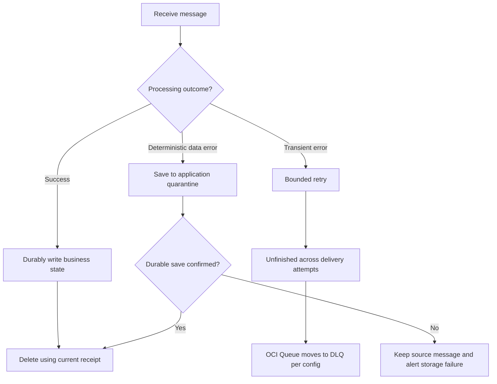

# Dead-Letter Queues and Failed Message Handling

In an asynchronous system, receiving a message does not mean completing the job. A consumer might parse JSON successfully yet fail to write to the database; or it might generate an invoice and then crash before acknowledging completion to the messaging service. Both produce an incomplete delivery at the infrastructure layer, yet business recovery differs drastically.

A **Dead-letter queue (DLQ)** isolates messages that failed to process within the system's delivery policy. The goal is preserving investigation leads and protecting the healthy processing flow. A DLQ must be paired with an owner, alerts, a resolution deadline, and a controlled replay procedure.

This lesson belongs to the **Streaming and Queue** chapter in the scope of **Oracle Cloud Infrastructure (OCI)**. Learners will design an error-handling loop for OCI Queue, contrast it with OCI Streaming's read-and-commit model, and connect it to IAM, compartments, Compute, storage, Oracle Database, and operational monitoring.

## 1. Running Scenario: Invoice Generation

Suppose a Java application publishes a `GenerateInvoice` request to OCI Queue. A worker on Compute receives the request, checks data in Oracle Database, generates a PDF, and stores it in Object Storage.

```json
{
  "eventId": "evt-invoice-20261120-000042",
  "eventType": "GenerateInvoice",
  "schemaVersion": 2,
  "occurredAt": "2026-11-20T03:00:00Z",
  "correlationId": "checkout-9021",
  "payload": {
    "invoiceId": "INV-9021",
    "orderId": "ORD-9021"
  }
}
```

This is an illustrative application message contract, not fields automatically added to the body by OCI.

| Field | Role in Investigation and Recovery |
| --- | --- |
| `eventId` | Stable identifier of the logical request, linking deliveries and replays |
| `schemaVersion` | Selects decoding rules and checks consumer compatibility |
| `invoiceId` | Business key for verifying whether the invoice was already created |
| `correlationId` | Links producer logs, worker logs, and recovery workflows |
| `occurredAt` | Preserves the original business timestamp on replay |

Jobs can fail due to missing data, database maintenance, wrong Object Storage write permissions, or the worker losing network access after generating the PDF. Do not lump all failures into a single `catch` block and retry identically.

## 2. Built-in DLQ of OCI Queue

### 2.1. Delivery Count and Moving to DLQ

OCI Queue automatically creates a DLQ when a queue is created; channels within a queue also have a corresponding DLQ. The service counts deliveries and moves failing messages to the DLQ according to the configured delivery threshold. Messages in the DLQ remain subject to retention and are deleted by the service upon expiration. A DLQ is not indefinite storage. [Oracle: Dead Letter Queues](https://docs.oracle.com/en-us/iaas/Content/queue/deadletterqueues.htm).

Distinguish two counters:

- **Service delivery count:** increments when a message is fetched, including polling operations in the Console.
- **Business attempt count:** tracked by the application; a single receive might call a target system multiple times or fail before running any business logic.

A Java exception does not automatically become a failure reason inside Queue. If the consumer does not delete the message, the service observes the delivery lifecycle; application logs are what explain why business processing failed. [Oracle: Consuming Messages](https://docs.oracle.com/en-us/iaas/Content/queue/consume-messages.htm).

For example, a worker receives a request and retries connecting to the database three times. Three connection errors inside the same receive do not increment delivery count by three. Conversely, an operator polling in the Console can increment the counter even though no invoice was ever attempted.

### 2.2. Three Clocks to Separate

| Clock | Question It Answers | Design Consequence |
| --- | --- | --- |
| Visibility timeout | After delivery, how long is the message hidden from other consumers? | Must cover one processing run or be extended appropriately |
| Retention | Until when is the message retained? | Must account for outage duration and recovery time |
| Polling timeout | How long at most does a receive request wait for data? | Tunes polling frequency when the queue is empty |

A consumer that succeeds must delete the message to prevent redelivery. If visibility expires without deletion, the message can become receivable again. Polling timeout does not grant extra business processing time. [Oracle: Overview of Queue](https://docs.oracle.com/en-us/iaas/Content/queue/overview.htm).

Example initial configuration for a measured workload:

```text
Typical processing time:               4 seconds
Measured p99 processing time:         18 seconds
Chosen visibility timeout:            60 seconds
Chosen polling timeout:               20 seconds
Business retry limit:                 bounded, per error category
```

These numbers are illustrative assumptions, not OCI defaults or universal recommendations. For long tasks, extend visibility based on progress while also enforcing an ultimate stop deadline. Extending forever keeps stuck jobs hidden from detection.

`UpdateMessage` adjusts visibility using the delivery's receipt; extensions cannot stretch past the message's retention expiration. [Oracle: Updating Messages](https://docs.oracle.com/en-us/iaas/Content/queue/update-messages.htm).

When scheduling DLQ investigations, factor in actual expiration timestamps. Never assume each state transition grants a fresh full retention cycle.

### 2.3. Receipt Differs from eventId

`DeleteMessage` requires the receipt returned by `GetMessages`. The `eventId` in the body serves business logic and does not replace the receipt in the delete API. [Oracle: Deleting Messages](https://docs.oracle.com/en-us/iaas/Content/queue/delete-messages.htm).

Your design should retain all of these together:

```text
Delivery source: queue / consumer group / channel
Message ID:      service-layer identifier for tracing
Receipt:         delivery token to update visibility or delete
Event ID:        application logical request identifier
Business key:    invoiceId, orderId, or equivalent key
```

After redelivery, use the current delivery's metadata and check the API result. A receipt is unsuitable as a long-term business deduplication key.

### 2.4. Check Effective Configuration of Consumer Groups

When using consumer groups, explicitly identify which group is consuming. A group can set its own DLQ threshold or inherit the queue-level value if unset. In the SDK model, `0` disables the DLQ rather than meaning immediate quarantine. [Oracle: ConsumerGroup model](https://docs.oracle.com/en-us/iaas/tools/typescript/latest/modules/_queue_lib_model_consumer_group_.consumergroup.html).

When updating a group, `-1` clears the group-specific threshold to fall back to the queue's setting. Lowering the threshold does not retroactively move currently in-flight messages to the DLQ immediately. [Oracle: Update consumer group](https://docs.oracle.com/en-us/iaas/tools/oci-cli/latest/oci_cli_docs/cmdref/queue/queue-admin/consumer-group/update.html).

Do not interpret delivery settings as the number of `retry()` calls in code. In a lab, observe actual delivery counts and DLQ transition timing rather than building logic dependent on guesses about counting boundaries.

## 3. Classify Errors Before Retrying

The table below is a recommended application policy for the invoicing example, not an automatic classifier inside OCI Queue.

| Error Class | Examples | Handling Direction |
| --- | --- | --- |
| Transient, recoverable | Brief timeout, target system rate-limiting | Retry with backoff and time bounds |
| Invalid data | Malformed JSON, missing `invoiceId`, unsupported schema | Quarantine, record reason, fix producer or transform data |
| Shared config or infrastructure | Wrong IAM, wrong endpoint, widespread DB outage | Throttle or pause intake; fix system issue |
| Uncertain outcome | Timeout after sending invoice-creation request | Reconcile by business key before calling again |
| Valid business rejection | Order already canceled; invoice disallowed | Record rejection outcome per business contract |

### 3.1. Poison Messages

A **poison message** is a message that causes consumers to fail repeatedly, such as a malformed payload or data triggering a deterministic bug in the program.

Retrying the same data with the same consumer version will not make a syntax error disappear. You can quarantine early to protect resources, provided the failed record is durably persisted before deleting the source message.

Do not conclude a message is poison solely because you see HTTP 500. If every payload type fails right after a deployment, the culprit may be the new consumer or a downstream dependency.

### 3.2. Shared Outages and Circuit Breakers

Suppose Oracle Database becomes unreachable for ten minutes. If hundreds of workers keep receiving and failing immediately, many valid requests can burn through their delivery budget and get quarantined.

An operational approach:

1. Detect when overall error rate crosses a threshold within an observation window.
2. Slow down or pause new receives; manage currently held work.
3. Verify identity, connectivity, IAM, and target systems.
4. Use a small probe workload to verify recovery.
5. Ramp load back up once business outcomes stabilize.

Circuit breakers curb pointless retries and protect downstream services. Retention keeps ticking while intake is paused, so prolonged outages still require retention and recovery planning.

## 4. Retrying with Backoff and Bounds

A common policy is exponential backoff with jitter:

```text
upperBound(n) = min(maxDelay, baseDelay × 2^(n - 1))
delay(n)      = random value in [0, upperBound(n)]
```

This is an application-implemented formula. For instance, `baseDelay = 2 seconds`, `maxDelay = 30 seconds`; it does not imply OCI Queue automatically applies this wait sequence for consumers.

Set three bounds together:

- Maximum attempts for a given error or logical request.
- Total elapsed time from first attempt until automatic cutoff.
- Maximum concurrent work hitting the downstream system.

If using visibility updates to defer the next delivery, handle visibility update errors and verify the message still has lifetime left. If sleeping inside the worker, avoid holding scarce DB connections, open transactions, or worker threads idle without useful work.

For long delays, you can design a scheduler or dedicated retry queue. In that case, handoff must be durable and requires extra controls for retention, deduplication, and retry loops.

Retries across multiple layers multiply. A worker retrying three times, an HTTP client retrying three times per call, and Queue redelivering multiple times generate far more target requests than the count of `eventId`s. Document retries across SDKs, HTTP libraries, business logic, and the delivery layer to avoid unexpected load amplification.

Extending visibility indefinitely is not a poison-message policy. Resetting visibility too short and looping receives continuously can also exhaust the delivery budget before a shared outage is fixed.

## 5. Built-in DLQ vs. Application Quarantine

### 5.1. Two Different Responsibilities

The **built-in DLQ** is managed by OCI Queue according to delivery lifecycle and configured thresholds. It preserves leads in case a worker crashes before it can even log the failure cause.

An **application quarantine** is a destination proactively written by the application, such as a separate queue, an error table in Oracle Database, or Object Storage with an investigation index. It immediately stores the bad payload alongside failure reason, consumer version, and business metadata.

An application-created queue named `invoice-errors` does not automatically become the built-in DLQ of `invoice-jobs`. In designs and dashboards, name them clearly so routing mechanisms and recovery workflows are never confused.

### 5.2. Persist First, Delete Afterward



Writing the quarantine record and deleting the source message are two separate operations. A worker crashing in between can cause redelivery to record the error again. The quarantine store needs a unique key or durable `storeIfAbsent` semantics; an in-memory map inside one worker is insufficient.

If the quarantine store cannot be written, do not delete the source message just to shrink the backlog. Preserve the recovery path and alert on the error-handling system failure itself.

### 5.3. Metadata for Investigation

An application quarantine record can use a schema like:

```json
{
  "failureId": "failure-invoice-000042",
  "source": {
    "service": "OCI_QUEUE",
    "queueAlias": "invoice-jobs",
    "consumerGroupAlias": "invoice-workers",
    "channelId": "billing",
    "messageId": "service-message-id"
  },
  "originalEventId": "evt-invoice-20261120-000042",
  "businessKey": "INV-9021",
  "schemaVersion": 2,
  "failureCategory": "UNSUPPORTED_SCHEMA",
  "consumerVersion": "invoice-worker-3.4.0",
  "failedAt": "2026-11-20T03:05:00Z",
  "replayGeneration": 0,
  "originalPayloadRef": "restricted-object-reference"
}
```

These fields are designed by the application. Aliases must map back to real OCIDs and environments; plain names can collide across compartments or regions. If a body is so corrupted that `eventId` cannot be parsed, still key the quarantine entry by a stable source identifier.

Keep original data intact and record any corrective transforms separately. Never overwrite the original payload and lose the ability to explain what the earlier attempt actually received.

## 6. Preventing Duplicate Effects with Business Keys

### 6.1. The Committed-but-Undeleted Window

```text
1. Worker receives request INV-9021.
2. Worker creates invoice and commits the database successfully.
3. Worker stops before deleting the message on Queue.
4. Message is redelivered.
```

If you rely solely on message deletion to know a job finished, the consumer can create a second invoice. A DLQ does not close this window; replaying hours later can also trigger it again.

**Idempotency** means executing the same logical request again causes no unintended extra side effects. The key must bind to the business operation, not merely to a single publish attempt's identifier.

### 6.2. Ledger Table in Oracle Database

Example using key `(consumer_name, event_id)`:

```sql
CREATE TABLE processed_events (
    consumer_name VARCHAR2(100) NOT NULL,
    event_id      VARCHAR2(200) NOT NULL,
    processed_at  TIMESTAMP WITH TIME ZONE DEFAULT SYSTIMESTAMP NOT NULL,
    CONSTRAINT processed_events_pk PRIMARY KEY (consumer_name, event_id)
);
```

When the ledger and business updates reside in the same database, use a single transaction:

1. Attempt to insert the processing key for the current consumer.
2. Execute the business updates.
3. Commit both; if an error occurs, roll back both.
4. Only after commit, delete the message from Queue.

On a unique constraint violation, verify the exact completed key and handle the transaction properly. Do not turn every SQL error into an "already processed" conclusion. If adding an `IN_PROGRESS` state, distinguish it from `COMPLETED` and handle workers crashing mid-flight.

A marker protects related updates only when committed alongside them. Writing and committing the marker before business logic can cause a later delivery to skip an invoice that was never created.

Retention of deduplication keys must span the entire retry and replay window. Purging the ledger before failed records are replayed can make the system treat an old request as brand-new work.

### 6.3. Side Effects Outside the Transaction

Creating objects, sending emails, or calling payment gateways do not automatically join an Oracle Database transaction. Handle them explicitly:

| Side Effect | Control to Consider |
| --- | --- |
| Storing a PDF | Deterministic object key per invoice and clear overwrite/content rules |
| Calling external APIs | Idempotency key if the API supports it |
| Sending requests after DB update | Outbox written within the same transaction |
| Timeout with unknown outcome | Query and reconcile by business key before retrying |

An outbox protects the intent to send and resumability after failures. It still requires duplicate handling at the external system boundary; adding an outbox table does not by itself guarantee every effect executes once.

## 7. Processing Structure in Java

The snippet below is **skeleton code with application-defined ports**, not a standalone runnable OCI SDK program. It illustrates separating business errors from delete acknowledgment errors.

```java
void handleDelivery(Delivery delivery) {
    try {
        handler.executeIdempotently(delivery.body());
    } catch (InvalidPayloadException invalid) {
        // If storage fails, throw and do not delete the source message yet.
        quarantine.storeIfAbsent(
                delivery.stableSourceKey(),
                delivery.body(),
                invalid.reasonCode());
    } catch (RetryableDependencyException temporary) {
        retryPolicy.deferUsingCurrentReceipt(delivery);
        return;
    } catch (SystemicFailureException systemic) {
        intakeControl.pauseAndAlert(systemic.reasonCode());
        return;
    }

    // Reach here only after business work or quarantine storage succeeds.
    try {
        queuePort.deleteUsingCurrentReceipt(delivery);
    } catch (QueueAcknowledgementException uncertain) {
        operations.recordUncertainDeletion(delivery, uncertain);
    }
}
```

Ports must define concrete contracts:

| Port | Contract to Implement |
| --- | --- |
| `executeIdempotently` | Validate schema, business key, transaction, and already-completed state |
| `storeIfAbsent` | Durably store payload or reference, preventing duplicate error records |
| `deferUsingCurrentReceipt` | Cap retries, check deadlines, and handle visibility update failures |
| `pauseAndAlert` | Throttle intake across related workers with recovery probe conditions |
| `deleteUsingCurrentReceipt` | Use the current receipt and matching delivery source |

A delete failure after business success must never be classified as an invalid payload and sent to quarantine. Redelivery must rely on idempotency to recognize the existing result.

Unclassified exceptions should be handled under a controlled default policy. Never add `catch (Exception) { delete(); }` just to make the queue look clean.

In the actual OCI integration layer, use operations such as `GetMessages`, `UpdateMessage`, `DeleteMessage`, and `PutMessages`. The data client must target the queue's **messages endpoint**, retrievable via `GetQueue`. [Oracle: Queue Java SDK](https://docs.oracle.com/en-us/iaas/tools/java/latest/com/oracle/bmc/queue/Queue.html).

## 8. When the Source Is OCI Streaming

### 8.1. Do Not Copy Queue's Receive-Then-Delete Loop

OCI Streaming uses partitions and offsets. With a consumer group using `commitOnGet=true`, the next `GetMessages` call commits progress from the previous fetch. You can use `commitOnGet=false` and manual commits when explicit control over acknowledgment timing is needed. [Oracle: Streaming Consumer Groups](https://docs.oracle.com/en-us/iaas/Content/Streaming/Tasks/using_consumer_groups.htm).

Therefore, for custom consumers, design an error path and checkpointing strategy rather than copying Queue's DLQ configuration verbatim. You can write failing records to a separate stream, a quarantine queue, or an investigation store before deciding to advance the read position.

| Design Choice | Benefit | Trade-off |
| --- | --- | --- |
| Halt partition, bounded retry | Preserves strict before/after processing order | Subsequent records in that partition are blocked |
| Durably store error, then move on | One bad record does not block everything behind it | Must handle late/out-of-order events during recovery |
| Coordinate recovery per entity key | Can protect per-entity business order | Higher complexity in state and synchronization |

These are application architectural options, not three toggleable DLQ modes inside Streaming.

### 8.2. Boundary Between Error Persistence and Commit

```text
Handle failing record
    -> durably persist error data and source metadata
    -> confirm persistence succeeded
    -> only then advance checkpoint/commit per consumer model
```

Committing before saving the error creates a data-loss window: the worker can crash after advancing the read position before any quarantine record exists. Saving first and crashing before commit can create a duplicate error record. The quarantine store needs a source-derived key such as stream, partition, offset, and consumer path.

Suppose a batch has A, B, C: A succeeds, B fails, and C is unprocessed. You must not acknowledge the entire batch merely because B was saved to quarantine. Every record skipped past by a checkpoint—including C—must have a corresponding durable outcome.

With `commitOnGet=true`, do not let the fetch loop pull the next batch while a thread pool has not finished the previous batch. If running a parallel pipeline, acknowledgment must reflect genuinely finished work, not merely items buffered in RAM.

### 8.3. Business Ordering After Replay

Suppose `InvoiceCreated` was quarantined while `InvoiceCancelled` was already processed. Replaying the creation event later could resurrect a canceled invoice.

Consumers may need to validate entity versions, current state, or valid state-transition guards. Keeping the original event helps tracing; it does not guarantee a late event's effect remains valid at recovery time.

## 9. Investigation and Controlled Replay

**Replay** means feeding stored requests or events back into processing. Before doing so, establish why a fresh attempt has a chance to succeed and whether the business still wants that effect.

### 9.1. Define Scope and Root Cause

Record the region, compartment, queue or stream, consumer group, and channel or partition. Then answer:

1. How many logical requests failed, rather than just how many deliveries occurred?
2. Which deployment, policy change, or schema change preceded the failures?
3. Are other valid messages still being processed?
4. Has the target system already applied partial or full side effects?
5. Is data about to expire and in need of transfer to an authorized investigation store?

Do not poll thousands of messages just to measure backlog. Console polling still affects visibility and delivery count. [Oracle: Consume Messages from a Consumer Group](https://docs.oracle.com/en-us/iaas/Content/queue/consume-messages-consumer-group.htm).

### 9.2. Fix the Root Cause First

| Verified Root Cause | Prerequisite Before Replay |
| --- | --- |
| Unsupported new schema | Patched consumer deployed and tested against representative samples |
| Wrong IAM or networking | Real runtime identity verified able to reach target resources |
| Bad payload | Correction rule defined, keeping original payload and transform trace |
| Timeout after possible side effect | Reconciled and safe retry path confirmed |
| Target system overloaded | Rate limits and dedicated recovery capacity established |

Replaying before fixing the root cause usually creates a fresh failure loop and wastes budget.

### 9.3. Transfer Using Persist-First, Remove-After

An application-managed recovery process can follow this sequence:

```text
Select error set
    -> verify still eligible for processing
    -> read original data and failure reason
    -> prepare business key and recovery target
    -> republish, confirm outcome
    -> mark source transferred / delete per source mechanism
    -> track until business completion
```

Reading or deleting from a DLQ does not move messages back to the main flow. With a built-in DLQ, recovery tooling must use supported service API/doc access paths; in application-managed replay, publishing anew and removing the error record remain separate steps.

If the process crashes after republishing succeeds but before marking the source, it may republish again. Preserve `originalEventId`, business key, and transfer history to recognize this case.

If a fresh identifier is needed per transfer attempt, add `replayId`. If altering the business meaning of a payload, mark it clearly as a corrective or new request; reusing the old key without clarifying semantics can cause deduplication to drop the fix.

### 9.4. Rate Limits and Delivery Scope

Start with a small representative sample per root-cause group. Verify database state, output objects, and logs before scaling up. Set concurrency caps, replay attempt limits, and circuit-breaking stop conditions if error rates or target latency climb.

Maintain a transfer ledger with states like `PLANNED`, `PUBLISHED`, `COMPLETED`, `FAILED`. "Republished" does not yet mean "completed."

With Queue fan-out, messages route by attributes and per-group filters; changing a filter does not retroactively evaluate older messages. Replaying back into the original queue can trigger multiple groups. Identify who will receive the newly published message and consider a dedicated recovery target. [Oracle: Fan Out Messages](https://docs.oracle.com/en-us/iaas/Content/queue/fanout-top.htm).

## 10. IAM, Monitoring, and Cost

### 10.1. Separation of Permissions by Responsibility

Separate producers, workers, statistics viewers, and replay processes. OCI Queue uses `queue-push` for publishing and `queue-pull` for receiving/updating visibility/deleting; config and stats read permissions should be scoped separately. Consumers can be restricted via `target.consumer-group.id`. [Oracle: Queue Policies](https://docs.oracle.com/en-us/iaas/Content/queue/policy-reference.htm).

Lab example assuming dynamic groups already have proper membership:

```text
Allow dynamic-group InvoiceProducers to use queue-push in compartment MessagingLab
Allow dynamic-group InvoiceWorkers to use queue-pull in compartment MessagingLab
Allow group MessagingObservers to read queues in compartment MessagingLab
```

This scopes to the entire `MessagingLab` compartment; with multiple apps, narrow by resource or appropriate group. Replay requires permission to read the error source and publish to the recovery target—not every worker needs queue admin permissions.

Use appropriate resource principals for workloads on Compute or other runtimes. IAM and network routing are independent prerequisites: valid policies do not prove endpoint reachability, and reachability does not prove data access rights.

### 10.2. Observing DLQ and Business Outcomes

OCI provides approximate stats for visible messages, in-flight messages, and queue/DLQ size. Values fluctuate while producers and consumers run. Use `GetStats` to observe backlog rather than test-receiving all messages. [Oracle: Getting Queue Statistics](https://docs.oracle.com/en-us/iaas/Content/queue/queue-statistics.htm).

| Signal | What to Investigate |
| --- | --- |
| New data appearing in DLQ | Jobs exceeded delivery policy; operator action needed |
| Growing backlog | Publish rate rose or processing capacity dropped |
| High in-flight, low completions | Hung workers, slow tasks, or poorly tuned timeouts |
| Errors rising across payload types | Possible shared outage |
| Replay API succeeded yet business incomplete | Trace downstream processing path |
| Sudden DLQ drop | Processed, moved, deleted, or expired? |

The metric namespace is `oci_queue`, including metrics such as `MessagesInQueueCount`, `RequestSuccess`, `RequestsLatency`, and `ConsumerLag`. `ConsumerLag` measures time in minutes, not message counts. With fan-out, `DroppedMessagesCount` helps spot messages matched by no group. [Oracle: Queue Metrics](https://docs.oracle.com/en-us/iaas/Content/queue/metrics.htm).

If DLQ alerting needs go beyond built-in metrics, a collector can poll stats and emit custom metrics. Never invent a native metric name and assume OCI emits it.

Tie alerts to business SLAs: how late an invoice is, when failed records near expiration, who owns resolution, and what conditions authorize replay.

### 10.3. Error Stores Also Need a Data Lifecycle

Failed messages can contain customer data and diagnostic details. Restrict read access, redact logs, and avoid duplicating large payloads across multiple stores.

If storing payloads in Object Storage, object retention must cover retry, investigation, and replay windows. An error record pointing to an object already purged by lifecycle rules cannot recover the job. Conversely, set an upper retention bound instead of letting error stores grow forever.

Costs also include GET, UPDATE, DELETE, republish calls, wasted worker compute, logging, and database load. When estimating, include retry and replay multipliers; one failing request can generate far more calls than a successful one.

## 11. Hands-On Lab on OCI

Use mock data in a separate compartment. The goal is observing message lifecycles and validating error-handling design.

### 11.1. Prepare the Queue and Tooling

Create a lab queue, e.g., `invoice-dlq-lab`, with retention sufficient for the session. You can choose a 15-second visibility timeout and a small delivery limit, such as 3, for easier observation. This is an illustrative lab config.

Record the OCID, messages endpoint, and consumer group. Queue retention cannot be changed after creation, so choose it up front to match your planned session. [Oracle: Creating a Queue](https://docs.oracle.com/en-us/iaas/Content/queue/queue-create.htm).

PowerShell example to query stats only:

```powershell
$labQueueId = 'ocid1.queue...'
$labMessagesEndpoint = 'https://<queue-messages-endpoint>'

oci queue messages get-stats `
  --queue-id $labQueueId `
  --endpoint $labMessagesEndpoint
```

If using a dedicated group, add `--consumer-group-id` accordingly. Stats operations use the queue's messages endpoint. [Oracle: CLI get-stats](https://docs.oracle.com/en-us/iaas/tools/oci-cli/latest/oci_cli_docs/cmdref/queue/messages/get-stats.html).

Prepare a producer and worker capable of simulating success, invalid data errors, and transient errors.

### 11.2. Observe the Success Path

1. Publish a request with distinct `eventId` and `invoiceId`.
2. Have the worker durably write the business result and then delete the message.
3. Verify exactly one business result exists.
4. Inspect stats after values settle.

A successful receive API call proves only that data was fetched, not that the invoice was created.

### 11.3. Observe Redelivery and Built-in DLQ

1. Publish a new mock request.
2. Receive it and log message ID, delivery count, and receive timestamp.
3. Intentionally skip deleting and extending visibility.
4. Wait for visibility expiration and receive again; avoid polling from another Console window.
5. Observe delivery count and DLQ stats per the service threshold.
6. Record actual behavior rather than inferring from worker loop iterations.

Command to receive one message in the lab:

```powershell
oci queue messages get-messages `
  --queue-id $labQueueId `
  --endpoint $labMessagesEndpoint `
  --limit 1 `
  --visibility-in-seconds 15 `
  --timeout-in-seconds 5
```

This command affects visibility and delivery count. Even `--visibility-in-seconds 0` increments the counter, so do not use it as a completely passive peek. [Oracle: CLI get-messages](https://docs.oracle.com/en-us/iaas/tools/oci-cli/latest/oci_cli_docs/cmdref/queue/messages/get-messages.html).

### 11.4. Test the Application Quarantine Path

1. Publish a schema-invalid payload.
2. Have the worker persist the failed record and reason to the quarantine store.
3. Simulate a quarantine write failure: confirm the source message was not deleted.
4. Restore the quarantine store and let the save succeed.
5. Stop the worker after saving but before deleting.
6. Receive again; confirm no infinite duplicate error records are created.

This tests proactive quarantine routing, distinct from hitting the service's max delivery attempts.

### 11.5. Test Committed-but-Undeleted

1. Publish a new valid request.
2. Have the worker commit the business result.
3. Stop the worker before the Queue delete call.
4. Restart and allow the message to be redelivered.
5. Verify only one invoice exists for that business key.
6. Verify the second delivery finishes cleanly.

This proves idempotency across crashes. Two successful runs with two different keys do not prove duplicate protection.

### 11.6. Replay a Small Sample and Preserve Evidence

Pick an error whose root cause is clear and fixed. Use recovery tooling matching the error source, replay a small sample while preserving links to the original request, and verify end results.

Also test publishing successfully before marking the source: the next recovery run must not double the side effect. If the source is Streaming, add a test stopping after saving the error record but before committing to check duplicate error records and checkpoints.

| Item | Evidence to Retain |
| --- | --- |
| Error source | Queue/stream, group, channel or partition, region, and environment |
| Root cause | Error code, consumer version, and applied fix |
| Replay scope | Event IDs or filter criteria, target, and rate limits |
| Deduplication | Business key and outcome after failure simulation |
| Completion | DB state, objects, or business outcome |
| Data cleanup | Whether failed records were processed, archived, or held under which retention |

At the end of the lab, stop producers and workers, verify any data to keep, and clean up dedicated resources. `Purge DLQ` is deletion, not replay; run it only after reconciling outcomes and retaining required evidence.
